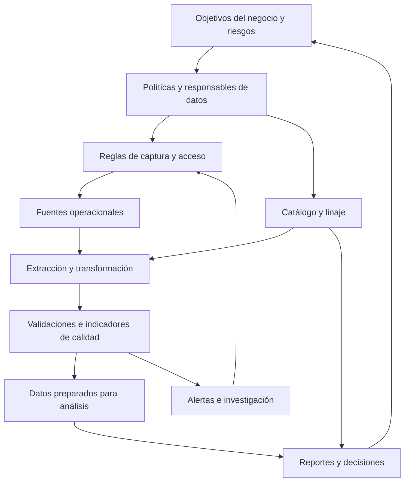

# Clase 6: Estadística aplicada a la gobernanza y la calidad de los datos

> **Objetivo académico:** Comprender cómo la estadística permite medir y supervisar la calidad de los datos, interpretar sus efectos sobre las decisiones empresariales y articular controles técnicos con responsabilidades, trazabilidad y seguridad durante todo el ciclo de vida de la información.

## 1. Contexto y marco conceptual

La sesión conecta el análisis estadístico con la gobernanza de datos mediante un problema central: una decisión puede estar calculada correctamente y, aun así, ser inadecuada si los datos utilizados contienen errores, duplicaciones o reglas mal interpretadas. La confianza requiere evidencia sobre la calidad y sobre los procesos que producen y distribuyen la información.

La **gobernanza de datos** establece políticas, estándares, responsabilidades y criterios para decidir qué datos pueden utilizarse, con qué restricciones y bajo qué condiciones de calidad. La **gestión de datos** lleva esas decisiones a la operación: captura, almacenamiento, transformación, acceso, supervisión y consumo. La estadística aporta mediciones que permiten verificar el funcionamiento de estos procesos y comunicar sus consecuencias.

El valor empresarial no reside únicamente en encontrar errores. Consiste en demostrar cómo su tratamiento cambia una decisión, reduce reprocesos, mejora tiempos de atención, protege información o limita riesgos. Un indicador de calidad necesita vincularse con una acción y con un responsable.

### Dimensiones de calidad abordadas

| Dimensión | Pregunta orientadora | Aplicación en la sesión |
|---|---|---|
| Exactitud | ¿El dato representa correctamente la realidad? | Contrastar edades y montos con referencias o evidencia pertinente. |
| Completitud | ¿Están presentes los valores necesarios? | Identificar ausencias y definir su tolerancia según el uso. |
| Consistencia | ¿Se cumplen las reglas definidas? | Revisar dominios, relaciones entre campos y formatos. |
| Coherencia entre fuentes | ¿Las fuentes concuerdan bajo definiciones equivalentes? | Conciliar información utilizada por distintas áreas. |
| Actualidad | ¿La información corresponde al período requerido? | Evitar decisiones sobre comportamientos actuales usando información desfasada. |

**Enriquecimiento conceptual:** estas dimensiones pueden solaparse según el marco de referencia. La separación anterior conserva la organización didáctica de la clase. La exactitud requiere contraste con la realidad; cumplir un rango o un formato demuestra validez respecto de una regla, pero no prueba por sí solo exactitud. Asimismo, precisión no significa simplemente que un dato permanezca invariable.

La completitud no exige que todo campo tenga siempre un valor. Una ausencia puede ser admisible, obligatoria por diseño o problemática. Deben distinguirse los casos no aplicables, los desconocidos y los errores de captura.

**Enriquecimiento conceptual:** la actualidad depende del propósito. Los datos recientes son relevantes para describir condiciones presentes, mientras que las series históricas pueden ser indispensables para estudiar estacionalidad o cambios estructurales. La confiabilidad tampoco se deduce únicamente de la calidad de los campos: intervienen la representatividad, las definiciones y el contexto de producción.

## 2. Fundamentos teóricos y arquitectura

### Gobernanza sustentada en mediciones

La clase menciona ISO 8000, DAMA-DMBOK y COBIT como referencias para organizar la calidad, la gestión de datos y la gobernanza de tecnología. Su función es orientar prácticas y responsabilidades; la sesión no desarrolla requisitos normativos concretos ni demuestra cumplimiento de esos marcos.

**Enriquecimiento conceptual:** DAMA-DMBOK es un cuerpo de conocimiento sobre gestión de datos y COBIT es un marco de gobierno y gestión de información y tecnología. No equivalen a leyes. Las obligaciones legales requieren identificar la jurisdicción y la regulación aplicable. Una medición estadística tampoco sustituye los controles organizacionales o técnicos.

La arquitectura conceptual presentada puede resumirse así:



El circuito de alertas permite intervenir en el proceso que origina el problema. El catálogo documenta significado y responsabilidades; el linaje registra de dónde provienen los datos y qué transformaciones han experimentado.

### Estadística descriptiva para el diagnóstico

La inspección inicial utiliza conteos, media, desviación estándar, mínimos, máximos y percentiles. Su propósito es detectar señales que justifiquen una revisión, no certificar automáticamente la calidad.

**Enriquecimiento conceptual:** para una variable numérica con observaciones válidas $x_1,\ldots,x_n$, donde $n$ es el número de valores observados, la media es:

$$
\bar{x}=\frac{1}{n}\sum_{i=1}^{n}x_i.
$$

Cada $x_i$ y la media tienen la misma unidad: años para edad o bolivianos para ingreso y préstamo. La media es sensible a valores extremos y a repeticiones que alteran el peso de determinadas observaciones.

La desviación estándar muestral, para $n>1$, se calcula como:

$$
s=\sqrt{\frac{1}{n-1}\sum_{i=1}^{n}(x_i-\bar{x})^2}.
$$

Primero se calcula la distancia de cada observación a la media; después se eleva al cuadrado, se agrega y se divide entre $n-1$; finalmente se obtiene la raíz cuadrada. El resultado conserva la unidad de la variable. En pandas, `Series.std()` utiliza por defecto esta corrección muestral.

Una desviación baja indica concentración alrededor de la media y una alta indica mayor dispersión. La desviación estándar es una medida de dispersión, no de tendencia central. No exige normalidad para calcularse y no constituye un máximo de variación: pueden existir observaciones fuera de $\bar{x}\pm s$.

**Enriquecimiento conceptual:** el intervalo $[\bar{x}-ks,\bar{x}+ks]$, con $k>0$ adimensional, puede usarse como regla de alerta. Modificar $k$ cambia el intervalo de revisión, no la distribución observada ni su desviación estándar. La interpretación probabilística del intervalo requiere supuestos adicionales; no corresponde denominarlo automáticamente intervalo de confianza.

### Asociación, inferencia y predicción

La clase relaciona la búsqueda de patrones con anomalías, oportunidades comerciales y anticipación de eventos. También diferencia la asociación estadística de una relación causal.

**Enriquecimiento conceptual:** una correlación positiva describe variación conjunta en la misma dirección; una negativa describe direcciones opuestas. Si ambas variables disminuyen conjuntamente, la asociación sigue siendo positiva. Las variables constantes no permiten calcular una correlación de Pearson definida. Una correlación cercana a cero no descarta relaciones no lineales.

La inferencia utiliza datos observados para formular conclusiones sobre una población, bajo un diseño y supuestos explícitos. La predicción estima resultados no observados, frecuentemente futuros. La probabilidad permite representar incertidumbre; no es únicamente un porcentaje de acierto añadido a una predicción. Observar ventas repetidas de diez unidades no basta para asignar una probabilidad numérica al siguiente resultado.

## 3. Implementación técnica y lógica de negocio

### Inspección de una base ficticia de clientes

El caso desarrollado utiliza una tabla de 31 registros con seis campos:

| Campo | Significado | Control relevante |
|---|---|---|
| ID de cliente | Identificador del cliente | Revisar repetición según el nivel de detalle de la tabla. |
| Edad | Edad en años | Evaluar ausencias y rangos acordados. |
| Ingreso mensual | Ingreso declarado en bolivianos por mes | Revisar ceros, extremos y definición temporal. |
| Monto de préstamo | Importe otorgado en bolivianos | Evaluar reglas financieras y registros sin monto. |
| Sexo | Categoría registrada | Revisar catálogo y variantes de escritura. |
| Región | Localización declarada | Homogeneizar escritura y verificar nivel geográfico. |

Se emplea Google Colab, acceso a archivos de Drive y pandas para leer el archivo Excel. `head()` permite inspeccionar las primeras filas; `info()` resume columnas, tipos y cantidades no nulas; `describe()` reúne estadísticas de las variables numéricas. NumPy se utiliza para representar valores faltantes y `unicodedata` para tratar variantes textuales.

**Enriquecimiento conceptual:** la transcripción describe el código, pero no proporciona un listado íntegro ni el archivo utilizado. El siguiente fragmento reconstruye su lógica con nombres de columnas explícitos; no reproduce una ejecución verificada:

```python
import pandas as pd

ruta_excel = "/content/drive/MyDrive/datos/ejemplo.xlsx"
df = pd.read_excel(ruta_excel)

numericas = ["edad", "ingreso_mensual", "monto_prestamo"]
print(f"Registros: {len(df)}")
display(df.head())
df.info()
display(df[numericas].describe())
```

La ruta y los nombres deben corresponder al archivo real. La presencia de 31 valores no nulos en una columna no demuestra que esos valores sean válidos. pandas admite distintos formatos de datos y no se limita a archivos de Microsoft.

### Banderas de calidad por registro

El procedimiento utiliza máscaras booleanas para identificar casos y agregar sus frecuencias:

```python
campos_comparacion = [
    "edad", "ingreso_mensual", "monto_prestamo", "sexo", "region"
]

banderas = pd.DataFrame(index=df.index)
banderas["edad_fuera_regla"] = (
    (df["edad"] < 0) | (df["edad"] > 100)
)
banderas["id_repetido"] = df.duplicated(
    subset=["id_cliente"], keep=False
)
banderas["combinacion_repetida"] = df.duplicated(
    subset=campos_comparacion, keep=False
)
banderas["prestamo_mayor_ingreso"] = (
    df["monto_prestamo"] > df["ingreso_mensual"]
)
banderas["ingreso_o_prestamo_cero"] = (
    (df["ingreso_mensual"] == 0) | (df["monto_prestamo"] == 0)
)

display(banderas.sum())
display(df.loc[banderas["edad_fuera_regla"]])
```

**Enriquecimiento conceptual:** este código es una reconstrucción ilustrativa de los validadores descritos. `keep=False` marca todas las filas pertenecientes a grupos repetidos. Su suma cuenta filas involucradas, no grupos ni filas sobrantes. Las ausencias necesitan banderas separadas mediante `isna()`; las comparaciones de rango no son un sustituto de ese control.

Las reglas del ejemplo tienen límites importantes:

- El umbral superior de 100 años es una decisión didáctica, no una imposibilidad biológica universal.
- Un préstamo puede superar el ingreso mensual porque compara un importe total con un flujo de un mes. La bandera sirve para revisar el caso, pero no demuestra un error financiero.
- Un valor cero depende de la definición y del estado de la operación; no siempre es incorrecto.
- Repetir un ID puede ser legítimo si cada fila representa un préstamo, una transacción o un período diferente.
- Dos personas pueden compartir todos los atributos comparados sin ser la misma entidad.

### Homogeneización de texto

La sesión transforma variantes de escritura de región y sexo mediante eliminación de espacios periféricos, conversión a minúsculas y tratamiento de acentos. Después agrupa las variantes originales para mostrar qué representaciones convergen en una misma etiqueta.

**Enriquecimiento conceptual:** una implementación equivalente del procedimiento descrito es:

```python
import unicodedata


def normalizar_texto(valor):
    if pd.isna(valor):
        return valor
    texto = str(valor).strip().lower()
    texto = unicodedata.normalize("NFKD", texto)
    return "".join(
        caracter for caracter in texto
        if not unicodedata.combining(caracter)
    )


df_limpio = df.copy()
for columna in ["region", "sexo"]:
    df_limpio[f"{columna}_normalizada"] = (
        df_limpio[columna].map(normalizar_texto)
    )

variantes = df_limpio.groupby("region_normalizada")["region"].agg(
    lambda valores: sorted(set(valores.dropna()))
)
display(variantes)
```

Se conservan columnas originales y derivadas para mantener trazabilidad. Esta normalización textual es diferente de la normalización relacional y de la estandarización estadística. Eliminar diacríticos puede fusionar cadenas distintas; la equivalencia debe validarse contra un catálogo. Tampoco resuelve diferencias semánticas: una lista que mezcla ciudades y departamentos necesita definir antes su nivel geográfico.

### Tratamiento y comparación posterior

La demostración crea una copia de los datos, convierte determinados valores considerados erróneos en `NaN`, homogeneiza categorías, retira duplicados y recalcula las estadísticas. Su principio operativo más importante es preservar el original.

**Enriquecimiento conceptual:** una corrección documentada debería conservar valor original, regla aplicada, motivo y decisión adoptada. Las anomalías discutibles deben mantenerse señalizadas hasta contar con validación del negocio. Sustituir un valor por `NaN` evita incorporarlo directamente al cálculo, pero no garantiza ausencia de sesgo: las medias pueden basarse en subconjuntos distintos y excluir sistemáticamente ciertos perfiles.

## 4. Análisis crítico de casos y auditoría práctica

### Resultados comunicados en la demostración

| Control | Filas señalizadas |
|---|---:|
| Edad negativa o superior a 100 años | 8 |
| ID de cliente repetido | 20 |
| Combinación de atributos repetida | 21 |
| Préstamo superior al ingreso mensual | 16 |
| Ingreso o préstamo igual a cero | 3 |

Estas cifras proceden de la exposición. Una misma fila puede activar varias banderas; por ello, sumarlas no produce el total de registros afectados. Además, las banderas representan incumplimientos de las reglas seleccionadas, cuya validez debe analizarse antes de calificarlos como errores reales.

**Enriquecimiento conceptual:** con 31 filas, la proporción señalizada por la regla de edad es:

$$
\frac{8}{31}\times100\approx25{,}8\%.
$$

El numerador cuenta filas que activan esa regla y el denominador es el total inspeccionado. El resultado describe esta tabla y no estima, por sí solo, la tasa de error de toda una organización.

La comparación comunicada antes y después de la depuración fue aproximadamente la siguiente:

| Variable | Antes | Después |
|---|---|---|
| Edad media | 40 años | 34 años |
| Desviación estándar de edad | 41 años | 5 años |
| Ingreso mensual medio | 5.000 Bs/mes | 6.600 Bs/mes |
| Monto medio de préstamo | 7.000 Bs | 3.000 Bs |

Los valores son aproximados y la narración no es uniforme en todos sus redondeos. La enseñanza es que el tratamiento puede modificar considerablemente los agregados. La tabla posterior no demuestra automáticamente la verdad del fenómeno: también refleja las decisiones de exclusión y el conjunto de observaciones conservado.

### Corregir en la fuente o en el análisis

El debate identifica tres lugares de intervención: captura y fuente operacional, procesos ETL o ELT y preparación analítica. Se prioriza corregir el origen cuando es posible, porque una misma falla puede propagarse a múltiples productos. Las dependencias de producción y las restricciones organizacionales explican que también sean necesarias medidas intermedias.

**Enriquecimiento conceptual:** una actualización masiva en la fuente requiere verificar equivalencias y preservar evidencia. Si la transformación solo es pertinente para un análisis, puede ser preferible una capa derivada y documentada. El objetivo es evitar correcciones locales incompatibles que generen definiciones distintas del mismo dato.

### Patrones y casos de negocio

En telecomunicaciones se describe la revisión de frecuencias, diversidad de números y horarios de llamadas para detectar comportamientos inusuales. Esas señales pueden motivar investigación de fraude o revelar una necesidad comercial legítima. Una anomalía es una señal contextual, no una prueba de conducta indebida.

La asociación entre eventos y demanda comercial permite planificar recursos, pero requiere distinguir coincidencia, estacionalidad y mecanismos causales. El relato de pedidos de pizzas vinculados con actividad gubernamental se presentó como ilustración anecdótica y no como evidencia verificada.

En atención bancaria, los tiempos de espera se utilizan para localizar procesos lentos, como la actualización de datos, y considerar alternativas digitales o atención especializada. La estadística permite medir el problema; comprobar la mejora exige contrastar períodos y condiciones comparables.

**Enriquecimiento conceptual:** los controles sobre atributos personales deben utilizar definiciones explícitas y pertinentes. No debe inferirse género a partir de nombres, ni declarar inconsistencias clínicas sin distinguir identidad de género, atributos anatómicos y variables clínicas. Las reglas basadas en supuestos simplificados pueden producir falsos positivos.

## 5. Principios de diseño, buenas prácticas y anti-patrones

### Indicadores con definición verificable

La clase propone documentar indicadores de error, completitud, consistencia y duplicación. Cada indicador requiere unidad de análisis, fórmula, alcance, frecuencia, umbral y responsable de actuación.

**Enriquecimiento conceptual:** las siguientes fórmulas operacionalizan esa propuesta; no son ecuaciones reproducidas de una diapositiva:

| Indicador | Expresión | Interpretación |
|---|---|---|
| Filas señalizadas | $T=100N_a/N$ | Porcentaje de filas que activan al menos una regla. |
| Completitud de un campo | $C_j=100(N_j-M_j)/N_j$ | Porcentaje de valores presentes entre los casos aplicables. |
| Cumplimiento de consistencia | $K_r=100V_r/E_r$ | Porcentaje de casos evaluables que satisfacen la regla. |
| Filas en grupos duplicados | $D=100N_d/N$ | Porcentaje de filas pertenecientes a grupos repetidos. |

Aquí $N>0$ es el total de filas inspeccionadas; $N_a$ cuenta filas con alguna bandera; $N_j>0$ es el número de casos donde aplica el campo $j$; $M_j$ cuenta sus ausencias; $E_r>0$ es el número de casos evaluables para la regla $r$ y $V_r$ los que la cumplen; $N_d$ cuenta filas marcadas como repetidas según una clave declarada. Todos son conteos enteros no negativos y los indicadores se expresan en porcentaje. Si un denominador es cero, el indicador debe declararse no calculable.

Una tasa de filas señalizadas solo puede llamarse tasa de error confirmado después de validar las reglas y los casos. Los umbrales porcentuales mencionados en la clase son orientaciones contextuales, no requisitos universales de ISO o DAMA. Deben establecerse según criticidad, impacto y uso.

### Seguridad y acceso durante todo el ciclo de vida

La discusión final muestra una falla recurrente: las restricciones del sistema operacional pueden perderse al exportar datos a Excel o construir reportes de BI. La gobernanza abarca captura, transformación, publicación y consumo.

La matriz de activos o catálogo debe registrar significado, clasificación, responsable del dominio y condiciones de acceso. Las solicitudes y autorizaciones necesitan quedar registradas; el acceso no debe depender únicamente de acuerdos verbales. La responsabilidad organizacional sobre un dato no equivale a propiedad irrestricta sobre la información personal de un cliente.

**Enriquecimiento conceptual:** cifrado, enmascaramiento, autorización y linaje cumplen funciones distintas. El cifrado protege representaciones; el enmascaramiento limita lo visible; la autorización determina operaciones permitidas; el linaje documenta procedencia y transformaciones. Ninguno sustituye por sí solo a los demás. Un catálogo tampoco garantiza que todas las plataformas apliquen automáticamente las restricciones: se requieren controles y pruebas en cada punto de consumo.

Se menciona Microsoft Purview como herramienta de apoyo a la gobernanza y DLP como enfoque para prevenir pérdida o exposición de información. La selección debe considerar madurez, integración y alcance real de las capacidades. La clase plantea desarrollar primero responsabilidades y cultura para que la automatización tenga un proceso claro que sostener.

### Herramientas y escalabilidad

La sesión considera Python, R, SAS y herramientas de visualización como Power BI, Looker y Tableau. La elección depende del volumen, la integración, las competencias y las necesidades de comunicación.

**Enriquecimiento conceptual:** Python es un lenguaje de propósito general con bibliotecas científicas; R dispone de un ecosistema estadístico e integraciones amplias, y Shiny permite construir aplicaciones interactivas. No corresponde asumir que una herramienta determina por sí sola la capacidad de aportar valor al negocio.

También deben separarse arquitectura y ubicación: un data warehouse puede operar en instalaciones propias o en la nube; un data lake no se define solo por estar en la nube. ETL transforma antes de cargar y ELT transforma después de cargar. Un lakehouse busca combinar capacidades de lagos y almacenes de datos. Estas distinciones corrigen simplificaciones presentes en la exposición.

Para grandes volúmenes, una demostración en pandas no garantiza capacidad operativa. Deben evaluarse memoria, lectura por particiones, procesamiento cercano al almacenamiento y alternativas distribuidas cuando corresponda.

### Buenas prácticas y anti-patrones

| Buena práctica | Anti-patrón asociado |
|---|---|
| Definir el nivel de detalle y la clave de la tabla. | Eliminar toda repetición de un cliente sin revisar qué representa cada fila. |
| Conservar originales y registrar transformaciones. | Sobrescribir datos sin posibilidad de reconstrucción. |
| Investigar anomalías con responsables del negocio. | Convertir automáticamente todo extremo en un error. |
| Comparar indicadores antes y después con conteos válidos. | Afirmar mejora solo porque disminuyó la dispersión. |
| Corregir causas y mantener controles preventivos. | Repetir limpiezas locales sin retroalimentación al origen. |
| Aplicar restricciones también en reportes y exportaciones. | Proteger el ERP y dejar abiertos los productos derivados. |
| Medir costos y efectos mediante casos acotados. | Adquirir plataformas sin responsabilidades ni procesos definidos. |

## 6. Síntesis conceptual y profundización académica

La contribución principal de la estadística a la gobernanza es transformar preocupaciones generales sobre calidad en observaciones verificables, reglas discutibles y decisiones documentadas. El ciclo completo comprende detectar, interpretar, decidir, corregir, verificar y supervisar. Una limpieza aislada no constituye por sí sola un programa de gobernanza.

El caso de clientes demuestra que una media aparentemente plausible puede coexistir con edades imposibles, repeticiones y heterogeneidad considerable. También muestra que toda depuración introduce decisiones metodológicas: cambiar valores o retirar filas modifica el conjunto sobre el que se calculan los resultados.

La adopción organizacional se apoya en casos de negocio pequeños y comprensibles, patrocinio directivo y evidencia de consecuencias concretas. Comparar una decisión basada en datos sin validar con otra sustentada en información revisada permite discutir el costo del error frente al costo del control. Las asociaciones simplificadas entre edad y canal publicitario, utilizadas en la exposición, deben entenderse como ilustraciones y no como reglas comerciales demostradas.

**Enriquecimiento conceptual:** profundizar en mecanismos de datos faltantes, detección robusta de anomalías, control estadístico de procesos e inferencia causal permite superar una depuración basada solo en umbrales. En paralelo, contratos de datos, catálogos y controles de acceso conectan esas capacidades con una operación reproducible. El criterio final es que cada resultado pueda explicarse, rastrearse y utilizarse dentro de los límites de su evidencia.
