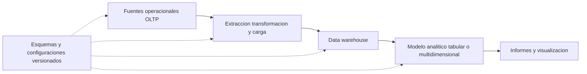
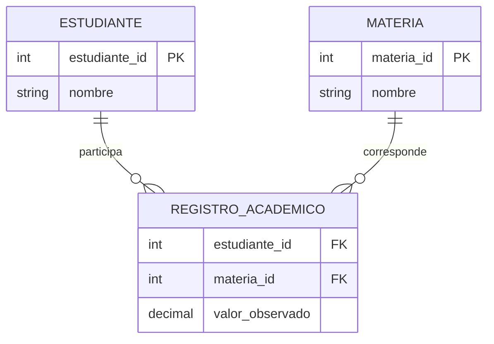

# Clase 1: Fundamentos relacionales, arquitectura de BI y gestión del esquema como código

> **Objetivo académico:** Comprender el tránsito desde una base de datos transaccional hacia una arquitectura de inteligencia de negocios, reconocer entidades y eventos en un modelo relacional y gestionar su esquema como código mediante proyectos de SQL Server, relacionando las consultas SQL con su procesamiento lógico y su ejecución física.

## 1. Contexto y marco conceptual

### 1.1. De los datos operacionales a la información para el negocio

La gestión de datos y la inteligencia de negocios articulan un flujo que transforma información operacional en estructuras aptas para consulta, análisis e informes. El propósito no se reduce a instalar una herramienta ni a trasladar tablas: exige comprender el negocio, organizar los datos y construir una representación que facilite su consumo analítico.

La sesión introduce una arquitectura con cinco componentes relacionados:

1. **Base de datos transaccional u OLTP:** registra las operaciones del negocio y mantiene su consistencia.
2. **Procesos ETL:** extraen información de las fuentes, la transforman y la cargan en un repositorio de destino.
3. **Data warehouse:** organiza los datos para su consulta analítica y su interpretación histórica.
4. **Modelo analítico:** ofrece una representación orientada al negocio sobre el repositorio; puede adoptar un enfoque multidimensional o tabular.
5. **Herramientas de informes y visualización:** consumen el modelo o los datos para presentar resultados útiles para la toma de decisiones.



El diagrama representa el flujo conceptual expuesto y la gestión del código de sus componentes. No presupone que todos los consumidores deban acceder exclusivamente a través de un modelo analítico.

La clase presenta el recorrido completo, pero desarrolla principalmente sus fundamentos: bases relacionales, preparación de SQL Server, proyectos de base de datos y consultas SQL. El diseño dimensional, las cargas ETL y los modelos analíticos aparecen como contexto arquitectónico; no se demuestra todavía su implementación integral.

### 1.2. OLTP y OLAP: diferencias de propósito

Una base operacional debe admitir inserciones, modificaciones y eliminaciones frecuentes sin introducir inconsistencias. Una solución analítica privilegia la recuperación, el resumen y la comparación de información, con especial atención al rendimiento de las consultas.

| Aspecto | Orientación transaccional | Orientación analítica |
| --- | --- | --- |
| Finalidad | Registrar y mantener operaciones | Analizar el comportamiento del negocio |
| Operaciones destacadas | Inserción, actualización, eliminación y consulta puntual | Lectura, agrupación y agregación |
| Organización introducida | Modelo relacional normalizado | Modelo dimensional y desnormalización selectiva |
| Riesgo central discutido | Redundancia e inconsistencias | Consultas costosas y rendimiento insuficiente |
| Papel temporal | Estado y operaciones de la aplicación | Análisis histórico según el diseño del repositorio |

**Enriquecimiento conceptual:** OLTP y OLAP describen orientaciones de procesamiento. Un data warehouse es un repositorio y una arquitectura de integración; OLAP designa capacidades de análisis. Una base de datos dimensional y un modelo tabular son capas diferentes, aunque participen en una misma solución. Asimismo, una solución analítica también recibe escrituras mediante sus procesos de carga: su orientación a lectura no significa ausencia de modificaciones.

## 2. Fundamentos teóricos y arquitectura

### 2.1. Datos, metadatos y esquema

Los **datos** representan instancias concretas: una persona, un producto, una orden o una cantidad vendida. Los **metadatos** describen cómo se organiza esa información: nombres de tablas y columnas, tipos de datos, claves, restricciones y definiciones de objetos.

El **esquema de la base de datos**, en sentido general, reúne sus definiciones estructurales. La clase insiste en distinguir ese esquema de los valores almacenados: gestionar una tabla como código no implica incorporar automáticamente sus filas al repositorio de versiones.

**Enriquecimiento conceptual:** En SQL Server, `SCHEMA` también tiene un significado específico: es un espacio de nombres que contiene objetos y permite organizar permisos. Por ello, `production` y `sales` son esquemas concretos, mientras que la expresión «esquema de la base de datos» puede referirse a toda su estructura. En `production.products`, `production` identifica el esquema y `products` la tabla.

### 2.2. Claves y relaciones: el caso estudiante–materia

El ejemplo conceptual parte de estudiantes y materias. Cada conjunto tiene un identificador que permite distinguir sus elementos, incluso cuando comparten una descripción o un nombre.

Una **clave primaria** identifica de manera única cada fila. Una **clave foránea** relaciona una fila con una clave de otra tabla y permite imponer integridad referencial.

La interacción entre estudiantes y materias se representa mediante una tercera tabla, denominada kardex en la explicación. Esta registra el estudiante, la materia y un valor asociado a su interacción. Su propósito es separar las descripciones de las entidades de los hechos que las vinculan.



El diagrama recoge las relaciones presentadas; no fija una clave primaria para el registro académico porque la fuente no determina si una combinación estudiante–materia puede repetirse.

**Enriquecimiento conceptual:** Si existieran periodos, intentos u otras repeticiones, la pareja estudiante–materia no bastaría para identificar cada registro. Antes de elegir una clave debe definirse la **granularidad**, es decir, qué representa exactamente una fila. Esta decisión también es fundamental en el modelamiento dimensional.

**Enriquecimiento conceptual:** La integridad referencial no exige que toda columna foránea sea obligatoria. Si admite `NULL`, puede expresar una relación ausente. Además, una clave foránea puede referenciar una clave candidata declarada única, no exclusivamente una clave primaria.

### 2.3. Normalización y consistencia

La sesión ilustra los problemas de mezclar en una misma tabla atributos de entidades y registros de sus interacciones. Añadir columnas como «materia 1», «materia 2» y sus respectivos valores hace rígida la estructura. Repetir la información del estudiante para cada materia genera redundancia y dificulta el mantenimiento.

También se analiza la repetición de descripciones. Si el nombre de una materia aparece en numerosas filas, cambiarlo obliga a actualizar todas sus apariciones. Con una tabla de materias y referencias mediante identificadores, la descripción se mantiene en un lugar central.

La normalización busca reducir estas anomalías y preservar la coherencia de la información. Su valor se vuelve especialmente visible cuando una aplicación modifica datos constantemente.

**Enriquecimiento conceptual:** Las formas normales no equivalen simplemente a «usar claves primarias» y «conectar claves foráneas». De manera introductoria:

- **Primera forma normal:** exige una representación tabular sin grupos repetitivos y valores atómicos respecto del dominio definido.
- **Segunda forma normal:** requiere primera forma normal y que los atributos no primos no dependan de una parte propia de una clave candidata compuesta.
- **Tercera forma normal:** restringe dependencias que producen redundancia entre atributos; formalmente, para cada dependencia funcional no trivial, el determinante debe ser una superclave o el atributo dependiente debe ser primo.

Una dependencia funcional establece que un conjunto de atributos determina otro. Estas precisiones delimitan la simplificación utilizada durante el repaso y explican por qué la normalización requiere analizar el significado de los datos.

### 2.4. Entidades, eventos y futura organización dimensional

La distinción entre tablas descriptivas y tablas que registran eventos constituye el puente hacia el data warehouse. Productos, marcas, clientes y tiendas describen elementos del negocio. Órdenes y líneas de orden registran interacciones que ocurren a lo largo del tiempo.

En el caso discutido, las tablas de eventos tienden a crecer con cada operación comercial, mientras que las descriptivas suelen cambiar con menor frecuencia. Este comportamiento orienta la identificación posterior de dimensiones y hechos.

**Enriquecimiento conceptual:** El crecimiento de una tabla es un indicio, no una regla suficiente para clasificarla. Una tabla de hechos se define por su proceso de negocio y granularidad; una dimensión proporciona contexto descriptivo para analizarlo. Tampoco toda medida admite cualquier agregación: sumar cantidades puede ser pertinente, mientras que sumar precios unitarios suele carecer de significado comercial.

### 2.5. Componentes de la plataforma Microsoft

| Componente | Función introducida |
| --- | --- |
| SQL Server Database Engine | Almacenar y consultar bases de datos relacionales |
| SQL Server Agent | Automatizar y programar ejecuciones |
| SQL Server Integration Services, SSIS | Implementar integración y movimiento de datos |
| SQL Server Analysis Services, SSAS | Alojar modelos analíticos tabulares o multidimensionales |
| SQL Server Reporting Services, SSRS | Ofrecer servicios de informes |
| SQL Server Management Studio, SSMS | Administrar y consultar instancias y bases de datos |
| Visual Studio y extensiones de datos | Desarrollar proyectos de base de datos y componentes de BI |
| Power BI | Consumir información para análisis y visualización |

SSAS se presenta en dos modos: multidimensional y tabular. La exposición favorece el tabular por su accesibilidad para el trabajo orientado al negocio; ello no demuestra que sea universalmente superior al multidimensional.

**Enriquecimiento conceptual:** La disponibilidad de características, extensiones e instaladores depende de la versión. Las plantillas de proyectos pertenecen al entorno de desarrollo y sus extensiones; SSMS cumple principalmente funciones de administración y consulta. No debe asumirse que instalar SSMS instala por sí solo todos los componentes de desarrollo de BI.

## 3. Implementación técnica y lógica de negocio

### 3.1. Instalación selectiva e instancias

La demostración selecciona el motor relacional, Analysis Services e Integration Services. El criterio es instalar los componentes necesarios y evitar servicios que consumirían recursos sin intervenir en el flujo previsto. Reporting Services se describe como un componente con instalación separada.

Se utiliza la edición Developer para disponer de las capacidades requeridas. La edición Express no satisface el conjunto de necesidades presentado, en particular por la ausencia de SQL Server Agent.

**Enriquecimiento conceptual:** Developer está destinada a desarrollo y pruebas, no a operación productiva. La diferencia entre Developer y Express no se reduce a que una permita consultar tablas: ambas ofrecen un motor relacional, pero difieren en características disponibles y límites de recursos.

Una **instancia** es una instalación identificable del servicio de SQL Server, con su propia configuración y conjunto de bases de datos. Una máquina puede alojar una instancia predeterminada y otras nombradas. Cada instancia adicional consume recursos y requiere administración.

En Windows, los componentes se ejecutan como servicios. Si una conexión local falla, una comprobación inicial pertinente es verificar que el servicio de la instancia esté iniciado. Reiniciar elementos de red ajenos a esa conexión no resuelve un motor detenido.

**Enriquecimiento conceptual:** Que una conexión sea local no garantiza que siempre sea inmediata. Un servicio detenido es una causa posible; también pueden intervenir el nombre de instancia, los protocolos, la autenticación, el cifrado o la carga del sistema.

### 3.2. Autenticación y autorización

La configuración mostrada distingue:

- **Autenticación de Windows:** utiliza la identidad del usuario o de un grupo de Windows.
- **Autenticación de SQL Server:** emplea un inicio de sesión y contraseña administrados por SQL Server.
- **Modo mixto:** permite ambos mecanismos en el motor relacional.

Se muestran conexiones con una identidad de Windows y con `sa`. También se explica la utilidad de administrar acceso mediante grupos cuando participan numerosos usuarios. En el entorno de SSAS demostrado se configuran administradores mediante identidades de Windows.

**Enriquecimiento conceptual:** La autenticación integrada de Windows utiliza mecanismos del sistema operativo; no debe entenderse como una simple lectura o reutilización de la contraseña por parte de SQL Server. Autenticar responde quién accede; autorizar determina qué puede hacer.

La sesión también encuentra opciones de confianza del certificado y cifrado durante la conexión.

**Enriquecimiento conceptual:** Confiar explícitamente en un certificado o relajar requisitos de cifrado puede facilitar una prueba local, pero no sustituye una configuración segura. En entornos compartidos conviene validar certificados, utilizar identidades con permisos mínimos y evitar cuentas administrativas para el consumo ordinario de datos. Una advertencia del firewall debe interpretarse según el acceso requerido, no descartarse de forma general.

### 3.3. Restauración y recuperación del esquema

La restauración de un archivo de respaldo permite recuperar una base con estructura y datos. La demostración selecciona el respaldo como dispositivo de origen y revisa las rutas de destino de sus archivos. Si la ruta original no existe o no dispone de espacio, se reubican los archivos durante la restauración.

Una base restaurada puede servir como origen para generar scripts de **solo esquema**. Estos describen sus objetos sin incluir las filas, lo que permite trasladar la estructura a un proyecto de base de datos.

**Enriquecimiento conceptual:** Un respaldo y un proyecto resuelven necesidades distintas. El respaldo permite recuperar el estado respaldado de una base; el proyecto expresa definiciones versionables. El proyecto no reemplaza una estrategia de respaldo y recuperación.

### 3.4. Gestión de la base de datos como código

El problema práctico central es la pérdida de control cuando varias personas modifican tablas, procedimientos y otros objetos directamente en una base compartida. Aparecen versiones incompatibles, objetos sobrantes y dificultad para identificar el origen de los cambios.

El proyecto de base de datos propone mantener las definiciones en archivos organizados y versionados. Su estructura puede separar tablas, procedimientos, esquemas y scripts auxiliares. Las carpetas facilitan la navegación del código; los esquemas SQL organizan objetos dentro de la base de datos.

El flujo demostrado es:

1. Definir objetos en el proyecto.
2. Compilar el modelo.
3. Seleccionar una base de datos de destino.
4. Generar un script de sincronización o publicar directamente.
5. Revisar los cambios aplicados y comprobar la estructura resultante.

Cuando el proyecto incorpora una tabla inexistente, el script genera su creación. Cuando se añade una columna a una tabla existente, la publicación determina los cambios necesarios para aproximar el destino al modelo del proyecto.

**Enriquecimiento conceptual:** La compilación no crea físicamente los objetos en la base de datos. Valida y construye una representación del esquema. La publicación es la operación que compara ese modelo con el destino y aplica un plan de cambios. La comparación depende de sus opciones y no garantiza por sí sola que todo cambio preserve datos o sea inocuo.

### 3.5. DACPAC y scripts de posdespliegue

La compilación genera un archivo **DACPAC**, que empaqueta el modelo de esquema para su despliegue. En el ejemplo, los datos de demostración se incorporan mediante scripts de posdespliegue; esto explica por qué aparecen filas tras publicar, aunque el proyecto se centre en estructura.

Conviene distinguir tres clases de contenido:

| Contenido | Tratamiento conceptual |
| --- | --- |
| Definiciones de tablas y procedimientos | Integran el modelo de esquema |
| Scripts auxiliares de inserción | Se ejecutan como instrucciones adicionales |
| Datos operacionales existentes | No quedan versionados automáticamente por el proyecto |

La sesión muestra que las definiciones estructurales participan en la compilación, mientras que los scripts auxiliares referenciados por el posdespliegue no deben tratarse como objetos del modelo.

**Enriquecimiento conceptual:** En el formato de proyecto mostrado, los archivos auxiliares pueden tener acción `None`, mientras que el archivo principal de posdespliegue tiene la acción correspondiente a esa función. Lo decisivo es la configuración y referencia de los archivos, no que la carpeta se llame obligatoriamente `Scripts`. Además, un posdespliegue puede volver a ejecutarse: si sus inserciones no contemplan ese caso, pueden producir duplicados o errores. La idempotencia permite repetir una operación sin alterar indebidamente el resultado esperado.

La integración con Git conserva la historia del código y favorece el trabajo colaborativo. La demostración identifica los binarios como contenido que no debe incorporarse indiscriminadamente al repositorio.

**Enriquecimiento conceptual:** También conviene excluir archivos temporales, configuraciones personales y credenciales. Los scripts tradicionales pueden versionarse correctamente; la ventaja específica del proyecto declarativo es añadir validación del modelo y generación del plan de sincronización.

### 3.6. Familias de instrucciones SQL

| Familia | Propósito | Ejemplos |
| --- | --- | --- |
| DDL | Definir y modificar objetos | `CREATE`, `ALTER`, `DROP` |
| DML | Modificar filas | `INSERT`, `UPDATE`, `DELETE` |
| Control de acceso | Conceder o retirar permisos | `GRANT`, `REVOKE` |
| Consulta | Recuperar y transformar resultados | `SELECT` |

La diferencia central es el objeto de la operación: DDL modifica definiciones; DML modifica datos. Un procedimiento almacenado constituye un objeto persistente que puede contener lógica de negocio.

La exposición vincula la persistencia con los archivos de datos y de registro de transacciones de SQL Server, y menciona `COMMIT` y `ROLLBACK` como parte de la gestión transaccional.

**Enriquecimiento conceptual:** SQL Server puede tener un archivo de datos principal, archivos secundarios y archivos de registro. El registro transaccional no es simplemente una segunda copia de las filas. La durabilidad se apoya en el protocolo de registro y recuperación: una confirmación no implica que todas las páginas modificadas ya hayan sido escritas al archivo de datos. Asimismo, `SELECT` puede clasificarse dentro de DML o separarse como lenguaje de consulta, según la convención didáctica.

## 4. Análisis crítico de casos y auditoría práctica

### 4.1. Lectura del modelo Bike Stores

El caso de una empresa de venta de bicicletas permite interpretar una estructura existente antes de construir consultas o proponer una reorganización analítica.

| Área | Tablas discutidas | Interpretación |
| --- | --- | --- |
| Producción | `products`, `brands`, `categories` | Productos y atributos descriptivos |
| Producción | `stocks` | Existencias por producto y tienda |
| Ventas | `stores`, `staff`, `customers` | Tiendas, empleados y clientes |
| Ventas | `orders` | Cabecera del evento comercial |
| Ventas | `order_items` | Detalle de productos de cada orden |

La cabecera responde quién compró, en qué tienda, quién atendió y qué fechas o estado corresponden a la operación. El detalle agrega qué producto se registró, en qué cantidad, a qué precio y con qué descuento.

La repetición del identificador de orden en sus líneas no es una duplicación accidental de la cabecera. Expresa una relación de uno a muchos y una granularidad distinta: una fila por orden frente a una fila por ítem de orden.

**Enriquecimiento conceptual:** La relevancia de `stocks` depende de la pregunta de negocio. Aunque la sesión la deja fuera del análisis principal, puede ser esencial para disponibilidad, rotación o quiebres de inventario. Una tabla con el estado actual no proporciona automáticamente una historia de existencias; esa historia requiere un mecanismo de captura temporal.

### 4.2. Recuperar descripciones mediante joins

Los productos almacenan identificadores de marca y categoría. Para presentar sus descripciones se relacionan las tablas mediante condiciones de igualdad.

**Enriquecimiento conceptual:** El siguiente SQL reconstruye de forma explícita la lógica demostrada; no es una copia literal del código proyectado ni se presenta como ejecución verificada.

```sql
SELECT
    p.product_name AS nombre_producto,
    b.brand_name AS marca,
    c.category_name AS categoria
FROM production.products AS p
INNER JOIN production.categories AS c
    ON c.category_id = p.category_id
INNER JOIN production.brands AS b
    ON b.brand_id = p.brand_id
WHERE c.category_name = 'Mountain Bikes'
ORDER BY nombre_producto;
```

Los alias `p`, `b` y `c` identifican las tablas y evitan ambigüedades. Los joins recuperan las descripciones asociadas a cada producto y el filtro conserva la categoría indicada.

**Enriquecimiento conceptual:** Un `INNER JOIN` conserva las combinaciones que satisfacen su condición. No garantiza por sí mismo una fila por producto: esa propiedad depende de que cada identificador de marca y categoría corresponda como máximo a una fila. Si el lado referenciado contiene duplicados, el join puede multiplicar filas y distorsionar agregaciones posteriores.

### 4.3. Orden lógico y alcance de los alias

La sesión utiliza un alias de columna para mostrar por qué el orden escrito de una consulta no equivale a su orden lógico de procesamiento. En el ejemplo, las fuentes y relaciones se establecen antes del filtrado y de la proyección de columnas. Por eso, el alias definido en `SELECT` no está disponible en `WHERE` dentro del mismo nivel de consulta; sí puede utilizarse en `ORDER BY`.

**Enriquecimiento conceptual:** Para las cláusulas tratadas, la secuencia lógica puede ampliarse así:


Este orden sirve para razonar sobre el significado y la visibilidad de nombres. No obliga al motor a materializar una tabla intermedia gigantesca. El optimizador puede adelantar filtros, cambiar el orden de los joins y elegir distintas estrategias físicas mientras preserve la semántica.

**Enriquecimiento conceptual:** SQL es principalmente declarativo: expresa el resultado deseado y delega al motor numerosas decisiones de ejecución. La clasificación como lenguaje de tercera generación mencionada en la exposición no describe adecuadamente este rasgo central.

### 4.4. Agregación por marca y categoría

El segundo caso reduce el detalle individual de los productos para contar cuántos pertenecen a cada combinación de marca y categoría. La consulta cambia de granularidad: deja de representar un producto por fila y pasa a representar un grupo.

**Enriquecimiento conceptual:** Reconstrucción del patrón mostrado:

```sql
SELECT
    b.brand_name AS marca,
    c.category_name AS categoria,
    COUNT(*) AS cantidad_productos
FROM production.products AS p
INNER JOIN production.brands AS b
    ON b.brand_id = p.brand_id
INNER JOIN production.categories AS c
    ON c.category_id = p.category_id
GROUP BY
    b.brand_name,
    c.category_name
ORDER BY
    marca,
    categoria;
```

`GROUP BY` define los grupos y `COUNT(*)` cuenta las filas de cada uno. Bajo el supuesto de que los joins no multiplican productos, ese conteo corresponde a productos registrados, no a unidades vendidas ni a existencias.

La sesión menciona también `SUM`, `AVG`, `MAX` y `MIN` como funciones de agregación.

**Enriquecimiento conceptual:** Las expresiones seleccionadas que no forman parte de una agregación deben ser compatibles con las reglas de agrupación. No es obligatorio agrupar toda consulta agregada: sin `GROUP BY`, una agregación puede resumir el conjunto completo. Además, `COUNT(columna)` cuenta valores no nulos, mientras que `COUNT(*)` cuenta filas. Si dos marcas distintas comparten nombre, agrupar solo por su descripción puede fusionarlas; cuando la identidad importa, deben incluirse los identificadores correspondientes.

### 4.5. Planes de ejecución y rendimiento

La demostración activa el plan de ejecución para observar cómo el motor recupera y combina información. Una consulta sencilla muestra acceso a una estructura de datos; al incorporar joins y agregaciones aparecen más operadores, entre ellos `Stream Aggregate` en el caso observado.

En la representación gráfica habitual de SQL Server, el flujo de filas suele seguirse de derecha a izquierda. Este recurso conecta la consulta declarativa con las operaciones físicas que ejecuta el motor.

**Enriquecimiento conceptual:** Un plan estimado describe decisiones del optimizador; un plan real agrega información de la ejecución. El número de operadores no basta para concluir que una consulta es lenta. Una evaluación pertinente considera filas estimadas y reales, lecturas, tiempos y comportamiento de los operadores. `Stream Aggregate` es una alternativa física, no una garantía de que todas las agrupaciones utilicen ese operador.

La clase no aporta una comparación cuantitativa de rendimiento ni una prueba de optimización. La conclusión sustentada es metodológica: interpretar los planes será necesario para comprender el costo de consultas analíticas más complejas.

## 5. Principios de diseño, buenas prácticas y anti-patrones

| Principio | Justificación | Anti-patrón asociado |
| --- | --- | --- |
| Comprender el proceso de negocio antes de transformar tablas | La estructura adquiere significado por lo que representa | Diseñar un warehouse copiando tablas sin analizar su función |
| Definir la granularidad | Permite identificar filas y agregar medidas correctamente | Mezclar cabeceras y detalles sin reconocer sus distintos niveles |
| Separar datos y metadatos | Distingue recuperación de información y gestión del esquema | Suponer que versionar DDL preserva también los datos |
| Centralizar descripciones cuando corresponde | Reduce actualizaciones redundantes | Repetir nombres y atributos descriptivos en cada evento |
| Versionar las definiciones de objetos | Facilita trazabilidad y colaboración | Modificar exclusivamente una base compartida sin registrar cambios |
| Revisar la sincronización antes de aplicarla | Permite evaluar efectos sobre el destino | Publicar cambios estructurales sin inspeccionar su alcance |
| Instalar componentes necesarios | Reduce consumo y complejidad operativa | Seleccionar todas las características sin un propósito |
| Adoptar nombres coherentes | Mejora legibilidad y mantenimiento | Mezclar convenciones sin una decisión explícita |
| Verificar el servicio ante fallos de conexión | Relaciona el síntoma con la arquitectura local | Buscar causas externas sin comprobar primero el motor |
| Interpretar la consulta y su plan por separado | Distingue significado lógico y estrategia física | Confundir el orden conceptual con una ejecución literal |

La discusión sobre nombres en singular o plural no establece una regla universal. La decisión debe ser consistente con el estándar del equipo y con el proyecto existente.

**Enriquecimiento conceptual:** Otras precisiones necesarias para aplicar estos principios son:

- **Desnormalizar selectivamente:** reducir joins puede beneficiar ciertas lecturas, pero introduce redundancia que debe mantenerse mediante cargas y controles adecuados.
- **No clasificar un sistema por la presencia de joins:** tener tablas aisladas no convierte automáticamente una base en NoSQL. La categoría depende del modelo y las capacidades del sistema.
- **Separar compilación, publicación y validación:** compilar verifica el modelo; publicar modifica un destino; validar comprueba si el resultado satisface la necesidad y conserva las propiedades esperadas.
- **Usar permisos según la función:** los grupos y roles simplifican la administración, pero no justifican conceder privilegios administrativos de manera general.
- **Distinguir tecnologías de disponibilidad:** replicación y grupos de disponibilidad Always On son mecanismos diferentes. No conviene tratar uno como una mera extensión del otro.
- **Mantener el conocimiento técnico independiente de la herramienta:** SSIS, SSAS y los proyectos de SQL Server materializan una arquitectura concreta; los problemas de integración, consistencia y trazabilidad existen también en otros ecosistemas.

## 6. Síntesis conceptual y profundización académica

La clase establece que una solución de BI comienza por comprender el origen de los datos. Las claves y relaciones no son únicamente convenciones sintácticas: representan identidades, dependencias e interacciones del negocio. La normalización reduce anomalías en la operación; la reorganización dimensional posterior debe responder a preguntas analíticas y a una granularidad explícita.

Gestionar el esquema como código aporta una segunda capa de disciplina. El proyecto expresa definiciones, la compilación construye un modelo y la publicación sincroniza un destino. Los scripts de posdespliegue explican cómo pueden ejecutarse operaciones adicionales, pero no eliminan la diferencia entre esquema versionado y datos operacionales.

El caso Bike Stores integra ambos planos. Productos, marcas y categorías proporcionan contexto; órdenes y líneas de orden registran eventos con distinto nivel de detalle. Los joins recuperan relaciones descriptivas y las agregaciones cambian la granularidad del resultado. Interpretar correctamente estos cambios evita confundir productos registrados, unidades vendidas y existencias.

Finalmente, una consulta tiene una semántica lógica y una estrategia física. Comprender el alcance de los alias y el papel de `GROUP BY` permite escribir consultas correctas; revisar planes de ejecución permite investigar cómo el motor las resuelve. La sesión introduce esta relación sin demostrar todavía mejoras cuantitativas de rendimiento.

**Enriquecimiento conceptual:** La profundización se articula alrededor de tres preguntas: qué representa cada fila, cómo se conserva su significado al transformar los datos y qué evidencia permite evaluar el comportamiento de la solución. Estas preguntas conectan el modelamiento relacional, el diseño dimensional, la ingeniería de despliegues y el análisis del rendimiento sin reducir la inteligencia de negocios a una secuencia de herramientas.
