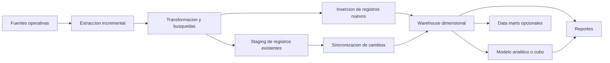
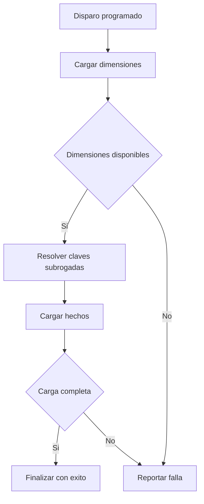

# Clase 4: Arquitectura de data warehouse y cargas incrementales con SSIS

> **Objetivo académico:** Diferenciar las funciones del procesamiento transaccional y analítico, comprender las decisiones del modelado dimensional e interpretar un patrón de integración incremental con SSIS, resolución de claves subrogadas y orquestación de cargas.

## 1. Contexto y marco conceptual

### 1.1. Propósito del data warehouse

Un **data warehouse** es un repositorio integrado de datos históricos, organizado para facilitar el análisis y apoyar la toma de decisiones. La sesión articula su definición alrededor de cuatro propiedades:

- **Orientación a temas:** organiza la información según procesos o ámbitos del negocio, como ventas por internet, ventas a revendedores o actividad de un centro de llamadas.
- **Integración:** reúne datos procedentes de sistemas heterogéneos y transforma sus estructuras para permitir su análisis conjunto.
- **Variación temporal:** conserva información vinculada con distintos momentos o períodos, haciendo posible estudiar cambios y tendencias.
- **No volatilidad:** prioriza la conservación y consulta de información histórica frente a la modificación continua propia de los sistemas operativos.

La orientación a temas se manifiesta en conjuntos de hechos y dimensiones. Una empresa puede analizar varios procesos mediante distintas tablas de hechos; las dimensiones compartidas permiten relacionar sus perspectivas.

**Enriquecimiento conceptual:** la no volatilidad no significa que todo registro de un warehouse sea físicamente inmutable. Las cargas, correcciones y estrategias de mantenimiento de dimensiones pueden modificar datos. La propiedad expresa principalmente que el repositorio conserva una base histórica estable para el análisis, con cambios controlados.

### 1.2. OLTP, warehouse y OLAP

El sistema **OLTP**, *Online Transaction Processing*, sostiene las operaciones cotidianas: registrar pedidos, actualizar clientes o modificar existencias. Su prioridad es procesar transacciones concurrentes con integridad y baja latencia.

El procesamiento **OLAP**, *Online Analytical Processing*, atiende consultas analíticas que combinan dimensiones, agregaciones y períodos históricos. El warehouse proporciona una base de datos organizada para ese consumo; sobre ella pueden construirse modelos semánticos o cubos.

| Aspecto | OLTP | Warehouse y consumo analítico |
|---|---|---|
| Finalidad | Ejecutar procesos operativos | Analizar procesos y apoyar decisiones |
| Operaciones predominantes | Inserciones, actualizaciones, eliminaciones y consultas puntuales | Lecturas, filtros y agregaciones; escrituras durante las cargas |
| Alcance habitual de consulta | Pocos registros asociados con una operación | Conjuntos amplios y períodos históricos |
| Organización del modelo | Frecuentemente normalizada | Frecuentemente dimensional |
| Prioridad de rendimiento | Respuesta transaccional con concurrencia | Eficiencia de consultas analíticas |
| Historia | Según necesidades operativas y políticas de retención | Conservación histórica según necesidades analíticas |

La sesión usa SQL Server para ambos repositorios. Su diferencia principal es el propósito y el patrón de acceso, aunque compartan motor relacional.

**Enriquecimiento conceptual:** OLAP designa una modalidad de procesamiento y puede implementarse sobre diferentes arquitecturas. Un warehouse relacional y un cubo OLAP son componentes relacionados, pero no equivalentes; tampoco todo procesamiento analítico requiere un cubo multidimensional independiente.

### 1.3. Retención y separación de cargas

Las tablas de pedidos y detalle crecen con mayor rapidez que muchos catálogos operativos. En la sesión se plantea conservar una ventana reciente en OLTP y una historia más extensa en el warehouse, trasladando previamente la información que deba preservarse.

Los plazos mencionados son ejemplos de operación, no requisitos generales. La separación busca reducir la interferencia entre transacciones y consultas históricas.

**Enriquecimiento conceptual:** eliminar datos del origen requiere comprobar su conservación, integridad y disponibilidad en el destino. La conveniencia de una purga depende de las necesidades operativas, regulatorias y de recuperación. El tamaño de una tabla, por sí solo, no determina su rendimiento: también intervienen índices, particionamiento, distribución de datos y planes de ejecución.

## 2. Fundamentos teóricos y arquitectura

### 2.1. Hechos, dimensiones y granularidad

Las **dimensiones** describen entidades y contextos de análisis: cliente, empleado, tienda, producto y fecha. Las **tablas de hechos** registran eventos o estados medibles, vinculándolos con esas dimensiones mediante claves.

La implementación utiliza dimensiones de clientes, empleados, tiendas y productos, además de una dimensión de fechas precargada. La tabla de hechos de pedidos identifica cada registro mediante la combinación de `OrderID` e `ItemID`.

**Enriquecimiento conceptual:** esta clave sugiere una granularidad de **línea de pedido**. Declarar el grano permite interpretar las medidas y evita mezclar propiedades del pedido completo con medidas de cada línea. Una medida de cabecera repetida en todas las líneas podría generar doble conteo al agregarse.

En AdventureWorks se observan múltiples tablas de hechos relacionadas con distintos procesos. También se comenta una tabla sin medidas, aunque la explicación oral vincula su clasificación con el tamaño.

**Enriquecimiento conceptual:** una **tabla de hechos sin medidas**, o *factless fact table*, representa ocurrencias o relaciones entre dimensiones sin necesitar una medida numérica explícita. Su clasificación depende de la semántica y del grano, no de que una dimensión sea demasiado grande. El tamaño puede motivar ajustes físicos, pero no define por sí mismo qué constituye un hecho.

### 2.2. Estrella y copo de nieve

En el **modelo estrella**, las dimensiones se conectan directamente con la tabla de hechos. La dimensión producto del ejemplo incorpora información procedente de productos, marcas y categorías.

El **modelo copo de nieve** separa parte de los atributos de una dimensión en tablas relacionadas. Esta organización puede reducir redundancia, aunque introduce uniones adicionales para recuperar el contexto completo.

| Criterio | Estrella | Copo de nieve |
|---|---|---|
| Organización descriptiva | Atributos concentrados en dimensiones | Atributos distribuidos en tablas relacionadas |
| Redundancia | Mayor repetición de atributos | Menor repetición |
| Consulta | Recorrido más directo | Más relaciones que recorrer |
| Mantenimiento | Un cambio descriptivo puede propagarse a varias filas | Algunos cambios se concentran en una tabla |

La sesión relaciona la reducción de uniones con mejoras de rendimiento.

**Enriquecimiento conceptual:** es una orientación de diseño, no una garantía universal. El rendimiento depende también del motor, los índices, el almacenamiento, la selectividad y el volumen procesado. La decisión debe considerar tanto las consultas como el costo de mantener el modelo.

### 2.3. Data marts y enfoques de integración

Un **data mart** delimita información para un ámbito, una unidad o una necesidad analítica. Puede atender, por ejemplo, llamadas entrantes, llamadas salientes o costos, siempre que esa separación responda al negocio y a sus reportes.

La sesión presenta dos enfoques:

- **Centralización inicial, asociada con Bill Inmon:** integrar primero en un repositorio corporativo y derivar posteriormente estructuras de consumo.
- **Desarrollo dimensional por procesos, asociado con Ralph Kimball:** construir estructuras analíticas acotadas y coordinarlas para ampliar la cobertura del negocio.

**Enriquecimiento conceptual:** esta comparación simplifica ambas propuestas. El enfoque de Inmon suele distinguir un warehouse corporativo integrado, frecuentemente normalizado, de los data marts dimensionales posteriores. El de Kimball exige **dimensiones conformadas** y una arquitectura común; no consiste en acumular data marts aislados y centralizarlos al final. El ejemplo de la clase comparte la centralización inicial, pero su modelo estrella no basta para identificarlo como una implementación completa de Inmon.

Un data mart permite acotar volumen y exposición de datos. Sin embargo, esa separación debe acompañarse de controles de acceso.

**Enriquecimiento conceptual:** una perspectiva de un modelo analítico puede simplificar lo visible para un usuario, pero no sustituye los permisos ni constituye por sí sola una frontera de seguridad.

### 2.4. Flujo arquitectónico

El diagrama refleja el patrón implementado: los registros nuevos pueden insertarse directamente en el destino, mientras que las actualizaciones pasan por staging. La exposición arquitectónica también describe staging como una zona general de recepción y transformación; esa función más amplia no coincide exactamente con todas las rutas del ejemplo.

## 3. Implementación técnica y lógica de negocio

### 3.1. Componentes del entorno

La demostración emplea SQL Server, paquetes de **SQL Server Integration Services —SSIS—**, procedimientos almacenados, catálogo de integración y trabajos de SQL Server Agent.

Cada paquete concentra la carga de una entidad de destino. Esto no implica que lea una única tabla: el paquete de producto integra productos, marcas y categorías.

Los componentes principales son:

| Componente | Función |
|---|---|
| Conexión de origen | Acceder a OLTP y consultar cambios |
| Conexión de destino | Acceder al warehouse, staging y configuración |
| Variables de versión | Delimitar la ventana incremental |
| Execute SQL Task | Ejecutar consultas o procedimientos de control |
| OLE DB Source | Producir el flujo de registros |
| Lookup | Buscar correspondencias y recuperar claves |
| OLE DB Destination | Insertar registros en tablas de destino |
| Procedimiento de sincronización | Aplicar cambios pendientes de staging |
| Configuración del paquete | Conservar la última marca procesada |

La **metadata** comprende nombres de columnas, tipos, longitudes y demás propiedades de los datos que atraviesan el flujo. Su compatibilidad debe revisarse al modificar consultas, importar paquetes o cambiar destinos.

### 3.2. Ventana incremental mediante versiones

El patrón obtiene primero una marca superior desde la base operativa y después la última marca registrada por el paquete en el warehouse. Estas variables delimitan qué cambios consultar.

La sesión utiliza variables de 64 bits y remarca que un entero de 32 bits no es equivalente. El valor superior se captura al inicio y se guarda como nueva marca al finalizar la carga.

**Enriquecimiento conceptual:** en SQL Server, `rowversion` es un valor binario de ocho bytes generado a partir de un contador de la base de datos. No representa una fecha ni una hora. La compatibilidad entre ese tipo, su representación en procedimientos y las variables SSIS debe comprobarse explícitamente; disponer de ocho bytes no garantiza por sí solo una conversión correcta a un entero con signo.

**Enriquecimiento conceptual:** una ventana habitual puede expresarse como:

$$
L_p < v(r) \leq U
$$

Aquí, $p$ identifica el paquete; $L_p$ es su última marca confirmada; $U$ es el límite superior capturado para la ejecución; $r$ es una fila del origen y $v(r)$ su versión. Las marcas pertenecen al dominio ordenado de versiones de una misma base, no a una escala temporal. Bajo esta convención se incluyen las versiones posteriores a la marca anterior y hasta el límite capturado. La transcripción no reproduce los operadores exactos de los procedimientos, por lo que esta expresión explica una convención posible, sin afirmar que sea el código ejecutado.

El flujo de control sigue este orden:

1. Capturar la versión superior del origen.
2. Recuperar la marca anterior del paquete.
3. Limpiar la tabla de staging correspondiente.
4. Extraer los cambios y clasificarlos mediante búsquedas.
5. Insertar registros nuevos y sincronizar los existentes.
6. Actualizar la marca del paquete al completar el procesamiento.

**Enriquecimiento conceptual:** registrar la marca antes de completar la carga puede omitir cambios en una ejecución posterior. Además, una marca global capturada sin controlar transacciones concurrentes no garantiza por sí sola una extracción sin pérdidas: pueden existir versiones asociadas con transacciones todavía no confirmadas. La corrección requiere definir aislamiento, confirmación y recuperación; la sesión no demuestra esas garantías.

### 3.3. Dimensiones: separación entre inserción y actualización

Para empleados y las demás dimensiones, un `Lookup` busca la clave de negocio en el destino:

- **Coincidencia:** recupera la clave subrogada y dirige la fila a staging para actualizar el registro existente.
- **Sin coincidencia:** dirige la fila a la dimensión como un registro nuevo.

La salida sin coincidencia es una ruta funcional y no debe confundirse con la salida de errores del componente.

En las dimensiones que usan `IDENTITY`, la clave subrogada se genera en el destino. Por ello, esa columna se deja sin mapeo en la inserción normal. En las actualizaciones, la clave recuperada permite localizar el registro que se modificará.

**Enriquecimiento conceptual:** sobrescribir atributos conservando la misma clave corresponde al comportamiento de una **dimensión lentamente cambiante de tipo 1**. Este tratamiento conserva la descripción vigente, pero no versiones anteriores de sus atributos. Tener hechos históricos no garantiza conservar toda la historia descriptiva.

Los procedimientos denominados de sincronización o *merge* aplican los cambios de staging. La explicación posterior indica que varios realizan actualizaciones por clave subrogada.

**Enriquecimiento conceptual:** el nombre de un procedimiento no demuestra el uso de la sentencia SQL `MERGE`. Una actualización basada en conjuntos puede cumplir esa función sin utilizarla.

### 3.4. Producto: detección de cambios en varias tablas

La dimensión producto integra nombre del producto, marca, categoría, año del modelo y precio de lista. El procedimiento de extracción debe considerar cambios en cualquiera de las tres tablas que aportan esos atributos.

La demostración diferencia dos situaciones:

- Modificar un producto afecta la fila dimensional correspondiente.
- Modificar una marca compartida afecta todos los productos asociados con ella.

En el segundo caso se observaron **118 filas afectadas** tras cambiar una marca. Esa cantidad corresponde a los datos demostrados, no a una propiedad general del modelo.

**Enriquecimiento conceptual:** si $P$ es el conjunto de productos, $B$ el de marcas y $C$ el de categorías, una regla conceptual de detección es:

$$
\operatorname{cambio}(p)=\operatorname{enVentana}(v(p))\lor\operatorname{enVentana}(v(b(p)))\lor\operatorname{enVentana}(v(c(p)))
$$

Aquí, $p\in P$; $b(p)\in B$ y $c(p)\in C$ son la marca y categoría relacionadas; $v$ obtiene la versión de cada fila; y $\operatorname{enVentana}$ comprueba su pertenencia al intervalo incremental. La regla supone que esas relaciones pueden resolverse y que las tres fuentes de atributos están monitorizadas. Explica por qué un cambio en una tabla descriptiva puede obligar a reconstruir numerosas filas dimensionales.

### 3.5. Tabla de hechos: resolución de claves subrogadas

La carga de hechos añade búsquedas para obtener las claves del warehouse a partir de los identificadores operativos:

| Identificador del flujo | Dimensión consultada | Clave incorporada |
|---|---|---|
| `CustomerID` | Cliente | `CustomerSK` |
| `StaffID` | Empleado | `StaffSK` |
| `StoreID` | Tienda | `StoreSK` |
| `ProductID` | Producto | `ProductSK` |

El lado de entrada del `Lookup` representa el flujo acumulado; el lado de consulta corresponde a la dimensión. La clave recuperada se añade como una nueva columna y queda disponible para los componentes posteriores.

El orden de estas cuatro búsquedas no es relevante para el ejemplo siempre que todas se completen antes de insertar el hecho. Las dimensiones, en cambio, deben existir previamente.

Ante una dimensión ausente, el componente se configura para fallar. La decisión evita cargar hechos sin correspondencia dimensional.

Después, otro `Lookup` busca el par `OrderID` e `ItemID` en la tabla de hechos:

- Si existe, la fila pasa a staging para sincronización.
- Si no existe, se inserta directamente.

La tabla de hechos no usa una clave `IDENTITY` propia en el ejemplo. Su clave primaria compuesta debe enviarse explícitamente; las claves subrogadas de dimensiones siguen siendo referencias necesarias.

### 3.6. Fechas y valores ausentes

La dimensión fecha se genera mediante un script para un intervalo que cubra las fechas del origen. En la demostración se menciona el período 2016–2019 y se explica que esa dimensión puede ampliarse con poca frecuencia, sin repetir una extracción transaccional completa.

Pedidos utiliza tres referencias temporales: fecha de pedido, fecha requerida y fecha de envío. La fecha de envío puede estar ausente; la transformación del ejemplo la representa mediante la clave `0`.

La carga falla inicialmente porque esa clave no existe en la dimensión fecha. Se incorpora una fila especial y la repetición de la carga permite insertar los registros.

**Enriquecimiento conceptual:** una dimensión fecha utilizada por varios roles temporales es una **dimensión con roles**. La clave `0` debe representar un estado explícito, como fecha no informada, y excluirse de interpretaciones cronológicas ordinarias. Los atributos de esa fila deben ser coherentes con su significado; utilizar una fecha válida arbitraria como sustituto puede distorsionar filtros y agregaciones.

### 3.7. Despliegue y orquestación

Los paquetes se despliegan al catálogo de SSIS antes de seleccionarlos en los pasos de SQL Server Agent. El trabajo define el flujo de ejecución y el *schedule* establece cuándo se dispara.

La demostración configura una recurrencia de un minuto. Es una configuración ilustrativa: no constituye una frecuencia óptima universal.

El orden esencial es cargar las dimensiones antes de los hechos. Los pasos intermedios continúan al siguiente cuando tienen éxito; el último finaliza el trabajo reportando éxito. Una falla debe producir una terminación o ruta de recuperación coherente con el error.

Agregar pasos puede dejar configurado un cierre prematuro en el antiguo último paso. Por eso debe revisarse la ruta completa después de modificar el trabajo.

## 4. Análisis crítico de casos y auditoría práctica

### 4.1. Carga inicial y ejecuciones sin cambios

En empleados, una carga inicial recupera diez registros y los clasifica como nuevos. Una ejecución posterior, sin modificaciones del origen, no recupera filas adicionales. Al modificar un empleado se detecta una fila, se reconoce su existencia y se aplica la actualización.

El caso ilustra tres comportamientos esperados: inserción inicial, ventana sin novedades y propagación de una modificación.

**Enriquecimiento conceptual:** una ejecución sin novedades no prueba la **idempotencia ante fallas**. Para ello habría que analizar qué ocurre si una corrida inserta parte de los datos y se interrumpe antes de guardar la marca. Las restricciones de unicidad, las transacciones y la repetición segura son determinantes.

### 4.2. Error de parámetros

Una corrida falla por una discrepancia entre nombres de parámetros y su configuración. La corrección del mapeo permite continuar.

La revisión debe distinguir:

- Variables de SSIS que contienen los valores.
- Parámetros del procedimiento que reciben esos valores.
- Marcadores posicionales del proveedor OLE DB.
- Columnas o nombres devueltos mediante el conjunto de resultados.

El índice `0` utilizado en un mapeo identifica la posición del parámetro, no el contenido enviado. La compatibilidad de nombres, posiciones y tipos debe verificarse según el componente y proveedor utilizados.

### 4.3. Propagación de una marca

El cambio de una marca provoca 118 actualizaciones de producto. El caso hace visible un costo de la desnormalización: la consulta puede simplificarse a cambio de repetir atributos y ampliar las operaciones de mantenimiento.

**Enriquecimiento conceptual:** si una marca $b$ está asociada con el conjunto de productos $P_b$, la cantidad potencial de filas dimensionales afectadas es:

$$
A(b)=|P_b|
$$

Aquí, $A(b)$ es un conteo de filas, $P_b$ el conjunto de productos vinculados con $b$ y $|P_b|$ su cardinalidad. La igualdad supone una fila vigente por producto y la propagación del atributo a todos sus productos. No estima tiempo de ejecución ni costo de entrada y salida.

### 4.4. Conservación de filas al resolver dimensiones

La extracción de pedidos recupera **4722 registros**. Las búsquedas dimensionales deben conservar esa cantidad si cada identificador tiene exactamente una correspondencia válida.

**Enriquecimiento conceptual:** para una búsqueda $i$, la condición de control es:

$$
N_{i+1}=N_i
$$

$N_i$ y $N_{i+1}$ son cantidades de filas antes y después de esa búsqueda, respectivamente. La condición supone que no se filtran registros y que cada clave del flujo corresponde a una sola fila dimensional aplicable. Una reducción sugiere faltantes o descartes; un aumento en una unión relacional puede indicar correspondencias múltiples. En un `Lookup` también debe verificarse la unicidad de la consulta, pues conservar el conteo no garantiza seleccionar la fila correcta.

### 4.5. Integridad referencial y fecha de envío

El error de carga de pedidos se relaciona con una referencia temporal sin fila correspondiente en `DimDate`. La causa no se resuelve únicamente haciendo coincidir tipos de datos: toda clave enviada debe satisfacer las restricciones y la semántica del destino.

**Enriquecimiento conceptual:** una clave foránea SQL puede admitir `NULL` si el esquema lo permite. La imposibilidad de usarlo en la demostración responde al diseño concreto y a su transformación a `0`; no es una prohibición general de las bases relacionales.

### 4.6. Actualización de hechos e historia

La demostración conserva el mismo patrón de inserción y actualización para dimensiones y hechos. Se advierte que actualizar eventos históricos puede ser debatible y que una carga exclusivamente incremental sería una alternativa.

**Enriquecimiento conceptual:** la validez de actualizar hechos depende del proceso representado. Un evento transaccional cerrado puede preservarse y corregirse mediante movimientos compensatorios; una instantánea acumulativa puede actualizarse conforme avanza un pedido. No existe una prohibición universal: deben definirse el tipo de hecho, el grano y la política histórica. La sesión no especifica suficientemente esa política para resolverla de manera definitiva.

### 4.7. Lookups frente a uniones

La sesión utiliza `Lookup` porque las claves subrogadas están en el warehouse y no en el origen. También señala el costo potencial de llamadas a procedimientos dentro del flujo.

**Enriquecimiento conceptual:** esa ubicación impide obtener las claves mediante una consulta exclusiva al origen, pero no impide toda solución con uniones. Si los datos operativos se depositan en staging del destino, pueden resolverse claves mediante operaciones SQL basadas en conjuntos. La comparación requiere considerar accesibilidad, transferencia, índices, memoria y estrategia de caché; una llamada por fila puede resultar especialmente costosa.

## 5. Principios de diseño, buenas prácticas y anti-patrones

### 5.1. Modularidad y configuración

Un paquete por entidad de destino facilita identificar responsabilidades y reutilizar el patrón. Los nombres legibles de paquetes, conexiones, tareas y procedimientos permiten comprender el flujo sin depender de la memoria de quien lo construyó.

Al importar un paquete deben revisarse las conexiones y metadata. En la demostración se utiliza `localhost` para facilitar pruebas locales.

**Enriquecimiento conceptual:** `localhost` solo es adecuado si el servicio buscado está en el equipo que ejecuta la conexión. Para otros ambientes conviene parametrizar servidores, bases y opciones de conexión, evitando que el paquete dependa del nombre del equipo de desarrollo.

### 5.2. Staging y recuperación

Staging ofrece un punto intermedio para recibir, transformar y aplicar datos. Puede implementarse como tablas adicionales o en una base separada. Su utilidad aumenta cuando existen transferencias entre servidores o regiones.

La limpieza debe apuntar exclusivamente a la tabla de staging prevista. Confundirla con una dimensión o tabla de hechos produciría pérdida de datos del destino.

**Enriquecimiento conceptual:** staging no es únicamente una caché de rendimiento. Puede servir para reconciliación y recuperación si se acompaña de identificadores de lote, estados y conteos. Limpiarlo en cada ejecución simplifica la demostración, pero exige evaluar cómo recuperar fallas y evitar interferencias entre corridas simultáneas.

### 5.3. Dependencias y observabilidad

Las dimensiones deben estar disponibles antes de resolver las claves de hechos. Su orden relativo puede variar en el ejemplo, pero la carga de hechos mantiene una dependencia explícita respecto de todas ellas y de la dimensión fecha.

**Enriquecimiento conceptual:** el estado exitoso del trabajo demuestra terminación técnica, pero no certifica calidad. La observabilidad también requiere comparar registros extraídos, insertados, actualizados y rechazados; marcas procesadas; duración; duplicados; y claves sin correspondencia.

Una frecuencia corta puede reducir el retraso de actualización, pero también aumenta la sobrecarga. Debe ajustarse a la duración del proceso, al volumen y a la tolerancia del negocio.

### 5.4. Control de versiones de paquetes

La sesión advierte que los conflictos de integración de archivos SSIS pueden producir paquetes que Visual Studio ya no interpreta correctamente. La recomendación práctica es integrar archivos completos y evitar modificaciones concurrentes sobre los mismos componentes.

**Enriquecimiento conceptual:** los paquetes pueden versionarse con Git. La dificultad reside en resolver correctamente cambios sobre XML, identificadores y referencias internas. Un conflicto resuelto como texto puede conservar sintaxis y aun así romper la semántica del paquete; después de una integración deben validarse referencias, metadata y ejecución.

### 5.5. Anti-patrones identificados

| Anti-patrón | Consecuencia | Principio de corrección |
|---|---|---|
| Guardar la marca antes de completar la carga | Riesgo de omitir cambios | Confirmar avance después de procesar correctamente |
| Monitorizar solo productos en una dimensión integrada | Marcas o categorías desactualizadas | Detectar cambios en todas las fuentes de atributos |
| Insertar claves naturales donde se esperan subrogadas | Relaciones incorrectas o fallas de integridad | Resolver las claves del destino |
| Terminar el trabajo en un paso intermedio | Omisión de paquetes posteriores | Revisar rutas de éxito y falla |
| Usar una clave especial sin miembro dimensional | Violación referencial | Crear y documentar el miembro especial |
| Sobrescribir atributos suponiendo que conservan historia | Pérdida de versiones descriptivas | Elegir explícitamente la estrategia histórica |
| Considerar una perspectiva como control de acceso | Exposición potencial de información | Aplicar permisos efectivos |
| Equiparar terminación técnica con calidad de datos | Errores silenciosos | Reconciliar contenido y conteos |

## 6. Síntesis conceptual y profundización académica

La clase conecta el propósito analítico del warehouse con decisiones concretas de integración. Separar OLTP y análisis permite atender patrones de acceso diferentes; el modelo dimensional facilita interpretar el negocio; y los paquetes incrementales mantienen el destino actualizado mediante ventanas de cambios.

La dimensión producto muestra que simplificar consultas introduce costos de mantenimiento: un atributo compartido puede estar repetido en muchas filas. La tabla de hechos hace visible otra responsabilidad del proceso: transformar identificadores operativos en referencias dimensionales válidas, respetando el grano y la integridad referencial.

La orquestación convierte paquetes individuales en un proceso con dependencias. El *schedule* determina cuándo se intenta ejecutar; el trabajo determina en qué orden y con qué comportamiento ante éxito o falla. Esta distinción es esencial para evitar cargas incompletas.

La actualización periódica produce una relación de **consistencia eventual** entre origen y destino: los cambios no son visibles inmediatamente, sino después de una corrida correcta.

**Enriquecimiento conceptual:** bajo ejecuciones periódicas sin fallas ni solapamientos, una aproximación al retraso de visibilidad es:

$$
T_{\mathrm{visible}}\approx T_{\mathrm{espera}}+T_{\mathrm{carga}}
$$

$T_{\mathrm{visible}}$ es el tiempo desde que un cambio queda disponible en el origen hasta que aparece en el destino; $T_{\mathrm{espera}}$ es la espera hasta una captura que lo incluya; y $T_{\mathrm{carga}}$ es la duración hasta su publicación efectiva. Todas las magnitudes deben expresarse en la misma unidad temporal. La aproximación no contempla reintentos, colas ni retrasos de confirmación transaccional, por lo que una programación de un minuto no garantiza un retraso total de un minuto.

Las líneas de profundización que se desprenden del contenido son la captura de cambios bajo concurrencia, la recuperación idempotente, las dimensiones lentamente cambiantes, los distintos tipos de tablas de hechos y la evaluación de lookups frente a uniones basadas en conjuntos. Estas cuestiones permiten pasar del patrón demostrativo a una integración cuya corrección histórica y operativa pueda justificarse.
