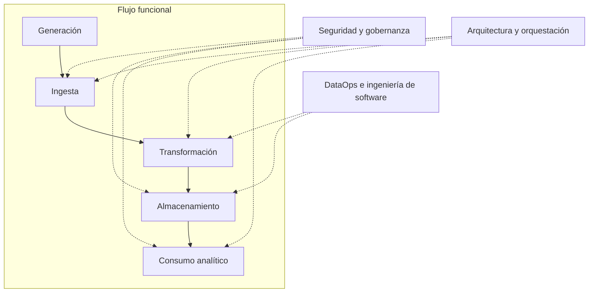
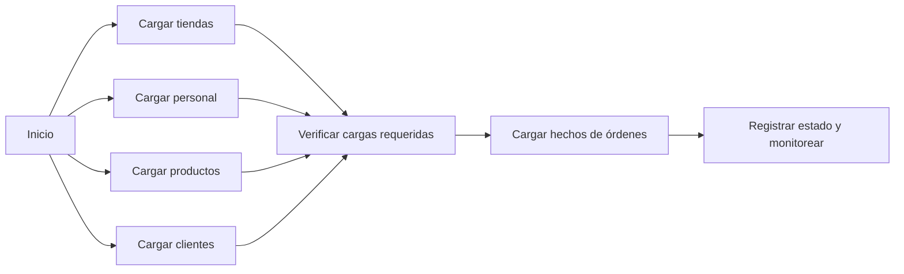

# Clase 5: Capas transversales de ingeniería de datos y auditoría del data warehouse

> **Objetivo académico:** Analizar cómo la seguridad, la gobernanza, DataOps, la arquitectura, la orquestación y la ingeniería de software sostienen un sistema de integración de datos, y evaluar decisiones de modelado dimensional y despliegue a partir de casos de data warehouse.

## 1. Contexto y marco conceptual

### Del flujo de datos a su operación integral

La sesión sitúa el trabajo de Business Intelligence dentro del ciclo moderno de ingeniería de datos: generación, ingesta, transformación, almacenamiento y consumo analítico. Esta evolución amplía las capacidades y responsabilidades de BI; no implica su desaparición. El consumo puede incluir reportes, análisis y modelos de aprendizaje automático.

El flujo funcional necesita capacidades transversales, denominadas *undercurrents* en la sesión:

| Capacidad | Problema que aborda | Manifestación en una solución de datos |
| --- | --- | --- |
| Seguridad | Acceso indebido, exposición y pérdida | Roles, permisos, cifrado y recuperación |
| Gestión y gobernanza | Uso, responsabilidad y significado de la información | Políticas, privacidad, metadatos y calidad |
| DataOps | Entrega y operación repetible de cambios | Ambientes, automatización, integración continua y monitoreo |
| Arquitectura de datos | Organización de componentes y decisiones tecnológicas | Fuentes, staging, warehouse, lake y consumo |
| Orquestación | Dependencias y coordinación temporal | Secuencias, paralelismo, programación y estados |
| Ingeniería de software | Mantenibilidad de los procesos de datos | Código, pruebas, patrones y control de versiones |

Estas capacidades afectan todo el ciclo. Un ETL que copia correctamente registros puede seguir siendo inadecuado si usa credenciales administrativas, expone información sensible, carece de recuperación o depende de configuraciones locales no documentadas.

### Alcance de la evidencia

La primera parte desarrolla estas capacidades mediante ejemplos de SQL Server, SSIS y servicios de procesamiento distribuido. La segunda analiza modelos dimensionales y demuestra aspectos del despliegue de un proyecto de base de datos. Las observaciones técnicas pueden generalizarse como criterios de diseño, pero no constituyen mediciones de rendimiento ni resultados de pruebas de carga.

## 2. Fundamentos teóricos y arquitectura

### Seguridad: privilegios, protección y recuperación

El principio de mínimo privilegio establece que una identidad debe recibir únicamente los permisos necesarios para cumplir su función. Un rol agrupa permisos y facilita su administración. Para un proceso de integración, esto puede traducirse en lectura de fuentes y ejecución de procedimientos específicos, sin capacidad general para modificar el esquema ni ejecutar rutinas ajenas al proceso.

La separación también debe considerar identidades con funciones diferentes: una identidad de despliegue puede necesitar crear objetos; una identidad de ejecución normalmente requiere un conjunto más acotado. En el caso descrito, los procedimientos de integración y los de control del paquete constituyen una superficie de acceso que puede delimitarse.

La sesión introduce cifrado, enmascaramiento, purga y resiliencia como mecanismos relacionados con la protección de datos.

**Enriquecimiento conceptual:** Conviene distinguir sus objetivos y corregir algunas equivalencias del discurso:

| Mecanismo | Función | Límite relevante |
| --- | --- | --- |
| Cifrado | Proteger la confidencialidad mediante claves | Su eficacia depende del algoritmo, del modo de uso y de la gestión de claves |
| Hash criptográfico | Obtener un resumen de una entrada | No es cifrado reversible ni dispone de una operación de descifrado |
| Enmascaramiento | Restringir o transformar la información visible | No sustituye automáticamente el cifrado ni los permisos sobre el dato original |
| Purga | Eliminar datos conforme a una política | Requiere verificar retención, integridad y obligaciones aplicables |
| Respaldo y recuperación | Restaurar datos o servicios ante fallos | Deben comprobarse mediante restauraciones y objetivos explícitos |

**Enriquecimiento conceptual:** AES es un algoritmo de cifrado simétrico y RSA pertenece a la criptografía asimétrica. SHA y MD5 son familias o funciones hash; MD5 no es adecuado para usos que requieren resistencia a colisiones. No corresponde comparar la seguridad de algoritmos diferentes únicamente por el tamaño numérico de sus claves o resúmenes.

La sesión advierte que transformar cada valor durante consultas masivas puede añadir un costo significativo. La observación es pertinente para operaciones criptográficas por fila, pero no permite concluir que el cifrado deba evitarse en un warehouse.

**Enriquecimiento conceptual:** El cifrado en reposo, en tránsito y a nivel de columna actúa en capas distintas y tiene costos diferentes. La selección debe responder a la sensibilidad, las amenazas y la carga de trabajo. El rendimiento debe evaluarse sobre una implementación concreta.

### Retención, purga y resiliencia

Se plantea conservar información histórica en el warehouse y reducir el volumen del sistema transaccional mediante políticas de retención. Los horizontes temporales son decisiones de cada organización, no valores universales. La eliminación del origen presupone que la integración ya preservó la información necesaria y que el destino puede recuperarse.

**Enriquecimiento conceptual:** Borrar filas no garantiza eliminar la fragmentación ni liberar inmediatamente espacio físico. La mejora depende de índices, particiones, estrategia de borrado y mantenimiento. Además, retener historia para análisis y eliminar datos por privacidad pueden imponer requisitos distintos sobre todas las copias.

La resiliencia expresa la capacidad de recuperación ante pérdida o siniestro. La sesión utiliza respaldos completos y diferenciales para ilustrar distintos puntos posibles de retorno.

**Enriquecimiento conceptual:** Un respaldo diferencial de SQL Server contiene cambios desde su respaldo completo base; los respaldos del registro de transacciones son otro mecanismo. Bajo una configuración compatible y con la cadena necesaria, estos últimos permiten una recuperación más granular. El punto recuperable no queda determinado solo por la existencia de un respaldo diario: también depende de su integridad y del procedimiento de restauración.

### Gobernanza como responsabilidad organizacional

El warehouse reúne información de varias áreas y puede permitir cruces que no eran posibles en sistemas separados. Esa utilidad también amplifica riesgos: acceso a salarios, información crediticia o registros de comunicaciones exige límites de visibilidad, confidencialidad y responsabilidad ética.

La gobernanza interviene desde la extracción hasta el consumo:

- Autoriza conexiones, accesos de red y ventanas operativas.
- Define quién puede consultar, transformar y compartir información.
- Establece políticas de almacenamiento y ciclo de vida.
- Orienta controles de calidad, documentación y significado.
- Delimita la exposición de indicadores y reportes.

Los metadatos son datos sobre los datos: nombres, tipos, estructuras y otras propiedades permiten interpretar los objetos técnicos.

**Enriquecimiento conceptual:** Los metadatos técnicos no sustituyen la documentación semántica. Una columna puede tener nombre y tipo definidos sin que estén claros su significado, su origen o sus reglas de cálculo. Asimismo, una perspectiva de un modelo analítico organiza la experiencia de consumo, pero no debe asumirse como barrera de seguridad sin controles de acceso efectivos.

### Arquitecturas de almacenamiento y consumo

La arquitectura de referencia enlaza fuentes operacionales, staging, warehouse, data marts y herramientas de presentación. Staging desacopla la extracción de la integración definitiva; el warehouse conserva información analítica integrada; los data marts orientan su consumo hacia dominios o necesidades específicas.

La sesión amplía el panorama hacia datos estructurados, semiestructurados y no estructurados, procesamiento distribuido y lagos de datos. ETL transforma antes de cargar en el destino previsto; ELT carga antes de ejecutar allí las transformaciones. La diferencia reside en dónde y cuándo se transforma, no en la eliminación de las reglas de calidad.

También se mencionan Kafka y Amazon Kinesis para flujos de eventos, y Amazon SageMaker como ejemplo de soporte a modelos de aprendizaje automático. Estas tecnologías se presentan de manera introductoria, sin una implementación comparativa.

## 3. Implementación técnica y lógica de negocio

### DataOps: convertir procesos de datos en entregas operables

La analogía con DevOps distingue actividades de planificación, desarrollo, construcción y prueba, seguidas de entrega, despliegue, operación y monitoreo. DataOps aplica esa coordinación a paquetes ETL, tablas, procedimientos, funciones y configuraciones.

El resultado operativo no consiste solo en llevar código al servidor: requiere asegurar que las conexiones, permisos, datos iniciales y dependencias estén disponibles. Los registros de ejecución y las alertas permiten localizar fallos que serían difíciles de reconstruir en procesos extensos.

La integración y entrega o despliegue continuos permiten automatizar cambios. La colaboración entre desarrollo y operaciones reduce la dependencia de conocimiento informal para ejecutar los procesos.

**Enriquecimiento conceptual:** La duración de una iteración de desarrollo no define DevOps ni DataOps. Tampoco basta con automatizar el despliegue: los cambios de esquema y las transformaciones deben mantener compatibilidad con los datos existentes y sus consumidores.

### Configuración de ambientes y credenciales

Un mismo proceso puede necesitar configuraciones diferentes según región o ambiente: servidor, base de datos, credenciales, idioma, zona horaria y ventanas de mantenimiento. La sesión muestra los ambientes del catálogo de SSIS como contenedores de configuración, aunque no completa su asociación y ejecución.

El uso de valores fijos vinculados a `localhost` facilita un ejemplo local, pero dificulta reutilizarlo. La parametrización permite separar el comportamiento del proceso de sus valores operativos.

**Enriquecimiento conceptual:** Las credenciales deben administrarse mediante mecanismos de secretos y parámetros sensibles adecuados a la plataforma. No deben quedar incrustadas en código ni repositorios. Una configuración regional también puede requerir cambios del servidor o del esquema; una variable de ambiente por sí sola no modifica todas las propiedades de collation o almacenamiento.

En la sesión se presenta la autenticación de SQL Server como una alternativa para identidades con permisos delimitados.

**Enriquecimiento conceptual:** El mínimo privilegio es compatible con distintos mecanismos de autenticación. La autenticación integrada de Windows también puede utilizar cuentas de servicio y roles restringidos. Cambiar el puerto habitual de SQL Server reduce ciertas exploraciones triviales, pero no sustituye autenticación, autorización ni segmentación de red.

### Tiempo, fecha y despliegue regional

La discusión sobre `DimDate` distingue el calendario analítico de los instantes de los eventos. Se describe un caso empresarial que conserva una referencia temporal asociada a Mountain Time y convierte los valores para regiones externas. También se menciona UTC como alternativa. La selección se presenta como una decisión interna, no como regla universal.

**Enriquecimiento conceptual:** Una dimensión de fecha no necesita contener una hora para verse afectada por las zonas horarias: un mismo instante puede corresponder a fechas civiles diferentes. Por eso debe definirse si la fecha analítica es la del negocio local, la del servidor o una referencia común.

**Enriquecimiento conceptual:** Mountain Time no equivale universalmente a un desplazamiento fijo UTC−7, pues algunas regiones aplican horario estacional. Las conversiones históricas requieren reglas de zona, no solo sumar o restar una constante. UTC facilita una referencia común para instantes, pero no elimina la necesidad de derivar fechas locales cuando el negocio las requiere.

### Orquestación y dependencias

El caso utiliza un job que carga dimensiones y posteriormente una tabla de hechos. La secuencia observada es tienda, personal, producto, cliente y órdenes. La condición de éxito de cada paso habilita el siguiente.

La dependencia sustantiva es que las claves dimensionales necesarias existan antes de cargar los hechos. Si las cargas dimensionales son independientes, la secuencia completa puede contener restricciones innecesarias.

El diagrama representa la posibilidad de paralelizar cargas independientes, no una ejecución observada. El paralelismo requiere comprobar dependencias reales y disponibilidad de recursos.

La programación define cuándo se inicia el flujo; la orquestación define cómo se coordinan sus tareas. Airflow se introduce como alternativa programática en Python para expresar flujos y dependencias. También se mencionan Azure Data Factory, AWS Data Pipeline y Apache NiFi como referencias de herramientas para integración u orquestación, sin demostrar equivalencia funcional entre ellas.

### Formatos y organización física de datos

La sesión compara Avro, Parquet y ORC para almacenar grandes volúmenes de datos:

| Formato | Organización principal | Relación con el uso discutido |
| --- | --- | --- |
| Avro | Registros o filas | Intercambio de registros y tratamiento de esquemas |
| Parquet | Columnas | Lecturas analíticas que seleccionan subconjuntos de columnas |
| ORC | Columnas | Procesamiento analítico columnar con metadatos y compresión |

La explicación utiliza bloques de disco simplificados. En una organización por filas, los atributos de un registro se almacenan próximos. En una organización columnar, los valores de una columna se agrupan, lo que favorece leer únicamente los atributos requeridos.

**Enriquecimiento conceptual:** La ventaja columnar es especialmente relevante en agregaciones y proyecciones sobre muchas filas y pocas columnas. No garantiza acelerar toda búsqueda puntual: intervienen índices, particionado, estadísticas y capacidad de omitir bloques. Los motores relacionales tampoco están restringidos a una única organización física; SQL Server admite estructuras rowstore y columnstore.

**Enriquecimiento conceptual:** Las proporciones visuales de compresión o evolución de esquema mencionadas en la sesión no constituyen porcentajes medidos. El resultado depende de los datos, los códecs, las versiones y los motores. La posibilidad de procesamiento paralelo depende de la estructura interna del formato; dividirlo arbitrariamente por bytes puede producir fragmentos inválidos. La compresión reduce volumen y transferencia, pero no sustituye comprobaciones de integridad contra corrupción.

### Lake, lakehouse y curación

Se introduce Databricks como plataforma para procesar datos y Delta Lake como componente relacionado con su almacenamiento y cambios. La curación se entiende como preparar datos para consumo mediante limpieza, resolución de ambigüedades, aplicación de reglas y, cuando corresponda, agregación.

**Enriquecimiento conceptual:** Databricks no debe describirse como una adquisición de Microsoft; su integración con servicios de Microsoft no implica esa relación de propiedad. Delta Lake añade un registro transaccional y capacidades de gestión de tablas sobre archivos de datos, habitualmente Parquet. El enfoque lakehouse busca combinar almacenamiento flexible con capacidades de gestión propias de plataformas analíticas.

**Enriquecimiento conceptual:** Un data lake puede desplegarse en nube o en infraestructura propia. Su viabilidad depende de costos, escala y operación. La curación tampoco implica eliminar todos los nulos: algunos representan ausencia legítima o información desconocida y deben conservarse con una semántica explícita.

## 4. Análisis crítico de casos y auditoría práctica

### Granularidad y coherencia dimensional

Los casos analizados corresponden a ventas, órdenes y libros. Las dimensiones incluyen cliente, producto o libro, fecha, tienda, personal, editorial, idioma, territorio, estado y modalidad de envío. Las tablas de hechos combinan claves dimensionales y medidas como cantidad, precio unitario, descuento e importe.

La revisión identifica dimensiones sin relación visible con la tabla de hechos, referencias de dirección ambiguas y hechos sin las medidas esperadas para el proceso de venta.

**Enriquecimiento conceptual:** Antes de evaluar columnas debe declararse la granularidad: por ejemplo, una fila por línea de orden. Esa decisión determina qué medidas y dimensiones pueden coexistir. No toda dimensión del warehouse debe conectarse con todos los hechos; la relación depende del proceso representado. Incorporarlas todas por uniformidad puede introducir asociaciones falsas o duplicaciones.

La existencia de varias tablas de hechos no es un defecto por sí misma. Puede responder a procesos o granularidades diferentes. Su fusión solo es correcta si preserva la semántica y no mezcla medidas incompatibles.

### Atributos, identificadores y medidas

La sesión cuestiona copiar al warehouse columnas únicamente porque existen en el OLTP. El criterio es su utilidad analítica, no la reproducción mecánica del origen.

**Enriquecimiento conceptual:** Un número de orden puede ser una dimensión degenerada útil para trazabilidad, conteos y análisis de canastas. Los términos de pago pueden servir para segmentar ventas. No necesitan ser cantidades sumables para tener valor. Su inclusión debe justificarse mediante necesidades de análisis.

También se observa una tabla denominada de hechos que contiene principalmente atributos descriptivos.

**Enriquecimiento conceptual:** La ausencia de medidas numéricas no invalida automáticamente una tabla de hechos: un hecho sin medidas puede registrar la ocurrencia de eventos y permitir contarlos. Sin embargo, una colección de títulos u otros atributos descriptivos, sin granularidad de evento definida, suele corresponder mejor a una dimensión.

### Claves y redundancia

Se revisan claves subrogadas, identificadores originales y claves primarias compuestas extensas. La preocupación central es la complejidad de integración y mantenimiento.

**Enriquecimiento conceptual:** Una clave artificial facilita identificar físicamente una fila, pero no impide duplicar el mismo evento de negocio. La unicidad de la granularidad debe controlarse por separado. Del mismo modo, una clave compuesta no es incorrecta por definición: debe evaluarse por tamaño, estabilidad, semántica y costo de mantenimiento.

Cuando existen una clave hacia `DimDate` y una fecha almacenada directamente, debe analizarse si representan lo mismo. Una fecha civil recuperable desde la dimensión puede ser redundante; un timestamp que conserva hora y precisión puede aportar información diferente.

La desnormalización de categorías, subcategorías o idioma dentro de una dimensión puede simplificar consultas. Su conveniencia depende de las jerarquías, cardinalidades y reglas de actualización.

### Cálculo de importes y materialización

En un caso de venta se analiza el importe de línea como producto de cantidad y precio unitario:

$$
A = q \times p
$$

Aquí, $q$ es la cantidad entera no negativa de unidades vendidas, $p$ es el precio por unidad en una moneda definida y $A$ es el importe en esa misma moneda. La expresión presupone una venta sin devoluciones representadas por cantidades negativas y no incorpora descuentos, impuestos ni cargos adicionales. Las reglas reales pueden requerir ampliar ese cálculo.

La recomendación de la sesión es calcular el importe durante el ETL y almacenarlo como una medida decimal para simplificar el consumo.

**Enriquecimiento conceptual:** En SQL Server, una columna calculada `PERSISTED` almacena físicamente el resultado y lo mantiene cuando cambian sus columnas dependientes; no equivale a recalcularlo siempre durante cada lectura. Llevar el cálculo al ETL puede centralizar reglas y facilitar auditoría, pero introduce la obligación de mantenerlo sincronizado. La elección requiere comparar costo de escritura, lectura y mantenimiento, sin asumir una superioridad universal.

**Enriquecimiento conceptual:** Si dos líneas tienen cantidades y precios $(2,10)$ y $(3,20)$, sus importes son 20 y 60 unidades monetarias y la venta total es 80. Las cantidades se agregan si las unidades son compatibles; los precios unitarios no se suman para representar ingresos. Esta distinción explica por qué la definición de cada medida es tan importante como su tipo numérico.

### Despliegue y datos iniciales

La demostración reconstruye el warehouse desde el proyecto y verifica la creación del esquema `staging`, las dimensiones, los hechos y la tabla de control `PackageConfig`. Se revisa que algunas tablas permanezcan vacías mientras otras contienen datos iniciales por scripts, como la dimensión de fecha y la configuración de paquetes.

Los scripts posteriores al despliegue ejecutan inicializaciones y un ajuste asociado a miembros con clave cero. El nombre y detalle completo de esas rutinas no quedan disponibles para reproducirlas literalmente.

**Enriquecimiento conceptual:** Un miembro reservado con clave cero puede representar información desconocida o no disponible. Su significado debe documentarse para evitar confundir un dato pendiente con una ausencia válida.

La sesión muestra la directiva `:r` para incluir archivos y el separador `GO`.

**Enriquecimiento conceptual:** `:r` pertenece al procesamiento SQLCMD y `GO` es un separador de lotes reconocido por herramientas cliente; ninguno es una sentencia ordinaria del motor T-SQL. En proyectos SQL, el script principal debe configurarse como `PostDeploy`, mientras los archivos auxiliares incluidos suelen quedar fuera de `Build`. Configurar todos como `None` no garantiza que se ejecuten.

**Enriquecimiento conceptual:** Los scripts posteriores al despliegue pueden volver a ejecutarse en publicaciones sucesivas. Por ello, la inicialización debe ser idempotente o controlar qué cambios ya se aplicaron. No debe suponerse que se ejecutará una sola vez.

Los scripts copiados desde herramientas de administración pueden incluir cambios de contexto o instrucciones innecesarias para un proyecto declarativo. Deben revisarse según el modelo de despliegue; las opciones de sesión no se eliminan indiscriminadamente sin comprobar su función.

### Integración incremental y consistencia eventual

La lógica descrita extrae cambios, utiliza staging y aplica procedimientos de integración hacia dimensiones y hechos. Las rutinas de lectura y actualización de versiones, junto con `PackageConfig`, sirven como mecanismos de control del avance, aunque la transcripción no aporta su código completo.

El origen y el warehouse pueden diferir temporalmente. La convergencia ocurre cuando se ejecuta el flujo y aplica sus reglas; el destino puede ser una representación transformada y no una copia literal.

**Enriquecimiento conceptual:** Una verificación significativa relaciona un cambio identificable del origen con su resultado esperado en el destino. La marca de avance debe actualizarse de forma compatible con el éxito de la carga: adelantarla antes de consolidar los datos puede omitir cambios. También deben distinguirse inserciones, actualizaciones y eliminaciones, cuya captura no se demuestra de manera completa en la sesión.

## 5. Principios de diseño, buenas prácticas y anti-patrones

| Principio | Aplicación razonada | Anti-patrón asociado |
| --- | --- | --- |
| Mínimo privilegio | Separar ejecución, despliegue y administración | Ejecutar toda integración como administrador |
| Protección según riesgo | Combinar permisos, cifrado y visibilidad | Tratar el enmascaramiento como protección equivalente en todas las capas |
| Gobernanza operativa | Definir usos, responsables, retención y acceso | Centralizar información sin controlar su exposición |
| Configuración externa | Parametrizar destinos, regiones y valores sensibles | Depender de credenciales incrustadas o de `localhost` |
| Semántica temporal explícita | Definir instante, fecha de negocio y zona | Usar desplazamientos fijos para toda conversión histórica |
| Granularidad primero | Vincular medidas y dimensiones al evento | Fusionar hechos incompatibles o añadir relaciones sin significado |
| Modelado orientado al consumo | Justificar atributos e identificadores | Copiar todas las columnas del sistema transaccional |
| Dependencias reales | Paralelizar solo tareas independientes | Serializar todo sin necesidad o cargar hechos antes de sus dimensiones |
| Despliegue reproducible | Crear objetos y datos iniciales desde fuentes controladas | Depender de cambios manuales no representados en el proyecto |
| Observabilidad | Registrar estado, errores y avance | Considerar suficiente que el proceso se haya iniciado |

La organización propuesta agrupa OLTP, warehouse, ETL y modelo analítico dentro de una solución para facilitar su comprensión conjunta. El control de versiones también debe preservar las asociaciones entre proyectos y archivos, de modo que el repositorio permita reconstruir el sistema.

**Enriquecimiento conceptual:** Una única solución de desarrollo es una decisión de organización útil en este contexto, no una regla arquitectónica general. Sistemas mayores pueden separar repositorios o unidades de despliegue según responsabilidades y ciclos de cambio. El criterio es mantener dependencias explícitas y entregas reproducibles.

La ingeniería de software aporta programación, patrones y pruebas a los procesos de datos. Se mencionan Python, SQL, Java, C# y Scala, así como Spark, Flink y Hive en el ecosistema de procesamiento y metadatos. Su enumeración no equivale a una selección tecnológica demostrada; la elección depende del volumen, latencia, integración y capacidades operativas.

## 6. Síntesis conceptual y profundización académica

La contribución central de la clase consiste en conectar el diseño funcional del ETL con las condiciones que permiten operarlo de forma responsable. Seguridad y gobernanza delimitan usos y accesos; DataOps organiza la entrega; la arquitectura distribuye responsabilidades; la orquestación respeta dependencias; la ingeniería de software sostiene el cambio y la mantenibilidad.

La auditoría dimensional muestra que la calidad del warehouse depende de su semántica. Una tabla técnicamente válida puede representar mal un evento si mezcla granularidades, omite medidas necesarias o incorpora dimensiones sin relación. A la inversa, un identificador no numérico o un hecho sin medidas puede ser válido si existe una finalidad analítica explícita.

**Enriquecimiento conceptual:** Tres distinciones permiten profundizar el análisis:

- **Corrección lógica y rendimiento:** una recomendación de rendimiento requiere conocer el motor, la organización física y la carga de trabajo. El tamaño de una tabla por sí solo no demuestra que una columna persistida, una clave compuesta o un mecanismo de cifrado sea inadecuado.
- **Referencia temporal y significado de negocio:** conservar instantes comparables no resuelve automáticamente qué fecha debe utilizar cada indicador. La interpretación depende del calendario y la zona relevantes para el proceso.
- **Despliegue exitoso y operación correcta:** crear objetos no garantiza integridad de datos, permisos adecuados, convergencia ni recuperación. Cada propiedad necesita evidencia propia.

Las líneas de profundización que se desprenden de la sesión son el gobierno de metadatos, la recuperación verificable, la semántica temporal, la materialización de medidas y la consistencia de cargas incrementales. Todas convergen en un mismo criterio: el sistema debe preservar significado, control y trazabilidad mientras transforma datos en información analítica.
