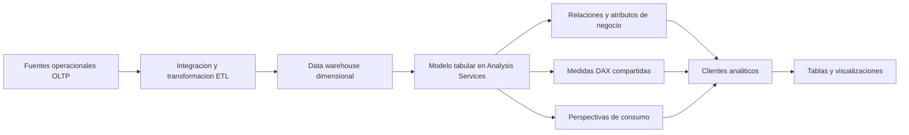

# Clase 6: Modelos tabulares en Analysis Services: capa semántica, métricas DAX y perspectivas

> **Objetivo académico:** Comprender y construir una capa semántica sobre un almacén dimensional, definiendo medidas DAX reutilizables, clasificaciones de negocio y perspectivas de consumo, con atención a la granularidad, la validación y los límites de seguridad y rendimiento.

## 1. Contexto y marco conceptual

### Del almacenamiento al consumo analítico

La sesión aborda la transición entre disponer de un data warehouse poblado y ofrecer información interpretable a sus consumidores. El caso Bike Stores parte de un modelo estrella, alimentado mediante ETL, con una tabla de hechos de órdenes y dimensiones de clientes, empleados, productos, tiendas y fechas.

El almacén conserva e integra información histórica y facilita consultas analíticas mediante su organización dimensional. Sin embargo, disponer de tablas adecuadas no garantiza que distintos departamentos interpreten de la misma forma las cantidades, los importes y los filtros. La capa semántica añade definiciones compartidas para que los clientes consuman conceptos del negocio y no deban reconstruir cada cálculo.

El problema inicial se ilustra con una suma de cantidades por tienda. Al incorporar restricciones por empleado, producto o cliente, las consultas comienzan a divergir. Si cada variante se mantiene como un procedimiento almacenado independiente, aumentan la duplicación, la dificultad de mantenimiento y el riesgo de inconsistencias.

| Elemento | Responsabilidad principal | Riesgo si se confunden sus funciones |
|---|---|---|
| Sistema OLTP | Registrar operaciones del negocio | Sobrecargar la operación con consultas analíticas extensas |
| ETL | Integrar, transformar y cargar datos | Repetir transformaciones estables en cada consumidor |
| Data warehouse | Conservar datos históricos con estructura analítica | Suponer que las tablas bastan para unificar las definiciones del negocio |
| Modelo semántico tabular | Definir relaciones, atributos y medidas reutilizables | Trasladar decisiones de significado a cada reporte |
| Cliente de visualización | Explorar y presentar resultados | Crear versiones incompatibles de una misma métrica |

Los procedimientos almacenados pueden ser una solución válida. La crítica de la sesión se dirige a la proliferación de versiones con reglas similares, no a su uso en cualquier contexto. Una capa semántica permite separar una medida estable de los filtros que el usuario aplica durante la exploración.



### Modelo semántico y lógica de negocio

En la sesión, la lógica de negocio se concreta principalmente en expresiones de cálculo y condiciones de filtrado. El modelo también contiene orígenes de datos, tablas, relaciones, medidas, perspectivas y objetos vinculados con seguridad e indicadores. Los KPI se mencionan, pero no se desarrolla su definición ni su implementación.

La finalidad es que un consumidor seleccione, por ejemplo, una tienda y una medida denominada `Total Quantity`, sin decidir nuevamente si debe sumar, promediar o contar la columna de cantidades.

## 2. Fundamentos teóricos y arquitectura

### Modelos multidimensionales y tabulares

Se presenta SQL Server Analysis Services como servicio especializado para análisis. La sesión contrasta la experiencia de desarrollo multidimensional con la tabular y adopta esta última por su representación mediante tablas y por el uso de DAX.

| Aspecto | Enfoque multidimensional | Enfoque tabular utilizado |
|---|---|---|
| Organización conceptual | Cubos, dimensiones y medidas | Tablas, relaciones y medidas |
| Lenguaje tratado | MDX | DAX |
| Experiencia de modelado | Estructuras multidimensionales específicas | Estructuras próximas al modelo de tablas conocido |
| Implementación de la sesión | Referencia comparativa | Importación desde el warehouse y despliegue en Analysis Services |

**Enriquecimiento conceptual:** MOLAP y ROLAP son modalidades de almacenamiento y acceso; no deben confundirse con una oposición absoluta entre MDX y DAX. Tampoco el modelo tabular elimina las relaciones: conserva relaciones entre tablas, aunque utiliza un motor analítico distinto del motor relacional que aloja el warehouse.

### Importación, compresión y procesamiento

El flujo demostrado importa datos del warehouse al modelo tabular. El modelo trabaja sobre una instantánea que debe actualizarse mediante procesamiento; las operaciones posteriores en el origen no se reflejan automáticamente en esa copia.

La explicación introduce xVelocity y VertiPaq para describir el procesamiento analítico en memoria. La finalidad es responder agregaciones con rapidez y separar el consumo analítico de la carga transaccional.

**Enriquecimiento conceptual:** VertiPaq utiliza almacenamiento columnar comprimido. En modo Import, la consulta se beneficia de estructuras cargadas en memoria, pero ello no significa que el servicio carezca de persistencia en disco. Del mismo modo, los motores relacionales emplean memoria y cachés; no realizan necesariamente una lectura física de disco por cada operación. La ventaja de rendimiento debe evaluarse según volumen, cardinalidad, compresión, diseño y consulta, sin asumir una superioridad universal.

La sesión diferencia el procesamiento completo de una tabla y el procesamiento por particiones. Este último permite limitar la actualización a un subconjunto, como un período mensual, cuando el modelo y la estrategia de carga están preparados para ello.

### Definición del modelo y datos procesados

En Visual Studio se crea un proyecto de tipo `Analysis Services Tabular Project`. El archivo `.bim` actúa como elemento central de definición del modelo.

**Enriquecimiento conceptual:** Aunque la explicación oral agrupa datos y metadatos alrededor del proyecto, el archivo `.bim` describe el modelo; no debe entenderse como un archivo que incorpora todas las filas importadas. Los datos procesados se gestionan en las bases de trabajo y del servidor de Analysis Services.

También se distinguen dos conexiones: la del modelo hacia el warehouse y la del cliente hacia Analysis Services. La autenticación del origen de datos y la del servicio analítico son configuraciones diferentes. En la demostración se emplea un servidor local; `localhost` designa la máquina donde se ejecuta cada proceso, por lo que no identifica automáticamente el mismo servidor entre equipos distintos.

## 3. Implementación técnica y lógica de negocio

### Preparación y presentación del modelo

El desarrollo sigue un ciclo de importación, configuración, compilación, despliegue y validación mediante un cliente. Al importar las tablas dimensionales y la tabla de hechos, se revisan las relaciones y se adapta la presentación para consumo.

Las operaciones principales son:

- Renombrar tablas y atributos con términos comprensibles para el negocio.
- Ocultar claves técnicas y columnas que no necesitan aparecer en los reportes.
- Combinar nombres y apellidos en un atributo descriptivo.
- Mantener visibles las medidas explícitas y las dimensiones pertinentes.
- Revisar la experiencia del cliente después del despliegue.

Ocultar una columna conserva su disponibilidad para relaciones y cálculos. Los cambios de presentación en la capa semántica no modifican por sí mismos las tablas originales del warehouse.

**Enriquecimiento conceptual:** Los siguientes fragmentos reconstruyen la lógica mostrada con nombres consistentes; no son una transcripción literal del editor. Suponen tablas `Orders`, `Customer` y `Store`, y deben adaptarse a los nombres efectivos del modelo.

```dax
Customer Name =
    CONCATENATE(
        Customer[first_name],
        CONCATENATE(" ", Customer[last_name])
    )
```

Esta columna combina dos textos y un espacio para facilitar la selección del cliente. La misma operación se aplica conceptualmente al nombre del empleado. La construcción de un nombre descriptivo no convierte ese texto en una clave única.

### Columnas calculadas: importes y clasificadores

Para cada línea de venta, la sesión construye un importe bruto a partir de cantidad y precio, y un importe neto después del descuento:

$$
g_i = q_i p_i
$$

$$
n_i = g_i(1-d_i)
$$

Aquí, $i$ identifica una fila de detalle; $q_i$ es la cantidad de unidades vendidas, $p_i$ es el precio por unidad en una moneda homogénea, $d_i$ es la tasa de descuento expresada como fracción, y $g_i$ y $n_i$ son importes monetarios bruto y neto. Para el caso ilustrado se supone $q_i\geq 0$, $p_i\geq 0$ y $0\leq d_i\leq 1$. Las fórmulas no incorporan costos, impuestos, devoluciones ni otras deducciones no representadas.

```dax
Gross Sales =
    Orders[quantity] * Orders[list_price]

Net Sales =
    Orders[Gross Sales] * (1 - Orders[discount])

Sales Type =
    IF(Orders[quantity] > 1, "Big Sale", "Simple Sale")

Discount Type =
    IF(Orders[discount] >= 0.1, "Big Discount", "Normal Discount")
```

`Sales Type` clasifica como venta grande una fila cuya cantidad supera una unidad. `Discount Type` clasifica como descuento grande una tasa mayor o igual al 10 %. La exposición alterna verbalmente entre «más del 10 %» y «mayor o igual»; la reconstrucción conserva la condición explícita mostrada, `>= 0.1`.

Estas etiquetas son convenciones ilustrativas. Una línea con dos unidades pertenece a `Big Sale`, pero ello no demuestra por sí mismo que corresponda a una operación mayorista. Además, como la clasificación se calcula por fila, no necesariamente describe la orden completa cuando esta contiene varias líneas.

### Medidas explícitas y contexto de filtro

Una columna contiene un valor por fila. Una medida evalúa una expresión en el contexto de la consulta, por ejemplo, para una tienda, un año o una categoría seleccionados.

```dax
Total Quantity := SUM(Orders[quantity])

Total Gross Sales := SUM(Orders[Gross Sales])

Total Net Sales := SUM(Orders[Net Sales])

Total Orders := DISTINCTCOUNT(Orders[order_id])
```

La notación `:=` representa la definición de medidas empleada en la sesión; algunos editores muestran `=`. Las primeras tres medidas suman cantidades o importes. `Total Orders` cuenta identificadores distintos porque varias filas pueden pertenecer a una sola orden.

Si el cliente recibe directamente una columna numérica, puede crear una agregación implícita y permitir que el usuario cambie de suma a promedio, máximo o recuento. Una medida explícita fija la expresión acordada y evita esa redefinición desde el selector de agregación del visual. El resultado sigue variando con los filtros permitidos.

La segmentación de medidas se construye mediante `CALCULATE`:

```dax
Total Big Sales Quantity :=
    CALCULATE(
        [Total Quantity],
        Orders[Sales Type] = "Big Sale"
    )

Total Simple Sales Quantity :=
    CALCULATE(
        [Total Quantity],
        Orders[Sales Type] = "Simple Sale"
    )

Total Net Sales Big Discount :=
    CALCULATE(
        [Total Net Sales],
        Orders[Discount Type] = "Big Discount"
    )

Total Net Sales Normal Discount :=
    CALCULATE(
        [Total Net Sales],
        Orders[Discount Type] = "Normal Discount"
    )
```

`CALCULATE` evalúa una expresión modificando el contexto de filtro. La misma estructura permite segmentar cantidades, ventas brutas y ventas netas por tipo de venta o descuento, y combinar ambos clasificadores.

**Enriquecimiento conceptual:** Un filtro directo de `CALCULATE` puede reemplazar un filtro existente sobre la misma columna. Por ello, una medida segmentada no siempre representa la intersección con cualquier selección previa. Esta propiedad debe revisarse cuando el reporte ofrece selectores sobre el mismo clasificador.

### Consultas DAX y clientes

La sesión introduce `EVALUATE` para devolver una tabla y muestra consultas que combinan medidas existentes con una medida definida temporalmente. Los clientes analíticos generan consultas al seleccionar dimensiones y medidas.

**Enriquecimiento conceptual:** Una reconstrucción equivalente de esa consulta es:

```dax
DEFINE
    MEASURE Orders[Order Count For Query] =
        DISTINCTCOUNT(Orders[order_id])
EVALUATE
    SUMMARIZECOLUMNS(
        Store[store_name],
        "Quantity", [Total Quantity],
        "Orders", [Order Count For Query]
    )
ORDER BY Store[store_name]
```

La medida definida con `DEFINE` pertenece a esa consulta y no queda incorporada permanentemente al modelo. `SUMMARIZECOLUMNS` devuelve resultados agrupados por tienda; las relaciones permiten que cada tienda filtre las filas correspondientes de `Orders`.

La demostración utiliza Power BI como cliente de consumo y una herramienta de consulta DAX para explorar tablas y planes. XMLA se menciona como mecanismo para operaciones de administración y automatización del procesamiento, sin desarrollar una implementación detallada.

## 4. Análisis crítico de casos y auditoría práctica

### Granularidad y conteo de órdenes

El caso revela que la tabla de hechos contiene detalle de órdenes. Contar sus filas no equivale a contar operaciones comerciales: una orden con cinco líneas debe aportar una sola unidad al conteo de órdenes.

**Enriquecimiento conceptual:** Si tres órdenes contienen cinco, dos y una líneas respectivamente, el conteo de filas es ocho y el conteo de órdenes distintas es tres. Se trata de un ejemplo didáctico, no de un resultado reconstruido de la pantalla.

El conteo distinto exige que `order_id` identifique una orden de manera inequívoca. Además, no es necesariamente aditivo: una misma orden con productos de dos categorías puede aparecer en el conteo de cada categoría, pero solo una vez en el total general.

La fuente contiene un tramo donde se anuncia una medida de cantidades por descuento, pero se menciona `Total Orders` como expresión base. La definición final exacta no queda inequívoca. La distinción semántica debe preservarse: filtrar `[Total Quantity]` produce unidades; filtrar `[Total Orders]` produce órdenes distintas con líneas que cumplen el filtro.

### Validación de segmentos y valores en blanco

Durante la demostración aparecen resultados en blanco porque una medida busca una etiqueta diferente de la generada por el clasificador: `Normal` frente a `Simple`, o variantes de nombres de descuento. El problema se corrige revisando los textos y desplegando nuevamente los cambios guardados.

**Enriquecimiento conceptual:** Un resultado en blanco no demuestra por sí solo un error tipográfico. También puede indicar ausencia de hechos para una dimensión, filtros incompatibles, relaciones incorrectas, valores faltantes o una división sin denominador válido. El diagnóstico debe revisar expresión, datos, relaciones y contexto antes de convertir el blanco en cero.

Para una suma sobre categorías exhaustivas y mutuamente excluyentes se espera que los segmentos reconstruyan el total. Por ejemplo:

$$
Q(C)=Q_{\text{grande}}(C)+Q_{\text{simple}}(C)
$$

Aquí, $C$ es un mismo contexto de selección, $Q(C)$ es la cantidad total en unidades, y los términos de la derecha suman las unidades de cada categoría dentro de ese contexto. La identidad supone una clasificación completa y filtros compatibles. No debe extrapolarse automáticamente a conteos distintos si una orden participa en ambos segmentos.

### Ventas netas, utilidad y cocientes

La sesión denomina `profit` al cociente entre ventas netas y ventas brutas:

```dax
Net To Gross Ratio :=
    DIVIDE([Total Net Sales], [Total Gross Sales])
```

**Enriquecimiento conceptual:** Ese cociente representa la proporción del importe bruto que permanece después de descuentos. No mide utilidad ni margen de beneficio, porque no descuenta el costo de los productos u otros gastos. Por la misma razón, las ventas netas no equivalen al dinero que finalmente constituye ganancia.

$$
R(C)=\frac{N(C)}{G(C)}
$$

$N(C)$ y $G(C)$ son ventas netas y brutas en la misma moneda y bajo el mismo contexto $C$. El cociente $R(C)$ es adimensional y requiere $G(C)>0$. Con cantidades y precios no negativos, y descuentos entre cero y uno, pertenece al intervalo $[0,1]$. En DAX, `DIVIDE` devuelve por defecto un blanco cuando el denominador es cero o está en blanco.

**Enriquecimiento conceptual:** Sustituyendo la definición de ventas netas se obtiene:

$$
R(C)=\frac{\sum_{i\in C}g_i(1-d_i)}{\sum_{i\in C}g_i}
=1-\frac{\sum_{i\in C}g_i d_i}{\sum_{i\in C}g_i}
$$

La proporción retenida es uno menos el descuento medio ponderado por importe bruto; no es uno menos el promedio simple de las tasas. Si una línea tiene importe bruto de 200 y descuento del 10 %, y otra de 100 sin descuento, el bruto conjunto es 300 y el neto 280. El cociente es aproximadamente 93,33 %. Este ejemplo es ilustrativo y no corresponde a una ejecución reportada.

Las variantes por venta grande o descuento grande requieren numerador y denominador del mismo segmento si se desea medir retención interna. Dividir el neto de un segmento entre el bruto total responde a otra pregunta: su contribución respecto de una base global.

### Perspectivas y límites de confidencialidad

Se crean perspectivas denominadas HR y Sales seleccionando subconjuntos de dimensiones, atributos y medidas. El cliente puede elegirlas al conectarse y recibe una lista de campos más reducida. La selección se modifica durante la demostración; lo estable es el mecanismo de simplificación por perfil de consumo.

**Enriquecimiento conceptual:** Una perspectiva no constituye una barrera de seguridad. Ocultar objetos o excluirlos de una perspectiva simplifica la navegación, pero no revoca permisos sobre el modelo subyacente. La confidencialidad requiere roles y permisos efectivos, y, cuando corresponda y sea compatible con la plataforma, restricciones por filas u objetos.

La analogía con un data mart es útil por su orientación departamental. Sin embargo, una perspectiva no crea una copia física, un repositorio separado ni una partición de seguridad. La sesión relaciona esta organización con los enfoques de Inmon y Kimball; esa comparación es introductoria y no permite reducir sus arquitecturas a una simple inversión del orden entre warehouse y data marts.

## 5. Principios de diseño, buenas prácticas y anti-patrones

### Ubicar cada transformación en la capa adecuada

Una consulta técnica de la sesión cuestiona si los importes derivados deben calcularse en ETL o mediante columnas del modelo. La recomendación expuesta es trasladar al ETL las transformaciones estables por fila, especialmente ante grandes volúmenes, y mantener las medidas agregadas en la capa semántica.

| Tipo de operación | Ubicación sugerida en el caso | Justificación |
|---|---|---|
| Cantidad por precio, importe después del descuento | ETL o warehouse si son reglas estables y compartidas | Centralizar el cálculo y reducir trabajo durante el procesamiento del modelo |
| Clasificaciones persistentes por fila | ETL cuando la regla está consolidada | Mantener consistencia entre consumidores |
| Sumas y conteos según selección | Medidas DAX | Responder al contexto analítico |
| Cocientes entre medidas | Medidas DAX | Evaluar numerador y denominador en el contexto pertinente |
| Nombres, formatos y visibilidad | Metadatos del modelo | Facilitar el consumo |
| Presentación gráfica | Cliente de visualización | Comunicar los resultados calculados |

**Enriquecimiento conceptual:** Trasladar una columna al ETL no elimina el almacenamiento que esa columna requiere al importarse. Tampoco garantiza por sí mismo una mejora global. La decisión debe considerar reutilización, compresión, cardinalidad, frecuencia de cambio y tiempos de procesamiento. Asimismo, una medida puede contener iteradores y resultar costosa; la oposición entre columna lenta y medida rápida es insuficiente.

### Gobierno de métricas y experiencia de consumo

Las medidas deben expresar una pregunta de negocio identificable, una unidad y una granularidad. Conviene distinguir en los nombres cantidades, órdenes e importes, así como ventas netas y utilidad. Una razón financiera debe describir su numerador y denominador con precisión.

Las medidas derivadas pueden reutilizar medidas base para reducir duplicación. No obstante, crear todas las combinaciones posibles de filtros puede reproducir la proliferación criticada en los procedimientos almacenados. Una medida específica se justifica cuando fija una regla relevante o facilita una interpretación recurrente; para exploraciones generales pueden bastar medidas base y filtros dimensionales.

Ocultar claves técnicas y columnas susceptibles de agregaciones incorrectas mejora la experiencia. Conservar nombres descriptivos, etiquetas estables y formatos coherentes disminuye errores de interpretación. En la dimensión temporal, presentar mes y año facilita resúmenes.

**Enriquecimiento conceptual:** El nombre del mes necesita un criterio de orden cronológico y un contexto de año cuando la comparación lo requiera. Agrupar únicamente por nombre de mes puede reunir distintos años de forma involuntaria.

Los anti-patrones más relevantes son duplicar lógica en cada reporte, permitir agregaciones implícitas sobre columnas con significado delicado, contar líneas como órdenes, interpretar cualquier blanco como cero, llamar utilidad a las ventas netas y utilizar perspectivas como control de acceso.

### Despliegue y procesamiento controlados

El ciclo de compilación y despliegue permite trasladar cambios de definición al servicio. El procesamiento actualiza los datos disponibles para las consultas. En la práctica mostrada, no guardar una modificación antes del despliegue provoca que el cliente conserve una definición anterior.

**Enriquecimiento conceptual:** Desplegar metadatos y procesar datos son operaciones relacionadas, pero distintas. La validación debe confirmar tanto la versión del modelo como la actualidad de los datos. La posibilidad técnica de recrear una base de desarrollo no justifica borrar y reconstruir indiscriminadamente una base utilizada por consumidores.

## 6. Síntesis conceptual y profundización académica

El aporte central de la clase es la construcción de una capa semántica que convierte columnas y relaciones del warehouse en conceptos analíticos compartidos. Analysis Services aporta el servicio de modelado y procesamiento; DAX expresa medidas y filtros; los clientes consumen resultados mediante dimensiones y métricas ya definidas.

La secuencia conceptual del caso es identificar la granularidad, depurar la presentación, definir medidas base y ampliar el análisis con clasificadores. `SUM` responde a cantidades o importes; `DISTINCTCOUNT` responde a entidades identificadas; `CALCULATE` modifica el contexto; `DIVIDE` expresa razones cuyo significado depende de una base consistente.

La calidad del modelo depende tanto de su corrección numérica como de su interpretación. Dos resultados pueden ser técnicamente calculables y responder a preguntas diferentes: unidades frente a órdenes, líneas con descuento frente a órdenes que contienen alguna línea con descuento, retención dentro de un segmento frente a contribución sobre el total.

Las perspectivas aportan simplicidad de navegación, mientras que los permisos establecen acceso efectivo. La separación entre ambas responsabilidades evita atribuir confidencialidad a una función de presentación.

Las líneas de profundización que se desprenden de la sesión son el estudio del contexto de filtro en DAX, la aditividad de las medidas, la evaluación del costo entre ETL y modelo tabular, el diseño de particiones y la gobernanza de definiciones. El criterio rector es ofrecer métricas verificables y comprensibles, con nombres, unidades y alcances que permitan interpretar correctamente cada resultado.
