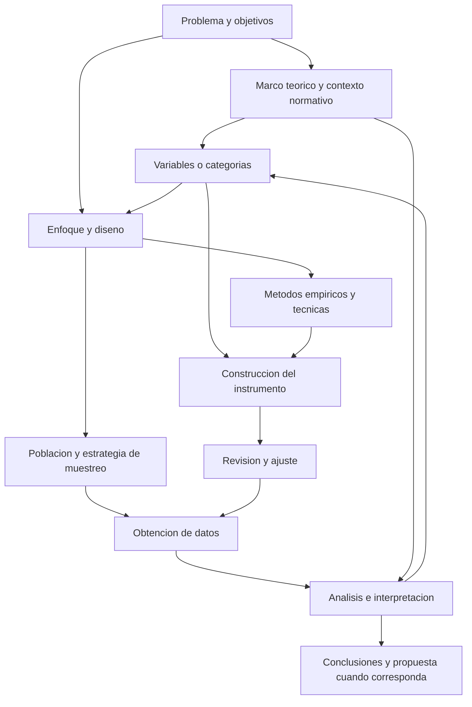

# Clase 6: Construcción del marco metodológico: enfoques, diseños, instrumentos y muestreo

> **Objetivo académico:** Fundamentar la coherencia entre problema de investigación, marco teórico, enfoque, diseño, métodos, instrumentos y muestreo, distinguiendo el alcance de las decisiones metodológicas y las condiciones de calidad de la evidencia.

## 1. Contexto y marco conceptual

La sesión articula dos dimensiones de la investigación monográfica: la fundamentación teórico-referencial y la construcción del procedimiento para obtener y analizar evidencia. El marco teórico desarrolla los conceptos y antecedentes que permiten comprender el problema; el marco metodológico explica cómo se producirá conocimiento sobre ese problema y por qué las decisiones adoptadas resultan pertinentes.

El alcance tratado es principalmente analítico o propositivo. Una investigación analítica puede concluir con la interpretación y discusión de los resultados; una propositiva incorpora una alternativa de solución sustentada en el diagnóstico. Diseñar una propuesta no equivale a implementarla ni a demostrar sus efectos.

### Organización del marco teórico-referencial

La exposición distingue tres componentes relacionados:

| Componente | Función académica | Tratamiento predominante |
| --- | --- | --- |
| Estado del arte y antecedentes | Reconstruir aportes, hitos y evolución del problema | Descripción cronológica y comparación de contribuciones |
| Fundamentos teóricos y conceptuales | Explicar las teorías y conceptos que sustentan el problema | Argumentación, explicación y posicionamiento razonado |
| Marco normativo y legal | Identificar regulaciones pertinentes, referentes internacionales y posibles vacíos | Descripción contextualizada de normas e implicaciones |

En inteligencia artificial y ciencia de datos, el docente enfatiza la actualización de los antecedentes, con especial atención a los últimos dos o tres años y, según el tema, hasta cinco. Esta recomendación responde a la rapidez de evolución del campo.

**Enriquecimiento conceptual:** La actualidad del estado del arte no exige eliminar fundamentos anteriores. Conviene diferenciar entre antecedentes recientes, necesarios para identificar el conocimiento disponible, y trabajos fundacionales, necesarios para explicar conceptos o teorías todavía vigentes. El horizonte temporal debe justificarse por el problema y la evolución de su literatura.

Los componentes no deben convertirse en una sucesión de definiciones aisladas. La redacción necesita nexos: los antecedentes conducen a las teorías relevantes y estas permiten comprender las condiciones normativas del contexto. El índice tentativo cumple una función argumental: organiza la progresión de las ideas antes de redactarlas.

La clasificación de un antecedente depende también del uso que se haga de él. Un caso de implementación puede describir la evolución de un campo o utilizarse para explicar un principio técnico. Su ubicación debe corresponder a esa función y evitar repeticiones.

En el encuadre presentado, la monografía utiliza epígrafes y un desarrollo más acotado que una tesis. La concisión se entiende como selección de contenido pertinente, sin sacrificar el sustento conceptual. Las extensiones y restricciones mencionadas en la sesión pertenecen a ese encuadre formativo y no constituyen propiedades universales de toda monografía.

## 2. Fundamentos teóricos y arquitectura

### El marco metodológico como sistema de decisiones

La naturaleza metodológica de la investigación comprende la justificación del enfoque, el diseño, la población, la muestra, los criterios de selección, los métodos teóricos y empíricos, las técnicas, los instrumentos y el procedimiento de construcción de estos últimos.

El diagrama representa la congruencia entre decisiones. La retroalimentación hacia las categorías resulta particularmente relevante en investigaciones cualitativas, donde la comprensión del fenómeno y la obtención de datos pueden desarrollarse de manera iterativa.

### Enfoques de investigación

| Enfoque | Orientación principal | Evidencia y tratamiento |
| --- | --- | --- |
| Cuantitativo | Medir atributos, describir distribuciones o analizar relaciones | Datos operacionalizados y análisis numérico |
| Cualitativo | Comprender significados, experiencias, prácticas y perspectivas | Discursos, observaciones y documentos interpretados en contexto |
| Mixto | Integrar dimensiones cuantitativas y cualitativas del problema | Articulación de ambas evidencias e inferencias |

La selección se vincula con la naturaleza del problema, los objetivos, las posibilidades de acceso, los recursos, las consideraciones éticas y el contexto disciplinario. La tradición de un campo puede orientar decisiones, pero no reemplaza su justificación.

### Diseños cuantitativos

La exposición diferencia diseños experimentales y no experimentales. Los primeros incorporan la administración de estímulos, tratamientos o intervenciones; los segundos estudian los fenómenos sin esa manipulación deliberada.

En los diseños experimentales se presentan tres variantes:

- **Preexperimental:** dispone de un control reducido sobre explicaciones alternativas.
- **Cuasiexperimental:** suele trabajar con grupos previamente constituidos, sin asignación aleatoria de participantes a las condiciones.
- **Experimental propiamente dicho:** combina manipulación de la variable independiente, medición de resultados, comparación y control.

**Enriquecimiento conceptual:** La asignación aleatoria y el emparejamiento no son procedimientos equivalentes. La primera distribuye participantes al azar entre condiciones; el segundo procura hacer comparables ciertas características observadas. El emparejamiento, por sí solo, no elimina la confusión por factores no observados.

Los diseños no experimentales se distinguen por su temporalidad:

| Diseño | Organización temporal | Finalidad característica |
| --- | --- | --- |
| Transversal o transeccional | Obtención de datos en un momento o corte definido | Caracterizar una situación o analizar relaciones en ese corte |
| Longitudinal | Obtención de datos en distintos momentos | Analizar cambios, trayectorias o evolución |

El alcance puede ser exploratorio, descriptivo o correlacional, según la pregunta y la evidencia disponible. La exposición también utiliza la denominación correlacional-causal.

**Enriquecimiento conceptual:** Una relación observada en un corte transversal no demuestra causalidad. Una interpretación causal necesita justificar, entre otros aspectos, la precedencia temporal, el control de explicaciones alternativas y los supuestos del diseño. La intención de explicar no basta para identificar efectos causales.

La sesión introduce estudios longitudinales de tendencia, cohorte y panel, aunque sus diferencias aparecen formuladas de manera imprecisa.

**Enriquecimiento conceptual:** Un estudio de tendencia observa cambios en una población y puede utilizar muestras diferentes en cada medición. Un estudio de cohorte sigue una subpoblación definida por una característica o acontecimiento compartido. Un panel vuelve a observar las mismas unidades. El panel no se define como una combinación de tendencia y cohorte.

### Diseños cualitativos

La exposición presenta los diseños como orientaciones flexibles, con posibles zonas de contacto, cuya selección depende del propósito del análisis.

| Diseño | Foco principal |
| --- | --- |
| Narrativo | Historias, vivencias y sucesos organizados temporalmente |
| Teoría fundamentada | Construcción de explicaciones teóricas mediante análisis y codificación de datos |
| Etnográfico | Prácticas, significados y patrones culturales de un colectivo |
| Fenomenológico | Comprensión de la experiencia vivida respecto de un fenómeno |
| Investigación-acción | Ciclos de reflexión, actuación y observación para comprender y transformar una práctica |
| Estudio de caso | Comprensión profunda y contextualizada de un caso delimitado |

En teoría fundamentada se mencionan procedimientos de codificación abierta y selectiva. La sesión también alude a formas valorativas de codificación, sin desarrollar un procedimiento específico.

**Enriquecimiento conceptual:** El estudio de caso puede delimitar una persona, un equipo, una organización, un proceso o un acontecimiento. Tampoco está restringido universalmente a evidencia cualitativa: puede articular datos cuantitativos o mixtos. Su rasgo distintivo es la delimitación del caso y su estudio contextualizado.

### Diseños mixtos e integración

El enfoque mixto se vincula en la sesión con una orientación pragmática: combinar evidencias según su utilidad para responder el problema. Incluye recolección, análisis e integración de datos, así como la elaboración de inferencias conjuntas o metainferencias.

Se distinguen diseños **secuenciales**, con fases sucesivas, y **concurrentes**, con fases desarrolladas de manera simultánea. Entre los primeros se mencionan el exploratorio, el explicativo y el transformativo; entre los concurrentes, la triangulación, los diseños anidados, los de varios niveles y los transformativos. También se presenta la integración múltiple como una variante compleja, sin detallar su implementación.

La integración puede buscar complementariedad, contraste, contextualización, compensación de limitaciones y reducción de incertidumbre. La exposición reserva este enfoque para estudios de mayor alcance que la monografía acotada tratada en clase.

**Enriquecimiento conceptual:** La combinación de enfoques no produce automáticamente mayor validez o una representación exhaustiva de la realidad. Requiere explicar dónde se integran los resultados y cómo se interpretan sus coincidencias y discrepancias. La complejidad de un diseño tampoco depende exclusivamente del número de investigadores.

## 3. Implementación técnica y lógica de negocio

La fuente presenta procedimientos de diseño metodológico y ejemplos de investigación aplicada. No contiene código, bases de datos, análisis estadísticos ejecutados ni resultados empíricos verificables.

### Métodos teóricos y empíricos

Los métodos del nivel empírico permiten obtener evidencia mediante la experiencia y procedimientos sistemáticos. Los métodos del nivel teórico permiten descomponer, relacionar, interpretar, representar y sintetizar esa evidencia. La relación es recíproca: la teoría orienta qué observar y la evidencia puede modificar la comprensión teórica.

La expresión de la sesión «moldear los datos» se entiende como elaboración analítica de la información obtenida.

**Enriquecimiento conceptual:** La transformación analítica debe conservar la trazabilidad de los registros originales. Codificar, resumir o modelar datos no autoriza a alterar observaciones para ajustarlas a una expectativa.

| Método teórico | Operación intelectual | Aplicación descrita o compatible con la sesión |
| --- | --- | --- |
| Análisis-síntesis | Descomponer e integrar | Examinar conceptos, interpretar datos y formular conclusiones |
| Histórico-lógico | Relacionar evolución y organización del fenómeno | Reconstruir antecedentes y cambios conceptuales |
| Genético | Indagar orígenes y formación | Comprender la génesis de un proceso; se menciona sin desarrollo detallado |
| Inductivo-deductivo | Relacionar observaciones, generalizaciones y consecuencias | Construir interpretaciones y contrastarlas con casos particulares |
| Hipotético-deductivo | Derivar consecuencias de hipótesis | Se menciona asociado a investigaciones que contrastan hipótesis |
| Sistémico-estructural y enfoque de sistema | Analizar componentes, relaciones, jerarquías y contexto | Comprender dependencias en objetos o procesos complejos |
| Tránsito de lo abstracto a lo concreto pensado | Reconstruir una situación mediante relaciones conceptuales | Conectar teoría y comprensión de un problema situado |
| Modelación | Representar selectivamente un fenómeno | Elaborar modelos conceptuales, matemáticos, estadísticos o informáticos |

El análisis-síntesis atraviesa varios momentos: revisión documental, organización de resultados y elaboración de conclusiones. No basta con enumerarlo; debe explicarse qué se descompone, con qué criterios y cómo se integra.

**Enriquecimiento conceptual:** Una síntesis histórica o un modelo pueden sugerir mecanismos explicativos, pero no establecen causalidad por su sola denominación. Asimismo, un modelo incorpora supuestos y simplificaciones que limitan sus usos y su capacidad de representar la realidad.

### Relación entre método, técnica e instrumento

La sesión utiliza una clasificación operativa: el método corresponde a la vía general, la técnica a su modalidad específica y el instrumento al soporte concreto para obtener datos. Reconoce que los autores pueden clasificar de modo diferente términos como encuesta y cuestionario.

| Método o vía general | Técnica o modalidad | Instrumento |
| --- | --- | --- |
| Encuesta | Aplicación con preguntas cerradas o semicerradas | Cuestionario |
| Entrevista | Estructurada, semiestructurada o abierta | Guía de entrevista |
| Observación | Directa, indirecta o participante | Guía o registro de observación |
| Grupo focal | Discusión grupal moderada | Guía de temas y registro de la interacción |
| Análisis de productos de la actividad | Revisión de documentos o productos | Registro organizado según criterios de análisis |

La observación se define como una percepción sistemática orientada por objetivos. La encuesta recoge opiniones, criterios, sugerencias u otros atributos mediante un sistema de preguntas. La entrevista permite profundizar en información proporcionada por participantes. El análisis de productos de la actividad se vincula con la revisión documental.

**Enriquecimiento conceptual:** La técnica no determina por sí sola el enfoque. Una observación puede producir conteos o descripciones interpretativas; una encuesta puede contener preguntas abiertas; una entrevista estructurada puede generar datos numéricos. El enfoque depende de la pregunta, el tipo de evidencia y su tratamiento. La profundidad de una entrevista tampoco implica necesariamente una estructura rígida.

El grupo focal utiliza la interacción entre participantes para explorar experiencias, actitudes, creencias y perspectivas sobre un tema delimitado. El moderador necesita dominio del tema y capacidad para sostener un diálogo pertinente. La sesión propone grupos reducidos y advierte contra dispersar la discusión entre demasiados asuntos.

**Enriquecimiento conceptual:** La cantidad de personas no define por sí sola un grupo focal. Su particularidad es la producción de información mediante la interacción moderada. Puede utilizar una guía semiestructurada; la flexibilidad no exige prescindir de preparación.

### Construcción del instrumento

El procedimiento cuantitativo presentado comprende:

1. Definir las variables a partir del problema y del marco teórico.
2. Revisar instrumentos existentes que midan aspectos pertinentes.
3. Seleccionar, adaptar o construir el instrumento.
4. Revisar su funcionamiento mediante una aplicación piloto u otra vía pertinente.
5. Ajustarlo y recopilar los datos.

**Enriquecimiento conceptual:** Entre la definición conceptual y las preguntas conviene explicitar la operacionalización: dimensiones, indicadores, formato de respuesta y criterio de interpretación. Encontrar un instrumento similar no garantiza su adecuación a otra población o contexto.

En el procedimiento cualitativo, las categorías o conceptos iniciales orientan la guía, que puede ajustarse a partir de las primeras entrevistas u observaciones. Obtención de datos, interpretación y refinamiento del instrumento pueden coexistir. La sesión relaciona el cierre de ese proceso con la saturación de información.

**Enriquecimiento conceptual:** La flexibilidad cualitativa no excluye una revisión previa de claridad, pertinencia y ética. Es necesario conservar versiones de la guía y justificar sus cambios; presentar únicamente la versión final puede ocultar diferencias relevantes entre las condiciones de producción de los datos.

### Calidad del instrumento y juicio experto

La discusión menciona aplicación piloto, juicio de expertos, estabilidad mediante test-retest y consistencia interna mediante alfa de Cronbach. Se destaca la necesidad de seleccionar especialistas mediante criterios explícitos para reducir sesgos por cercanía personal o expectativas favorables. El método Delphi aparece como una profundización del trabajo con expertos, sin desarrollo operativo.

**Enriquecimiento conceptual:** Estas estrategias aportan evidencias distintas y no son intercambiables. El juicio experto puede examinar pertinencia y cobertura del contenido; el pilotaje permite detectar problemas de comprensión y aplicación; test-retest estudia estabilidad temporal; alfa de Cronbach evalúa consistencia interna bajo supuestos específicos. Ninguna estrategia aislada certifica toda la validez de un instrumento. Delphi incorpora rondas estructuradas de consulta y retroalimentación; no equivale a cualquier consulta a especialistas.

## 4. Análisis crítico de casos y auditoría práctica

### Casos de construcción del marco teórico

La revisión de índices tentativos permite identificar decisiones transferibles a diferentes temas:

| Caso tratado | Aporte metodológico | Aspecto que requiere atención |
| --- | --- | --- |
| Sistemas inteligentes para alertas relacionadas con el oro y la economía minera | Articula contexto, aprendizaje, series temporales y apoyo a decisiones | Ubicar las implementaciones previas según su función histórica o conceptual |
| Predicción de precios inmobiliarios en Cochabamba | Relaciona aprendizaje supervisado, modelos, variables y fuentes de datos | Vincular conceptos con teorías y contextualizar referentes internacionales y nacionales |
| Inteligencia artificial y detección de amenazas informáticas | Integra antecedentes, fundamentos, análisis de datos y regulación | Formular subtítulos específicos y evitar duplicar la evolución histórica |
| Identificación de talento deportivo con datos incompletos | Vincula algoritmos de ensamble, imputación y tratamiento de datos | Considerar el contexto de menores de edad y la pertinencia de las normas mencionadas |

Los casos son propuestas temáticas y discusiones de estructura. No constituyen evidencia de que las herramientas hayan sido implementadas o hayan producido mejoras. La denominación de ciertos sistemas de ciberseguridad presenta errores de transcripción, por lo que no se reconstruye una sigla técnica ausente.

### Evaluación de herramientas para mejorar un proceso

Una intervención plantea comparar herramientas alternativas para un proceso existente. La aclaración central es que «evaluación» describe una actividad o propósito, pero todavía no identifica el instrumento que producirá los datos.

**Enriquecimiento conceptual:** Una operacionalización posible sería definir dimensiones como adecuación funcional, rendimiento y facilidad de integración, y vincularlas con registros observables. Si se comparara rendimiento, haría falta especificar tareas, condiciones de ejecución y criterios de medida. Esta es una ilustración metodológica; la sesión no presenta un protocolo ni resultados de comparación.

La sugerencia de pensar primero en el instrumento funciona como una ayuda para concretar la evidencia necesaria. Sin embargo, debe mantenerse la coherencia con el problema y los objetivos.

**Enriquecimiento conceptual:** Elegir una encuesta únicamente porque es accesible puede restringir indebidamente lo investigado. El razonamiento debe ser iterativo: pregunta, evidencia necesaria, diseño e instrumento se revisan conjuntamente.

### Población, muestra y acceso a empresas

La población es el conjunto delimitado de unidades al que se refiere el estudio; la muestra es un subconjunto de esas unidades. La sesión destaca la definición de la unidad de muestreo y de análisis, así como la composición y los criterios de selección.

En el caso hipotético de empresas de comercio minorista o electrónico de Santa Cruz, se plantea una dificultad: el ámbito de interés es amplio, pero no se tiene acceso a todas las organizaciones. La discusión distingue una selección probabilística de una selección dirigida hacia unidades accesibles.

| Estrategia | Base de selección | Alcance de las conclusiones |
| --- | --- | --- |
| Probabilística | Procedimiento aleatorio con probabilidades de inclusión conocidas | Permite inferencia estadística bajo las condiciones del diseño |
| No probabilística | Accesibilidad, propósito, características o disposición a participar | Describe las unidades estudiadas, con límites explícitos de generalización |

Se mencionan muestreo aleatorio simple, estratificado, por conglomerados y selección sistemática; también sorteos, tablas de números aleatorios y software como medios de selección.

**Enriquecimiento conceptual:** El muestreo probabilístico no es exclusivo de los diseños experimentales. Se utiliza también en estudios observacionales. Además, la representatividad no se garantiza tomando un porcentaje fijo, como el 30 % de la población: depende del marco muestral, la selección, la cobertura, la no respuesta y la precisión buscada.

Cuando se incorporan solo empresas accesibles o voluntarias, la posibilidad de sesgo debe formar parte de la interpretación. Las empresas que aceptan participar podrían diferir de las que no responden o no permiten acceso. La participación voluntaria, como requisito ético, tampoco define por sí sola toda la estrategia de muestreo.

### Muestreo cualitativo y saturación

La selección cualitativa se orienta por la relevancia de los casos para comprender el fenómeno. Puede ajustarse durante la investigación según lo que se aprende y según la capacidad de obtener y analizar información.

La sesión menciona selección de expertos, casos típicos, cuotas y voluntarios; también máxima variación, homogeneidad, cadenas o redes, casos extremos, oportunidad, selección teórica o conceptual, casos confirmativos, casos importantes y conveniencia.

**Enriquecimiento conceptual:** Estas estrategias no están obligatoriamente separadas entre «antes» y «después» de la primera inmersión. Su momento de uso depende del diseño. La saturación requiere una justificación analítica: no equivale a alcanzar un número pequeño de entrevistas ni a sentir que ya se obtuvo lo esperado. Debe atender a la aparición de información nueva y al desarrollo de las categorías pertinentes.

### Curación de literatura y apoyo de IA generativa

La exposición propone una redacción progresiva apoyada en el índice: desarrollar cada componente, revisar su coherencia, depurar repeticiones y mantener enlaces lógicos. También describe la búsqueda documental, las fichas de citas textuales y paráfrasis, el esquema de ideas y los gestores bibliográficos como recursos de organización.

**Enriquecimiento conceptual:** Solicitar a una IA referencias reales o formato APA 7 no garantiza que las fuentes existan ni que respalden el texto. La revisión debe comprobar la existencia de cada referencia, sus datos bibliográficos y la correspondencia entre la afirmación y el documento original. La corrección estilística y la verificación de evidencia son operaciones diferentes.

## 5. Principios de diseño, buenas prácticas y anti-patrones

- **Justificar decisiones, no acumular etiquetas.** El enfoque, el diseño y cada método deben vincularse con una necesidad concreta de conocimiento.
- **Mantener trazabilidad conceptual.** Las variables o categorías del problema deben reconocerse en el marco teórico, el instrumento y el análisis.
- **Distinguir alcance y efecto demostrado.** Describir una situación, formular una propuesta y probar su efectividad requieren evidencias diferentes.
- **Separar temporalidad y manipulación.** Un estudio transversal no se define por tener un único instrumento, sino por su corte temporal; un estudio no experimental se define por la ausencia de manipulación deliberada relevante.
- **Alinear muestreo y generalización.** La conveniencia puede ser viable, pero no autoriza a representar estadísticamente a todas las unidades de una región.
- **Revisar la calidad según el uso del instrumento.** La estrategia elegida debe aportar evidencia pertinente para la interpretación pretendida.
- **Documentar ajustes cualitativos.** La adaptación de guías y selección de casos debe quedar vinculada con hallazgos y decisiones analíticas.
- **Seleccionar expertos con criterios explícitos.** Experiencia pertinente y posibles conflictos de interés deben considerarse al interpretar sus valoraciones.
- **Integrar teoría y contexto normativo.** Enumerar normas sin explicar su pertinencia no fundamenta una decisión metodológica.
- **Preservar soportes de investigación.** Las guías, cuestionarios y matrices relevantes permiten comprender cómo se obtuvo y organizó la información.

**Enriquecimiento conceptual:** Entre los anti-patrones que conviene evitar están equiparar correlación con causalidad, asumir que un coeficiente demuestra validez integral, clasificar un enfoque solo por el nombre del instrumento y considerar que un método mixto es superior por definición. También debe evitarse presentar datos simulados como observaciones reales: una simulación necesita identificación explícita, supuestos y límites de interpretación.

En estudios con personas, y especialmente con menores de edad o datos sensibles, la viabilidad del acceso debe analizarse junto con la protección de los participantes.

**Enriquecimiento conceptual:** La planificación debe contemplar consentimiento pertinente, minimización de datos, confidencialidad y condiciones de uso. La disponibilidad de registros no constituye por sí misma autorización para cualquier tratamiento.

## 6. Síntesis conceptual y profundización académica

El marco metodológico es una argumentación sobre la producción y el análisis de evidencia. Su coherencia se reconoce cuando la pregunta, los conceptos, las unidades estudiadas, los procedimientos y las conclusiones mantienen una relación justificable.

La distinción entre marco teórico y metodológico puede expresarse como una diferencia de función: el primero fundamenta qué se estudia y desde qué conceptos; el segundo explica cómo se lo investigará. Ambos se condicionan mutuamente. Un cambio en la definición de una variable o categoría puede modificar el instrumento y su interpretación.

En el encuadre de la sesión se privilegia una investigación acotada, con un instrumento principal y un enfoque cuantitativo o cualitativo. Esta delimitación facilita la viabilidad del estudio, pero no sustituye la justificación metodológica ni garantiza por sí misma la calidad.

Las líneas de profundización que se desprenden del contenido son la operacionalización de constructos, la diferencia entre validez y confiabilidad, la inferencia causal en estudios observacionales, la saturación cualitativa, la selección de expertos y la integración efectiva de evidencias mixtas. En cada caso, la cuestión central es determinar qué afirmaciones permite sostener la evidencia y cuáles exceden su alcance.
