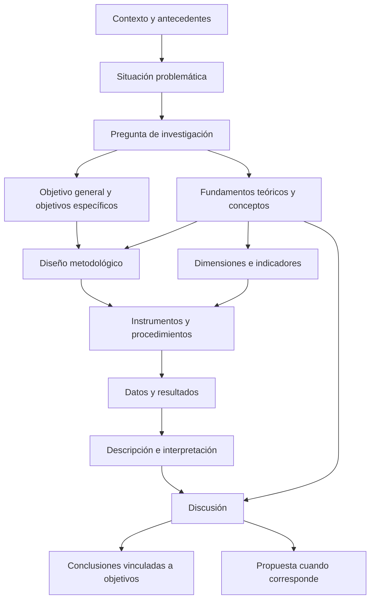

# Clase 8: Congruencia metodológica, instrumentos y discusión de resultados en la monografía

> **Objetivo académico:** Analizar la congruencia entre problema, objetivos, fundamentos teóricos, metodología e instrumentos de una monografía, y establecer criterios para presentar, interpretar y discutir resultados sin exceder la evidencia disponible.

## 1. Contexto y marco conceptual

La sesión integra el proceso de construcción de una monografía mediante la revisión de su coherencia interna. El problema central es cómo conseguir que las distintas secciones sostengan una misma investigación: la introducción delimita una necesidad de conocimiento; el marco teórico fundamenta sus conceptos; la metodología establece cómo obtener evidencia; los resultados presentan lo observado; la discusión interpreta sus implicaciones; y las conclusiones responden a los objetivos.

La congruencia metodológica implica continuidad conceptual y correspondencia entre decisiones. Una pregunta acerca de la precisión de un sistema predictivo no puede responderse exclusivamente mediante opiniones sobre su adopción. Ambas cuestiones pueden ser relevantes, pero constituyen objetos distintos y exigen evidencias diferentes.

### Monografía analítica y monografía propositiva

La clase distingue dos orientaciones por su alcance principal:

| Orientación | Finalidad | Verbos representativos | Cierre argumental |
| --- | --- | --- | --- |
| Analítica | Caracterizar, describir, comparar o evaluar una situación | Analizar, caracterizar, describir, identificar, evaluar | Interpretación de resultados y conclusiones sobre el problema |
| Propositiva | Formular una respuesta sustentada al problema diagnosticado | Diseñar, proponer, desarrollar | Diagnóstico, fundamentación de la propuesta y delimitación de su contribución |

La propuesta no constituye una sección obligatoria de toda investigación. Su pertinencia depende del objetivo general y de la evidencia obtenida. Cuando existe, debe justificarse mediante el diagnóstico y los fundamentos teóricos, explicando por qué se selecciona esa alternativa.

**Enriquecimiento conceptual:** El verbo del objetivo orienta el alcance, pero no determina por sí solo el diseño. Evaluar puede requerir mediciones, comparación documental, juicios especializados o combinaciones de procedimientos. Del mismo modo, diseñar una solución no demuestra que funcione: diseño, implementación y validación son contribuciones diferentes.

La sesión también distingue entre el alcance acotado de una monografía y una investigación de mayor profundidad. Esa diferencia se expresa en la amplitud del problema, la suficiencia de los datos, la complejidad de los procedimientos y la fuerza de las conclusiones. Las referencias de la clase a un carácter necesariamente propositivo de la investigación de maestría corresponden a su contexto formativo.

**Enriquecimiento conceptual:** No puede generalizarse que toda investigación de maestría deba contener una propuesta aplicada. El carácter analítico, explicativo, metodológico o propositivo depende de la disciplina y del marco institucional correspondiente.

## 2. Fundamentos teóricos y arquitectura

### Del contexto a la pregunta de investigación

La introducción desarrolla una transición desde la relevancia general del tema hacia un problema delimitado. La sesión identifica como componentes principales la importancia contextual, la vinculación con una línea de investigación, los antecedentes, la situación problemática, la pregunta, los objetivos y la delimitación.

Los antecedentes deben exponer aportes pertinentes y cerrar con una síntesis que explique qué se conoce y qué permanece insuficientemente esclarecido. Una sucesión de autores sin articulación no permite reconocer la necesidad de la investigación.

Se diferencia entre problemas comunes y situación problemática. Los primeros pueden ser manifestaciones dispersas: dificultades de acceso, errores, demoras, carencias de información o limitaciones de un procedimiento. La situación problemática integra esas manifestaciones en una descripción de la carencia central que el estudio abordará. La pregunta expresa la necesidad de conocimiento derivada de esa descripción.

En la orientación presentada durante la clase, la pregunta no debe dar por establecida la solución que todavía necesita fundamentación. En una investigación propositiva, el objetivo general puede declarar el diseño o formulación de una respuesta, mientras que el planteamiento del problema debe mostrar por qué esa respuesta resulta necesaria.

**Enriquecimiento conceptual:** Una pregunta sí puede estudiar explícitamente una intervención o comparar tecnologías cuando ese sea el objeto del diseño. El criterio general es evitar que su formulación presuponga el éxito de una alternativa o confunda una solución preferida con un resultado demostrado.

### Objetivos y delimitación

El objetivo general declara el alcance central. Los objetivos específicos descomponen ese alcance en contribuciones articuladas. La secuencia destacada en la sesión comprende fundamentación teórica, análisis del estado del problema y, cuando corresponde, formulación de una propuesta.

Esta secuencia permite revisar la correspondencia entre objetivos y desarrollo: cada objetivo debe contar con una sección que aporte evidencia de su cumplimiento y con una conclusión que sintetice lo alcanzado. Enumerar operaciones sin explicar su contribución al problema debilita esa correspondencia.

La delimitación comprende tres dimensiones:

| Dimensión | Pregunta que resuelve | Contenido esperado |
| --- | --- | --- |
| Temática | ¿Qué aspecto se estudia y hasta dónde? | Conceptos centrales y límites del análisis |
| Temporal | ¿Qué período o momento representa la evidencia? | Intervalo de observación, registros o recolección |
| Espacial | ¿A qué contexto corresponde el estudio? | Territorio, instituciones, población o entorno de aplicación |

La delimitación requiere una descripción que permita interpretar el alcance real de los hallazgos, más allá de mencionar un lugar o un período.

### Función del marco teórico referencial

El marco teórico fundamenta el problema y las categorías utilizadas para investigarlo. La sesión propone integrar una reconstrucción de hitos relevantes, teorías y conceptos asociados a las variables o categorías centrales, y un marco legal o normativo cuando corresponda.

El estado del arte se presenta como una exposición sintética de aportes y acontecimientos que permiten comprender la evolución del tema. Los apartados conceptuales deben explicar las teorías seleccionadas y justificar la posición adoptada. El componente normativo identifica las disposiciones pertinentes para el objeto de estudio.

**Enriquecimiento conceptual:** Un estado del arte adquiere mayor capacidad analítica cuando, además de organizar aportes cronológicamente, compara problemas, métodos, evidencias, coincidencias y vacíos. La cronología ayuda a situar el campo, pero no sustituye la síntesis crítica.

El marco teórico también orienta la construcción del instrumento. Para preguntar por percepción, disposición o barreras, primero deben definirse esos conceptos. Las preguntas del instrumento no deberían surgir únicamente de una formulación intuitiva del tema.

El diagrama expresa dependencias conceptuales: una modificación del problema o del objetivo puede obligar a revisar teoría, instrumento y conclusiones. La coherencia no se recupera cambiando únicamente una frase aislada.

## 3. Implementación técnica y lógica de negocio

La fuente describe procedimientos y decisiones de instrumentación, pero no proporciona código completo, bases de datos ni resultados verificables. Por ello, la implementación se analiza como arquitectura metodológica, sin atribuir ejecuciones ni reproducir experimentos.

### Diferenciar enfoque, diseño y alcance

En la sesión se corrigen formulaciones que mezclan niveles de clasificación:

| Nivel | Qué caracteriza | Ejemplo tratado |
| --- | --- | --- |
| Enfoque | Naturaleza de los datos y lógica de su análisis | Cuantitativo, cualitativo o mixto |
| Diseño | Organización de la observación o intervención | No experimental |
| Temporalidad | Distribución temporal de la recolección | Transversal o transeccional |
| Alcance | Tipo de conocimiento buscado | Descriptivo |

En el caso de la encuesta a productores, el diseño no experimental se justifica por la ausencia de una intervención tecnológica y de manipulación deliberada de variables. El carácter transversal corresponde a la recolección en un momento o período acotado. El alcance descriptivo se vincula con la caracterización de percepciones.

**Enriquecimiento conceptual:** Utilizar datos numéricos no convierte automáticamente un estudio en explicativo. Una descripción transversal de percepciones no demuestra efectos causales ni permite inferir cómo cambiaría el rendimiento agrícola después de implementar una tecnología.

### Métodos teóricos y procedimientos empíricos

El método analítico-sintético se aborda como recurso para descomponer la información en elementos relevantes y reconstruir una comprensión integrada. Su fundamentación debe indicar qué información se analiza y qué síntesis permite producir. Mencionar su nombre sin describir su función aporta poco a la trazabilidad metodológica.

En los casos documentales, la clasificación que finalmente se estabiliza en la sesión es: análisis documental como método, revisión documental como técnica y ficha o matriz de extracción como instrumento. Para la encuesta, se distingue el procedimiento de consulta, su estructuración y el cuestionario utilizado.

**Enriquecimiento conceptual:** La ubicación exacta de encuesta o revisión documental como método o técnica varía entre tradiciones metodológicas. La prioridad es definir cada término y mantener una clasificación consistente, acompañada de una descripción operativa. También pueden existir encuestas con preguntas abiertas; el formato de respuesta debe identificarse por sus características reales.

### Instrumento, procesamiento y presentación

Uno de los problemas más relevantes surge al confundir una matriz que presenta resultados con el instrumento que registra o produce la evidencia.

| Componente | Función | Ejemplo |
| --- | --- | --- |
| Fuente o unidad de análisis | Proporcionar el material estudiado | Sentencia judicial, documento técnico o productor consultado |
| Instrumento | Registrar observaciones mediante campos o preguntas definidos | Ficha documental o cuestionario |
| Procedimiento de procesamiento | Transformar registros en datos analizables | Extracción, codificación, ejecución de un algoritmo o agregación |
| Matriz de resultados | Organizar las salidas del análisis | Comparación de puntuaciones por consulta y técnica |
| Visualización | Comunicar patrones y diferencias | Tabla o gráfico acompañado de interpretación |

Una matriz puede funcionar como instrumento si define previamente los campos y criterios de registro. Si solo reúne salidas calculadas, es necesario explicar qué procedimiento produjo esas salidas y cómo se asegura la consistencia de sus valores.

La ficha documental puede contener resúmenes elaborados por quien investiga o fragmentos extraídos de las fuentes, siempre identificando su procedencia. La estructura debe responder a las categorías requeridas por la pregunta.

**Enriquecimiento conceptual:** Para un caso de recuperación jurídica, una estructura posible incluiría identificador del documento, procedencia, consulta, técnica, posición en la lista recuperada, puntuación del sistema y juicio de relevancia cuando exista. Es una propuesta de organización, no una reconstrucción de un instrumento mostrado íntegramente en la sesión.

### Población, muestra y calidad del cuestionario

La población debe describir quiénes o qué unidades pertenecen al estudio y en qué contexto. La muestra requiere criterios de selección y una explicación de su relación con esa población. En la sesión se reconoce que un enfoque cuantitativo puede utilizar muestreo no probabilístico.

**Enriquecimiento conceptual:** El uso de una muestra no probabilística limita la generalización basada en probabilidades conocidas de selección. Una participación elevada dentro del grupo contactado no demuestra representatividad de toda la población. Conviene distinguir el tamaño previsto, las respuestas recibidas y los registros finalmente utilizables.

La sesión menciona dos vías de revisión del cuestionario: una prueba piloto y la valoración por especialistas. La primera permite detectar dificultades de comprensión y aplicación; la segunda puede aportar una revisión de pertinencia y claridad.

**Enriquecimiento conceptual:** Estas vías no garantizan por sí solas toda la validez del instrumento. El juicio de especialistas puede aportar evidencia de validez de contenido mediante procedimientos cualitativos, cuantitativos o combinados. Las entrevistas también pueden someterse a revisión previa, y los ajustes durante su aplicación requieren documentación. Por tanto, no es adecuado reducir la validación a una oposición rígida entre encuesta cuantitativa y entrevista cualitativa.

### Del resultado a la discusión

El procedimiento expositivo central consta de cuatro operaciones:

1. Ilustrar los datos mediante una tabla, gráfico u otra representación pertinente.
2. Describir lo que muestra la representación, con precisión sobre categorías y diferencias.
3. Interpretar el significado de esos patrones dentro del problema estudiado.
4. Discutir los hallazgos en relación con los fundamentos, sus límites y sus implicaciones.

La descripción responde qué se observa. La interpretación explica qué puede significar. La discusión contrasta ese significado con otras evidencias y con el alcance del diseño. Las conclusiones recuperan las contribuciones alcanzadas respecto de los objetivos.

En los anexos se sitúa el instrumento completo y, cuando resulte pertinente, información complementaria que permita comprender o reproducir el procedimiento. La sesión contempla enlazar código o cuadernos computacionales mediante un recurso identificable y acompañado de una descripción.

**Enriquecimiento conceptual:** Un enlace por sí solo no asegura reproducibilidad. También se necesitan datos accesibles o una descripción de sus restricciones, versiones de dependencias, parámetros y pasos de ejecución. Cuando intervienen procedimientos aleatorios, debe documentarse cómo se controla esa variabilidad.

## 4. Análisis crítico de casos y auditoría práctica

### Caso 1. Recuperación de jurisprudencia mediante procesamiento de lenguaje natural

El caso plantea evaluar técnicas de recuperación de información en documentos del sistema judicial boliviano. El procedimiento descrito comprende reunir sentencias, procesarlas mediante código, formular consultas jurídicas y registrar resultados para compararlos. Se mencionan técnicas basadas en coincidencias de palabras, semejanza semántica y ponderación de términos, sin especificaciones suficientes para reconstruir sus algoritmos.

La discusión comienza con la identificación del instrumento. Inicialmente se interpreta la matriz como registro de observación; después, al aclararse la naturaleza documental del corpus, se propone una ficha de análisis documental. La enseñanza general es que la selección del instrumento depende de la naturaleza de las unidades y de los datos que se registran.

El punto crítico del caso es la relevancia jurídica. Se reconoce que no se dispone de un juicio especializado suficiente para establecer qué documentos responden correctamente a cada consulta. Se propone utilizar coincidencias o puntuaciones como aproximaciones y se advierte que parte de la relevancia se encuentra simulada.

**Enriquecimiento conceptual:** La puntuación de un sistema y la relevancia de una sentencia son variables distintas. Una coincidencia léxica puede reflejar términos compartidos sin resolver la necesidad jurídica. Si el mismo mecanismo asigna puntuaciones y define qué se considera relevante, la comparación puede volverse circular. En ese escenario puede describirse el comportamiento del sistema, pero no afirmarse una superioridad en relevancia jurídica real.

**Enriquecimiento conceptual:** Para ilustrar la diferencia, la precisión en los primeros resultados puede definirse como:

$$
P@k(q)=\frac{1}{k}\sum_{i=1}^{k}r_{q,i}
$$

Aquí, $q$ es una consulta perteneciente al conjunto de consultas evaluadas; $k$ es un entero positivo que indica cuántas posiciones se consideran, suponiendo que el sistema devuelve al menos esa cantidad de resultados; $i$ identifica cada posición; y $r_{q,i}\in\{0,1\}$ señala si el documento de esa posición es relevante según un criterio de referencia. La medida no tiene unidad y toma valores entre cero y uno. Si, en un ejemplo hipotético, tres de los cinco primeros documentos fueran relevantes, se obtendría $P@5=3/5=0.6$. Este cálculo no corresponde a resultados de la clase.

La expresión muestra por qué la medida necesita juicios de referencia: reemplazar $r_{q,i}$ por una coincidencia calculada por el propio buscador cambia lo que se está midiendo. Tampoco permite evaluar cuánto material relevante quedó sin recuperar.

La participación de especialistas puede fortalecer la evaluación, pero la sesión la vincula con una ampliación hacia métodos mixtos y triangulación.

**Enriquecimiento conceptual:** La intervención de especialistas no vuelve automáticamente mixto un estudio. Si sus juicios se registran como etiquetas y se analizan numéricamente, la evaluación puede seguir siendo cuantitativa. Un diseño mixto requiere componentes cualitativos y cuantitativos definidos y una estrategia explícita de integración.

### Caso 2. Modelos predictivos para precios del oro y transferencia al contexto boliviano

Este caso presenta una revisión de modelos de inteligencia artificial para analizar precios del oro. Se describen dificultades de acceso a datos nacionales y un desplazamiento hacia fuentes internacionales. También se plantea una arquitectura híbrida y posibles mecanismos de comunicación de alertas.

La retroalimentación identifica una limitación decisiva: los datos externos pueden contribuir al análisis, pero no sustituyen automáticamente el conocimiento del contexto local. Si el problema se formula para Bolivia, la ausencia de evidencia nacional debe reflejarse en el alcance y en las conclusiones.

Se exponen porcentajes de mejora predictiva y afirmaciones sobre factibilidad, infraestructura y normativa. La transcripción no proporciona fuentes verificables, métricas, series, comparación de referencia ni ejecución suficiente para confirmar esas afirmaciones. En consecuencia, se conservan como objeto de evaluación crítica, sin adoptarlas como resultados demostrados.

**Enriquecimiento conceptual:** La evaluación de una supuesta mejora predictiva exige conocer qué error se mide, frente a qué modelo se compara, cuál es el horizonte de predicción y cómo se separan temporalmente los datos. Si un menor error representa mejor desempeño, una mejora relativa puede expresarse como:

$$
I=\frac{E_b-E_m}{E_b}\times 100\%
$$

En esta expresión, $E_b>0$ es el error del modelo de referencia y $E_m\geq 0$ el del modelo evaluado, calculados con la misma métrica, unidad y conjunto de evaluación. $I$ es un porcentaje: es positivo cuando el segundo error es menor, cero cuando ambos coinciden y negativo cuando el modelo evaluado empeora. La expresión no es aplicable directamente a métricas donde un valor mayor representa mejor desempeño y no demuestra significación estadística ni utilidad económica.

**Enriquecimiento conceptual:** En series temporales, utilizar información futura durante el entrenamiento o el procesamiento puede producir una evaluación artificialmente favorable. La partición y la preparación de datos deben respetar el orden temporal. Además, los modelos estadísticos también pueden representar dinámicas temporales; no es correcto contraponerlos globalmente como modelos estáticos frente a una inteligencia artificial necesariamente dinámica.

La eventual arquitectura híbrida debe tratarse como una alternativa por justificar. Sin implementación y evaluación comparativa, no puede concluirse que combinar modelos produzca mejores predicciones. De igual manera, la existencia de una experiencia extranjera no establece por sí sola su viabilidad técnica, institucional o jurídica en otro entorno.

El caso muestra que el dominio del área de aplicación es una condición práctica para evaluar la evidencia. La familiaridad con herramientas de IA no reemplaza el conocimiento económico y estadístico requerido para interpretar una predicción de precios.

### Caso 3. Percepción de productores sobre sistemas predictivos de rendimiento agrícola

El tercer caso comienza con una pregunta sobre si integrar imágenes satelitales, datos climáticos y variables edáficas mejora la precisión de la estimación del rendimiento. Sin embargo, el objetivo revisado y el instrumento se orientan a conocer la percepción de productores sobre la adopción de sistemas predictivos.

La incongruencia es sustantiva: medir precisión predictiva exige observaciones del rendimiento y estimaciones comparables; estudiar percepción requiere respuestas de personas y una definición del constructo. Las opiniones sobre una tecnología no demuestran su exactitud.

La revisión reorienta la pregunta hacia la percepción de productores de las principales provincias productoras de Santa Cruz respecto de la adopción de sistemas basados en monitoreo multimodal. También plantea acotar el objetivo, evitando acumular percepción, disposición y barreras como si fueran intercambiables.

**Enriquecimiento conceptual:** Disposición y barreras pueden funcionar como dimensiones de un modelo conceptual más amplio, pero esa relación debe justificarse. No basta con omitirlas del objetivo si el cuestionario continúa mezclando constructos sin distinguirlos. La operación necesaria es definir qué se entiende por percepción, cómo se relaciona con otros conceptos y qué evidencia aportará cada pregunta.

El marco teórico revisado incluye agricultura, teledetección, integración multimodal y aprendizaje automático. Estos componentes fundamentan la tecnología, aunque una investigación sobre adopción también necesita sustento sobre la dimensión humana que pretende medir.

La revisión de resultados destaca que cada gráfico debe estar acompañado de descripción e interpretación. Una colección de capturas del formulario no constituye una discusión. El análisis debe explicar qué patrón se observa, qué aporta al objetivo y qué otras interpretaciones siguen siendo posibles.

**Enriquecimiento conceptual:** En una escala de tipo Likert, las categorías de un ítem expresan un orden. La interpretación debe conservar el significado de los anclajes y distinguir un ítem aislado de una escala compuesta. Agrupar varios ítems requiere justificar que representan un mismo constructo y explicar el procedimiento de puntuación.

### Criterios transversales de auditoría

| Relación revisada | Evidencia de coherencia | Señal de inconsistencia |
| --- | --- | --- |
| Problema y objetivo | Ambos se refieren al mismo fenómeno delimitado | Se pregunta por precisión y se responde con percepción |
| Objetivo y teoría | Los conceptos centrales cuentan con fundamento pertinente | Se explica la tecnología sin fundamentar la adopción que se mide |
| Teoría e instrumento | Las preguntas o campos derivan de dimensiones definidas | Los ítems aparecen sin justificación conceptual |
| Instrumento y resultados | Es posible rastrear cada resultado hasta su registro y procesamiento | Una tabla presenta valores cuyo origen no se explica |
| Resultados y conclusiones | La afirmación final mantiene los límites de la evidencia | Una simulación se presenta como validación contextual |
| Diagnóstico y propuesta | Las decisiones responden a necesidades identificadas | Se recomienda una arquitectura sin comparación ni criterio de selección |

## 5. Principios de diseño, buenas prácticas y anti-patrones

### Redacción como construcción argumental

La clase insiste en una narrativa académica que conecte descripción, explicación y posición crítica. Cada párrafo debe mostrar cómo se relacionan los conceptos y por qué se adopta una interpretación. Una acumulación de etiquetas destacadas, viñetas y afirmaciones breves puede ocultar que esa relación todavía no está desarrollada.

**Enriquecimiento conceptual:** El problema no reside en utilizar listas o tablas, sino en emplearlas como sustituto del razonamiento. Son útiles para comparar dimensiones o resumir decisiones; la justificación y los límites requieren una explicación articulada. La apariencia de un texto tampoco permite determinar con certeza si fue generado mediante IA.

### Verificación de fuentes y responsabilidad intelectual

Las afirmaciones tomadas de otras obras deben contar con citas y referencias correspondientes. Las paráfrasis también requieren atribución. La sesión advierte sobre referencias inexistentes producidas por sistemas generativos y sobre el riesgo de aceptar textos cuyo contenido no se domina.

La responsabilidad de la fundamentación permanece en quien escribe: debe comprobar que la fuente existe, que puede consultarse y que respalda la afirmación utilizada. La lista de referencias debe distinguirse, cuando corresponda, de otras fuentes meramente consultadas.

**Enriquecimiento conceptual:** Incluir en una instrucción a la IA la exigencia de usar fuentes reales no garantiza que las referencias existan ni que sostengan el argumento. La verificación requiere contrastar el registro bibliográfico y el contenido pertinente de la obra. Una referencia auténtica también puede estar mal interpretada.

### Prácticas y anti-patrones identificados

| Buena práctica | Anti-patrón | Consecuencia |
| --- | --- | --- |
| Seleccionar un tema con acceso viable a datos y conocimiento contextual | Elegirlo por atractivo tecnológico sin evaluar factibilidad | Dependencia de información insuficiente o mal interpretada |
| Justificar cada método por su función | Enumerar métodos sin vincularlos al procedimiento | Metodología nominal y difícil de reproducir |
| Separar evidencia observada, simulación y propuesta | Presentar escenarios ilustrativos como resultados empíricos | Conclusiones que exceden los datos |
| Delimitar el alcance de datos internacionales | Generalizar directamente al contexto boliviano | Transferencia sin sustento contextual |
| Interpretar cada visualización | Acumular gráficos sin análisis | Resultados sin respuesta al problema |
| Documentar el instrumento y el procesamiento | Mostrar únicamente una matriz final | Pérdida de trazabilidad |
| Derivar conclusiones de los objetivos y resultados | Introducir recomendaciones o hallazgos nuevos al cierre | Ruptura de la cadena argumental |

La arquitectura documental expuesta sitúa la metodología después de los fundamentos teóricos y antes de los resultados. Las conclusiones cierran el razonamiento; las recomendaciones pueden señalar continuidades pertinentes; las referencias documentan las fuentes utilizadas; y los anexos contienen instrumentos y materiales complementarios.

Los requisitos formales de presentación ayudan a reconocer la organización del documento, pero la consistencia metodológica depende de la relación entre pregunta, conceptos, evidencia e inferencia.

## 6. Síntesis conceptual y profundización académica

La contribución principal de la sesión es una visión integrada de la monografía. La pregunta delimita lo que necesita conocerse; los objetivos establecen la contribución buscada; la teoría define los conceptos; el diseño organiza la producción de evidencia; el instrumento registra observaciones; y la discusión establece qué puede sostenerse a partir de los resultados.

Los tres casos muestran límites distintos. En la recuperación jurídica, la limitación principal es la ausencia de juicios independientes de relevancia. En la predicción de precios del oro, se combinan restricciones de acceso a datos locales con afirmaciones de desempeño que no pueden verificarse con el material presentado. En la investigación agrícola, el problema es la discrepancia entre medir rendimiento técnico y estudiar percepción de adopción.

Las conclusiones deben recuperar las contribuciones logradas en los objetivos específicos: qué permitió comprender el fundamento teórico, qué mostró el diagnóstico y, si existe una propuesta, qué respuesta formula y hasta dónde ha sido validada. La discusión reúne e interpreta los hallazgos; las conclusiones expresan la respuesta final dentro de los límites del estudio.

**Enriquecimiento conceptual:** Tres ejes permiten profundizar esta integración. La validez de constructo pregunta si el registro representa el concepto declarado; la validez de la inferencia pregunta si la conclusión se deriva de la evidencia; y la transferibilidad pregunta bajo qué condiciones los hallazgos pueden ser útiles en otros contextos. Estos ejes explican por qué coincidencia textual no equivale a relevancia jurídica, opinión favorable no equivale a precisión predictiva y desempeño externo no equivale a efectividad local.

Una monografía rigurosa conserva una cadena de justificación rastreable. Su fortaleza reside en producir afirmaciones proporcionadas a la evidencia, reconocer las incertidumbres y distinguir con claridad lo observado, lo interpretado y lo propuesto.
