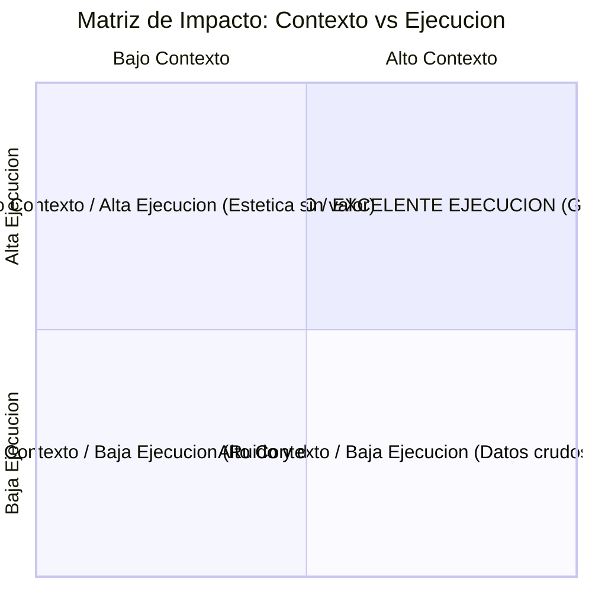
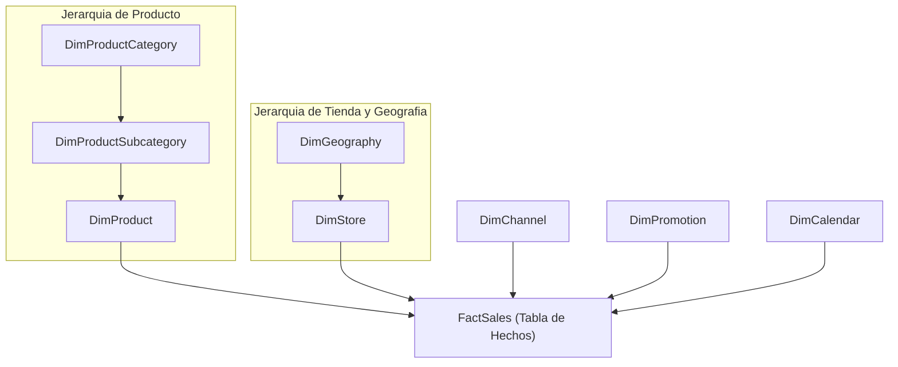

# Clase 3: Arquitectura Dimensional Contoso, Estrategia de Reportes y Modelado DAX

## 1\. Taxonomia y Estrategia de Reportes Empresariales

El valor de un sistema de Business Intelligence no reside en la cantidad de graficos generados, sino en la adecuacion del reporte al horizonte de decision del usuario y a la latencia de los datos.

### Niveles de Reportes segun el Horizonte de Decision

| Nivel | Horizonte Temporal | Latencia de Datos | Audiencia Objetivo | Proposito Principal |
| --- | --- | --- | --- | --- |
| **Operacional** | Corto plazo (Dia a dia, intra-diario) | T-1 (procesamiento batch nocturno) o Near Real-Time (\~30 segundos via streaming / Kafka) | Supervisores, jefaturas operativas, personal de soporte | Monitoreo continuo de tareas, seguimiento de incidencias, gestion inmediata de inventario o despacho. Requiere alto nivel de granularidad. |
| **Analitico** | Mediano plazo (1 a 3 anos) | Semanal, mensual o consolidada historica | Analistas de datos, cientificos de datos, gerencias intermedias | Exploracion multidimensional, deteccion de patrones ocultos, analisis de tendencias, clustering y modelado predictivo (supervisado/no supervisado). |
| **Estrategico** | Largo plazo (5 a 7 anos) | Mensual, trimestral o anual consolidado | Direccion ejecutiva (C-Level), comites de directorio | Seguimiento de metas corporativas (KPIs macro) y toma de decisiones estructurales (apertura/cierre de sucursales, adquisiciones, nuevas lineas de negocio). |

### Gobernanza de Actualizacion: Data Warehouse vs. Procesos Manuales

Un riesgo critico en proyectos de BI es el uso de transformaciones ad-hoc y manuales en Power Query sin un repositorio centralizado. 

- **ETL Manual / Artesanal:** Genera desactualizacion cronica, dependencias operativas individuales y perdida de trazabilidad.

- **Data Warehouse Gobernado:** Centraliza las reglas de negocio en la capa de datos corporativa. La herramienta de visualizacion debe consumir modelos estructurados, garantizando consistencia, rendimiento y una fuente unica de la verdad (*Single Source of Truth*).

---

## 2\. Principios de Diseno Visual y Comunicacion Efectiva

Un reporte efectivo busca responder preguntas de negocio en pocos segundos. El diseno no es decoracion; es una disciplina de comunicacion funcional.

### La Matriz de Impacto: Contexto vs. Ejecucion

La efectividad de una visualizacion se evalua en dos ejes cardinales:

- **Contexto:** Nivel de comprension y profundidad del mensaje transmitido (evitar omitir dispersion, sesgos o concentraciones).

- **Ejecucion:** Calidad estetica, composicion, eliminacion de ruido visual, contraste y aplicacion de branding.



- **El peligro del Promedio Simple:** Un promedio simple oculta la realidad de la distribucion. Por ejemplo, en una evaluacion academica, un promedio de 7.3 puede esconder dos grupos disjuntos (un cluster sobresaliente con 9.0 y un grupo rezagado con 4.0).

- **El Cuadrante Objetivo ("Grafica Ganadora"):** Presenta la distribucion completa (mostrando clusters naturales o anomalias) con un diseno limpio y profesional que permite tomar decisiones inmediatas (como enfocar programas de refuerzo escolar en el grupo vulnerable).

### Criterios de Seleccion: Barras vs. Lineas

- **Barras Agrupadas:** Apropiadas unicamente para comparar pocas categorias o periodos breves (maximo 2 a 3 anos). Si se comparan 4 a 7 periodos en barras agrupadas, se produce el fenomeno de la "cortina de colores", donde la dispersion cromatica satura la vista y se pierde la capacidad comparativa.

- **Lineas de Tendencia:** Cuando se analiza la evolucion temporal o series cronologicas, las lineas superan ampliamente a las barras. El cerebro humano recuerda formas, siluetas y direcciones, no cifras exactas en tablas.

- **Ejemplo de Analisis de Variacion de Gastos:**

  - En lugar de barras paralelas de gasto 2017 vs. 2018 para cada area, se utiliza un grafico de lineas de cambio (*slopegraph*) con fondo gris neutro.
  
  - Se utiliza color verde para reducciones de gasto (Marketing bajo de 39% a 15%) y rojo para incrementos anomolos y preocupantes (Produccion subio de 7% a 25%).

### El Lienzo en Plomo (Gray Canvas) y Uso Estratégico del Color

El color debe usarse como una herramienta preatentiva de senalizacion, nunca como decoracion arbitraria:

1. **Lienzo Base Neutro:** Utilizar tonos de gris para los datos de contexto o que representan el comportamiento estandar.

1. **Color de Acento Focal:** Aplicar color saturado unicamente al elemento que requiere accion o explicacion (por ejemplo, destacar con naranja los segmentos con potencial de expansion).

1. **Consistencia Cromatica entre Visuales:** Si una entidad o categoria se representa con azul en un grafico temporal, debe conservar exactamente el mismo azul en cualquier otra vista del dashboard.

### Buenas Practicas en Tablas y Control de Sobrecarga Cognitiva

- **Prohibicion del Scroll Interminable:** Si una tabla requiere scroll vertical o horizontal prolongado en un dashboard, significa que la informacion no ha sido sintetizada adecuadamente. Una tabla debe limitarse a entre 6 y 10 registros clave consolidados.

- **Branding y Tipografia en Informes Operacionales:** En reportes operacionales granulares que no admiten reduccion de datos por motivos regulatorios u operativos, la profesionalizacion se logra mediante alineacion rigurosa de columnas, tipografias corporativas legibles, jerarquia clara de subtotales y contraste blanco/azul sobrio.

- **Anti-patron de Graficos Combinados con Doble Escala Heterogenea:** Mezclar barras de volumen absoluto a la izquierda con lineas de porcentaje a la derecha sobre el mismo eje temporal genera confusion, etiquetas superpuestas y rechazo visual ("da flojera leer").

  - *Solucion:* Desacoplar las visuales en paneles independientes alineados (*Small Multiples*) con escalas unificadas y colores consistentes por entidad.

---

## 3\. Arquitectura Dimensional: Caso Contoso Data Warehouse

En esta sesion se transiciona del modelo academico BikeStores a un Data Warehouse empresarial multinacional: **Contoso**.

### Comparativa Estructural: BikeStores vs. Contoso

| Dimension | BikeStores (Sesion Anterior) | Contoso Data Warehouse (Sesion Actual) |
| --- | --- | --- |
| **Escala** | Red local de tiendas (3 sucursales, 1600 ordenes) | Corporacion multinacional (310 tiendas, multiples paises, millones de transacciones) |
| **Estructura Transaccional** | Maestro-Detalle (Cabecera ` orders ` y detalle ` order_items `) | Evento unitario por fila en ` FactSales ` (cada registro representa una transaccion completa) |
| **Variables de Hechos** | Ventas sin modulo formal de devoluciones | Modulo integrado de devoluciones (` ReturnQuantity `) y catalogo de 28 promociones |
| **Esquema** | Modelo Estrella puro (Star Schema) | Modelo Copo de Nieve (Snowflake Schema) con jerarquias multinivel |

### Modelo Snowflake (Copo de Nieve) vs. Estrella

El esquema Contoso presenta ramificaciones jerarquicas en sus dimensiones:

- ` FactSales ` -&gt; ` DimProduct ` -&gt; ` DimProductSubcategory ` -&gt; ` DimProductCategory `

- ` FactSales ` -&gt; ` DimStore ` -&gt; ` DimGeography `



#### Consideraciones de Diseno y Gobernanza:

1. **Desnormalizar vs. Mantener Snowflake:**

   - En teoria, fusionar ` DimGeography ` dentro de ` DimStore ` y ` DimProductCategory ` dentro de ` DimProduct ` agiliza consultas y simplifica el modelo.
   
   - En la practica empresarial, alterar tablas con millones o billones de registros implica costes gigantescos de computo y rediseño de pipelines ETL. Mantener un segundo nivel jerarquico es aceptable siempre que no existan dependencias circulares.

1. **Regla de Oro en Snowflake:** Las ramificaciones deben ser estrictamente unidireccionales desde la tabla de hechos hacia las dimensiones externas. Nunca deben existir relaciones transversales entre dimensiones (por ejemplo, entre ` DimGeography ` y ` DimPromotion `).

1. **La Dimension Calendario es Obligatoria:** La fecha de transaccion nunca debe quedar aislada como un simple campo de texto o timestamp en la tabla de hechos. ` DimCalendar ` es imprescindible para funciones de Time Intelligence, ordenamiento cronologico correcto y rendimiento en el motor VertiPaq.

### Limpieza e Higiene del Modelo (Data Hygiene)

Antes de formular calculos, se depuran las tablas de dimension:

- **Ocultar Claves Tecnicas (Surrogate Keys):** Los campos ` ProductKey `, ` StoreKey `, ` ChannelKey `, ` GeographyKey ` se ocultan de la vista de reporte para evitar que los usuarios de negocio los utilicen como atributos visuales.

- **Eliminar Columnas Inertes o Nulas:** Campos sin datos significativos (como ` ClassID `, ` ColorID `, ` Weight ` o ` Size ` cuando vienen en blanco) deben ser retirados u ocultados para optimizar el consumo de memoria en RAM.

---

## 4\. Enriquecimiento de la Tabla de Hechos (FactSales)

La tabla de hechos no debe limitarse a las cantidades crudas provistas por el sistema transaccional (` SalesQuantity ` y ` ReturnQuantity `). Debe enriquecerse con logica de negocio a nivel de fila antes de definir las agregaciones.

### Columnas Calculadas Implementadas

#### 1\. Cantidad Neta Vendida (Total Quantity)

Calcula el volumen real de productos tras descontar unidades devueltas por defectos o desistimiento:

```javascript
Total Quantity = FactSales[SalesQuantity] - FactSales[ReturnQuantity]
```

#### 2\. Indicador de Devolucion (Is Return)

Marca booleana para filtrar de inmediato transacciones que sufrieron incidencias:

```javascript
Is Return = IF(FactSales[ReturnQuantity] > 0, TRUE(), FALSE())
```

#### 3\. Clasificacion del Volumen de Venta (Sale Type)

Segmenta ventas individuales mayores a 10 unidades para tratamiento comercial prioritario:

```javascript
Sale Type = IF(FactSales[SalesQuantity] > 10, "Venta Grande", "Venta Pequeña")
```

#### 4\. Tipificacion de Severidad de Devolucion (Return Type)

Distingue devoluciones estadisticamente aceptables (1 unidad) de devoluciones multiples criticas que senalan lotes defectuosos o problemas logisticos severos:

```javascript
Return Type = 
IF(
    FactSales[ReturnQuantity] == 0, 
    BLANK(), 
    IF(FactSales[ReturnQuantity] == 1, "Único", "Múltiple")
)
```

#### 5\. Regla de Negocio: Descuento por Fidelizacion Presencial (Big Sale Discount)

Aplica un 5% de descuento condicionado a tres factores estrategicos: venta de alto volumen (` Venta Grande `), canal presencial en tienda fisica (` ChannelKey == 1 `) y ausencia de promociones previas (` PromotionKey == 1 `):

```javascript
Big Sale In-Store Discount = 
IF(
    FactSales[Sale Type] == "Venta Grande" && 
    FactSales[channelKey] == 1 && 
    FactSales[PromotionKey] == 1, 
    0.05, 
    0.0
)
```

> **Racionalidad de Negocio:**
> 
> El canal digital no permite controlar el recorrido del cliente, mientras que el canal reseller transfiere el margen a un tercero. Atraer compras de gran escala a la tienda fisica permite exhibir productos complementarios, interactuar directamente con el cliente y construir fidelizacion a largo plazo.

#### 6\. Propagacion del Precio Unitario via RELATED

El precio unitario reside en la dimension ` DimProduct `. Se propaga a la tabla de hechos para facilitar el computo financiero consolidado:

```javascript
Price = RELATED(DimProduct[UnitPrice])
```

#### 7\. Ingreso Neto por Transaccion (Total Income)

Calcula el valor monetario real facturado por linea de venta considerando devoluciones:

```javascript
Total Income = FactSales[Price] * FactSales[Total Quantity]
```

---

## 5\. Medidas de Negocio en DAX (Tabla Contenedora Metrics)

Siguiendo las mejores practicas de arquitectura en Power BI, las medidas no se dispersan en las tablas transaccionales, sino que se centralizan en una tabla contenedora dedicada denominada ` Metrics `.

### Medidas Base de Agregacion

#### Cantidad Total de Ventas

```javascript
Total Sales Quantity = SUM(FactSales[SalesQuantity])
```

#### Cantidad Total de Devoluciones

```javascript
Total Return Quantity = SUM(FactSales[ReturnQuantity])
```

#### Cantidad Neta (Total Quantity)

Se formula a traves de la composicion de medidas existentes para respetar el contexto de filtro en cualquier dimension:

```javascript
Total Quantity = [Total Sales Quantity] - [Total Return Quantity]
```

#### Total de Ordenes

Dado que en Contoso cada fila es un evento transaccional unitario con su identificador propio, no se requiere ` DISTINCTCOUNT `:

```javascript
Total Orders = COUNT(FactSales[SalesOrderNumber])
```

#### Ingreso Total

```javascript
Total Income = SUM(FactSales[Total Income])
```

---

### Medidas Avanzadas: Modificacion de Contexto de Filtro

#### Precio Promedio General Constante (Benchmark)

Para comparar cualquier transaccion con el estandar del catalogo completo, se anulan todos los filtros que puedan estar actuando sobre la dimension producto mediante la combinacion de ` CALCULATE ` y ` ALL `:

```javascript
Average Price = CALCULATE(AVERAGE(DimProduct[UnitPrice]), ALL(DimProduct))
```

*Comportamiento:* Esta medida produce un escalar invariable frente a segmentadores de categoria o subcategoria, sirviendo como linea de base corporativa.

#### Ordenes de Alto Precio (High Price Orders)

Calcula el numero de pedidos cuyo precio unitario supera el precio promedio general constante:

```javascript
High Price Orders = 
CALCULATE(
    [Total Orders],
    FILTER(
        DimProduct,
        DimProduct[UnitPrice] > [Average Price]
    )
)
```

#### Ordenes con Devolucion Unica y Multiple

Miden la frecuencia con que los productos sufren devoluciones tolerables frente a rechazos masivos:

```javascript
Single Return Orders = 
CALCULATE(
    [Total Orders],
    FactSales[Return Type] == "Único"
)
```

```javascript
Multiple Return Orders = 
CALCULATE(
    [Total Orders],
    FactSales[Return Type] == "Múltiple"
)
```

---

## 6\. Validacion del Modelo y Conclusion

### Matriz de Validacion Dimensional

Para verificar la consistencia del modelo, se despliega una matriz cruzando ` DimProductCategory[CategoryName] ` frente a las medidas implementadas:

- ` Total Orders `

- ` Single Return Orders `

- ` Multiple Return Orders `

- ` High Price Orders `

- ` Total Income `

- Tarjeta fija de KPI con ` Average Price ` (valor constante)

Los valores en blanco (` BLANK() `) en ciertas intersecciones reflejan de forma natural que ciertas categorias no registraron ordenes bajo esa condicion particular, sin alterar los totales generales.

### Conclusiones y Reglas de Oro para Entrega de Modelos

1. **La tecnologia es solo el vehiculo:** Conocer DAX y Power BI sin criterio de negocio resulta en reportes inutiles.

1. **Priorizar el mensaje sobre el artificio:** Menos colores y graficos enfocados en tendencias superan ampliamente a tableros saturados de barras multicolores con etiquetas sobrepuestas.

1. **Enriquecer la capa de hechos:** Todo analisis solido requiere columnas derivadas que reflejen situaciones operativas (devoluciones, tipos de venta, reglas comerciales) antes de formular las medidas finales.

---

---
