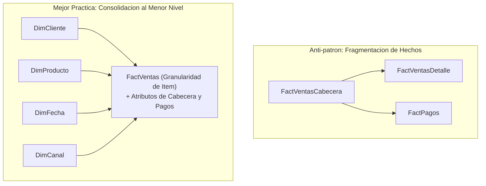
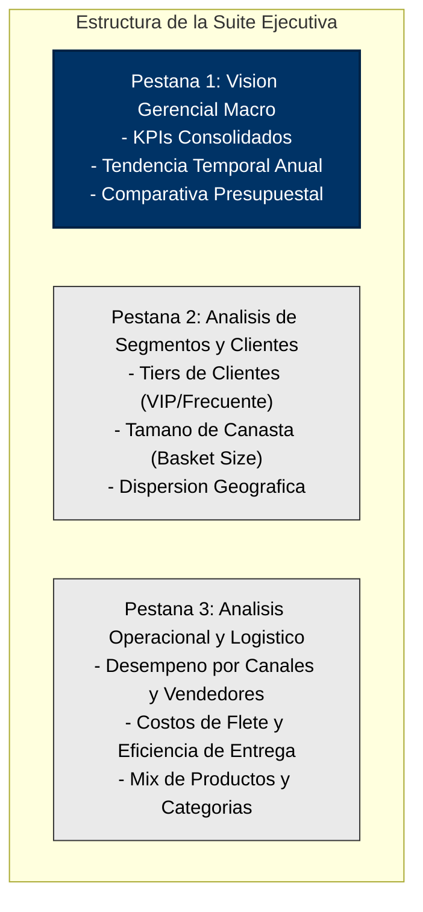

# Clase 4: Taller de Revisión de Modelos de Datos, Optimización Dimensional y Buenas Prácticas de Dashboarding

> **Objetivo de la Sesión**<br>
> 
> 
> Evaluar y optimizar los modelos de datos dimensionales desarrollados por los equipos analíticos, debatir sobre anti-patrones arquitectónicos en Power BI (como el exceso de tablas de hechos y la sobrecarga de granularidad en dimensiones), contrastar el uso de columnas calculadas frente a medidas DAX dinámicas, y establecer las pautas fundamentales de diseño visual, branding corporativo y control de carga cognitiva para la construcción de tableros ejecutivos.

---

## 1\. Contexto Académico y Metodología de Evaluación

El hito correspondiente al cierre de la segunda semana representa un punto de control intermedio (*Mid-term Checkpoint*) decisivo para el éxito del módulo:

- **Ponderación de la Calificación:** La entrega y consistencia técnica del modelo de datos dimensional representa el 50% de la evaluación total del módulo, mientras que la presentación y defensa de la suite interactiva de tableros ejecutivos conformará el 50% restante.

- **Axioma Arquitectónico Central:** *"El que no tiene modelo, menos va a tener reportes"*. La visualización no opera en el vacío; ningún diseño visual o capa gráfica puede subsanar las deficiencias, inconsistencias o bloqueos de rendimiento originados en una arquitectura dimensional defectuosa o mal relacionada.

- **Dinámica de Aprendizaje Cruzado (Peer Review):** La presentación pública de los modelos de cada equipo permitió socializar desafíos comunes de la industria: fuentes heterogéneas (Kaggle, Data Warehouses corporativos, catálogos relacionales), trade-offs de normalización, tratamiento de costos logísticos y formulaciones analíticas avanzadas.


---

## 2\. Principios Fundamentales de Arquitectura Dimensional y Buenas Prácticas

A partir de las auditorías técnicas realizadas en clase, se formalizaron directrices estructurales para el diseño dimensional de alto rendimiento sobre el motor en memoria *VertiPaq*:

### 2.1. El Anti-patrón de Múltiples Tablas de Hechos Sobre-normalizadas

En esquemas transaccionales tradicionales (OLTP), las operaciones comerciales se descomponen de forma natural en cabeceras y detalles (por ejemplo, cabecera de venta, líneas de detalle de venta y tablas de pagos en cuotas).

- **Riesgo en Sistemas Analíticos (Power BI):** Mantener tablas de hechos separadas para cabeceras (` FactVentasCabecera `), detalles (` FactVentasDetalle `) y pagos (` FactPagos `) provoca:

  1. Ambigüedad en los caminos de filtrado y problemas de cardinalidad bidireccional no deseada.
  
  1. Consumo exponencial de memoria RAM en el motor tabular al indexar claves intermedias redundantes.
  
  1. Degradación severa del tiempo de respuesta al evaluar medidas DAX complejas que deben transitar entre múltiples hechos.

- **Regla de Consolidación y Plegado (Folding):** En el modelado dimensional, las tablas de cabecera y detalle deben **desnormalizarse y consolidarse en una única tabla de hechos** definida al nivel más profundo de granularidad (el detalle de ítem). Los atributos de la cabecera (fecha de orden, cliente, forma de pago, términos de crédito) se integran directamente como columnas dimensionales o atributos degenerados en la tabla de detalle consolidada.

- **Principio de Supresión de Componentes Inertes:** *"Quitar lo que no se usa no es un crimen"*. Si una tabla transaccional accesoria (como un registro de auditoría o histórico de transacciones intermedias) no responde directamente a las preguntas de negocio formuladas en los requerimientos de reporte, debe eliminarse por completo del modelo analítico.



### 2.2. Tablas de Hechos Sin Hechos (Factless Fact Tables)

Un hallazgo crítico discutido durante el análisis de catálogos y consumo de medios (caso de estudio del catálogo de Netflix) fue la presencia de tablas transaccionales que carecen de métricas numéricas acumulativas tradicionales (sin columnas de ventas monetarias, cantidades vendidas ni costos unitarios).

- **Definición Teórica:** Una **Factless Fact Table** registra exclusivamente la ocurrencia de un evento en una coordenada multidimensional específica (por ejemplo, la publicación de un título cinematográfico en un momento del tiempo, por un director, en un país y bajo una clasificación particular).

- **Mecanismo de Explotación Analítica:**

  - No es posible aplicar funciones de suma directa (` SUM `).
  
  - Toda la inteligencia de negocio se deriva a partir de conteos cardinales (` COUNT `, ` DISTINCTCOUNT `), ratios de frecuencia, proporciones relativas respecto al total del catálogo (` DIVIDE `), y análisis de cobertura temporal (` MIN `, ` MAX `).
  
  - Requiere una estricta normalización de las dimensiones de soporte (` DimDirector `, ` DimPais `, ` DimRating `, ` DimTipoContenido `) y una ` DimDate ` robusta para estudiar tendencias de incorporación de contenido.

### 2.3. Control de Granularidad en Dimensiones de Gran Volumen

Un error recurrente en analítica consiste en trasladar dimensiones a nivel transaccional sin agrupamiento previo al entorno de visualización:

- **El Problema de las Dimensiones Masivas:** Tablas como ` DimCustomer ` o ` DimCards ` con decenas de miles o millones de registros individuales no pueden proyectarse de forma directa en un dashboard ejecutivo. Provocan visuales inoperables con barras de desplazamiento infinitas y rechazo cognitivo inmediato.

- **Técnica de Agrupamiento y Binarización (Bucketing / Binning):** El modelo dimensional debe incorporar columnas de agregación y categorización categórica que reduzcan la cardinalidad visual a segmentos ejecutivos:

  - *Segmentación por Rango Etario:* Niños, Adolescentes, Adultos Jóvenes, Adultos, Adulto Mayor.
  
  - *Segmentación por Score / Valor de Cliente:* VIP, Frecuente, Regular, Ocasional.
  
  - *Categorización de Tarjetas y Medios:* Tarjetas de Crédito, Débito, Prepago; Chips vs. Banda Magnética; Franquicias emisoras (Visa, Mastercard, Amex).
  
  - *Desacople Geográfico:* Extraer atributos dispersos en la dimensión de clientes hacia una ` DimGeography ` estructurada (País, Departamento/Estado, Ciudad, Código Postal) para posibilitar análisis jerárquicos (*drill-down*).

### 2.4. Integración del Flete y Variables Logísticas Ocultas

En negocios de retail, distribución y comercio electrónico (casos Northwind, Bookstore y Olist), un error común consiste en limitar el costo de la transacción a ` Cantidad * Precio Unitario `.

- **Impacto Financiero del Flete (**` Freight `**):** Los costos de transporte y despacho representan un componente estructural del margen neto. Ignorar el flete distorsiona la rentabilidad real de las órdenes.

- **Fórmula de Integración:**

  $\text{Margen Bruto Real} = \text{Venta Neta} - \text{Costo Mercadería} - \text{Costo de Flete Prorrateado}$

- **Potencial Analítico del Flete:** El flete permite crear categorizaciones operativas por umbral de costo logístico (flete bajo, medio, alto) y analizar disparidades territoriales de despacho.

---

## 3\. Lógica de Negocio y DAX: Columnas Calculadas vs. Medidas Dinámicas

La frontera entre la preparación de datos y el cálculo analítico determina la velocidad de respuesta del tablero.

### 3.1. Criterio de Selección según Rendimiento

| Elemento | Momento de Evaluación | Almacenamiento | Casos de Uso Aconsejados | Impacto en Rendimiento |
| --- | --- | --- | --- | --- |
| **Columna Calculada (Calculated Column)** | Tiempo de carga y refresco del modelo (Refresh). | Persiste físicamente en RAM y disco (comprimida por VertiPaq). | Segmentaciones estáticas fila por fila (` IF `, ` SWITCH `), cualificadores nominales (Venta Grande / Pequeña), bandas de precio y llaves sintéticas. | Aumenta ligeramente el peso del archivo, pero libera procesamiento en tiempo de consulta. **Esencial para filtros y segmentadores visuales.** |
| **Medida Dinámica (Measure)** | En tiempo de consulta al interactuar con el dashboard (Query Time). | No consume almacenamiento; utiliza ciclos de CPU en tiempo real. | Agregaciones (` SUM `, ` AVERAGE `), conteos (` DISTINCTCOUNT `), ratios (` DIVIDE `), comparaciones temporales (Time Intelligence) y métricas contextuales (` CALCULATE `). | Óptima si opera sobre columnas ya preparadas; **muy lenta y costosa si intenta evaluar lógica condicional fila por fila sobre millones de registros en tiempo real**. |

> **Directriz Técnica:**<br>
> 
> 
> No intente programar en DAX dinámico aquello que puede precalcularse de forma determinística en una columna calculada de la tabla de hechos. Las clasificaciones nominales deben resolverse en la carga para que los slicers y matrices funcionen de manera instantánea.

### 3.2. Patrones de Modelado DAX y Lógica Empresarial Implementados

#### 1\. Prorrateo de Costos Fijos por Transacción (Ejemplo de Campañas de Marketing)

Cuando un presupuesto o costo fijo se define a nivel macro en una dimensión (ej. ` Budget ` en ` DimCampaign `), pero se desea evaluar el costo de adquisición unitario por transacción en ` FactSales `, se prorratea el presupuesto entre el número total de ventas vinculadas a dicha campaña:

```javascript
// Columna Calculada en FactSales: Prorrateo de Presupuesto
Campaign Cost Per Sale = 
VAR CurrentCampaign = FactSales[CampaignKey]
VAR TotalSalesInCampaign = 
    CALCULATE(
        DISTINCTCOUNT(FactSales[SalesID]),
        ALLEXCEPT(FactSales, FactSales[CampaignKey])
    )
VAR CampaignBudget = 
    RELATED(DimCampaign[Budget])
RETURN
    DIVIDE(CampaignBudget, TotalSalesInCampaign, 0)
```

#### 2\. Prorrateo de Flete por Línea de Pedido (Detalle de Orden)

En órdenes de compra con múltiples ítems pero un único costo de envío global a nivel de cabecera:

```javascript
// Columna Calculada en FactSales: Flete por Ítem
Shipping Cost Item = 
VAR CurrentOrderID = FactSales[OrderID]
VAR TotalItemsInOrder = 
    CALCULATE(
        COUNTROWS(FactSales),
        ALLEXCEPT(FactSales, FactSales[OrderID])
    )
VAR OrderShippingFee = RELATED(OrdersHeader[ShippingFee])
RETURN
    DIVIDE(OrderShippingFee, TotalItemsInOrder, 0)
```

#### 3\. Tamaño Promedio de Canasta (Average Basket Size)

Métrica clave para comercios minoristas y librerías que cuantifica la cantidad promedio de unidades que un cliente adquiere por cada transacción:

```javascript
Average Basket Size = 
DIVIDE(
    [Total Quantity],
    [Total Orders],
    0
)
```

#### 4\. Indicador de Retención y Ratio de Finalización (Streaming Analytics)

En plataformas de streaming de audio o video, la evaluación de la calidad del contenido se determina por el ratio entre el tiempo reproducido y la duración nominal de la pista:

```javascript
// Columna Calculada en FactListens
Completion Ratio = 
DIVIDE(
    FactListens[SecondsListened], 
    RELATED(DimTrack[TrackDurationSeconds]), 
    0
)

// Cualificación Nominal del Engagement
Engagement Level = 
SWITCH(
    TRUE(),
    FactListens[Completion Ratio] >= 0.90, "High Engagement",
    FactListens[Completion Ratio] >= 0.50, "Medium Engagement",
    "Low Engagement / Skipped"
)
```

#### 5\. Métricas de Crecimiento Interperíodo (Growth Metrics)

Indispensables para tableros ejecutivos y análisis con mapas de calor:

```javascript
// Ventas del Período Anterior
Sales Previous Period = 
CALCULATE(
    [Total Net Sales],
    DATEADD(DimDate[Date], -1, MONTH)
)

// Porcentaje de Crecimiento
Sales Growth Rate = 
DIVIDE(
    [Total Net Sales] - [Sales Previous Period],
    [Sales Previous Period],
    0
)
```

### 3.3. Restricciones Técnicas en Fuentes de Datos: SSAS Live Connection vs. Data Warehouse Directo

Uno de los aprendizajes clave del taller (caso Bookstore) provino de comparar dos métodos de conexión corporativa:

- **Conexión Live a SSAS Tabular (SQL Server Analysis Services):** Cuando Power BI se conecta en modo Live a un cubo o modelo tabular preexistente, el diseñador queda inhabilitado para crear columnas calculadas, manipular relaciones o enriquecer la tabla de hechos en Power BI Desktop. El modelo queda bloqueado en modo consumo.

- **Conexión al Data Warehouse / Modo Importación:** Permite libertad absoluta para realizar operaciones de modelado semántico, enriquecer la capa de hechos con columnas operativas y construir el repositorio centralizado de métricas en DAX.

---

## 4\. Síntesis Comparativa de Casos de Estudio y Modelos Auditados

| Proyecto / Equipo | Dominio de Negocio | Estructura Dimensional | Desafíos Técnicos Identificados | Solución y Recomendación del Docente |
| --- | --- | --- | --- | --- |
| **Grupo 2**<br> (Camacho, Chaló, Fernández, Flores, Gutiérrez) | Ventas Retail Multicanal (2024) | Modelo Snowflake: ` DimCustomers `, ` DimCampaign `, ` DimProducts `, ` DimStores `, ` FactSales `. | Prorrateo de presupuestos fijos de marketing y creación de tabla resumida de clientes VIP. | Ocultar Surrogate Keys en la vista de informe. Crear tabla auxiliar de cuotas/objetivos (` Sales Targets `) para comparar ejecutado vs. presupuesto. |
| **Grupo 1**<br> (Carvajal, Cueva, Grimaldo, Humes, Meléndez, Terceros) | Bookstore (Librería y Distribución) | Modelo Estrella sobre DW: ` DimBook `, ` DimCustomer `, ` DimShipping `, ` FactSales `. | Bloqueo inicial en conexión SSAS Live. Datos crudos homogéneos (` Quantity = 1 `). | Transición a conexión directa DW para habilitar columnas calculadas. Prorrateo de fletes por línea de orden. Generación estocástica (variabilidad natural) de cantidades. Métricas de canasta promedio (` Average Basket Size `). |
| **Grupo 3**<br> (Arispe, Calumani, Canseco) | Plataforma de Streaming Musical | Modelo Estrella: ` DimUser `, ` DimTrack `, ` DimDevice `, ` DimGeo `, ` FactListens `. | Modelado de métricas de calidad y comportamiento sin variables financieras directas. | Excelente ingeniería de características en la tabla de hechos (` Completion Ratio `, ` Time Bucket `, ` Engagement Level `). Enfocar las métricas estrictamente a las preguntas de negocio iniciales. |
| **Grupo 4**<br> (Pinto, Valverde) | Importación y Venta de Línea Blanca | Múltiples Tablas de Hechos: ` FactVentasCabecera `, ` FactVentasDetalle `, ` FactCompras `, ` FactPagos `. | Sobre-normalización severa, relaciones múltiples y potencial pérdida de rendimiento en VertiPaq. | **Refactorización crítica obligatoria:** Consolidar cabecera y detalle en una sola tabla de hechos al nivel de ítem. Eliminar tablas de hechos que no sustenten dashboards prioritarios. |
| **Grupo 5**<br> (Calderón, Guzmán) | Marketplace E-commerce (Olist Brasil) | Modelo Estrella: ` DimCustomer `, ` DimSeller `, ` DimProduct `, ` DimStatus `, ` FactOrderItems `. | Tablas de pagos complejas y cantidades unitarias implícitas en cada registro. | Asumir y documentar que 1 fila equivale a 1 unidad vendida. Incorporar el valor del flete (` fright_value `) al costeo de rentabilidad. |
| **Grupo 6**<br> (Buergo, Colque) | Retail en Centros Comerciales | Modelo Estrella sobre dataset desnormalizado: ` FactVentas `, dimensiones derivadas. | Intento de procesar categorizaciones condicionales complejas exclusivamente dentro de DAX dinámico. | Trasladar clasificaciones fijas (rangos de precios altos/bajos, venta unitaria vs. volumen) a columnas calculadas en la tabla de hechos para preservar el rendimiento. |
| **Grupo 7**<br> (Caricari, Plaza) | Distribución y Logística Nacional | Modelo Estrella Olist: ` FactOrderItems `, ` DimProduct `, ` DimCustomer `, ` DimDate `. | Tabla de geolocalización masiva y redundante sin claves unívocas para relación directa. | Depurar y descartar tablas accesorias huérfanas. Analizar a fondo el diccionario de datos de las variables logísticas antes de construir visuales. |
| **Grupo 8**<br> (Acho, Arancibia, Valderrama) | Northwind Traders (Import / Export) | Modelo Estrella clásico: ` FactOrders `, ` DimProducts `, ` DimCustomers `, ` DimEmployees `. | Replicación estricta del modelo base de clase sin personalización del dominio. | Aprovechar campos no explotados como ` Freight ` (flete) para computar margen neto real y segmentar distancias logísticas. |
| **Caso Individual: R. Gallo** | Catálogo de Contenido Streaming (Netflix) | Modelo dimensional con ` Factless Fact Table `: ` DimDirector `, ` DimCountry `, ` DimRating `, ` DimDate `. | Inexistencia de métricas aditivas cuantitativas (sin montos ni volúmenes de venta). | Correcta aplicación del concepto de Factless Table mediante medidas de conteo, proporciones del catálogo y generación de calendario DAX dinámico. |
| **Caso Individual: M. Jiménez** | Transacciones Financieras y Pasarelas de Pago | Esquema dimensional de alto volumen (10 millones de filas): ` FactTransacciones `, ` DimCards `, ` DimUsers `. | Dimensiones ultra-granulares (números de tarjeta e IDs de usuario) inviables para visualización. | Agrupar tarjetas por franquicia (Visa/Mastercard) y tecnología (Chip/Banda). Categorizar edades y scores crediticios. Diseñar tableros ejecutivos basados en mapas de calor temporal (MoM, WoW). |
| **Caso Individual: J. Mesa** | Tienda Musical Chinook | Esquema Estrella: ` DimProduct `, ` DimCustomer `, ` DimEmployee `, ` FactInvoices `. | Mezcla lingüística (inglés/español) y dimensiones compuestas ocultas dentro de una sola entidad. | Estandarizar el idioma en toda la solución. Desacoplar atributos en dimensiones independientes (` DimArtist `, ` DimGenre `, ` DimTrack `). |
| **Caso Individual: R. Zoruco** | E-commerce Internacional | Modelo Estrella: ` FactSales `, ` DimStore `, ` DimCustomer `, ` DimTransactionType `. | Nombres técnicos crudos (` TransDim `) y dimensionamiento de clientes sin datos descriptivos. | Estandarizar nomenclaturas a lenguaje de negocio. Cualificar temporalidad por franja horaria (` DayPart `: mañana, tarde, noche) para análisis de picos de demanda. |

---

## 5\. Directrices de Visualización y Preparación de Dashboards (Semana 3)

Como antesala a la etapa intensiva de construcción visual, se fijaron directrices estrictas para asegurar que los tableros cumplan con estándares ejecutivos de alto impacto:

### 5.1. Regla de los Cinco Segundos y Control de Carga Cognitiva

- **La Regla de los 5 Segundos:** Un directivo o tomador de decisiones debe ser capaz de comprender el estado general del negocio, la tendencia principal y las áreas con desviaciones críticas en menos de cinco segundos de observación.

- **Prohibición del "Collage Visual" (Visual Salad):** Un error habitual consiste en intentar condensar todos los gráficos posibles (barras, líneas, donas, tarjetas numéricas, tablas detalladas y mapas) en un único lienzo. El exceso de información produce parálisis visual (*Cognitive Overload*).

- **Estructura Multi-Pestaña Especializada:**

  - *Pestaña 1: Resumen Ejecutivo / Estratégico:* Indicadores macro de salud del negocio (Ventas Netas, Ticket Promedio, Cumplimiento de Metas, Margen Global) con segmentación temporal consolidada.
  
  - *Pestaña 2: Análisis de Comportamiento / Clientes:* Distribución por segmentos (VIP, Frecuente, Regular), tamaño de canasta, retención y procedencia geográfica.
  
  - *Pestaña 3: Rendimiento Operativo y de Canales:* Rendimiento por vendedor, canal de distribución (físico vs. online), métodos de despacho y costos logísticos.
  
  - *Pestaña 4: Cumplimiento de Objetivos (Targets):* Comparativa sistemática de Presupuesto vs. Real (*Actual vs. Budget*).

### 5.2. Branding Corporativo y Arquitectura Cromática

- **Definición de Identidad Institucional:** Ningún reporte profesional debe entregarse con las paletas predeterminadas o en tonos monocromáticos grises opacos sin jerarquía. Es obligatorio incorporar:

  1. Logotipo oficial de la empresa o entidad en una esquina superior neutra.
  
  1. Tipografía corporativa homogénea y legible.
  
  1. Paleta cromática corporativa restringida a un máximo de 2 a 3 colores dominantes.

- **El Lienzo Neutro Estructurado:**

  - Emplear un fondo gris tenue o neutro para delimitar secciones visuales mediante tarjetas contenedoras (*cards* con esquinas sutilmente redondeadas y ligera elevación visual).
  
  - Reservar el color saturado de acento exclusivamente para dirigir la atención ejecutiva hacia metas alcanzadas (verde/azul) o desviaciones operativas y pérdidas (rojo/naranja cálido).



---

## 6\. Acuerdos Académicos y Próximos Entregables

1. **Evidencia Técnica de Modelado (Hito Semana 2):**

   - Subir el archivo de Power BI (` .pbix `) a la plataforma académica como respaldo del modelo dimensional depurado y la tabla de métricas DAX.
   
   - Para proyectos construidos sobre datos públicos (Kaggle), no se requiere grabación de video explicativo individual en esta etapa; la entrega del archivo de modelo constituye la evidencia formal.

1. **Participación en Foro Académico:**

   - El foro temático sobre *"Visualizaciones Efectivas y Criterios de Selección Gráfica"* se encuentra habilitado para discusión e intercambio técnico hasta el domingo.

1. **Cuestionario de Evaluación de Medio Término:**

   - Evaluación conceptual habilitada en la plataforma institucional con un límite de dos intentos. Cubre principios de percepción visual, taxonomía de reportes, arquitectura dimensional y fundamentos DAX.
