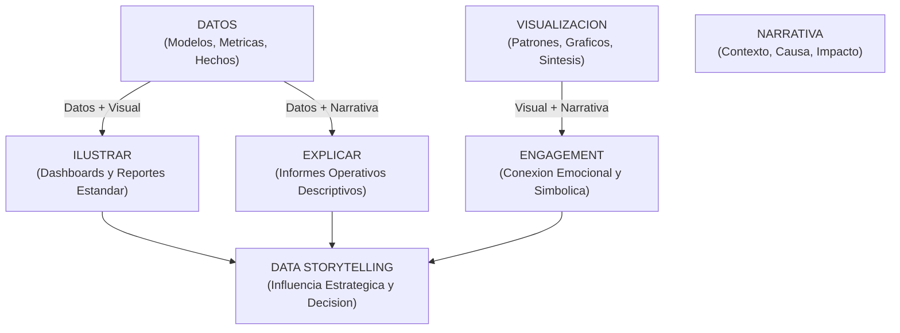
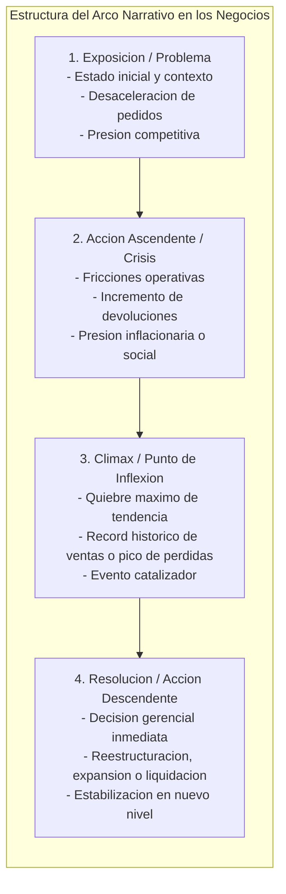
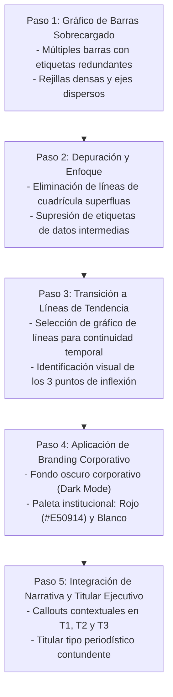
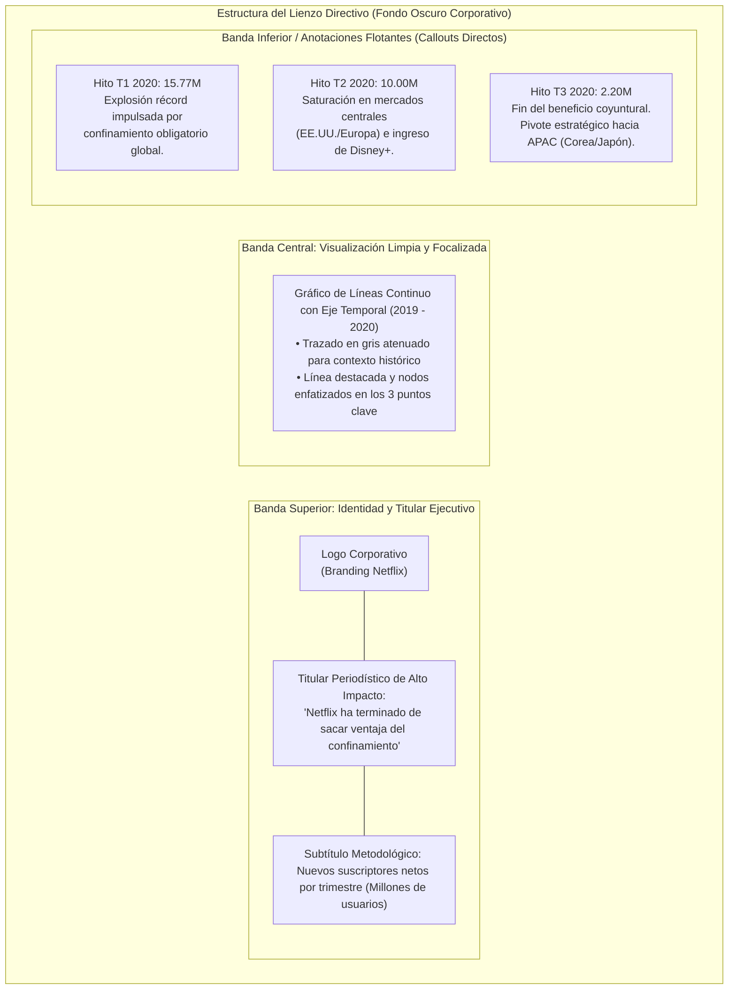
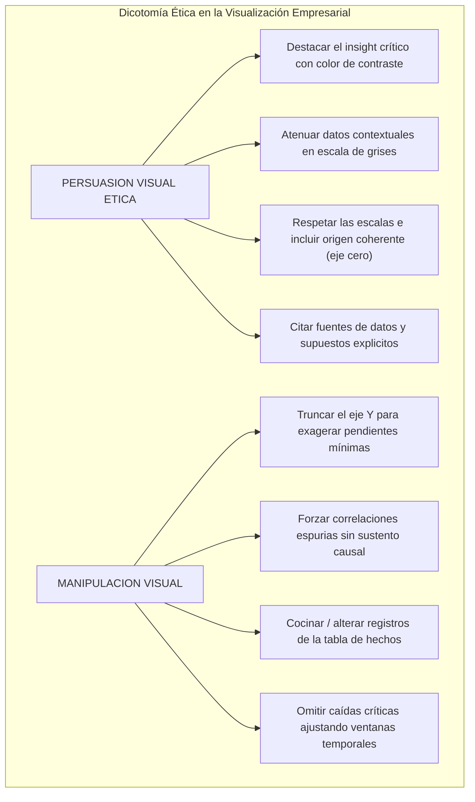
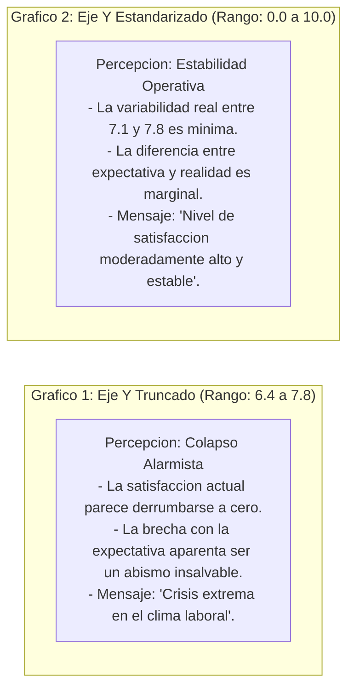
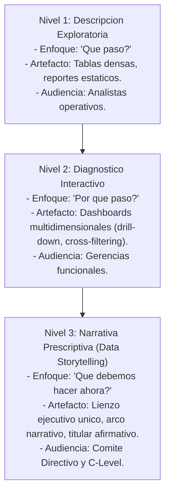

# Clase 6: Fundamentos y Aplicacion de Data Storytelling Empresarial en Entornos Corporativos

> **Objetivo de la Sesion** 
> Comprender, estructurar e implementar narrativas estrategicas basadas en datos (Data Storytelling) en entornos de Inteligencia de Negocios, transitando desde la visualizacion analitica tradicional hacia la comunicacion ejecutiva persuasiva, memorable y accionable mediante la integracion de arcos narrativos, branding corporativo, reduccion de sobrecarga cognitiva y rigor etico.

## 1\. Contexto y Transicion Metodologica: De la Visualizacion Operativa al Storytelling Estrategico

En el desarrollo de soluciones de Inteligencia de Negocios (BI), se observa con frecuencia una marcada brecha disciplinar entre la construccion de modelos de datos tecnicos y la transmision efectiva de hallazgos a los tomadores de decisiones (stakeholders). El perfil analitico e ingenieril tiende a concentrarse de forma prioritaria en:

1. El modelado relacional (esquemas en estrella, tablas de hechos y dimensiones).

1. La transformacion y limpieza de datos mediante procesos ETL/ELT.

1. El calculo de metricas complejas a traves de expresiones analiticas (DAX, SQL analitico).

1. El diseno de cuadros de mando exhaustivos y multidimensionales.

Sin embargo, el objetivo nuclear de la analitica empresarial no radica exclusivamente en el procesamiento o en la precision milimetrica de las metricas, sino en su capacidad para **influir en decisiones estrategicas corporativas**. La direccion ejecutiva, vicepresidencias y directorios operan bajo restricciones severas de tiempo y atencion, por lo que reportes sobrecargados de filtros, tablas densas y visualizaciones sin foco analitico generan **sobrecarga cognitiva** y fracasan en su proposito comunicativo.

El Data Storytelling emerge como la disciplina metodologica orientada a traducir analisis complejos en narrativas simples, estructuradas y contextualizadas. Mientras que un reporte operativo responde a la pregunta *"¿Que paso?"*, el storytelling directivo explica *"¿Por que paso y que acciones concretas deben implementarse ahora?"*.

---

## 2\. Fundamentos Teoricos del Data Storytelling Empresarial

### 2.1. La Triada Conceptual de la Narrativa de Datos

El Data Storytelling no constituye una herramienta de software ni un lenguaje de programacion en particular, sino un proceso metodologico integrado por tres pilares interdependientes:

1. **Datos (Data Cut):** Segmento analitico de informacion filtrado y dimensionado a partir de la tabla de hechos y modelos OLAP (sumatorias, promedios, maximos, minimos o ratios especificos).

1. **Visualizaciones (Visuals):** Representacion visual estructurada (lineas, barras, dispersiones, proporciones) que sintetiza la variabilidad y magnitudes de las metricas.

1. **Narrativa (Narrative):** Relato textual explicativo que provee contexto situacional, temporal, factores causales y proyecciones de negocio.

#### Analisis de Intersecciones:

- **Datos + Visualizacion (Ilustrar):** Genera representaciones graficas de la informacion (ejemplo: distribuciones porcentuales en graficos de dona o barras de ventas mensuales). Carece de explicacion causal si no se incorpora contexto cualitativo.

- **Datos + Narrativa (Explicar):** Descripcion textual de volumenes y concentraciones de mercado (ejemplo: informes tecnicos de agregaciones donde se detalla el desempeno operativo de un trimestre).

- **Visualizacion + Narrativa (Engagement):** Transmision inmediata de un mensaje conceptual apoyado en recursos graficos de alto impacto y sintesis simbolica. Un ejemplo corporativo paradigmático es ilustrar la dominancia tecnologica proyectando un porcentaje contundente (ejemplo: "95% del mundo corporativo") junto al imagotipo de una herramienta empresarial y una silueta de rascacielos corporativos, comunicando universalidad y vigencia sin necesidad de bloques extensos de texto.

- **Interseccion Central (Data Storytelling):** Convergencia de los tres dominios. Explica el contexto con rigor numerico, ilustra las tendencias visuales minimizando el ruido y engancha a la audiencia provocando reflexion, urgencia o alineacion estrategica.

### 2.2. Patologias de la Visualizacion No Narrativa

La ausencia de equilibrio entre los componentes de la triada conduce a fallas estructurales de comunicacion:

| Concepto | Descripcion y Manifestacion | Consecuencia Analitica |
| --- | --- | --- |
| **Data Decoration (Decoracion de Datos)** | Incorporacion de visualizaciones estetizadas pero carentes de mensaje analitico claro. Uso indiscriminado de paletas arcoiris, representacion innecesaria de decenas de miles de entidades simultaneas (ej. nubes masivas de clientes o productos) y elementos superfluos. | Sobrecarga sensorial, incapacidad de interpretacion y nulidad como soporte a la toma de decisiones. |
| **Data Cut sin Insight** | Extraccion directa de cortes dimensionales de la base de datos o cubo OLAP (ej. listar ventas de una gestion sin destacar picos, anomalias ni hitos relevantes). | El reporte se reduce a una consulta SQL ejecutada, transfiriendo al directivo la carga de descubrir el problema. |
| **Cameo Narrativo** | Exposicion de una historia aislada o declaracion superficial sin respaldo empirico ni contraste dimensional (ej. afirmar "las ventas se incrementaron en 2017" sin explicar la causa ni dimensionar la participacion de mercado). | Falta de credibilidad y superficialidad analitica. |

### 2.3. El Arco Narrativo Aplicado al Ciclo de Negocio

Toda narrativa efectiva adopta una secuencia estructural heredada de la dramaturgia clasica (planteamiento, nudo, desenlace), perfectamente extrapolable a la vida util, crisis y reactivacion de las organizaciones.

#### Fases del Arco en Contextos Empresariales:

1. **Exposicion (Contextualizacion del Personaje/Empresa):** Descripcion del modelo de negocio, lineas de producto y condiciones de estabilidad del mercado previa al fenomeno en estudio.

1. **Crisis (Accion Creciente):** Irrupcion de factores exogenos o endogenos que alteran el desempeno normal (ej. saturacion de mercados maduros, devaluacion monetaria, irrupcion de competidores con modelos de suscripcion o fallas en cadenas de suministro).

1. **Climax (Punto de Inflexion Critico):** Momento determinante donde la metrica alcanza su registro extremo (maximo historico de demanda o suelo critico de solvencia). En este punto se define la continuidad o el giro de la organizacion.

1. **Resolucion / Fin (Accion Ejecutiva):** Adopcion de medidas accionables (diversificacion geografica, reconversion de catalogo, cierre de sucursales deficitarias o ajuste de politicas de precios) conducentes a una nueva meseta operativa.

---

## 3\. Demostracion e Implementacion en Power BI: Caso Netflix y Arquitectura Visual

### 3.1. Caso de Estudio: Suscripciones Globales de Netflix (2019-2020)

El analisis de la dinamica de adquisicion de nuevos suscriptores netos de Netflix durante el inicio y desarrollo de la pandemia por COVID-19 constituye un caso canonico de transformacion desde datos brutos hacia una historia de impacto ejecutivo.

#### Datos Trimestrales de Entrada:

- Periodo prepandemia (2019): Tiempos de crecimiento moderado y sostenido.

- **T1 2020 (Pico/Climax):** Adicion extraordinaria de 15.77 millones de nuevos suscriptores netos debido al inicio del confinamiento global obligatorio.

- **T2 2020 (Desaceleracion/Crisis de saturacion):** Descenso a aproximadamente 10.00 millones de suscriptores, provocado por la saturacion en mercados maduros (Norteamerica y Europa Occidental) y la irrupcion masiva de competidores (Disney+, HBO Max, Paramount+).

- **T3 2020 (Estabilizacion/Nueva normalidad):** Ajuste a 2.20 millones de usuarios, reflejando el agotamiento de la ventaja coyuntural y obligando a la diversificacion de contenido (producciones en Corea del Sur, Japon y produccion regional).

### 3.2. Proceso de Evolucion y Depuracion Visual

La transformacion de este informe siguio un riguroso proceso de eliminacion de ruido visual (decluttering) y aplicacion de branding corporativo:

### 3.3. Maquetacion del Lienzo de Storytelling Directivo

A diferencia de un dashboard analitico operativo que se encuentra saturado de segmentadores y matrices, el lienzo de storytelling se estructura en un folio unico de presentacion ejecutiva:

#### Caracteristicas Clave de la Arquitectura del Reporte:

1. **Titular Orientado a la Conclusion:** En lugar de titular el grafico de manera neutral como *"Suscripciones de Netflix 2019-2020"*, el reporte adopta un encabezado de juicio de valor sustentado: *"Netflix ha terminado de sacar ventaja del confinamiento"*. Si el directivo solo leyera el titulo, asimila inmediatamente el estado estrategico del negocio.

1. **Anotaciones Directas en Puntos de Inflexion:** Se evitan leyendas separadas. Las cajas de texto (callouts) se posicionan contiguas a los puntos criticos del trazado, vinculando directamente la magnitud numerica con su causalidad.

1. **Alineacion Cromatica con la Identidad Corporativa:** El contraste entre grises apagados, blanco para texto principal y rojo corporativo para el enfasis focaliza la mirada sin fatiga visual.

---

## 4\. Casos y Analisis de Visualizacion: Persuasion vs. Manipulacion Visual

### 4.1. Frontera Etica: Persuasion Analitica vs. Manipulacion de Datos

En el diseno de reportes ejecutivos, el analista posee el control del encuadre visual. Es mandatorio diferenciar la persuacion legitima de la manipulacion sesgada:

- **Persuasion Etica:** Consiste en dirigir la atencion del decisor hacia hechos comprobables y relevantes para el negocio, utilizando contrastes de color, encuadres cronologicos justificados y tipografias jerarquizadas sin distorsionar la verdad empirica subyacente.

- **Manipulacion:** Ocurre cuando se modifican de manera maliciosa o descuidada los parametros visuales (escalas, origenes de ejes, truncamientos, correlaciones forzadas) para inducir conclusiones erroneas o artificialmente alarmistas/triunfalistas.

### 4.2. Caso de Estudio: Truncamiento de Escalas en Evaluacion de Satisfaccion Laboral

Un ejemplo contundente analizado en clase demuestra como dos representaciones del mismo conjunto de datos generan percepciones diametralmente opuestas sobre la satisfaccion de los empleados en funcion de su edad (22 a 47 anos) y su satisfaccion actual versus expectativa a 5 anos:

#### Implicancia Metodologica:

Al truncar el eje de ordenadas a un intervalo cerrado (6.4 - 7.8), se magnifican fluctuaciones microscopicas, distorsionando la realidad del negocio y conduciendo a intervenciones organizacionales costosas e injustificadas. La regla general exige utilizar la escala natural de evaluacion (0 a 10 en encuestas psicometricas o de satisfaccion) para contextualizar la dimension real de los cambios.

### 4.3. Casos Complementarios Discutidos en Sesion

#### 1\. Dinamica del Tipo de Cambio Paralelo (USD / USDT en Bolivia)

El comportamiento reciente del mercado cambiario ilustra las fases completas del arco narrativo:

- **Exposicion:** Estabilidad fija historica (6.96 Bs/USD) sin divergencia con el mercado paralelo.

- **Crisis:** Escasez inicial de divisas fisicas, colas por combustible y nacimiento del tipo de cambio paralelo, superando la barrera de 15 Bs.

- **Climax:** Panico e inflacion proyectada en el periodo preelectoral alcanzando un record historico cercano a 20 Bs/USD.

- **Resolucion / Estabilizacion:** Aplicacion de politicas regulatorias y correccion de mercado, estabilizandose en una banda de resistencia y soporte de entre 9.50 y 10.00 Bs/USD. La narracion visual debe respaldarse en triangulacion con eventos sociales y medidas economicas clave.

#### 2\. Metáforas Visuales de Impacto: Infografia "Planeta Basura"

En el analisis de residuos plasticos globales, la simple presentacion de tablas con porcentajes carece de impacto emocional. La inclusion de analogias contextualizadas (ej. *"Con los residuos plasticos desperdiciados en 6 anos, China podria reconstruir una nueva Gran Muralla China"*) logra anclar mentalmente cifras abstractas en magnitudes comprensibles para la memoria de trabajo de la audiencia.

---

## 5\. Directrices, Buenas Practicas y Anti-patrones de Diseno Visual

### 5.1. Gestion de la Carga Cognitiva en la Comunicacion Directiva

1. **La Regla de la Simplicidad Ejecutiva (*****The Simpler, The Better*****):** Un directivo o gerente general no analiza pormenores multidimensionales. El reporte debe concentrarse en **una sola metrica cardinal** (por ejemplo, Ventas Netas Totales), prescindiendo de introducir de manera concurrente ventas brutas, descuentos, volumen fisico de piezas y comparativas de tres ejercicios previos en el mismo lienzo narrativo.

1. **Reduccion del Ruido Visual (Data-to-Ink Ratio):** Eliminar lineas de cuadricula saturadas, marcos gruesos, etiquetas en cada punto de datos y fondos con imagenes distractores.

1. **Uso de la Tecnica del Fondo Neutro y Acento Focal:** Pintar todas las series secundarias y contextos temporales pasados en tonalidades de gris atenuado, reservando el color institucional saturado exclusivamente para la linea, barra o sucursal foco de la decision.

### 5.2. Tabla de Buenas Practicas vs. Anti-patrones

| Dimension | Practica Recomendada | Anti-patron Detectado |
| --- | --- | --- |
| **Metricas en Pantalla** | Seleccionar una metrica clave alineada con el problema del negocio (ej. Ventas Netas Totales). | Mezclar multiples variantes de la misma metrica (ventas netas, brutas, costo, margen, impuestos) en una sola vista narrativa. |
| **Etiquetado** | Rotular de forma directa unicamente los hitos (pico, quiebre, cierre) mediante cajas de llamada (callouts). | Mostrar etiquetas de datos densas sobre cada una de las 12 barras o puntos del ano. |
| **Uso del Color** | Paleta semantica y corporativa sobria (fondo neutro, gris para contexto, color acento para el hallazgo). | Esquema arcoiris o colores aleatorios por categoria sin justificacion semantica. |
| **Ejes y Escalas** | Iniciar ejes cuantitativos en cero y mantener escalas proporcionales al fenomeno analizado. | Truncar ejes para exagerar pendientes o utilizar ejes secundarios con escalas incompatibles que confunden la causalidad. |
| **Titulos** | Titulares periodisticos afirmativos y accionables que comunican el veredicto del reporte. | Titulos genericos y puramente descriptivos (ej. *"Ventas por Mes 2023"*). |

---

## 6\. Sintesis Conceptual y Profundizacion Academica

### 6.1 Taxonomia de la Madurez en Comunicacion con Datos

La evolucion desde la generacion de reportes tradicionales hasta la persuasion ejecutiva sigue un continuo de sofisticacion tecnica y narrativa:

### 6.2 Principios Epistemologicos y Eticos del Storytelling Directivo

1. **La Verdad Factual como Condicion Necesaria pero Insuficiente:** Un analisis riguroso que no logra comunicar su hallazgo central de forma comprensible para quienes toman decisiones carece de impacto practico en la organizacion.

1. **El Deber Deontologico de la Escala:** La alteracion arbitraria de ejes cuantitativos para sobredimensionar tendencias marginales vulnera la etica profesional del cientifico de datos. La persuasion legitima se fundamenta en la claridad del recorte analitico y en el rigor contextual, jamas en la distorsion visual.

1. **Economia de la Atencion Ejecutiva:** El recurso mas escaso en un comite de direccion es el tiempo cognitivo. Un reporte que exige descifrar convenciones graficas complejas o relacionar decenas de variables disconexas fracasa en su objetivo de catalizar decisiones informadas.
