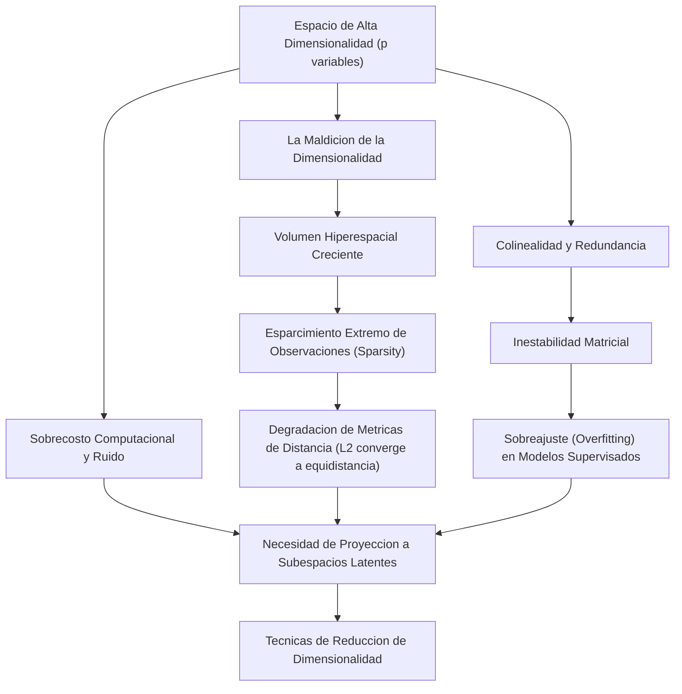
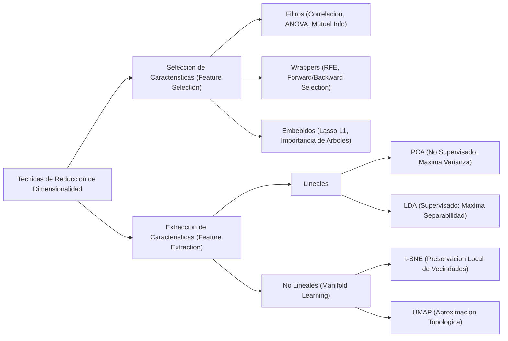
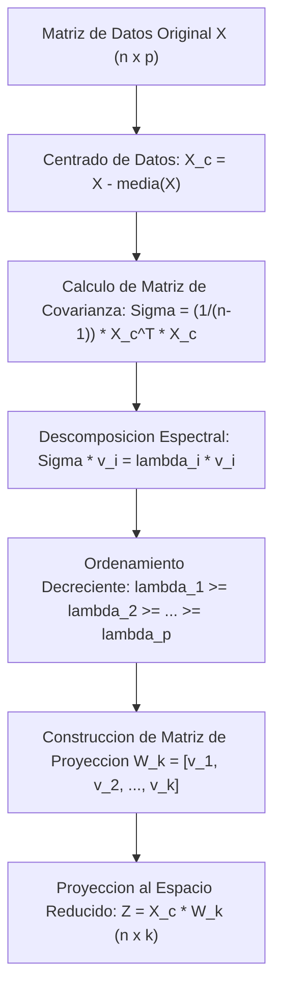
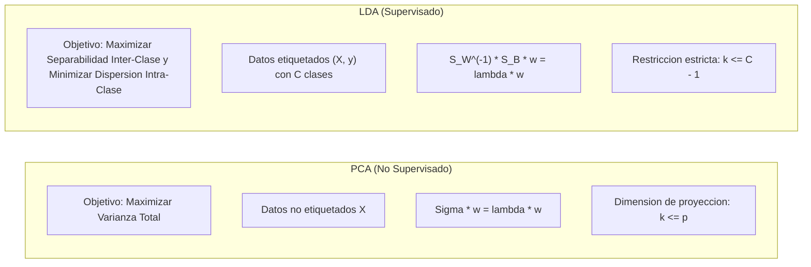
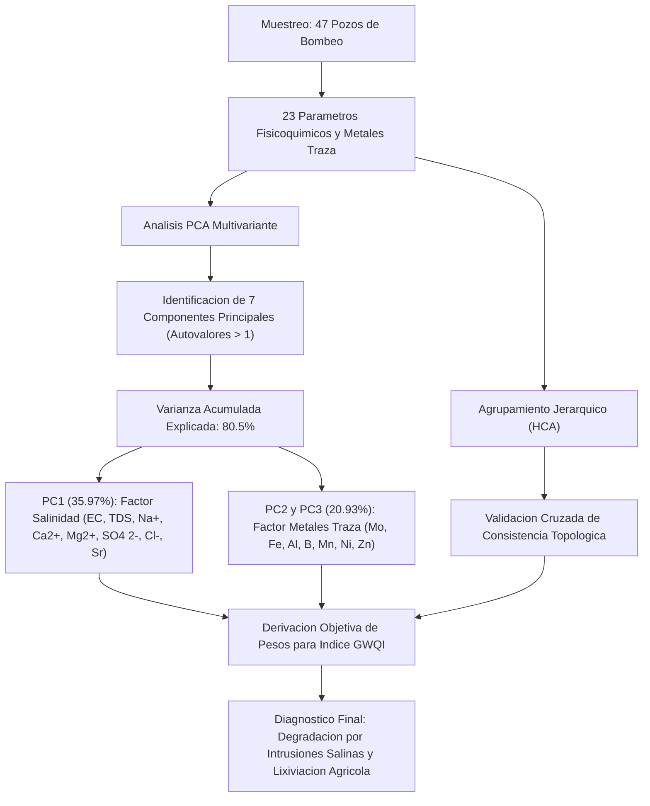
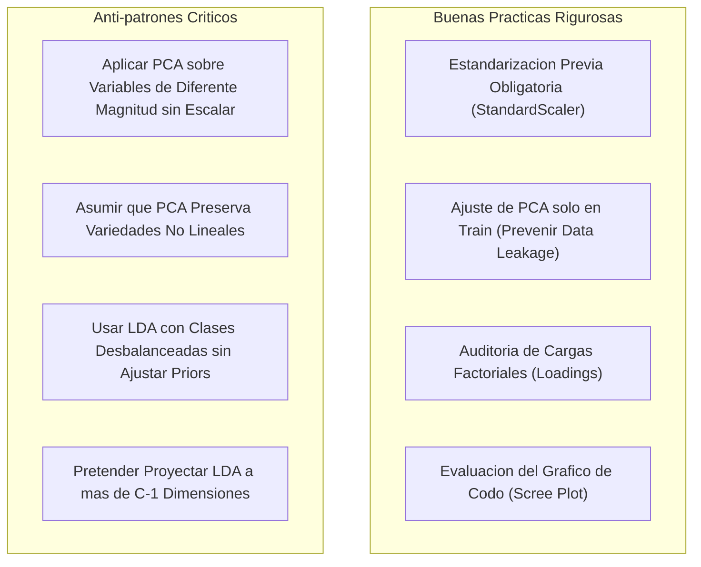
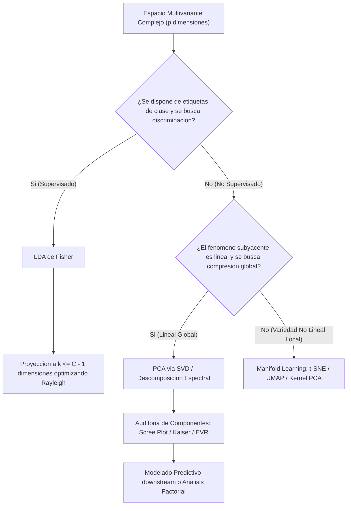

# Clase 4: Reduccion de Dimensionalidad, Analisis de Componentes Principales (PCA) y Analisis Discriminante Lineal (LDA)

Fuente de analisis primario: clase4.txt  

Material complementario: Diapositivas oficiales ("5. Reduccion de Dimensionalidad.pdf")  

Area tematica: Modulo 8 - Machine Learning \| Maestria en Ciencia de Datos e Inteligencia Artificial

> **Objetivo Academico y Pedagogico**<br>
> 
> 
> Comprender y formalizar matematicamente los fundamentos de la reduccion de dimensionalidad en espacios continuos multivariados, dominando las diferencias estructurales entre la seleccion y la extraccion de caracteristicas. Se profundiza en el Analisis de Componentes Principales (PCA) como tecnica no supervisada orientada a la maximizacion de la varianza proyectada mediante descomposicion espectral y SVD, asi como en el Analisis Discriminante Lineal (LDA) de Fisher como metodo supervisado para la maximizacion de la separabilidad inter-clase. Se evaluan implementaciones computacionales reproducibles en Python, criterios analiticos de seleccion de dimensiones latentes y aplicaciones cientificas de vanguardia.

---

## 1\. Contexto y Marco Conceptual

En el modelado estadistico contemporaneo y el aprendizaje automatico aplicado, el tratamiento de conjuntos de datos caracterizados por una alta cardinalidad de variables descriptivas ($p$) respecto al numero de observaciones ($n$), o con valores elevados de $p \in \mathbb{R}^d$, impone restricciones severas tanto teoricas como computacionales.



### 1.1 La Maldicion de la Dimensionalidad (Curse of Dimensionality)

El termino, acunado originalmente por Richard Bellman en 1961 en el contexto de control optimo, sintetiza los fenomenos contraintuitivos que emergen cuando el espacio vectorial de caracteristicas incrementa su dimension:

1. **Crecimiento Exponencial del Volumen Hiperespacial:** El volumen de un hipercubo de dimension $p$ y lado $L$ escala como $V(p) = L^p$. Si se requiere mantener una densidad constante de muestreo para garantizar representatividad estadistica en cada region del espacio, el numero de muestras requeridas crece exponencialmente con $p$ ($N \propto \mathcal{O}(k^p)$). En la practica, las muestras reales se vuelven extremadamente escasas (*data sparsity*), dejando vastas regiones hiperespaciales desiertas.

1. **Concentracion de Medidas y Fenomeno de Equidistancia:** En espacios de alta dimension, la razon entre la distancia euclidiana al punto mas cercano y al punto mas lejano converge a 1:

   $\lim_{p \to \infty} \frac{\text{dist}_{\max} - \text{dist}_{\min}}{\text{dist}_{\min}} \to 0$
   
   Esto degrada severamente el rendimiento de algoritmos fundamentados en distancias directas (como $k$-NN, maquinas de soporte vectorial con kernel RBF y algoritmos de agrupamiento como $k$-Means), dado que todas las observaciones parecen estar a distancias equivalentes entre si.

### 1.2 Redundancia, Multicolinealidad y Ruido

En la mayoria de los dominios empiricos (quimica ambiental, vision computacional, biologia molecular, datos sociodemograficos), las variables originales no son mutuamente independientes:

- **Multicolinealidad:** Diversas caracteristicas miden facetas redundantes del mismo fenomeno fisico subyacente (por ejemplo, multiples iones disueltos correlacionados con la salinidad total de un acuifero, o pixeles contiguos en una imagen digital).

- **Inestabilidad de Parametros:** Matrices de covarianza de dimension $p \times p$ con columnas colineales poseen determinantes proximos a cero (matrices mal condicionadas), lo cual desestabiliza estimadores de regresion lineal y modelos parametricos.

- **Sobrecarga de Ruido:** Atributos con varianza insignificante o sin correlacion con el fenomeno de interes introducen grados de libertad espurios que incrementan el riesgo de sobreajuste (*overfitting*).

---

## 2\. Fundamentos Teoricos y Arquitectura Matematica

La reduccion de dimensionalidad comprende dos paradigmas fundamentales y complementarios:



- **Seleccion de Caracteristicas (*****Feature Selection*****):** Preserva un subconjunto estricto $k < p$ de las variables originales $X_{j_1}, \dots, X_{j_k}$, eliminando las $p - k$ restantes. Mantiene la interpretabilidad fisica directa de las variables, pero descarta por completo la informacion residual contenida en los atributos omitidos.

- **Extraccion de Caracteristicas (*****Feature Extraction*****):** Transforma el espacio original mediante una proyeccion funcional $\Phi: \mathbb{R}^p \to \mathbb{R}^k$ (con $k \ll p$), construyendo nuevas variables sinteticas (componentes o factores) que representan combinaciones de todos los atributos iniciales, reteniendo la maxima cantidad de informacion o varianza global.

### 2.1 Analisis de Componentes Principales (PCA): Derivacion Analitica Rigurosa

El Analisis de Componentes Principales es una tecnica ortogonal no supervisada que busca un nuevo sistema de coordenadas cartesianas donde los ejes se orientan en direccion a las varianzas decrecientes del conjunto de datos.



#### Paso 1: Centrado y Estandarizacion de Datos

Sea la matriz de diseno $X \in \mathbb{R}^{n \times p}$ compuesta por $n$ observaciones y $p$ variables continuas:

$\bar{x}_j = \frac{1}{n} \sum_{i=1}^n X_{ij}, \quad \forall j \in \{1, \dots, p\}$

Definimos la matriz centrada $X_c = X - \mathbf{1}_n \bar{x}^T$, donde cada columna posee media muestral cero ($\mathbb{E}[X_c] = 0$).

#### Paso 2: Matriz de Covarianza Muestral

La dispersion y correlacion conjunta se cuantifican mediante la matriz simetrica y semidefinida positiva $\Sigma \in \mathbb{R}^{p \times p}$:

$\Sigma = \frac{1}{n - 1} X_c^T X_c$

Donde cada elemento $\Sigma_{jk}$ representa:

$\Sigma_{jk} = \operatorname{Cov}(X_j, X_k) = \frac{1}{n - 1} \sum_{i=1}^n (X_{ij} - \bar{x}_j)(X_{ik} - \bar{x}_k)$

En la diagonal principal se ubican las varianzas individuales $s_j^2 = \Sigma_{jj}$, y fuera de la diagonal las covarianzas bivariadas.

#### Paso 3: Maximizacion de la Varianza Proyectada via Multiplicadores de Lagrange

Deseamos encontrar una direccion lineal unitaria $w_1 \in \mathbb{R}^p$ (con $\|w_1\|_2^2 = w_1^T w_1 = 1$) tal que la proyeccion unidimensional de las observaciones sobre dicha direccion, dada por $z_1 = X_c w_1$, posea la maxima varianza posible.

La varianza muestral de la variable proyectada $z_1$ es:

$\operatorname{Var}(z_1) = \frac{1}{n - 1} z_1^T z_1 = \frac{1}{n - 1} (X_c w_1)^T (X_c w_1) = w_1^T \left( \frac{1}{n - 1} X_c^T X_c \right) w_1 = w_1^T \Sigma w_1$

Formulamos el problema de optimizacion restringida:

$\max_{w_1} w_1^T \Sigma w_1 \quad \text{sujeto a} \quad w_1^T w_1 = 1$

Construimos la funcion Lagrangiana con el multiplicador $\lambda_1$:

$\mathcal{L}(w_1, \lambda_1) = w_1^T \Sigma w_1 - \lambda_1 (w_1^T w_1 - 1)$

Calculando el gradiente respecto a $w_1$ e igualando a cero:

$\nabla_{w_1} \mathcal{L} = 2 \Sigma w_1 - 2 \lambda_1 w_1 = \mathbf{0}$

$\Sigma w_1 = \lambda_1 w_1$

Esta ecuacion demuestra que $w_1$ debe ser un **autovector** (*eigenvector*) de la matriz de covarianza $\Sigma$, y $\lambda_1$ su correspondiente **autovalor** (*eigenvalue*).

Multiplicando por la izquierda por $w_1^T$:

$w_1^T \Sigma w_1 = w_1^T (\lambda_1 w_1) = \lambda_1 (w_1^T w_1) = \lambda_1$

Por lo tanto, la varianza del primer componente proyectado es exactamente igual al autovalor $\lambda_1$. Para maximizar esta varianza, debemos seleccionar el autovalor maximo de la matriz $\Sigma$.

#### Paso 4: Componentes Posteriores y Restriccion de Ortogonalidad

Para el segundo componente principal $w_2$, se impone la condicion de ortogonalidad con respecto a $w_1$ ($w_2^T w_1 = 0$) ademas de la restriccion unitaria ($w_2^T w_2 = 1$). El Lagrangiano correspondiente es:

$\mathcal{L}(w_2, \lambda_2, \phi) = w_2^T \Sigma w_2 - \lambda_2 (w_2^T w_2 - 1) - \phi (w_2^T w_1)$

Derivando e incorporando la simetria de $\Sigma$, se demuestra que $\phi = 0$ y se arriba nuevamente a la ecuacion de autovalores:

$\Sigma w_2 = \lambda_2 w_2$

Por induccion, los $p$ componentes principales corresponden a los $p$ autovectores ortonormales $\{w_1, w_2, \dots, w_p\}$ de $\Sigma$, ordenados en correspondencia con sus autovalores decrecientes:

$\lambda_1 \ge \lambda_2 \ge \dots \ge \lambda_p \ge 0$

#### Paso 5: Varianza Explicada y Razon Acumulada

La varianza total del sistema (inercia total) es igual a la traza de la matriz de covarianza:

$\operatorname{Traza}(\Sigma) = \sum_{j=1}^p \Sigma_{jj} = \sum_{j=1}^p \lambda_j$

La razon de varianza explicada (*Explained Variance Ratio*, EVR) para el componente $k$-esimo es:

$\text{EVR}_k = \frac{\lambda_k}{\sum_{j=1}^p \lambda_j}$

La varianza explicada acumulada al conservar $m$ componentes ($m \le p$) resulta:

$\text{Varianza Acumulada}(m) = \frac{\sum_{i=1}^m \lambda_i}{\sum_{j=1}^p \lambda_j}$

### 2.2 Descomposicion en Valores Singulares (SVD) y Relacion con PCA

En la practica computacional moderna (incluyendo ` sklearn.decomposition.PCA `), el calculo de autovalores sobre $\Sigma = \frac{1}{n-1}X_c^T X_c$ se evita debido a que la multiplicacion explicita $X_c^T X_c$ eleva al cuadrado el numero de condicion de la matriz ($\kappa(X_c^T X_c) = \kappa(X_c)^2$), amplificando errores de redondeo de punto flotante.

En su lugar, se aplica la **Descomposicion en Valores Singulares (SVD)** sobre la matriz centrada $X_c \in \mathbb{R}^{n \times p}$:

$X_c = U S V^T$

Donde:

- $U \in \mathbb{R}^{n \times n}$ es una matriz ortogonal cuyas columnas son los vectores singulares izquierdos ($U^T U = I_n$).

- $S \in \mathbb{R}^{n \times p}$ es una matriz diagonal rectangular con valores singulares $\sigma_1 \ge \sigma_2 \ge \dots \ge \sigma_{\min(n,p)} \ge 0$.

- $V \in \mathbb{R}^{p \times p}$ es una matriz ortogonal cuyas columnas son los vectores singulares derechos ($V^T V = I_p$).

Sustituyendo la SVD en la definicion de covarianza:

$\Sigma = \frac{1}{n - 1} X_c^T X_c = \frac{1}{n - 1} (V S^T U^T)(U S V^T) = \frac{1}{n - 1} V S^T S V^T = V \left( \frac{S^2}{n - 1} \right) V^T$

Comparando con la diagonalizacion espectral $\Sigma = V \Lambda V^T$, se concluye formalmente:

1. Las columnas de $V$ son identicas a los autovectores de $\Sigma$ (direcciones de los componentes principales).

1. Los autovalores estan relacionados con los valores singulares mediante:

   $\lambda_i = \frac{\sigma_i^2}{n - 1}$

1. Las coordenadas transformadas (puntuaciones o *scores*) en el subespacio latente se calculan directamente como:

   $Z = X_c V = U S$

### 2.3 Analisis Discriminante Lineal (LDA) de Fisher: Fundamento y Contraste

Mientras que PCA busca direcciones de maxima dispersion total sin considerar la pertenencia a clases, el Analisis Discriminante Lineal (Ronald Fisher, 1936) es una tecnica de proyeccion **supervisada**.



#### Formulacion Matematica de LDA

Consideremos $C$ clases $\{C_1, C_2, \dots, C_C\}$ con medias muestrales de clase $\mu_c$ y media global $\mu$:

- **Matriz de Dispersion Intra-Clase (*****Within-Class Scatter Matrix*****,** $S_W$**):** Mide la varianza interna de las muestras alrededor del centroide de su propia clase:

  $S_W = \sum_{c=1}^C \sum_{x \in C_c} (x - \mu_c)(x - \mu_c)^T$

- **Matriz de Dispersion Inter-Clase (*****Between-Class Scatter Matrix*****,** $S_B$**):** Mide la separacion relativa entre los centroides de clase respecto a la media global:

  $S_B = \sum_{c=1}^C N_c (\mu_c - \mu)(\mu_c - \mu)^T$

El objetivo de Fisher consiste en hallar el vector de proyeccion $w$ que maximiza el **Cociente de Rayleigh**:

$J(w) = \frac{w^T S_B w}{w^T S_W w}$

La maximizacion conduce al problema generalizado de autovalores:

$S_B w = \lambda S_W w \iff S_W^{-1} S_B w = \lambda w$

#### Teorema del Rango y Limite Dimensional de LDA

Dado que la media global $\mu$ es una combinacion lineal de las $C$ medias de clase ($\mu = \frac{1}{N} \sum N_c \mu_c$), solo existen a lo sumo $C - 1$ vectores directores independientes en $S_B$. En consecuencia:

$\operatorname{rango}(S_B) \le C - 1$

Esto establece una restriccion teorica cardinal: **LDA puede reducir el espacio a un maximo de** $C - 1$ **dimensiones**.

- En clasificacion binaria ($C = 2$), LDA proyecta estrictamente sobre un unico eje unidimensional ($k = 1$).

- En el conjunto de datos Iris ($C = 3$), LDA permite a lo sumo 2 componentes discriminantes lineales (LD1 y LD2).

---

## 3\. Implementacion Tecnica y Laboratorio en Python

A continuacion se expone la implementacion formal y reproducible en Python. Se presenta primero la derivacion matricial pura con ` numpy ` y posteriormente el pipeline robusto de grado productivo utilizando ` scikit-learn `.

### 3.1 Implementacion Matricial desde Cero (NumPy)

```python
import numpy as np

def pca_desde_cero(X: np.ndarray, n_componentes: int):
    """
    Calcula PCA a partir de la descomposicion espectral de la matriz de covarianza.
    
    Parametros:
        X: Matriz de caracteristicas de dimension (n_muestras, n_variables).
        n_componentes: Numero de dimensiones latentes a retener (k <= p).
        
    Retorna:
        X_proyectado: Matriz transformada de dimension (n_muestras, n_componentes).
        autovalores_ordenados: Autovalores en orden decreciente.
        varianza_explicada_ratio: Fraccion de varianza explicada por componente.
        componentes: Vectores directores (cargas) de dimension (n_componentes, n_variables).
    """
    # 1. Centrado riguroso de la matriz de datos
    media_muestral = np.mean(X, axis=0)
    X_centrado = X - media_muestral
    
    # 2. Computo de la matriz de covarianza muestral (grados de libertad: n - 1)
    n_muestras = X.shape[0]
    matriz_covarianza = (1.0 / (n_muestras - 1)) * np.dot(X_centrado.T, X_centrado)
    
    # 3. Descomposicion espectral (eigh es optimo para matrices simetricas reales)
    autovalores, autovectores = np.linalg.eigh(matriz_covarianza)
    
    # 4. Ordenamiento decreciente de autovalores y autovectores
    indices_ordenados = np.argsort(autovalores)[::-1]
    autovalores_ordenados = autovalores[indices_ordenados]
    autovectores_ordenados = autovectores[:, indices_ordenados]
    
    # 5. Seleccion de los primeros k autovectores
    componentes = autovectores_ordenados[:, :n_componentes].T
    
    # 6. Proyeccion de los datos centrados sobre el subespacio latente
    X_proyectado = np.dot(X_centrado, autovectores_ordenados[:, :n_componentes])
    
    # 7. Computo del radio de varianza explicada
    varianza_total = np.sum(autovalores_ordenados)
    varianza_explicada_ratio = autovalores_ordenados[:n_componentes] / varianza_total
    
    return X_proyectado, autovalores_ordenados, varianza_explicada_ratio, componentes
```

### 3.2 Pipeline Completo de Produccion con Scikit-Learn: PCA, LDA y Scree Plot

```python
import numpy as np
import matplotlib.pyplot as plt
from sklearn.datasets import load_iris
from sklearn.preprocessing import StandardScaler
from sklearn.decomposition import PCA
from sklearn.discriminant_analysis import LinearDiscriminantAnalysis as LDA
from sklearn.model_selection import train_test_split
from sklearn.ensemble import RandomForestClassifier
from sklearn.metrics import classification_report, confusion_matrix

# 1. Carga del conjunto clasico de Iris de Fisher (150 muestras, 4 variables, 3 clases)
datos = load_iris()
X = datos.data
y = datos.target
nombres_variables = datos.feature_names
nombres_clases = datos.target_names

# 2. Particion controlada en Entrenamiento y Prueba (70% - 30%)
X_train, X_test, y_train, y_test = train_test_split(
    X, y, test_size=0.30, random_state=42, stratify=y
)

# 3. Estandarizacion de caracteristicas (media = 0, varianza = 1)
# REGLA CRITICA: fit_transform exclusivamente en train; transform en test para evitar Data Leakage
escalador = StandardScaler()
X_train_std = escalador.fit_transform(X_train)
X_test_std = escalador.transform(X_test)

# 4. Ajuste de PCA exploratorio completo (4 componentes)
pca_completo = PCA(n_components=4)
pca_completo.fit(X_train_std)

evr = pca_completo.explained_variance_ratio_
evr_acumulada = np.cumsum(evr)

print("Varianza Explicada Individual:", [round(float(v), 4) for v in evr])
print("Varianza Explicada Acumulada:", [round(float(v), 4) for v in evr_acumulada])

# 5. Generacion del Grafico de Scree (Criterio del Codo de Jambu)
plt.figure(figsize=(8, 4))
plt.bar(range(1, 5), evr * 100, alpha=0.7, color='steelblue', label='Varianza Individual (%)')
plt.step(range(1, 5), evr_acumulada * 100, where='mid', color='darkred', label='Varianza Acumulada (%)')
plt.axhline(y=95, color='grey', linestyle='--', label='Umbral 95%')
plt.title('Scree Plot - Criterio del Codo para Seleccion de Componentes')
plt.xlabel('Componente Principal')
plt.ylabel('Porcentaje de Varianza Explicada')
plt.xticks(range(1, 5))
plt.legend(loc='best')
plt.grid(axis='y', linestyle=':', alpha=0.6)
plt.tight_layout()
plt.savefig('scree_plot_pca.png')
plt.close()

# 6. Proyeccion 2D con PCA (k = 2)
pca_2d = PCA(n_components=2)
X_train_pca = pca_2d.fit_transform(X_train_std)
X_test_pca = pca_2d.transform(X_test_std)

# 7. Proyeccion 2D con LDA (Supervisado, k = C - 1 = 3 - 1 = 2)
lda_2d = LDA(n_components=2)
X_train_lda = lda_2d.fit_transform(X_train_std, y_train)
X_test_lda = lda_2d.transform(X_test_std)

# 8. Analisis de Cargas Factoriales (Loadings) en PCA
cargas = pca_2d.components_.T * np.sqrt(pca_2d.explained_variance_)
print("\nMatriz de Cargas Factoriales (Factor Loadings) para PC1 y PC2:")
for nombre, carga in zip(nombres_variables, cargas):
    print(f"Variable: {nombre:<20} | PC1: {carga[0]:.4f} | PC2: {carga[1]:.4f}")

# 9. Evaluacion de Modelo Predictivo Posterior (Random Forest) en Espacio PCA
clasificador_pca = RandomForestClassifier(n_estimators=100, random_state=42)
clasificador_pca.fit(X_train_pca, y_train)
y_pred_pca = clasificador_pca.predict(X_test_pca)

print("\nReporte de Clasificacion en el Espacio Reducido PCA (2D):")
print(classification_report(y_test, y_pred_pca, target_names=nombres_clases))
```

---

## 4\. Analisis Critico de Casos y Auditoria Practica

### 4.1 Matriz Comparativa Estructurada de Tecnicas de Reduccion

| Dimension Analitica | PCA (Principal Component Analysis) | LDA (Linear Discriminant Analysis) | t-SNE (t-Distributed Stochastic Neighbor Embedding) | UMAP (Uniform Manifold Approximation and Projection) |
| --- | --- | --- | --- | --- |
| **Naturaleza del Aprendizaje** | No Supervisado | Supervisado | No Supervisado | No Supervisado / Semi-supervisado |
| **Linealidad de la Transformacion** | Lineal (Rotacion ortogonal) | Lineal (Espacio afin no ortogonal) | No Lineal (Mapeo probabilistico) | No Lineal (Topologia Riemanniana) |
| **Objetivo Matematico** | Maximizar $\operatorname{Var}(Xw)$ global | Maximizar $w^T S_B w / w^T S_W w$ | Minimizar divergencia KL de distribuciones conjuntas | Minimizar entropia cruzada difusa (*fuzzy cross-entropy*) |
| **Limite de Dimensiones Latentes** | Hasta $p$ componentes | Maximo $C - 1$ componentes | Arbitrario (usualmente 2 o 3 para visualizacion) | Arbitrario (2 o 3 para visualizacion; $k$ para modelado) |
| **Preservacion Geometrica** | Distancias globales y varianza total | Fronteras de decision entre clases | Preserva vecindades locales; distorsiona distancias globales | Preserva estructura local y razonable estructura global |
| **Capacidad Predictiva Directa** | Si (Permite ` transform ` en datos no vistos) | Si (Permite clasificacion y proyeccion de nuevos datos) | No (No parametrico; requiere reajuste completo) | Si (Acepta ` transform ` de nuevos puntos mediante aproximacion) |
| **Costo Computacional** | $\mathcal{O}(\min(n^3, p^3))$ via SVD / Lanczos | $\mathcal{O}(np + p^3)$ | $\mathcal{O}(n^2)$ o $\mathcal{O}(n \log n)$ con arboles Barnes-Hut | $\mathcal{O}(n \log n)$ altamente escalable |

### 4.2 Analisis de Casos Reales Discutidos en Sesion

#### Caso 1: Indice de Calidad de Agua Subterranea (GWQI) en Wadi El-Natrun, Egipto

*Referencia: Abdelaziz, Gad &amp; El Tahan (2020), Journal of African Earth Sciences.*



- **Problematica:** La evaluacion tradicional de calidad hidrogeologica mediante indices de calidad de agua (GWQI) sufre comunmente de subjetividad al asignar ponderaciones arbitrarias a los distintos parametros quimicos segun juicio de expertos.

- **Metodologia:** Se procesaron 23 variables fisicoquimicas y elementos traza en 47 pozos. Se aplico PCA para descomposicion espectral de la variabilidad hidrologica y Analisis de Conglomerados Jerarquicos (HCA).

- **Hallazgos Clave:**

  - Siete componentes principales presentaron autovalores $\lambda > 1$ (Criterio de Kaiser), explicando de forma agregada el $80.5\%$ de la varianza total del sistema acuifero.
  
  - El primer componente (PC1) explico aproximadamente el $36\%$ de la inercia total, dominado univocamente por indicadores de salinizacion severa ($\text{EC}, \text{TDS}, \text{Na}^+, \text{Ca}^{2+}, \text{Mg}^{2+}, \text{SO}_4^{2-}, \text{Cl}^-, \text{Sr}$).
  
  - PC2 y PC3 sintetizaron el enriquecimiento antropogenico por metales traza derivados de fertilizantes y actividad agroindustrial.
  
  - La extraccion de los autovalores de PCA permitio formular un GWQI objetivo, clasificando que de 47 pozos analizados, unicamente 5 presentaban condiciones optimas para consumo humano, mientras que la mayoria requeria remediacion por intrusion de salmuera.

#### Caso 2: Monitorizacion y Clasificacion Ambiental en Cuencas Mineras (Rio Loa, Antofagasta)

- **Problematica:** Cuencas hidricas sometidas a efluentes de explotaciones de cobre y litio generan matrices de datos de alta dimension con decenas de metales pesados altamente correlacionados entre si.

- **Leccion Aprendida:** La presencia de correlaciones casi perfectas entre metales lixiviados crea hipersuperficies colineales. Reducir la dimensionalidad mediante PCA preserva la firma geoquimica sin dispersar la varianza, permitiendo que modelos clasificadores de umbrales ensayados (Random Forest con ensamble de arboles y arranque bootstrap) alcancen eficiencias predictivas elevadas (Accuracy $\approx 0.89$) al mitigar el sobreajuste inducido por redundancia.

#### Caso 3: Vision por Computador y Reconocimiento Facial (Eigenfaces)

- **Modelado:** Una imagen en escala de grises de $100 \times 100$ pixeles reside en un espacio vectorial de $p = 10,000$ dimensiones.

- **Compresion Espectral:** La mayoria de los pixeles estan fuertemente correlacionados con sus vecinos espaciales. Al aplicar PCA sobre la matriz de imagenes centradas, los primeros $k \approx 50$ autovectores (*Eigenfaces*) capturan caracteristicas estructurales globales (iluminacion, simetria facial, contornos), permitiendo comprimir la informacion en un $99.5\%$ conservando la discriminabilidad biometrica esencial.

---

## 5\. Principios de Diseno, Buenas Practicas y Anti-patrones



### 5.1 Estandarizacion Obligatoria: La Sensibilidad a la Escala de Medida

El Analisis de Componentes Principales es intrinsecamente sensible a las unidades y escalas de dispersion de las variables.

- Si una variable se mide en miligramos por litro ($\text{mg/L}$ con varianza $\sigma^2 \approx 10,000$) y otra en concentracion molar ($\text{mol/L}$ con $\sigma^2 \approx 0.001$), el calculo de autovalores sobre la matriz de covarianza cruda provocara que la primera variable absorba artificialmente el $99.9\%$ del primer componente principal por discrepancia numerica de escala.

- **Regla de Oro:** Siempre debe aplicarse estandarizacion con puntuaciones $z$ ($z = \frac{x - \mu}{\sigma}$) previa a la descomposicion. Esto equivale matematicamente a calcular la descomposicion espectral sobre la **matriz de correlacion** de Pearson en lugar de la matriz de covarianza.

### 5.2 Prevencion Estricta de Fuga de Datos (*Data Leakage*)

En pipelines de aprendizaje supervisado, el transformador ` StandardScaler ` y el extractor ` PCA ` **jamas** deben ajustarse sobre la totalidad del conjunto de datos antes de la particion:

```python
# ANTI-PATRON CATASTROFICO: Fuga de Informacion
pca = PCA(n_components=2)
X_pca = pca.fit_transform(X) # ERROR: Los autovectores aprendieron varianza de test
X_train, X_test, y_train, y_test = train_test_split(X_pca, y)

# PATRON ARQUITECTONICO CORRECTO
X_train, X_test, y_train, y_test = train_test_split(X, y, test_size=0.3)
scaler = StandardScaler()
X_train_std = scaler.fit_transform(X_train)
X_test_std = scaler.transform(X_test) # Solo transforma con medias de train

pca = PCA(n_components=2)
X_train_pca = pca.fit_transform(X_train_std)
X_test_pca = pca.transform(X_test_std) # Proyeccion pura sobre base aprendida
```

### 5.3 Interpretabilidad mediante Cargas Factoriales (*Factor Loadings*)

A menudo se cataloga erroneamente al PCA como una "caja negra" que destruye la semantica original. Las **cargas factoriales** ($a_{ij}$) miden la correlacion de Pearson exacta entre la variable original $X_j$ y el componente principal $PC_i$:

$a_{ij} = v_{ij} \sqrt{\lambda_i}$

Donde $v_{ij}$ es el elemento del autovector y $\lambda_i$ el autovalor respectivo. La inspeccion de los coeficientes $a_{ij}$ permite interpretar conceptualmente a cada componente (e.g., "Indice de Salinidad", "Indice de Metales Pesados").

### 5.4 Limitaciones Estructurales ante Topologias No Lineales

PCA proyecta exclusivamente sobre hiperplanos planos globales. Si la estructura subyacente de los datos reside en una variedad no lineal curva (como el manifold de la "Espiral Suiza" o *Swiss Roll*), PCA colapsara las trayectorias curvas proyectando puntos distantes sobre una misma region lineal, perdiendo la continuidad geodesica. En tales escenarios, se impone el uso de tecnicas no lineales como Kernel PCA, Isomap, t-SNE o UMAP.

---

## 6\. Sintesis Conceptual y Profundizacion Academica



### 6.1 Sintesis de Principios Fundamentales

1. **Compresion y Maximizacion de Inercia:** PCA reorienta el sistema de ejes de coordenadas cartesianas hacia los vectores directores de maxima covarianza muestral, garantizando que los primeros $k$ autovectores concentren la mayor fraccion explicada de varianza total sin correlacion mutua residual.

1. **Dualidad Espectral y SVD:** La equivalencia computacional entre los autovectores de la matriz de covarianza $\Sigma$ y los vectores singulares derechos de la matriz centrada $X_c$ posibilita una resolucion numericamente estable y eficiente para volumenes masivos de datos.

1. **Supervisado vs. No Supervisado:** Mientras PCA maximiza la dispersion global sin considerar la pertenencia de grupo, LDA explota activamente la estructura de clases maximizando la distancia inter-centroides y minimizando la dispersion interna de cada agrupamiento.

### 6.2 Conexiones Teoricas con la Regularizacion

Existe una correspondencia formal profunda entre la reduccion de dimensionalidad y los metodos de regularizacion en aprendizaje supervisado:

- La regresion en componentes principales (PCR) trunca los autovalores menores a un umbral $k$, actuando como un filtro pasa-bajos rectangular estricto sobre el espectro de covarianza.

- La regularizacion Ridge ($L_2$, Tikhonov) suaviza los autovalores de manera continua mediante un factor de encogimiento $\frac{\lambda_i}{\lambda_i + \alpha}$. Ambos paradigmas abordan el mismo fenomeno matematico fundamental: mitigar la inestabilidad hiperespacial impuesta por la multicolinealidad y la escasez de datos.

### 6.3 Referencias Bibliograficas Canonicas Recomendadas

- **Abdelaziz, S., Gad, M. I., &amp; El Tahan, A. H. M.** (2020). *Groundwater quality index based on PCA: Wadi El-Natrun, Egypt*. Journal of African Earth Sciences, 172, 103964.

- **Bishop, C. M.** (2006). *Pattern Recognition and Machine Learning*. Springer Science+Business Media, LLC.

- **Fisher, R. A.** (1936). *The use of multiple measurements in taxonomic problems*. Annals of Eugenics, 7(2), 179–188.

- **Hastie, T., Tibshirani, R., &amp; Friedman, J.** (2009). *The Elements of Statistical Learning: Data Mining, Inference, and Prediction* (2nd ed.). Springer Series in Statistics.

- **Hotelling, H.** (1933). *Analysis of a complex of statistical variables into principal components*. Journal of Educational Psychology, 24(6), 417–441.

- **Jolliffe, I. T., &amp; Cadima, J.** (2016). *Principal component analysis: a review and recent developments*. Philosophical Transactions of the Royal Society A: Mathematical, Physical and Engineering Sciences, 374(2065), 20150202.

- **Pearson, K.** (1901). *On lines and planes of closest fit to systems of points in space*. The London, Edinburgh, and Dublin Philosophical Magazine and Journal of Science, 2(11), 559–572.
