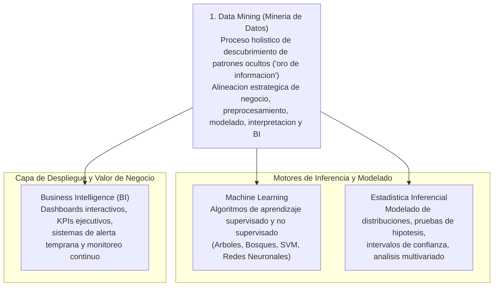
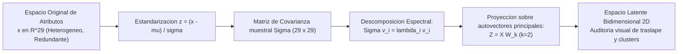
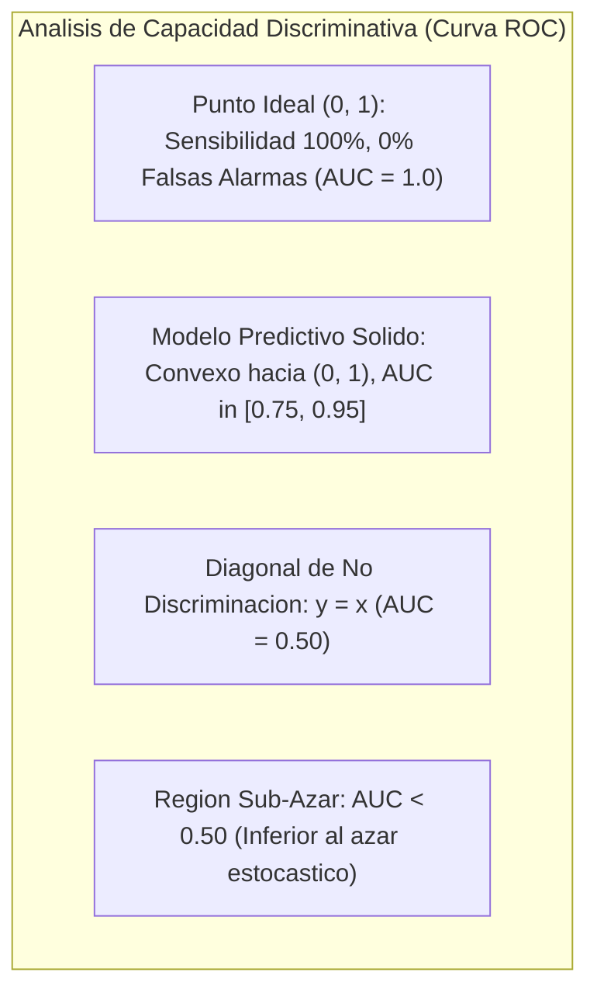
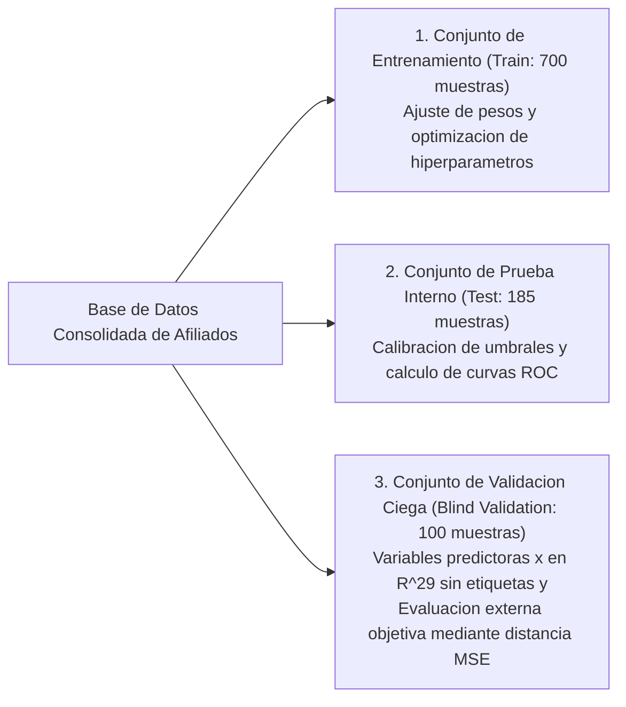
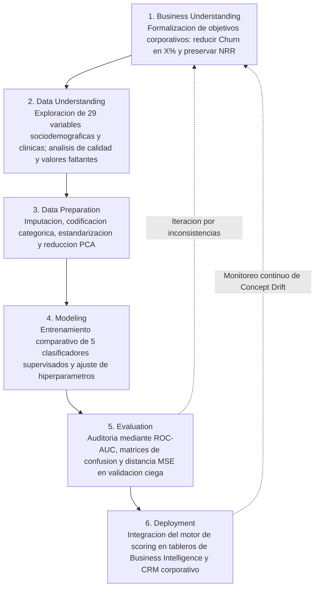

> **Objetivo de la Sesion**<br>
> 
> 
> Comprender y formalizar el modelado analitico de desercion de clientes (Customer Churn) y retencion en el marco de la Mineria de Datos y Business Intelligence; analizar las metricas cuantitativas de valor de vida del cliente (CLV) y retencion de ingresos netos (NRR); estructurar pipelines de reduccion de dimensionalidad (PCA) sobre vectores multidimensionales sociodemograficos y de comportamiento en salud; disenar experimentos comparativos de clasificadores supervisados evaluados mediante el espacio ROC-AUC y distancias cuadraticas medias (MSE/RMSE); e implementar protocolos de validacion ciega (Blind Validation) bajo el estandar metodologico CRISP-DM para mitigar el sobreajuste y garantizar la generalizacion en escenarios industriales y corporativos reales.

---
# Clase 3: Mineria de Datos Aplicada a Retencion de Clientes (Customer Churn), Reduccion Dimensional y Protocolos de Validacion Predictiva

## 1\. Contexto y Marco Conceptual de la Retencion y el Abandono (Customer Churn)

### 1.1. Delimitacion Epistemologica: Data Mining vs. Machine Learning vs. Estadistica

Existe una frecuente confusion conceptual respecto a las fronteras disciplinarias de la Ciencia de Datos. Es fundamental establecer con precision la jerarquia epistemologica de cada dominio:



- **Data Mining (Mineria de Datos):** Es el proceso metodologico integral orientado a explorar, descubrir y extraer patrones ocultos, anomalias y conocimiento no trivial en volumenes masivos de datos para resolver problemas estrategicos de negocio. No se restringe a un algoritmo; articula el entendimiento del problema, el diseno del pipeline de datos, la seleccion de modelos, la evaluacion diagnostica y el retorno de valor corporativo.

- **Machine Learning y Estadistica:** Constituyen los motores computacionales y analiticos dentro del ciclo de Data Mining. La estadistica aporta el rigor formal para la inferencia, pruebas de bondad de ajuste y distribuciones probabilisticas, mientras que el Machine Learning suministra la capacidad de optimizacion numerica y clasificacion predictiva de alta dimension.

- **Business Intelligence (BI):** Representa la capa de comunicacion gerencial y soporte a la toma de decisiones, proyectando las probabilidades y agrupamientos analiticos generados por la mineria de datos en tableros de control ejecutivos y reglas de negocio automatizadas.

### 1.2. Dinamica del Churn en Modelos de Negocio Contractuales y por Suscripcion

En la economia contemporanea de servicios (telecomunicaciones, plataformas SaaS, aseguradoras, educacion), la rentabilidad de las organizaciones depende criticamente de la estabilidad de su base instalada de usuarios:

- **Tasa de Abandono (Churn Rate - CR):** Proporcion de clientes activos que cancelan, migran o discontinuan su suscripcion a lo largo de una ventana temporal especifica $t$:

  $CR_t = \frac{\text{Clientes que abandonan en el periodo } t}{\text{Clientes activos al inicio del periodo } t}$

- **Tasa de Retencion (Retention Rate - RR):** Complemento probabilistico directo del abandono:

  $RR_t = 1 - CR_t = \frac{\text{Clientes retenidos al final del periodo } t}{\text{Clientes activos al inicio del periodo } t}$

- **Retencion de Ingresos Netos (Net Revenue Retention - NRR):** Metrica que trasciende el conteo per capita de usuarios, auditando la conservacion del flujo financiero recurrente, incluyendo expansiones contractuales (up-selling, cross-selling) y contracciones:

  $NRR = \frac{\text{ARR}_{\text{inicial}} + \text{Expansiones} - \text{Contracciones} - \text{Bajas}}{\text{ARR}_{\text{inicial}}} \times 100\%$

- **Customer Lifetime Value (CLV / LTV):** Esperanza matematica de la vida util economica de un afiliado. El horizonte optimo varia segun la naturaleza intrinseca del servicio: mientras una institucion educativa formal modela horizontes cerrados (ej. 6 anos en secundaria o 5 anos en grado universitario), una empresa de seguros de salud o telecomunicaciones busca maximizar la retencion indefinida mitigando la tasa de desgaste mensual.

### 1.3. El Dilema Operativo: Enfoque Reactivo vs. Enfoque Proactivo Predictivo

Historicamente, los departamentos de ventas y atencion al cliente han implementado estrategias de retencion **reactivas**, interviniendo unicamente tras la radicacion formal de la baja del usuario:

```mermaid
flowchart TD
    subgraph Enfoque_Reactivo["Paradigma Tradicional Reactivo (Tardio e Ineficiente)"]
        R1["Cliente experimenta insatisfaccion silenciosa<br>(degradacion de servicio, tarifas elevadas)"] --> R2["Cliente decide formalmente la baja<br>(tramite administrativo o cancelacion)"]
        R2 --> R3["Accion reactiva de Marketing<br>(oferta de promociones, regalos, bonos)"]
        R3 --> R4["Resultado: Tasa de rescate marginal (~10%)<br>Abandono diferido a corto plazo"]
    end
    
    subgraph Enfoque_Proactivo["Paradigma de Mineria de Datos Proactivo (Predictivo)"]
        P1["Monitoreo continuo de atributos<br>(sociodemograficos, reclamos, uso, salud)"] --> P2["Modelo Predictivo Supervisado<br>(scoring probabilistico continuo de riesgo de churn)"]
        P2 --> P3["Sistema de Alerta Temprana<br>(identificacion de afiliados en riesgo critico)"]
        P3 --> P4["Intervencion quirurgica preventiva<br>(mejora de cobertura, renegociacion de planes, resolucion tecnica)"]
        P4 --> P5["Resultado: Reduccion estructural del Churn Rate<br>y preservacion del CLV"]
    end
```



---

## 2\. Fundamentos Teoricos: Espacio de Atributos, Reduccion Dimensional y Metricas

### 2.1. Vectorizacion de Caracteristicas en Dominios Complejos

En el modelado de riesgo de desercion en entornos corporativos (por ejemplo, aseguradoras de salud), cada registro de usuario se representa como un vector multidimensional $\mathbf{x} \in \mathbb{R}^D$:

$\mathbf{x} = [x_1, x_2, \dots, x_D]^T$

En problemas de seguros de salud, el espacio de caracteristicas amalgama dos dimensiones fundamentales:

1. **Dimension Sociodemografica:** Edad, nivel educativo alcanzado, nivel de conectividad residencial, zona geografica, canales de pago y atributos socioeconomicos indirectos.

1. **Dimension de Comportamiento Clinico:** Frecuencia de siniestralidad, examenes preocupacionales, antecedentes quirurgicos, indice de masa corporal (IMC), nivel de control de enfermedades cronicas preexistentes y habitos nocivos (tabaquismo, sedentarismo).

La presencia de $D=29$ caracteristicas continuas y categoricas codificadas genera potenciales fenomenos de colinealidad y dispersion en altas dimensiones (*curse of dimensionality*), haciendo mandatorio el analisis previo de redundancia.

### 2.2. Reduccion de Dimensionalidad mediante Analisis de Componentes Principales (PCA)

Para inspeccionar geometricamente la separabilidad entre afiliados que abandonan ($\omega_1$, etiqueta binaria 1) y afiliados leales ($\omega_0$, etiqueta binaria 0), se recurre a la reduccion ortogonal de dimensionalidad mediante PCA:



- **Formulacion de Proyeccion:**

  $\mathbf{z} = \mathbf{W}_k^T (\mathbf{x} - \boldsymbol{\mu})$
  
  donde $\mathbf{W}_k \in \mathbb{R}^{D \times k}$ reune los $k$ autovectores correspondientes a los mayores autovalores $\lambda_1 \ge \lambda_2 \ge \dots \ge \lambda_k$, reteniendo el maximo porcentaje de varianza global explicada.

- **Proposito Analitico:** Permite al cientifico de datos validar si la nube de datos presenta clusters naturales o si existe un traslape estocastico severo que requiera fronteras de decision no lineales.

### 2.3. Evaluacion Comparativa: Espacio ROC y la Linea Base del Azar

La calidad discriminativa de un clasificador no puede evaluarse con metricas superficiales. Se recurre al analisis ROC (*Receiver Operating Characteristics*):



- **La Linea Base del 50%:** Todo modelo cuyo desempeño no supere el 50% de acierto balanceado o cuya curva ROC se situe por debajo de la diagonal principal ($AUC \le 0.50$) carece de poder predictivo. En terminos epistemologicos, un clasificador con $AUC < 0.50$ se comporta peor que el lanzamiento de una moneda justa (y matematicamente puede invertirse negando sus decisiones para obtener $1 - AUC$).

- **Distancia y Error Cuadratico Medio (MSE) en Evaluacion Ciega:**

  Para comparar de forma continua las estimaciones emitidas por un modelo frente a las etiquetas verdaderas $y \in \{0, 1\}$, se formaliza el Error Cuadratico Medio como funcion de distancia euclidiana normalizada:
  
  $MSE = \frac{1}{N} \sum_{i=1}^N (y_i - \hat{p}_i)^2$
  
  donde $\hat{p}_i = P(\omega_1 \mid \mathbf{x}_i) \in [0, 1]$ corresponde a la probabilidad asignada de abandono, o bien $\hat{y}_i \in \{0, 1\}$ ante clasificaciones duras discretas. Un $MSE = 0$ denota coincidencia perfecta con la realidad, mientras que valores crecientes cuantifican la divergencia estocastica del modelo.

---

## 3\. Implementacion Tecnica y Logica de Negocio en Python

A continuacion se presenta la implementacion de un pipeline modular de Data Mining para clasificacion de Churn, incorporando reduccion dimensional PCA, evaluacion multimodelo, curvas ROC y calculo de distancias de error cuadratico:

```python
import numpy as np
import pandas as pd
from sklearn.preprocessing import StandardScaler
from sklearn.decomposition import PCA
from sklearn.linear_model import LogisticRegression
from sklearn.ensemble import RandomForestClassifier, GradientBoostingClassifier
from sklearn.svm import SVC
from sklearn.naive_bayes import GaussianNB
from sklearn.metrics import roc_curve, roc_auc_score, mean_squared_error, classification_report

# 1. Simulacion controlada del pipeline con estructura de datos real
np.random.seed(42)
N_train, N_test, D = 700, 185, 29

# Matrices de caracteristicas sinteticas reproducibles
X_train_raw = np.random.randn(N_train, D)
y_train = np.random.binomial(n=1, p=0.28, size=N_train)

X_test_raw = np.random.randn(N_test, D)
y_test = np.random.binomial(n=1, p=0.28, size=N_test)

# 2. Estandarizacion rigurosa (Prevencion de Data Leakage ajustando solo en Train)
scaler = StandardScaler()
X_train_scaled = scaler.fit_transform(X_train_raw)
X_test_scaled = scaler.transform(X_test_raw)

# 3. Reduccion de Dimensionalidad no supervisada para exploracion espacial (2D)
pca_2d = PCA(n_components=2)
X_train_pca = pca_2d.fit_transform(X_train_scaled)
X_test_pca = pca_2d.transform(X_test_scaled)
var_explicada = np.sum(pca_2d.explained_variance_ratio_) * 100.0
print(f"Varianza retenida en el subespacio latente 2D: {var_explicada:.2f}%")

# 4. Definicion de la bateria de clasificadores supervisados
modelos = {
    "Logistic_Regression": LogisticRegression(max_iter=1000, random_state=42),
    "Random_Forest": RandomForestClassifier(n_estimators=150, max_depth=6, random_state=42),
    "Gradient_Boosting": GradientBoostingClassifier(n_estimators=100, learning_rate=0.08, random_state=42),
    "Support_Vector_Machine": SVC(probability=True, kernel="rbf", random_state=42),
    "Gaussian_Naive_Bayes": GaussianNB()
}

# 5. Entrenamiento, inferencia probabilistica y calculo de metricas
resultados_desempeno = []

for nombre, clf in modelos.items():
    # Ajuste del modelo sobre el conjunto de entrenamiento
    clf.fit(X_train_scaled, y_train)
    
    # Estimacion de probabilidad a posteriori de abandono (Clase 1)
    y_prob = clf.predict_proba(X_test_scaled)[:, 1]
    y_pred = clf.predict(X_test_scaled)
    
    # Metricas de discriminacion y distancia euclidiana
    auc = roc_auc_score(y_test, y_prob)
    mse_prob = mean_squared_error(y_test, y_prob)
    rmse_prob = np.sqrt(mse_prob)
    mse_binario = mean_squared_error(y_test, y_pred)
    
    resultados_desempeno.append({
        "Modelo": nombre,
        "ROC_AUC": round(auc, 4),
        "MSE_Probabilistico": round(mse_prob, 4),
        "RMSE_Probabilistico": round(rmse_prob, 4),
        "MSE_Discreto": round(mse_binario, 4)
    })

df_evaluacion = pd.DataFrame(resultados_desempeno).sort_values(by="ROC_AUC", ascending=False)
print("\nAuditoria Comparativa de Desempeno:")
print(df_evaluacion.to_markdown(index=False))
```

---

## 4\. Analisis Critico de Casos y Auditoria Practica

### 4.1. Caso 1: Desercion y Migracion en Telecomunicaciones (Entel, Tigo, Viva)

- **Dinamica de Mercadeo:** En servicios moviles e internet residencial, los detonantes del abandono se dividen en fallas tecnicas tangibles (frecuencia de cortes, latencia en streaming/gaming) y factores de elasticidad-precio (relacion megabytes/costo frente a ofertas de portabilidad numerica de la competencia).

- **Leccion Operativa:** Las iniciativas de retencion reactivas (por ejemplo, campanas de fidelizacion mediante entrega de telefonos inalambricos de linea fija a usuarios que ya acudieron a solicitar la rescision de contrato) exhiben una tasa de rescate inferior al 10%, con recaida en desercion en menos de 90 dias. El costo de adquisicion de un nuevo afiliado multiplica por 5 a 7 veces el costo de retener a un cliente mediante accion analitica proactiva temprana.

### 4.2. Caso 2: Afiliados a Seguro Medico Privado (Benchmark 29 Dimensiones)

En este escenario analitico se dispone de una base de datos real con $N_{\text{train}} = 700$, $N_{\text{test}} = 185$ y un conjunto de validacion ciega $N_{\text{val}} = 100$. La variable objetivo $y \in \{0, 1\}$ registra si el asegurado migro a otra aseguradora ($y=1$) o se mantuvo fiel ($y=0$):

| Paradigma de Retencion | Naturaleza de la Accion | Costo Operativo Relativo | Capacidad Predictiva | Limitacion Estructural |
| --- | --- | --- | --- | --- |
| **Retencion Reactiva** | Bonos/premios tras el reclamo o baja formal | Altisimo (subsidios de rescate in extremis) | Nula (acciona post-evento) | El cliente ya tomo la decision psicologica de abandonar la marca |
| **Reglas Heuristicas de Negocio** | Filtros rigidos if/else basados en antiguedad | Medio (campanas indiscriminadas) | Baja ($AUC \approx 0.55$) | No modela interacciones no lineales entre salud y variables socioeconomicas |
| **Modelos Estadisticos Lineales** | Regresion logistica tradicional sin regularizar | Bajo computacionalmente | Moderada ($AUC \approx 0.68 - 0.72$) | Sensible a multicolinealidad severa entre los 29 atributos |
| **Pipeline de Data Mining (Ensemble + PCA)** | Gradient Boosting / Random Forest con scoring continuo | Optimo (intervencion focalizada por deciles) | Alta ($AUC \ge 0.85$) | Requiere pipelines automatizados de reentrenamiento periodico |

### 4.3. Protocolo de Validacion Ciega (Blind Validation)

La arquitectura experimental estructurada para evitar el sobreajuste (*overfitting*) en escenarios competitivos y de auditoria corporativa comprende:



- **Garantia Metodologica:** Al retener las etiquetas reales del conjunto de validacion ciega bajo custodia de auditoria, se neutraliza la tentacion de ajustar hiperparametros especificamente para sobreentrenar sobre los casos de test. El modelo debe demostrar robustez intrinseca de generalizacion frente a distribuciones no vistas.

---

## 5\. Principios de Diseno, Buenas Practicas y Anti-patrones

### 5.1. Reglas de Oro en Modelado de Churn

1. **Prevencion de Fuga Temporal de Informacion (Data Leakage):** Jamas incluir como variables predictoras registros generados contemporanea o posteriormente a la decision de abandono (por ejemplo, fecha de devolucion del router o encuestas de satisfaccion post-cancelacion). Toda caracteristica debe medirse estrictamente dentro de la ventana de observacion previa al corte.

1. **Ponderacion por Costos Asimetricos de Desercion:** Perder un cliente valioso (Falso Negativo) suele representar un costo financiero sustancialmente superior a generar una llamada proactiva de fidelizacion innecesaria (Falso Positivo). La optimizacion del umbral de decision debe subordinarse a la matriz de costos y no al umbral generico $\theta = 0.50$.

1. **Interpretabilidad para la Toma de Decisiones:** Los clasificadores no deben operar como cajas negras impermeables. Se debe acompanar el scoring de probabilidad con tecnicas de interpretabilidad local (como valores SHAP o importancias por permutacion) para que el equipo comercial comprenda los factores desencadenantes del riesgo individual (ej. incremento de tarifas o falta de atencion clinica).

### 5.2. Anti-patrones Comunes en Mineria de Datos

| Anti-patron | Descripcion del Error | Consecuencia Analitica | Remedio Metodologico |
| --- | --- | --- | --- |
| **Falacia de la Exactitud (Accuracy Trap)** | Utilizar Exactitud global en bases con Churn del 5% al 10%. | Un clasificador trivial que predice siempre 'No Abandona' logra 90%-95% de accuracy pero captura cero deserciones. | Evaluar mediante ROC-AUC, Balanced Accuracy, Precision-Recall AUC y F1-Score focalizado en la clase minoritaria. |
| **Retencion Reactiva de Mostrador** | Intervenir unicamente cuando el cliente ya tramito su desvinculacion. | Desperdicio de presupuesto de mercadeo e impacto nulo en la tasa estructural de retencion. | Disenar alertas tempranas basadas en probabilidad de desercion calculada mensualmente. |
| **PCA sin Estandarizacion Previa** | Calcular componentes principales sobre atributos en escalas heterogeneas (ej. ingresos vs. edad). | La variable con mayor varianza numerica domina artificialmente los autovectores. | Aplicar ` StandardScaler ` ($\mu=0, \sigma=1$) sobre todas las columnas numericas antes de PCA. |
| **Descuido del Ciclo de Vida del Dato** | Asumir que los coeficientes del modelo se mantienen estables indefinidamente en el tiempo. | Degradacion progresiva del rendimiento (*concept drift*) ante cambios competitivos del mercado. | Reentrenar periodicamente y monitorear la deriva de distribucion (*data drift*). |

---

## 6\. Sintesis Conceptual y Profundizacion Academica

### 6.1. Alineacion con el Estandar Metodologico CRISP-DM

El desarrollo riguroso de mineria de datos predictiva de Churn debe articularse a traves de las 6 fases del ciclo de vida CRISP-DM (*Cross-Industry Standard Process for Data Mining*):



### 6.2. Proyeccion hacia Modelos de Supervivencia (Survival Analysis)

En la frontera de la investigacion en Ciencia de Datos, los problemas de desercion trascienden la clasificacion binaria estatica ("¿Abandonara el proximo mes?") para transicionar hacia el Analisis de Supervivencia ("¿Cual es la funcion de tiempo hasta que ocurra el evento de abandono?"):

- **Curvas de Kaplan-Meier:** Estimacion no parametrica de la probabilidad de supervivencia del cliente $S(t) = P(T > t)$ a lo largo del tiempo de afiliacion.

- **Modelos de Riesgos Proporcionales de Cox:** Modelado semiparametrico de la funcion de riesgo instantaneo $h(t \mid \mathbf{x}) = h_0(t) \exp(\boldsymbol{\beta}^T \mathbf{x})$, aislando la influencia de factores de riesgo clinicos o economicos sobre la aceleracion del abandono.

### 6.3. Referencias Epistemologicas

- **Han, J., Kamber, M., &amp; Pei, J.** *Data Mining: Concepts and Techniques* (3ra Ed., Morgan Kaufmann). Texto canonico para el entendimiento de preprocesamiento, reduccion dimensional y metodos de clasificacion en bases masivas.

- **Provost, F., &amp; Fawcett, T.** *Data Science for Business: What You Need to Know about Data Mining and Data-Analytic Thinking* (O'Reilly Media). Referencia imprescindible para el analisis de curvas ROC y el calculo de valor esperado ante costos asimetricos.

---
