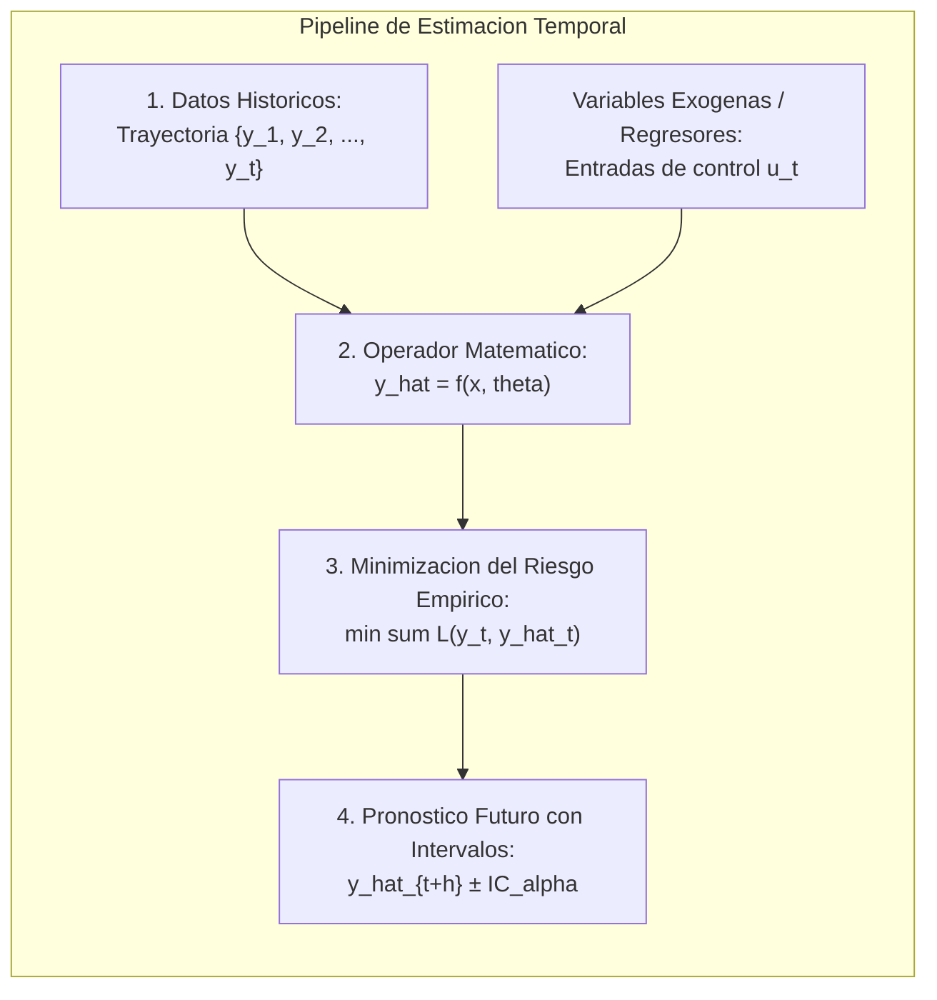
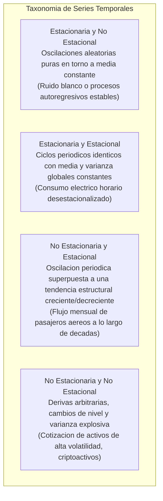
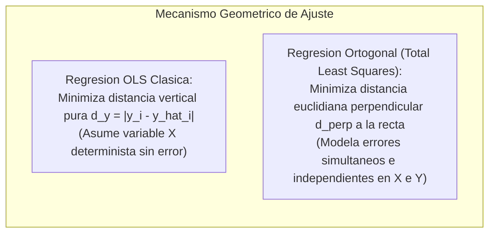
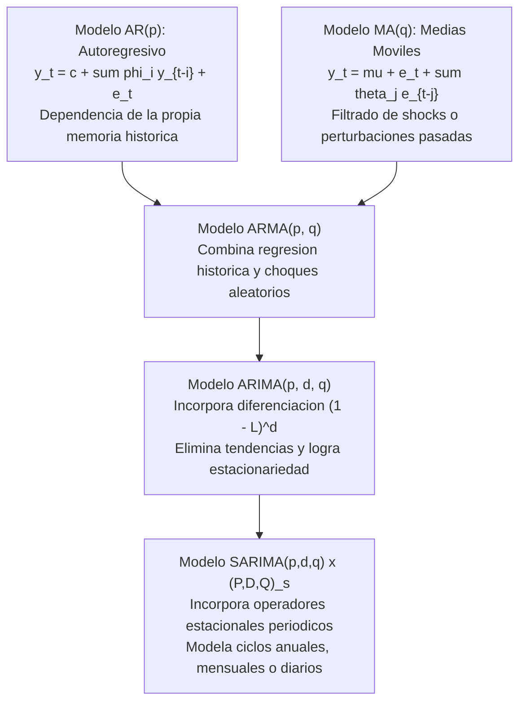
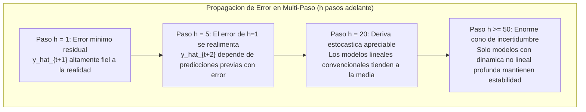
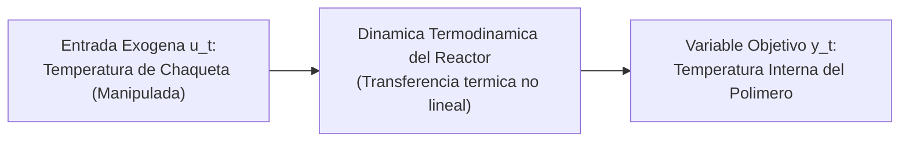
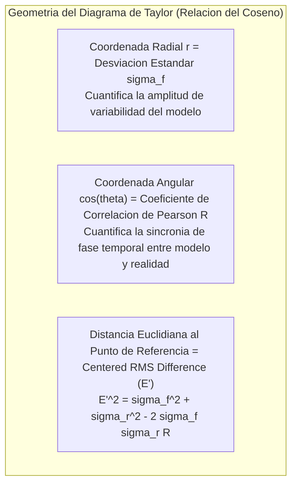

> **Objetivo de la Sesion**<br>
> 
> 
> Formalizar los principios matematicos y metodologicos del analisis de regresion y el pronostico estocastico en series temporales (Time Series Forecasting); derivar rigurosamente la formulacion de Regresion Ortogonal (Deming / Total Least Squares) para mitigar errores de medicion en ambos ejes en instrumentacion sismologica y sensores fisicos; explorar regresiones no lineales polinomiales y exponenciales evaluando el compromiso sesgo-varianza; descomponer series temporales y contrastar modelos de la familia ARMA, ARIMA y SARIMA; analizar la dinamica del pronostico multi-paso y la acumulacion de incertidumbre; examinar arquitecturas avanzadas con variables exogenas (ARX, ARMAX) y redes neuronales recurrentes (NNARX, LSTM) aplicadas al control de reactores industriales; e implementar metricas multidimensionales de diagnostico de error mediante el Diagrama de Taylor.

---
# Clase 4: Modelado Predictivo, Analisis de Regresion y Pronostico Avanzado en Series de Tiempo

## 1\. Contexto y Marco Conceptual del Pronostico y la Regresion

### 1.1. Epistemologia de la Prediccion en Ciencia de Datos

El acto de predecir en Ciencia de Datos e Inteligencia Artificial no constituye un ejercicio oracular de adivinanza ni clarividencia determinista. La estimacion cientifica se fundamenta en tres axiomas indispensables:

1. **Evidencia Historica:** La disponibilidad de series de datos observados que registren la trayectoria y variabilidad temporal del fenomeno bajo estudio.

1. **Minimizacion de la Funcion de Perdida:** El ajuste analitico de un operador matematico concebido para minimizar la discrepancia estocastica (residuo) entre el valor estimado y la realidad fisica observada.

1. **Invariantes Estructurales y Causalidad:** La hipotesis operativa de que las dinamicas subyacentes del sistema conservan patrones, ciclos o tendencias proyectables hacia horizontes futuros bajo margenes medibles de incertidumbre.



### 1.2. Taxonomia y Descomposicion Formal de Series de Tiempo

Una serie de tiempo $\{y_t\}_{t \in T}$ es una sucesion ordenada cronologicamente de observaciones cuantitativas. La clasificacion estructural de las series depende de dos propiedades fundamentales:

- **Estacionariedad (Stationarity):** En sentido debil (o de segundo orden), implica que las propiedades estadisticas del proceso no varian en funcion del tiempo:

  $\mathbb{E}[y_t] = \mu, \quad \text{Var}(y_t) = \sigma^2, \quad \text{Cov}(y_t, y_{t-k}) = \gamma_k \quad \forall t, k$

- **Estacionalidad (Seasonality):** Existencia de fluctuaciones periodicas y regulares que se repiten con frecuencia fija (diaria, mensual, trimestral o anual) asociadas a ciclos climaticos, calendarios o laborales.



---

## 2\. Fundamentos Teoricos: De la Regresion Lineal Simple a la Regresion Ortogonal

### 2.1. Regresion Lineal Ordinaria por Minimos Cuadrados (OLS)

El modelo clasico de regresion lineal ordinaria modela una relacion funcional afín entre la variable independiente $x$ y la variable dependiente $y$:

$\hat{y} = B_0 + B_1 x$

- **Hipotesis Asimetrica de OLS:** OLS asume que la variable predictora $x$ es determinista y esta **libre de error de medicion**, concentrando toda la perturbacion estocastica en el eje vertical $y$:

  $y_i = B_0 + B_1 x_i + \varepsilon_i, \quad \varepsilon_i \sim \mathcal{N}(0, \sigma^2)$

- **Derivacion Analitica de Parametros:**

  Minimizando la suma de residuos cuadraticos verticales $S = \sum_{i=1}^n (y_i - B_0 - B_1 x_i)^2$:
  
  $B_1 = \frac{SS_{xy}}{SS_{xx}} = \frac{\sum_{i=1}^n (x_i - \bar{x})(y_i - \bar{y})}{\sum_{i=1}^n (x_i - \bar{x})^2}, \quad B_0 = \bar{y} - B_1 \bar{x}$

### 2.2. Regresion Ortogonal (Deming / Total Least Squares)

En la practica de la fisica experimental, instrumentacion y geofisica, el supuesto de que $x$ carece de error es insostenible. Cuando tanto la variable predictora $x$ como la respuesta $y$ provienen de sensores estocasticos sujetos a ruido independiente, OLS subestima sistematicamente la pendiente (sesgo de atenuacion). 

La **Regresion Ortogonal** (o regresion de Deming) resuelve el problema de errores en variables (*Errors-in-Variables Model*):



- **Minimizacion de la Distancia Perpendicular:**

  La distancia ortogonal desde cada punto observado $(x_i, y_i)$ hasta la recta $B_1 x - y + B_0 = 0$ viene dada por:
  
  $d_{\text{ortogonal}, i} = \frac{|y_i - (B_0 + B_1 x_i)|}{\sqrt{1 + B_1^2}}$

- **Formulacion de la Pendiente Ortogonal:**

  Sea $\delta = \sigma_{\varepsilon}^2 / \sigma_{\eta}^2$ la razon de varianzas de error entre $y$ y $x$ (con $\delta=1$ para errores isotropicos estandarizados):
  
  $B_1 = \frac{SS_{yy} - \delta SS_{xx} + \sqrt{(SS_{yy} - \delta SS_{xx})^2 + 4 \delta SS_{xy}^2}}{2 SS_{xy}}$
  
  $B_0 = \bar{y} - B_1 \bar{x}$

- **Aplicacion Canonica en Sismologia (Trabajo del Dr. Rangit Das):**

  En el analisis sismologico de terremotos de subduccion (como en el norte de Chile y la cordillera del Himalaya), los sensores sismograficos analogicos y digitales saturan ante magnitudes extremas o registran desfases angulares de propagacion. La igualacion y homogeneizacion de diferentes escalas de magnitud ($M_w$ magnitud de momento, $M_s$ ondas superficiales, $m_b$ ondas de cuerpo) exige regresion ortogonal para evitar sesgos criticos en la calibracion de atenuacion sismica.

### 2.3. Modelado No Lineal: Regresion Polinomial y Exponencial

Cuando la fisica del fenomeno exhibe tasas de aceleracion o curvaturas geometricas marcadas:

- **Regresion Polinomial de Grado** $m$**:**

  $y = a_0 + a_1 x + a_2 x^2 + \dots + a_m x^m + \varepsilon$
  
  - *Compromiso Sesgo-Varianza:* Incrementar el orden polinomial ($m \ge 4$) permite ajustarse a fluctuaciones locales pero introduce el fenomeno de Runge (oscilaciones salvajes e inestabilidad divergente en los bordes del dominio de interpolacion).

- **Regresion Exponencial:**

  $y = a e^{b x} \iff \ln(y) = \ln(a) + b x$
  
  - Crucial en fases tempranas de dispersion epidemiologica, crecimiento bacteriano no restringido o difusion de senales en redes.

---

## 3\. Jerarquia de Modelado en Series de Tiempo: AR, MA, ARIMA y SARIMA

### 3.1. Formulacion de Procesos Lineales Estocasticos

La modelizacion econometrica y de ingenieria para series temporales se estructura a traves de la metodologia de Box-Jenkins:



1. **AR(**$p$**):** La variable se proyecta en funcion lineal de sus propios $p$ valores rezagados. Exige que las raices del polinomio caracteristico $\Phi(z) = 1 - \sum \phi_i z^i$ se ubiquen fuera del circulo unitario.

1. **MA(**$q$**):** Modela la variable en funcion de los errores de pronostico de $q$ periodos previos, capturando shocks transitorios del sistema.

1. **ARIMA(**$p, d, q$**):** Introduce el orden de integracion $d$ mediante el operador de rezago $L$ (donde $L^k y_t = y_{t-k}$), diferenciando la serie para estabilizar la media:

   $\Phi(L) (1 - L)^d y_t = c + \Theta(L) \varepsilon_t$

1. **SARIMA(**$p, d, q$**)**$\times$**(**$P, D, Q$**)**$_s$**:** Captura estacionalidades de periodo $s$ (ej. $s=12$ para meses del ano):

   $\Phi_p(L) \tilde{\Phi}_P(L^s) (1 - L)^d (1 - L^s)^D y_t = c + \Theta_q(L) \tilde{\Theta}_Q(L^s) \varepsilon_t$

### 3.2. Criterios de Seleccion de Modelos y Pruebas de Hipotesis

Para determinar de forma rigurosa los ordenes optimos de rezagos $(p, d, q)$ y $(P, D, Q)_s$:

- **Prueba Aumentada de Dickey-Fuller (ADF Test):** Contrasta la hipotesis nula $H_0$ de presencia de raiz unitaria (no estacionariedad). Si el p-valor $< 0.05$, se rechaza $H_0$, certificando estacionariedad.

- **Criterio de Informacion de Akaike (AIC) y Criterio Bayesiano (BIC):**

  $\text{AIC} = 2k - 2\ln(\hat{L})$
  
  $\text{BIC} = k\ln(N) - 2\ln(\hat{L})$
  
  donde $k$ representa el numero de parametros estimados y $\hat{L}$ la maxima verosimilitud alcanzada. El modelo optimo minimiza AIC/BIC, penalizando la complejidad parametrica para evitar sobreajuste.

- **Prueba de Ljung-Box:** Valida que los residuos estocasticos del modelo ajustado constituyan efectivamente ruido blanco incorrelacionado ($p\text{-valor} > 0.05$).

---

## 4\. Dinamica Multi-Paso, Variables Exogenas y Redes Neuronales

### 4.1. La Ley de Acumulacion de Incertidumbre en Pronosticos Multi-Paso

Existe una diferencia metodologica radical entre estimar a un paso ($h=1$) y realizar pronosticos multi-paso ($h \gg 1$):



- **La Realimentacion Estocastica:** En esquemas autorregresivos recursivos, la prediccion $\hat{y}_{t+1}$ se utiliza como entrada determinista para computar $\hat{y}_{t+2}$. En consecuencia, la varianza del error de estimacion crece de forma monotona estricta con el horizonte $h$:

  $\text{Var}(y_{t+h} - \hat{y}_{t+h}) \propto \sum_{j=0}^{h-1} \psi_j^2 \sigma_{\varepsilon}^2$

- **Analogia de Navegacion en Robotica:** Un desfase angular diminuto de $1^\circ$ en odometria inercial es despreciable en una distancia de $10\text{ cm}$; sin embargo, tras recorrer $1\text{ km}$, el error acumulado desvia el vehiculo decenas de metros de su posicion teorica.

### 4.2. Inyeccion de Variables Exogenas: Modelos ARX y ARMAX

Muchos sistemas fisicos no evolucionan de forma aislada; estan subordinados a variables de control externas $u_t$ (senales exogenas):

- **Ecuacion ARMAX:**

  $A(L) y_t = B(L) u_{t-k} + C(L) \varepsilon_t$
  
  donde $u_{t-k}$ representa la variable exogena retrasada en $k$ intervalos de tiempo.

### 4.3. Casos de Estudio en Control de Procesos y Reactores Industriales

#### Caso A: Reactor Batch con Chaqueta Termica de Control

En la sintesis de polimeros para capsulas farmacologicas, la temperatura interna del reactor ($y_t$) determina las propiedades mecanicas y moleculares del producto. Dicha temperatura es regulada dinamicamente mediante el paso de agua fria o caliente a traves de una chaqueta externa ($u_t$):



- **Comportamiento Comparativo:**

  - En horizontes cortos ($h \le 20$ pasos): Los modelos estadisticos lineales ARX y ARMAX presentan una excelente relacion costo-computacional y error cuadratico bajo ($RMSE < 0.25$).
  
  - En horizontes largos ($h \ge 50$ a $100$ pasos): La divergencia parabolica de los modelos lineales se vuelve intolerable. Las arquitecturas no lineales recurrentes como **NNARX** (Neural Network AutoRegressive with eXogenous inputs) conservan la cota de error gracias a funciones de activacion sigmoideas y capas densas con poda de pesos (*weight pruning*).

#### Caso B: Reactores de Biodiesel y Redes Recurrentes LSTM

En la produccion de biocombustibles mediante transesterificacion quimica, la conversion de trigliceridos depende de dinamicas cataliticas complejas. La comparacion empirica entre cuatro paradigmas arroja:

| Familia de Modelo | Tipo Arquitectonico | Desempeno $h=1$ | Desempeno $h=50$ | Complejidad Computacional |
| --- | --- | --- | --- | --- |
| **ARX** | Lineal Autorregresivo Puro | Optimo ($RMSE \approx 0.08$) | Muy deficiente (divergencia) | Minima (algebra matricial directa) |
| **ARMAX** | Lineal con Medias Moviles | Optimo ($RMSE \approx 0.07$) | Regular (degradacion monotona) | Baja (estimacion de verosimilitud) |
| **NNARX** | Red Neuronal No Lineal | Muy Bueno ($RMSE \approx 0.10$) | Estable ($RMSE \approx 0.35$) | Media (retropropagacion guiada) |
| **LSTM** | Red Neuronal Profunda Recurrente | Excelente ($RMSE \approx 0.06$) | Altamente Estable ($RMSE \approx 0.18$) | Alta (GPU, optimizacion ADAM) |

---

## 5\. Auditoria de Desempeno y Visualizacion Multidimensional

### 5.1. Metricas Clasicas de Error de Pronostico

Sea $y_i$ la serie observada y $\hat{y}_i$ la serie estimada para $N$ puntos de evaluacion:

- **Error Cuadratico Medio (MSE):**

  $MSE = \frac{1}{N} \sum_{i=1}^N (y_i - \hat{y}_i)^2$

- **Raiz del Error Cuadratico Medio (RMSE):**

  $RMSE = \sqrt{\frac{1}{N} \sum_{i=1}^N (y_i - \hat{y}_i)^2}$
  
  Conserva las unidades fisicas de la variable objetivo y penaliza severamente los errores grandes debido a la formulacion cuadratica.

- **Error Medio Absoluto (MAE):**

  $MAE = \frac{1}{N} \sum_{i=1}^N |y_i - \hat{y}_i|$
  
  Metrica linealmente intuitiva y robusta ante la presencia de valores atipicos (*outliers*).

- **Error Porcentual Absoluto Medio (MAPE):**

  $MAPE = \frac{100\%}{N} \sum_{i=1}^N \left| \frac{y_i - \hat{y}_i}{y_i} \right|$
  
  Normaliza el error en funcion de la magnitud del valor real, expresando la precision en porcentaje relativo.

### 5.2. El Diagrama de Taylor (Taylor Diagram - Karl E. Taylor, 2001)

Cuando se contrastan multiples modelos predictivos, tabular valores de RMSE o MAE resulta insuficiente para diagnosticar la estructura interna del error. El **Diagrama de Taylor** resuelve esta limitacion al proyectar tres metricas fundamentales en un unico espacio bidimensional polar:



- **Interpretacion Diagnostica:**

  - El patron observado real se situa sobre el eje horizontal a una distancia radial igual a su desviacion estandar $\sigma_r$, con correlacion $R=1.0$.
  
  - Los modelos mas robustos se ubican simultaneamente proximos al arco de variabilidad de la referencia ($\sigma_f \approx \sigma_r$), con angulo agudo ($R \to 1$) y minima distancia radial centrada ($E' \to 0$).

---

## 6\. Implementacion Tecnica en Python: Regresion Ortogonal y SARIMAX

### 6.1. Implementacion Matricial de Regresion Ortogonal (Deming)

```python
import numpy as np
import matplotlib.pyplot as plt

def orthogonal_distance_regression(x, y, delta=1.0):
    """
    Computa la Regresion Ortogonal (Deming / Total Least Squares)
    para datos con incertidumbre en ambos ejes X e Y.
    delta = ratio de varianzas de error (Var(e_y) / Var(e_x)).
    """
    n = len(x)
    x_mean = np.mean(x)
    y_mean = np.mean(y)
    
    # Sumas de cuadrados y productos cruzados
    ss_xx = np.sum((x - x_mean) ** 2)
    ss_yy = np.sum((y - y_mean) ** 2)
    ss_xy = np.sum((x - x_mean) * (y - y_mean))
    
    # Derivacion formal de la pendiente B1
    termino_raiz = np.sqrt((ss_yy - delta * ss_xx) ** 2 + 4 * delta * (ss_xy ** 2))
    b1 = (ss_yy - delta * ss_xx + termino_raiz) / (2 * ss_xy)
    b0 = y_mean - b1 * x_mean
    
    return b0, b1

# Caso didactico sismologico simulado
x_sensor1 = np.array([2.1, 2.9, 3.8, 5.1, 5.9, 7.0, 7.8, 9.1])
y_sensor2 = np.array([2.4, 2.7, 4.1, 4.8, 6.3, 6.9, 8.2, 8.8])

b0_odr, b1_odr = orthogonal_distance_regression(x_sensor1, y_sensor2, delta=1.0)
print(f"Modelo Ortogonal Ajustado: Y = {b0_odr:.4f} + {b1_odr:.4f} * X")
```

### 6.2. Pipeline de Series de Tiempo con ARIMA y SARIMAX

```python
import numpy as np
import pandas as pd
from statsmodels.tsa.statespace.sarimax import SARIMAX
from sklearn.metrics import mean_squared_error

# Generacion sintetica de serie estacional mensual con tendencia
np.random.seed(42)
meses = 120
t = np.arange(meses)
tendencia = 1.8 * t
estacionalidad = 25.0 * np.sin(2 * np.pi * t / 12)
ruido = np.random.normal(0, 5, meses)
serie = 100.0 + tendencia + estacionalidad + ruido

# Particion cronologica rigurosa (80% Train, 20% Test) - PROHIBIDO shuffle aleatorio
n_train = int(meses * 0.8)
train, test = serie[:n_train], serie[n_train:]

# Ajuste de modelo no estacional ARIMA(2, 1, 1)
modelo_arima = SARIMAX(train, order=(2, 1, 1))
res_arima = modelo_arima.fit(disp=False)
pred_arima = res_arima.forecast(steps=len(test))
rmse_arima = np.sqrt(mean_squared_error(test, pred_arima))

# Ajuste de modelo estacional SARIMA(2, 1, 1) x (1, 1, 1, 12)
modelo_sarima = SARIMAX(train, order=(2, 1, 1), seasonal_order=(1, 1, 1, 12))
res_sarima = modelo_sarima.fit(disp=False)
pred_sarima = res_sarima.forecast(steps=len(test))
rmse_sarima = np.sqrt(mean_squared_error(test, pred_sarima))

print("Diagnostico Comparativo en Test:")
print(f"RMSE ARIMA (No estacional): {rmse_arima:.2f}")
print(f"RMSE SARIMA (Estacional s=12): {rmse_sarima:.2f}")
print(f"Reduccion de Error Cuadratico: {((rmse_arima - rmse_sarima) / rmse_arima) * 100.0:.2f}%")
```

---

## 7\. Principios de Diseno, Buenas Practicas y Anti-patrones

### 7.1. Reglas de Oro en Series Temporales y Regresion

1. **Particion Temporal Estricta:** En datos temporales, queda estrictamente vedado el uso de validacion cruzada aleatoria tradicional (` KFold ` estandar o ` train_test_split ` con permutacion). Se debe emplear siempre validacion secuencial hacia adelante (*TimeSeriesSplit* o *Rolling Window*) para evitar que observaciones del futuro filtren informacion analitica al pasado.

1. **Homogeneizacion de Escalas en Errores Bidireccionales:** Cuando ambas variables proceden de dispositivos fisicos con ruido instrumental, utilizar regresion ortogonal (Deming) en lugar de OLS para impedir atenuacion sesgada en las pendientes de calibracion.

1. **Estabilizacion Previa de la Varianza:** Si la amplitud de las oscilaciones estacionales crece proporcionalmente al nivel de la serie, aplicar transformaciones logaritmicas o de Box-Cox antes de ajustar diferencias integradas en modelos ARIMA/SARIMA.

### 7.2. Anti-patrones Comunes

| Anti-patron | Descripcion del Error | Consecuencia Analitica | Solucion Metodologica |
| --- | --- | --- | --- |
| **OLS sobre Variables con Error (Attenuation Bias)** | Ajustar OLS clasico sobre mediciones de sensores con incertidumbre en $X$. | Subestimacion artificial de la pendiente y coeficientes sesgados. | Implementar Regresion Ortogonal (Deming / Total Least Squares). |
| **Extrapolacion Polinomial Descontrolada** | Utilizar polinomios de grado alto ($m \ge 4$) para pronosticar pasos lejanos. | Divergencia exponencial irreal provocada por el fenomeno de Runge. | Emplear splines de suavizado, modelos autorregresivos o redes neuronales recurrentes. |
| **Filtro Ciego sin Diagnostico de Residuos** | Dar por concluido el ajuste de ARIMA sin verificar autocorrelacion residual. | El modelo omite informacion predictiva no capturada; intervalos de confianza invalidos. | Ejecutar la prueba de Ljung-Box y trazar las funciones ACF y PACF de los residuos. |
| **Ignorar la Multiplicatividad Estacional** | Modelar estacionalidad aditiva constante cuando la dispersion relativa se expande. | Errores cuadraticos crecientes en picos estacionales futuros. | Aplicar transformacion logaritmica previa $\ln(y_t)$ o SARIMA con parametros multiplicativos. |

---

## 8\. Sintesis Conceptual y Recomendaciones de Profundizacion

### 8.1. Matriz de Seleccion de Paradigmas de Pronostico

| Escenario de Modelado | Dinamica Temporal | Modelo Recomendado | Justificacion Epistemologica |
| --- | --- | --- | --- |
| **Relacion Bivariada con Error en Instrumentos** | Estatica / Calibracion | **Regresion Ortogonal (Deming)** | Modela la incertidumbre simultanea en ejes de abscisas y ordenadas. |
| **Serie Temporal Univariada Estacionaria** | Sin tendencia ni ciclos | **ARMA(**$p, q$**)** | Captura la memoria autorregresiva y la disipacion de perturbaciones estocasticas. |
| **Serie con Tendencia pero sin Estacionalidad** | Tendencial estocastica | **ARIMA(**$p, d, q$**)** | La diferenciacion de orden $d$ elimina raices unitarias y homogeniza la media. |
| **Serie con Tendencia y Ciclos Estacionales** | Periodica estacional | **SARIMA(**$p,d,q$**)**$\times$**(**$P,D,Q$**)**$_s$ | Trata los rezagos periodicos mediante factores polinomiales estacionales. |
| **Sistema Complejo con Entradas de Control Externas** | Horizontes cortos ($h \le 20$) | **ARMAX(**$p, q, b$**)** | Integra variables exogenas con bajo costo de computo e inferencia exacta. |
| **Control No Lineal en Horizontes Largos** | No lineal / Horizontes $h > 30$ | **NNARX / LSTM** | Mitiga la divergencia del error recursivo mediante celdas con memoria adaptativa. |

### 8.2. Literatura Cientifica de Posgrado

- **Box, G. E., Jenkins, G. M., Reinsel, G. C., &amp; Ljung, G. M.** *Time Series Analysis: Forecasting and Control* (5ta Ed., Wiley). La biblia fundacional de la modelizacion ARMA, ARIMA y funciones de transferencia.

- **Taylor, K. E. (2001).** *Summarizing multiple aspects of model performance in a single diagram*. Journal of Geophysical Research: Atmospheres, 106(D7), 7183-7192. Articulo original fundacional del Diagrama de Taylor.

- **Brockwell, P. J., &amp; Davis, R. A.** *Introduction to Time Series and Forecasting* (3ra Ed., Springer). Rigor matematico en pruebas de estacionariedad, procesos lineales y espacio de estados.
