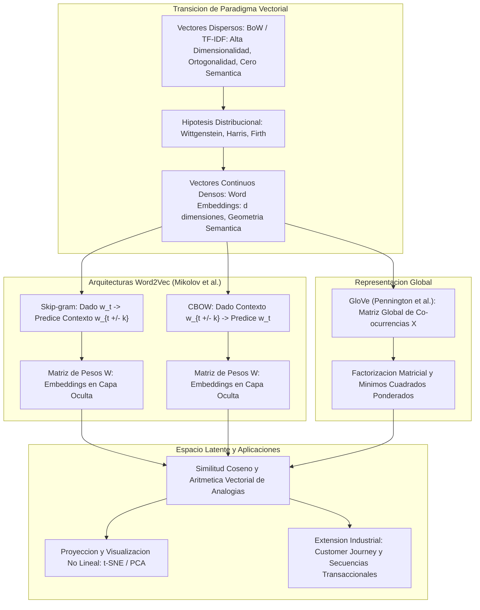

# Clase 4: Semantica Vectorial y Representaciones Densas: Word Embeddings con Word2Vec y GloVe

> Proposito pedagogico: Dominar la transicion epistemologica y matematica desde las representaciones dispersas (Bag-of-Words, TF-IDF) hacia los espacios vectoriales continuos y densos (Word Embeddings). Analizar el fundamento conexionista y la arquitectura de redes neuronales (MLP, SGD con Momentum, Backpropagation), formalizar la Hipotesis Distribucional del significado, desglosar matematicamente las arquitecturas Word2Vec (Skip-gram y CBOW) y GloVe, y aplicar tecnicas de proyeccion no lineal (t-SNE/PCA) para la auditoria de relaciones semanticas y analogias vectoriales.

## Seccion 1 - Contexto y Marco Conceptual

### 1.1 El Problema Semantico en el Procesamiento del Lenguaje Natural

En las aproximaciones tradicionales de procesamiento de texto (One-Hot Encoding, Bag-of-Words, TF-IDF), cada palabra se trata como una unidad simbolica atomica e independiente. En un esquema One-Hot, para un vocabulario de tamaño $|V|$, cada termino se proyecta como un vector unitario de dimension $|V|$ donde una sola posicion contiene $1$ y las demas $0$.

Esta formulacion impone una propiedad geometrica rigida y destructiva:

$\vec{v}_{\text{perro}} \cdot \vec{v}_{\text{gato}} = 0$

Todos los vectores son mutuamente ortogonales, por lo que la distancia euclidiana y el producto escalar entre cualquier par de palabras distintas es exactamente constante. El modelo carece por construccion de nocion de similitud, sinonimia o proximidad conceptual. Un termino como "Apple" es computado exactamente igual si aparece en el contexto de una empresa de computacion o de una fruta comestible.

### 1.2 Dimensiones Semanticas del Lexico Humano

La lingüistica teorica define multiples fenomenos que una representacion computacional del significado debe ser capaz de codificar:

- Polisemia: Un unico lema posee multiples significados relacionados (ej. "raton" como roedor vertebrado o como dispositivo señalador de computadora).

- Homonimia: Palabras identicas en forma ortografica pero con origenes y sentidos conceptuales completamente distintos (ej. "banco" como entidad financiera vs. "banco" como asiento).

- Sinonimia: Terminos con morfologia distinta que comparten un mismo significado o concepto central (ej. "agua" y "H2O", "bonito" y "hermoso", "rapido" y "veloz"). El Principio Lingüistico del Contraste postula que rara vez dos sinonimos son identicos al 100%, variando sutilmente en registro, intensidad o connotacion.

- Similitud Semantica: Terminos que no son sinonimos directos pero comparten un campo conceptual o hiperonimo comun (ej. "auto" y "bicicleta" como vehiculos de transporte; "vaca" y "caballo" como mamiferos de pastoreo).

- Relaciones Asociativas y Sintagmaticas: Palabras que coexisten frecuentemente en un mismo dominio o marco de accion (ej. "cafe" y "taza", "cirujano" y "bisturi", "camarero" y "menu").

- Antonimia: Terminos que expresan conceptos polares u opuestos dentro de una misma dimension continua (ej. "claro" vs. "oscuro", "corto" vs. "largo", "subir" vs. "bajar").

- Connotacion Afectiva y Modelos Multidimensionales:

  En 1957, el psicologo Charles Osgood demostro que el significado connotativo de las palabras puede modelarse cuantitativamente proyectando las evaluaciones de los hablantes sobre tres ejes ortogonales fundamentales:
  
  1. Valencia (Agrado / Evaluacion): De lo positivo y placentero a lo negativo y desagradable.
  
  1. Excitacion (Activacion Emocional): De lo calmado a lo altamente excitado/intenso.
  
  1. Dominancia (Control Percibido): Del grado de control y poder ejercido sobre el estimulo a la sensacion de sumision.

### 1.3 La Hipotesis Distribucional

La clave teorica para trasladar el significado a algoritmos computacionales sin depender de diccionarios manuales o juicios subjetivos proviene de la filosofia del lenguaje y la lingüistica estructural:

- Ludwig Wittgenstein (1953): "El significado de una palabra es su uso en el lenguaje". El sentido no reside en una definicion formal fija y abstracta, sino en su empleo practico dentro de los juegos de lenguaje cotidianos.

- Zellig Harris (1954): "Si dos terminos A y B poseen entornos gramaticales y colocacionales casi identicos, entonces son sinonimos".

- J.R. Firth (1957): "Conoceras a una palabra por la compania que mantiene" ("You shall know a word by the company it keeps").

Caso Ilustrativo de Inferencia Contextual (El Enigma de "Onchoy"):

Considerense oraciones donde aparece un termino desconocido para un observador occidental:

1. "El onchoy salteado con ajo esta delicioso sobre arroz."

1. "Las hojas frescas de onchoy se sirven en ensaladas saladas."

1. "Los tallos y las hojas de la acelga son deliciosos."

1. "Espinacas salteadas con ajo servidas sobre arroz."

A pesar de no contar con una definicion previa de "onchoy" (espinaca de agua asiatica), cualquier lector o modelo estadistico infiere con alta certeza que se trata de una verdura de hoja verde comestible, analoga a la espinaca o acelga, debido exclusivamente a la similitud de su entorno distribucional ("salteado con ajo", "hojas", "ensaladas", "delicioso").

---

## Seccion 2 - Fundamentos Teoricos y Arquitectura

### 2.1 Repaso Formal de Redes Neuronales Artificiales

El advenimiento de los Word Embeddings marca la transicion del NLP hacia el enfoque conexionista de la Inteligencia Artificial (Pedro Domingos: conexionismo, simbolismo, evolucionismo, bayesianos y analogistas):

- Perceptron Simple y Limitacion Lineal: Introducido por Rosenblatt, calcula $z = w^T x + b$ y aplica una activacion umbral o sigmoidea. Minsky y Papert (1969) demostraron su incapacidad para resolver problemas no linealmente separables (como la compuerta XOR).

- Perceptron Multicapa (MLP): Introduce capas ocultas con funciones de activacion continuas no lineales (Sigmoide, Tanh, ReLU), permitiendo aproximar cualquier funcion continua (Teorema de Aproximacion Universal).

- Algoritmo de Retropropagacion (Rumelhart, Hinton &amp; Williams, 1986): Aplica la regla de la cadena multivariada para propagar el error desde la salida hacia las capas ocultas, calculando el gradiente de la funcion de perdida $\nabla \mathcal{L}(W)$ respecto a cada peso sinaptico.

- Descenso de Gradiente Estocastico (SGD) con Momentum:

  Para evitar oscilaciones destructivas en cañones estrechos de la superficie de perdida, se incorpora un termino inercial (momentum $\gamma \in [0, 1]$):
  
  $v_t = \gamma v_{t-1} + \eta \nabla \mathcal{L}(w_t)$
  
  $w_{t+1} = w_t - v_t$

### 2.2 Transicion de Espacios Dispersos a Espacios Densos

- Vectores Dispersos (TF-IDF):

  - Dimension $|V| \in [10^4, 10^6]$ (tamaño total del lexico).
  
  - Mas del $99\%$ de entradas nulas.
  
  - Incapaces de generalizar; palabras morfologicamente distintas pero semanticamente equivalentes ocupan coordenadas ortogonales.

- Vectores Densos (Embeddings):

  - Dimension reducida $d \in [50, 1000]$.
  
  - Valores reales continuos en todas sus dimensiones (no existen ceros estructurales).
  
  - Aprendidos de manera autosupervisada a partir de grandes corpus textuales.
  
  - La cercania geometrica en $\mathbb{R}^d$ codifica cercania semantica y distribucional.

### 2.3 Metricas de Distancia y Similitud en Espacios Continuos

Para comparar dos vectores de palabras $\vec{u}, \vec{v} \in \mathbb{R}^d$:

1. Producto Punto (Escalar):

   $\vec{u} \cdot \vec{v} = \sum_{i=1}^d u_i v_i$
   
   Mide la proyeccion de un vector sobre otro, pero se ve fuertemente distorsionado por la magnitud (longitud) de los vectores, que suele correlacionar con la frecuencia de aparicion de la palabra.

1. Similitud Coseno:

   $\cos(\theta) = \frac{\vec{u} \cdot \vec{v}}{\|\vec{u}\|_2 \|\vec{v}\|_2} = \frac{\sum_{i=1}^d u_i v_i}{\sqrt{\sum_{i=1}^d u_i^2} \sqrt{\sum_{i=1}^d v_i^2}}$
   
   - Normaliza los vectores por su norma euclidiana L2, desacoplando la orientacion angular de la frecuencia del termino.
   
   - Rango $[-1, 1]$:
   
     - $\cos = 1$: Vectores colineales que apuntan exactamente en la misma direccion (identidad semantica).
     
     - $\cos = 0$: Vectores ortogonales independientes (conceptos disjuntos o perpendiculares).
     
     - $\cos = -1$: Vectores diametralmente opuestos en el espacio latente.



### 2.4 Arquitecturas de Word2Vec (Mikolov et al., 2013)

Word2Vec comprende dos formulaciones complementarias para aprender representaciones densas mediante tareas de prediccion autosupervisadas en ventanas deslizantes de contexto de radio $k$:

#### 1\. Arquitectura Skip-gram

- Objetivo: Dada la palabra objetivo central $w_t$, predecir las palabras de su contexto circundante dentro de la ventana: $\{w_{t-k}, \dots, w_{t-1}, w_{t+1}, \dots, w_{t+k}\}$.

- Funcion de Maxima Verosimilitud:

  $\mathcal{L}_{\text{Skip-gram}} = \sum_{t=1}^T \sum_{-k \le j \le k, j \ne 0} \log P(w_{t+j} | w_t)$

- Probabilidad modelada mediante Softmax:

  $P(w_O | w_I) = \frac{\exp({v'_{w_O}}^T v_{w_I})}{\sum_{w=1}^{|V|} \exp({v'_w}^T v_{w_I})}$
  
  donde $v_w$ es la representacion vectorial de la palabra como entrada y $v'_w$ es su representacion como palabra de contexto de salida.

#### 2\. Arquitectura CBOW (Continuous Bag of Words)

- Objetivo: Dado el contexto de palabras circundantes $\{w_{t-k}, \dots, w_{t+k}\} \setminus \{w_t\}$, predecir la palabra central $w_t$.

- Mecanismo de Agregacion: Se promedian los vectores de entrada del contexto:

  $\hat{v}_{\text{context}} = \frac{1}{2k} \sum_{-k \le j \le k, j \ne 0} v_{w_{t+j}}$

- Probabilidad Softmax:

  $P(w_t | \text{context}) = \frac{\exp({v'_{w_t}}^T \hat{v}_{\text{context}})}{\sum_{w=1}^{|V|} \exp({v'_w}^T \hat{v}_{\text{context}})}$

#### 3\. La Capa Oculta como Matriz de Embeddings

La red neuronal empleada en Word2Vec posee una caracteristica arquitectonica crucial:

- No contiene funciones de activacion no lineales en su capa intermedia.

- La entrada es un vector One-Hot $x \in \mathbb{R}^{|V|}$.

- La proyeccion lineal a la capa oculta utiliza una matriz de pesos $W \in \mathbb{R}^{|V| \times d}$.

- Al multiplicar $x^T W$, se selecciona de forma directa la fila $i$-ésima de la matriz de pesos correspondiente al termino activo:

  $x^T W = W_{(i, :)} \in \mathbb{R}^d$

- En consecuencia, la matriz de pesos $W$ aprendida tras la convergencia del entrenamiento constituye directamente el diccionario tabular de Word Embeddings.

### 2.5 Arquitectura GloVe (Global Vectors for Word Representation - Pennington et al., 2014)

Mientras que Word2Vec opera mediante muestreo local de ventanas iterativas descartando la informacion global de frecuencias del corpus, GloVe (desarrollado en Stanford) combina lo mejor de dos mundos:

1. Construye una matriz global de co-ocurrencia palabra-palabra $X$, donde $X_{ij}$ cuenta el numero de veces que la palabra $j$ aparece en el contexto de la palabra $i$ a lo largo de todo el corpus.

1. Demuestra que la proporcion de probabilidades de co-ocurrencia entre tres palabras codifica significado relacional puro.

1. Optimiza una funcion de perdida de minimos cuadrados ponderados:

   $J = \sum_{i,j=1}^{|V|} f(X_{ij}) \left( w_i^T \tilde{w}_j + b_i + \tilde{b}_j - \log X_{ij} \right)^2$
   
   donde la funcion de ponderacion $f(X_{ij})$ evita sobreponderar palabras hiperfrecuentes (como stopwords) o penalizar co-ocurrencias nulas:
   
   $f(x) = \begin{cases} (x / x_{\max})^\alpha & \text{si } x < x_{\max} \\ 1 & \text{en otro caso} \end{cases}$
   
   (comunmente con $\alpha = 0.75$ y $x_{\max} = 100$).

- GloVe se fundamenta conceptualmente en la factorizacion matricial y la Descomposicion en Valores Singulares (SVD), vinculandose a los sistemas de recomendacion basados en filtrado colaborativo latente.

---

## Seccion 3 - Implementacion Tecnica y Logica de Negocio

### 3.1 Implementacion de CBOW "From Scratch" en NumPy

A continuacion se expone la logica fundamental de construccion y entrenamiento analitico del modelo CBOW sin librerias de alto nivel:

```python
import numpy as np

# 1. Corpus de juguete para trazabilidad
corpus = ["el", "gato", "duerme", "en", "la", "cama"]
vocab = sorted(list(set(corpus)))
vocab_size = len(vocab)
word_to_idx = {w: i for i, w in enumerate(vocab)}
idx_to_word = {i: w for i, w in enumerate(vocab)}

# 2. Generacion de datos de entrenamiento (Ventana k = 1)
# Contexto: [w_{t-1}, w_{t+1}] -> Target: w_t
data = []
for i in range(1, len(corpus) - 1):
    context = [corpus[i - 1], corpus[i + 1]]
    target = corpus[i]
    data.append((context, target))

# 3. Inicializacion de Hiperparametros y Matrices de Pesos
embedding_dim = 5
np.random.seed(42)
W1 = np.random.uniform(-0.5, 0.5, (vocab_size, embedding_dim))
W2 = np.random.uniform(-0.5, 0.5, (embedding_dim, vocab_size))
learning_rate = 0.05
epochs = 500

def one_hot(idx, size):
    vec = np.zeros(size)
    vec[idx] = 1.0
    return vec

def softmax(x):
    e_x = np.exp(x - np.max(x))
    return e_x / e_x.sum(axis=0)

# 4. Bucle de Entrenamiento via SGD
for epoch in range(epochs):
    total_loss = 0
    for context, target in data:
        # Codificacion One-Hot y proyeccion lineal promedio a capa oculta
        x_context = np.mean([one_hot(word_to_idx[w], vocab_size) for w in context], axis=0)
        h = np.dot(x_context, W1) # Vector latente continuo
        
        # Logits y probabilidad Softmax de salida
        u = np.dot(h, W2)
        y_pred = softmax(u)
        
        y_true = one_hot(word_to_idx[target], vocab_size)
        total_loss += -np.sum(y_true * np.log(y_pred + 1e-9))
        
        # Retropropagacion analitica (Backpropagation)
        error = y_pred - y_true # Gradiente respecto a logits
        dW2 = np.outer(h, error)
        dW1 = np.outer(x_context, np.dot(W2, error))
        
        # Actualizacion de pesos
        W1 -= learning_rate * dW1
        W2 -= learning_rate * dW2

# La matriz W1 final representa los Embeddings aprendidos para cada termino
embeddings_dict = {idx_to_word[i]: W1[i] for i in range(vocab_size)}
```

### 3.2 Implementacion Industrial con Gensim

En entornos de produccion, la libreria ` gensim ` optimiza el entrenamiento en C/Cython mediante paralelismo de hilos y tecnicas de muestreo negativo:

```python
from gensim.models import Word2Vec

sentences = [
    ["el", "gato", "duerme", "en", "la", "cama"],
    ["el", "perro", "corre", "en", "el", "parque"],
    ["el", "gato", "y", "el", "perro", "son", "mascotas"],
    ["la", "sopa", "esta", "caliente", "en", "la", "mesa"]
]

# Configuracion de Hiperparametros:
# vector_size: dimension del espacio latente (d)
# window: radio de la ventana contextual (k)
# min_count: umbral de frecuencia minima para inclusion lexico
# sg: 0 para CBOW, 1 para Skip-gram
# epochs: numero de iteraciones sobre el corpus
w2v_model = Word2Vec(
    sentences=sentences,
    vector_size=10,
    window=2,
    min_count=1,
    sg=1,
    epochs=100,
    workers=4
)

# Acceso y similitud vectorial
vector_gato = w2v_model.wv['gato']
similitud = w2v_model.wv.similarity('gato', 'perro')
```

### 3.3 Reduccion de Dimensionalidad y Visualizacion con t-SNE

Dado que los embeddings se encuentran en espacios multidimensionales ($d \ge 10$), para inspeccionar su estructura semantica se emplean tecnicas de reduccion no lineal como t-SNE (t-Distributed Stochastic Neighbor Embedding):

- A diferencia de PCA (que asume hiperplanos lineales maximizadores de varianza global), t-SNE preserva las probabilidades de vecindad local mediante distribuciones t de Student, evitando el apelotonamiento central (crowding problem).

- Permite evidenciar que terminos con roles semanticos homologos emergen agrupados espontaneamente en conglomerados espaciales ("gato" proximo a "perro", "sopa" proxima a "caliente").

### 3.4 Propiedades Emergentes: Aritmetica Vectorial y Analogias

Uno de los descubrimientos mas sorprendentes de Mikolov et al. es la linealidad de las relaciones analogicas en el espacio vectorial:

$\vec{v}_{\text{rey}} - \vec{v}_{\text{hombre}} + \vec{v}_{\text{mujer}} \approx \vec{v}_{\text{reina}}$

$\vec{v}_{\text{Paris}} - \vec{v}_{\text{Francia}} + \vec{v}_{\text{Italia}} \approx \vec{v}_{\text{Roma}}$

El vector diferencia $\vec{v}_{\text{hombre}} - \vec{v}_{\text{mujer}}$ codifica de forma abstracta la dimension de genero gramatical o biologico, mientras que $\vec{v}_{\text{Francia}} - \vec{v}_{\text{Paris}}$ codifica la relacion funcional "capital-pais".

### 3.5 Extension Industrial: Embeddings de Comportamiento de Clientes

La metodologia de Word2Vec trasciende el texto hacia cualquier dominio modelable como secuencias discretas de eventos (Customer Journey Embeddings):

- Corpus Transaccional: Las transacciones de un cliente en el tiempo se modelan como una "oracion", y los articulos adquiridos o paginas navegadas como "palabras" de un vocabulario comercial.

- Aplicacion Practica: En telecomunicaciones o retail bancario, la adquisicion sucesiva de paquetes de datos, recargas y consultas forma secuencias temporales. Entrenar Skip-gram sobre estas secuencias genera representaciones vectoriales densas para cada producto o accion, permitiendo agrupar clientes mediante clustering denso y construir motores de recomendacion predictiva basados en proximidad de canastas de consumo.

---

## Seccion 4 - Analisis Critico de Casos y Auditoria Practica

### 4.1 Cuadro Comparativo de Representaciones de Texto

| Criterio | One-Hot Encoding | TF-IDF | Word2Vec (CBOW / Skip-gram) | GloVe |
| --- | --- | --- | --- | --- |
| **Dimensionalidad** | $V_{\text{size}}$ (Enorme, $\ge 10^4$) | $V_{\text{size}}$ (Enorme, $\ge 10^4$) | $d$ Fijo (Bajo, $50 - 1000$) | $d$ Fijo (Bajo, $50 - 1000$) |
| **Densidad Matricial** | Dispersa ($99.9\%$ ceros) | Dispersa ($>95\%$ ceros) | Totalmente Densa | Totalmente Densa |
| **Relaciones Semanticas** | Nulas (Ortogonales) | Indirectas por co-ocurrencia | Directas (Geometria latente) | Directas (Ratios de co-ocurrencia) |
| **Captura de Polisemia** | No (Idem simbolo) | No (Idem ponderacion) | No (Unico vector estatico) | No (Unico vector estatico) |
| **Alcance Estadistico** | Local al documento | Global via ponderacion IDF | Local (Ventana deslizante) | Global (Matriz de co-ocurrencia) |
| **Costo Computacional** | Despreciable | Bajo | Moderado | Moderado (Requiere armar $X$) |
| **Sensibilidad a Frecuencia** | Fija | Penaliza stopwords | Suavizada por submuestreo | Ponderada por funcion $f(X_{ij})$ |

### 4.2 Auditoria Comparativa: CBOW vs. Skip-gram

- CBOW (Continuous Bag of Words):

  - Dinamica: Promedia el contexto para predecir la palabra central.
  
  - Velocidad: Entrena significativamente mas rapido (un solo paso de actualizacion por ventana).
  
  - Fortaleza: Mayor estabilidad y precision estadistica en palabras de alta frecuencia debido al efecto promediador.
  
  - Debilidad: Tiende a difuminar o ignorar palabras raras o infrecuentes.

- Skip-gram:

  - Dinamica: Expande la palabra central hacia multiples predicciones de contexto independientes.
  
  - Velocidad: Mayor costo computacional ($2k$ actualizaciones por cada posicion central).
  
  - Fortaleza: Desempeno superior con vocabularios de tamaño moderado y capacidad sobresaliente para aprender representaciones ricas de palabras raras o terminologia tecnica poco frecuente.

---

## Seccion 5 - Principios de Diseno, Buenas Practicas y Anti-patrones

### 5.1 Reglas de Oro en el Uso y Entrenamiento de Embeddings

1. Calibracion del Tamaño de Ventana ($k$):

   - Ventanas estrechas ($k \in [1, 2]$): Capturan dependencias sintacticas estrictas, clases gramaticales (POS) y relaciones morfologicas.
   
   - Ventanas amplias ($k \in [5, 10]$): Capturan similitud topica, asociacion de dominio y relaciones semanticas generales.

1. Normalizacion L2 Mandatoria: Antes de almacenar o calcular distancias sobre vectores de palabras, siempre normalizar cada vector a norma unitaria ($\|\vec{v}\|_2 = 1$). Esto transforma el producto punto en similitud coseno y elimina el sesgo por volumen de aparicion del termino.

1. Adopcion de Transfer Learning: En ausencia de corpus masivos (cientos de millones de palabras), se recomienda emplear embeddings pre-entrenados en dominios generales (GloVe sobre Wikipedia/Common Crawl). Entrenar desde cero solo se justifica ante dialectos muy especificos o jergas hiperespecializadas (medicina, contratos legales, telemetria).

### 5.2 Anti-patrones y Limitaciones Estructurales

- Anti-patron de Invarianza Estatica (Polisemia No Resuelta): Asumir que Word2Vec o GloVe pueden desambiguar sentidos contextuales. Dado que asignan un unico vector rigido por palabra, el vector de "banco" sera un promedio forzado entre su sentido financiero y su sentido de mueble, requiriendo modelos contextuales modernos (como BERT o ELMo) para representaciones dinamicas segun la oracion.

- Anti-patron de Softmax Plena en Vocabularios Masivos: Intentar entrenar Skip-gram calculando la funcion Softmax estandar sobre todo el vocabulario $|V|$, provocando un coste computacional insostenible $O(|V|)$. Debe implementarse obligatoriamente Muestreo Negativo (Negative Sampling) o Softmax Jerarquica.

- Anti-patron de Inclusion Léxica Indiscriminada: Omitir el filtrado ` min_count ` permitiendo la entrada de palabras con una sola aparicion (hapax legomena) o errores tipograficos, lo cual contamina el espacio latente y sobredimensiona innecesariamente la matriz de pesos.

---

## Seccion 6 - Sintesis Conceptual y Profundizacion Academica

### 6.1 Sintesis de Aprendizajes Clave

Los Word Embeddings transformaron la historia de la Inteligencia Artificial al formalizar matematicamente la Hipotesis Distribucional a traves de representaciones continuas en variedades de baja dimension:

- Resolvieron la maldicion de la dimensionalidad inherente a las matrices de conteo dispersas.

- Habilitaron operaciones geometricas y analogicas con significado lexico reproducible.

- Sirvieron como el bloque de construccion fundacional (capa de embedding) que alimenta todas las redes neuronales contemporaneas.

### 6.2 Conexion con la Frontera del Conocimiento: Hacia los Transformers

Aunque Word2Vec y GloVe representaron un salto cualitativo descomunal respecto a TF-IDF, sus vectores continuan siendo representaciones estaticas y descontextualizadas. La resolucion de la polisemia dinamica y la atencion entre dependencias de largo alcance exigio la posterior aparicion de las redes recurrentes (LSTM/GRU) y, finalmente, de la Arquitectura Transformer y los Modelos de Lenguaje Masivos (LLMs), donde cada token adquiere un embedding dinamico moldeado por el contexto integral de la secuencia.

### 6.3 Referencias Bibliograficas Fundamentales

- Mikolov, T., Chen, K., Corrado, G., &amp; Dean, J. (2013). Efficient estimation of word representations in vector space. arXiv preprint arXiv:1301.3781.

- Pennington, J., Socher, R., &amp; Manning, C. D. (2014). GloVe: Global Vectors for Word Representation. Proceedings of the 2014 Conference on Empirical Methods in Natural Language Processing (EMNLP), 1532-1543.

- Goldberg, Y. (2017). Neural Network Methods in Natural Language Processing. Synthesis Lectures on Human Language Technologies, Morgan &amp; Claypool Publishers.
