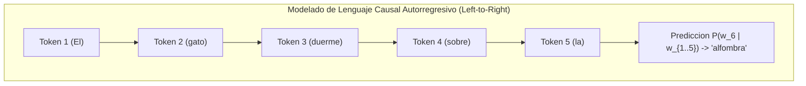
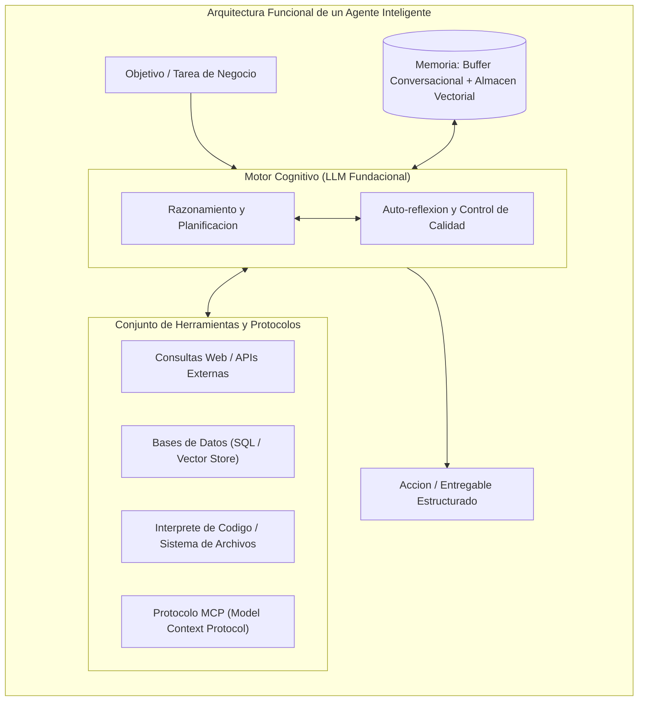
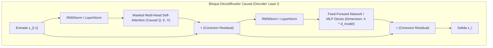
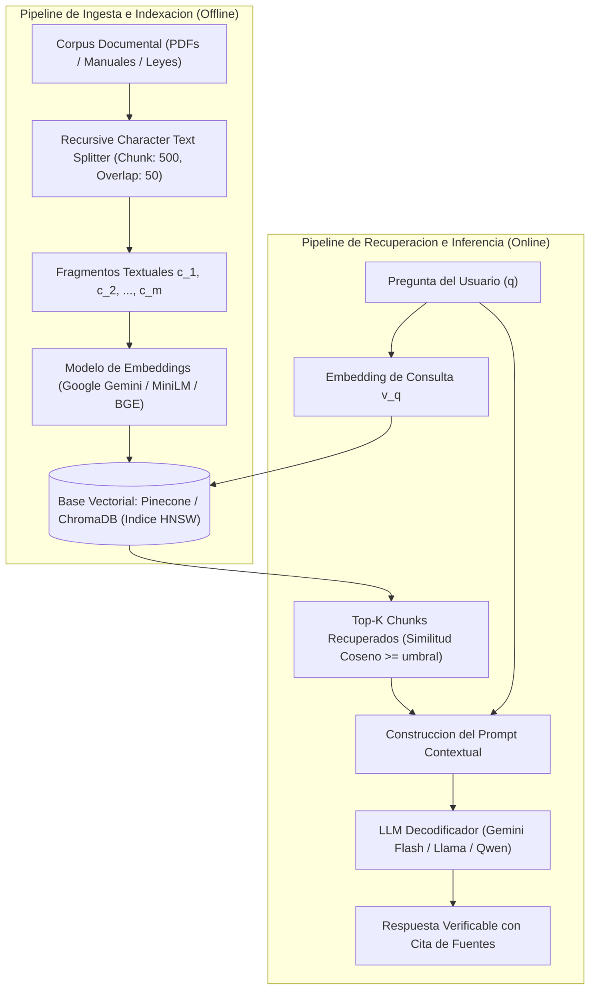
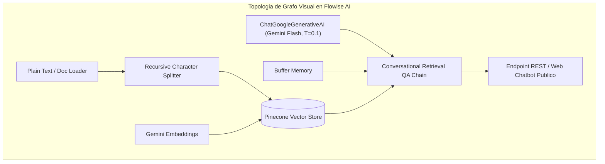

# Clase 8: Modelos de Lenguaje Masivos (LLMs), Atencion Causal Autorregresiva, Sistemas Multi-Agente y Arquitectura RAG

> **Objetivo de la sesion:** Comprender los fundamentos matematicos y arquitectonicos de la rama de decodificadores (Decoder-Only) en los modelos de lenguaje masivos (LLMs) y su mecanismo de atencion causal autorregresiva; analizar la transicion del Prompt Engineering hacia el paradigma de Inteligencia Artificial Agentica (Agentic AI) y orquestacion multi-agente colaborativa (CrewAI, Flowise); dominar la arquitectura de Generacion Aumentada por Recuperacion (RAG) integrando bases de datos vectoriales (Pinecone, ChromaDB); y evaluar el despliegue local soberano y privado mediante gestores de modelos cuantizados (Ollama) e interfaces de usuario web (Open WebUI).

## 1\. Contexto y Marco Conceptual

### La Rama Decodificadora (Decoder-Only) y los Modelos Generativos

Tras la aparicion del Transformer original, la arquitectura Secuencia a Secuencia tradicional (utilizada primariamente para traduccion neuronal entre dos idiomas) dio paso a una simplificacion radical de la rama decodificadora liderada por OpenAI con la serie **GPT (Generative Pre-trained Transformer)**:

- **GPT-1 (Radford et al., 2018):** Demostro que una pila de bloques decodificadores sin conexion a un codificador previo era capaz de aprender representaciones linguisticas universales mediante pre-entrenamiento causal no supervisado.

- **GPT-2 (2019) y GPT-3 (2020, 175B parametros):** Evidenciaron el principio de escalabilidad parametrica (*Scaling Laws*), demostrando capacidades emergentes de aprendizaje en contexto (*In-Context Learning*) bajo modalidades *Zero-Shot* y *Few-Shot*.

- **La Era Contemporanea de LLMs (2022-Presente):** Modelos masivos de escala industrial alineados mediante Aprendizaje por Refuerzo con Retroalimentacion Humana (RLHF) y razonamiento inductivo (GPT-4, Claude 3.5 Sonnet, Gemini 1.5/2.0, DeepSeek R1), a la par del florecimiento de modelos de pesos abiertos de alta eficiencia (Llama 3, Mistral, Qwen 2.5, Gemma 2).

A diferencia de BERT (que resuelve el problema estocastico bidireccional de adivinar palabras enmascaradas al medio), los modelos Decoder-Only operan bajo el principio de **Modelado de Lenguaje Causal (Causal Language Modeling - CLM)**: predicen estrictamente la distribucion de probabilidad condicional del siguiente token de izquierda a derecha sobre el vocabulario:

$P(W) = \prod_{t=1}^T P(w_t \mid w_1, w_2, \dots, w_{t-1})$



### Jerarquia y Granularidad de Embeddings

El desarrollo contemporaneo de representaciones semanticas se articula en una taxonomia jerarquica segun el nivel de abstraccion de la unidad de analisis:

1. **Sub-word / Token Embeddings:** Proyecciones vectoriales continuas de subunidades graficas generadas por algoritmos BPE (Byte-Pair Encoding) o SentencePiece. Constituyen la representacion elemental de entrada al modelo.

1. **Word Embeddings (Vectores de Palabra):** Representaciones continuas de palabras completas (Word2Vec, GloVe).

1. **Sentence Embeddings (Vectores de Oracion):** Vectores condensados (típicamente $\mathbb{R}^{384}$ o $\mathbb{R}^{768}$) generados por modelos siameses (Sentence-BERT, MiniLM) para medir similitud textual y realizar agrupamiento semantico.

1. **Document Embeddings (Vectores de Documento):** Representaciones densas globales de textos extensos o reportes completos, fundamentales para la indexacion y recuperacion a gran escala en bases vectoriales.

### La Transicion Epistemologica: Del Prompt Engineering a la IA Agentica

La interaccion con los modelos de lenguaje masivos ha transitado por tres fases paradigmaticas:

1. **Chatbots Monoliticos (2022-2023):** Consultas conversacionales de entrada y salida directa usuario-modelo sin persistencia de estado ni acceso al entorno exterior.

1. **Prompt Engineering Parametrico (2023-2024):** Diseno sistematico de directivas, plantillas estructuradas, tecnicas de Cadena de Pensamiento (*Chain of Thought - CoT*) y pocas muestras (*Few-Shot Prompting*) para guiar la inferencia del modelo.

1. **Inteligencia Artificial Agentica (Agentic AI - 2024-Presente):** Construccion de **agentes autonomos orientados a objetivos**, donde el LLM actua como el motor de razonamiento cognitivo (*cerebro*) de una entidad que posee:

   - **Percepcion:** Capacidad de captar eventos y datos estructurados/no estructurados del entorno.
   
   - **Memoria:** Registro de interacciones previas (memoria de trabajo conversacional) y conocimiento historico indexado (memoria episodica vectorial).
   
   - **Planificacion y Reflexion:** Descomposicion de metas complejas en subtareas ejecutables con evaluacion recursiva de sus propios resultados.
   
   - **Uso de Herramientas (Tool Calling / Action Execution):** Capacidad de ejecutar codigo en interpretes de Python, invocar APIs REST externas, consultar bases de datos relacionales o interactuar con el sistema de archivos.
   
   - **Estandarizacion de Protocolos (Model Context Protocol - MCP):** Adopcion de estandares abiertos (liderados por iniciativas como MCP de Anthropic) que unifican la capa de abstraccion e interoperabilidad entre los modelos cognitivos y las fuentes de datos empresariales.



### Retrieval-Augmented Generation (RAG) y Soberania de Datos

Aunque los LLMs exhiben una competencia linguistica sobresaliente, presentan limitaciones intrinsecas en entornos de produccion corporativa:

- **Alucinaciones Verosimiles:** Generacion de asertos falsos expresados con absoluta certeza sintactica.

- **Corte Temporal de Entrenamiento (*****Knowledge Cutoff*****):** Incapacidad para responder sobre hechos o normativas posteriores a su fecha de pre-entrenamiento.

- **Falta de Acceso a Informacion Privada:** Desconocimiento de manuales operativos, politicas de credito, contratos legales o auditorias internas confidenciales de la organizacion.

La arquitectura **RAG (Generacion Aumentada por Recuperacion)** resuelve este trilema desacoplando la memoria fáctica del modelo linguistico: los documentos internos se indexan en un almacen vectorial local, y unicamente los fragmentos pertinentes a la consulta del usuario se inyectan en tiempo real dentro del contexto del LLM.

Asimismo, la implementacion de RAG sobre infraestructura local (**Ollama + bases vectoriales locales**) garantiza la **soberania de datos y cumplimiento regulatorio**: en sectores bancarios, juridicos o medicos, la transmision de datos confidenciales hacia servicios SaaS externos infringe marcos legales de privacidad (GDPR, secreto bancario, normativas de proteccion de datos personales). El procesamiento on-premise suprime completamente el riesgo de exfiltracion de activos de informacion sensibles.

---

## 2\. Fundamentos Teoricos y Arquitectura

### 1\. Mecanismo de Auto-Atencion Causal Enmascarada (Masked Self-Attention)

Para impedir que durante la fase de optimizacion el decodificador filtre informacion de palabras futuras, se aplica una mascara causal aditiva a la matriz de compatibilidad de atencion:

$\text{Attention}(Q, K, V) = \text{softmax}\left(\frac{Q K^T}{\sqrt{d_k}} + M\right) V$

Donde la matriz de mascara causal $M \in \mathbb{R}^{T \times T}$ se define estrictamente como:

$M_{i,j} = \begin{cases} 0 & \text{si } j \le i \\ -\infty & \text{si } j > i \end{cases}$

Dado que $\exp(-\infty) = 0$, al evaluar la funcion Softmax en cualquier posicion $i$, los pesos asignados a posiciones $j > i$ colapsan deterministicamente a cero:

$\text{softmax}\left(\mathbf{z}_i + \mathbf{m}_i\right)_j = \frac{\exp(z_{i,j} + M_{i,j})}{\sum_{k=1}^T \exp(z_{i,k} + M_{i,k})} = 0 \quad \forall j > i$

Esta formulacion permite entrenar el modelo paralelizando todas las posiciones de la secuencia en una sola pasada tensorial en GPU (*teacher forcing*), preservando la propiedad autorregresiva estricta requerida durante la inferencia secuencial token a token.

### 2\. Descomposicion Parametrica de un Bloque Decodificador

Un bloque decodificador estandar se estructura como:

1. Capa de Auto-Atencion Causal Multi-Cabeza (*Masked Multi-Head Attention*).

1. Conexiones residuales con normalizacion de capa (*RMSNorm* o *LayerNorm* pre-atencion).

1. Red Feed-Forward Proyectiva (*MLP / SwiGLU*), la cual proyecta la dimension oculta $d_{\text{model}}$ hacia un espacio de mayor capacidad (habitualmente $4 \cdot d_{\text{model}}$ u $\frac{8}{3} \cdot d_{\text{model}}$) y luego la comprime nuevamente.

1. Conexiones residuales y normalizacion final.

*Analisis de Distribucion Parametrica:* En las arquitecturas decodificadoras modernas (GPT-3, Llama), mas del 65% del volumen total de parametros entrenables reside en las capas densas del perceptron multicapa (MLP) proyectivo, mientras que las cabezas de atencion albergan el porcentaje restante, concentrando la capacidad de asociacion de patrones factuales dentro de los pesos del MLP.



### 3\. Pipeline Arquitectonico de Retrieval-Augmented Generation (RAG)

La arquitectura formal de RAG se descompone en dos fases operativas:

#### Fase 1: Ingesta, Fragmentacion e Indexacion Vectorial (Offline / Asincrona)

1. **Carga e Ingesta:** Extraccion de texto crudo no estructurado desde repositorios corporativos (manuales tecnicos, documentos normativos, leyes, reportes de auditoria).

1. **Segmentacion Parametrizada (Chunking):** Division del corpus continuo en fragmentos discretos $\{c_1, c_2, \dots, c_m\}$ caracterizados por un tamano de ventana $L_c$ (medido en tokens o caracteres) y un solapamiento $\Delta$ (*chunk overlap*) para asegurar continuidad semantica en los limites de corte.

1. **Proyeccion Vectorial Continua:** Transformacion de cada fragmento mediante un modelo de embeddings denso:

   $\mathbf{v}_k = f_{\text{embed}}(c_k) \in \mathbb{R}^{d_{\text{embed}}}$

1. **Indexacion en Base Vectorial:** Insercion de los pares $(\mathbf{v}_k, \text{metadata}_k)$ en almacenes vectoriales especializados (Pinecone, ChromaDB, Weaviate), estructurados mediante grafos jerarquicos de mundos pequenos navegables (**HNSW - Hierarchical Navigable Small World**) para busqueda de vecinos mas cercanos en tiempo sublineal $\mathcal{O}(\log N)$.

#### Fase 2: Recuperacion Semantica y Generacion Fundamentada (Online / Sincrona)

1. **Vectorizacion de la Consulta:** El usuario formula una interrogante $q$, la cual se proyecta en el mismo espacio vectorial latente: $\mathbf{v}_q = f_{\text{embed}}(q)$.

1. **Recuperacion Semantica (Top-K Retrieval):** Se ejecuta una consulta por similitud coseno sobre el indice vectorial para aislar los $K$ fragmentos con mayor proximidad angular:

   $\text{Sim}(\mathbf{v}_q, \mathbf{v}_k) = \frac{\mathbf{v}_q \cdot \mathbf{v}_k}{\|\mathbf{v}_q\|_2 \|\mathbf{v}_k\|_2}$

1. **Ensamblado del Prompt Aumentado:** Se concatenan las directivas del sistema, los fragmentos documentales recuperados $\{c_{(1)}, \dots, c_{(K)}\}$ en calidad de contexto fáctico delimitado y la pregunta original del usuario:

   $\text{Prompt}_{\text{final}} = \text{Instruccion}_{\text{sistema}} \oplus \text{Contexto}_{\text{recuperado}} \oplus \text{Pregunta}$

1. **Inferencia Causal Fundamentada:** El LLM decodificador genera la respuesta final condicionada exclusivamente sobre el contexto provisto, citando evidencias y eliminando alucinaciones.



### 4\. Formalizacion de Sistemas Multi-Agente

Un sistema multi-agente se define como un conjunto de entidades cognitivas heterogeneas $\mathcal{S} = \{\mathcal{A}_1, \mathcal{A}_2, \dots, \mathcal{A}_n\}$ coordinadas bajo un protocolo de colaboracion para resolver una tarea compuesta $\mathcal{T}_{\text{global}}$. Cada agente individual se formaliza mediante la tupla:

$\mathcal{A}_i = \langle \mathcal{R}_i, \mathcal{G}_i, \mathcal{B}_i, \mathcal{M}_i, \mathcal{O}_i, \mathcal{L}_i \rangle$

- $\mathcal{R}_i$ (**Rol**): Especialidad funcional asignada (e.g., *Content Planner*, *Financial Auditor*, *Code Reviewer*).

- $\mathcal{G}_i$ (**Objetivo / Goal**): Meta analitica directriz que el agente busca maximizar o satisfacer.

- $\mathcal{B}_i$ (**Trasfondo / Backstory**): Instruccion de condicionamiento que inyecta experiencia previa, criterios metodologicos y sesgos operativos deseados.

- $\mathcal{M}_i$ (**Memoria**): Mecanismo de persistencia de estado a corto y largo plazo.

- $\mathcal{O}_i$ (**Herramientas / Operations**): Catalogo de funciones computacionales ejecutables.

- $\mathcal{L}_i$ (**Modelo de Lenguaje**): Instancia de LLM asignada como procesador cognitivo (optimizando costes al asignar modelos pequenos y rapidos a tareas rutinarias, y modelos de frontera a tareas criticas de revision).

---

## 3\. Implementacion Tecnica y Logica de Negocio

### 1\. Orquestacion de Sistemas Multi-Agente con CrewAI en Python

A continuacion se presenta la implementacion formal de un equipo multi-agente para planificacion, redaccion y control de calidad editorial utilizando modelos fundacionales servidos a traves de endpoints de inferencia:

```python
import os
from crewai import Agent, Task, Crew, Process, LLM
from IPython.display import display, Markdown

# 1. Configuracion de Credenciales y Endpoint de Inferencia
os.environ["HUGGINGFACE_API_KEY"] = "hf_token_placeholder"

# 2. Instanciacion del Modelo Cognitivo Fundacional
qwen_llm = LLM(
    model="huggingface/Qwen/Qwen2.5-32B-Instruct",
    api_key=os.environ["HUGGINGFACE_API_KEY"],
    temperature=0.2
)

# 3. Declaracion de Agentes Especializados con Prompt Engineering Estructurado
content_planner = Agent(
    role="Content Planner",
    goal="Investigar tendencias clave, estructura discursiva y audiencia objetivo para el tema: {topic}",
    backstory=(
        "Eres un estratega editorial experto en analisis de audiencias digitales. Tu mision "
        "consiste en disenar esquemas analiticos rigurosos, identificando puntos de dolor "
        "y fuentes informativas criticas para estructurar publicaciones de alto impacto."
    ),
    llm=qwen_llm,
    verbose=True,
    allow_delegation=False
)

content_writer = Agent(
    role="Content Writer",
    goal="Redactar un articulo tecnico integral y exhaustivo sobre el tema {topic} fundamentado en el plan editorial",
    backstory=(
        "Eres un redactor academico y tecnologico senior con dominio del formato Markdown. "
        "Transformas esquemas conceptuales en narrativas analiticas fluidas, sustentadas "
        "con terminologia precisa y evidencia formal, organizando cada seccion en 2 a 3 parrafos solidos."
    ),
    llm=qwen_llm,
    verbose=True,
    allow_delegation=False
)

content_editor = Agent(
    role="Content Editor",
    goal="Auditar el borrador editorial asegurando excelencia gramatical, rigor analitico y consistencia estilistica",
    backstory=(
        "Eres un corrector de estilo y auditor de calidad editorial de nivel posgrado. "
        "Revisas meticulosamente la ortografia, la neutralidad del registro, la precision "
        "conceptual y el formateo estructural antes de dar por finalizada la publicacion."
    ),
    llm=qwen_llm,
    verbose=True,
    allow_delegation=False
)

# 4. Definicion de Tareas con Salidas Esperadas Formales
plan_task = Task(
    description=(
        "Priorizar las tendencias centrales y debates vigentes sobre {topic}. "
        "Elaborar un esquema detallado que comprenda introduccion, desarrollo analitico "
        "en tres puntos cardinales, consideraciones criticas y sintesis ejecutiva."
    ),
    expected_output="Esquema estructural completo del articulo con secciones, publico objetivo y puntos clave.",
    agent=content_planner
)

write_task = Task(
    description=(
        "Desarrollar el articulo completo en formato Markdown riguroso a partir del esquema aprobado. "
        "Desarrollar argumentos con fundamento tecnico, asegurando que cada seccion contenga entre 2 y 3 parrafos."
    ),
    expected_output="Documento en formato Markdown integro, compuesto por secciones coherentes y listo para auditoria.",
    agent=content_writer
)

edit_task = Task(
    description=(
        "Auditar y corregir el documento generado por el redactor. Depurar errores sintacticos, "
        "garantizar fidelidad al esquema inicial y asegurar que el registro sea analitico y formal."
    ),
    expected_output="Version final del articulo en Markdown pulido, validado tecnicamente y formateado para publicacion.",
    agent=content_editor
)

# 5. Ensamblaje de la Tripulacion (Crew) y Ejecucion del Flujo
editorial_crew = Crew(
    agents=[content_planner, content_writer, content_editor],
    tasks=[plan_task, write_task, edit_task],
    process=Process.sequential,
    verbose=True
)

execution_result = editorial_crew.kickoff(inputs={"topic": "Arquitectura de Modelos Transformer y RAG"})
display(Markdown(str(execution_result)))
```

### 2\. Diseno de Grafos Visuales Low-Code con Flowise AI

Flowise AI provee una capa de abstraccion grafica sobre LangChain y LangGraph para la construccion declarativa de arquitecturas analiticas complejas:

1. **Pipeline Conversacional Basico:**

   - Componente ` ChatGoogleGenerativeAI ` configurado con credenciales de Google AI Studio, seleccionando el modelo ` gemini-2.5-flash ` con parametro de ` temperature=0.1 ` para garantizar determinismo fáctico.
   
   - Enlace a un nodo ` BufferMemory ` para persistir el historial de la conversacion y mantener coherencia contextuada en dialogos multi-turno.
   
   - Conexion a un nodo central ` ConversationChain `, expuesto mediante endpoints HTTP REST para integracion en sistemas corporativos o compartido como chatbot publico embebido.

1. **Pipeline de Retrieval-Augmented Generation (RAG):**

   - Ingesta de texto plano o archivos no estructurados mediante el nodo ` DocumentLoader ` / ` PlainText `.
   
   - Fragmentacion automatica mediante ` RecursiveCharacterTextSplitter ` con configuracion de longitud de fragmento de 500 caracteres y solapamiento de 50 caracteres.
   
   - Vectorizacion de fragmentos mediante el nodo ` GoogleGenerativeAIEmbeddings `.
   
   - Almacenamiento vectorial en la nube mediante el nodo ` Pinecone Vector Store ` (especificando ` pineconeIndex `, ` namespace ` y API Key).
   
   - Ensamblaje en una cadena ` ConversationalRetrievalQAChain `, la cual intercepta la consulta del usuario, recupera los fragmentos afines de Pinecone y alimenta al LLM decodificador.



### 3\. Inferencia Local Soberana y RAG Privado con Ollama y Open WebUI

Para entornos con regulaciones estrictas de confidencialidad, la combinacion de Ollama y Open WebUI conforma una infraestructura de IA privada sobre hardware local:

1. **Motor de Inferencia Ligero (Ollama):** Gestiona la descarga, cuantizacion en enteros de 4 bits (GGUF Q4\_K\_M) y ejecucion de modelos fundacionales de pesos abiertos (Gemma 2, Llama 3, Qwen 2.5) optimizados para GPU y CPU local.

1. **Interfaz de Usuario Web Contenedorizada (Open WebUI sobre Docker):**

   ```bash
   docker run -d -p 3000:8080 \
     --add-host=host.docker.internal:host-gateway \
     -v open-webui:/app/backend/data \
     --name open-webui \
     --restart always \
     ghcr.io/open-webui/open-webui:main
   ```

1. **Mecanismo de RAG Integrado:**

   - En el panel de Open WebUI, se accede a la seccion **Espacios de Trabajo / Conocimiento (*****Knowledge Bases*****)**.
   
   - Se crea una coleccion tematica (e.g., *Articulos Cientificos de Transformers* o *Manuales de Procedimientos Internos*) y se suben documentos en formato PDF mediante arrastre directo (*drag &amp; drop*).
   
   - De manera transparente, Ollama fragmenta el documento, calcula los embeddings densos y los persiste en una base de datos vectorial embebida (**ChromaDB**).
   
   - En la interfaz de chat, el usuario adjunta la base de conocimiento utilizando el comando ` #knowledge ` o seleccionando la coleccion correspondiente, permitiendo consultas factuales precisas sin que un solo byte de datos abandone el perimetro de la red local.

---

## 4\. Analisis Critico de Casos y Auditoria Practica

### Comparativa: Servicios Cloud Propietarios vs Despliegue Local Privado

| Dimension de Analisis | APIs Cloud Propietarias (OpenAI GPT-4o, Claude 3.5, Gemini 2.0) | Modelos Locales Cuantizados (Ollama: Llama 3, Gemma 2, Qwen 2.5) |
| --- | --- | --- |
| **Privacidad y Soberania** | Riesgo de transito de datos por nubes publicas; sujeto a politicas SaaS | Soberania total: datos y pesos residen exclusivamente en hardware local |
| **Modelo de Costes** | Coste recurrente por volumen de tokens (OPEX variable y acumulativo) | Inversion inicial en hardware/GPU (CAPEX); coste marginal cero por inferencia |
| **Requerimientos de Infraestructura** | Minimos en el cliente (unicamente conectividad de red segura HTTPS) | Elevados: demanda de memoria VRAM (minimo 8GB - 24GB para modelos 8B-32B) |
| **Riesgo de Disponibilidad y Latencia** | Sujeto a cortes de red, degradacion por concurrencia y latencia WAN | Latencia determinista ligada exclusivamente a los ciclos de computo locales |
| **Capacidad Cognitiva General** | Estado del arte en razonamiento logico abstracto y conocimiento enciclopedico | Altamente competente en modelos 8B a 32B para tareas acotadas de dominio corporativo |

### Comparativa de Almacenes Vectoriales: Pinecone vs ChromaDB

| Criterio Tecnico | Pinecone Vector Database | ChromaDB (Local / Embebido) |
| --- | --- | --- |
| **Modelo de Despliegue** | Totalmente administrado en la nube (SaaS multinube) | Autohospedado, embebido en memoria o contenedor local |
| **Escalabilidad Horizontal** | Elastica a miles de millones de vectores en clusters distribuidos | Acotada por la memoria RAM y capacidad de almacenamiento del nodo local |
| **Latencia de Consulta** | Latencia de red WAN (50 - 150 ms tipica) | Ultra-baja en memoria local (&lt; 10 ms) |
| **Complejidad Operativa** | Nula administracion de infraestructura (orientada a API keys) | Gestion de volumenes Docker, respaldos de disco y optimizacion de RAM |
| **Caso de Uso Optimo** | Aplicaciones analiticas empresariales SaaS con alta concurrencia concurrente | Entornos cerrados confidenciales, auditorias privadas y RAG on-premise |

### Auditoria de Casos Reales

1. **Auditoria Documental en Entornos Legales y Financieros Sensibles:**

   Al someter contratos corporativos o registros financieros a revision, el uso de APIs comerciales externas infringe claúsulas de confidencialidad y acuerdos de no divulgacion (NDAs). La implementacion de RAG local con Ollama y Open WebUI sobre bases de conocimiento en ChromaDB garantiza el aislamiento absoluto de los datos confidenciales, permitiendo consultas semanticas complejas con cero exposicion a vectores de fuga de informacion.

1. **Alineacion Etica y Barreras de Seguridad (*****Guardrails*****):**

   Las pruebas de resistencia (*red teaming*) sobre modelos de pesos abiertos ejecutados en local (como Gemma 2 o Llama 3) demuestran que las tecnicas de alineacion por RLHF y DPO aplicadas durante su entrenamiento original persisten intactas en los pesos cuantizados: solicitudes orientadas a la construccion de virus informaticos o ejecucion de ciberataques son rechazadas deterministicamente por el modelo, comprobando que la inferencia local conserva las salvaguardas de seguridad corporativa.

---

## 5\. Principios de Diseno, Buenas Practicas y Anti-patrones

### Reglas de Oro en RAG y Sistemas Multi-Agente

1. **Calibracion Rigurosa de la Temperatura:**

   - Para tareas de recuperacion fáctica, auditoria documental, analisis legal y RAG, fijar la temperatura en $T \le 0.2$ (optimo: $0.0 - 0.1$) para forzar la seleccion del modo de maxima probabilidad y suprimir alucinaciones.
   
   - Reservar temperaturas moderadas o altas ($T \in [0.6, 0.8]$) exclusivamente para tareas creativas, generacion de narrativas o lluvia de ideas.

1. **Sintonizacion de la Granularidad de Chunking en RAG:**

   - Evitar fragmentos excesivamente breves (&lt; 150 tokens), ya que destruyen el contexto gramatical y relacional de la oracion.
   
   - Evitar fragmentos hiper-extensos (&gt; 1200 tokens), ya que diluyen la densidad de representacion semantica en el calculo de la similitud coseno.
   
   - El compromiso optimo en documentacion tecnica oscila entre **300 y 600 tokens con un solapamiento del 10% al 15%** (e.g., chunk size = 500, overlap = 50).

1. **Asignacion Heterogenea de Modelos en Arquitecturas Agénticas:**

   No utilizar modelos masivos de frontera para todas las subtareas del sistema. Asignar modelos pequenos y ultrarrapidos (e.g., Llama-3-8B o Gemini Flash) para tareas mecánicas de extraccion de datos, enrutamiento o formateo, y reservar modelos de razonamiento avanzado para auditoria critica y sintesis directiva, reduciendo costes y latencia hasta en un 80%.

### Anti-patrones Comunes

- **Anti-patron de "Prompt Stuffing" Indiscriminado:** Inyectar reportes de cientos de paginas directamente en ventanas de contexto gigantescas (1M+ tokens) sin indexacion vectorial previa. Esto ocasiona el fenomeno de degradacion de atencion (*Lost in the Middle*), incrementa exponencialmente el coste en tokens y multiplica la latencia de respuesta frente a un sistema RAG bien calibrado.

- **Anti-patron de Bucles Agénticos Infinitos:** Disenar flujos de agentes con retroalimentacion mutua sin definir una condicion estricta de parada (e.g., maximo de 3 iteraciones de revision o un umbral cuantitativo de aprobacion), generando llamadas ciclicas infinitas y agotamiento de cuotas de procesamiento.

- **Anti-patron de Almacen Vectorial Desincronizado:** Tratar la base de datos vectorial como un repositorio estatico, omitiendo pipelines de actualizacion cuando los documentos fuente cambian, provocando que el sistema RAG emita respuestas fundamentadas en manuales o normativas derogadas.

---

## 6\. Sintesis Conceptual y Profundizacion Academica

### Sintesis de la Sesion

La evolucion contemporanea del Procesamiento de Lenguaje Natural ha convergido en la consolidacion de la rama decodificadora causal (Decoder-Only) como el nucleo cognitivo de los sistemas analiticos y generativos modernos. Superando las etapas preliminares del Prompt Engineering, la disciplina se ha expandido hacia la Inteligencia Artificial Agentica, donde multiples modelos cooperan mediante roles especializados, memoria estructurada y ejecucion de herramientas a traves de protocolos estandarizados como MCP. Complementariamente, la arquitectura RAG articulada con bases vectoriales y gestores locales soberanos como Ollama resuelve el problema de las alucinaciones y democratiza el despliegue privado de soluciones corporativas de alta seguridad.

### Literatura de Referencia y Marcos Teoricos

- **Radford, A., Wu, J., Child, R., et al. (2019).** *Language Models are Unsupervised Multitask Learners.* OpenAI Technical Report (GPT-2).

- **Brown, T. B., Mann, B., Ryder, N., et al. (2020).** *Language Models are Few-Shot Learners.* Advances in Neural Information Processing Systems 33 (NeurIPS 2020).

- **Lewis, P., Perez, E., Piktus, A., et al. (2020).** *Retrieval-Augmented Generation for Knowledge-Intensive NLP Tasks.* Advances in Neural Information Processing Systems 33 (NeurIPS 2020), 9459-9474.

- **DeepSeek-AI. (2025).** *DeepSeek-R1: Incentivizing Reasoning Capability in LLMs via Reinforcement Learning.* arXiv:2501.12948.

- **Anthropic. (2024).** *Model Context Protocol (MCP) Specification.* Open-source documentation: [https://modelcontextprotocol.io](<https://modelcontextprotocol.io/>)

- **Chase, H. (2023).** *LangChain and LangGraph: Frameworks for Context-Aware Language Model Applications.*
