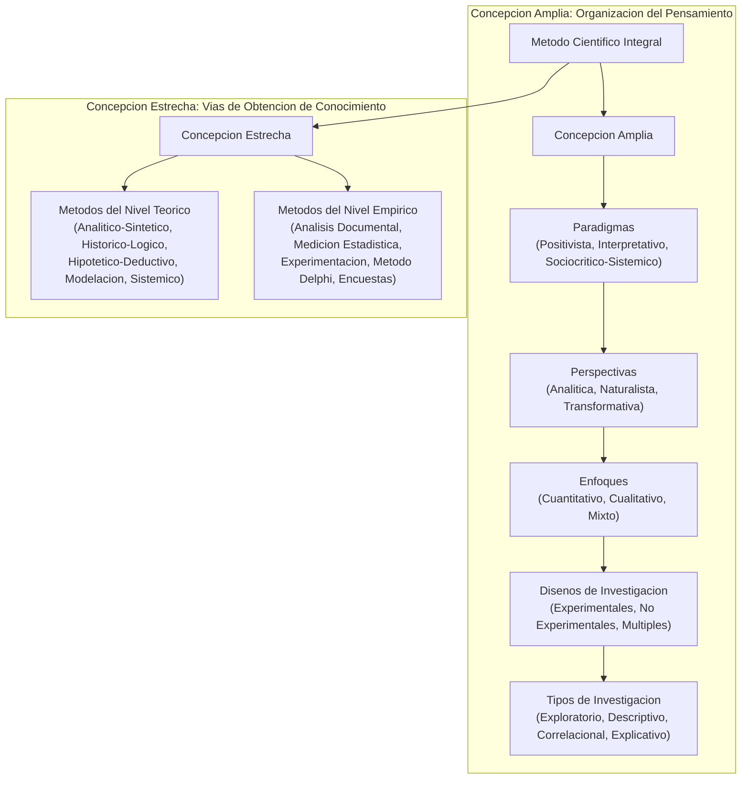
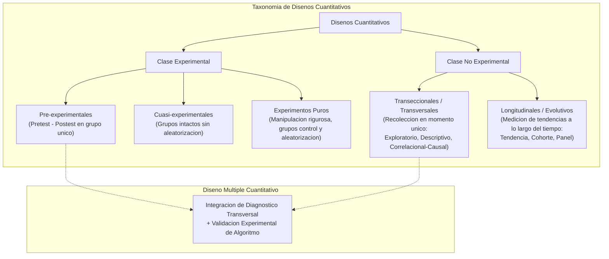
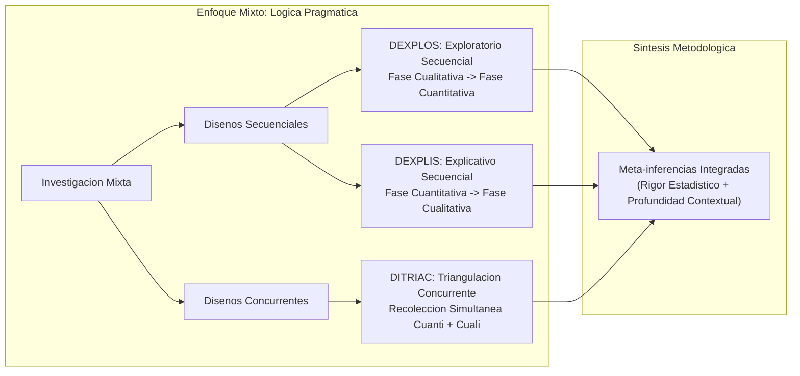

# Clase 2: El Metodo Cientifico en Sentido Amplio: Paradigmas, Perspectivas, Enfoques y Disenos de Investigacion Aplicada

> **Objetivo Pedagogico y Competencias Analiticas:**
> 
> Fundamentar el metodo cientifico en sus dimensiones amplia y estrecha para proyectos de posgrado en Ciencias de la Computacion e Inteligencia Artificial. Establecer la clasificacion epistemologica de los paradigmas cientificos, sus perspectivas asociadas, la seleccion rigurosa del enfoque (cuantitativo, cualitativo, mixto) y la delimitacion de disenos experimentales y no experimentales, consolidando la proyeccion metodologica del perfil de tesis conforme al protocolo institucional 2026.

## 1\. Contexto y Marco Conceptual: La Estructura Dual del Metodo Cientifico

### 1.1 Concepcion Amplia vs Concepcion Estrecha del Metodo Cientifico

El metodo cientifico en el ambito de los estudios de posgrado se desdobla en dos dimensiones conceptuales complementarias:

- **Concepcion Amplia (Forma de Organizacion del Pensamiento Cientifico):** Refiere al marco epistemologico global que adopta el investigador para concebir la realidad, estructurar el razonamiento y justificar la validez del conocimiento. Comprende la cadena deductiva: Paradigma $\rightarrow$ Perspectiva $\rightarrow$ Enfoque $\rightarrow$ Diseno $\rightarrow$ Tipo de Investigacion.

- **Concepcion Estrecha (Vias de Obtencion y Procesamiento del Conocimiento):** Refiere a los procedimientos tecnicos, metodos, tecnicas e instrumentos operativos que viabilizan el principio de vinculacion entre teoria y practica. Comprende la relacion dialectica entre metodos del nivel teorico (modelacion, deduccion, analisis-sintesis) y metodos del nivel empirico (medicion, experimentacion algoritmica, observacion, metodos periciales).

### 1.2 Articulacion Metodologica Institucional y Paradigma Sociocritico-Sistemico

En la investigacion contemporanea en Ciencias de la Computacion de posgrado (UAGRM - SOE), se supera el reduccionismo empirista tradicional a traves de una postura epistemologica sociocritica y sistemica:

- **Articulacion de Criterios Academicos:** Los comites de evaluacion, tribunales y directores de trabajo final de grado unifican criterios bajo un mismo marco conceptual, garantizando que los artefactos tecnologicos evaluados respondan a estandares formales de reproducibilidad e impacto social.

- **Vision Sistemica y Complejidad:** El desarrollo de soluciones inteligentes (sistemas multiagente, modelos de aprendizaje profundo, arquitecturas IoT) no opera en el vacio tecnico; interactua con entornos organizacionales, dinamicas humanas y restricciones contextuales que demandan un enfoque metodologico integrador.

### 1.3 Diferenciacion Taxonomica entre Investigacion de Maestria y Doctoral

Es fundamental delimitar con precision los limites de alcance metodologico entre ambos grados academicos:

- **Nivel Doctoral:** Su proposito prioritario es la investigacion basica o aplicada de frontera con generacion de **nuevo conocimiento teorico** (nuevos modelos matematicos, teorias computacionales, extensiones ontologicas). Demanda una variedad y magnitud amplia de instrumentos empiricos y validaciones comparativas exhaustivas.

- **Nivel Maestria:** Su proposito es la **investigacion aplicada con caracter propositivo**. Parte de teorias y paradigmas cientificos consolidados para resolver problematicas tecnologicas complejas de la realidad mediante la concepcion, desarrollo y validacion empirica de artefactos (productos, servicios, arquitecturas o modelos). El aporte no radica en crear nueva teoria gnoseologica, sino en la originalidad, efectividad y aplicabilidad comprobada de la solucion disenada.

---

## 2\. Fundamentos Teoricos y Arquitectura Metodologica

### 2.1 Taxonomia Epistemologica del Metodo Cientifico

La siguiente representacion modela la arquitectura completa del metodo cientifico en sus dos vertientes:

### 2.2 Paradigmas y Perspectivas de Investigacion

El pensamiento cientifico se articula en tres grandes paradigmas epistemologicos:

1. **Paradigma Positivista (Racionalista / Empirista):**

   - Postulado: La realidad es unica, objetiva, medible y fragmentable en variables discretas.
   
   - Perspectiva Asociada: Analitico-explicativa o empirista.
   
   - Enfoque Derivado: Cuantitativo.

1. **Paradigma Interpretativo (Hermenéutico / Fenomenologico):**

   - Postulado: La realidad es multiple, holistica y construida socialmente por los sujetos interactuantes.
   
   - Perspectiva Asociada: Naturalista, fenomenologica, humanista o etnografica.
   
   - Enfoque Derivado: Cualitativo.

1. **Paradigma Sociocritico y Sistemico (Dialectico / Constructivista):**

   - Postulado: El conocimiento es una construccion historico-social orientada a la transformacion practica y emancipadora de la realidad mediante sistemas complejos.
   
   - Perspectiva Asociada: Transformativa, participativa, dialectica y praxiologica.
   
   - Enfoque Derivado: Mixto (integra herramientas cuantificables con comprension holistica del contexto).

### 2.3 Tipologia y Arquitectura de Disenos Cuantitativos

En el enfoque cuantitativo coexisten dos grandes familias metodologicas:

### 2.4 Arquitectura Metodologica del Enfoque Mixto y Disenos Hibridos

El enfoque mixto adopta una orientacion pragmatica donde los metodos cuantitativos y cualitativos se articulan para maximizar la validez y profundidad del hallazgo cientifico:

---

## 3\. Implementacion Tecnica y Logica Metodologica de los Disenos

### 3.1 Disenos Cuantitativos Experimentales en Ciencias de la Computacion e IA

En proyectos de algoritmos, modelos predictivos y sistemas de IA, la experimentacion constituye el nucleo probatorio de la variable independiente ($X$):

- **Pre-experimentos:** Diseno con pretest y postest en un solo grupo ($O_1 \rightarrow X \rightarrow O_2$). Se aplica para medir metricas basales de un proceso organizacional, implementar el algoritmo propuesto y registrar la metrica posterior. Carece de grupo de control estricto, pero resulta altamente util y viable en validaciones tecnicas iniciales de tesis de maestria.

- **Cuasi-experimentos:** Evaluacion que incluye grupos de contraste (ej. dos areas operativas o dos lineas de produccion), pero donde los sujetos o datos provienen de grupos previamente intactos sin asignacion aleatoria pura.

- **Experimentos Puros:** Control estricto de variables extranas mediante asignacion aleatoria y grupos de control formal ($R \; G_1: O_1 \rightarrow X \rightarrow O_2$; $R \; G_2: O_3 \rightarrow - \rightarrow O_4$). Muy utilizado en benchmarks estandarizados con datasets cerrados y tecnicas de validacion cruzada k-fold balanceada.

### 3.2 Disenos Cuantitativos No Experimentales

Aquellos donde no existe manipulacion deliberada de la variable independiente, observando los fenomenos en su estado natural:

- **Transeccionales / Transversales:** Medicion en una unica ventana temporal:

  - *Exploratorios:* Mapeo inicial de variables poco documentadas.
  
  - *Descriptivos:* Caracterizacion de tasas de fallas, distribuciones o latencias de un sistema.
  
  - *Correlacionales / Causales:* Estimacion de dependencia funcional o asociacion entre variables predictoras y desenlaces sin intervencion directa.

- **Longitudinales / Evolutivos:** Analisis a traves de series de tiempo continuas:

  - *De Tendencia:* Analisis de cambios en poblaciones amplias en distintos instantes.
  
  - *De Cohorte:* Monitoreo de subpoblaciones especificas identificadas por un rasgo comun.
  
  - *De Panel:* Monitoreo continuo de exactamente los mismos sujetos o nodos computacionales en sucesivos instantes.

### 3.3 El Diseno Multiple Cuantitativo

En ingenieria y ciencia de datos es comun estructurar un **Diseno Multiple Cuantitativo**: diseno que combina tecnicas no experimentales transeccionales (para recolectar datos iniciales y realizar el diagnostico analitico de la situacion problematica) con tecnicas experimentales pre-experimentales (para evaluar el rendimiento del modelo desarrollado mediante contraste pretest-postest). Se debe evitar confundir el diseno multiple cuantitativo con un diseno mixto; el primero opera con exclusividad dentro de la epistemologia cuantitativa.

### 3.4 Fuentes de Invalidacion en Experimentos Algoritmicos y de Software

El rigor cientifico exige identificar y mitigar activamente amenazas a la validez:

- **Sesgo de Seleccion / Data Leakage:** Fugas de informacion del conjunto de prueba (test set) hacia el conjunto de entrenamiento (train set), produciendo metricas de precision infladas artificialmente.

- **Falta de Representatividad Muestral:** Conjuntos de datos desbalanceados o muestras sesgadas geografica o demograficamente que impiden la generalizacion.

- **Efecto Placebo o Efecto de Demanda:** Respuestas sesgadas de usuarios en pruebas de evaluacion de interfaces o asistentes inteligentes donde los evaluadores intentan complacer al investigador.

- **Sesgo del Experimentador:** Ajuste hiperparametrico forzado (*p-hacking* computacional) para demostrar hipoteticas mejoras estadisticamente no significativas.

### 3.5 Disenos Cualitativos en el Ambito Tecnologico

Lejos de constituir un abordaje secundario, el enfoque cualitativo resulta indispensable cuando se evalua la dimension socio-tecnica:

- **Teoria Fundamentada:** Codificacion abierta y axial para descubrir inductivamente patrones de adopcion o rechazo de sistemas computacionales.

- **Estudios Etnograficos:** Inmersion en equipos de ingenieria para caracterizar culturas de ciberseguridad o practicas DevOps.

- **Disenos Fenomenologicos:** Exploracion de las vivencias subjetivas y ergonomia cognitiva de profesionales que operan con sistemas de soporte a la decision asistidos por IA.

### 3.6 Logica Pragmatica del Enfoque Mixto

En ciencias de la computacion aplicadas, el enfoque mixto ofrece el mayor poder de resolucion metodologica:

- Permite diagnosticar cuantitativamente una brecha (ej. precision diagnostica de 62%) e investigar cualitativamente con especialistas medicos las barreras interpretativas del reporte clinico.

- Combina la validacion pericial formal (metodo Delphi cuali-cuantitativo para evaluar coherencia conceptual, factibilidad y pertinencia) con la medicion cuantitativa empirica de la efectividad del algoritmo en un entorno piloto.

---

## 4\. Analisis Critico de Casos y Auditoria de Proyectos de Tesis

### 4.1 Deconstruccion y Refactorizacion de Temas Expuestos en Sesion

Se evaluaron y refinaron propuestas de perfil bajo los canones formales del protocolo 2026:

#### Caso A: Modelo predictivo IoT en apicultura

- *Propuesta Inicial:* Modelo predictivo basado en inteligencia artificial e IoT orientado a anticipar variables criticas en apicultura para la toma de decisiones tecnica y estrategica, estancia Yukirenda, Villamontes, Tarija, primer semestre 2027.

- *Auditoria:* Estructura altamente solida. Identifica con precision: Propuesta ($X$: Modelo predictivo), Variables Intervinientes ($Z_1$: Inteligencia Artificial, $Z_2$: IoT), Variable Dependiente de Transformacion ($Y$: Toma de decisiones tecnica y estrategica), Contexto Espacial ($S$: Estancia Yukirenda, Villamontes, Tarija) y Temporalidad ($T$: Primer semestre 2027). Se recomendo profundizar la fundamentacion teorica de la linea de investigacion.

#### Caso B: Deteccion de desercion de clientes en PYMES

- *Propuesta Inicial:* Modelo predictivo de desercion de clientes basado en mineria de datos orientado al fortalecimiento de la fidelizacion en PYME, Santa Cruz, Bolivia.

- *Auditoria:* Se detecto debilidad sintactica en el conector *orientado al*. Este conector deja ambigua la variable dependiente de transformacion. Se corrigio por la preposicion formal: *...basado en mineria de datos para el fortalecimiento de la fidelizacion...*, complementando con la delimitacion temporal proyectiva (2026-2027).

#### Caso C: Clasificacion de vectores de leishmaniasis mediante Deep Learning

- *Propuesta Inicial:* Modelo de reconocimiento y clasificacion automatica de imagenes de flebotominos mediante deep learning en vision artificial para la deteccion y clasificacion de vectores de leishmaniasis en Santa Cruz, Bolivia durante el periodo 2026-2027.

- *Auditoria:* Propuesta bien fundamentada. Se recomendo depurar la frase redundante *durante el periodo* y consolidar la formulacion directa: *...Santa Cruz, Bolivia, 2026-2027*, asegurando la articulacion con la linea de Sistemas Cognitivos e Inteligentes.

#### Caso D: Arquitectura para plataformas de comercio agentico

- *Propuesta Inicial:* Diseno de una arquitectura de referencia basada en sistemas multiagente para plataformas de comercio agentico aplicadas a marketplaces verticales en Bolivia, gestion 2026.

- *Auditoria:* Uso del termino *Diseno*. En el nivel de maestria el alcance terminal no es un mero plano o diseno conceptual, sino la arquitectura estructurada y validada. Se corrigio a *Arquitectura de referencia basada en sistemas multiagente...*, articulando el objetivo general con el verbo de maxima habilidad: *Proponer una arquitectura de referencia...*.

#### Caso E: Deteccion no supervisada de anomalias en ciberseguridad

- *Propuesta Inicial:* Modelo de deteccion de anomalias de ciberseguridad mediante aprendizaje automatico no supervisado e integracion SIEM en la empresa Tecnova SRL, Santa Cruz, Bolivia, semestre 1-2027.

- *Auditoria:* Omitia en la redaccion formal el proposito transformador directo (la variable dependiente $Y$). Se corrigio incorporando el para que: *...e integracion SIEM para la identificacion temprana de incidentes criticos en la empresa...*.

#### Caso F: Clasificacion y control de calidad en industria avicola

- *Propuesta Inicial:* Desarrollo de un sistema inteligente basado en ciencia de datos, vision computacional y aprendizaje automatico para automatizar el control de calidad y monitoreo de produccion de huevos...

- *Auditoria:* Anti-patron de inicio con *Desarrollo de...*. El desarrollo es una fase del ciclo de vida, no la propuesta integradora. Se corrigio hacia *Sistema inteligente basado en vision computacional...*, exigiendo delimitacion en una empresa avicola concreta y validacion de campo con evaluacion de efectividad.

#### Caso G: Clasificacion hibrida y prediccion de desercion academica

- *Propuesta Inicial:* Sistema hibrido de clasificacion de estados academicos y prediccion temprana de desercion estudiantil mediante reglas de negocio e inteligencia artificial en caso X.

- *Auditoria:* Se preciso que, en caso de anonimato institucional, debe explicitarse la tipologia institucional formal (ej. institucion de educacion superior de posgrado en Bolivia), complementando con la delimitacion temporal estricta (2026-2027).

### 4.2 Tabla Consolidada de Auditoria y Matriz de Variables de Proyectos

| **Proyecto Auditado** | **Propuesta (X) y Mediacion (Z)** | **Variable Dependiente (Y)** | **Contexto (S y T)** | **Dictamen y Ajuste Estructural** |
| --- | --- | --- | --- | --- |
| Predictivo IoT Apicola | Modelo predictivo basado en IA e IoT | Toma de decisiones tecnica y estrategica | Estancia Yukirenda, Tarija (2027) | Completitud estructural plena. Mantener coherencia en operacionalizacion. |
| Desercion Clientes PYME | Modelo predictivo con mineria de datos | Fidelizacion de clientes | PYMES, Santa Cruz (2026-2027) | Sustitucion de 'orientado a' por 'para'. Delimitacion temporal incorporada. |
| Clasificacion Vectores Leishmaniasis | Modelo de deep learning y vision artificial | Deteccion y clasificacion vectorial | Santa Cruz, Bolivia (2026-2027) | Depuracion de redundancias sintacticas. Sintaxis precisa. |
| Arquitectura Multiagente | Arquitectura de referencia con sistemas multiagente | Eficiencia en plataformas de comercio agentico | Marketplaces verticales, Bolivia (2026) | Eliminacion del vocablo 'Diseno'. Alcance propositivo completo. |
| Anomalias SIEM Ciberseguridad | Modelo no supervisado con integracion SIEM | Deteccion temprana de incidentes criticos | Tecnova SRL, Santa Cruz (2027) | Inclusion explicita de la variable dependiente de transformacion. |
| Vision Computacional Avicola | Sistema inteligente con vision y ML | Control de calidad y monitoreo de produccion | Empresa avicola, Santa Cruz (2026-2027) | Eliminacion del vocablo 'Desarrollo'. Exigencia de validacion empirica. |
| Desercion Academica Hibrida | Sistema hibrido: reglas de negocio e IA | Clasificacion de estados y mitigacion de desercion | Institucion de posgrado, Bolivia (2026-2027) | Explicitacion de tipologia de organizacion y anclaje contextual nacional. |

---

## 5\. Principios de Diseno Metodologico, Buenas Practicas y Anti-patrones

### 5.1 Buenas Practicas Metodologicas

1. **Articulacion Biunivoca Teoria-Metodologia:** Cada variable identificada en la hipotesis debe encontrar respaldo en el marco teorico referencial y contar con un instrumento de medicion especifico en la proyeccion metodologica.

1. **Estrategia de Validacion Dual:** En investigaciones propositivas de maestria, la validacion del artefacto tecnologico debe contemplar:

   - *Validacion Metodologica por Juicio de Expertos (Metodo Delphi):* Evaluacion de pertinencia, consistencia logica y factibilidad por pares especialistas.
   
   - *Validacion Empirica Cuantitativa de Efectividad:* Evaluacion de desempeno tecnico en entorno real o piloto (exactitud, precision, recall, F1-score, reduccion de latencia, optimizacion de costos operativos) mediante diseno pre-experimental o cuasi-experimental.

1. **Claridad Capitular en el Perfil:** La proyeccion metodologica (Capitulo 2 del perfil institucional) debe explicitar con precision el enfoque, diseno, tipo de investigacion, poblacion y muestra antes de detallar tecnicas e instrumentos.

### 5.2 Anti-patrones Metodologicos

- **Anti-patron de Inconsistencia Paradigmatica:** Declarar formalmente un enfoque mixto pero presentar unicamente resultados numericos descriptivos, sin meta-inferencias ni comprension del contexto cualitativo.

- **Anti-patron del Falso Experimento:** Denominar "experimento cientifico" a la simple ejecucion de un script de codigo o entrenamiento de modelo sin comparacion basal previa (pretest) ni control sistematico de fuentes de invalidacion.

- **Anti-patron del Desprecio Axiologico:** Desestimar los metodos cualitativos asumiendo dogmaticamente que la ingenieria solo opera con formulas matematicas, ignorando que la aceptabilidad, usabilidad y etica de la IA exigen abordajes cualitativos rigurosos.

- **Anti-patron de la Tarea Inacabada:** Limitar el alcance de la tesis a la etapa de diseno o prototipado sin contemplar la validacion de efectividad en el contexto empirico.

---

## 6\. Sintesis Conceptual y Profundizacion Academica

### 6.1 Interseccion Metodologica: Del "Que" al "Como"

El avance epistemologico del perfil de tesis transita formalmente por dos momentos sistemicos:

1. **El "Que" de la Investigacion (Nucleo Tematico e Introduccion):** Consolidado mediante la delimitacion del tema propositivo, su articulacion con las lineas de investigacion institucional y la contextualizacion del problema a nivel global, regional y local.

1. **El "Como" de la Investigacion (Proyeccion Metodologica):** Consolidado mediante la eleccion fundamentada del paradigma, la definicion del enfoque (cuantitativo/mixto), la estructuracion del diseno (experimental multiple / transversal) y la definicion del plan de analisis de datos.

### 6.2 Literatura Fundamental de Metodologia y Epistemologia Cientifica

Para afianzar el rigor conceptual se recomienda la revision de las siguientes obras de referencia:

- Bunge, M. *La investigacion cientifica: su estrategia y su filosofia*. Barcelona: Ariel.

- Hernandez-Sampieri, R., &amp; Mendoza, C. *Metodologia de la investigacion: Las rutas cuantitativa, cualitativa y mixta*. Ciudad de Mexico: McGraw-Hill.

- Hevner, A. R., March, S. T., Park, J., &amp; Ram, S. *Design Science in Information Systems Research*. MIS Quarterly, 28(1), 75-105.

- Creswell, J. W., &amp; Creswell, J. D. *Research Design: Qualitative, Quantitative, and Mixed Methods Approaches*. SAGE Publications.
