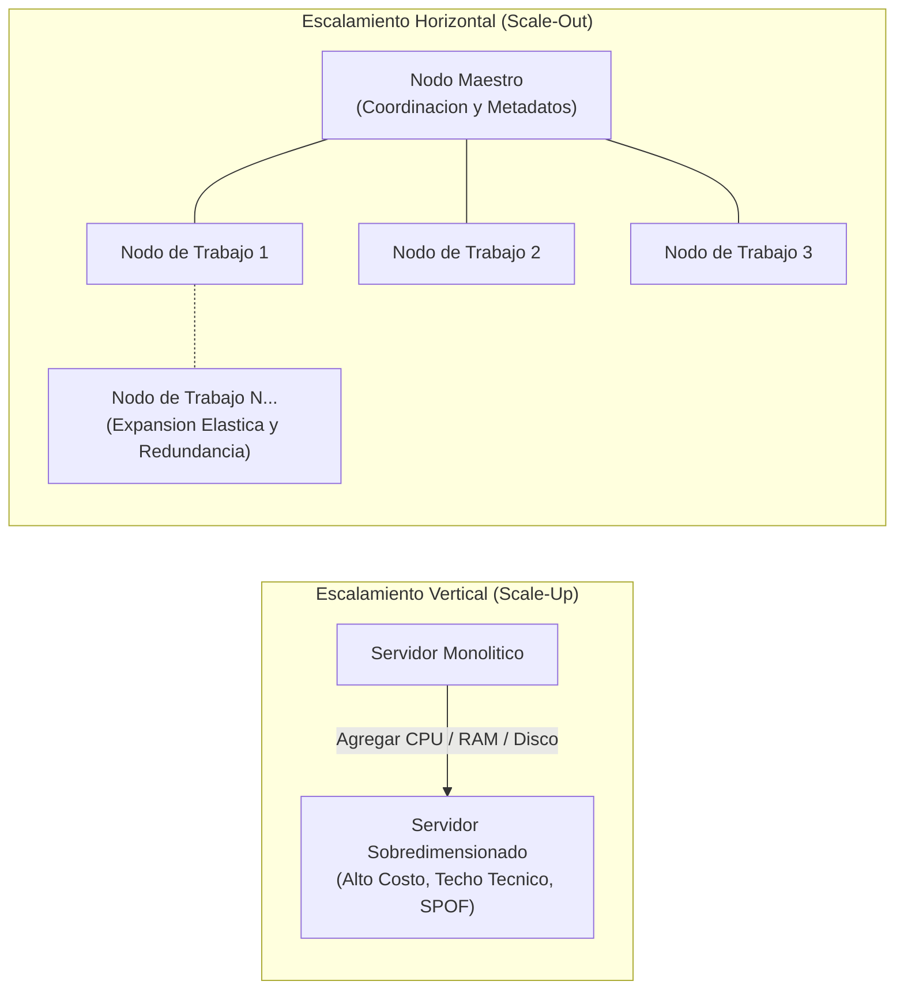
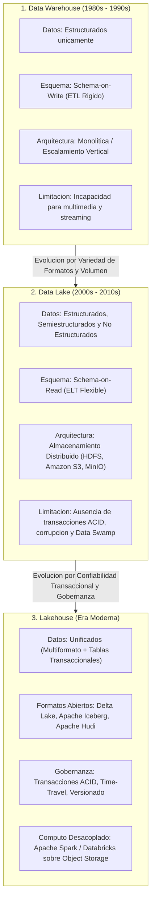
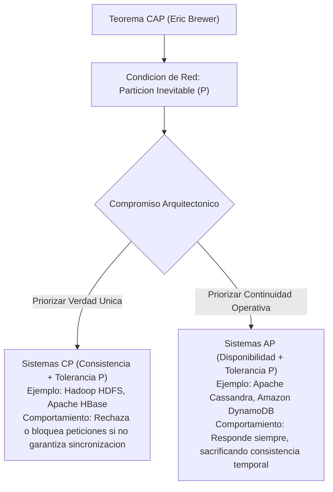
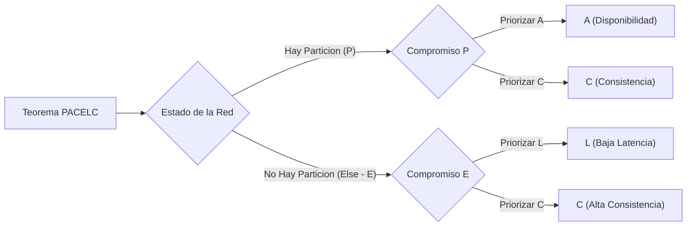
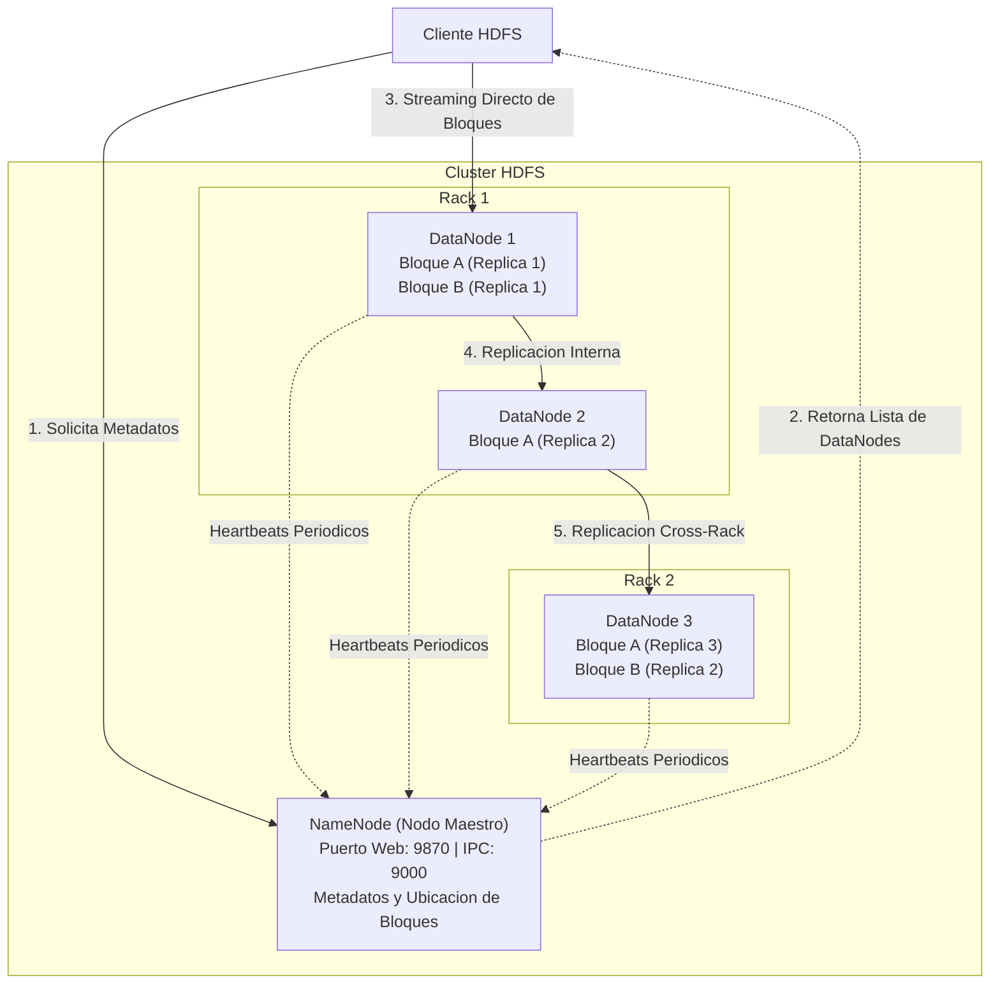

# Clase 1: Arquitectura de Big Data, Teoremas Distribuidos y Almacenamiento a Escala

> **Objetivo de la Sesion:** Analizar la transicion epistemologica y tecnologica desde las arquitecturas relacionales clasicas hacia plataformas analiticas distribuidas a gran escala (Data Warehouse, Data Lake y Lakehouse), formalizar los compromisos de diseno en entornos distribuidos mediante los teoremas CAP y PACELC, y establecer las bases operativas de clusterizacion con Docker y el sistema de archivos Hadoop HDFS.

## Seccion 1: Contexto y Marco Conceptual

### La Crisis de Escala en los Modelos Relacionales Tradicionales

Durante decadas, los sistemas de soporte a la decision (DSS) y las plataformas de inteligencia de negocios dependieron exclusivamente del paradigma de **Data Warehouse**, formalizado principalmente bajo las escuelas metodologicas de Bill Inmon (enfoque corporativo top-down) y Ralph Kimball (modelado dimensional bottom-up en esquemas estrella y copo de nieve).

No obstante, la aceleracion en la generacion de datos durante las ultimas dos decadas expuso tres limitaciones estructurales criticas en los sistemas relacionales tradicionales (RDBMS como SQL Server, Oracle o PostgreSQL):

1. **Incompatibilidad con Datos No Estructurados:** Los Data Warehouses tradicionales exigen el cumplimiento estricto del principio de *Schema-on-Write* (esquema definido previamente a la ingestion). Este requerimiento inhabilita el almacenamiento y procesamiento eficiente de datos no estructurados y semiestructurados (archivos JSON, XML, documentos PDF, imagenes, audio, video y flujos de redes sociales), indispensables en aplicaciones modernas de Machine Learning, Computer Vision y arquitecturas RAG (Retrieval-Augmented Generation).

1. **Saturacion de Rendimiento en Herramientas Analiticas de Escritorio:** Herramientas analiticas como Power BI sufren degradaciones severas de rendimiento y tiempos de refresco intolerables cuando se enfrentan a datasets de millones de registros bajo modelos relacionales clasicos no distribuidos, requiriendo agregaciones forzadas o dependencias criticas de infraestructura de computo pesada.

1. **Limite Fisico y Financiero del Escalamiento Monolitico:** La expansion de los Data Warehouses tradicionales descansa fundamentalmente en el escalamiento vertical, elevando exponencialmente los costos de hardware propietario y estableciendo un limite fisico superior para el procesamiento.

### Taxonomia Formal de las 5 V del Big Data

El concepto de Big Data no responde a un umbral numerico absoluto y estatico (como podria ser 1 TB o 10 TB), sino a una condicion dinamica donde el volumen supera la capacidad de gestion y procesamiento de los metodos computacionales tradicionales. La definicion formal se rige por las cinco dimensiones cardinales:

- **Volumen:** Magnitud cuantitativa masiva de los datos generados y almacenados. Su dimension es historica y relativa: un terabyte en el ano 2000 constituia un desafio de escala extrema, mientras que en la actualidad se gestionan ordenes de magnitud de petabytes y exabytes.

- **Velocidad:** Tasa temporal a la cual los datos son generados, ingeridos y transformados. Cubre desde arquitecturas de procesamiento por lotes (batch) hasta canales continuos de transmision en tiempo real (streaming con Apache Kafka o Cassandra).

- **Variedad:** Heterogeneidad estructural de las fuentes de datos. Implica la convivencia de datos estructurados (tablas relacionales, CSVs delimitados), semiestructurados (logs de servidores, JSON, XML) y no estructurados (documentos, grafos, texto libre, binarios multimedia).

- **Veracidad:** Fidelidad, nivel de ruido, consistencia e integridad de los datos. En entornos masivos y distribuidos, los datos provienen de fuentes dispersas y son propensos a corrupcion, perdidas o desorden, lo que exige mecanismos rigurosos de validacion y limpieza.

- **Valor:** El principio teleologico del analisis: la capacidad de extraer ventajas operativas, modelos predictivos y conocimiento de negocio accionable a partir de la informacion acumulada. El almacenamiento sin criterio economico y sin proposito de valor genera costos financieros prohibitivos, especialmente bajo modelos de facturacion en nube publica.

### Paradigmas de Escalabilidad: Scale-Up vs. Scale-Out

Para resolver el desafio computacional de las 5 V, la ingenieria de infraestructura distingue dos enfoques de escalado:

- **Escalamiento Vertical (Scale-Up):** Consiste en incrementar los recursos de hardware (anadir CPU cores, ampliar memoria RAM o incorporar almacenamiento masivo) dentro de una unica maquina servidora. Es la estrategia convencional de los Data Warehouses. Presenta limites tecnicos infranqueables (techo tecnologico de la placa base) y constituye un Punto Unico de Fallo (Single Point of Failure - SPOF).

- **Escalamiento Horizontal (Scale-Out):** Consiste en articular un cluster compuesto por multiples maquinas independientes (denominadas **nodos**) interconectadas a traves de una red de alta velocidad. Es el principio rector de Big Data. Permite una expansion elastica casi lineal, reduce la dependencia de hardware de alta gama al operar sobre servidores de coste estandar y ofrece tolerancia intrinseca a fallos mediante replicacion.



---

## Seccion 2: Fundamentos Teoricos y Arquitectura

### Evolucion Arquitectonica: Data Warehouse, Data Lake y Lakehouse

La gestion corporativa de datos ha transitado tres etapas evolutivas, cada una resolviendo las deficiencias operativas de su predecesora:



1. **Data Warehouse:** Optimizado para transacciones analiticas estructuradas (OLAP), utilizando SQL y estructuras relacionales tabulares. Su rigidez de ingestion y su alto costo por gigabyte limitaron su alcance frente a datos masivos no relacionales.

1. **Data Lake:** Introducido como un repositorio centralizado de bajo costo capaz de almacenar datos en su formato original nativo (raw format). Aunque resolvio la capacidad de almacenamiento y la diversidad de formatos, introdujo graves desafios de integridad: al carecer de un motor transaccional, los archivos podian ser sobrescritos, borrados o quedar a medio escribir sin auditoria de estado, derivando con frecuencia en "pantanos de datos" (*Data Swamps*).

1. **Lakehouse:** Paradigma contemporaneo que fusiona la flexibilidad y bajo costo del almacenamiento de objetos de los Data Lakes con las garantias transaccionales ACID y las capacidades de optimizacion SQL de los Data Warehouses. Utiliza capas de metadatos transaccionales abiertas (Delta Lake, Apache Iceberg, Apache Hudi) operando sobre almacenamiento de objetos desacoplado y procesado por motores de computo distribuido como Apache Spark.

### Teoremas Fundamentales de Sistemas Distribuidos: CAP y PACELC

#### Teorema CAP (Eric Brewer, 2000)

El Teorema CAP postula que en cualquier sistema computacional distribuido que comparte estado mutable a traves de una red de comunicaciones, es matematicamente imposible garantizar simultaneamente las siguientes tres propiedades:

- **Consistencia (Consistency - C):** Todo nodo del sistema devuelve la lectura mas reciente y exacta de los datos. Todos los clientes observan la misma informacion en el mismo instante temporal.

- **Disponibilidad (Availability - A):** Toda peticion no defectuosa recibida por un nodo no caido debe resultar en una respuesta valida (exito o fallo), sin garantia estricta de que contenga la version mas actualizada.

- **Tolerancia a Particiones (Partition Tolerance - P):** El sistema continua funcionando a pesar de la perdida o retraso arbitrario de mensajes debido a divisiones en la infraestructura de red.

Dado que las particiones de red son una realidad inevitable en los sistemas distribuidos a escala fisica, el teorema impone una disyuntiva forzada durante una particion: **elegir entre Consistencia (sistemas CP) o Disponibilidad (sistemas AP)**.



#### Teorema PACELC (Daniel Abadi, 2012)

El Teorema PACELC amplia y refina el modelo CAP al modelar explicitamente el comportamiento del sistema cuando **no** existe una falla de red. Su formulacion estipula:

- **Si hay Particion (**$P$**):** El sistema debe elegir entre Disponibilidad ($A$) y Consistencia ($C$).

- **Sino (**$Else - E$**):** El sistema opera en condiciones nominales y debe elegir entre Latencia ($L$) y Consistencia ($C$).

Un sistema que prioriza la consistencia estricta en todo momento (como Hadoop HDFS o bases de datos relacionales distribuidas con bloqueo distribuido) operara como un sistema **PC/EC**: sacrifica disponibilidad durante fallas y asume mayor latencia en operacion normal para coordinar replicas. En contraste, sistemas como Apache Cassandra operan como **PA/EL**: maximizan la disponibilidad durante fallas y minimizan la latencia normal aceptando consistencia eventual.



### Arquitectura de Almacenamiento Distribuido: Hadoop HDFS

El sistema de archivos distribuido de Hadoop (**HDFS**) constituye el modelo arquetipico de almacenamiento distribuido orientado a la persistencia masiva en disco.

#### Topologia y Roles

- **NameNode (Nodo Maestro):** Administra el espacio de nombres (*namespace*) del sistema de archivos, mantiene el arbol de directorios, los metadatos de los archivos y la tabla de ubicacion de bloques fisicos. El NameNode no almacena los datos reales; unicamente coordina y responde consultas de metadatos de los clientes.

- **DataNodes (Nodos Trabajadores):** Servidores fisicos o contenedores encargados de almacenar y gestionar los bloques de datos fisicos en sus sistemas de archivos locales. Envian senales periodicas de actividad (*Heartbeats*) y reportes de bloques (*Block Reports*) al NameNode para certificar su estado y salud.

- **Bloques de Datos (Data Blocks):** HDFS fragmenta los archivos cargados en bloques contiguos de tamano fijo (por defecto **128 MB** o **256 MB**). Esta granularidad gruesa optimiza el rendimiento de lectura secuencial al amortizar el tiempo de busqueda de cabezal (*seek time*) en disco.

- **Factor de Replicacion (Replication Factor):** Para mitigar la perdida de datos por fallo de hardware, cada bloque se replica de manera predeterminada **3 veces** a traves de distintos DataNodes y racks (tecnica de *Rack Awareness*).



---

## Seccion 3: Implementacion Tecnica y Operaciones de Cluster

### Aislamiento de Entornos mediante Virtualizacion Ligera (Docker)

En la practica de ingenieria de datos moderna, la configuracion manual de clusters bare-metal o maquinas virtuales completas (VirtualBox, VMware) introduce una sobrecarga administrativa y de consumo de memoria intolerable durante fases formativas y de prueba. Docker permite desplegar topologias de cluster complejas mediante contenedores que comparten el kernel del sistema operativo anfitrion, logrando inicializaciones en segundos y paridad estricta entre entornos de desarrollo y produccion.

### Protocolo de Verificacion del Demonio de Docker

Previamente al despliegue de cualquier cluster analitico, es imperativo auditar la correcta operacion del subsistema de contenedores en el host:

```bash
# 1. Comprobacion de la version binaria y cliente de Docker
docker --version

# 2. Diagnostico del estado del motor, memoria y subsistema de virtualizacion
docker info

# 3. Validacion funcional de aislamiento mediante la ejecucion de contenedor de prueba
docker run hello-world

# 4. Inspeccion de contenedores en ejecucion o detenidos
docker ps -a
```

La ejecucion exitosa de ` docker run hello-world ` certifica que el daemon de Docker se encuentra activo, que el subsistema de virtualizacion (WSL2 en plataformas Windows o Hypervisor Framework en macOS) esta correctamente configurado y que existe comunicacion de red fluida hacia los registros de imagenes.

---

## Seccion 4: Analisis Critico de Casos y Auditoria de Sistemas Distribuidos

### Matriz Comparativa: Data Warehouse, Data Lake y Lakehouse

| Criterio Arquitectonico | Data Warehouse | Data Lake | Lakehouse |
| --- | --- | --- | --- |
| **Naturaleza de los Datos** | Estructurados unicamente | Estructurados, semiestructurados y no estructurados | Unificado: Multiformato con tablas transaccionales |
| **Definicion de Esquema** | Schema-on-Write (ETL estricto) | Schema-on-Read (ELT flexible) | Esquema forzado (Schema Enforcement y Evolution) |
| **Garantias Transaccionales** | ACID completas | Nulas (No-ACID, archivos crudos) | ACID completas (via Delta / Iceberg / Hudi) |
| **Costo de Almacenamiento** | Elevado (Hardware o almacenamiento propietario) | Muy bajo (Object Storage / Commodity Hardware) | Muy bajo (Object Storage desacoplado) |
| **Modelo de Computo** | Acoplado al motor de base de datos | Desacoplado (Multiples motores de procesamiento) | Completamente desacoplado (Apache Spark, Trino, Flink) |
| **Casos de Uso Principales** | BI tradicional, dashboards relacionales, reporting financiero | Almacenamiento masivo, ingesta de logs, repositorios crudos | Machine Learning, RAG, analitica predictiva y BI unificado |

### Matriz Comparativa: Modelos de Escalabilidad

| Dimension Tecnica | Escalamiento Vertical (Scale-Up) | Escalamiento Horizontal (Scale-Out) |
| --- | --- | --- |
| **Mecanismo de Crecimiento** | Incremento de CPU, RAM o almacenamiento en un unico nodo | Incorporacion de nodos adicionales interconectados en cluster |
| **Costo Marginal** | Exponencial a medida que se exige hardware de gama extrema | Lineal y escalonado utilizando servidores estandar |
| **Tolerancia a Fallos** | Nula intrinsecamente (constituye un Single Point of Failure) | Alta (replicacion distribuida de datos y tareas) |
| **Complejidad Operativa** | Baja a nivel de software; no requiere balanceo distribuido | Alta; exige coordinadores de cluster, redes rapidas y consenso |
| **Paradigma Asociado** | Data Warehouses relacionales tradicionales | Big Data, Hadoop HDFS, Apache Spark, NoSQL distribuido |

### Matriz Comparativa: Compromiso CAP (Hadoop HDFS vs. Apache Cassandra)

| Atributo Evaluado | Hadoop HDFS (Sistema CP) | Apache Cassandra (Sistema AP) |
| --- | --- | --- |
| **Clasificacion CAP** | Consistencia y Tolerancia a Particiones (CP) | Disponibilidad y Tolerancia a Particiones (AP) |
| **Comportamiento ante Particion** | Rechaza operaciones si no garantiza la consistencia del bloque | Acepta escrituras/lecturas en cualquier nodo activo disponible |
| **Modelo de Consistencia** | Consistencia Fuerte (Single Source of Truth) | Consistencia Eventual (Tunable Consistency) |
| **Naturaleza de Acceso** | Lecturas y escrituras secuenciales masivas por lotes (Batch) | Lecturas y escrituras puntuales de bajisima latencia (Real-time) |
| **Tolerancia al Desfase Temporal** | Cero tolerancia a divergencias en metadatos o bloques | Alta tolerancia a que dos nodos reporten versiones divergentes |

---

## Seccion 5: Principios de Diseno, Buenas Practicas y Anti-patrones

### Principios Fundamentales de Diseno

1. **Desacoplamiento Estricto de Almacenamiento y Computo:** La infraestructura analitica moderna debe dimensionar la capacidad de persistencia (disco/objetos) independientemente de la potencia de procesamiento (CPU/RAM).

1. **Arquitectura Orientada a la Tolerancia a Fallos:** En entornos distribuidos de cientos o miles de nodos, la falla de hardware no es una anomalia sino un evento probabilistico continuo. El software debe gestionar la redundancia de forma transparente.

1. **Inmutabilidad y Versionado de Datos:** Adoptar paradigmas de escritura tipo WORM (Write Once, Read Many) minimiza los conflictos de concurrencia y simplifica los protocolos de consistencia en el cluster.

### Anti-patrones Arquitectonicos Identificados

- **El Monolito Distribuido:** Disenar una red de microservicios o nodos de datos con dependencias sincronas rigidas, donde la caida de un componente particular provoca la caida en cascada de la totalidad del cluster, anulando los beneficios de la distribucion.

- **Forzar el Modelo Relacional para Multimedia (BLOB Antipattern):** Embeber datos binarios pesados (imagenes, audio, documentos PDF) dentro de tablas relacionales de un Data Warehouse, provocando una degradacion masiva de los indices y del buffer pool del motor de base de datos.

- **Creacion de Pantanos de Datos (Data Swamp):** Implementar Data Lakes sin catalogos de metadatos forzados, politicas de gobernanza o linaje de datos, transformando el repositorio central en un vertedero inmanejable de archivos huerfanos.

---

## Seccion 6: Sintesis Conceptual y Profundizacion Academica

### Conclusiones de la Sesion

La transicion hacia el procesamiento de Big Data impone una transformacion fundamental en los modelos de diseno:

1. Las restricciones impuestas por el Teorema CAP y PACELC demuestran que ningun sistema distribuido puede ser universalmente optimo para todas las cargas de trabajo; cada arquitectura exige negociar explicitamente el balance entre consistencia, disponibilidad y latencia.

1. Hadoop HDFS represento la piedra angular del almacenamiento distribuido de bajo costo al desacoplar el espacio de nombres (NameNode) del almacenamiento masivo particionado en bloques (DataNodes).

1. Las arquitecturas analiticas contemporaneas evolucionan hacia el Lakehouse, combinando el almacenamiento de objetos economico con motores transaccionales que rescatan las garantias ACID dentro de clusters escalables horizontalmente.

### Referencias Seminales para Profundizacion

- Brewer, E. A. (2000). *Towards Robust Distributed Systems*. ACM Symposium on Principles of Distributed Computing (PODC).

- Abadi, D. J. (2012). *Consistency Tradeoffs in Modern Distributed Database System Design: CAP is Only Part of the Story*. IEEE Computer, 45(2), 37-42.

- Ghemawat, S., Gobioff, H., &amp; Leung, S. T. (2003). *The Google File System*. ACM SIGOPS Operating Systems Review, 37(5), 29-43.

- Inmon, W. H. (2005). *Building the Data Warehouse* (4th ed.). John Wiley &amp; Sons.

- Kimball, R., &amp; Ross, M. (2013). *The Data Warehouse Toolkit: The Definitive Guide to Dimensional Modeling* (3rd ed.). Wiley.

---
