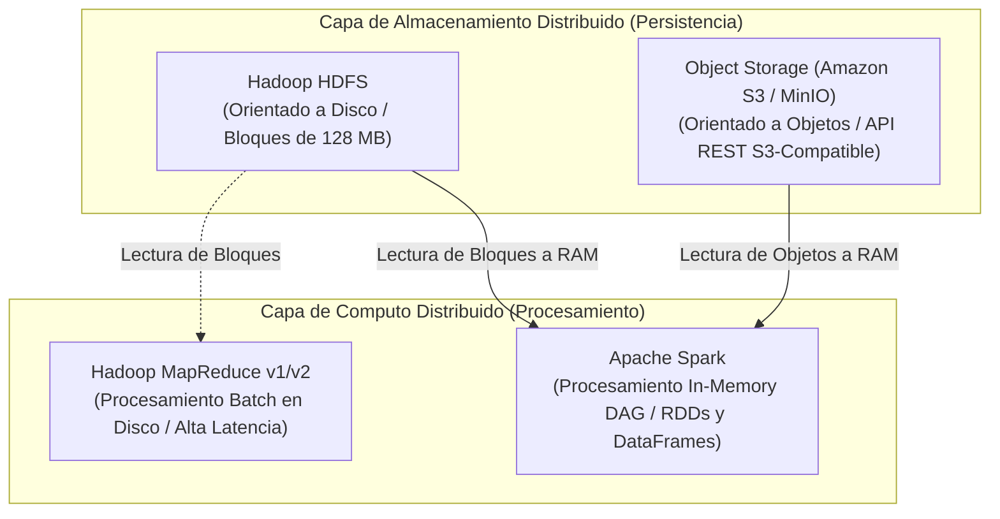
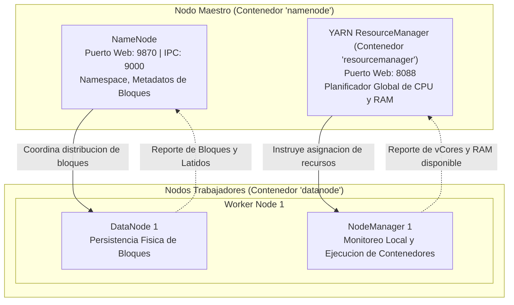
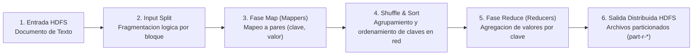

# Clase 2: Despliegue de Hadoop HDFS, YARN y el Paradigma MapReduce

> **Objetivo de la Sesion:** Implementar y operar un cluster distribuido de Hadoop v2 mediante Docker Compose, comprender el rol del orquestador de recursos YARN, interactuar de manera operativa con el sistema de archivos distribuido HDFS a traves de su interfaz CLI y consolas de telemetria web, y formalizar la ejecucion de pipelines de computo paralelo bajo el paradigma MapReduce.

## Seccion 1: Contexto y Marco Conceptual

### La Especializacion Funcional: Almacenamiento vs. Computo Distribuido

Uno de los fundamentos mas trascendentales en la evolucion de las tecnologias de Big Data es la comprension de que el **almacenamiento distribuido** y el **procesamiento distribuido** obedecen a dinamicas de optimizacion completamente distintas:

- **Hadoop HDFS** se concibio y optimizo primordialmente como una capa de **almacenamiento persistente en disco**. Su diseno prioriza el throughput de entrada/salida secuencial sobre grandes volumenes de bloques, asumiendo lecturas masivas y una tolerancia rigurosa a fallos de hardware mediante replicacion fisica.

- **Apache Spark**, en contraste, surgió como un motor especializado en **procesamiento distribuido en memoria RAM**. Spark no pretende resolver el almacenamiento fisico a largo plazo; su fortaleza reside en realizar computaciones analiticas complejas, transformaciones iterativas y modelos de Machine Learning reduciendo al minimo las escrituras intermedias a disco.

Historicamente, durante la vigencia de Hadoop v2 y hasta la consolidacion de Spark v3, el ecosistema opero de forma complementaria: HDFS administraba la persistencia fisica de los bloques de datos, mientras que Spark se montaba sobre dicho cluster para leer, procesar en memoria y retornar resultados. Con la consolidacion de los sistemas de almacenamiento de objetos en la nube (Amazon S3, Google Cloud Storage, Azure Blob Storage) y alternativas open-source on-premise como **MinIO**, Spark ha desacoplado aun mas su dependencia de HDFS, interactuando directamente contra almacenamiento de objetos mediante APIs REST de alto rendimiento.



---

## Seccion 2: Fundamentos Teoricos y Arquitectura

### Arquitectura de Componentes de Hadoop v2 y el Rol de YARN

La version 2 de Apache Hadoop transformo la arquitectura monolitica inicial al introducir una clara separacion entre el sistema de archivos distribuido (**HDFS**) y el subsistema de gestion y negociacion de recursos (**YARN** \- *Yet Another Resource Negotiator*).



#### Componentes Principales

1. **NameNode:** Administra la jerarquia del sistema de archivos (*namespace*) y la ubicacion fisica de los bloques. Mantiene en memoria RAM el mapeo de bloques a DataNodes para asegurar latencias minimas de metadata. Las mutaciones se registran en el *EditLog* y se consolidan periodicamente en la imagen del sistema de archivos (*FsImage*).

1. **DataNode:** Almacena los bloques de datos fisicos (por defecto 128 MB) en el disco del sistema de archivos del sistema operativo subyacente. Se encarga de atender peticiones de lectura y escritura provenientes de los clientes y de ejecutar pipelines de replicacion entre nodos hermanos.

1. **YARN ResourceManager:** Autoridad central que arbitra y asigna recursos computacionales (vCores de CPU y memoria RAM) a lo largo de todas las aplicaciones concurrentes en el cluster. Posee dos componentes basicos:

   - *Scheduler:* Planificador puro que asigna recursos segun politicas configuradas (FIFO, Capacity Scheduler o Fair Scheduler) sin monitorear el estado interno de la aplicacion.
   
   - *ApplicationsManager:* Gestiona la recepcion de trabajos, negocia el primer contenedor para la ejecucion del *ApplicationMaster* especifico y reinicia contenedores ante eventuales caidas.

1. **YARN NodeManager:** Agente que reside en cada nodo trabajador. Monitorea el consumo local de recursos (CPU, memoria, disco y red) y ejecuta los contenedores de tareas asignados por el ResourceManager.

### El Paradigma MapReduce: Fundamentos Matematicos y Flujo de Procesamiento

MapReduce, concebido originalmente por Jeffrey Dean y Sanjay Ghemawat en Google (2004), es un modelo de programacion funcional disenado para el procesamiento masivo de datos en paralelo a traves de clusters distribuidos. Su formulacion se sustenta en dos primitivas funcionales puras: **Map** y **Reduce**.



#### El Pipeline de Procesamiento MapReduce Paso a Paso

1. **Input Splitting (Division de Entrada):** El dataset de entrada se fragmenta en divisiones logicas denominadas *Input Splits* (generalmente coincidentes con el tamano de bloque de HDFS, 128 MB). Cada split es asignado a una instancia independiente del mapper, promoviendo el principio de **Data Locality** (trasladar el computo hacia donde residen fisicamente los datos en disco, evitando el trafico masivo de red).

1. **Fase Map (Mapeo):** La funcion mapper procesa secuencialmente cada registro del split y emite cero o mas pares intermedios clave-valor:

   $map: (k_1, v_1) \rightarrow list(k_2, v_2)$
   
   En el caso clasico del conteo de palabras (*WordCount*), la entrada es una linea de texto ($k_1 = offset, v_1 = linea$) y la salida intermedia emitida es un par compuesto por la palabra identificada y una constante unitaria:
   
   $(palabra, 1)$

1. **Fase Shuffle &amp; Sort (Barajado y Ordenamiento):** Es el nucleo critico del framework. El subsistema de MapReduce garantiza que todos los valores correspondientes a una misma clave intermedia $k_2$ sean transferidos a traves de la red y agrupados en el mismo nodo Reducer. Durante este proceso, los registros se ordenan lexicograficamente por su clave:

   $shuffle: list(k_2, v_2) \rightarrow (k_2, list(v_2))$

1. **Fase Reduce (Reduccion):** La funcion reducer itera sobre el conjunto consolidado de valores agrupados para cada clave unica y produce un resultado sintetizado o agregado:

   $reduce: (k_2, list(v_2)) \rightarrow list(k_3, v_3)$
   
   Para el algoritmo WordCount, el reducer computa la sumatoria algebraica de todos los valores unitarios asociados a cada palabra:
   
   $(palabra, \sum 1) \rightarrow (palabra, frecuencia\_total)$

1. **Output (Persistencia Final):** Los resultados finales se escriben directamente en HDFS en un directorio de salida exclusivo. La salida se estructura en archivos particionados por cada instancia de Reducer ejecutada (` part-r-00000 `, ` part-r-00001 `, etc.), garantizando escritura concurrente sin contencion de bloqueos.

---

## Seccion 3: Implementacion Tecnica y Operaciones de Cluster

### Definicion de Infraestructura con Docker Compose

El cluster de estudio se define mediante tres servicios interconectados en una red bridge: el NameNode, un DataNode y el ResourceManager de YARN.

#### Variables de Entorno (` hadoop.env `)

El archivo de entorno define las directivas de red e integracion entre nodos del cluster:

```text
# Especificacion del sistema de archivos por defecto y puerto IPC del NameNode
CORE_CONF_fs_defaultFS=hdfs://namenode:9000

# Configuracion de seguridad y permisos de HDFS
HDFS_CONF_dfs_permissions_enabled=false
```

#### Puertos de Red y Roles

- **Puerto 9870:** Interfaz web HTTP del NameNode (monitoreo de almacenamiento, explorador HDFS).

- **Puerto 8088:** Interfaz web HTTP del YARN ResourceManager (monitoreo de jobs MapReduce, asignacion de memoria/vCores).

- **Puerto 9000:** Canal IPC interno para la comunicacion binaria entre DataNodes, clientes y el NameNode.

### Flujo de Operaciones y Comandos CLI

#### 1\. Despliegue del Cluster en Segundo Plano

```bash
# Lanzamiento desacoplado del cluster de Hadoop
docker compose up -d

# Verificacion del estado de salud de los contenedores
docker ps
```

#### 2\. Copia de Archivos desde el Host hacia el Contenedor NameNode

Para introducir un dataset al ecosistema, primero se transfiere desde el sistema de archivos del anfitrion hacia el sistema de archivos local del contenedor maestro:

```bash
# Copia del archivo de texto local hacia la raiz del contenedor namenode
docker cp ejemplo.txt namenode:/ejemplo.txt
```

#### 3\. Acceso Interactivo a la Consola del NameNode

```bash
# Apertura de sesion bash interactiva en el contenedor maestro
docker exec -it namenode /bin/bash
```

#### 4\. Operaciones en el Sistema de Archivos Distribuido HDFS (` hdfs dfs `)

Una vez dentro del NameNode, la interaccion con el sistema de archivos distribuido se realiza mediante el cliente CLI ` hdfs dfs `, cuya sintaxis emula fielmente los comandos estandar POSIX:

```bash
# Creacion de directorio distribuido en HDFS (con creacion de carpetas padre)
hdfs dfs -mkdir -p /user/root

# Ingestion del archivo local del contenedor hacia el cluster HDFS
hdfs dfs -put /ejemplo.txt /user/root/ejemplo.txt

# Listado de metadatos, permisos y factor de replicacion del archivo en HDFS
hdfs dfs -ls /user/root

# Lectura directa del contenido de un archivo almacenado en HDFS
hdfs dfs -cat /user/root/ejemplo.txt
```

#### 5\. Ejecucion del Job MapReduce via JAR Empaquetado

Hadoop incorpora librerias Java empaquetadas con implementaciones estandar de algoritmos distribuidos. La ejecucion se orquesta a traves del comando ` hadoop jar `:

```bash
# Ejecucion del algoritmo WordCount sobre el archivo distribuido
hadoop jar $HADOOP_HOME/share/hadoop/mapreduce/hadoop-mapreduce-examples-*.jar wordcount /user/root/ejemplo.txt /user/root/output
```

*Nota Tecnica:* El directorio de salida especificado (` /user/root/output `) **no debe existir previamente** en HDFS. Si la ruta existe, Hadoop abortara la ejecucion para prevenir la sobrescritura accidental de datos historicos.

#### 6\. Inspeccion de Resultados y Descarga hacia el Entorno Local

```bash
# Visualizacion de la salida generada por los reducers en HDFS
hdfs dfs -cat /user/root/output/part-*

# Extraccion del directorio distribuido hacia el sistema de archivos local del contenedor
hdfs dfs -get /user/root/output /output_local

# Salida de la sesion del contenedor hacia la terminal del host
exit

# Copia de los resultados consolidados desde el contenedor hacia la maquina anfitriona
docker cp namenode:/output_local ./resultado_output
```

### Telemetria y Monitoreo a traves de Consolas Web

#### NameNode Web UI (` http://localhost:9870 `)

- **Pestana Overview:** Informa la capacidad total del cluster (DFS Configured Capacity), espacio utilizado, espacio libre y el volumen de bloques defectuosos o sub-replicados.

- **Pestana Datanodes:** Detalla la totalidad de nodos de datos activos (*In Service / Live Nodes*) y nodos inactivos (*Dead Nodes*), su consumo de disco individual y la fecha/hora del ultimo latido recibido.

- **Utilities -&gt; Browse the file system:** Permite navegar visualmente por la jerarquia de directorios HDFS, inspeccionar metadatos de archivos, el ID de cada bloque asignado y su factor de replicacion configurado.

#### YARN ResourceManager Web UI (` http://localhost:8088 `)

- **Pestana Cluster Metrics:** Despliega metricas de hardware agregadas del cluster: memoria RAM total disponible vs asignada, vCores reservados y numero de NodeManagers registrados.

- **Pestana Applications:** Ofrece una bitacora detallada de cada trabajo MapReduce ejecutado: identificador unico de aplicacion (` application_<timestamp>_<id> `), usuario ejecutor, estado del ciclo de vida (` NEW `, ` SUBMITTED `, ` RUNNING `, ` FINISHED `, ` FAILED `), hora de inicio/fin y porcentaje de avance de las fases Map y Reduce.

---

## Seccion 4: Analisis Critico de Casos y Auditoria de Sistemas Distribuidos

### Matriz Comparativa: Procesamiento MapReduce vs. In-Memory Computing (Apache Spark)

| Criterio de Evaluacion | Hadoop MapReduce | Apache Spark |
| --- | --- | --- |
| **Medio de Persistencia Intermedio** | Disco fisico obligatorio (I/O intensivo entre fases) | Memoria RAM distribuida (RDDs / DataFrames en memoria) |
| **Latencia de Ejecucion** | Alta (optimizado unicamente para batch a gran escala) | Baja a moderada (hasta 10x-100x mas veloz en algoritmos iterativos) |
| **Modelo de Programacion** | Rigido y bipartito (unicamente operaciones Map y Reduce) | Grafo Aciclico Dirigido (DAG) con multiples transformaciones ricas |
| **Tolerancia a Fallos** | Basada en la persistencia forzada de bloques a disco | Basada en linaje computacional (Lineage Graph) para recomputar nodos |
| **Soporte de Algoritmos Iterativos** | Ineficiente (Machine Learning exige releer y reescribir de disco) | Nativo y optimizado para ciclos continuos de entrenamiento ML |
| **Consumo de Hardware** | Demanda alta capacidad de I/O de disco y redes intermedias | Demanda grandes cantidades de memoria RAM en los nodos de trabajo |

### Diagnostico del "Small Files Problem" en HDFS

Una de las vulnerabilidades arquitectonicas mas criticas de HDFS es su ineficiencia ante grandes volumenes de archivos pequenos (menores al tamano de bloque estandar de 128 MB):

- **Sobrecarga de RAM en el NameNode:** El NameNode almacena todos los metadatos de directorios, inodos y bloques en memoria principal. Cada entrada de metadato consume aproximadamente **150 bytes**. Si un dataset de 100 GB se compone de 100 millones de archivos de 1 KB, el NameNode requerira aproximadamente 15 GB de RAM unicamente para indexar los metadatos, saturando el nodo maestro antes de explotar la capacidad de disco de los DataNodes.

- **Ineficiencia en MapReduce:** MapReduce instancian un Mapper por cada split/bloque asignado. Millones de archivos pequenos provocan la creacion y destruccion de millones de procesos JVM, generando un overhead de coordinacion en YARN que supera con creces el tiempo de procesamiento util.

---

## Seccion 5: Principios de Diseno, Buenas Practicas y Anti-patrones

### Principios y Reglas de Oro

1. **Sintonizacion de Bloques HDFS (Block Sizing):** Para cargas de trabajo analiticas de alta escala, los bloques deben fijarse entre **128 MB y 256 MB**. Bloques excesivamente grandes reducen la concurrencia de procesamiento del cluster; bloques excesivamente pequenos inducen el "Small Files Problem".

1. **Consolidacion y Formatos Columnares:** Convertir fuentes fragmentadas hacia formatos columnares autocontenidos y comprimidos (como **Apache Parquet** o **Apache ORC**) o utilizar estructuras como **SequenceFiles** para agrupar miles de documentos pequenos en contenedores binarios unificados.

1. **Aseguramiento de Directorios de Salida:** Todo pipeline distribuido debe garantizar idempotencia; el borrado previo o versionado automatizado de las rutas de salida de HDFS previene fallos de ejecucion por colision de nombres.

### Anti-patrones de Computo Distribuido

- **Data Skewing (Desbalanceo de Claves en el Reducer):** Disenar funciones Mapper cuyas claves emitidas esten fuertemente concentradas en un unico valor. Esto provoca que el 99% de los Reducers finalicen su labor instantaneamente mientras un unico nodo receptor colapsa procesando la mayoria de los registros (*Straggler Effect*).

- **HDFS como Almacenamiento Transaccional OLTP:** Intentar utilizar HDFS para aplicaciones de consulta interactiva con escrituras, actualizaciones o lecturas aleatorias en tiempo real. HDFS carece de indices secundarios y esta estrictamente concebido bajo la filosofia WORM (Write Once, Read Many).

---

## Seccion 6: Sintesis Conceptual y Profundizacion Academica

### Conclusiones Metodologicas

1. Hadoop v2 establecio el estandar fundacional de la arquitectura distribuida al desacoplar el sistema de archivos (HDFS) de la negociacion de recursos del cluster (YARN), permitiendo la coexistencia de multiples motores computacionales sobre la misma infraestructura de datos.

1. El paradigma MapReduce demostro la viabilidad de paralelizar algoritmos complejos a traves de clusters heterogeneos mediante primitivas funcionales puras y el principio de localidad de datos, sentando las bases teoricas de los modernos frameworks de computo en memoria como Apache Spark.

1. El dominio practico de los comandos de bajo nivel (` hdfs dfs `) y la interpretacion de la telemetria web en NameNode y ResourceManager proporcionan el marco de control indispensable para auditar, diagnosticar y operar pipelines de datos a nivel de posgrado.

### Referencias Seminales para Profundizacion

- Dean, J., &amp; Ghemawat, S. (2004). *MapReduce: Simplified Data Processing on Large Clusters*. Communications of the ACM, 51(1), 107-113.

- Vavilapalli, V. K., Murthy, A. C., Douglas, C., Agarwal, S., Konar, M., Evans, R., Graves, T., Lowe, J., Shah, H., Seth, S., Saha, B., Curino, C., O'Malley, O., Radia, S., Reed, B., &amp; Baldeschwieler, E. (2013). *Apache Hadoop YARN: Yet Another Resource Negotiator*. Proceedings of the 4th Annual Symposium on Cloud Computing (SOCC '13), 1-16.

- White, T. (2015). *Hadoop: The Definitive Guide: Storage and Analysis at Internet Scale* (4th ed.). O'Reilly Media.
