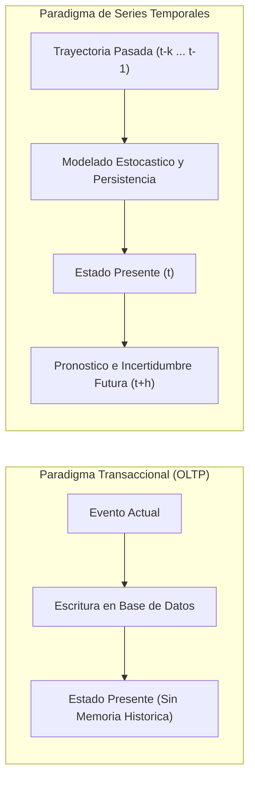
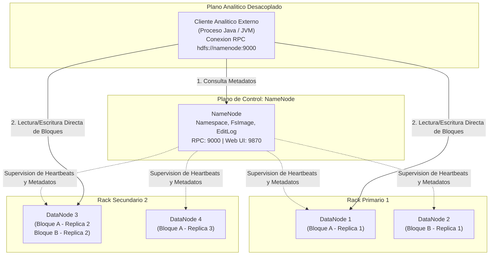
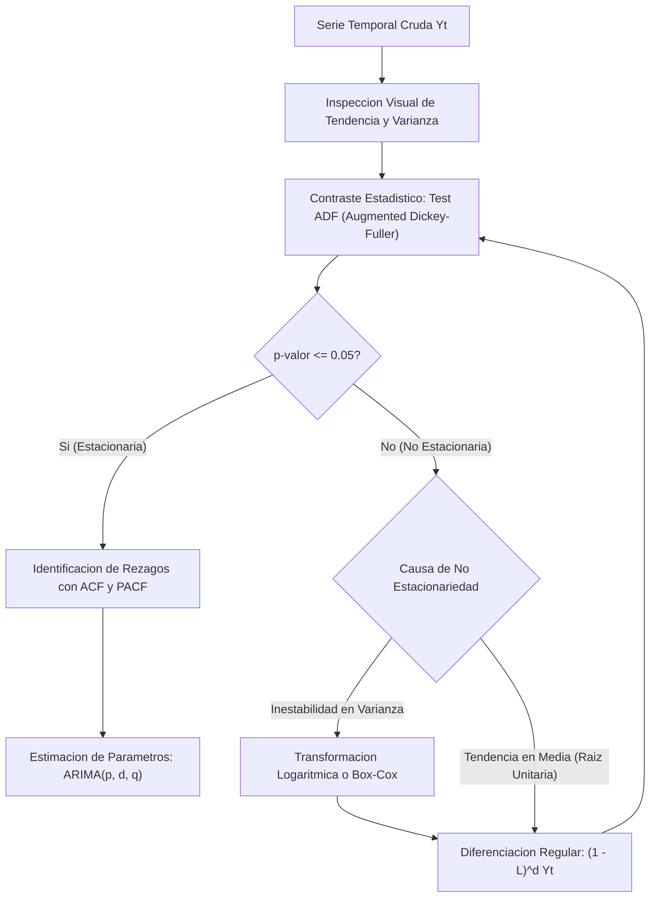

# Clase 3: Arquitectura de Clusteres Distribuidos en Hadoop, Procesamiento Desacoplado y Modelado de Series Temporales Autorregresivas

> Proposito pedagogico: Formalizar la implementacion y operacion de arquitecturas distribuidas de almacenamiento masivo con Apache Hadoop HDFS bajo topologias multinodo contenerizadas, desacoplar el procesamiento analitico mediante clientes externos nativos en Java, y fundamentar rigurosamente el modelado estocastico de series temporales (descomposicion estructural, contrastes de estacionariedad mediante la prueba de Dickey-Fuller Aumentada y parametrizacion de modelos autorregresivos AR, MA y ARIMA).

## 1\. Contexto y Marco Conceptual

### Paradigma del Almacenamiento y Computo Distribuido

En la ingenieria de datos contemporanea, la transicion desde sistemas centralizados monoliticos hacia infraestructuras distribuidas responde a la incapacidad fisica de escalar verticalmente el hardware (Scale-up) frente a tasas de generacion de datos exponenciales. El marco conceptual de Apache Hadoop introdujo un cambio de paradigma cardinal: **desacoplar el plano de almacenamiento distribuido (Hadoop Distributed File System - HDFS) del plano de procesamiento y analitica**.

Bajo este modelo, los volumenes masivos de informacion no se almacenan como entidades unificadas en un unico disco rigido, sino que se particionan en bloques discretos homogeneos que se distribuyen a traves de un cluster de maquinas comerciales (Commodity Hardware).

### Limitaciones Computacionales de las Arquitecturas Monoliticas

El analisis exploratorio y predictivo tradicional desarrollado en entornos monoliticos (tales como bibliotecas en memoria RAM en Python mediante Pandas o en R) colapsa inexorablemente al sobrepasar el umbral de capacidad de la memoria volatil:

1. **Condicion de Memoria Fuera de Limite (Out-of-Memory - OOM):** Cuando el volumen del conjunto de datos excede la memoria RAM utilizable de un solo nodo, el sistema operativo recurre a la paginacion en disco (Swap), degradando el rendimiento en ordenes de magnitud o provocando la terminacion abrupta del proceso.

1. **Saturacion de Canales I/O:** El cuello de botella en sistemas monoliticos reside en el bus de entrada/salida del almacenamiento local.

1. **Escasez de Tolerancia a Fallos:** En una estacion unaria, la falla mecanica de un disco o la corrupcion de sectores fisicos conlleva la perdida catastrofica del proceso o de los datos de trabajo.

La solucion arquitectonica distribuida mitiga estas restricciones mediante particionamiento horizontal, redundancia activa por replicacion cruzada y procesamiento analitico desacoplado.

### La Dimension Temporal en la Analitica Avanzada

Existe una divergencia ontologica entre el desarrollo de software transaccional y la ciencia de datos temporal:

- **Enfoque Transaccional Tradicional (OLTP):** Opera en un estado de presente perpetuo. Al motor de base de datos relacional y a la logica de aplicacion les compete unicamente la atomicidad y consistencia del registro actual (por ejemplo, registrar una transaccion de venta en tiempo presente), sin considerar la memoria de estados previos ni formular proyecciones estocasticas.

- **Enfoque de Series Temporales (Business Intelligence y Analitica Predictiva):** La observacion presente $Y_t$ no es independiente, sino una variable aleatoria condicionada por su trayectoria historica $\{Y_{t-1}, Y_{t-2}, \dots, Y_{t-k}\}$ y por perturbaciones no observables del entorno. La comprension del pasado resulta matematicamente indispensable para parametrizar la incertidumbre del futuro.



---

## 2\. Fundamentos Teoricos y Arquitectura

### Arquitectura HDFS Multinodo y Mecanismos de Tolerancia a Fallos

El sistema de archivos distribuido Apache HDFS implementa una topologia maestro-esclavo (Master-Worker):

1. **NameNode (Nodo Maestro):**

   - Custodia el espacio de nombres (Namespace) del sistema de archivos distribuido.
   
   - Mantiene en memoria RAM el mapa de bloques que asigna que bloques especificos componen cada archivo y en que DataNodes residen.
   
   - Registra de forma persistente los cambios en disco mediante el registro de transacciones (*EditLog*) y la instantanea del sistema (*FsImage*).
   
   - Expone interfaces de red diferenciadas: puerto RPC interno (tipicamente puerto 9000 o 8020) para comunicacion de bajo nivel entre nodos y clientes, y puerto HTTP Web UI (9870 en Hadoop 3.x, anteriormente 50070 en Hadoop 2.x) para supervision administrativa y telemetria.

1. **DataNodes (Nodos Esclavos de Almacenamiento):**

   - Almacenan y recuperan fisicamente los bloques de datos en sus unidades de almacenamiento secundario locales.
   
   - No poseen conocimiento de la logica global de los archivos; procesan lectura y escritura a nivel de bloques binarios.
   
   - Emiten mensajes periodicos de latido (*Heartbeats*) y reportes de bloques (*Block Reports*) al NameNode para atestiguar su disponibilidad operativa.

#### Politica de Replicacion y Diseno Topologico de Racks

Por defecto en entornos productivos, HDFS establece un **Factor de Replicacion (**$R = 3$**)** sobre bloques discretos estandar de 128 MB (o 256 MB):

- **Copia 1:** Se deposita en un DataNode local al nodo de ingesta.

- **Copia 2:** Se aloja en un DataNode ubicado en un rack fisico diferente para mitigar cortes de energia o switches de red.

- **Copia 3:** Se almacena en un DataNode alternativo dentro del mismo rack remoto de la segunda copia para optimizar el ancho de banda inter-rack.



### Teoria Matematica y Estocastica de Series Temporales

Formalmente, una serie temporal es una realizacion particular de un proceso estocastico indexado en el tiempo:

$$
\{Y_t \in \mathbb{R} : t \in T\}
$$

donde el conjunto temporal $T$ se encuentra discretizado a intervalos uniformes y equidistantes ($\Delta t = \text{cte}$).

#### Descomposicion Estructural Clasica

Cualquier serie empirica puede expresarse analiticamente mediante sus componentes ortogonales bajo un esquema aditivo o multiplicativo:

- **Modelo Aditivo:** $Y_t = T_t + S_t + C_t + \epsilon_t$

- **Modelo Multiplicativo:** $Y_t = T_t \cdot S_t \cdot C_t \cdot \epsilon_t$

donde:

- $T_t$: **Tendencia Secular**, representando la direccion deterministica o estocastica de largo plazo.

- $S_t$: **Estacionalidad**, oscilaciones ciclicas periodicas de frecuencia fija vinculadas al calendario (mensual, trimestral).

- $C_t$: **Ciclo**, fluctuaciones de onda larga no asociadas a periodicidades fijas de calendario (ciclos macroeconomicos).

- $\epsilon_t$: **Componente Irregular o Ruido Blanco**, perturbacion estocastica pura con media nula y varianza finita $\epsilon_t \sim \mathcal{WN}(0, \sigma^2)$.

### Formalizacion de la Estacionariedad

Un requisito matematico obligatorio para la validez de inferencias y la estabilidad asintotica de los modelos autorregresivos clasicos es la **estacionariedad en sentido debil o de segundo orden (Covariance Stationarity)**:

1. **Media Constante:**

   $\mathbb{E}[Y_t] = \mu, \quad \forall t \in T$

1. **Varianza Constante y Finita (Homocedasticidad):**

   $\text{Var}(Y_t) = \mathbb{E}[(Y_t - \mu)^2] = \sigma^2 < \infty, \quad \forall t \in T$

1. **Autocovarianza Invariante en el Tiempo:**

   $\text{Cov}(Y_t, Y_{t-k}) = \gamma_k, \quad \forall t, k$
   
   La covarianza depende exclusivamente de la magnitud del rezago o desplazamiento temporal $k$, no del momento temporal $t$ en que se compute.

### Contraste de Hipotesis: Prueba de Dickey-Fuller Aumentada (ADF)

Para verificar rigurosamente la presencia de no-estacionariedad debida a raices unitarias, se plantea la ecuacion de regresion auxiliar con $p$ terminos aumentados:

$$
\Delta Y_t = \alpha + \beta t + \gamma Y_{t-1} + \sum_{i=1}^p \delta_i \Delta Y_{t-i} + \epsilon_t
$$

donde $\Delta Y_t = Y_t - Y_{t-1}$ es el operador de primera diferencia, $\alpha$ es la constante de deriva, $\beta t$ es la tendencia temporal lineal y $\gamma = (\rho - 1)$.

El contraste formal de hipotesis se define como:

- **Hipotesis Nula (**$H_0$**):** $\gamma = 0$ (o equivalentemente $\rho = 1$). El proceso posee una raiz unitaria; la serie temporal **no es estacionaria** y exhibe memoria infinita ante perturbaciones.

- **Hipotesis Alternativa (**$H_1$**):** $\gamma < 0$. El proceso no contiene raiz unitaria; la serie **es estacionaria** alrededor de la constante o tendencia.

**Criterio de Decision Probabilistica:**

- Si el estadistico $p$-valor $\le 0.05$, se rechaza $H_0$ a un nivel de significancia del 5%, concluyendo estacionariedad.

- Si el $p$-valor $> 0.05$, no existe evidencia estadistica suficiente para rechazar $H_0$, lo que exige aplicar transformaciones de estabilizacion (diferenciacion regular o transformaciones no lineales Box-Cox).



---

## 3\. Implementacion Tecnica y Logica de Negocio

### Orquestacion Contenerizada del Cluster con Docker Compose

La infraestructura distribuida se parametriza mediante un archivo declarativo de servicios Docker:

- ` namenode `: Instancia coordinadora encargada de HDFS.

- ` datanode1 `, ` datanode2 `, ` datanode3 `: Nodos trabajadores vinculados en la red virtual ` hadoop-network `.

- ` cliente-analitico `: Contenedor desacoplado aprovisionado con el Hadoop SDK y JVM para computo analitico independiente.

Comando de despliegue en segundo plano:

```bash
docker compose up -d
docker ps --format "table {{.Names}}\t{{.Status}}\t{{.Ports}}"
```

### Gestion y Transferencia de Datos en el Sistema de Archivos Distribuido (HDFS)

1. **Copia de los Datos Crudos al Contenedor Coordinador:**

   ```bash
   docker cp transacciones_financieras.csv namenode:/tmp/transacciones_financieras.csv
   ```

1. **Acceso a la Terminal del NameNode:**

   ```bash
   docker exec -it namenode /bin/bash
   ```

1. **Provision de Directorios en HDFS y Carga Distribuida:**

   ```bash
   # Creacion recursiva del directorio de usuario
   hdfs dfs -mkdir -p /user/root/datos
   
   # Ingestion distribuida hacia HDFS
   hdfs dfs -put /tmp/transacciones_financieras.csv /user/root/datos/
   
   # Listado y confirmacion de persistencia
   hdfs dfs -ls /user/root/datos/
   ```

1. **Auditoria Forense de Bloques y Nodos con FSCK:**

   ```bash
   hdfs fsck /user/root/datos/transacciones_financieras.csv -files -blocks -locations
   ```
   
   Esta instruccion audita la fragmentacion del archivo, revelando el identificador del bloque (ej. ` blk_1073741825 `), su tamano exacto en bytes y las direcciones IP/puertos de los DataNodes donde residen las replicas.

### Desarrollo del Cliente Analitico Desacoplado en Java Nativo

Para evitar la ejecucion de computo intensivo sobre el nodo coordinador (NameNode), se desacopla la logica de negocio en un contenedor cliente que interactua con el API distribuido de Apache Hadoop.

#### Logica de Reduccion Dimensional y Agregacion Hash (` analisis_riesgo.java `)

```java
package com.analytics.hadoop;

import java.io.BufferedReader;
import java.io.InputStreamReader;
import java.io.OutputStreamWriter;
import java.io.PrintWriter;
import java.net.URI;
import java.util.HashMap;
import java.util.Map;

import org.apache.hadoop.conf.Configuration;
import org.apache.hadoop.fs.FSDataInputStream;
import org.apache.hadoop.fs.FSDataOutputStream;
import org.apache.hadoop.fs.FileSystem;
import org.apache.hadoop.fs.Path;

public class AnalisisRiesgoFinanciero {

    public static void main(String[] args) {
        String hdfsUri = "hdfs://namenode:9000";
        String rutaEntrada = "/user/root/datos/transacciones_financieras.csv";
        String rutaSalida = "/user/root/datos/resumen_sucursales.csv";

        Configuration conf = new Configuration();
        conf.set("fs.defaultFS", hdfsUri);

        try {
            FileSystem fs = FileSystem.get(new URI(hdfsUri), conf);
            Path pathEntrada = new Path(rutaEntrada);
            Path pathSalida = new Path(rutaSalida);

            if (!fs.exists(pathEntrada)) {
                System.err.println("Error: Archivo de entrada no encontrado en HDFS: " + rutaEntrada);
                System.exit(1);
            }

            FSDataInputStream inputStream = fs.open(pathEntrada);
            BufferedReader reader = new BufferedReader(new InputStreamReader(inputStream));

            // Mapa para acumulacion agregada en memoria (Sucursal -> Suma de Exposicion Total)
            Map<String, Double> exposicionPorSucursal = new HashMap<>();

            String linea;
            boolean esEncabezado = true;

            while ((linea = reader.readLine()) != null) {
                if (esEncabezado) {
                    esEncabezado = false;
                    continue;
                }
                String[] campos = linea.split(",");
                if (campos.length >= 3) {
                    String sucursal = campos[0].trim();
                    try {
                        double monto = Double.parseDouble(campos[1].trim());
                        exposicionPorSucursal.put(sucursal, exposicionPorSucursal.getOrDefault(sucursal, 0.0) + monto);
                    } catch (NumberFormatException e) {
                        // Ignorar registros corruptos
                    }
                }
            }
            reader.close();
            inputStream.close();

            // Escritura del resumen consolidado en HDFS
            FSDataOutputStream outputStream = fs.create(pathSalida, true);
            PrintWriter writer = new PrintWriter(new OutputStreamWriter(outputStream));

            writer.println("sucursal,exposicion_total");
            for (Map.Entry<String, Double> entry : exposicionPorSucursal.entrySet()) {
                writer.println(entry.getKey() + "," + String.format("%.2f", entry.getValue()));
            }
            writer.flush();
            writer.close();
            outputStream.close();

            System.out.println("Procesamiento y reduccion dimensional finalizados con exito.");
            fs.close();

        } catch (Exception e) {
            e.printStackTrace();
        }
    }
}
```

#### Ciclo de Compilacion, Empaquetado y Ejecucion en el Cliente

```bash
# 1. Acceso a la terminal del cliente analitico
docker exec -it cliente-analitico /bin/bash

# 2. Navegacion al directorio de scripts montado
cd /opt/scripts

# 3. Compilacion asociando el Classpath nativo de Hadoop
javac -cp $(hadoop classpath) -d . AnalisisRiesgoFinanciero.java

# 4. Empaquetado del bytecode en archivo JAR ejecutable
jar -cvf analisis_riesgo.jar *.class

# 5. Despacho y ejecucion de la aplicacion en el cluster HDFS
hadoop jar analisis_riesgo.jar com.analytics.hadoop.AnalisisRiesgoFinanciero

# 6. Extraccion y validacion del resumen generado desde HDFS hacia el host
hadoop fs -get hdfs://namenode:9000/user/root/datos/resumen_sucursales.csv ./
cat resumen_sucursales.csv | head -n 10
```

### Pipeline de Modelado de Series Temporales en Python

Para modelar series temporales a nivel econometrico, se emplea el modulo ` statsmodels ` sobre un dataset de ventas mensuales de vehiculos.

#### Ingestion y Test de Estacionariedad (ADF)

```python
import numpy as np
import pandas as pd
import matplotlib.pyplot as plt
from statsmodels.tsa.stattools import adfuller
from statsmodels.tsa.ar_model import AutoReg
from statsmodels.tsa.arima.model import ARIMA

# Carga de la serie temporal mensual
url = "https://raw.githubusercontent.com/jbrownlee/Datasets/master/monthly-car-sales.csv"
df = pd.read_csv(url, parse_dates=['Month'], index_col='Month')
df.rename(columns={'Sales': 'ventas'}, inplace=True)
df.index.freq = 'MS'  # Frecuencia mensual de inicio de mes

# Evaluacion de Estacionariedad
adf_resultado = adfuller(df['ventas'].dropna())
print(f"Estadistico ADF: {adf_resultado[0]:.4f}")
print(f"p-valor: {adf_resultado[1]:.4f}")
print("Valores Criticos:")
for key, value in adf_resultado[4].items():
    print(f"\t{key}: {value:.4f}")

# Criterio: Si p-valor > 0.05, la serie es no estacionaria (requiere diferenciacion)
```

#### Especificacion Matematica y Estimacion del Modelo AR(1)

El modelo autorregresivo de orden 1 se formaliza como:

$$
Y_t = c + \phi_1 Y_{t-1} + \epsilon_t
$$

donde:

- $c$: Intercepto o termino de deriva.

- $\phi_1$: Coeficiente de persistencia autorregresiva. Si $|\phi_1| < 1$, el proceso es causal y estacionario; si $\phi_1 = 1$, el proceso deriva en un camino aleatorio (*Random Walk*).

- $\epsilon_t \sim \mathcal{WN}(0, \sigma^2)$: Termino de error estocastico.

```python
# Ajuste de un modelo Autorregresivo de orden 1
modelo_ar1 = AutoReg(df['ventas'], lags=1).fit()
print(modelo_ar1.summary())

# Extraccion de parametros estimados
c_estimado = modelo_ar1.params[0]
phi1_estimado = modelo_ar1.params[1]
print(f"Ecuacion Estimada: Ventas_t = {c_estimado:.2f} + {phi1_estimado:.2f} * Ventas_(t-1)")
```

#### Especificacion General del Modelo ARIMA(p, d, q)

La formalizacion completa integra operadores de rezago y diferenciacion estocastica:

$$
\Phi(L)(1 - L)^d Y_t = c + \Theta(L)\epsilon_t
$$

donde:

- $\Phi(L) = 1 - \sum_{i=1}^p \phi_i L^i$: Polinomio autorregresivo de orden $p$.

- $(1 - L)^d$: Operador de diferenciacion de orden $d$ para neutralizar tendencias estocasticas.

- $\Theta(L) = 1 + \sum_{j=1}^q \theta_j L^j$: Polinomio de medias moviles de orden $q$, ponderando errores de prediccion pasados.

```python
# Particion temporal estricta respetando causalidad (12 meses para validacion)
train = df.iloc[:-12]
test = df.iloc[-12:]

# Ajuste de modelo ARIMA(1, 1, 1)
modelo_arima = ARIMA(train['ventas'], order=(1, 1, 1)).fit()
print(modelo_arima.summary())

# Proyeccion de 12 pasos hacia adelante (Out-of-sample Forecast)
predicciones = modelo_arima.forecast(steps=12)
predicciones.index = test.index

# Evaluacion de residuales y metricas de desempeno
mae = np.mean(np.abs(test['ventas'] - predicciones))
rmse = np.sqrt(np.mean((test['ventas'] - predicciones)**2))
print(f"MAE: {mae:.2f} | RMSE: {rmse:.2f}")
```

---

## 4\. Analisis Critico de Casos y Auditoria Practica

### Evaluacion Comparativa de Paradigmas de Procesamiento de Datos

| **Dimension Analitica** | **Monolitico en Memoria (Pandas / R)** | **Almacenamiento Distribuido (Hadoop HDFS)** | **Computo Distribuido en Memoria (Apache Spark)** |
| --- | --- | --- | --- |
| **Mecanismo de Escalabilidad** | Vertical (Scale-up: sujeta al limite fisico de RAM del equipo). | Horizontal (Scale-out: particionamiento en bloques sobre discos del cluster). | Horizontal (Scale-out: computo distribuido particionado en memoria RAM). |
| **Tolerancia a Fallos** | Nula. La falla de la instancia aborta el proceso completamente. | Alta. Replicacion automatica de bloques ($R=3$) ante caida de DataNodes. | Maxima. Reconstruccion automatica de particiones mediante linaje RDD y DAGs. |
| **Latencia de Procesamiento** | Minima en datasets pequenos; bloqueo absoluto (OOM) en escala Big Data. | Elevada. I/O constante de lectura/escritura en disco magnetico intermedio. | Optima. Procesamiento en memoria de 10 a 100 veces superior a MapReduce. |
| **Volumen Optimo de Datos** | $<$ 10 GB (acotado al tamano de la memoria principal). | $100 \text{ GB} - \text{Petabytes}$ (orientado a almacenamiento masivo batch). | $10 \text{ GB} - \text{Petabytes}$ (analitica interactiva, streaming y machine learning). |

### Taxonomia Comparativa de Modelos Estocasticos para Series Temporales

| **Modelo** | **Parametros** | **Estructura Matematica** | **Propiedades y Escenario de Aplicacion** |
| --- | --- | --- | --- |
| **AR(p)** | $p$ (orden autorregresivo) | $Y_t = c + \sum_{i=1}^p \phi_i Y_{t-i} + \epsilon_t$ | Modela memoria prolongada y persistencia estocastica. Requiere estacionariedad estricta. |
| **MA(q)** | $q$ (orden de media movil) | $Y_t = \mu + \epsilon_t + \sum_{j=1}^q \theta_j \epsilon_{t-j}$ | Modela la absorcion de choques aleatorios de corto plazo. Autocovarianzas nulas para rezagos $k > q$. |
| **ARMA(p, q)** | $p, q$ | $\Phi(L)Y_t = c + \Theta(L)\epsilon_t$ | Combina persistencia historica y dinamica de errores. Requiere que la serie carezca de tendencia secular. |
| **ARIMA(p, d, q)** | $p, d, q$ | $\Phi(L)(1-L)^d Y_t = c + \Theta(L)\epsilon_t$ | Integra diferenciacion ($d$) para estabilizar series no estacionarias con tendencia estocastica. |
| **SARIMAX** | $p, d, q, P, D, Q, s, X$ | Polinomios estacionales + Variables exogenas | Modela periodicidades ciclicas ($s=12, 4$) e incorpora regresores externos explicativos ($X_t$). |

### Auditoria Metodologica: El Principio de Causalidad Temporal

En el aprendizaje automatico convencional sobre datos transversales (Cross-Sectional Data), la particion aleatoria estratificada (K-Fold Cross Validation con barajado *Shuffle*) constituye la practica estandar. Sin embargo, en el modelado de series temporales, **el barajado aleatorio representa un error metodologico invalidante**:

- **Fuga Temporal (Look-ahead Leakage):** Entrenar un modelo con datos del periodo $t+1$ para predecir $t$ introduce informacion futura en el estimador, produciendo evaluaciones artificialmente optimistas que colapsan en produccion.

- **Protocolo de Validacion Obligatorio:** Debe aplicarse una particion secuencial estricta (*Out-of-Time Validation* o *Rolling Window Forward Chaining*), donde el conjunto de entrenamiento precede cronologicamente al de prueba.

---

## 5\. Principios de Diseno, Buenas Practicas y Anti-patrones

### Reglas de Oro en Big Data y Modelado Temporal

1. **Preservacion de la Jerarquia de Red en HDFS:** Los procesos de computo analitico deben ejecutarse en nodos desacoplados o directamente donde residen los datos (principio de *Data Locality*), garantizando que las consultas de metadatos al NameNode no saturen su memoria heap.

1. **Establecimiento de Linea Base Rigurosa (Baseline First):** En investigaciones cientificas y proyectos de posgrado, jamas debe abordarse un problema de series temporales aplicando directamente redes neuronales complejas (LSTM, GRU, Transformers) sin contrastar su rendimiento frente a modelos parametricos clasicos (ARIMA, Suavizado Exponencial). Si el modelo de Deep Learning no supera estadisticamente a la linea base autorregresiva, carece de justificacion computacional.

1. **Comprobacion Diagnostica Residual:** Todo modelo de series temporales ajustado debe validar que sus residuos se comporten como ruido blanco incorrelacionado mediante la prueba de Ljung-Box:

   $$
   Q = n(n+2)\sum_{k=1}^h \frac{\hat{\rho}_k^2}{n-k} \sim \chi^2(h - p - q)
   $$

### Anti-patrones Metodologicos Identificados

| **Anti-patron** | **Mecanismo del Error** | **Impacto Tecnico / Consecuencia** | **Estrategia de Mitigacion** |
| --- | --- | --- | --- |
| **Regresion Espuria** | Estimar regresiones directas por minimos cuadrados entre series no estacionarias con tendencia comun. | Coeficientes de determinacion $R^2$ artificialmente inflados y estadisticos $t$ falsamente significativos sin relacion causal real. | Diferenciar las series hasta alcanzar estacionariedad o verificar cointegracion mediante la prueba de Johansen / Engle-Granger. |
| **Sobrediferenciacion (Over-differencing)** | Aplicar diferenciacion regular $d \ge 2$ a series que ya eran estacionarias con $d=0$ o $d=1$. | Inyeccion de raices unitarias artificiales en el polinomio de medias moviles (MA) e incremento de la varianza residual. | Monitorear la varianza de la serie en cada paso; detener la diferenciacion cuando la varianza comience a incrementarse. |
| **Canibalizacion del NameNode (Compute-on-Master)** | Ejecutar scripts pesados de analitica o ETL directamente dentro del servidor donde corre el NameNode. | Consumo indebido de CPU y memoria RAM que compromete la gestion de metadatos de todo el cluster, induciendo desconexiones globales. | Desacoplar siempre el plano analitico en maquinas o contenedores cliente externos dedicados. |
| **Barajado Temporal en Validacion Cruzada** | Utilizar ` train_test_split(..., shuffle=True) ` en modelos con indexacion temporal. | Corrupcion de la estructura estocastica y sobreestimacion irreal de la precision predictiva. | Utilizar esquemas de evaluacion temporal sin barajado (` TimeSeriesSplit ` de scikit-learn). |

---

## 6\. Sintesis Conceptual y Profundizacion Academica

### Sintesis Integradora

La infraestructura de datos contemporanea exige una delimitacion nitida entre almacenamiento tolerante a fallos y procesamiento analitico. Apache Hadoop HDFS resuelve el almacenamiento masivo mediante particionamiento en bloques y replicacion topologica en racks, mientras que la analitica moderna desacopla la logica en clientes dedicados para salvaguardar la estabilidad de los nodos maestros. Simultaneamente, la dimension temporal exige rigor matematico: las series cronologicas no pueden tratarse como vectores aleatorios independientes. La contrastacion formal de raices unitarias (ADF), la estabilizacion de la media y la varianza, y la estimacion disciplinada de polinomios autorregresivos (ARIMA) representan los cimientos sobre los cuales se construyen sistemas predictivos escalables y reproducibles.

### Preguntas Guia para la Investigacion de Posgrado

1. ¿Bajo que condiciones estocasticas especificas los modelos de redes neuronales recurrentes con mecanismos de atencion (Temporal Fusion Transformers) demuestran superioridad asintotica frente a modelos autorregresivos estacionales SARIMAX en presencia de quiebres estructurales no lineales?

1. ¿Como afecta la latencia de red y el costo de serializacion de llamadas a procedimiento remoto (RPC) en Hadoop HDFS cuando un cluster analitico procesa millones de archivos pequenos (*Small Files Problem*) frente a conjuntos consolidados de gran volumen?

### Referencias Bibliograficas Fundamentales

- Box, G. E., Jenkins, G. M., Reinsel, G. C., &amp; Ljung, G. M. (2015). *Time Series Analysis: Forecasting and Control* (5th ed.). John Wiley &amp; Sons.

- Hamilton, J. D. (1994). *Time Series Analysis*. Princeton University Press.

- White, T. (2015). *Hadoop: The Definitive Guide: Storage and Analysis at Internet Scale* (4th ed.). O'Reilly Media.

- Shvachko, K., Kuang, H., Radia, S., &amp; Chansler, R. (2010). *The Hadoop Distributed File System*. IEEE 26th Symposium on Mass Storage Systems and Technologies (MSST).

- Dickey, D. A., &amp; Fuller, W. A. (1979). *Distribution of the Estimators for Autoregressive Time Series With a Unit Root*. Journal of the American Statistical Association, 74(366), 427-431.

---
