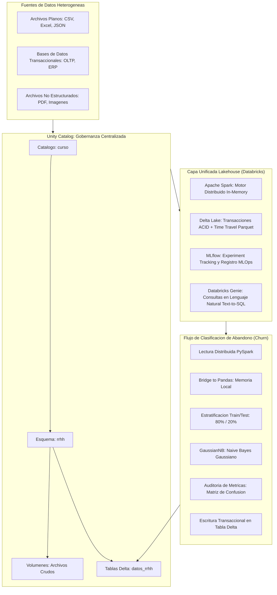

# Clase 5: Arquitectura Lakehouse, Gobernanza de Datos y Modelado Predictivo en Databricks

> Proposito pedagogico: Dominar la evolucion epistemologica y arquitectonica del almacenamiento analitico desde Data Warehouses y Data Lakes hacia la arquitectura unificada Lakehouse. Comprender el funcionamiento del motor de computacion distribuida Apache Spark, el control transaccional ACID y versionado de Delta Lake, y la gobernanza unificada mediante Unity Catalog. Implementar un pipeline end-to-end de clasificacion supervisada para prediccion de abandono laboral empleando Naive Bayes Gaussiano, diagnosticando cuantitativamente el sesgo por desbalance de clases, calibrando probabilidades posteriores y persistiendo resultados transaccionales en tablas Delta.

## Seccion 1 - Contexto y Marco Conceptual

### 1.1 Evolucion del Almacenamiento de Datos Empresariales

A lo largo de las ultimas cuatro decadas, las arquitecturas de datos para analitica empresarial han transitado por tres generaciones tecnologicas fundamentales, respondiendo a la expansion exponencial del volumen, la variedad y la velocidad de los datos:

1. Primera Generacion: Data Warehouse Tradicional (Decadas de 1980 - 2000):

   - Filosofia Arquitectonica: Paradigma Schema-on-Write (esquema en escritura). Los datos deben ser exhaustivamente limpiados, estructurados, modelados y validados antes de ser persistidos.
   
   - Enfoque Funcional: Especializado en procesamiento analitico en linea (OLAP), segregado de los sistemas operacionales transaccionales (OLTP) para evitar contencion de recursos. Emplea modelos relacionales dimensionales (esquemas en estrella y copo de nieve segun las metodologias de Ralph Kimball y Bill Inmon).
   
   - Limitaciones Estructurales:
   
     - Rigidez de Esquema: Cualquier alteracion en las entidades de negocio requiere complejas migraciones de esquema en base de datos.
     
     - Incapacidad para Almacenar Datos No Estructurados: Incapaz de procesar de forma nativa documentos de texto (PDF, Word), registros de mensajeria, audios o imagenes.
     
     - Costos Prohibitivos de Escalabilidad: El escalamiento vertical o clusters propietarios de hardware de alto costo limitan la retencion de grandes volumenes de datos crudos.

1. Segunda Generacion: Data Lake (Decada de 2010):

   - Filosofia Arquitectonica: Paradigma Schema-on-Read (esquema en lectura). Los datos se almacenan en su formato nativo crudo en sistemas de almacenamiento de objetos distribuidos y de bajo costo (Amazon S3, Azure Data Lake Storage, Google Cloud Storage, HDFS).
   
   - Enfoque Funcional: Permite la ingestion masiva y flexible de datos estructurados, semiestructurados (JSON, CSV, Parquet, XML) y no estructurados (imagenes, archivos binarios).
   
   - Patologia del Pantano de Datos (Data Swamp):
   
     - Carencia de Transaccionalidad ACID: Incapacidad para garantizar atomicidad y aislamiento en escrituras concurrentes; una falla a mitad de un proceso de carga corrompe el dataset completo.
     
     - Falta de Versionado y Calidad: Dificultad extrema para auditar modificaciones historicas o garantizar la integridad referencial.
     
     - Desempeno Degradado en SQL: La falta de indices globales y estadisticas de consulta penaliza severamente las cargas de trabajo de Business Intelligence.

1. Tercera Generacion: Arquitectura Unificada Lakehouse (2019 - Presente):

   - Filosofia Arquitectonica: Combina la flexibilidad, apertura y rentabilidad de almacenamiento del Data Lake con el rigor transaccional, la gobernanza, el desempeno y la gestion de metadatos del Data Warehouse.
   
   - Desacoplamiento de Computo y Almacenamiento: El almacenamiento reside en formatos columnares abiertos (Apache Parquet) gobernados por una capa transaccional intermedia (Delta Lake), mientras que el computo elastico bajo demanda (clusters serverless de Apache Spark) escala de forma totalmente independiente.

### 1.2 La Necesidad Empresarial de Unificacion

En el ecosistema corporativo moderno, la dicotomia artificial entre analizar el pasado y predecir el futuro ha quedado obsoleta:

- Analitica Descriptiva y Diagnostica (Pasado hacia el Presente): Conducida tradicionalmente por Business Intelligence (BI), reportes ejecutivos, dashboards y cubos OLAP que requieren agregaciones SQL sobre datos altamente modelados.

- Analitica Predictiva y Prescriptiva (Presente hacia el Futuro): Conducida por Ciencia de Datos, Aprendizaje Automatico (Machine Learning) y Deep Learning, que requieren alimentarse de grandes volumenes de caracteristicas crudas y diversas.

El Lakehouse elimina la duplicacion y sincronizacion constante de datos entre sistemas heterogeneos (Data Lake -&gt; ETL -&gt; Data Warehouse -&gt; Datamarts), evitando la latencia analitica, el costo financiero de almacenamiento redundante y los riesgos de inconsistencia de datos.

### 1.3 Democratizacion de Datos y Taxonomia de Roles en Databricks

La plataforma unificada Databricks estructura el ciclo de vida del dato mediante cuatro roles funcionales claramente demarcados:

1. Administrador de Plataforma y Cloud: Gestiona la infraestructura, los clusters de computo, los workspaces, la facturacion por consumo y las politicas globales de red y seguridad.

1. Ingeniero de Datos (Data Engineer): Responsable de la ingestion continua, el diseno de pipelines de transformacion (ETL/ELT), la orquestacion de flujos (Workflows / Jobs) y la optimizacion de almacenamiento con Spark.

1. Analista de Datos (Data Analyst): Ejecuta consultas SQL interactivas en SQL Warehouses, crea visualizaciones, construye paneles de control y analiza metricas de rendimiento empresarial.

1. Cientifico de Datos (Data Scientist): Desarrolla notebooks reproducibles, realiza ingenieria de variables (feature engineering), entrena modelos de machine learning y gestiona el ciclo MLOps mediante MLflow.

---

## Seccion 2 - Fundamentos Teoricos y Arquitectura

### 2.1 Ecosistema Tecnologico de Databricks

La arquitectura de Databricks integra tres componentes de software criticos que interactuan de manera sinergica:

1. Motor de Computacion Distribuida: Apache Spark:

   - Arquitectura Maestro-Trabajador (Driver-Worker): Un nodo Driver coordina y planifica la ejecucion de tareas a traves de un Directed Acyclic Graph (DAG), distribuyendo el procesamiento en particiones de memoria a lo largo de multiples nodos Worker.
   
   - Procesamiento en Memoria (In-Memory Computing): Supera el cuello de botella de I/O de disco caracteristico del MapReduce tradicional de Hadoop, logrando aceleraciones de ordenes de magnitud en operaciones iterativas de Machine Learning.
   
   - Interoperabilidad Multilenguaje: Admite interfaces cliente en Scala, Java, Python (PySpark), R y Spark SQL sobre el mismo motor de optimizacion (Catalyst Optimizer y Tungsten Engine).

1. Capa de Almacenamiento Transaccional Abierto: Delta Lake:

   - Propiedades ACID: Garantiza que cualquier operacion de escritura, actualizacion o borrado sea totalmente atomica y consistente mediante un registro de transacciones ordenado (\_delta\_log).
   
   - Time Travel (Versionado de Datos): Cada transaccion genera una nueva version logica inmutable del dataset. Esto posibilita viajar en el tiempo a versiones previas para auditoria forense, reproducibilidad de experimentos de Machine Learning y rollback inmediato ante corrupciones de datos.
   
   - Formato Subyacente: Almacena los datos en archivos Apache Parquet comprimidos (Snappy), anadiendo metadatos de estadisticas min/max por particion para omitir lectura de bloques innecesarios (Data Skipping).

1. Plataforma de Ciclo de Vida MLOps: MLflow:

   - MLflow Tracking: Registro automatico y manual de parametros de hiperconfiguracion, metricas de evaluacion (accuracy, recall, loss), codigo fuente y artefactos del modelo serializado.
   
   - MLflow Model Registry: Repositorio centralizado para el versionado formal de modelos, transicion entre entornos (Staging, Production, Archived) y trazabilidad del gobierno de modelos.
   
   - Mitigacion del Desvanecimiento y Degradacion (Model Drift): Los modelos de Machine Learning no poseen una vida util estatica; la variabilidad en los habitos humanos o factores macroeconomicos degrada su capacidad predictiva en produccion, exigiendo reentrenamientos periodicos y monitoreo continuo.

### 2.2 Modelo de Gobernanza Centralizada: Unity Catalog

Databricks implementa un modelo de gobernanza unificado a traves de Unity Catalog, estructurando los objetos de datos bajo una jerarquia formal estandarizada de tres niveles:

$\text{Metastore} \longrightarrow \text{Catalogo} \longrightarrow \text{Esquema} \longrightarrow \text{Objetos (Tablas, Vistas, Volumenes)}$

- Metastore: Contenedor de maximo nivel asignado a una region en la nube, que centraliza los metadatos y politicas de seguridad para multiples workspaces.

- Catalogo: Primer nivel de organizacion del usuario o proyecto (ej. curso). Permite segregar ambientes (desarrollo, testing, produccion) o divisiones de negocio.

- Esquema (Base de Datos): Contenedor logico de segundo nivel (ej. rrhh, finanzas) que agrupa datos relacionados a un dominio operativo.

- Tablas y Volumenes: Objetos terminales de almacenamiento. Las tablas contienen datos tabulares estructurados (Delta), mientras que los volumenes gestionan archivos crudos (Excel, PDF, CSV, Parquet) manteniendo el control de acceso y linaje.

### 2.3 Databricks Genie: Asistencia Basada en IA y RAG sobre Datos

Databricks integra Genie Spaces, un entorno conversacional sustentado en modelos de lenguaje de gran tamano (LLMs) con arquitectura Retrieval-Augmented Generation (RAG) aplicada al catalogo de metadatos. Genie interpreta consultas formuladas en lenguaje natural por usuarios de negocio o tecnicos, inspecciona las definiciones semanticas de las columnas y genera autonomamente consultas SQL ejecutadas contra el cluster, democratizando el acceso a la informacion sin requerir conocimientos de sintaxis de consulta ni asistencia directa del administrador de base de datos.



---

## Seccion 3 - Implementacion Tecnica y Logica de Negocio

### 3.1 Ingestion y Definicion de la Jerarquia en Unity Catalog

El flujo de trabajo comienza estructurando el espacio de almacenamiento dentro de Unity Catalog. Mediante la interfaz visual o sentencias DDL, se establece la jerarquia curso.rrhh.empleados:

1. Creacion del Catalogo: curso (tipo estandar).

1. Creacion del Esquema: rrhh (recursos humanos).

1. Ingestion del Dataset: Carga del archivo datos\_rrhh.csv (atributos demograficos, salariales y operacionales de 5,000 empleados).

### 3.2 Ingestion Distribuida y Consulta Interoperable (PySpark y SQL)

En Databricks, las tablas gobernadas se consultan nativamente a traves de la sesion distribuida de Spark o mediante celdas interactivas de SQL (%sql):

```python
# Lectura de la tabla gobernada en Unity Catalog a un DataFrame distribuido de Apache Spark
df_spark = spark.table("curso.rrhh.empleados")

# Visualizacion del esquema y los primeros registros en el motor distribuido
display(df_spark)
```

Para evaluar la composicion de la variable objetivo (abandono), se ejecuta una consulta de agregacion SQL sin abandonar el entorno:

```sql
%sql
SELECT 
    abandono, 
    COUNT(*) AS total_empleados,
    ROUND(COUNT(*) * 100.0 / SUM(COUNT(*)) OVER(), 2) AS porcentaje
FROM curso.rrhh.empleados
GROUP BY abandono;
```

Resultado de la consulta:

- Clase 0 (Permanencia): 4,082 registros ($81.64\%$).

- Clase 1 (Abandono voluntario): 918 registros ($18.36\%$).

- Diagnostico: Desbalance de clases severo (proporcion aproximada de 4 a 1).

### 3.3 Interoperabilidad entre PySpark y Pandas

Cuando el tamano de la muestra resultante o filtrada permite su alojamiento en la memoria RAM del nodo Driver, es metodologicamente valido transferir el DataFrame distribuido hacia un DataFrame de Pandas para utilizar la suite de algoritmos especializados de scikit-learn:

```python
# Conversion de Spark DataFrame (distribuido) a Pandas DataFrame (en memoria del Driver)
df_pandas = df_spark.toPandas()
```

### 3.4 Formulacion Matematica de Naive Bayes Gaussiano

El clasificador Naive Bayes aplica el Teorema de Bayes bajo la asuncion simplificadora de independencia condicional entre las variables predictoras dada la clase:

$P(C_k \mid X) = \frac{P(C_k) \cdot P(X \mid C_k)}{P(X)} = \frac{P(C_k) \prod_{i=1}^n P(x_i \mid C_k)}{P(X)}$

Dado que el dataset de recursos humanos contiene atributos continuos (edad, salario mensual, anos en la empresa, horas extras anuales, evaluacion de satisfaccion, distancia al centro de trabajo), no es aplicable la distribucion Multinomial (disenada para conteos enteros o texto disperso) ni la de Bernoulli (variables binarias). Se formula el modelo Naive Bayes Gaussiano (GaussianNB), asumiendo que la verosimilitud de cada variable sigue una campana de Gauss condicional a la clase:

$P(x_i \mid C_k) = \frac{1}{\sqrt{2\pi \sigma_{ki}^2}} \exp\left( -\frac{(x_i - \mu_{ki})^2}{2\sigma_{ki}^2} \right)$

Donde los parametros $\mu_{ki}$ (media) y $\sigma_{ki}^2$ (varianza) se estiman a partir de los datos de entrenamiento para la variable $i$ y clase $k$.

### 3.5 Pipeline de Entrenamiento y Diagnostico de Metricas

Se procede a particionar los datos de manera estratificada para preservar la distribucion original de clases, entrenando el estimador y computando las metricas analiticas:

```python
import numpy as np
import pandas as pd
from sklearn.model_selection import train_test_split
from sklearn.naive_bayes import GaussianNB
from sklearn.metrics import classification_report, confusion_matrix

# Segregacion de variables predictoras (X) y variable objetivo (y)
X = df_pandas.drop(columns=['id_empleado', 'abandono'])
y = df_pandas['abandono']

# Particion estratificada: 80% entrenamiento, 20% evaluacion
X_train, X_test, y_train, y_test = train_test_split(
    X, y, test_size=0.20, random_state=42, stratify=y
)

# Instanciacion y ajuste del estimador Naive Bayes Gaussiano
modelo_gnb = GaussianNB()
modelo_gnb.fit(X_train, y_train)

# Generacion de predicciones categoricas sobre el conjunto de prueba
y_pred = modelo_gnb.predict(X_test)

# Reporte detallado de metricas de clasificacion
print(classification_report(y_test, y_pred, digits=4))
```

Resultados Obtenidos en la Evaluacion del Modelo:

- Exactitud Global (Accuracy): $0.8210$ ($82.10\%$).

- Clase 0 (Permanencia):

  - Precision: $0.8415$
  
  - Sensibilidad (Recall): $0.9694$
  
  - F1-Score: $0.9009$

- Clase 1 (Abandono - Clase Minoritaria de Interes):

  - Precision: $0.5667$
  
  - Sensibilidad (Recall): $0.1630$
  
  - F1-Score: $0.2531$

Auditoria Critica del Rendimiento:

A pesar de que el modelo exhibe un Accuracy global aparentemente solido del $82.1\%$, una auditoria rigurosa revela un colapso en la clase de interes comercial: el recall es de solo $16.3\%$. El modelo clasifica correctamente a quienes permanecen en la organizacion debido al predominio numerico de su probabilidad a priori ($P(C_0) \approx 0.816$), pero deja escapar a mas del $83\%$ de los empleados que efectivamente van a renunciar (Falsos Negativos). En terminos de negocio, este desempeno es inaceptable para un sistema de retencion preventiva de talento.

### 3.6 Calibracion de Probabilidades y Umbrales Operativos

Para flexibilizar la toma de decisiones gerenciales, se sustituye la clasificacion rigida binaria (sujeta al umbral por defecto $\tau = 0.5$) por el vector continuo de probabilidades posteriores:

```python
# Extraccion de la distribucion de probabilidad condicional P(abandono = 1 | X)
probabilidades = modelo_gnb.predict_proba(X_test)
probabilidad_abandono = probabilidades[:, 1]

# Consolidacion de resultados en DataFrame analitico
df_resultados = X_test.copy()
df_resultados['abandono_real'] = y_test.values
df_resultados['abandono_predicho'] = y_pred
df_resultados['probabilidad_abandono'] = np.round(probabilidad_abandono, 4)
```

Al inspeccionar las probabilidades, el equipo de recursos humanos puede segmentar a los colaboradores por deciles de riesgo (Scoring de Propension) y actuar sobre aquellos con probabilidades superiores a $0.30$, optimizando la intervencion de retencion sin requerir un corte arbitrario en $0.5$.

### 3.7 Persistencia Transaccional en Tablas Delta Lake

Para completar el ciclo de gobernanza dentro del Lakehouse, los resultados analiticos se reconvierten a un DataFrame de Spark y se escriben transaccionalmente en una nueva tabla Delta administrada por Unity Catalog:

```python
# Conversion de DataFrame de Pandas enriquecido a Spark DataFrame
df_spark_resultados = spark.createDataFrame(df_resultados)

# Escritura atomica en formato Delta dentro del catalogo gobernado
(df_spark_resultados.write
    .format("delta")
    .mode("overwrite")
    .option("overwriteSchema", "true")
    .saveAsTable("curso.rrhh.predicciones_abandono")
)
```

Verificacion mediante SQL:

```sql
%sql
SELECT 
    abandono_real,
    abandono_predicho,
    probabilidad_abandono,
    COUNT(*) AS total_casos
FROM curso.rrhh.predicciones_abandono
GROUP BY abandono_real, abandono_predicho, probabilidad_abandono
ORDER BY probabilidad_abandono DESC
LIMIT 10;
```

---

## Seccion 4 - Analisis Critico de Casos y Auditoria Practica

### 4.1 Matriz Comparativa: Data Warehouse vs. Data Lake vs. Lakehouse

| Criterio de Evaluacion | Data Warehouse Tradicional | Data Lake | Lakehouse (Databricks) |
| --- | --- | --- | --- |
| **Paradigma de Esquema** | Schema-on-Write (alta rigidez) | Schema-on-Read (sin validacion previa) | Esquema Dual con Enforcement y Evolucion |
| **Tipos de Datos Admitidos** | Estrictamente Estructurados (Tablas Relacionales) | Estructurados, Semiestructurados y No Estructurados | Unificado: Tablas relacionales y Volumenes para archivos |
| **Garantias Transaccionales** | ACID Completo en motor relacional | Sin garantias transaccionales (posible corrupcion) | ACID Completo via Delta Lake (\_delta\_log) |
| **Soporte de Casos de Uso** | Optimo para BI y Reporteria SQL retrospectiva | Optimo para almacenamiento de Machine Learning crudo | Hibrido: BI de alta velocidad y ML/Deep Learning |
| **Costo y Escalabilidad** | Elevado (computo y disco fuertemente acoplados) | Bajo (almacenamiento de objetos elastico en la nube) | Optimizado (almacenamiento Parquet + computo elastico) |
| **Auditoria y Versionado** | Manual via triggers, snapshots o tablas temporales | Inexistente o dependiente de prefijos en carpetas | Nativo via Delta Time Travel y Linaje de Unity Catalog |
| **Gobernanza y Seguridad** | Centralizada a nivel de DBMS | Fragmentada a nivel de IAM y permisos de bucket | Centralizada y granular mediante Unity Catalog |

### 4.2 Auditoria de Rendimiento del Modelo de Abandono

| Metrica de Desempeno | Clase 0 (Permanencia) | Clase 1 (Abandono) | Promedio Ponderado / Global |
| --- | --- | --- | --- |
| **Precision** | $84.15\%$ | $56.67\%$ | $79.10\%$ |
| **Sensibilidad (Recall)** | $96.94\%$ | $16.30\%$ | $82.10\%$ |
| **F1-Score** | $0.9009$ | $0.2531$ | $0.7819$ |
| **Soporte (N Muestras Test)** | 816 casos | 184 casos | 1,000 casos totales |

Diagnostico de Auditoria:

1. Sobreajuste hacia la Clase Mayoritaria: El estimador aprende que predecir sistematicamente la permanencia minimiza el error matematico global, sacrificando la deteccion de la rotacion.

1. Camino de Mitigacion Tecnico: Para mitigar esta patologia se requiere:

   - Tecnicas de remuestreo (SMOTE para sobremuestreo sinteticamente balanceado de la clase minoritaria, o submuestreo de la clase mayoritaria).
   
   - Reemplazo de Naive Bayes por algoritmos basados en ensambles de arboles con ponderacion asimetrica de penalizacion por clase (class\_weight='balanced'), tales como Random Forest o Gradient Boosting (XGBoost, LightGBM).

---

## Seccion 5 - Principios de Diseno, Buenas Practicas y Anti-patrones

### 5.1 Reglas de Oro en Arquitectura Lakehouse y Modelado

1. Aislamiento Estricto de Capas de Datos (Arquitectura Medallion): En proyectos a escala de produccion, estructurar los datos en capas Bronce (crudos e inmutables), Plata (limpios, enriquecidos y estandarizados) y Oro (agregaciones de negocio y tablas analiticas optimizadas).

1. Persistencia en Formato Abierto con Registro ACID: Toda salida de transformacion debe registrarse en formato Delta Lake, aprovechando la deduplicacion y el versionado temporal para garantizar reproducibilidad cientifica.

1. Desacoplamiento de Entornos en Unity Catalog: Aislar esquemas operacionales de tablas temporales de experimentacion, asignando cuotas de computo segun roles para mitigar el consumo innecesario de DBU (Databricks Units).

1. Evaluacion Multi-Metrica Obligatoria: En datasets con distribuciones sesgadas, el Accuracy nunca debe utilizarse como unico criterio de aprobacion; deben auditarse el Recall, el F1-Score y el area bajo la curva ROC (AUC-ROC).

### 5.2 Anti-patrones y Errores Metodologicos Comunes

- Anti-patron del Pantano Replicado: Subir miles de archivos no gobernados a Databricks sin catalogar metadatos ni definir esquemas formales, replicando el desorden del Data Lake en el entorno de trabajo colaborativo.

- Anti-patron de Fuga de Memoria Driver con toPandas(): Ejecutar .toPandas() sobre datasets masivos (terabytes o petabytes), provocando el colapso inmediato por Out-Of-Memory (OOM) en el nodo Driver.

- Anti-patron del Umbral Ciego: Asumir que la probabilidad 0.5 es el optimo operativo sin evaluar la matriz de costos y beneficios financieros de los errores Tipo I (Falsos Positivos) y Tipo II (Falsos Negativos).

- Anti-patron del Algoritmo Incompatible: Aplicar Naive Bayes Multinomial sobre caracteristicas continuas gaussianas o, reciprocamente, Naive Bayes Gaussiano sobre matrices de conteo textual.

---

## Seccion 6 - Sintesis Conceptual y Profundizacion Academica

### 6.1 Sintesis de Aprendizajes Clave

- La arquitectura Lakehouse reconcilia con exito el mundo del Data Warehouse estructurado con la flexibilidad elastica del Data Lake, sustentandose en el almacenamiento columnar Apache Parquet con control transaccional Delta Lake.

- Unity Catalog centraliza la gobernanza, el control de acceso basado en roles y el linaje de datos de extremo a extremo, facilitando tanto el trabajo riguroso de ingenieria como la democratizacion analitica mediante inteligencia artificial (Genie).

- El modelado predictivo supervisado requiere no solo dominio algoritmico sino conciencia del impacto distributivo; el desbalance de clases distorsiona la exactitud aparente y exige calibrar probabilidades continuas antes de desplegar politicas operativas.

### 6.2 Puente Metodologico hacia las Series Temporales

Mientras que la clasificacion supervisada analizada en esta sesion asume observaciones independientes e identicamente distribuidas (i.i.d.), la analitica financiera y economica frecuentemente enfrenta datos donde la dimension temporal introduce una dependencia cronologica insoslayable. En la siguiente sesion se aborda la formalizacion de series de tiempo univariadas, el diagnostico de estacionariedad y la familia de modelos autorregresivos.

### 6.3 Referencias Bibliograficas y Lecturas Recomendadas

- Armbrust, M., Ghodsi, A., Xin, R., &amp; Zaharia, M. (2021). Lakehouse: A New Generation of Open Platforms that Unify Data Warehousing and Advanced Analytics. Proceedings of CIDR 2021.

- Chambers, B., &amp; Zaharia, M. (2018). Spark: The Definitive Guide: Big Data Processing Made Simple. O'Reilly Media.

- Zaharia, M., et al. (2018). Accelerating the Machine Learning Lifecycle with MLflow. IEEE Data Engineering Bulletin, 41(4), 39-45.

- Hastie, T., Tibshirani, R., &amp; Friedman, J. (2009). The Elements of Statistical Learning: Data Mining, Inference, and Prediction. Springer. Chapter 6: Kernel Smoothing and Naive Bayes.

---
