# Clase 6: Modelos Autorregresivos, Pruebas de Estacionariedad y Arquitectura de Integracion Databricks-Power BI

> Proposito pedagogico: Comprender los fundamentos matematicos y econometricos del analisis de series temporales y forecasting univariado. Formalizar rigurosamente las propiedades de la estacionariedad en sentido debil, contrastar raices unitarias mediante la prueba de Dickey-Fuller Aumentada (ADF), y aplicar tecnicas de transformacion por diferenciacion estocastica. Implementar, calibrar e interpretar modelos autorregresivos AR(p), procesos de medias moviles MA(q) y estructuras integradas ARIMA(p,d,q) en Python, detectando dependencias estacionales periodicas de largo plazo. Desarrollar la ingestion mediante Volumenes en Databricks Unity Catalog y estructurar la arquitectura empresarial de publicacion hacia Power BI Desktop para el consumo ejecutivo de predicciones.

## Seccion 1 - Contexto y Marco Conceptual

### 1.1 Naturaleza Formal de las Series Temporales

En el ambito de la ciencia de datos aplicada a los negocios y las finanzas, una serie temporal se formaliza como una realizacion secuencial de variables aleatorias indexadas estrictamente por una dimension de tiempo discreto:

$\{Y_t\}_{t \in \mathcal{T}}, \quad \mathcal{T} = \{1, 2, \dots, T\}$

Requisitos Estructurales Invariables:

- Orden Cronologico Estricto: Los datos deben mantener una secuencia cronologica invariable; cualquier reordenamiento aleatorio (shuffle) destruye la estructura de autocorrelacion y la causalidad temporal.

- Intervalos Temporales Regulares: Las observaciones deben estar espaciadas a intervalos uniformes (diario, semanal, mensual, trimestral). La presencia de saltos irregulares introduce sesgos en la estimacion de rezagos.

- Dependencia del Pasado: A diferencia del modelado estadistico transversal clasico (donde se asume que las observaciones son independientes e identicamente distribuidas, i.i.d.), las series temporales explotan la memoria historica del proceso: los valores pasados $Y_{t-1}, Y_{t-2}, \dots$ y los errores pasados $\epsilon_{t-1}, \epsilon_{t-2}, \dots$ explican el comportamiento presente $Y_t$ y futuro $Y_{t+h}$.

### 1.2 Distincion Teorica: Estacionariedad vs. Estacionalidad

Una de las confusiones semanticas mas frecuentes en la practica analitica reside en diferenciar dos conceptos con fonetica similar pero significado matematico dispar:

1. Estacionariedad (Stationarity):

   - Propiedad matematica de estabilidad probabilistica a lo largo del tiempo.
   
   - Implica que las leyes estocasticas fundamentales que rigen el proceso generador de datos no varian cuando se desplaza la ventana temporal.
   
   - Es una condicion previa y obligatoria para la validez de los estimadores lineales de la familia ARIMA/SARIMA.

1. Estacionalidad (Seasonality):

   - Patron ciclico o fluctuacion periodica recurrente que se repite a intervalos fijos del calendario (ej. picos de ventas en diciembre por fin de ano, variaciones diarias por fines de semana, patrones climaticos trimestrales).
   
   - Una serie con fuerte componente estacional no es estacionaria en su estado crudo, pues su media y varianza oscilan periodicamente segun la estacion.

### 1.3 Arquitectura Empresarial de Integracion: Lakehouse hacia Power BI

En entornos corporativos, existe una brecha tradicional entre los entornos de computo de alta ingenieria (Databricks, notebooks, modelos econometricos) y las mesas de toma de decisiones directivas:

- La Audiencia Directiva: No requiere visualizar cuadernos de codigo, trazas de errores o tablas de coeficientes estadisticos detallados; demanda paneles interactivos en Power BI para consultar pronosticos consolidados, escenarios de proyeccion e intervalos de confianza.

- La Audiencia Tecnica: Requiere un entorno escalable, auditable y gobernable para entrenar modelos, versionar dependencias y orquestar reentrenamientos periodicos.

Solucion Arquitectonica Hibrida: Databricks actua como motor de procesamiento y almacenamiento transaccional (Prediction / Feature Store sobre tablas Delta en Unity Catalog), mientras que Power BI Desktop se conecta de forma directa mediante el conector nativo de Databricks (DirectQuery o Import), permitiendo que cualquier actualizacion en el notebook se refleje inmediatamente en el dashboard ejecutivo tras una recarga de datos.

---

## Seccion 2 - Fundamentos Teoricos y Arquitectura

### 2.1 Propiedades de la Estacionariedad en Sentido Debil (Covariance Stationarity)

Un proceso estocastico $\{Y_t\}$ es estacionario en sentido debil o de segundo orden si satisface simultaneamente tres condiciones matematicas:

1. Media Constante: El valor esperado no depende del tiempo $t$:

   $\mathbb{E}[Y_t] = \mu, \quad \forall t \in \mathcal{T}$
   
   (Visualmente: la serie fluctua horizontalmente alrededor de una linea base central, sin tendencia ascendente o descendente).

1. Varianza Homogenea y Finita (Homocedasticidad): La dispersion alrededor de la media es constante y acotada:

   $\text{Var}(Y_t) = \mathbb{E}[(Y_t - \mu)^2] = \sigma^2 < \infty, \quad \forall t \in \mathcal{T}$
   
   (Visualmente: la amplitud vertical de las oscilaciones permanece contenida entre bandas paralelas).

1. Autocovarianza Invariante en el Tiempo: La covarianza entre dos periodos distantes por un rezago $k$ depende exclusivamente de la magnitud del rezago $k$, y no del tiempo absoluto $t$:

   $\text{Cov}(Y_t, Y_{t-k}) = \mathbb{E}[(Y_t - \mu)(Y_{t-k} - \mu)] = \gamma_k, \quad \forall t, k$

### 2.2 Diagnostico Formal de Raiz Unitaria: Prueba de Dickey-Fuller Aumentada (ADF)

La evaluacion de estacionariedad no puede sustentarse en apreciaciones visuales subjetivas; exige un contraste estadistico riguroso. La prueba ADF (Augmented Dickey-Fuller) formula la siguiente ecuacion de regresion auxiliar con intercepto y rezagos para absorber autocorrelacion residual:

$\Delta Y_t = \alpha + \beta t + \gamma Y_{t-1} + \sum_{i=1}^p \delta_i \Delta Y_{t-i} + \epsilon_t$

Donde:

- $\Delta Y_t = Y_t - Y_{t-1}$ es el operador de primera diferencia.

- $\gamma = \rho - 1$, siendo $\rho$ el coeficiente autorregresivo del rezago $Y_{t-1}$.

- $\epsilon_t \sim \text{iid } \mathcal{N}(0, \sigma^2)$ es ruido blanco.

Formulacion del Contraste de Hipotesis:

- Hipotesis Nula ($H_0$): $\gamma = 0 \iff \rho = 1$. La serie posee una raiz unitaria (Unit Root), lo que implica que el proceso es no estacionario (sigue una caminata aleatoria y los shocks son permanentes).

- Hipotesis Alternativa ($H_1$): $\gamma < 0 \iff \rho < 1$. La serie no posee raiz unitaria; el proceso es estacionario (los shocks son transitorios y la serie revierte a su media).

Regla de Decision:

Dado un nivel de significancia estandar $\alpha = 0.05$:

- Si $p\text{-value} \ge 0.05$: No se rechaza $H_0$. Se concluye que no existe evidencia estadistica para descartar la no estacionariedad.

- Si $p\text{-value} < 0.05$: Se rechaza la hipotesis nula $H_0$ a favor de $H_1$. Se concluye formalmente que la serie es estacionaria.

### 2.3 Metodos de Transformacion y Estabilizacion Estocastica

Cuando una serie no satisface la condicion de estacionariedad, se aplican transformaciones algebraicas:

1. No Estacionariedad en la Media (Tendencia): Se aplica el operador de diferenciacion de orden $d$:

   $\Delta^1 Y_t = Y_t - Y_{t-1}$
   
   $\Delta^2 Y_t = \Delta(\Delta Y_t) = (Y_t - Y_{t-1}) - (Y_{t-1} - Y_{t-2}) = Y_t - 2Y_{t-1} + Y_{t-2}$

1. No Estacionariedad en la Varianza (Heterocedasticidad): Si la amplitud de las oscilaciones se expande con el nivel de la serie, se aplican transformaciones no lineales estabilizadoras de varianza, tales como la transformacion logaritmica natural ($\ln Y_t$) o la familia Box-Cox.

### 2.4 Fundamentos de Modelado Autorregresivo y Medias Moviles

Los procesos estocasticos lineales se estructuran a traves de tres formulaciones complementarias:

1. Modelo Autorregresivo $AR(p)$:

   Modela la observacion actual en funcion lineal ponderada de sus propios $p$ valores historicos previos mas un termino de error contemporaneo:
   
   $Y_t = c + \phi_1 Y_{t-1} + \phi_2 Y_{t-2} + \dots + \phi_p Y_{t-p} + \epsilon_t = c + \sum_{i=1}^p \phi_i Y_{t-i} + \epsilon_t$
   
   - El parametro $\phi_1$ captura la memoria inercial. Si $|\phi_1| < 1$, el proceso $AR(1)$ es estacionario. Si $\phi_1 < 0$, la serie exhibe dinamica de reversion alternante (un incremento tiende a ser seguido por una reduccion).

1. Modelo de Medias Moviles $MA(q)$:

   Modela el valor actual en funcion lineal ponderada de los $q$ shocks aleatorios (errores de pronostico no anticipados) del pasado:
   
   $Y_t = \mu + \epsilon_t + \theta_1 \epsilon_{t-1} + \theta_2 \epsilon_{t-2} + \dots + \theta_q \epsilon_{t-q} = \mu + \epsilon_t + \sum_{j=1}^q \theta_j \epsilon_{t-j}$
   
   - Mide como eventos extraordinarios del pasado (ej. choques de oferta, promociones extraordinarias, crisis politicas o regulatorias) continuan afectando el comportamiento del sistema durante $q$ periodos posteriores.

1. Modelo Integrado $ARIMA(p, d, q)$:

   Sintetiza la diferenciacion de orden $d$ con componentes $AR(p)$ y $MA(q)$:
   
   $\left(1 - \sum_{i=1}^p \phi_i L^i\right) (1 - L)^d Y_t = c + \left(1 + \sum_{j=1}^q \theta_j L^j\right) \epsilon_t$
   
   Donde $L$ es el operador de retardo ($L^k Y_t = Y_{t-k}$).

```mermaid
flowchart TD
    subgraph Ingestion["Ingestion en Unity Catalog"]
        VOL["Volumen Gobernado: curso.finanzas.archivos"]
        EXCEL["Archivo Binario: financieraandina.xlsx"]
        VOL --> EXCEL
    end

    subgraph Preparacion["Preparacion Cronologica en Pandas"]
        EXCEL --> READ["pd.read_excel via openpyxl"]
        READ --> CAST["Estandarizacion de Fecha: pd.to_datetime"]
        CAST --> SORT["Ordenamiento Temporal Estricto: sort_values"]
        SORT --> IDX["Indexacion Temporal: set_index fecha"]
    end

    subgraph Diagnostico["Diagnostico de Estacionariedad"]
        IDX --> PLOT["Grafica de la Serie: Tendencia Identificada"]
        PLOT --> ADF1["Prueba ADF sobre Serie Cruda"]
        ADF1 --> PVAL1["p-value = 0.963: No Estacionaria (H0 no se rechaza)"]
        PVAL1 --> DIFF["Transformacion: Primera Diferenciacion d = 1"]
        DIFF --> ADF2["Prueba ADF sobre Serie Diferenciada"]
        ADF2 --> PVAL2["p-value = 3.85e-8: Estacionaria (H0 rechazada)"]
    end

    subgraph Estimacion["Modelado Econometrico ARIMA"]
        PVAL2 --> SPLIT["Particion Temporal: Train 84 m / Test 12 m"]
        SPLIT --> AR1["Ajuste ARIMA 1,1,0: phi_1 = -0.1517 (p = 0.014)"]
        AR1 --> AR2["Ajuste ARIMA 2,1,0: phi_2 no significativo (p = 0.531)"]
        AR2 --> AR12["Exploracion AR 12: Rezagos 11 y 12 significativos"]
        AR12 --> SAR["Diagnostico: Presencia de Estacionalidad Anual"]
    end

    subgraph Publicacion["Persistencia e Integracion Empresarial"]
        SAR --> DELTA["Persistencia en Tabla Delta: predicciones_ingresos"]
        DELTA --> PBI["Consumo en Power BI Desktop via Conector Nativo"]
        PBI --> DASH["Dashboard Ejecutivo: Historico + Pronostico"]
    end
```



---

## Seccion 3 - Implementacion Tecnica y Logica de Negocio

### 3.1 Gestion de Datos No Estructurados mediante Volumenes

A diferencia de la carga directa en tablas estructuradas realizada en la sesion previa, el caso abordado utiliza un archivo de hoja de calculo Excel (financieraandina.xlsx). En Databricks Unity Catalog, los archivos que no han sido convertidos previamente a formato relacional se almacenan en Volumenes:

- Ruta de Creacion: Catalogo curso -&gt; Esquema finanzas -&gt; Volumen archivos.

- Ruta en el Filesystem del Cluster: /Volumes/curso/finanzas/archivos/financieraandina.xlsx.

Para permitir la lectura de archivos de formato Microsoft Excel (.xlsx) y la estimacion econometrica en el entorno interactivo, se instalan las librerias requeridas mediante comandos magicos de entorno:

```python
%pip install openpyxl statsmodels
```

### 3.2 Ingestion y Preparacion Cronologica en Pandas

Se ejecuta la carga del archivo, validando el tipo de datos, el orden y la indexacion temporal:

```python
import pandas as pd
import numpy as np
import matplotlib.pyplot as plt

# Definicion de la ruta absoluta del volumen en Unity Catalog
ruta_excel = "/Volumes/curso/finanzas/archivos/financieraandina.xlsx"

# Ingestion del archivo Excel en memoria
df = pd.read_excel(ruta_excel)

# Estandarizacion de tipos de datos y aseguramiento de causalidad cronologica
df['fecha'] = pd.to_datetime(df['fecha'])
df = df.sort_values('fecha')

# Definicion de la variable fecha como indice de la serie temporal univariada
serie = df.set_index('fecha')['ingresos']

# Exploracion de dimensiones y primeros registros
print(f"Dimension total del corpus temporal: {len(serie)} observaciones mensuales.")
print(serie.head())
```

### 3.3 Diagnostico Estadistico de Estacionariedad sobre Serie Original

Se grafica la evolucion temporal de los ingresos para inspeccionar visualmente la presencia de tendencias, complementando con la ejecucion formal del test ADF:

```python
# Visualizacion formal de la serie temporal univariada
plt.figure(figsize=(12, 5))
plt.plot(serie.index, serie.values, color='#1f77b4', linewidth=1.5)
plt.title("Evolucion de Ingresos Mensuales - Financiera Andina (2018 - 2025)", fontsize=13)
plt.xlabel("Fecha", fontsize=11)
plt.ylabel("Ingresos (USD)", fontsize=11)
plt.grid(True, linestyle='--', alpha=0.6)
plt.show()
```

Ejecucion de la Prueba de Dickey-Fuller Aumentada:

```python
from statsmodels.tsa.stattools import adfuller

def ejecutar_prueba_adf(serie_temporal, nombre_serie="Serie"):
    resultado = adfuller(serie_temporal.dropna())
    estadistico_adf = resultado[0]
    p_valor = resultado[1]
    rezagos_usados = resultado[2]
    num_observaciones = resultado[3]
    valores_criticos = resultado[4]
    
    print(f"--- Diagnostico Dickey-Fuller Aumentado (ADF): {nombre_serie} ---")
    print(f"Estadistico ADF: {estadistico_adf:.4f}")
    print(f"p-value: {p_valor:.6f}")
    print(f"Rezagos incorporados: {rezagos_usados}")
    print(f"Observaciones efectivas: {num_observaciones}")
    for nivel, valor in valores_criticos.items():
        print(f"Valor Critico ({nivel}): {valor:.4f}")
        
    if p_valor < 0.05:
        print(f"Conclusion: p-value < 0.05. Se rechaza H0. La {nombre_serie} es ESTACIONARIA.")
    else:
        print(f"Conclusion: p-value >= 0.05. No se rechaza H0. La {nombre_serie} es NO ESTACIONARIA.")

ejecutar_prueba_adf(serie, "Serie Original de Ingresos")
```

Resultados del Test ADF sobre la Serie Cruda:

- Estadistico ADF: $-0.1834$

- p-value: $0.9632$

- Diagnostico: Al ser $p\text{-value} = 0.9632 > 0.05$, no se puede rechazar la hipotesis nula. La serie contiene raiz unitaria y exhibe no estacionariedad severa impulsada por tendencia ascendente.

### 3.4 Transformacion por Primera Diferenciacion ($d=1$)

Para remover la tendencia lineal en la media y estabilizar el proceso estocastico, se aplica la primera diferencia:

```python
# Aplicacion del operador primera diferencia
serie_diff = serie.diff().dropna()

# Visualizacion de la serie transformada
plt.figure(figsize=(12, 5))
plt.plot(serie_diff.index, serie_diff.values, color='#2ca02c', linewidth=1.5)
plt.axhline(0, color='red', linestyle='--', linewidth=1)
plt.title("Serie de Ingresos Mensuales Diferenciada (d = 1)", fontsize=13)
plt.xlabel("Fecha", fontsize=11)
plt.ylabel("Variacion Mensual de Ingresos", fontsize=11)
plt.grid(True, linestyle='--', alpha=0.6)
plt.show()

# Evaluacion ADF sobre la serie transformada
ejecutar_prueba_adf(serie_diff, "Serie Diferenciada (d=1)")
```

Resultados del Test ADF sobre la Serie Diferenciada:

- Estadistico ADF: $-6.1245$

- p-value: $3.85 \times 10^{-8}$ ($0.0000000385$)

- Diagnostico: Dado que $p\text{-value} \ll 0.05$, se rechaza contundentemente la hipotesis nula de raiz unitaria. La serie transformada es estacionaria tanto en media como en varianza.

- Conclusion Metodologica Fundamental: El parametro de integracion queda fijado formalmente en $d = 1$.

### 3.5 Particionamiento Cronologico Train / Test

En series temporales, las particiones de entrenamiento y validacion deben respetar estrictamente el flujo unidireccional del tiempo (Train en el pasado, Test en el futuro inmediato):

```python
# Total de observaciones: 96 meses (8 anos de historia: 2018 a 2025)
# Se reservan los ultimos 12 meses (2025) para evaluacion de pronostico (Out-of-sample)
h_test = 12

train = serie.iloc[:-h_test] # 84 periodos: Enero 2018 a Diciembre 2024
test = serie.iloc[-h_test:]  # 12 periodos: Enero 2025 a Diciembre 2025

print(f"Ventana de Entrenamiento: {train.index.min().strftime('%Y-%m')} a {train.index.max().strftime('%Y-%m')} ({len(train)} meses)")
print(f"Ventana de Evaluacion:    {test.index.min().strftime('%Y-%m')} a {test.index.max().strftime('%Y-%m')} ({len(test)} meses)")
```

### 3.6 Estimacion y Analisis de Coeficientes de Modelos Autorregresivos

Se procede al ajuste de modelos de la familia ARIMA sobre el conjunto de entrenamiento, evaluando la significancia estadistica de los parametros estimados:

1. Modelo $ARIMA(1, 1, 0)$ ($AR(1)$ integrado de orden 1):

   - Orden: $p=1$ (un rezago autoregresivo), $d=1$ (una diferenciacion), $q=0$ (sin termino de media movil).

```python
from statsmodels.tsa.arima.model import ARIMA

# Ajuste del modelo ARIMA(1, 1, 0)
modelo_ar1 = ARIMA(train, order=(1, 1, 0))
resultado_ar1 = modelo_ar1.fit()

# Resumen estadistico de la estimacion
print(resultado_ar1.summary())
```

Resultados Estadisticos del Modelo $ARIMA(1, 1, 0)$:

- Coeficiente Autorregresivo $\phi_1$ (ar.L1): $-0.1517$

- Error Estandar: $0.061$

- Estadistico z: $-2.469$

- p-value ($P > |z|$): $0.014 < 0.05$

- Interpretacion Cuantitativa: El coeficiente es estadisticamente significativo al $95\%$ de confianza ($p = 0.014 < 0.05$). El signo negativo ($-0.1517$) revela un comportamiento de reversion o correccion a la media: si en el periodo $t-1$ se produjo un crecimiento excepcional de ingresos, en el periodo $t$ el modelo predice una contraccion proporcional equivalente al $15.17\%$ de dicha variacion para amortiguar la oscilacion. La magnitud es moderada, indicando una persistencia transitoria y no explosiva.

1. Evaluacion del Modelo $ARIMA(2, 1, 0)$ ($AR(2)$):

   - Se incorpora un segundo rezago para comprobar si dos periodos hacia atras aportan memoria estadistica:

```python
# Ajuste del modelo ARIMA(2, 1, 0)
modelo_ar2 = ARIMA(train, order=(2, 1, 0))
resultado_ar2 = modelo_ar2.fit()
print(resultado_ar2.summary())
```

Resultados de la Estimacion:

- Coeficiente ar.L1: $-0.1624$ con $p\text{-value} = 0.018 < 0.05$ (significativo).

- Coeficiente ar.L2: $0.0712$ con $p\text{-value} = 0.531 > 0.05$ (no significativo).

- Conclusion Econometrica: El segundo rezago no aporta poder predictivo estadisticamente distinguible de cero. El modelo de orden $p=2$ introduce sobreparametrizacion innecesaria.

1. Deteccion de Dependencia Estacional Anual ($AR(12)$):

   - Al expandir los rezagos autorregresivos a 12 meses sobre la serie diferenciada:

```python
# Exploracion de 12 rezagos para diagnostico estacional
modelo_ar12 = ARIMA(train, order=(12, 1, 0))
resultado_ar12 = modelo_ar12.fit()
```

Analisis de Significancia de Rezagos:

- Los coeficientes intermedios (rezagos 2 a 10) carecen de significancia estadistica ($p > 0.10$).

- Los coeficientes ar.L11 y ar.L12 exhiben $p\text{-values} < 0.05$ (ej. $p_{\text{L11}} = 0.010$ y $p_{\text{L12}} = 0.018$).

- Interpretacion de Negocio: La significancia focalizada exactamente en los periodos 11 y 12 demuestra la existencia de un patron estacional anual marcado (ciclo de 12 meses). Esto evidencia que un modelo autorregresivo univariado tradicional no es suficiente y exige la transicion hacia modelos SARIMA estacionales con orden estacional $s = 12$.

### 3.7 Integracion Empresarial: Lakehouse hacia Power BI

Para cerrar la brecha entre el modelo matematico y la capa de decision corporativa:

1. Generacion de Pronosticos: Se computa el pronostico puntual e intervalos de confianza para los siguientes 12 meses.

1. Persistencia en Delta Lake: Se consolida una tabla Delta unificada (curso.finanzas.predicciones\_ingresos) conteniendo:

   - Registro historico real (2018 a 2024).
   
   - Datos de prueba observados (2025).
   
   - Valores pronosticados (fitted values y forecast).
   
   - Intervalos de confianza inferior y superior al $95\%$.

1. Consumo en Power BI Desktop: Mediante el conector Databricks nativo (especificando el Server Hostname y HTTP Path del SQL Warehouse), el analista importa la tabla Delta. Cualquier reejecucion del pipeline en Databricks actualiza la tabla Delta de forma atomica, permitiendo que un simple clic en Actualizar en Power BI refresque los graficos directivos en tiempo real.

---

## Seccion 4 - Analisis Critico de Casos y Auditoria Practica

### 4.1 Matriz Comparativa de Modelos de Series de Tiempo

| Familia de Modelos | Estructura Matematica | Parametros Clave | Mecanismo de Captura | Caso de Uso Idoneo |
| --- | --- | --- | --- | --- |
| **AR(p) - Autorregresivo** | $Y_t = c + \sum_{i=1}^p \phi_i Y_{t-i} + \epsilon_t$ | $p$ (orden de rezagos pasados) | Memoria inercial de observaciones previas | Series con fuerte correlacion serial de corto plazo |
| **MA(q) - Medias Moviles** | $Y_t = \mu + \epsilon_t + \sum_{j=1}^q \theta_j \epsilon_{t-j}$ | $q$ (orden de shocks pasados) | Persistencia de perturbaciones o eventos no anticipados | Sistemas sujetos a shocks transitorios de oferta/demanda |
| **ARIMA(p, d, q)** | $\Phi(L)(1-L)^d Y_t = c + \Theta(L)\epsilon_t$ | $p$, $d$ (diferenciacion), $q$ | Tendencia estocastica eliminada + memoria combinada | Series no estacionarias con tendencia en la media |
| **SARIMA(p,d,q)(P,D,Q)$$s$$** | Operadores regulares y estacionales | $(p,d,q)$, $(P,D,Q)$, periodo $s$ | Dinamica regular + dependencias periodicas de ciclo fijo | Ventas, demanda energetica e ingresos con estacionalidad anual |

### 4.2 Auditoria de Diagnostico Estadistico en Financiera Andina

| Etapa del Pipeline | Prueba / Modelo | Estadistico de Prueba | p-value | Veredicto y Decision |
| --- | --- | --- | --- | --- |
| **Serie Original** | ADF (con constante y tendencia) | $t = -0.1834$ | $0.9632$ | No estacionaria. Se rechaza uso directo de AR(p). Requiere $d \ge 1$. |
| **Serie Diferenciada** | ADF sobre $\Delta Y_t$ | $t = -6.1245$ | $3.85 \times 10^{-8}$ | Estacionaria confirmada. Se fija orden $d = 1$. |
| **Ajuste AR(1)** | Estimacion $ARIMA(1, 1, 0)$ | $\phi_1 = -0.1517$, $z = -2.469$ | $0.0140$ | Significativo. Dinamica de reversion a la media confirmada. |
| **Ajuste AR(2)** | Estimacion $ARIMA(2, 1, 0)$ | $\phi_2 = 0.0712$, $z = 0.627$ | $0.5310$ | No significativo. Se descarta $p=2$ por sobreparametrizacion. |
| **Exploracion AR(12)** | Estimacion de largo plazo | $\phi_{11}$ y $\phi_{12}$ con $z > 2.3$ | $< 0.05$ | Componente estacional anual activo. Se exige evolucion a SARIMA. |

---

## Seccion 5 - Principios de Diseno, Buenas Practicas y Anti-patrones

### 5.1 Reglas de Oro en Series Temporales y Arquitectura Hibrida

1. Prohibicion Absoluta del Shuffle Aleatorio: Toda particion de evaluacion (Train/Test) o validacion cruzada (Time Series Split) debe respetar estrictamente la flecha temporal para evitar fuga de informacion retrospectiva (Data Leakage).

1. Verificacion Estadistica Obligatoria de Estacionariedad: No asumir estacionariedad por inspeccion visual; el contraste ADF debe reportar formalmente $p\text{-value} < 0.05$ antes de calibrar modelos ARMA.

1. Principio de Parsimonia (Navaja de Ockham): Privilegiar modelos con el menor numero de parametros que satisfagan el diagnostico de residuales blancos; evitar incorporar rezagos no significativos que eleven la varianza del estimador.

1. Desacoplamiento de Responsabilidades Analiticas:

   - Databricks: Especializado en computo matematico intensivo, ingesta de big data, transformacion transaccional y ejecucion de modelos.
   
   - Power BI: Especializado en modelado semantico, accesibilidad ejecutiva, filtros cruzados y comunicacion gerencial.

### 5.2 Anti-patrones y Errores Metodologicos Comunes

- Anti-patron de la Regresion Espuria: Ajustar modelos de regresion lineal ordinaria (OLS) sobre dos series temporales no estacionarias; la elevada correlacion aparente ($R^2 > 0.90$) suele ser un artefacto de la tendencia comun y carece de validez causal.

- Anti-patron del Forecast sobre Datos Diferenciados sin Reintegracion: Presentar a los directivos graficos de prediccion en terminos de variacion diferencial ($\Delta Y_t$), generando confusion interpretativa en lugar de reintegrar los valores a la escala original de ingresos ($Y_t$).

- Anti-patron del Repositorio Caotico de Archivos: Almacenar archivos Excel dispersos sin gobernanza de esquema ni metadatos en carpetas compartidas locales, en lugar de centralizarlos en Volumenes gestionados en Unity Catalog.

- Anti-patron de la Sobre-diferenciacion: Aplicar dos o tres diferenciaciones sucesivas sin justificacion formal, induciendo varianza artificial y anulando la memoria natural de la serie.

---

## Seccion 6 - Sintesis Conceptual y Profundizacion Academica

### 6.1 Sintesis de Aprendizajes Clave

- Las series temporales constituyen procesos estocasticos gobernados por autocorrelacion y dependencia temporal; el diagnostico cuantitativo de estacionariedad (ADF) y la diferenciacion controlada son condiciones ineludibles para la validez de los estimadores lineales.

- Los modelos autorregresivos $AR(p)$ capturan la memoria inercial observada, mientras que los modelos de medias moviles $MA(q)$ modelan la absorcion de shocks estocasticos no anticipados.

- La significancia parametrica focalizada en rezagos multiplos del ciclo estacional (11 y 12 meses) revela estructuras periodicas de largo plazo que fundamentan la necesidad de modelos SARIMA.

- La combinacion estrategica de Databricks (Lakehouse / Delta Lake) y Power BI Desktop permite construir una cadena de valor analitica robusta, donde el rigor cientifico se traduce en impacto tangible para la direccion empresarial.

### 6.2 Proyeccion Metodologica hacia Modelos Estacionales y SARIMAX

A partir de la evidencia estacional identificada, la siguiente etapa metodologica consiste en extender la formulacion hacia:

- Modelos SARIMA: Incorporando operadores estacionales $(P, D, Q)_s$ con periodicidad $s = 12$ para capturar el ciclo anual sin sobredimensionar el espacio de parametros.

- Modelos SARIMAX Multivariados: Integrando variables exogenas observadas (tasas de interes bancarias, morosidad promedio y base de clientes activos) para evaluar el impacto cruzado sobre la trayectoria futura de los ingresos.

### 6.3 Referencias Bibliograficas y Lecturas Recomendadas

- Box, G. E., Jenkins, G. M., Reinsel, G. C., &amp; Ljung, G. M. (2015). Time Series Analysis: Forecasting and Control (5th ed.). John Wiley &amp; Sons.

- Hamilton, J. D. (1994). Time Series Analysis. Princeton University Press.

- Hyndman, R. J., &amp; Athanasopoulos, G. (2021). Forecasting: Principles and Practice (3rd ed.). OTexts: Melbourne, Australia.

- Shumway, R. H., &amp; Stoffer, D. S. (2017). Time Series Analysis and Its Applications: With R Examples (4th ed.). Springer.
