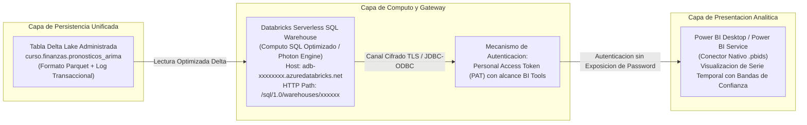
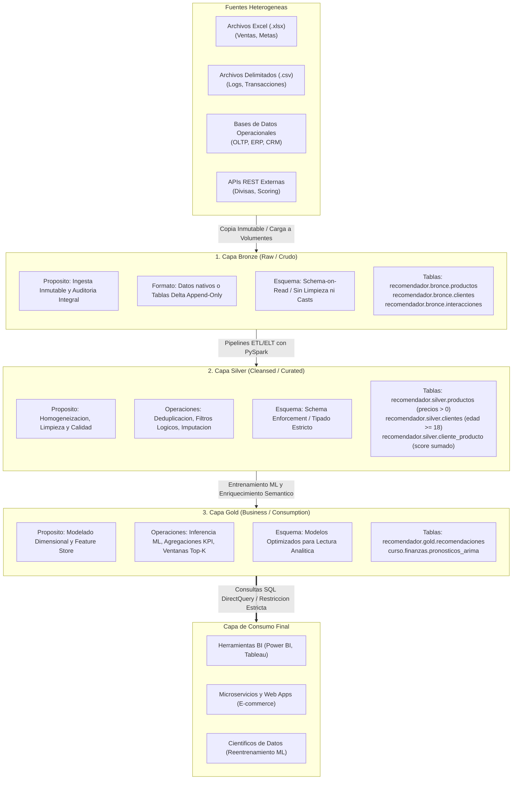
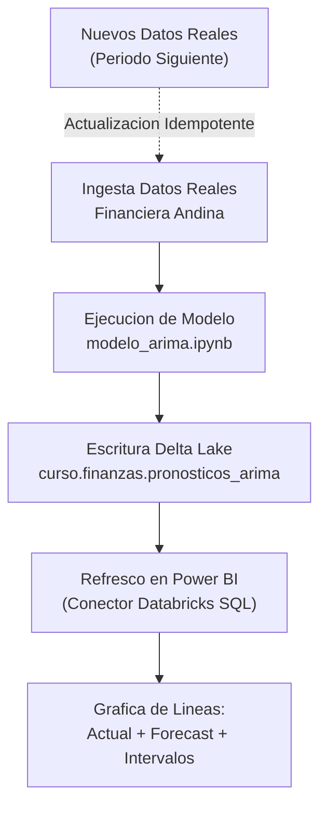

# Clase 7: Integracion MLOps de Series Temporales en Power BI y Fundamentos de la Arquitectura Medallon

> **Objetivo de la Sesion:** Consolidar el ciclo de vida MLOps conectando modelos predictivos de series temporales (ARIMA/SARIMA) generados en Databricks hacia entornos de Business Intelligence en Power BI mediante Databricks SQL Warehouse y Personal Access Tokens (PAT); formalizar los fundamentos epistemologicos y arquitectonicos de la Arquitectura Medallon (capas Bronze, Silver y Gold) para Lakehouses empresariales; e implementar la ingesta cruda y el saneamiento estandarizado de entidades de negocio en PySpark.

## Seccion 1: Contexto y Marco Conceptual

### El Desacoplamiento entre Ingenieria de Machine Learning y Consumo Analitico

En los ecosistemas analiticos corporativos convencionales, la fase de modelado predictivo y la fase de visualizacion gerencial suelen operar bajo silos operativos desconectados. Un flujo de trabajo arcaico y propenso a fallas consiste en exportar manualmente predicciones numéricas desde entornos de experimentacion (Jupyter Notebooks locales, Google Colab) hacia hojas de calculo (Excel o CSV), para posteriormente cargarlas de forma manual en motores de Business Intelligence como Power BI o Tableau.

Este enfoque artesanal presenta vulnerabilidades criticas:

1. **Ruptura de Idempotencia y Linaje de Datos:** La intervencion manual destruye la trazabilidad auditable (*data lineage*), impidiendo rastrear el origen exacto del dataset utilizado para entrenar la version del modelo que origino la prediccion.

1. **Latencia Operacional Intolerable:** En modelos de negocio dinamicos donde los datos transaccionales se generan continuamente, depender de un operador humano para refrescar pronosticos semanales o mensuales anula la capacidad de respuesta estrategica.

1. **Falta de Versionado y Vulnerabilidad de Seguridad:** Distribuir archivos intermedios con credenciales o datos financieros desprotegidos viola normativas de seguridad de la informacion y gobernanza corporativa.

### La Transicion hacia MLOps y Automatizacion de Pipelines

La evolucion contemporanea de la Ciencia de Datos exige la adopcion de practicas **MLOps (Machine Learning Operations)**. MLOps traslada los principios de DevOps (integracion continua, entrega continua y monitoreo continuo) al ciclo de vida de los modelos predictivos. Bajo este paradigma, el modelo de Machine Learning no es un artefacto estatico aislado, sino un componente acoplado a un pipeline automatizado:

- La fuente de datos se actualiza de manera centralizada en un almacenamiento escalable.

- Los trabajos de computo (*jobs*) ejecutan el reentrenamiento y la inferencia de forma programada.

- Las predicciones resultantes se persisten bajo un contrato de esquema rigido (*schema enforcement*) en tablas analiticas administradas.

- Las herramientas de toma de decisiones (Power BI) consumen los datos directamente a traves de endpoints optimizados (SQL Warehouses) mediante conexiones autenticadas y seguras.

Bajo este esquema, si la organizacion decide sustituir el algoritmo subyacente (por ejemplo, migrando de un modelo estocastico clasico como SARIMA hacia librerias de descomposicion aditiva como Facebook Prophet o redes neuronales recurrentes LSTM), el contrato de datos expuesto hacia el tablero de control permanece inmutable, garantizando desacoplamiento total entre infraestructura de computo y capa semantica de reporte.

---

## Seccion 2: Fundamentos Teoricos y Arquitectura

### Arquitectura de Integracion: Databricks SQL Warehouse hacia Power BI

Para conectar una plataforma de procesamiento distribuido como Databricks con herramientas semanticas de usuario final, se articula una arquitectura orientada a servicios desacoplados:



#### Protocolos de Autenticacion: Credenciales Nominales vs. Personal Access Tokens (PAT)

La integracion entre sistemas cliente-servidor en entornos corporativos restringe estrictamente el uso de credenciales nominales (usuario y contrasena corporativa). Proveer credenciales primarias a conectores externos genera riesgos de seguridad criticos:

- Expone el control total de la cuenta del usuario en caso de filtracion del archivo de conexion.

- Invalida la conexion analitica cada vez que las politicas de seguridad corporativas fuerzan la renovacion periodica de la contrasena del usuario.

- Impide el control granular de permisos sobre las operaciones que el conector externo puede ejecutar.

En su lugar, se implementan **Personal Access Tokens (PAT)**:

- **Aislamiento de Alcance:** El token se configura con permisos especificos (por ejemplo, *BI Tools* para lectura analitica de endpoints SQL), impidiendo el acceso a configuraciones de infraestructura o modificacion de usuarios.

- **Ciclo de Vida Acotado (TTL):** Poseen un tiempo de vida definido (ej. 14 dias en ambientes de prueba, 90 a 180 dias en entornos productivos con politicas de rotacion controlada).

- **Revocabilidad Inmediata:** En caso de compromiso del archivo de configuracion del dashboard, el token puede ser revocado instantaneamente desde la consola de administracion sin alterar las credenciales de acceso del analista ni afectar otros tokens activos.

### Epistemologia y Topologia de la Arquitectura Medallon

La **Arquitectura Medallon** (formalizada por Databricks y adoptada ampliamente en entornos Microsoft Azure y AWS Lakehouse) es un patron de diseno de datos que estructura la informacion en multiples capas logicas y fisicas sucesivas, asegurando una transformacion progresiva desde datos crudos hasta activos analiticos de alto valor de negocio.



#### Anatomia de las Capas del Medallon

1. **Capa Bronze (Inmutable Raw Store):**

   - **Naturaleza:** Es la zona de aterrizaje (*landing zone*) donde los datos se preservan en su estado crudo original. No se ejecutan transformaciones semanticas, filtrados ni eliminacion de duplicados.
   
   - **Regla Operativa:** Permite la recuperacion completa del estado historico ante errores en pipelines posteriores. Si una regla de negocio o algoritmo de imputacion en capas superiores resulta defectuoso, los datos en Bronze permiten reprocesar la historia completa sin depender de las fuentes externas.
   
   - **Granularidad:** Maxima granularidad temporal y transaccional disponible.

1. **Capa Silver (Curated / Conformed Data Layer):**

   - **Naturaleza:** Representa la "fuente de la verdad" (*Single Source of Truth*) para las entidades del dominio de negocio (clientes, productos, ordenes).
   
   - **Regla Operativa:** Se aplican tecnicas de saneamiento, conversion de tipos primitivos (casting), resolucion de ambiguedades, descarte de anomalías manifiestas (ej. precios menores o iguales a cero) y cumplimiento normativo (ej. exclusion de registros de menores de edad en concordancia con normativas de proteccion de datos como GDPR o regulaciones de IA).
   
   - **Enriquecimiento Intermedio:** Permite cruces logicos preliminares y agregaciones de comportamiento conductual (por ejemplo, matrices de frecuencia o pesos de interaccion cliente-producto).

1. **Capa Gold (Business Aggregation &amp; Consumption Mart):**

   - **Naturaleza:** Capa optimizada exclusivamente para la lectura analitica de alto rendimiento, reportes ejecutivos, tableros de control y motores de inferencia.
   
   - **Regla Operativa:** Los datos se estructuran bajo esquemas multidimensionales (Kimball: tablas de hechos y dimensiones) o vistas desnormalizadas listas para su presentacion.
   
   - **Principio de Aislamiento:** Las herramientas de visualizacion (Power BI) y las aplicaciones de produccion tienen **estrictamente prohibido** consultar las capas Bronze o Silver; todo acceso se canaliza de forma imperativa a traves de Gold.

---

## Seccion 3: Implementacion Tecnica y Operaciones en Databricks

### 1\. Conexion Segura de Power BI con Databricks SQL Warehouse

El aprovisionamiento del enlace de datos se efectua extrayendo los parametros de conectividad del Data Warehouse serverless y estructurando el conector nativo:

#### Parametros de Configuracion del Endpoint

- **Server Hostname:** Dominio regional asignado a la instancia de Databricks (ej. ` adb-xxxxxxxx.azuredatabricks.net `).

- **HTTP Path:** Ruta de acceso al endpoint SQL (ej. ` /sql/1.0/warehouses/xxxxxxxxxxxx `).

- **Protocolo de Conexion:** Archivo ` .pbids ` (Power BI Data Source) descargable directamente desde la consola de *SQL Warehouses &gt; Connection details*.

#### Generacion del Token de Acceso Personal (PAT)

1. Navegar a la configuracion de usuario dentro del workspace de Databricks (*User Settings &gt; Developer*).

1. Seleccionar *Generate new token*.

1. Asignar un identificador nemotecnico claro (ej. ` PowerBI_Analytics_Connector `).

1. Configurar el tiempo de vida (TTL): 14 dias para pruebas de integracion o 90 dias en produccion controlada.

1. Seleccionar la casilla de verificacion de privilegios para herramientas de Business Intelligence (*BI Tools*).

1. Copiar de forma inmediata la cadena alfanumerica generada y almacenarla en una boveda de secretos segura.

#### Consumo de la Serie Temporal en Power BI

Una vez autenticado el conector mediante el token, se navega por el catalogo ` curso `, esquema ` finanzas `, seleccionando la tabla ` pronosticos_arima `. En Power Query:

1. Se ajusta el tipo de dato de la columna ` fecha ` de ` DateTime ` a ` Date ` estricto para evitar duplicidad artificial de granularidad horaria.

1. En el lienzo de reporte, se inserta una visualizacion de lineas (*Line chart*):

   - **Eje X:** Campo ` fecha `.
   
   - **Eje Y (Serie Historica):** Campo ` valor_real `.
   
   - **Eje Y (Serie Pronosticada):** Campo ` valor_predicho `.
   
   - **Eje Y (Limites de Confianza):** Campos ` limite_inferior ` y ` limite_superior `.



### 2\. Creacion de la Estructura Jerarquica de la Arquitectura Medallon en SQL

Para asegurar reproducibilidad y evitar desalineamientos en la creacion manual de esquemas, se utiliza el motor Databricks SQL Editor ejecutando instrucciones DDL estandarizadas:

```sql
-- Creacion del catalogo principal para el dominio del recomendador
CREATE CATALOG IF NOT EXISTS recomendador;

-- Creacion secuencial de esquemas correspondientes a las capas de la arquitectura
CREATE SCHEMA IF NOT EXISTS recomendador.bronce;
CREATE SCHEMA IF NOT EXISTS recomendador.silver;
CREATE SCHEMA IF NOT EXISTS recomendador.gold;
```

### 3\. Pipeline de Ingesta Cruda a Capa Bronze (` recomendador_bronce `)

En la capa Bronze se crea un volumen administrado en Unity Catalog (` recomendador.bronce.archivos `) donde se cargan los archivos de origen en formato nativo: ` clientes.xlsx `, ` interacciones.xlsx ` y ` productos.xlsx `.

Debido a que el runtime distribuido no incluye de manera predeterminada dependencias de analisis de hojas de calculo binarias, se instalan las librerias requeridas y se realiza la lectura hacia estructuras tabulares Delta:

```python
# 1. Instalacion aislada de soporte para archivos de hoja de calculo Excel
%pip install openpyxl

# 2. Importacion de librerias de computo distribuido y manipulacion
import pandas as pd
from pyspark.sql import SparkSession

# 3. Verificacion operativa del volumen de almacenamiento distribuido
ruta_volumen = "/Volumes/recomendador/bronce/archivos/"
display(dbutils.fs.ls(ruta_volumen))

# 4. Lectura de datasets crudos y persistencia en tablas Delta administradas en Bronze
# Ingesta de Productos
df_productos_raw = pd.read_excel(f"{ruta_volumen}productos.xlsx")
spark.createDataFrame(df_productos_raw) \
    .write.format("delta").mode("overwrite") \
    .saveAsTable("recomendador.bronce.productos")

# Ingesta de Clientes
df_clientes_raw = pd.read_excel(f"{ruta_volumen}clientes.xlsx")
spark.createDataFrame(df_clientes_raw) \
    .write.format("delta").mode("overwrite") \
    .saveAsTable("recomendador.bronce.clientes")

# Ingesta de Interacciones
df_interacciones_raw = pd.read_excel(f"{ruta_volumen}interacciones.xlsx")
spark.createDataFrame(df_interacciones_raw) \
    .write.format("delta").mode("overwrite") \
    .saveAsTable("recomendador.bronce.interacciones")
```

### 4\. Saneamiento y Creacion de Entidades en Capa Silver (` recomendador_silver `)

El pipeline de la capa Silver procesa las tablas Delta de Bronze aplicando reglas de calidad, tipado formal y politicas de gobernanza:

```python
from pyspark.sql.functions import col, when, sum as _sum

# Ingesta desde las tablas administradas en Bronze
df_prod_bronze = spark.table("recomendador.bronce.productos")
df_clie_bronze = spark.table("recomendador.bronce.clientes")
df_inte_bronze = spark.table("recomendador.bronce.interacciones")

# Saneamiento de la Entidad Productos:
# Deduplicacion, eliminacion de nulos estructurales y restriccion de precio estrictamente positivo
df_prod_silver = df_prod_bronze.dropDuplicates(["producto_id"]) \
    .filter(col("producto_id").isNotNull()) \
    .filter(col("precio") > 0)

df_prod_silver.write.format("delta").mode("overwrite") \
    .saveAsTable("recomendador.silver.productos")

# Saneamiento de la Entidad Clientes:
# Deduplicacion y aplicacion de filtro etico-normativo de mayoria de edad (>= 18 anos)
df_clie_silver = df_clie_bronze.dropDuplicates(["cliente_id"]) \
    .filter(col("cliente_id").isNotNull()) \
    .filter(col("edad") >= 18)

df_clie_silver.write.format("delta").mode("overwrite") \
    .saveAsTable("recomendador.silver.clientes")

# Saneamiento de la Entidad Interacciones:
# Eliminacion de referencias vacias y ponderacion conductual
df_inte_silver = df_inte_bronze.dropDuplicates() \
    .filter(col("cliente_id").isNotNull() & col("producto_id").isNotNull())

df_inte_silver.write.format("delta").mode("overwrite") \
    .saveAsTable("recomendador.silver.interacciones")

# Generacion de la Matriz de Interaccion Ponderada (Cliente-Producto):
# Asignacion de pesos conductuales: Compra (10), Carrito (6), Favorito (4), Clic (1), Visita (1)
df_interacciones_pesadas = df_inte_silver.withColumn(
    "peso_accion",
    when(col("tipo_interaccion") == "compra", 10)
    .when(col("tipo_interaccion") == "carrito", 6)
    .when(col("tipo_interaccion") == "favorito", 4)
    .when(col("tipo_interaccion") == "clic", 1)
    .otherwise(1)
)

# Agregacion del score total por par de entidad (cliente, producto)
df_cliente_producto_silver = df_interacciones_pesadas.groupBy("cliente_id", "producto_id") \
    .agg(_sum("peso_accion").alias("score"))

df_cliente_producto_silver.write.format("delta").mode("overwrite") \
    .saveAsTable("recomendador.silver.cliente_producto")
```

---

## Seccion 4: Analisis Critico de Casos y Auditoria Practica

### Matriz Comparativa: Modos de Integracion Power BI y Databricks

| Dimension de Analisis | Import Mode Clasico | DirectQuery Directo | Databricks SQL Warehouse Direct |
| --- | --- | --- | --- |
| **Ubicacion del Computo** | Motor VertiPaq en memoria del cliente Power BI | Servidor de base de datos relacional tradicional | Cluster distribuido Serverless en Databricks |
| **Capacidad de Escala** | Limitado por la memoria RAM asignada al reporte (.pbix) | Dependiente del hardware y bloqueos en RDBMS monolitico | Escalamiento casi ilimitado sobre almacenamiento Delta |
| **Frescura de la Informacion** | Estatica hasta el proximo refresco programado | Tiempo real estricto en cada interaccion de usuario | Alta concurrencia con cache inteligente de consultas |
| **Costo Computacional** | Bajo en backend; intensivo en infraestructura Power BI | Riesgo de saturacion en bases de datos operacionales | Optimo; computo serverless auto-pausable ante inactividad |

### Matriz Comparativa: Reglas de Gobernanza en la Arquitectura Medallon

| Criterio Arquitectonico | Capa Bronze (Crudo) | Capa Silver (Depurada) | Capa Gold (Consumo) |
| --- | --- | --- | --- |
| **Objetivo Primordial** | Preservacion fiel e inmutable del origen | Limpieza, calidad y estandarizacion de entidades | Agregacion de valor, modelos ML y reportes BI |
| **Reglas de Calidad** | Nulas (incluso datos malformados se conservan) | Estrictas: eliminacion de nulos, filtros logicos | Empresariales: definiciones semanticas unificadas |
| **Esquema de Almacenamiento** | Schema-on-Read / Archivos en Volumen o Delta raw | Delta Lake con Schema Enforcement estricto | Modelos dimensionales o tablas anchas desnormalizadas |
| **Perfil de Acceso Autorizado** | Ingenieros de Datos exclusivamente | Ingenieros de Datos y Cientificos de Datos | Analistas de BI, Ejecutivos, APIs productivas y ML |

---

## Seccion 5: Principios de Diseno, Buenas Practicas y Anti-patrones

### Principios Fundamentales

1. **Inmutabilidad y Preservacion del Origen:** La capa Bronze jamas debe sobrescribirse destructivamente sin capacidad de recuperacion; representa el resguardo historico auditado de la organizacion.

1. **Contratos de Esquema Inalterables para Consumo:** La estructura de tablas en la capa Gold constituye una API de datos. Cualquier alteracion en nombres de columnas o tipos de datos rompe silenciosamente tableros ejecutivos y modelos downstream.

1. **Idempotencia en Pipelines Analiticos:** Los scripts de transformacion y generacion deben estar parametrizados de modo que su ejecucion repetida sobre la misma ventana temporal produzca exactamente el mismo estado final en el almacenamiento Delta.

### Anti-patrones Identificados

- **Acceso Directo a Bronze (Bypassing Layers):** Permitir que tableros de Power BI se conecten directamente a la capa Bronze. Esto traslada la logica de limpieza hacia medidas DAX complejas e ineficientes, degradando el rendimiento y fragmentando la logica de negocio.

- **Sobrescritura Destructiva de Predicciones:** Actualizar tablas de pronosticos borrando las predicciones de ejecuciones anteriores, imposibilitando la auditoria de error historico del modelo.

- **Filtrado Tardio en Memoria:** Ejecutar filtros de calidad de datos en herramientas cliente (Power BI o memoria de la aplicacion) en lugar de empujar el filtrado hacia el motor distribuido PySpark en la capa Silver.

---

## Seccion 6: Sintesis Conceptual y Profundizacion Academica

### Conclusiones Metodologicas

1. La articulacion de un pipeline MLOps unificado transforma el modelado predictivo en un activo continuo, permitiendo actualizar pronosticos de series temporales de manera automatizada mediante capas de datos expuestas a traves de endpoints SQL seguros.

1. La Arquitectura Medallon resuelve estructuralmente los vicios de inconsistencia de los repositorios masivos de datos al formalizar transiciones de calidad rigurosamente tipadas entre las capas Bronze, Silver y Gold.

1. El preprocesamiento de eventos en la capa Silver mediante matrices ponderadas de interaccion sienta las bases matematicas indispensables para algoritmos avanzados de filtrado colaborativo en sistemas de recomendacion.

### Referencias Seminales

- Armbrust, M., Ghodsi, A., Xin, R., &amp; Zaharia, M. (2021). *Lakehouse: A New Generation of Open Platforms that Unify Data Warehousing and Advanced Analytics*. Proceedings of CIDR 2021.

- Sculley, D., Holt, G., Golovin, D., Davydov, E., Phillips, T., Ebner, D., Chaudhary, V., Young, M., Crespo, J. F., &amp; Dennison, D. (2015). *Hidden Technical Debt in Machine Learning Systems*. Advances in Neural Information Processing Systems (NeurIPS 2015).

- Box, G. E., Jenkins, G. M., Reinsel, G. C., &amp; Ljung, G. M. (2015). *Time Series Analysis: Forecasting and Control* (5th ed.). John Wiley &amp; Sons.

---
