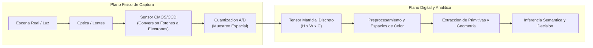
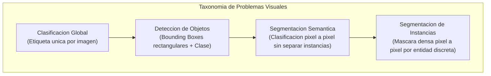
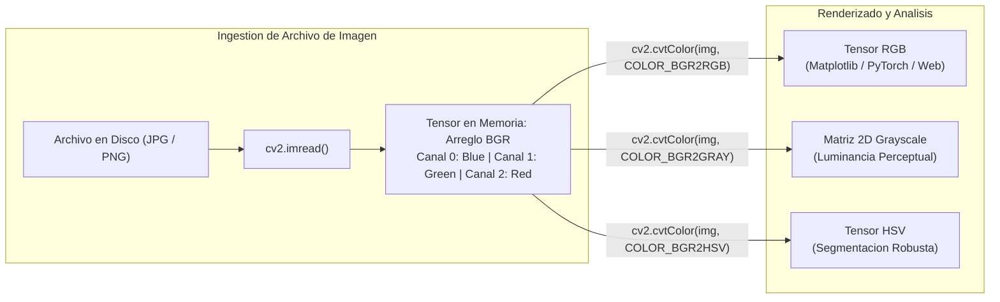
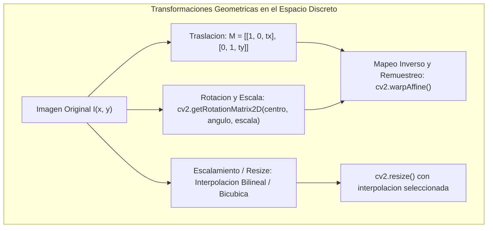
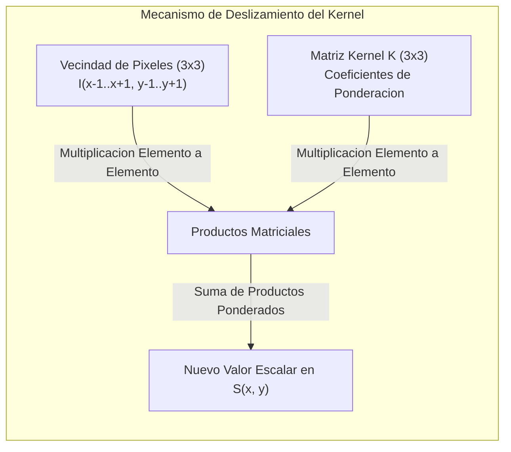

# Clase 1: Fundamentos de Vision por Computadora, Espacios de Color y Procesamiento Matricial con OpenCV y NumPy

> Proposito pedagogico: Comprender los fundamentos de la vision artificial clasica, la representacion digital de imagenes como tensores numericos multidimensionales, el desacoplamiento y manipulacion de canales cromaticos (RGB, BGR, HSV, escala de grises), la ejecucion de transformaciones geometricas afines y el filtrado espacial mediante kernels discretos de convolucion 2D.

## 1\. Contexto y Marco Conceptual

### La Vision por Computadora como Disciplina Cientifica

La vision por computadora constituye una rama cardinal de la inteligencia artificial orientada a dotar a los sistemas computacionales de la capacidad de emular, decodificar e interpretar el sistema visual humano a partir de senales opticas digitalizadas (imagenes estaticas y secuencias de video). A diferencia de la computacion grafica, cuya funcion teleologica radica en generar representaciones visuales sinteticas a partir de modelos geometricos tridimensionales, la vision por computadora opera en sentido inverso: toma una representacion visual bidimensional del mundo fisico y reconstruye descripciones simbolicas, semanticas y geometricas de los objetos presentes en la escena.

El pipeline visual se subdivide en dos grandes planos:

1. **Plano Fisico de Captura:** Fenomenos opticos, iluminacion radiativa, sensores semiconductores de imagen (CCD o CMOS), lentes de enfoque y conversion analogica-digital (cuantizacion espacial y de amplitud).

1. **Plano Digital y Analitico:** Tratamiento matricial de los arreglos discretos generados, extraccion de primitivas locales (bordes, esquinas, texturas), modelado estadistico e inferencia semantica.



### Taxonomia Formal de Problemas y Paradigmas en Vision Artificial

En funcion de la granularidad semantica y espacial requerida por el dominio de aplicacion, las tareas de vision por computadora se categorizan formalmente en:

- **Clasificacion de Imagenes (Image Classification):** Asigna una etiqueta categorica global $y \in \{1, \dots, K\}$ a la totalidad del lienzo visual. Responde estrictamente a la interrogante: *"¿Que objeto principal predomina en la imagen?"*.

- **Localizacion y Deteccion de Objetos (Object Detection):** Identifica la presencia de multiples instancias de objetos, estimando simultaneamente su clase y su ubicacion geometrica mediante cuadros delimitadores (*Bounding Boxes*) parametrizados por coordenadas $[x_{\min}, y_{\min}, x_{\max}, y_{\max}]$ o $[x_c, y_c, w, h]$. Responde a: *"¿Que objetos existen y donde estan ubicados exactamente?"*.

- **Segmentacion Semantica (Semantic Segmentation):** Clasifica cada pixel individual del arreglo bidimensional en una categoria predeterminada, sin discriminar entre instancias individuales de la misma clase.

- **Segmentacion de Instancias (Instance Segmentation):** Combina la precision a nivel de pixel de la segmentacion con la separacion discreta de entidades individuales provista por la deteccion.

- **Reconocimiento de Patrones Dinamicos y Tracking:** Inferencia espaciotemporal de trayectorias, pose y flujo optico en flujos continuos de cuadros.



### Naturaleza Tensor Matricial del Dato Visual

Desde una perspectiva algebraico-computacional, una imagen digital no es una entidad abstracta, sino un **tensor discreto de orden 3**:

$$
I \in \mathbb{R}^{H \times W \times C} \quad \text{o} \quad I \in \{0, 1, \dots, 255\}^{H \times W \times C}
$$

donde:

- $H$: Altura (*Height*), correspondiente al numero de filas discretas de la matriz.

- $W$: Ancho (*Width*), correspondiente al numero de columnas discretas.

- $C$: Canales de profundidad cromatica (*Channels*). En imagenes monocromaticas $C=1$, mientras que en imagenes policromaticas convencionales $C=3$.

Cada elemento escalar $I(y, x, c)$ representa la **intensidad cuantizada** de la senal luminosa en la posicion espacial $(x, y)$ para el canal $c$. Cuando se emplean enteros de 8 bits sin signo (` uint8 `), el dominio dinamico queda estrictamente acotado al rango $[0, 255]$, donde 0 representa ausencia total de intensidad (negro) y 255 representa la saturacion maxima del canal.

---

## 2\. Fundamentos Teoricos y Arquitectura

### Modelos y Espacios de Color

#### 1\. Espacio RGB vs Formato BGR en OpenCV

El modelo RGB es un espacio aditivo fundamentado en la teoria tricromatica de la percepcion humana, donde cualquier tonalidad se sintetiza mediante la combinacion lineal ponderada de tres longitudes de onda primarias: Rojo ($R$), Verde ($G$) y Azul ($B$).

Sin embargo, en el desarrollo con la biblioteca **OpenCV (Open Source Computer Vision Library)**, los canales se organizan historicamente en el orden inverso: **BGR (Blue, Green, Red)**. Esta decision arquitectonica provino de los primeros estandares de captura de hardware de video y graficos para chipsets de computadoras personales (sistemas Intel IPP) en la decada de 1990.

- Si una imagen leida mediante ` cv2.imread() ` se visualiza directamente en bibliotecas que esperan el estandar RGB (como Matplotlib o interfaces web), se produce una inversion cromatica: las regiones rojas se renderizan azules y viceversa.

- Es imperativo aplicar una conversion explicita: ` cv2.cvtColor(imagen, cv2.COLOR_BGR2RGB) `.



#### 2\. Escala de Grises (Monocromatica)

La reduccion de un tensor tridimensional a una matriz bidimensional $I_{\text{gray}} \in \mathbb{R}^{H \times W}$ no se realiza calculando un simple promedio aritmetico unweighted de los tres canales. Debido a que la retina humana exhibe una mayor densidad de fotorreceptores para longitudes de onda medias (verde), el estandar ITU-R BT.601 prescribe una proyeccion lineal ponderada por luminancia perceptual:

$$
Y = 0.299 \cdot R + 0.587 \cdot G + 0.114 \cdot B
$$

Esta transformacion colapsa la dimensionalidad en un 66.7%, reduciendo de forma sustancial la carga computacional en algoritmos donde la cromaticidad no aporta senal discriminativa (deteccion de bordes, OCR, geometria estructural).

#### 3\. Espacio HSV (Hue, Saturation, Value)

El modelo RGB acopla la informacion de color con la intensidad de la iluminacion ambiental, provocando que una misma superficie fisica bajo sombra arroje vectores numéricos $[R, G, B]$ radicalmente diferentes. Para desacoplar el contenido cromatico de las variaciones fotometricas, se emplea el espacio cilindrico **HSV**:

- **Hue (**$H$**, Matiz o Tono):** Angulo toroidal en $[0^\circ, 360^\circ]$ que identifica la longitud de onda dominante del color puro (en OpenCV se escala a $[0, 179]$ para almacenarse en un ` uint8 `).

- **Saturation (**$S$**, Saturacion):** Pureza cromatica o ausencia de dilucion en luz blanca ($[0, 255]$).

- **Value (**$V$**, Brillo o Intensidad):** Magnitud energetica luminosa ($[0, 255]$).

El espacio HSV es el estandar predilecto para tareas de segmentacion cromatica, dado que permite aislar un color especifico delimitando unicamente un intervalo angular en $H$, independientemente de las sombras o brillos presentes en $V$.

---

### Transformaciones Geometricas Afines y Remuestreo Espacial

Una transformacion afin es una transformacion geometrica lineal que preserva puntos, lineas rectas y paralelismos entre rectas, aunque no necesariamente angulos o distancias euclidianas.

Matematicamente, mapea una coordenada original $[x, y]^T$ hacia una nueva ubicacion $[x', y']^T$ mediante una matriz $2 \times 3$:

$$
\begin{bmatrix} x' \\ y' \end{bmatrix} = \begin{bmatrix} a_{11} & a_{12} & t_x \\ a_{21} & a_{22} & t_y \end{bmatrix} \begin{bmatrix} x \\ y \\ 1 \end{bmatrix}
$$

#### 1\. Traslacion Espacial

Desplaza rigidamente cada punto de la imagen en $t_x$ pixeles horizontalmente y $t_y$ pixeles verticalmente:

$$
M_{\text{trans}} = \begin{bmatrix} 1 & 0 & t_x \\ 0 & 1 & t_y \end{bmatrix}
$$

#### 2\. Rotacion con Escalamiento Alrededor de un Centro Arbitrario

Para rotar una imagen un angulo $\theta$ respecto a un centro de pivote $(\alpha, \beta)$ aplicando un factor de escala uniforme $s$, OpenCV parametriza la matriz afin:

$$
M_{\text{rot}} = \begin{bmatrix} \alpha_{\text{rot}} & \beta_{\text{rot}} & (1 - \alpha_{\text{rot}})\alpha - \beta_{\text{rot}}\beta \\ -\beta_{\text{rot}} & \alpha_{\text{rot}} & \beta_{\text{rot}}\alpha + (1 - \alpha_{\text{rot}})\beta \end{bmatrix}
$$

donde $\alpha_{\text{rot}} = s \cdot \cos(\theta)$ y $\beta_{\text{rot}} = s \cdot \sin(\theta)$.



#### 3\. Metodos de Interpolacion Espacial

Al deformar o escalar una matriz discreta, las coordenadas proyectadas no coinciden con posiciones enteras de la grilla de pixeles, exigiendo metodos de interpolacion:

- ` INTER_NEAREST ` **(Vecino mas proximo):** Asigna el valor del pixel mas cercano. Computacionalmente trivial $O(1)$, pero introduce artefactos de pixelado severos (*aliasing* y bordes dentados).

- ` INTER_LINEAR ` **(Interpolacion Bilineal):** Promedia ponderadamente los 4 pixeles circundantes. Estandar de la industria por su equilibrio entre suavidad y costo computacional.

- ` INTER_CUBIC ` **(Interpolacion Bicubica):** Ajusta polinomios cubicos sobre una vecindad de $4 \times 4$ (16 pixeles). Preserva gradientes de borde de alta calidad, pero con mayor costo computacional.

- ` INTER_AREA ` **(Remuestreo basado en relaciones de area de pixeles):** Metodo optimo y libre de distorsion moire para diezmado o reduccion de escala (*downsampling*).

---

### Introduccion a la Convolucion Bidimensional Discreta

El filtrado espacial opera modificando el valor de cada pixel en funcion de los valores de sus vecinos inmediatos. Esta transformacion se formaliza mediante el operador matematico de **convolucion bidimensional**:

$$
S(x, y) = (I * K)(x, y) = \sum_{m=-a}^{a} \sum_{n=-b}^{b} I(x - m, y - n) \cdot K(m, n)
$$

donde $K \in \mathbb{R}^{(2a+1) \times (2b+1)}$ representa el **kernel o filtro espacial**, una matriz de coeficientes deterministas disenados para amplificar o atenuar frecuencias espaciales especificas.



---

## 3\. Implementacion Tecnica y Logica de Negocio

### Pipeline de Manipulacion Basica e Ingestion Matricial

A continuacion se presenta la implementacion formal en Python integrando NumPy y OpenCV, ejecutando la lectura segura, inspeccion de metadatos, transformacion cromatica y extraccion de canales.

```python
import cv2
import numpy as np

def cargar_y_analizar_imagen(ruta_imagen: str):
    """
    Carga una imagen desde el almacenamiento local, audita su estructura tensorial
    y realiza las conversiones cromaticas fundamentales.
    """
    # 1. Lectura en espacio nativo BGR
    img_bgr = cv2.imread(ruta_imagen, cv2.IMREAD_COLOR)
    if img_bgr is None:
        raise FileNotFoundError(f"No fue posible cargar el archivo en: {ruta_imagen}")

    # Auditoria de dimensiones
    alto, ancho, canales = img_bgr.shape
    print(f"Dimensiones: {alto}x{ancho} | Canales: {canales} | Tipo de dato: {img_bgr.dtype}")

    # 2. Conversion a estandar RGB para renderizado y procesamiento
    img_rgb = cv2.cvtColor(img_bgr, cv2.COLOR_BGR2RGB)

    # 3. Conversion a escala de grises mediante ponderacion perceptual
    img_gray = cv2.cvtColor(img_bgr, cv2.COLOR_BGR2GRAY)

    # 4. Conversion a espacio cilindrico HSV
    img_hsv = cv2.cvtColor(img_bgr, cv2.COLOR_BGR2HSV)

    # 5. Descomposicion y recombinacion de canales
    canal_b, canal_g, canal_r = cv2.split(img_bgr)
    img_recompuesta = cv2.merge([canal_b, canal_g, canal_r])
    assert np.array_equal(img_bgr, img_recompuesta), "Error en la integridad de la recombinacion"

    return {
        "bgr": img_bgr,
        "rgb": img_rgb,
        "gray": img_gray,
        "hsv": img_hsv,
        "canales_separados": (canal_b, canal_g, canal_r)
    }
```

### Construccion de Lienzos Sinteticos y Geometria Vectorial

OpenCV permite operar directamente sobre arreglos de NumPy para generar lienzos digitales y superponer elementos vectoriales para anotacion visual:

```python
def generar_lienzo_anotado(alto: int = 500, ancho: int = 500) -> np.ndarray:
    """
    Crea un lienzo sintetico tridimensional y traza primitivas geometricas.
    """
    # Inicializacion de lienzo negro (intensidad cero en uint8)
    lienzo = np.zeros((alto, ancho, 3), dtype=np.uint8)

    # 1. Trazo de linea diagonal (Azul puro en BGR: (255, 0, 0))
    cv2.line(lienzo, (0, 0), (ancho, alto), (255, 0, 0), thickness=3)

    # 2. Rectangulo delimitador (Verde puro: (0, 255, 0))
    cv2.rectangle(lienzo, (50, 50), (200, 200), (0, 255, 0), thickness=2)

    # 3. Circunferencia rellena (Rojo puro: (0, 0, 255), thickness=-1)
    cv2.circle(lienzo, (350, 250), radius=60, color=(0, 0, 255), thickness=-1)

    # 4. Poligono convexo arbitrario
    puntos = np.array([[250, 350], [300, 450], [200, 480], [150, 400]], np.int32)
    puntos = puntos.reshape((-1, 1, 2))
    cv2.polylines(lienzo, [puntos], isClosed=True, color=(0, 255, 255), thickness=2)

    # 5. Anotacion de texto tipografico
    cv2.putText(
        lienzo,
        text="Anotacion Metrica",
        org=(50, 40),
        fontFace=cv2.FONT_HERSHEY_SIMPLEX,
        fontScale=0.9,
        color=(255, 255, 255),
        thickness=2,
        lineType=cv2.LINE_AA
    )

    return lienzo
```

### Transformaciones Afines y Remuestreo Espacial

```python
def aplicar_transformaciones_geometricas(imagen: np.ndarray):
    """
    Aplica traslacion matricial, rotacion arbitraria y recorte espacial (cropping).
    """
    alto, ancho = imagen.shape[:2]

    # A. Traslacion: desplazar ancho/4 en X y alto/4 en Y
    tx, ty = ancho / 4.0, alto / 4.0
    matriz_traslacion = np.float32([
        [1, 0, tx],
        [0, 1, ty]
    ])
    img_trasladada = cv2.warpAffine(imagen, matriz_traslacion, (ancho, alto))

    # B. Rotacion: 45 grados respecto al centro geometrico con escala 0.85
    centro = (ancho // 2, alto // 2)
    matriz_rotacion = cv2.getRotationMatrix2D(centro=centro, angle=45.0, scale=0.85)
    img_rotada = cv2.warpAffine(imagen, matriz_rotacion, (ancho, alto))

    # C. Redimensionamiento con preservacion de fidelidad
    nuevo_ancho, nuevo_alto = int(ancho * 0.5), int(alto * 0.5)
    img_reducida = cv2.resize(imagen, (nuevo_ancho, nuevo_alto), interpolation=cv2.INTER_AREA)

    # D. Recorte espacial ortogonal (Slicing directo de NumPy)
    ymin, ymax = int(alto * 0.2), int(alto * 0.8)
    xmin, xmax = int(ancho * 0.2), int(ancho * 0.8)
    img_recortada = imagen[ymin:ymax, xmin:xmax]

    return {
        "trasladada": img_trasladada,
        "rotada": img_rotada,
        "reducida": img_reducida,
        "recortada": img_recortada
    }
```

---

## 4\. Analisis Critico de Casos y Auditoria Practica

### Evaluacion Comparativa de Espacios de Color

| **Espacio de Color** | **Dimension / Canales** | **Ventajas Analiticas** | **Desventajas y Limitaciones** | **Caso de Uso Primario** |
| --- | --- | --- | --- | --- |
| **RGB / BGR** | $H \times W \times 3$ | Estandar directo del hardware de captura y despliegue optico; fidelidad perceptual directa. | Alto acoplamiento entre luminancia y crominancia; sumamente sensible a sombras y cambios de luz. | Almacenamiento de origen, visualizacion final y clasificacion en redes profundas. |
| **Grayscale** | $H \times W \times 1$ | Minima sobrecarga computacional (reduccion de 66% de memoria); invariante a distorsiones tonales. | Elimina completamente la informacion de matiz; colapsa regiones de identica luminancia pero distinto color. | Deteccion de bordes, extraccion de esquinas, OCR y calculo de gradientes espaciales. |
| **HSV** | $H \times W \times 3$ | Desacopla el tono ($H$) de la intensidad ($V$); permite segmentacion cromatica robusta a sombras. | Costo computacional no lineal en la conversion trigonometrica; singularidad en niveles de saturacion cero. | Segmentacion de objetos por color, tracking de marcadores y analisis de campos luminicos. |

### Matriz de Comparacion de Algoritmos de Interpolacion

| **Metodo** | **Complejidad Computacional** | **Tratamiento de Bordes** | **Artefactos Inducidos** | **Recomendacion Practica** |
| --- | --- | --- | --- | --- |
| **INTER\_NEAREST** | $O(1)$ por pixel | Preserva valores discretos exactos; bordes sumamente dentados. | Pixelado masivo (*aliasing*) en ampliaciones. | Remuestreo de mascaras categoricas de segmentacion donde no deben crearse clases intermedias. |
| **INTER\_LINEAR** | $O(4)$ por pixel | Transiciones suaves continuas entre regiones de contraste medio. | Ligero desenfoque de altas frecuencias espaciales. | Redimensionamiento general y aumento de datos en tiempo real para entrenamiento de redes. |
| **INTER\_CUBIC** | $O(16)$ por pixel | Maxima definicion de bordes y preservacion de gradientes. | Mayor latencia; susceptible a oscilaciones de Gibbs (*ringing*) en bordes abruptos. | Ampliacion y super-resolucion de imagenes de detalle fino. |
| **INTER\_AREA** | Dependiente del factor de escala | Calcula promedios integrales sobre areas de mapeo. | Comportamiento suboptimo si se usa para ampliacion ($\text{escala} > 1$). | Reduccion de escala (*downsampling*) para prevenir efecto Moire. |

---

## 5\. Principios de Diseno, Buenas Practicas y Anti-patrones

### Reglas de Oro en Procesamiento Matricial

1. **Verificacion Explicita de Rango y Tipo de Dato:** Al operar entre bibliotecas, asegurar la coherencia de tipos. Si una operacion matematica requiere precision decimal, convertir explicitamente a ` float32 ` normalizado en $[0.0, 1.0]$. Antes de exportar a disco o renderizar con OpenCV, re-escalar y convertir estrictamente a ` np.uint8 ` en $[0, 255]$.

1. **Alineacion de Espacios de Memoria y Continuidad C-Contiguous:** Las operaciones vectorizadas de OpenCV exigen arreglos contiguos en memoria. Al realizar transformaciones complejas con NumPy (transposiciones, giros), validar con ` np.ascontiguousarray() ` para evitar fallos de segmentacion o degradaciones de cache de CPU.

1. **Preservacion de la Relacion de Aspecto (Aspect Ratio):** En pipelines de preprocesamiento para modelos de aprendizaje automatico, jamas distorsionar las dimensiones arbitrariamente ($H \ne W$) sin aplicar tecnicas de rellenado (*letterboxing* o *padding*), ya que esto deforma la geometria intrinseca de los objetos.

### Anti-patrones Identificados

| **Anti-patron** | **Mecanismo del Error** | **Impacto Tecnico / Consecuencia** | **Estrategia de Mitigacion** |
| --- | --- | --- | --- |
| **Desbordamiento Aritmetico Modular (Wrap-around)** | Sumar o restar imagenes en formato ` uint8 ` usando operadores directos de NumPy (` + `, ` - `) en lugar de saturacion. | $250 + 10 = 4$ en NumPy por desbordamiento de 8 bits, produciendo patrones de inversion solarizada y corrupcion de pixeles. | Utilizar siempre funciones saturadas de OpenCV (` cv2.add `, ` cv2.subtract `) o convertir previamente a ` float32 `. |
| **Inversion Cromatica BGR/RGB** | Renderizar tensores leidos con ` cv2.imread() ` directamente en Matplotlib sin conversion previa. | Los rostros y objetos adquieren una tonalidad azul cadavérica debido al cruce de canales $R$ y $B$. | Aplicar ` cv2.cvtColor(img, cv2.COLOR_BGR2RGB) ` inmediatamente despues de la lectura. |
| **Slicing Invertido de Ejes Espaciales** | Confundir el orden cartesiano $(x, y)$ de OpenCV con el indexamiento de arreglos NumPy $[fila, columna] = [y, x]$. | Recortes desplazados, errores de ` IndexError ` o rotaciones involuntarias de 90 grados. | Recordar formalmente que en NumPy la coordenada vertical $Y$ precede a la horizontal $X$: ` img[y1:y2, x1:x2] `. |

---

## 6\. Sintesis Conceptual y Profundizacion Academica

### Sintesis Integradora

La vision artificial clasica fundamenta toda su capacidad deductiva en la representacion matricial de senales opticas digitalizadas. El tratamiento riguroso de los espacios de color (RGB, Grayscale, HSV) permite aislar caracteristicas visuales relevantes mientras que las transformaciones afines garantizan invariancia geometrica basica. La comprension de las limitaciones computacionales y de los tipos de datos en la memoria RAM constituye el requisito preliminar insustituible para abordar tecnicas avanzadas de filtrado espacial y modelado neuronal convolucional.

### Preguntas Guia para la Investigacion de Posgrado

1. ¿De que manera afecta la cuantizacion cromatica de 8 bits frente a representaciones de alto rango dinamico (HDR / 16-bit Float) la estabilidad asintotica de los gradientes espaciales en condiciones de iluminacion extrema?

1. ¿Bajo que condiciones geometricas las transformaciones afines resultan insuficientes para modelar deformaciones de perspectiva en sistemas de camaras con lentes gran angular o de ojo de pez, requiriendo matrices de homografia proyectiva $3 \times 3$?

### Referencias Bibliograficas Fundamentales

- Szeliski, R. (2022). *Computer Vision: Algorithms and Applications* (2nd ed.). Springer.

- Gonzalez, R. C., &amp; Woods, R. E. (2018). *Digital Image Processing* (4th ed.). Pearson.

- Bradski, G., &amp; Kaehler, A. (2008). *Learning OpenCV: Computer Vision with the OpenCV Library*. O'Reilly Media.

---
