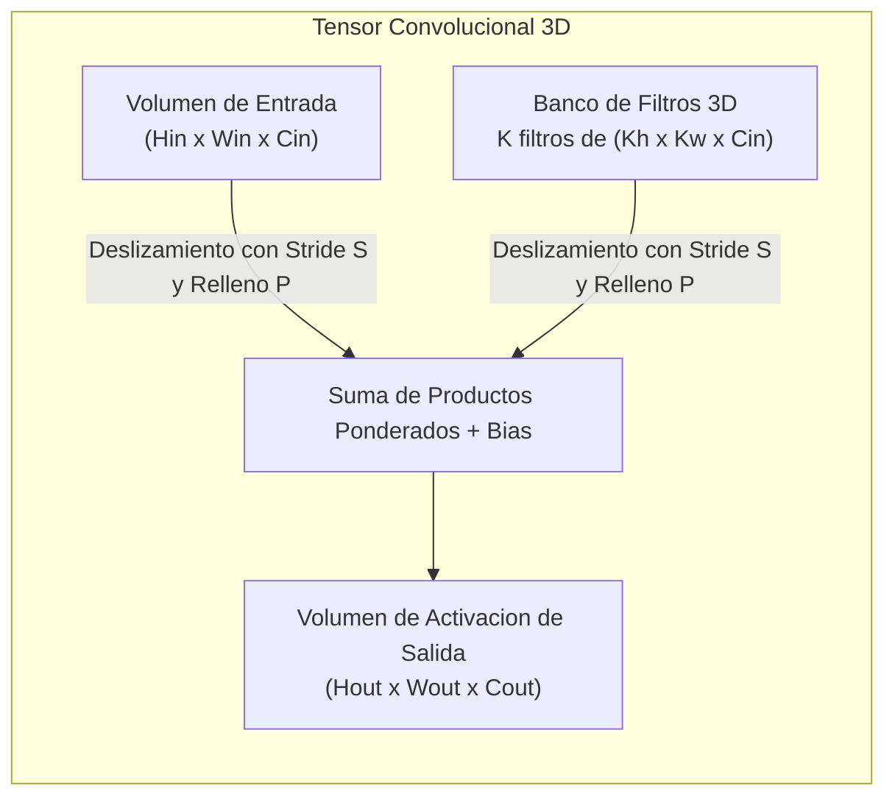
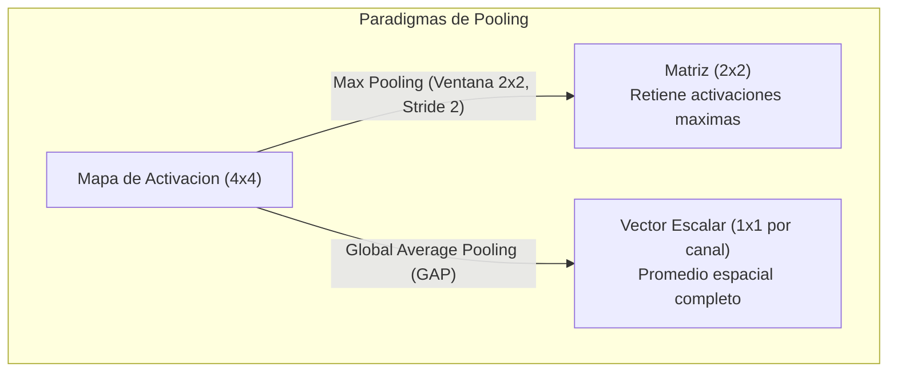
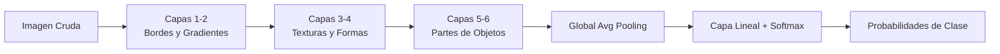

# Clase 3: Arquitecturas Convolucionales Profundas, Mecanismos de Convolucion y Aprendizaje de Representaciones Jerarquicas

> Proposito pedagogico: Comprender la transicion de los modelos multicapa totalmente conectados (MLP) hacia las redes neuronales convolucionales (CNNs), dominar el funcionamiento matematico de las capas de convolucion (kernels aprendibles, stride, padding), analizar el rol del pooling en la invariancia traslacional y reduccion dimensional, formalizar el campo receptivo y construir pipelines de clasificacion profunda en PyTorch/TensorFlow evaluando la convergencia del entrenamiento.

## 1\. Contexto y Marco Conceptual

### El Colapso de las Redes Densas frente a Senales Bidimensionales

En los albores del aprendizaje profundo, el perceptron multicapa (*Multilayer Perceptron* \- MLP) o red neuronal totalmente conectada (*Fully Connected*) represento el modelo canonico de aproximacion universal. No obstante, al extender su aplicacion al procesamiento de imagenes bidimensionales y tridimensionales, el paradigma denso colapsa inexorablemente debido a tres limitaciones estructurales:

1. **Explosion Combinatoria de Parametros:** Considerese una imagen de resolucion modesta de $1000 \times 1000$ pixeles policromaticos ($1000 \times 1000 \times 3 = 3 \times 10^6$ valores de entrada). Conectar directamente este tensor aplanado a una primera capa oculta de 1000 neuronas exigiria:

   $$
   3 \times 10^6 \times 10^3 = 3 \times 10^9 \text{ parametros de peso}
   $$
   
   Esta dimension parametrica induce un sobreajuste (*overfitting*) intratable, desborda la memoria de las GPUs comerciales y torna inviable el calculo de gradientes mediante retropropagacion.

1. **Destruccion de la Topologia Espacial 2D:** El aplanamiento de una grilla espacial en un vector $1\text{D}$ trata a cada pixel como una dimension ortogonalmente independiente. La proximidad geometrica entre pixeles adyacentes verticalmente se disuelve por completo en el vector aplanado.

1. **Ausencia de Invariancia Traslacional:** En una red totalmente conectada, los pesos asociados a una neurona especializada en detectar un patron visual (por ejemplo, el ojo de un animal) en la esquina superior izquierda son enteramente disjuntos de los pesos en la esquina inferior derecha. La red debe reaprender el mismo concepto visual en cada coordenada posible de la imagen.

```mermaid
flowchart TD
    subgraph RedDensa["Colapso de Redes Densas (MLP) en Imagenes"]
        A1["Imagen (1000x1000x3)"] -->|"Aplanamiento 1D"| A2["Vector de 3,000,000 elementos"]
        A2 -->|"Conexion Total"| A3["Capa Oculta (1000 neuronas)"]
        A3 --> A4["3,000,000,000 Parametros<br>(Explosion de Memoria y Overfitting)"]
    end
    subgraph RedConvolucional["Sesgos Inductivos de las CNNs"]
        B1["Imagen (Tensor 2D/3D)"] -->|"Filtros Locales Compartidos"| B2["Kernels 3x3 Aprendibles"]
        B2 --> B3["Comparticion de Pesos + Invariancia a Traslacion"]
        B3 --> B4["Minima Sobrecarga Parametrica y Preservacion Topologica"]
    end
```



### Sesgos Inductivos Fundacionales de las Redes Convolucionales

Las Redes Neuronales Convolucionales (CNNs) superan las restricciones del MLP mediante la incorporacion de dos sesgos inductivos (*Inductive Biases*) fundamentales inspirados en la neurobiologia:

- **Localidad Espacial (Spatial Locality):** La informacion semantica se encuentra concentrada en vecindades de pixeles contiguos. Cada neurona convolucional se conecta unicamente a una pequena subregion espacial de la imagen denominada **campo receptivo local**.

- **Comparticion de Pesos y Equivarianza a la Traslacion (Weight Sharing &amp; Translation Equivariance):** Los parametros del kernel convolucional son invariantes a la posicion espacial. Un filtro entrenado para detectar bordes verticales o texturas opera identicamente a lo largo de toda la matriz visual:

  $$
  f(T_g(\mathbf{x})) = T_g(f(\mathbf{x}))
  $$
  
  donde $T_g$ representa una transformacion de traslacion espacial.

### Evolucion Historica y Quiebres Tecnologicos

El origen conceptual de las CNNs se remonta a los experimentos de neurofisiologia de David Hubel y Torsten Wiesel (Premio Nobel 1981) sobre la corteza visual primaria de los gatos, identificando celulas simples (sensibles a orientaciones de bordes locales) y complejas (que combinan senales para lograr tolerancia a la posicion).

Kunihiko Fukushima formalizo estos hallazgos en el **Neocognitron** (1980), y Yann LeCun consolido la arquitectura moderna entrenable por descenso de gradiente en **LeNet-5** (1998) para el reconocimiento de digitos manuscritos (MNIST).

Sin embargo, el despliegue a gran escala de las CNNs debio aguardar hasta 2012 con la irrupcion de **AlexNet** (Krizhevsky, Sutskever y Hinton) en el desafio ImageNet, sustentada en tres factores convergentes:

1. **Poder de Computo Paralelo:** Implementacion masiva de kernels de convolucion sobre GPUs mediante la arquitectura NVIDIA CUDA.

1. **Disponibilidad de Datos Masivos:** Estandarizacion del corpus ImageNet con mas de un millon de imagenes anotadas.

1. **Optimizaciones Algoritmicas:** Sustitucion de funciones sigmoideas saturantes por la unidad lineal rectificada (**ReLU**) y regularizacion estocastica por **Dropout**.

---

## 2\. Fundamentos Teoricos y Arquitectura

### Anatomia y Operacion Matematica de la Capa Convolucional

Sea un tensor de activacion de entrada $\mathbf{X} \in \mathbb{R}^{H_{\text{in}} \times W_{\text{in}} \times C_{\text{in}}}$, donde $C_{\text{in}}$ es el numero de canales de entrada. La capa convolucional aplica un banco de $C_{\text{out}}$ filtros tridimensionales $\mathbf{W}^{(k)} \in \mathbb{R}^{K_h \times K_w \times C_{\text{in}}}$, donde cada filtro genera un **mapa de caracteristicas (Feature Map)** bidimensional:

$$
\mathbf{Y}(i, j, k) = b_k + \sum_{c=1}^{C_{\text{in}}} \sum_{m=-a}^{a} \sum_{n=-b}^{b} \mathbf{X}(i \cdot S + m, j \cdot S + n, c) \cdot \mathbf{W}^{(k)}(m, n, c)
$$

donde $b_k \in \mathbb{R}$ es el sesgo (*bias*) asociado al filtro $k$, y $S$ es el factor de desplazamiento espacial o **Stride**.



#### Hiperparametros Espaciales: Stride y Padding

- **Stride (**$S$**):** Magnitud del salto espacial que efectua el filtro entre aplicaciones sucesivas. Un stride $S > 1$ introduce un submuestreo espacial directo, reduciendo la resolucion del mapa resultante.

- **Padding (**$P$**):** Inyeccion perimetral de filas y columnas con valor cero (*Zero-Padding*):

  - **Valid Padding (**$P = 0$**):** No se anade relleno; el mapa resultante se contrae gradualmente.
  
  - **Same Padding:** El relleno se calibra para que las dimensiones espaciales de salida coincidan exactamente con las de entrada cuando $S = 1$:
  
    $$
    P = \frac{K - 1}{2} \quad (\text{para } K \text{ impar})
    $$

#### Ecuacion General de Dimensionamiento de Salida

Las dimensiones espaciales resultantes $(H_{\text{out}}, W_{\text{out}})$ se computan de forma exacta mediante la formula:

$$
H_{\text{out}} = \left\lfloor \frac{H_{\text{in}} - K_h + 2P}{S} \right\rfloor + 1, \quad W_{\text{out}} = \left\lfloor \frac{W_{\text{in}} - K_w + 2P}{S} \right\rfloor + 1
$$

---

### Funciones de Activacion No Lineales

La aplicacion sucesiva de transformaciones convolucionales lineales colapsaria matematicamente en una unica transformacion lineal trivial. Las funciones de activacion introducen la no-linealidad indispensable para separar colectores de datos no convexos:

- **ReLU (Rectified Linear Unit):**

  $$
  f(x) = \max(0, x)
  $$
  
  Propiedad: Su derivada es $1$ para $x > 0$ y $0$ para $x \le 0$. Al no saturar en el regimen positivo, elimina el fenomeno del desvanecimiento del gradiente (*Vanishing Gradient*) tipico de las funciones sigmoide y tangente hiperbolica.

- **Leaky ReLU:**

  $$
  f(x) = \max(\alpha x, x), \quad 0 < \alpha \ll 1
  $$
  
  Previene el problema de las "neuronas muertas" (*Dying ReLU*) manteniendo un gradiente residual constante para activaciones negativas.

---

### Capas de Agrupamiento y Reduccion (Pooling)

El pooling reduce progresivamente la dimensionalidad espacial de las representaciones, disminuyendo la carga parametrica subsecuente y otorgando **invariancia traslacional local**:

- **Max Pooling:** Desliza una ventana (tipicamente $2 \times 2$ con Stride $S=2$) y selecciona el valor maximo escalar:

  $$
  y = \max_{(m, n) \in \Omega} x(m, n)
  $$
  
  Captura la presencia mas conspicua de una caracteristica visual independientemente de su perturbacion milimetrica.

- **Average Pooling y Global Average Pooling (GAP):** Computa la media aritmetica. El **Global Average Pooling** promedia la totalidad del mapa espacial $H \times W$ a un unico valor escalar por canal, transformando un tensor $H \times W \times C$ en un vector $1 \times C$. Reemplaza a las costosas capas densas finales, eliminando millones de parametros y mitigando el sobreajuste (diseno canonico en ResNet e Inception).



---

### El Campo Receptivo Efectivo (Effective Receptive Field - ERF)

El **campo receptivo** formaliza el area de la imagen de entrada original que incide en la activacion de una neurona particular en una capa profunda de la red.

A medida que se suceden capas de convolucion y pooling, el campo receptivo crece lineal y exponencialmente:

- Dos capas convolucionales sucesivas con kernels de $3 \times 3$ poseen un campo receptivo equivalente a una sola capa con kernel de $5 \times 5$:

  $$
  ERF = 1 + \sum_{l=1}^{L} (K_l - 1) \prod_{i=1}^{l-1} S_i
  $$

- **Ventaja de Diseno:** Dos capas de $3 \times 3$ emplean $2 \times (3^2 \cdot C^2) = 18 C^2$ parametros, frente a $1 \times (5^2 \cdot C^2) = 25 C^2$ de una sola capa de $5 \times 5$, integrando ademas dos funciones no lineales intermedias en lugar de una.

---

### Jerarquia de Representacion en Redes Convolucionales

Las CNNs aprenden representaciones compuestas en niveles crecientes de abstraccion semantica:

1. **Capas Iniciales:** Sintonizan detectores de bordes primitivos, gradientes de color y frecuencias espaciales altas (filtros tipo Gabor).

1. **Capas Intermedias:** Combinan primitivas para formar esquinas, texturas, patrones repetitivos y contornos curvilineos.

1. **Capas Profundas:** Ensamblan componentes estructurales complejos (ojos, ruedas, partes anatomicas).

1. **Capas Finales (Clasificador):** Proyectan el vector semantico consolidado hacia el espacio de probabilidades categoricas mediante la funcion **Softmax**:

   $$
   P(y = c \mid \mathbf{x}) = \frac{\exp(z_c)}{\sum_{j=1}^K \exp(z_j)}
   $$



---

## 3\. Implementacion Tecnica y Logica de Negocio

### Pipeline de Clasificacion con PyTorch Nativo

A continuacion se implementa una arquitectura convolucional modular profunda en PyTorch, disenada con buenas practicas de normalizacion por lotes, regularizacion y evaluacion estocastica.

```python
import torch
import torch.nn as nn
import torch.optim as optim
from torch.utils.data import DataLoader
from torchvision import datasets, transforms

# 1. Definicion de la Arquitectura Convolucional Modular
class RedConvolucionalProfunda(nn.Module):
    def __init__(self, num_clases: int = 10):
        super(RedConvolucionalProfunda, self).__init__()
        
        # Bloque Convolucional 1: Entrada 3 canales -> 32 canales
        self.bloque1 = nn.Sequential(
            nn.Conv2d(in_channels=3, out_channels=32, kernel_size=3, stride=1, padding=1),
            nn.BatchNorm2d(32),
            nn.ReLU(inplace=True),
            nn.MaxPool2d(kernel_size=2, stride=2)  # Reduce espacialmente a H/2, W/2
        )
        
        # Bloque Convolucional 2: 32 -> 64 canales
        self.bloque2 = nn.Sequential(
            nn.Conv2d(in_channels=32, out_channels=64, kernel_size=3, stride=1, padding=1),
            nn.BatchNorm2d(64),
            nn.ReLU(inplace=True),
            nn.MaxPool2d(kernel_size=2, stride=2)  # Reduce a H/4, W/4
        )
        
        # Bloque Convolucional 3: 64 -> 128 canales
        self.bloque3 = nn.Sequential(
            nn.Conv2d(in_channels=64, out_channels=128, kernel_size=3, stride=1, padding=1),
            nn.BatchNorm2d(128),
            nn.ReLU(inplace=True),
            nn.AdaptiveAvgPool2d((1, 1))  # Global Average Pooling -> (Batch, 128, 1, 1)
        )
        
        # Cabezal Clasificador Lineal Desacoplado
        self.clasificador = nn.Sequential(
            nn.Flatten(),
            nn.Dropout(p=0.4),
            nn.Linear(128, num_clases)
        )

    def forward(self, x: torch.Tensor) -> torch.Tensor:
        x = self.bloque1(x)
        x = self.bloque2(x)
        x = self.bloque3(x)
        logits = self.clasificador(x)
        return logits

# 2. Ciclo de Entrenamiento y Optimizacion Estocastica
def entrenar_modelo(modelo, train_loader, val_loader, epochs=10, lr=0.001, device="cuda"):
    modelo = modelo.to(device)
    criterio = nn.CrossEntropyLoss()
    optimizador = optim.Adam(modelo.parameters(), lr=lr, weight_decay=1e-4)
    
    for epoch in range(epochs):
        modelo.train()
        running_loss = 0.0
        correctos = 0
        total = 0
        
        for imagenes, etiquetas in train_loader:
            imagenes, etiquetas = imagenes.to(device), etiquetas.to(device)
            
            # Paso hacia adelante
            optimizador.zero_grad()
            salidas = modelo(imagenes)
            loss = criterio(salidas, etiquetas)
            
            # Retropropagacion y actualizacion de gradientes
            loss.backward()
            optimizador.step()
            
            running_loss += loss.item() * imagenes.size(0)
            _, predicciones = torch.max(salidas, 1)
            correctos += (predicciones == etiquetas).sum().item()
            total += etiquetas.size(0)
            
        train_acc = correctos / total
        train_loss = running_loss / total
        
        # Evaluacion en validacion
        modelo.eval()
        val_correctos = 0
        val_total = 0
        with torch.no_grad():
            for val_imgs, val_lbls in val_loader:
                val_imgs, val_lbls = val_imgs.to(device), val_lbls.to(device)
                val_outs = modelo(val_imgs)
                _, val_preds = torch.max(val_outs, 1)
                val_correctos += (val_preds == val_lbls).sum().item()
                val_total += val_lbls.size(0)
                
        val_acc = val_correctos / val_total
        print(f"Epoch [{epoch+1}/{epochs}] | Train Loss: {train_loss:.4f} | Train Acc: {train_acc:.4f} | Val Acc: {val_acc:.4f}")
```

---

## 4\. Analisis Critico de Casos y Auditoria Practica

### Evaluacion Comparativa de Capas en Redes Convolucionales

| **Tipo de Capa** | **Operacion Matematica** | **Carga Parametrica** | **Rol Arquitectonico Fundamental** |
| --- | --- | --- | --- |
| **Conv2D** | Suma de convoluciones cruzadas 3D + Bias | $(K_h \cdot K_w \cdot C_{\text{in}} + 1) \cdot C_{\text{out}}$ | Extraccion de patrones locales con equivarianza a traslacion. |
| **Max Pooling** | Maximo escalar en vecindad local | 0 (No parametrica) | Submuestreo espacial e invariancia ante perturbaciones. |
| **Global Avg Pooling** | Promedio integral sobre dimensiones espaciales | 0 (No parametrica) | Colapso dimensional de $H \times W$ a $1 \times 1$; previene sobreajuste. |
| **Batch Normalization** | Normalizacion por lote con escalamiento $\gamma$ y desplazamiento $\beta$ | $2 \cdot C$ (aprendibles) + $2 \cdot C$ (medias moviles) | Estabiliza la distribucion interna de activaciones; acelera convergencia. |
| **Fully Connected (Dense)** | Producto punto matricial $\mathbf{y} = \mathbf{W}\mathbf{x} + \mathbf{b}$ | $N_{\text{in}} \cdot N_{\text{out}} + N_{\text{out}}$ | Mapeo global no lineal hacia probabilidades categoricas de salida. |

### Comparativa de Funciones de Activacion en Arquitecturas Profundas

| **Funcion de Activacion** | **Rango de Salida** | **Comportamiento del Gradiente** | **Riesgo Tecnico / Limitacion** |
| --- | --- | --- | --- |
| **Sigmoid** | $(0, 1)$ | Tiende a 0 cuando $\|x\|$ es grande ($\max f' = 0.25$). | Desvanecimiento catastrofico del gradiente en capas intermedias. |
| **Tanh** | $(-1, 1)$ | Centrada en cero; saturacion en los extremos. | Desvanecimiento moderado del gradiente en arquitecturas de muchas capas. |
| **ReLU** | $[0, \infty)$ | Constante 1 para $x > 0$; 0 para $x \le 0$. | Inactivacion irreversible si una neurona satura en negativo (Dead ReLU). |
| **Leaky ReLU** | $(-\infty, \infty)$ | Constante 1 para $x > 0$; $\alpha$ para $x \le 0$. | Requiere calibrar el hiperparametro $\alpha$ (tipicamente 0.01 a 0.2). |

---

## 5\. Principios de Diseno, Buenas Practicas y Anti-patrones

### Reglas de Oro en Diseno de Redes Convolucionales

1. **Preferir Stacking de Convoluciones Pequenas (**$3 \times 3$**):** Descartar kernels de gran tamano ($7 \times 7$ o $11 \times 11$) excepto en la capa de entrada inmediata. Dos capas de $3 \times 3$ ahorran 28% de parametros frente a una de $5 \times 5$, duplicando la no-linealidad.

1. **Sustituir Capas Densas Finales por Global Average Pooling:** En lugar de aplanar tensores espaciales gigantescos hacia capas totalmente conectadas de 4096 neuronas, colapsar espacialmente mediante GAP y conectar a una unica proyeccion lineal.

1. **Normalizacion Estricta segun el Corpus Base:** Al emplear modelos preentrenados en ImageNet, normalizar los tensores de entrada utilizando estrictamente sus medias y desviaciones estandar: $\mu = [0.485, 0.456, 0.406]$ y $\sigma = [0.229, 0.224, 0.225]$.

### Anti-patrones Metodologicos Identificados

| **Anti-patron** | **Mecanismo del Error** | **Impacto Tecnico / Consecuencia** | **Estrategia de Mitigacion** |
| --- | --- | --- | --- |
| **Flatten Masivo Prematuro** | Aplicar ` nn.Flatten() ` sobre mapas con resoluciones espaciales aun elevadas (ej. $32 \times 32 \times 256$). | Generacion de una matriz densa con mas de 260,000 entradas, monopolizando mas del 90% de los pesos de la red. | Continuar aplicando etapas de pooling o introducir Global Average Pooling antes de clasificar. |
| **Omision de Batch Normalization** | Disenar redes profundas ($> 10$ capas convolucionales) sin capas intermedias de normalizacion. | Inestabilidad de gradiente y convergencia sumamente lenta sujeta a una inicializacion hiperprecisa. | Insertar ` BatchNorm2d ` tras cada convolucion y antes de la activacion no lineal. |
| **Aumento de Canales sin Reduccion Espacial** | Incrementar exponencialmente el numero de canales ($C_{\text{out}}$) conservando la resolucion espacial sin pooling. | Crecimiento cuadratico del costo computacional (FLOPs) y saturacion de memoria en GPU. | Duplicar los canales unicamente cuando se reduzca a la mitad la resolucion espacial mediante stride o pooling. |

---

## 6\. Sintesis Conceptual y Profundizacion Academica

### Sintesis Integradora

Las Redes Neuronales Convolucionales redefinieron el analisis visual computacional al formalizar principios matematicos que reflejan la estructura fisica del mundo visual: correlacion de vecindad local, comparticion de parametros y equivariancia traslacional. La jerarquia de representacion que construyen de forma autonoma —desde bordes primitivos hasta semantica compleja— elimino la dependencia historica de descriptores artesanales, erigiendo el cimiento tecnologico que posibilita la deteccion de objetos y los modelos visuales contemporaneos.

### Preguntas Guia para la Investigacion de Posgrado

1. ¿De que manera altera la eleccion entre dilatacion convolucional (*Dilated / Atrous Convolutions*) y submuestreo por pooling la densidad del campo receptivo efectivo en tareas de segmentacion densa?

1. ¿Cuales son los limites teoricos formales de la equivarianza a la traslacion en CNNs frente a deformaciones afines no traslacionales (rotaciones, cambios de escala y cizallamiento)?

### Referencias Bibliograficas Fundamentales

- LeCun, Y., Bottou, L., Bengio, Y., &amp; Haffner, P. (1998). *Gradient-based learning applied to document recognition*. Proceedings of the IEEE, 86(11), 2278-2324.

- Krizhevsky, A., Sutskever, I., &amp; Hinton, G. E. (2012). *ImageNet classification with deep convolutional neural networks*. Advances in Neural Information Processing Systems (NeurIPS), 25, 1097-1105.

- Simonyan, K., &amp; Zisserman, A. (2014). *Very deep convolutional networks for large-scale image recognition*. arXiv preprint arXiv:1409.1556 (VGG).

- He, K., Zhang, X., Ren, S., &amp; Sun, J. (2016). *Deep residual learning for image recognition*. Proceedings of the IEEE Conference on Computer Vision and Pattern Recognition (CVPR), 770-778.

---
