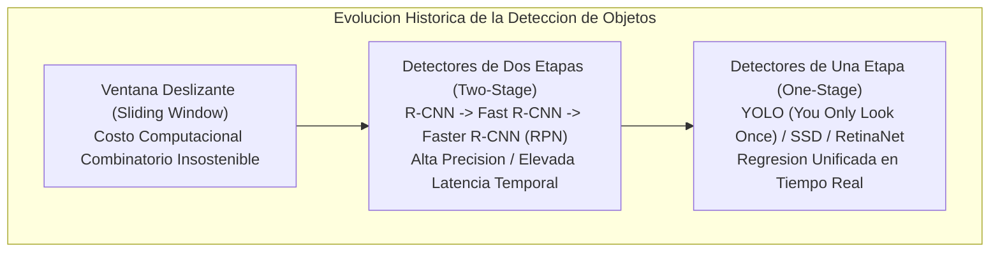
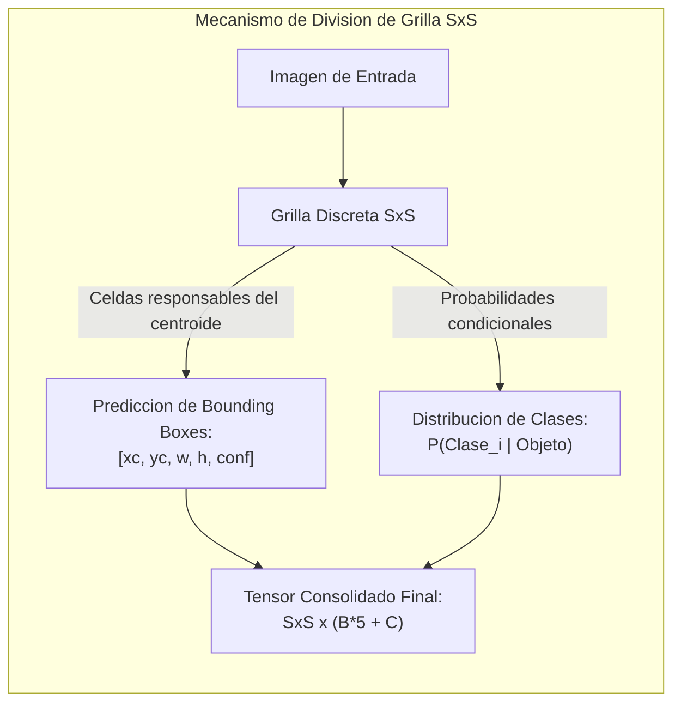
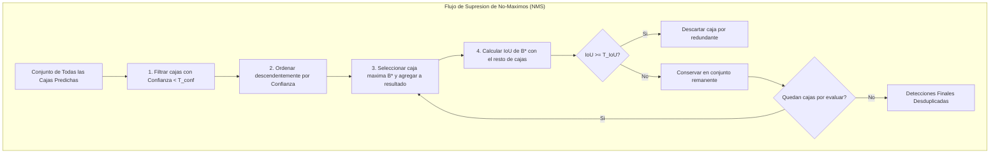
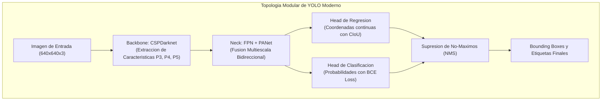

# Clase 4: Deteccion de Objetos en Tiempo Real, Algoritmos de Una Sola Etapa y Arquitectura YOLO

> Proposito pedagogico: Formalizar la evolucion arquitectonica de la deteccion de objetos desde los detectores de dos etapas (R-CNN, Fast/Faster R-CNN) hacia los detectores unificados de una etapa (YOLO - You Only Look Once), comprender la formulacion matematica de bounding boxes, IoU y supresion de no-maximos (NMS), parametrizar funciones de perdida multi-tarea y ejecutar fine-tuning con modelos Ultralytics YOLO sobre conjuntos de datos especificos evaluando curvas mAP.

## 1\. Contexto y Marco Conceptual

### De la Clasificacion Aislada a la Deteccion Multiobjeto

La clasificacion de imagenes resuelve la interrogante ontologica de *que* entidad visual predomina en un encuadre. Sin embargo, en escenarios operacionales del mundo real (vehiculos autonomos, inspeccion medica, telemetria industrial, biometria), una imagen alberga multiples instancias heterogeneas interactuando simultaneamente bajo distintas escalas y oclusiones.

La **deteccion de objetos (Object Detection)** exige resolver concurrentemente dos problemas matematicos fundamentales:

1. **Regresion Espacial:** Predecir las coordenadas continuas de un cuadro delimitador (*Bounding Box*) que encierre hermeticamente a cada objeto individual.

1. **Clasificacion Categorica:** Estimar la distribucion de probabilidad discreta multiclase para cada cuadro predicho.



### Limitaciones de los Enfoques Tradicionales y Dos Etapas

- **Ventana Deslizante (Sliding Window):** Consiste en desplazar ventanas de diversos tamanos y relaciones de aspecto sobre toda la grilla de la imagen, alimentando cada subregion a un clasificador. Resulta computacionalmente inviable ($O(N^2)$ inferencias completas por cuadro).

- **Detectores de Dos Etapas (Two-Stage Detectors):**

  - **R-CNN (Girshick et al., 2014):** Utiliza *Selective Search* para proponer \~2000 regiones candidatas por imagen, redimensionando cada una para evaluarla individualmente mediante una CNN. Tiempo de inferencia: \~47 segundos por imagen.
  
  - **Fast R-CNN (Girshick, 2015):** Procesa la imagen completa en una sola pasada convolucional y extrae caracteristicas mediante capas de agrupamiento de regiones de interes (*RoI Pooling*).
  
  - **Faster R-CNN (Ren et al., 2015):** Reemplaza algoritmos heuristicos de busqueda por una subred neuronal diferenciable: la **Region Proposal Network (RPN)**. Aunque alcanza prestaciones de vanguardia, su arquitectura secuencial de dos etapas (1: proponer regiones, 2: clasificar y refinar) dificulta su ejecucion en bordes empotrados a tasas superiores a 30 FPS.

### La Ruptura de Paradigma: YOLO (You Only Look Once)

Presentado por Joseph Redmon et al. (2016), YOLO reformulo la deteccion de objetos no como un pipeline heuristico o multi-etapa, sino como un **problema unificado de regresion directa**:

- Una sola red neuronal procesa la totalidad del cuadro visual en una unica pasada hacia adelante (*Single Forward Pass*).

- Predice directamente los cuadros delimitadores y las probabilidades de clase a partir del mapa de caracteristicas global.

- Razona holísticamente sobre toda la imagen, codificando implicitamente el contexto circundante y reduciendo dramaticamente los falsos positivos en el fondo (*background false positives*).

---

## 2\. Fundamentos Teoricos y Arquitectura

### Principio Operativo y Parametrizacion Espacial

El algoritmo divide conceptualmente la imagen de entrada en una grilla discreta de $S \times S$ celdas (por ejemplo, $7 \times 7$ o $19 \times 19$):

- Si el centro geometrico de un objeto cae dentro de una celda particular, dicha celda asume la **responsabilidad formal de detectar ese objeto**.

- Cada celda predice $B$ cajas delimitadoras y una distribucion de probabilidades para $C$ clases condicionales.

Cada caja delimitadora se parametriza mediante un vector de 5 valores continuos:

$$
\mathbf{b} = [x_c, y_c, w, h, \text{confianza}]
$$

donde:

- $(x_c, y_c)$: Coordenadas del centroide del cuadro, normalizadas en el rango $[0, 1]$ respecto a los limites de la celda responsable.

- $(w, h)$: Ancho y alto de la caja, normalizados respecto al ancho y alto total de la imagen completa.

- **Puntaje de Confianza (Confidence Score):** Cuantifica la certidumbre de que la caja albergue un objeto y la precision geometrica de su calce:

  $$
  \text{Confianza} = P(\text{Objeto}) \times \text{IoU}_{\text{pred}}^{\text{true}}
  $$
  
  Si no reside objeto alguno en la celda, el puntaje debe converger a 0.



---

### Metricas Geometricas: Interseccion sobre Union (IoU)

La metrica **IoU (Intersection over Union)** o indice de Jaccard cuantifica el grado de solapamiento espacial entre una caja predicha $B_{\text{pred}}$ y la caja de verdad fundamental (*Ground Truth*) $B_{\text{gt}}$:

$$
\text{IoU}(B_{\text{pred}}, B_{\text{gt}}) = \frac{\text{Area}(B_{\text{pred}} \cap B_{\text{gt}})}{\text{Area}(B_{\text{pred}} \cup B_{\text{gt}})} = \frac{\text{Area de Interseccion}}{\text{Area}(B_{\text{pred}}) + \text{Area}(B_{\text{gt}}) - \text{Area de Interseccion}}
$$

- $\text{IoU} = 1$: Superposicion matematica perfecta.

- $\text{IoU} = 0$: Disjuncion espacial absoluta.

- En la evaluacion estandar de benchmarks (PASCAL VOC, MS COCO), una deteccion se clasifica como Verdadero Positivo ($TP$) si $\text{IoU} \ge 0.50$ (o $0.75$ en evaluaciones estrictas) y la categoria clasificada coincide con la etiqueta real.

---

### Algoritmo de Supresion de No-Maximos (Non-Maximum Suppression - NMS)

En la inferencia de un detector de una etapa, multiples celdas vecinas predicen cajas redundantes y fuertemente solapadas para el mismo objeto fisico. El algoritmo **NMS** depura estas propuestas redundantes:

1. **Filtrado por Umbral de Confianza:** Se eliminan todas las cajas cuyo puntaje $\text{confianza} < T_{\text{conf}}$ (por ejemplo, $0.25$).

1. **Ordenamiento Descendente:** Se ordenan las cajas restantes de mayor a menor confianza.

1. **Seleccion y Poda Iterativa:**

   - Se extrae la caja con mayor confianza $B^*$ y se anade a la lista definitiva de detecciones.
   
   - Se calcula el $\text{IoU}(B^*, B_j)$ frente a cada una de las cajas restantes $B_j$.
   
   - Si $\text{IoU}(B^*, B_j) \ge T_{\text{IoU}}$ (tipicamente $0.45$ a $0.60$), la caja $B_j$ se descarta por redundante.

1. **Convergencia:** El proceso se repite iterativamente sobre el conjunto remanente hasta agotar las propuestas.



---

### Arquitectura Moderna de YOLO (Ultralytics YOLOv8 / YOLOv11)

Las versiones contemporaneas de YOLO estructuran su topologia en tres macro-componentes:

1. **Backbone (Espinazo Extractor - CSPDarknet):**

   - Emplea conexiones residuales parciales cruzadas (*Cross Stage Partial Networks* \- CSP).
   
   - Divide los mapas de caracteristicas en dos ramales, procesando uno a traves de bloques convolucionales residuales y concatenandolo posteriormente, reduciendo la redundancia de calculo y optimizando el flujo de gradientes.
   
   - Modulos de convolucion con paso espacial (*Strided Convolutions*) que reemplazan el pooling tradicional.

1. **Neck (Cuello de Agregacion Multiescala - PANet / FPN):**

   - Integra una Red de Piramide de Caracteristicas (*Feature Pyramid Network* \- FPN) combinada con una Red de Agregacion de Rutas (*Path Aggregation Network* \- PANet).
   
   - Fusiona caracteristicas semanticas de alto nivel (baja resolucion) con detalles espaciales de bajo nivel (alta resolucion) mediante conexiones bidireccionales top-down y bottom-up, permitiendo detectar con precision objetos tanto diminutos como de gran escala.

1. **Head (Cabezal Desacoplado - Anchor-Free Decoupled Head):**

   - Desacopla formalmente las ramas de prediccion: una rama convolucional se especializa en la regresion de coordenadas de caja y otra independiente en la clasificacion de categorias.
   
   - Diseno libre de anclas (*Anchor-Free*): Predice directamente la distancia desde el centro del pixel a los cuatro extremos de la caja delimitadora, eliminando la necesidad de calibrar cajas de anclaje (*Anchor Boxes*) manuales mediante clustering K-Means.



---

### Metricas de Evaluacion de Deteccion: Precision, Recall y mAP

El rendimiento de un detector no puede cuantificarse mediante el simple porcentaje de aciertos (*Accuracy*). Se recurre a la formalizacion de:

- **Precision (**$P$**):** Fraccion de detecciones correctas entre todas las detecciones formuladas:

  $$
  P = \frac{TP}{TP + FP}
  $$

- **Recall (**$R$**, Exhaustividad):** Fraccion de objetos reales correctamente identificados:

  $$
  R = \frac{TP}{TP + FN}
  $$

- **Precision Promedio (Average Precision - AP):** Integral del area bajo la curva Precision-Recall:

  $$
  AP = \int_0^1 P(R) \, dR
  $$

- **Mean Average Precision (**$mAP$**):** Media de los valores de $AP$ computados sobre las $C$ categorias del conjunto de datos:

  $$
  mAP = \frac{1}{C} \sum_{c=1}^C AP_c
  $$
  
  - $mAP@0.50$**:** Calculado con un umbral de $\text{IoU} = 0.50$.
  
  - $mAP@0.50:0.95$**:** Metrica cardinal de MS COCO; computa la media aritmetica de los valores de $mAP$ calculados a traves de 10 umbrales de IoU equidistantes: $[0.50, 0.55, \dots, 0.95]$.

---

## 3\. Implementacion Tecnica y Logica de Negocio

### Pipeline de Fine-Tuning e Inferencia con Ultralytics YOLO

A continuacion se presenta la implementacion formal en Python utilizando el SDK de Ultralytics para estructurar un flujo de entrenamiento sobre un dataset personalizado (por ejemplo, deteccion de vehiculos o deteccion de anomalias medicas/tumores cerebrales en resonancias magneticas).

```python
import os
from ultralytics import YOLO
import cv2

# 1. Definicion del manifiesto declarativo del dataset (dataset.yaml)
yaml_content = """
path: /opt/datasets/deteccion_vehiculos
train: images/train
val: images/val

names:
  0: automovil
  1: camion
  2: motocicleta
  3: autobus
"""

def configurar_y_entrenar_yolo(ruta_yaml: str = "dataset.yaml", epochs: int = 50, batch_size: int = 16):
    """
    Inicializa un modelo YOLO preentrenado y ejecuta fine-tuning sobre un dominio especifico.
    """
    # Carga del modelo base nano (balance optimo entre velocidad y precision)
    modelo = YOLO("yolov8n.pt")
    
    # Ejecucion del entrenamiento con aceleracion GPU y aumentos de datos
    resultados = modelo.train(
        data=ruta_yaml,
        epochs=epochs,
        batch=batch_size,
        imgsz=640,
        device=0,            # Indice de la GPU CUDA
        optimizer="AdamW",
        lr0=0.001,
        weight_decay=0.0005,
        plots=True,          # Genera graficos de convergencia, matrices de confusion y PR curves
        project="auditoria_yolo",
        name="experimento_vehiculos"
    )
    
    # Validacion formal de metricas
    metricas = modelo.val()
    print(f"mAP@50: {metricas.box.map50:.4f}")
    print(f"mAP@50-95: {metricas.box.map:.4f}")
    
    return modelo

# 2. Pipeline de Inferencia en Tiempo Real sobre Cuadros de Video
def ejecutar_inferencia_video(ruta_modelo: str, fuente_video: str, umbral_conf: float = 0.4):
    """
    Procesa un flujo de video ejecutando prediccion, filtrado NMS y renderizado de cajas.
    """
    modelo = YOLO(ruta_modelo)
    cap = cv2.VideoCapture(fuente_video)
    
    while cap.isOpened():
        ret, frame = cap.read()
        if not ret:
            break
            
        # Inferencia optimizada con NMS embebido en el motor
        resultados = modelo.predict(
            source=frame,
            conf=umbral_conf,
            iou=0.5,
            verbose=False
        )
        
        # Extraccion de tensores de cajas delimitadoras
        cajas = resultados[0].boxes
        for box in cajas:
            coords = box.xyxy[0].cpu().numpy().astype(int)  # [xmin, ymin, xmax, ymax]
            conf = float(box.conf[0])
            cls_id = int(box.cls[0])
            nombre_clase = modelo.names[cls_id]
            
            # Renderizado grafico
            cv2.rectangle(frame, (coords[0], coords[1]), (coords[2], coords[3]), (0, 255, 0), 2)
            cv2.putText(
                frame,
                f"{nombre_clase}: {conf:.2f}",
                (coords[0], coords[1] - 8),
                cv2.FONT_HERSHEY_SIMPLEX,
                0.5,
                (0, 255, 0),
                2
            )
            
    cap.release()
```

---

## 4\. Analisis Critico de Casos y Auditoria Practica

### Evaluacion Comparativa de Paradigmas de Deteccion

| **Arquitectura / Paradigma** | **Numero de Etapas** | **Latencia Media (FPS)** | **mAP en COCO** | **Idoneidad Operacional** |
| --- | --- | --- | --- | --- |
| **Faster R-CNN** | Dos Etapas (RPN + RoI Head) | $5 - 15 \text{ FPS}$ | $\sim 42 - 48\%$ | Sistemas offline de alta precision; telemetria satelital y microscopia. |
| **SSD (Single Shot Detector)** | Una Etapa (Multi-scale anchors) | $30 - 45 \text{ FPS}$ | $\sim 30 - 38\%$ | Dispositivos moviles heredados; dificultad con objetos muy pequenos. |
| **YOLO (v8 / v11)** | Una Etapa (Anchor-free unificado) | $80 - 160 \text{ FPS}$ | $\sim 45 - 54\%$ | Optimo para video en tiempo real, robotica movil y sistemas embebidos. |
| **DETR (Detection Transformer)** | End-to-End con Atencion Global | $10 - 25 \text{ FPS}$ | $\sim 44 - 50\%$ | Elimina NMS mediante emparejamiento hungaro; requiere entrenamiento masivo. |

### Auditoria de Casos de Estudio: Transporte vs Diagnostico Medico

| **Dimension Critica** | **Deteccion de Vehiculos / Trafico Urbano** | **Deteccion de Tumores Cerebrales en Resonancias** |
| --- | --- | --- |
| **Tolerancia a Falsos Positivos (**$FP$**)** | Moderada (un falso vehiculo se descarta en el siguiente cuadro). | Critica / Nula (induce biopsias innecesarias o angustia al paciente). |
| **Tolerancia a Falsos Negativos (**$FN$**)** | Critica en frenado autonomo; moderada en conteo vehicular. | Inadmisible (un tumor omitido compromete la supervivencia). |
| **Estrategia de Umbralizacion** | Balancear $F_1$-Score con $T_{\text{conf}} \approx 0.40 - 0.50$. | Priorizar Recall maximo ($R > 0.98$) reduciendo $T_{\text{conf}} \approx 0.15 - 0.20$. |
| **Naturaleza del Ruido en Datos** | Oclusiones dinamicas, cambios severos de clima y contraluz. | Ruido speckle, variaciones inter-resonador y cortes axiales heterogeneos. |

---

## 5\. Principios de Diseno, Buenas Practicas y Anti-patrones

### Reglas de Oro en Deteccion de Objetos

1. **Consistencia Rigurosa de Coordenadas de Anotacion:** Al etiquetar datasets en formatos YOLO, verificar estrictamente que los centros y dimensiones se encuentren normalizados en $[0.0, 1.0]$. Una sola coordenada absoluta en pixeles inyectada al archivo de etiquetas corrompe el calculo del gradiente de la perdida CIoU.

1. **Aumento de Datos Consciente del Contexto (Mosaic &amp; MixUp):** El aumento tipo *Mosaic* (fusionar 4 imagenes en una) permite al modelo aprender objetos en contextos variados y a diferentes escalas. Sin embargo, en datasets medicos donde la posicion anatomica es canonica, el aumento debe limitarse a ligeras rotaciones afines.

1. **Calibracion de Umbrales de Confianza e IoU en Validacion:** Jamas evaluar un modelo productivo utilizando el umbral arbitrario de $0.25$. Trazar la curva $F_1$-Confidence para identificar el punto operativo que maximiza el compromiso armonica entre Precision y Recall.

### Anti-patrones Metodologicos Identificados

| **Anti-patron** | **Mecanismo del Error** | **Impacto Tecnico / Consecuencia** | **Estrategia de Mitigacion** |
| --- | --- | --- | --- |
| **Umbral NMS Descalibrado** | Fijar $T_{\text{IoU}} > 0.80$ en escenas con alta densidad de aglomeracion de objetos. | Multiples cajas redundantes solapadas sobre el mismo objeto físico. | Ajustar $T_{\text{IoU}}$ entre $0.45$ y $0.60$, o implementar variantes de Soft-NMS. |
| **Desbalance Extremo Fondo-Primer Plano** | Entrenar detectores sin tecnicas de compensacion de perdida en imagenes mayoritariamente vacias. | El modelo aprende la solucion trivial degenerada: predecir confianza cero en todas las celdas. | Utilizar funciones de perdida focal (*Focal Loss*) o balancear el muestreo de cuadros vacios. |
| **Reduccion Agresiva de Resolucion en Objetos Pequenos** | Redimensionar imagenes de alta resolucion a $320 \times 320$ en tareas con objetos de pocos pixeles. | Los objetos pequenos desaparecen de los mapas de activacion de los niveles profundos P4/P5. | Preservar resolucion minima de $640$ o $1280$, o anadir cabezales de deteccion especializados P2. |

---

## 6\. Sintesis Conceptual y Profundizacion Academica

### Sintesis Integradora

La deteccion de objetos moderna representa la convergencia armonica entre la extraccion jerarquica de caracteristicas de las redes convolucionales y la optimizacion multiobjetivo en tiempo real. La ruptura introducida por YOLO al formular la deteccion como un problema unificado de regresion directa demostro que es posible prescindir de propuestas de region heurísticas, alcanzando un equilibrio de Pareto optimo entre precision media ($mAP$) y velocidad de procesamiento en cuadros por segundo (FPS).

### Preguntas Guia para la Investigacion de Posgrado

1. ¿Como impacta teoricamente la supresion de anclas (*Anchor-Free Design*) frente a esquemas clasicos basados en *Anchor Boxes* en la convergencia asintotica de la funcion de perdida CIoU cuando coexisten distribuciones bimodales de relacion de aspecto?

1. ¿Bajo que condiciones de degradacion visual extrema (niebla densa, baja iluminacion termica) los mecanismos de auto-atencion en detectores hibridos tipo RT-DETR superan a las piramides convolucionales clasicas de YOLO?

### Referencias Bibliograficas Fundamentales

- Redmon, J., Divvala, S., Girshick, R., &amp; Farhadi, A. (2016). *You only look once: Unified, real-time object detection*. Proceedings of the IEEE Conference on Computer Vision and Pattern Recognition (CVPR), 779-788.

- Ren, S., He, K., Girshick, R., &amp; Sun, J. (2015). *Faster R-CNN: Towards real-time object detection with region proposal networks*. Advances in Neural Information Processing Systems (NeurIPS), 28, 91-99.

- Bochkovskiy, A., Wang, C. Y., &amp; Liao, H. Y. M. (2020). *YOLOv4: Optimal speed and accuracy of object detection*. arXiv preprint arXiv:2004.10934.

- Jocher, G., Chaurasia, A., &amp; Qiu, J. (2023). *Ultralytics YOLO (Version 8.0.0)*. GitHub repository: [https://github.com/ultralytics/ultralytics](<https://github.com/ultralytics/ultralytics>).
