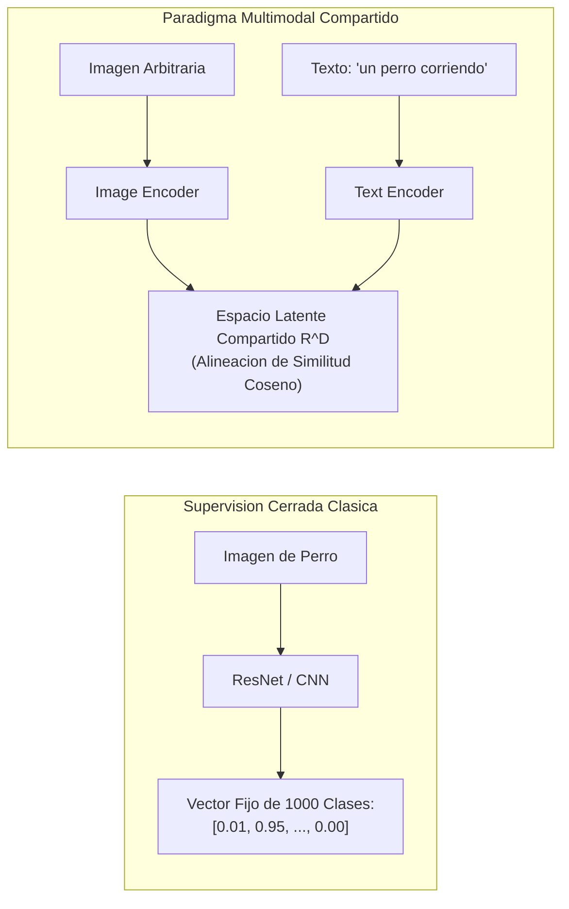
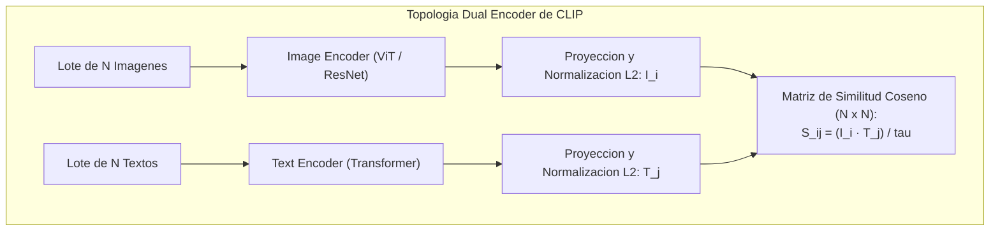
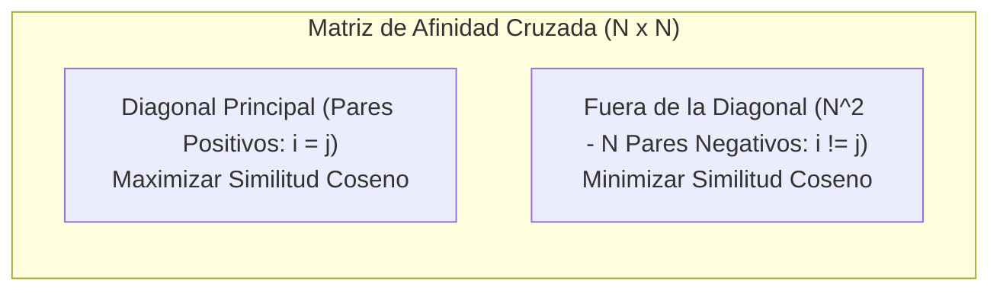
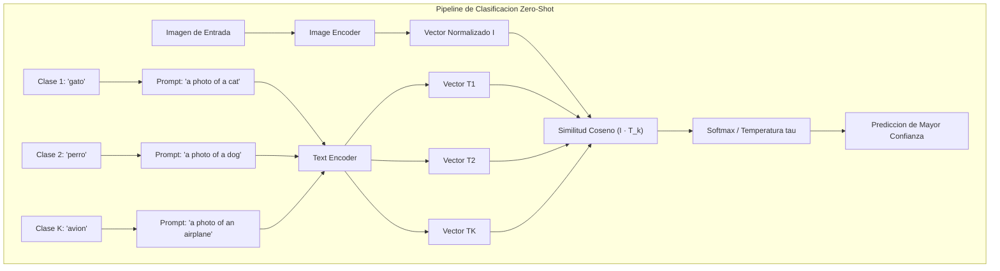

# Clase 6: Modelos Multimodales, Aprendizaje Contrastivo Vision-Lenguaje y Arquitectura CLIP

> Proposito pedagogico: Comprender los fundamentos del aprendizaje multimodal cruzado (Cross-Modal Learning), dominar la arquitectura y formulacion matematica de CLIP (Contrastive Language-Image Pretraining), parametrizar la perdida contrastiva simetrica (InfoNCE), implementar clasificacion en cero disparos (Zero-Shot Classification) y explorar la topologia de espacios latentes compartidos en Hugging Face y Roboflow.

## 1\. Contexto y Marco Conceptual

### La Convergencia entre Percepcion Visual y Lenguaje Natural

Historicamente, el campo de la inteligencia artificial mantuvo una bifurcacion disciplinaria tajante:

- **Vision por Computadora:** Confinada al analisis de tensores continuos mediante convoluciones, entrenada con etiquetas categoricas discretas fijas (por ejemplo, los 1000 identificadores de clase mutuamente excluyentes de ImageNet).

- **Procesamiento de Lenguaje Natural (NLP):** Enfocado en secuencias discretas de texto libre, modeladas mediante probabilidades de autoregresion o prediccion de mascaras de palabras sobre vocabularios abiertos.

Esta segmentacion imponia una barrera operacional severa: un modelo de clasificacion entrenado bajo supervision cerrada resulta completamente ciego e incapaz de reconocer una clase no presente en su vector de salida de tamano fijo $K$, requiriendo recoleccion y etiquetado costoso de nuevos datos para cualquier categoria adicional.

La **Multimodalidad (Multimodal Learning)** supera este aislamiento proyectando ambas modalidades sobre un **espacio latente compartido (Shared Latent Space)**. En este espacio geometrico unificado, las imagenes y los conceptos semanticos textuales coexisten bajo una metrica vectorial comun (similitud del coseno), permitiendo que el sistema reconozca conceptos visuales nunca antes vistos de forma supervisada a partir de su formulacion linguistica.



### El Aprendizaje Contrastivo a Escala de Internet

Para entrenar un sistema capaz de alinear la vision y el lenguaje sin recurrir a anotaciones manuales, Alec Radford et al. (OpenAI, 2021) formularon **CLIP (Contrastive Language-Image Pretraining)**:

- En lugar de forzar a la red a predecir la transcripcion exacta de un texto palabra por palabra a partir de una imagen (tarea generativa de altisima dificultad y computo intensivo), formularon una **tarea proxy contrastiva**:

- Dado un lote de pares imagen-texto extraidos masivamente de la web (400 millones de pares en el dataset WIT), el modelo debe aprender unicamente a **emparejar correctamente que imagen corresponde a que oracion**, discriminandola de todas las demas alternativas incorrectas del lote.

---

## 2\. Fundamentos Teoricos y Arquitectura

### Arquitectura Dual Encoder de CLIP

CLIP desacopla el procesamiento mediante dos ramas de codificacion independientes que proyectan sus salidas hacia un espacio latente comun de dimension $d$ (tipicamente $d = 512$ o $768$):

1. **Image Encoder (Codificador Visual):**

   - Puede materializarse mediante una CNN con atencion (ResNet-50 modificada) o un Vision Transformer (ViT-B/32, ViT-B/16, ViT-L/14).
   
   - Toma una imagen $\mathbf{x}_{\text{img}}$ y genera un vector de representacion visual base $\mathbf{I} \in \mathbb{R}^{d_v}$.

1. **Text Encoder (Codificador Textual):**

   - Implementado mediante un Transformer estandar con atencion causal.
   
   - Toma una oracion de texto $\mathbf{x}_{\text{text}}$ tokenizada (con longitud maxima de 77 tokens), extrayendo la activacion correspondiente al token de fin de secuencia ` [EOS] ` como vector de representacion $\mathbf{T} \in \mathbb{R}^{d_t}$.

1. **Proyeccion Lineal y Normalizacion** $L_2$ **Obligatoria:**

   - Los vectores se proyectan al espacio compartido y se normalizan para ubicarse en la superficie de la hipersfera unitaria $\mathbb{S}^{d-1}$:
   
     $$
     \hat{\mathbf{I}} = \frac{W_I \mathbf{I}}{\|W_I \mathbf{I}\|_2}, \quad \hat{\mathbf{T}} = \frac{W_T \mathbf{T}}{\|W_T \mathbf{T}\|_2}
     $$



---

### La Matriz de Similitud y la Funcion de Perdida Contrastiva Simetrica (InfoNCE)

Considerese un minilote de $N$ pares coincidentes $(\mathbf{x}_{\text{img}}^{(i)}, \mathbf{x}_{\text{text}}^{(i)})$. Al computar el producto punto entre todos los pares posibles, se conforma una **matriz de similitud de dimensiones** $N \times N$:

$$
S_{i, j} = \frac{\hat{\mathbf{I}}_i \cdot \hat{\mathbf{T}}_j}{\tau}
$$

donde $\tau$ representa un hiperparametro de **temperatura aprendible** (parametrizado internamente como $\ln(1/\tau)$) que modula la escala y dispersion de los logits.

#### Estructura de la Matriz $N \times N$:

- **Diagonal Principal (**$i = j$**):** Contiene los $N$ pares positivos genuinos. El objetivo matematico consiste en maximizar sus valores hacia $1$.

- **Fuera de la Diagonal (**$i \ne j$**):** Contiene $N^2 - N$ combinaciones cruzadas negativas (imagenes emparejadas con descripciones textuales ajenas). El objetivo consiste en minimizar sus valores hacia $0$.



#### Formulacion Matematica de la Perdida Simetrica:

La perdida optimiza concurrentemente dos direcciones de clasificacion multiclase mediante entropia cruzada:

1. **Perdida Imagen a Texto (Image-to-Text Loss):** Probabilidad de predecir la descripcion correcta $i$ dada la imagen $i$:

   $$
   \mathcal{L}_{\text{img}\to\text{text}} = -\frac{1}{N} \sum_{i=1}^N \log \frac{\exp(S_{i, i})}{\sum_{j=1}^N \exp(S_{i, j})}
   $$

1. **Perdida Texto a Imagen (Text-to-Image Loss):** Probabilidad de predecir la imagen correcta $j$ dado el texto $j$:

   $$
   \mathcal{L}_{\text{text}\to\text{img}} = -\frac{1}{N} \sum_{j=1}^N \log \frac{\exp(S_{j, j})}{\sum_{i=1}^N \exp(S_{i, j})}
   $$

1. **Perdida Total Consolidada:**

   $$
   \mathcal{L}_{\text{total}} = \frac{1}{2} \left( \mathcal{L}_{\text{img}\to\text{text}} + \mathcal{L}_{\text{text}\to\text{img}} \right)
   $$

---

### Mecanismo de Inferencia en Cero Disparos (Zero-Shot Classification)

La capacidad mas disruptiva de CLIP consiste en clasificar imagenes en categorias jamas vistas durante el entrenamiento sin ajustar un solo peso parametrico:

1. **Ingenieria de Prompts (*****Prompt Engineering*****):**

   Dadas $K$ clases candidatas (ej. ` ["gato", "perro", "automovil"] `), se expanden a descripciones sintacticas completas:
   
   $$
   \mathbf{t}_k = \text{"A photo of a } \{c_k\}\text{"}
   $$

1. **Codificacion de Textos:** Se calculan los embeddings normalizados de las $K$ oraciones mediante el Text Encoder: $\{\hat{\mathbf{T}}_1, \dots, \hat{\mathbf{T}}_K\}$.

1. **Codificacion de Imagen:** Se calcula el embedding normalizado de la imagen a evaluar: $\hat{\mathbf{I}}$.

1. **Calculo de Probabilidades por Softmax:** Se evalua la similitud del coseno de la imagen frente a todas las etiquetas textuales:

   $$
   P(y = k \mid \hat{\mathbf{I}}) = \frac{\exp(\hat{\mathbf{I}} \cdot \hat{\mathbf{T}}_k / \tau)}{\sum_{j=1}^K \exp(\hat{\mathbf{I}} \cdot \hat{\mathbf{T}}_j / \tau)}
   $$



---

### Topologia y Geometria de Espacios Latentes

El espacio latente de CLIP exhibe propiedades matematicas que concuerdan con la **Geometria Profunda (Geometric Deep Learning, Michael Bronstein)**:

- Al estar normalizados los vectores ($\|\mathbf{z}\|_2 = 1$), el espacio de representacion no es el espacio euclidiano plano $\mathbb{R}^d$, sino la **superficie no euclidiana de una hipersfera unitaria** $\mathbb{S}^{d-1}$.

- La metrica geodesica entre conceptos corresponde a la distancia angular sobre la esfera.

- Operaciones de aritmetica vectorial semantica son posibles: anadir el vector textual de un atributo ("color rojo") a la representacion de un objeto desplaza su coordenada a lo largo de una variedad diferenciable (*manifold*).

---

## 3\. Implementacion Tecnica y Logica de Negocio

### Pipeline de Clasificacion Zero-Shot y Similitud con Hugging Face

A continuacion se presenta la implementacion formal en Python utilizando el SDK de Hugging Face Transformers con el modelo oficial ` openai/clip-vit-base-patch32 `.

```python
import torch
from transformers import CLIPProcessor, CLIPModel
from PIL import Image

def clasificador_zero_shot_clip(ruta_imagen: str, clases_candidatas: list):
    """
    Ejecuta clasificacion Zero-Shot utilizando la arquitectura multimodal de CLIP.
    """
    # 1. Carga del procesador y modelo preentrenado oficial
    modelo_id = "openai/clip-vit-base-patch32"
    modelo = CLIPModel.from_pretrained(modelo_id)
    procesador = CLIPProcessor.from_pretrained(modelo_id)
    modelo.eval()

    # 2. Carga de la imagen y generacion de plantillas de prompts
    imagen = Image.open(ruta_imagen)
    prompts_textuales = [f"a photo of a {clase}" for clase in clases_candidatas]

    # 3. Procesamiento y tokenizacion simultanea de ambas modalidades
    entradas = procesador(
        text=prompts_textuales,
        images=imagen,
        return_tensors="pt",
        padding=True
    )

    # 4. Inferencia y computo de afinidades cruzadas
    with torch.no_grad():
        salidas = modelo(**entradas)
        # Logits por imagen: matriz de similitud escalada por temperatura
        logits_por_imagen = salidas.logits_per_image
        probabilidades = logits_por_imagen.softmax(dim=1).squeeze(0)

    # 5. Formateo y presentacion de resultados
    ranking = []
    for clase, prob in zip(clases_candidatas, probabilidades):
        ranking.append((clase, prob.item()))
        
    ranking.sort(key=lambda x: x[1], reverse=True)
    
    print("--- Resultados de Clasificacion Zero-Shot (CLIP) ---")
    for clase, score in ranking:
        print(f"Clase: {clase:<20} | Probabilidad: {score*100:.2f}%")
        
    return ranking
```

### Extraccion de Embeddings y Matriz de Afinidad Multi-Imagen Multi-Texto

```python
def computar_matriz_afinidad_completa(imagenes: list, textos: list):
    """
    Calcula la matriz cruzada de similitud del coseno entre N imagenes y M textos.
    """
    modelo = CLIPModel.from_pretrained("openai/clip-vit-base-patch32")
    procesador = CLIPProcessor.from_pretrained("openai/clip-vit-base-patch32")
    
    entradas = procesador(text=textos, images=imagenes, return_tensors="pt", padding=True)
    
    with torch.no_grad():
        # Extraccion y normalizacion explicita de embeddings
        emb_imagenes = modelo.get_image_features(entradas["pixel_values"])
        emb_textos = modelo.get_text_features(entradas["input_ids"])
        
        emb_imagenes = emb_imagenes / emb_imagenes.norm(p=2, dim=-1, keepdim=True)
        emb_textos = emb_textos / emb_textos.norm(p=2, dim=-1, keepdim=True)
        
        # Producto punto sobre la hipersfera (Matriz N x M)
        matriz_similitud = torch.matmul(emb_imagenes, emb_textos.T)
        
    return matriz_similitud.numpy()
```

---

## 4\. Analisis Critico de Casos y Auditoria Practica

### Evaluacion Comparativa de Paradigmas de Clasificacion

| **Metrica / Dimension** | **Supervisado Clasico (ResNet/ViT en ImageNet)** | **CLIP Zero-Shot (ViT-B/32)** | **CLIP con Fine-Tuning Lineal (Linear Probe)** |
| --- | --- | --- | --- |
| **Vocabulario / Clases** | Estrictamente cerrado y fijo ($1000$ clases). | Abierto e infinito (cualquier concepto verbalizable). | Cerrado al dataset evaluado. |
| **Costo de Etiquetado** | Extremadamente alto (requiere miles de muestras por clase). | Cero ($0$ muestras requeridas). | Bajo (entrena unicamente una capa lineal sobre embeddings fijos). |
| **Robustez ante Distribuciones Fuera de Dominio (OOD)** | Muy baja; colapsa ante bocetos, caricaturas o iluminacion artistica. | Excepcional; retiene comprension semantica de conceptos abstractos. | Alta; aprovecha las representaciones generalistas del espacio latente. |
| **Precision en Tareas Altamente Especializadas** | Maxima si esta entrenado en el dominio (ej. radiografias medicas). | Moderada a deficiente en dominios tecnicos ultraespecificos. | Optima con pocas muestras por clase. |

### Auditoria del Impacto de Prompt Engineering en CLIP

| **Estrategia de Prompt** | **Ejemplo de Consulta** | **mAP / Accuracy Relativo** | **Justificacion Mecanistica** |
| --- | --- | --- | --- |
| **Palabra Aislada** | ` "dog" ` | Linea base (menor rendimiento) | Ambiguedad sintactica; el codificador de texto pierde el contexto semantico. |
| **Plantilla Contextual Estandar** | ` "a photo of a dog" ` | $+5.2\%$ de incremento | Se alinea con la distribucion textual tipica de leyendas en la web. |
| **Ensamble de Multiples Prompts (Prompt Ensembling)** | Promedio de 80 plantillas (` "a good photo of a {}" `, ` "a sketch of {}" `, etc.) | $+8.7\%$ de incremento maximo | Mitiga sesgos de expresiones individuales y cancela perturbaciones ortogonales en el espacio latente. |

---

## 5\. Principios de Diseno, Buenas Practicas y Anti-patrones

### Reglas de Oro en Modelos Multimodales

1. **Adopcion de Plantillas Contextuales en Zero-Shot:** Jamas consultar el Text Encoder de CLIP con etiquetas aisladas de una sola palabra (ej. ` "perro" `). Utilizar invariablemente la estructura de leyenda sintactica completa ` "a photo of a {clase}" ` o el promedio de embeddings de un ensamble de plantillas.

1. **Normalizacion** $L_2$ **Previa a la Similitud:** Asegurar siempre que tanto los vectores de imagen como los de texto esten estrictamente normalizados antes de computar el producto punto o evaluar distancias metricas; de lo contrario, la magnitud del vector dominara sobre la orientacion semantica.

1. **Tamano de Lote Masivo en Entrenamiento Contrastivo:** El aprendizaje contrastivo fundamenta su calidad en la cantidad de ejemplos negativos presentes en el minilote. Entrenar modelos contrastivos con lotes pequenos ($N < 1024$) degrada drasticamente la capacidad discriminativa del espacio latente.

### Anti-patrones Metodologicos Identificados

| **Anti-patron** | **Mecanismo del Error** | **Impacto Tecnico / Consecuencia** | **Estrategia de Mitigacion** |
| --- | --- | --- | --- |
| **Distancia Euclidiana en Espacios Normalizados** | Utilizar distancia euclidiana directa sin normalizacion sobre vectores de caracteristicas crudos. | Inconsistencia geometrica y colapso de rankings de similitud. | Computar estrictamente la similitud del coseno $\hat{\mathbf{I}} \cdot \hat{\mathbf{T}}$ sobre la hipersfera. |
| **Ambiguedad Polisémica en Prompts** | Utilizar clases homonimas sin especificacion de dominio (ej. ` "crane" ` = grua o grulla). | Similitudes espurias y falsos positivos al colisionar significados divergentes. | Contextualizar explicitamente el prompt: ` "a photo of a crane, a type of construction equipment" `. |
| **Descuido de la Temperatura** $\tau$ | Omitir el factor de escala $\tau$ al calcular softmax sobre similitudes del coseno. | Los valores del producto punto (en $[-1, 1]$) son demasiado pequenos, produciendo distribuciones de probabilidad cuasi-uniformes sin confianza. | Preservar siempre el parametro de temperatura calibrado por el modelo ($\tau \approx 0.01 - 0.07$). |

---

## 6\. Sintesis Conceptual y Profundizacion Academica

### Sintesis Integradora

La multimodalidad consolido un salto cualitativo al demostrar que la vision por computadora y el procesamiento del lenguaje natural no son ambitos disjuntos, sino proyecciones complementarias de una misma semantica subyacente. A traves de la arquitectura dual de CLIP y la optimizacion contrastiva simetrica, fue posible construir espacios latentes unificados sobre variedades esfericas que habilitan capacidades de generalizacion en cero disparos y fundan la infraestructura perceptual que gobierna a los modelos generativos contemporaneos condicionados por texto.

### Preguntas Guia para la Investigacion de Posgrado

1. ¿De que manera induce el sesgo de distribucion linguistica de internet (*Web-scale pretraining*) representaciones no isotropicas (*representation degeneration problem*) en la hipersfera latente de CLIP?

1. ¿Cuales son los limites formales de la clasificacion Zero-Shot en CLIP cuando los conceptos visuales requieren relaciones espaciales compuestas (ej. "el circulo rojo encima del cuadrado azul") frente a meras co-ocurrencias de atributos?

### Referencias Bibliograficas Fundamentales

- Radford, A., Kim, J. W., Hallacy, C., Ramesh, A., Goh, G., Agarwal, S., ... &amp; Sutskever, I. (2021). *Learning transferable visual models from natural language supervision*. International Conference on Machine Learning (ICML), 8748-8763.

- Bronstein, M. M., Bruna, J., Cohen, T., &amp; Velickovic, P. (2021). *Geometric deep learning: Grids, groups, graphs, geodesics, and gauges*. arXiv preprint arXiv:2104.13478.

- Oord, A. v. d., Li, Y., &amp; Vinyals, O. (2018). *Representation learning with contrastive predictive coding*. arXiv preprint arXiv:1807.03748.
