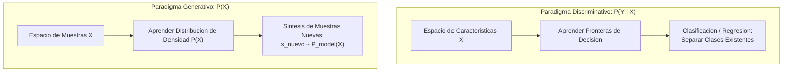
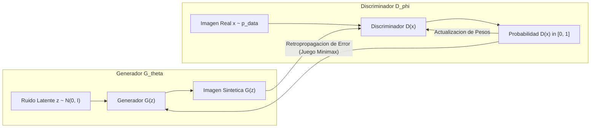
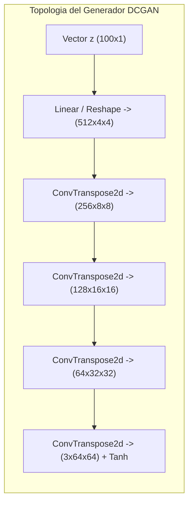

# Clase 7: Modelos Generativos Profundos, Topologia de Espacios Latentes y Redes Generativas Adversarias (GANs)

> Proposito pedagogico: Formalizar la transicion epistemologica desde el modelado discriminativo hacia el modelado generativo de distribuciones de probabilidad, comprender la compresion y topologia continua de espacios latentes, dominar la formulacion Minimax de las Redes Generativas Adversarias (GANs / DCGAN), parametrizar la optimizacion competitiva entre Generador y Discriminador y auditar fenomenos de inestabilidad como el colapso de modos (Mode Collapse).

## 1\. Contexto y Marco Conceptual

### La Transicion de Modelos Discriminativos a Modelos Generativos

En la ciencia de datos y el aprendizaje automatico tradicional, la gran mayoria de los modelos operativos pertenecen a la familia **discriminativa**:

- **Modelos Discriminativos:** Su proposito matematico radica en estimar la probabilidad condicional posterior $P(Y \mid X)$. Aprenden a trazar un hiperplano o una frontera de decision que delimita y separa clases existentes en el conjunto de datos (por ejemplo, determinar si una imagen pertenece a la clase "gato" o "perro"). No modelan como se generan los datos; unicamente reconocen diferencias entre categorias conocidas.

- **Modelos Generativos:** Abordan un problema sustancialmente mas ambicioso: aprender la verdadera distribucion de densidad de probabilidad subyacente de los datos $P(X)$ (en modelado no supervisado) o la distribucion conjunta $P(X, Y)$ (en modelado condicional). Al capturar la estructura estocastica de como se forman los datos, un modelo generativo es capaz de realizar **sintesis visual**: muestrear nuevas instancias sinteticas $\mathbf{x}_{\text{nuevo}} \sim P_{\text{data}}(X)$ que nunca antes existieron en el mundo real, pero que resultan estadisticamente indistinguibles de las observaciones autenticas.



### Naturaleza y Topologia de los Espacios Latentes ($z \in \mathcal{Z}$)

Una imagen digital policromatica de tamano estandar $64 \times 64 \times 3$ reside en un espacio euclidiano de altisima dimensionalidad:

$$
\mathcal{X} \subset \mathbb{R}^{64 \times 64 \times 3} = \mathbb{R}^{12,288}
$$

Sin embargo, una combinacion aleatoria de 12,288 valores numericos en $[0, 255]$ solo producira ruido blanco incoherente. Las imagenes con significado semantico (rostros humanos, vehiculos, animales) ocupan un subespacio de dimension intrinseca exponencialmente menor denominado **variedad diferenciable o colector de datos (Data Manifold)**.

El **espacio latente** $\mathcal{Z} \subset \mathbb{R}^d$ (donde tipicamente $d \approx 100$ a $512$) representa una parametrizacion compacta, continua y densa de esta variedad:

- Cada vector latente $\mathbf{z} \sim \mathcal{N}(0, \mathbf{I})$ codifica factores abstractos no correlacionados de variacion semantica (por ejemplo, angulo de rotacion de la cabeza, iluminacion, expresion facial o edad).

- **Interpolacion Suave en** $\mathcal{Z}$**:** Si el espacio latente es continuo, una interpolacion lineal o geodesica entre dos puntos $\mathbf{z}_1$ y $\mathbf{z}_2$:

  $$
  \mathbf{z}(\alpha) = (1 - \alpha)\mathbf{z}_1 + \alpha \mathbf{z}_2, \quad \alpha \in [0, 1]
  $$
  
  producira una transicion visual morfologica realista y sin artefactos entre ambas imagenes al decodificarse.

---

## 2\. Fundamentos Teoricos y Arquitectura

### Formulacion Minimax de las Redes Generativas Adversarias (GANs)

Propuestas por Ian Goodfellow et al. (2014), las GANs modelan la generacion mediante la teoria de juegos, estableciendo un **juego de suma cero para dos jugadores** que optimizan funciones objetivo contrapuestas:

1. **El Generador (**$G_\theta$**):**

   - Red neuronal parametrizada por pesos $\theta$.
   
   - Mapea un vector de ruido latente estocastico $\mathbf{z} \sim p_{\mathbf{z}}(\mathbf{z})$ (distribucion normal estandar multivariada $\mathcal{N}(0, \mathbf{I})$) hacia el espacio de imagenes sinteticas: $G(\mathbf{z}) \in \mathcal{X}$.
   
   - Su objetivo teleologico consiste en capturar la distribucion $p_{\text{data}}$ para enganar al discriminador, forzando a que este clasifique sus muestras sinteticas como reales.

1. **El Discriminador (**$D_\phi$**):**

   - Red neuronal parametrizada por pesos $\phi$.
   
   - Actua como un clasificador binario que toma como entrada una imagen $\mathbf{x}$ (pudiendo ser una imagen real extraida de la base de datos o una imagen sintetica generada por $G$) y emite una probabilidad escalar $D(\mathbf{x}) \in [0, 1]$.
   
   - Su objetivo teleologico consiste en discriminar con maxima certidumbre si la imagen proviene de la distribucion real ($D(\mathbf{x}) \to 1$) o de la distribucion sintetica del generador ($D(G(\mathbf{z})) \to 0$).



#### Ecuacion Minimax Fundamental

La dinamica competitiva se formaliza a traves de la funcion de valor conjunto $V(D, G)$:

$$
\min_G \max_D V(D, G) = \mathbb{E}_{\mathbf{x} \sim p_{\text{data}}(\mathbf{x})}[\log D(\mathbf{x})] + \mathbb{E}_{\mathbf{z} \sim p_{\mathbf{z}}(\mathbf{z})}[\log(1 - D(G(\mathbf{z})))]
$$

#### Optimo Teorico y la Divergencia de Jensen-Shannon (JSD)

Goodfellow et al. demostraron analiticamente dos propiedades fundamentales:

1. **Discriminador Optimo (**$D^*$**):** Para cualquier generador fijo $G$, el discriminador optimo que maximiza la funcion de valor se formaliza como:

   $$
   D^*(\mathbf{x}) = \frac{p_{\text{data}}(\mathbf{x})}{p_{\text{data}}(\mathbf{x}) + p_g(\mathbf{x}) draught}
   $$
   
   donde $p_g$ representa la densidad de probabilidad inducida por el generador.

1. **Equilibrio de Nash Global:** Sustituyendo $D^*$ en la ecuacion minimax, el problema de optimizacion para el generador equivale a minimizar la **divergencia de Jensen-Shannon (JSD)** entre la distribucion empirica de los datos y la distribucion generada:

   $$
   V(D^*, G) = -\log(4) + 2 \cdot D_{\text{JS}}(p_{\text{data}} \parallel p_g)
   $$
   
   Dado que $D_{\text{JS}}(p_{\text{data}} \parallel p_g) \ge 0$ y se anula si y solo si ambas distribuciones son identicas ($p_g = p_{\text{data}}$), el minimo global se alcanza cuando:
   
   $$
   p_g = p_{\text{data}} \implies D^*(\mathbf{x}) = \frac{1}{2} \quad \forall \mathbf{x}
   $$
   
   En este punto de equilibrio, el discriminador es incapaz de diferenciar entre imagenes autenticas y sinteticas (acierto aleatorio al 50%).

---

### Arquitectura Deep Convolutional GAN (DCGAN)

Las primeras formulaciones de GANs basadas en perceptrones multicapa (MLP) colapsaban con frecuencia ante imagenes complejas. Alec Radford, Luke Metz y Soumith Chintala (2015) establecieron las directrices arquitectonicas determinantes para estabilizar el entrenamiento mediante redes convolucionales profundas (**DCGAN**):

1. **Reemplazo de Pooling por Convoluciones con Stride:**

   - En el **Discriminador**, se eliminan todas las capas de pooling y se adoptan **convoluciones espaciales con stride 2** para que la red aprenda su propio mecanismo de submuestreo espacial.
   
   - En el **Generador**, se utilizan **convoluciones transpuestas (Transposed Convolutions / Fractional-Strided Convolutions)** para proyectar el vector latente $\mathbf{z}$ hacia resoluciones espaciales crecientes ($4 \times 4 \to 8 \times 8 \to 16 \times 16 \to 32 \times 32 \to 64 \times 64$).

1. **Normalizacion por Lotes (Batch Normalization):**

   - Insertada en todas las capas intermedias tanto del Generador como del Discriminador para estabilizar el flujo de gradientes y evitar que todas las activaciones colapsen hacia un unico punto. Se omite deliberadamente en la capa de salida de $G$ y en la capa de entrada de $D$.

1. **Funciones de Activacion:**

   - **Generador:** Activacion **ReLU** en todas las capas internas, finalizando con **Tanh** en la capa de salida para restringir los valores de los pixeles al rango normalizado $[-1, 1]$.
   
   - **Discriminador:** Activacion **LeakyReLU (**$\alpha = 0.2$**)** en todas las capas intermedias para permitir que el gradiente fluya incluso en regiones no activadas, finalizando con **Sigmoid** para producir la probabilidad de clasificacion.



---

### Patologias de Entrenamiento e Inestabilidad Dinamica

El entrenamiento de una GAN no es un problema de optimizacion convexo tradicional, sino la busqueda de un **equilibrio de Nash** en un sistema dinamico de ecuaciones diferenciales acopladas. Esto introduce patologias severas:

#### 1\. Colapso de Modos (Mode Collapse)

El generador descubre un unico modo o una subvariedad hiperespecifica de la distribucion real que engana con exito al discriminador actual. En lugar de aprender a sintetizar toda la diversidad del corpus (hombres, mujeres, diferentes edades y peinados), el generador se especializa en producir repetidamente el mismo rostro identico con variaciones imperceptibles.

#### 2\. Desvanecimiento del Gradiente en el Generador (Vanishing Gradient)

Si el discriminador aprende demasiado rapido y supera de forma aplastante al generador ($D(\mathbf{x}) \to 1$ y $D(G(\mathbf{z})) \to 0$), la funcion de perdida $\log(1 - D(G(\mathbf{z})))$ satura en su asintota plana con derivada practicamente nula:

$$
\lim_{D(G(\mathbf{z})) \to 0} \nabla_\theta \log(1 - D(G(\mathbf{z}))) = 0
$$

El generador deja de recibir gradientes y su aprendizaje se detiene.

**Solucion Heuristica No Saturante (Non-Saturating Heuristic):**

Goodfellow et al. propusieron modificar la perdida del generador: en lugar de minimizar $\log(1 - D(G(\mathbf{z})))$, se entrena a $G$ para **maximizar** $\log(D(G(\mathbf{z})))$:

$$
\max_G \mathbb{E}_{\mathbf{z} \sim p_{\mathbf{z}}}[\log(D(G(\mathbf{z})))]
$$

Esta formulacion provee gradientes intensos en las etapas tempranas del entrenamiento cuando las muestras generadas son deficientes.

---

## 3\. Implementacion Tecnica y Logica de Negocio

### Pipeline Modular de DCGAN en PyTorch

A continuacion se implementa la arquitectura completa de DCGAN, integrando la inicializacion de pesos de Radford et al. y el bucle de entrenamiento adversarial desacoplado.

```python
import torch
import torch.nn as nn
import torch.optim as optim
from torchvision import utils as vutils

# 1. Definicion del Generador Convolucional Transpuesto
class GeneradorDCGAN(nn.Module):
    def __init__(self, nz=100, ngf=64, nc=3):
        super(GeneradorDCGAN, self).__init__()
        self.red = nn.Sequential(
            # Entrada: Vector latente Z (Batch, nz, 1, 1) -> (Batch, ngf*8, 4, 4)
            nn.ConvTranspose2d(nz, ngf * 8, kernel_size=4, stride=1, padding=0, bias=False),
            nn.BatchNorm2d(ngf * 8),
            nn.ReLU(True),
            
            # (ngf*8, 4, 4) -> (ngf*4, 8, 8)
            nn.ConvTranspose2d(ngf * 8, ngf * 4, kernel_size=4, stride=2, padding=1, bias=False),
            nn.BatchNorm2d(ngf * 4),
            nn.ReLU(True),
            
            # (ngf*4, 8, 8) -> (ngf*2, 16, 16)
            nn.ConvTranspose2d(ngf * 4, ngf * 2, kernel_size=4, stride=2, padding=1, bias=False),
            nn.BatchNorm2d(ngf * 2),
            nn.ReLU(True),
            
            # (ngf*2, 16, 16) -> (ngf, 32, 32)
            nn.ConvTranspose2d(ngf * 2, ngf, kernel_size=4, stride=2, padding=1, bias=False),
            nn.BatchNorm2d(ngf),
            nn.ReLU(True),
            
            # (ngf, 32, 32) -> (nc, 64, 64)
            nn.ConvTranspose2d(ngf, nc, kernel_size=4, stride=2, padding=1, bias=False),
            nn.Tanh() # Salida estrictamente normalizada en [-1, 1]
        )

    def forward(self, x):
        return self.red(x)

# 2. Definicion del Discriminador Convolucional con Strided Convolutions
class DiscriminadorDCGAN(nn.Module):
    def __init__(self, nc=3, ndf=64):
        super(DiscriminadorDCGAN, self).__init__()
        self.red = nn.Sequential(
            # Entrada: (nc, 64, 64) -> (ndf, 32, 32)
            nn.Conv2d(nc, ndf, kernel_size=4, stride=2, padding=1, bias=False),
            nn.LeakyReLU(0.2, inplace=True),
            
            # (ndf, 32, 32) -> (ndf*2, 16, 16)
            nn.Conv2d(ndf, ndf * 2, kernel_size=4, stride=2, padding=1, bias=False),
            nn.BatchNorm2d(ndf * 2),
            nn.LeakyReLU(0.2, inplace=True),
            
            # (ndf*2, 16, 16) -> (ndf*4, 8, 8)
            nn.Conv2d(ndf * 2, ndf * 4, kernel_size=4, stride=2, padding=1, bias=False),
            nn.BatchNorm2d(ndf * 4),
            nn.LeakyReLU(0.2, inplace=True),
            
            # (ndf*4, 8, 8) -> (ndf*8, 4, 4)
            nn.Conv2d(ndf * 4, ndf * 8, kernel_size=4, stride=2, padding=1, bias=False),
            nn.BatchNorm2d(ndf * 8),
            nn.LeakyReLU(0.2, inplace=True),
            
            # (ndf*8, 4, 4) -> (1, 1, 1)
            nn.Conv2d(ndf * 8, 1, kernel_size=4, stride=1, padding=0, bias=False),
            nn.Sigmoid() # Probabilidad escalar de autenticidad
        )

    def forward(self, x):
        return self.red(x).view(-1, 1).squeeze(1)

# 3. Inicializacion Normal de Pesos (Radford et al., 2015)
def inicializar_pesos(m):
    classname = m.__class__.__name__
    if classname.find('Conv') != -1:
        nn.init.normal_(m.weight.data, 0.0, 0.02)
    elif classname.find('BatchNorm') != -1:
        nn.init.normal_(m.weight.data, 1.0, 0.02)
        nn.init.constant_(m.bias.data, 0)
```

### Ciclo de Entrenamiento Adversarial con Optimizacion Alternada

```python
def entrenar_dcgan(dataloader, netG, netD, nz=100, num_epochs=25, lr=0.0002, beta1=0.5, device="cuda"):
    netG.to(device).apply(inicializar_pesos)
    netD.to(device).apply(inicializar_pesos)

    criterio = nn.BCELoss()
    optD = optim.Adam(netD.parameters(), lr=lr, betas=(beta1, 0.999))
    optG = optim.Adam(netG.parameters(), lr=lr, betas=(beta1, 0.999))

    for epoch in range(num_epochs):
        for i, (datos_reales, _) in enumerate(dataloader):
            # -----------------------------------------------------------
            # (1) Actualizacion del Discriminador: maximizar log(D(x)) + log(1 - D(G(z)))
            # -----------------------------------------------------------
            netD.zero_grad()
            b_size = datos_reales.size(0)
            datos_reales = datos_reales.to(device)
            
            # Lote Real
            etiqueta_real = torch.full((b_size,), 1.0, dtype=torch.float, device=device)
            salida_real = netD(datos_reales)
            loss_D_real = criterio(salida_real, etiqueta_real)
            loss_D_real.backward()
            
            # Lote Falso
            ruido = torch.randn(b_size, nz, 1, 1, device=device)
            datos_falsos = netG(ruido)
            etiqueta_falsa = torch.full((b_size,), 0.0, dtype=torch.float, device=device)
            salida_falsa = netD(datos_falsos.detach())
            loss_D_falso = criterio(salida_falsa, etiqueta_falsa)
            loss_D_falso.backward()
            
            loss_D = loss_D_real + loss_D_falso
            optD.step()

            # -----------------------------------------------------------
            # (2) Actualizacion del Generador: maximizar log(D(G(z))) (no saturante)
            # -----------------------------------------------------------
            netG.zero_grad()
            salida_G = netD(datos_falsos) # Evaluacion con discriminador actualizado
            loss_G = criterio(salida_G, etiqueta_real) # Enganar a D usando etiqueta 1
            loss_G.backward()
            optG.step()

        print(f"Epoch [{epoch+1}/{num_epochs}] | Loss D: {loss_D.item():.4f} | Loss G: {loss_G.item():.4f}")
```

---

## 4\. Analisis Critico de Casos y Auditoria Practica

### Evaluacion Comparativa de Paradigmas Generativos

| **Familia de Modelo** | **Principio de Optimizacion** | **Ventajas Analiticas** | **Patologias y Limitaciones** | **Velocidad de Inferencia** |
| --- | --- | --- | --- | --- |
| **GANs (DCGAN / StyleGAN)** | Juego adversarial Minimax; aproxima Divergencia Jensen-Shannon. | Imagenes sumamente nitidas y detalles finos de alta resolucion. | Inestabilidad de entrenamiento, colapso de modos y ausencia de funcion de loss monotona. | Ultra rapida (un solo paso hacia adelante por el generador). |
| **VAEs (Autoencoders Variacionales)** | Optimizacion de cota inferior variacional (ELBO). | Espacio latente continuo y matematicamente interpretable; entrenamiento estable. | Imagenes borrosas debido al termino de error cuadratico de reconstruccion (MSE). | Ultra rapida (un paso por el decodificador). |
| **Modelos de Difusion (DDPM / LDMs)** | Cadena de Markov; denoising iterativo de ruido gaussiano. | Maxima fidelidad perceptual, cobertura total de modos y entrenamiento no adversarial. | Muestreo lento en inferencia (exige decenas de pasos de desnoising iterativo). | Lenta a moderada (segun el planificador / solver de ODE). |

### Auditoria Metodologica: Diagnostico de Curvas de Perdida en GANs

A diferencia del aprendizaje supervisado, donde la perdida de entrenamiento debe converger de forma monotona a cero:

- **En GANs, que Loss D converja a 0 es sintoma de falla catastrofica:** Significa que el discriminador derroto prematuramente al generador, bloqueando el flujo de gradientes.

- **Que Loss G crezca indefinidamente:** Indica que el generador esta produciendo imagenes que el discriminador identifica con certeza total como falsas.

- **Comportamiento Saludable:** Ambas perdidas deben oscilar en un balance dinamico equilibrado alrededor de valores estables, indicando una carrera armamentista productiva.

---

## 5\. Principios de Diseno, Buenas Practicas y Anti-patrones

### Reglas de Oro en Estabilizacion de GANs

1. **Calibracion Estricta del Hiperparametro** $\beta_1$ **en Adam:** Al emplear el optimizador Adam en GANs, configurar el momento de primer orden $\beta_1 = 0.5$ en lugar del valor estandar de deep learning $0.9$. Un $\beta_1$ elevado induce oscilaciones descontroladas en el juego Minimax.

1. **Suavizado de Etiquetas (One-Sided Label Smoothing):** Reemplazar el valor objetivo del discriminador para muestras reales de $1.0$ por un valor ligeramente atenuado como $0.9$. Esto penaliza la sobreconfianza del discriminador y previene gradientes desproporcionados sobre el generador.

1. **Mapeo Normalizado Coherente:** Asegurar que los datos de entrenamiento se normalicen estrictamente en $[-1, 1]$ mediante $\frac{\mathbf{x} - 0.5}{0.5}$ para acoplarse con la activacion de salida ` Tanh ` del Generador.

### Anti-patrones Metodologicos Identificados

| **Anti-patron** | **Mecanismo del Error** | **Impacto Tecnico / Consecuencia** | **Estrategia de Mitigacion** |
| --- | --- | --- | --- |
| **Discriminador Demasiado Poderoso** | Dotar al Discriminador de sustancialmente mas capas o mayor capacidad de aprendizaje que al Generador. | $D$ converge instantaneamente a precision perfecta; los gradientes hacia $G$ se extinguen. | Equilibrar capacidades arquitectonicas o actualizar $G$ mas frecuentemente por cada paso de $D$. |
| **Evaluacion con Error Cuadratico (MSE)** | Medir el progreso del entrenamiento de una GAN computando el error de reconstruccion pixel a pixel. | Metrica invalida; una imagen sintetica de un rostro realista jamas coincide pixel por pixel con una foto real de entrenamiento. | Evaluar con metricas basadas en distribuciones de caracteristicas en espacios profundos: **Frechet Inception Distance (FID)**. |
| **Reutilizacion de Grafos de Computo sin Detach** | Alimentar ` salida_falsa ` al Discriminador sin aplicar ` .detach() ` al calcular la perdida de $D$. | El gradiente de $D$ retropropaga accidentalmente hacia los pesos de $G$ durante el paso de entrenamiento del discriminador, corrompiendo la optimizacion. | Invocar siempre ` datos_falsos.detach() ` al actualizar el discriminador. |

---

## 6\. Sintesis Conceptual y Profundizacion Academica

### Sintesis Integradora

Las Redes Generativas Adversarias establecieron una ruptura conceptual al demostrar que dos redes neuronales interactuando bajo un esquema de competencia de teoria de juegos pueden aprender a aproximar variedades complejas sin necesidad de formalizar explicitamente una funcion de verosimilitud parametrica. A pesar de los desafios intrinsecos de estabilidad y colapso de modos, las innovaciones introducidas por DCGAN transformaron la sintesis de imagenes en una disciplina formal, sentando el precedente matematico para comprender los espacios latentes continuos.

### Preguntas Guia para la Investigacion de Posgrado

1. ¿De que manera la formulacion de la distancia de Wasserstein con penalizacion de gradiente (WGAN-GP) resuelve formalmente la discontinuidad de la divergencia de Jensen-Shannon cuando los soportes de las distribuciones $p_{\text{data}}$ y $p_g$ no se solapan en el espacio de alta dimension?

1. ¿Como se relaciona la presencia de atractores caoticos y ciclos limite en la dinamica continua del gradiente de las GANs con la aparicion del colapso de modos?

### Referencias Bibliograficas Fundamentales

- Goodfellow, I., Pouget-Abadie, J., Mirza, M., Xu, B., Warde-Farley, D., Ozair, S., ... &amp; Bengio, Y. (2014). *Generative adversarial nets*. Advances in Neural Information Processing Systems (NeurIPS), 27, 2672-2680.

- Radford, A., Metz, L., &amp; Chintala, S. (2015). *Unsupervised representation learning with deep convolutional generative adversarial networks*. arXiv preprint arXiv:1511.06434 (DCGAN).

- Arjovsky, M., Chintala, S., &amp; Bottou, L. (2017). *Wasserstein generative adversarial networks*. International Conference on Machine Learning (ICML), 214-223.

- Heusel, M., Ramsauer, H., Unterthiner, T., Nessler, B., &amp; Hochreiter, S. (2017). *Gans trained by a two time-scale update rule converge to a local nash equilibrium*. Advances in Neural Information Processing Systems (NeurIPS), 30, 6626-6637 (FID Metric).

---
