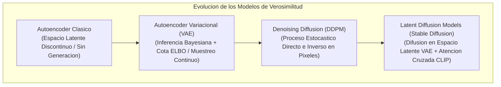
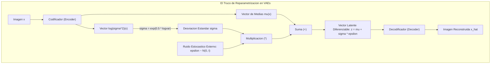
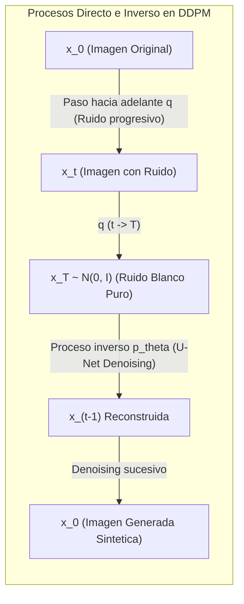
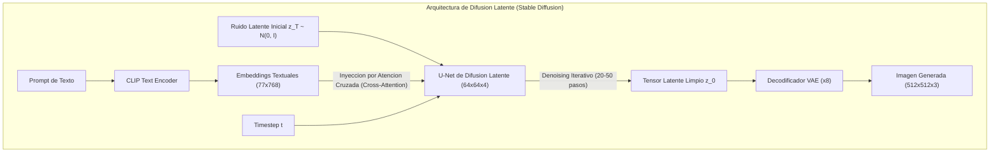

# Clase 8: Autoencoders Variacionales (VAEs), Dinamica de Difusion Probabilistica y Sintesis Latente con Stable Diffusion

> Proposito pedagogico: Comprender la formalizacion probabilistica de los Autoencoders Variacionales (VAEs) y el truco de reparametrizacion bajo la cota ELBO, analizar los procesos de difusion hacia adelante (Forward Markov Chain) y denoising inverso en DDPM, dominar la arquitectura U-Net con condicionamiento por texto (Cross-Attention CLIP) y formalizar la sintesis visual de alta fidelidad en el espacio latente con Latent Diffusion Models (Stable Diffusion).

## 1\. Contexto y Marco Conceptual

### La Evolucion de los Modelos Generativos Basados en Verosimilitud

Mientras que las GANs operan eludiendo la estimacion explicita de densidades de probabilidad mediante un juego adversarial, los modelos generativos fundamentados en verosimilitud (*Likelihood-based Models*) buscan optimizar directamente la probabilidad de que el modelo haya generado las observaciones del mundo real.

El desarrollo historico se articula en tres grandes hitos:

1. **Autoencoders Clasicos (Deterministicos):**

   - Comprimen una imagen $\mathbf{x}$ en un codigo latente $\mathbf{z} = \text{Encoder}(\mathbf{x})$ y la reconstruyen $\hat{\mathbf{x}} = \text{Decoder}(\mathbf{z})$.
   
   - **Limitacion:** El espacio latente resultante carece de regularizacion probabilistica; presenta "agujeros" discontinuos. Muestrear un vector aleatorio $\mathbf{z}$ en el espacio genera resultados aberrantes.

1. **Autoencoders Variacionales (VAEs, Kingma &amp; Welling, 2013):**

   - Introducen inferencia bayesiana variacional para forzar al espacio latente a comportarse como una distribucion normal continua y densa. Resuelven la generatividad, pero sufren de borrosidad debido a las funciones de perdida euclidianas.

1. **Modelos Probabilisticos de Difusion (DDPM / LDMs, 2020-2022):**

   - Destruyen la informacion de forma controlada mediante ruido gaussiano termodinamico y aprenden a revertir el proceso paso a paso, logrando la maxima calidad perceptual y estabilidad matematica de convergencia.



### El Trilema Generativo (The Generative Trilemma)

En el diseno de sistemas generativos contemporaneos, existe un compromiso tripartito irreductible postulado en la literatura teorica:

1. **Alta Calidad de Muestra (Sample Quality):** Fidelidad fotorealista y definicion de altas frecuencias espaciales.

1. **Velocidad de Muestreo (Fast Sampling):** Capacidad de sintetizar una muestra en un unico paso o fraccion de segundo.

1. **Cobertura Total de Modos (Mode Coverage / Diversity):** Captura integra de todas las variaciones posibles de la distribucion sin descartar subpoblaciones.

- Las **GANs** satisfacen (1) y (2), pero fallan en (3) por colapso de modos.

- Los **VAEs** satisfacen (2) y (3), pero fallan en (1) al generar imagenes difusas.

- Los **Modelos de Difusion** satisfacen plenamente (1) y (3), resolviendo historicamente el compromiso mediante la utilizacion de solucionadores avanzados de ecuaciones diferenciales que optimizan gradualmente (2).

---

## 2\. Fundamentos Teoricos y Arquitectura

### Autoencoders Variacionales (VAEs) y la Cota ELBO

Sea un conjunto de datos observados $\mathbf{x} \in \mathcal{X}$ generado a partir de variables latentes no observadas $\mathbf{z} \in \mathcal{Z}$ bajo una distribucion a priori parametrica $p(\mathbf{z}) = \mathcal{N}(0, \mathbf{I})$.

La verosimilitud marginal de los datos $p_\theta(\mathbf{x}) = \int p_\theta(\mathbf{x} \mid \mathbf{z}) p(\mathbf{z}) \, d\mathbf{z}$ es analiticamente intratable. Para resolverla, se introduce una distribucion variacional de reconocimiento amortizada $q_\phi(\mathbf{z} \mid \mathbf{x}) = \mathcal{N}(\boldsymbol{\mu}_\phi(\mathbf{x}), \boldsymbol{\Sigma}_\phi(\mathbf{x}))$, parametrizada por una red neuronal codificadora.

#### Deduccion de la Cota Inferior de la Evidencia (ELBO):

Aplicando la desigualdad de Jensen a la log-verosimilitud:

$$
\log p_\theta(\mathbf{x}) \ge \mathcal{L}_{\text{ELBO}}(\theta, \phi; \mathbf{x}) = \mathbb{E}_{q_\phi(\mathbf{z} \mid \mathbf{x})}[\log p_\theta(\mathbf{x} \mid \mathbf{z})] - D_{\text{KL}}(q_\phi(\mathbf{z} \mid \mathbf{x}) \parallel p(\mathbf{z}))
$$

La funcion de costo a minimizar $\mathcal{L}_{\text{VAE}} = -\mathcal{L}_{\text{ELBO}}$ se descompone con precision pedagogica en dos terminos antagónicos:

1. **Perdida de Reconstruccion:**

   $$
   \mathcal{L}_{\text{recon}} = -\mathbb{E}_{q_\phi(\mathbf{z} \mid \mathbf{x})}[\log p_\theta(\mathbf{x} \mid \mathbf{z})] \approx \|\mathbf{x} - \hat{\mathbf{x}}\|^2_2
   $$
   
   Fuerza al decodificador a reconstruir fielmente la entrada original.

1. **Regularizacion de Divergencia de Kullback-Leibler (**$D_{\text{KL}}$**):**

   Para gaussianas multivariadas con matriz de covarianza diagonal, se resuelve analiticamente en forma cerrada:
   
   $$
   D_{\text{KL}}(q_\phi(\mathbf{z} \mid \mathbf{x}) \parallel \mathcal{N}(0, \mathbf{I})) = -\frac{1}{2} \sum_{j=1}^d \left( 1 + \log(\sigma_j^2) - \mu_j^2 - \sigma_j^2 \right)
   $$
   
   Fuerza a la distribucion latente de cada imagen a alinearse con la normal estandar centrada en cero, eliminando vacios y garantizando continuidad e interpolacion suave.

#### El Truco de Reparametrizacion (Reparameterization Trick)

El muestreo directo de una variable aleatoria $\mathbf{z} \sim \mathcal{N}(\boldsymbol{\mu}, \boldsymbol{\sigma}^2)$ es una operacion estocastica no diferenciable que bloquea el flujo del gradiente durante la retropropagacion hacia el codificador.

Para restaurar la diferenciabilidad, Kingma &amp; Welling segregaron la fuente de aleatoriedad del grafo de computo:

$$
\mathbf{z} = \boldsymbol{\mu} + \boldsymbol{\sigma} \odot \boldsymbol{\epsilon}, \quad \text{con } \boldsymbol{\epsilon} \sim \mathcal{N}(0, \mathbf{I})
$$

donde $\odot$ es el producto elemento a elemento (Hadamard). Ahora $\mathbf{z}$ es una transformacion lineal diferenciable de $\boldsymbol{\mu}$ y $\boldsymbol{\sigma}$, permitiendo que el gradiente fluya sin perturbaciones mediante descenso de gradiente estandar.



---

### Modelos de Difusion Probabilistica (DDPM - Ho et al., 2020)

Los modelos de difusion conciben la generacion a traves de dos procesos estocasticos complementarios:

#### 1\. Proceso de Difusion Hacia Adelante (Forward Process $q$)

Proceso markoviano parametrizado por un cronograma de varianza fijo $0 < \beta_1 < \beta_2 < \dots < \beta_T < 1$. En cada paso $t$, inyecta incrementalmente ruido gaussiano a la imagen:

$$
q(\mathbf{x}_t \mid \mathbf{x}_{t-1}) = \mathcal{N}(\mathbf{x}_t; \sqrt{1 - \beta_t}\mathbf{x}_{t-1}, \beta_t \mathbf{I})
$$

**Propiedad de Salto Directo:** Permite muestrear directamente la imagen degradada $\mathbf{x}_t$ en cualquier paso $t$ sin necesidad de iterar los pasos intermedios:

$$
\mathbf{x}_t = \sqrt{\bar{\alpha}_t} \mathbf{x}_0 + \sqrt{1 - \bar{\alpha}_t} \boldsymbol{\epsilon}, \quad \boldsymbol{\epsilon} \sim \mathcal{N}(0, \mathbf{I})
$$

donde $\alpha_t = 1 - \beta_t$ y $\bar{\alpha}_t = \prod_{s=1}^t \alpha_s$. Cuando $t \to T$ ($T \approx 1000$), $\mathbf{x}_T$ converge de forma asintotica a ruido gaussiano puro $\mathcal{N}(0, \mathbf{I})$.

#### 2\. Proceso Inverso de Desnoising ($p_\theta$)

Consiste en revertir la cadena de Markov para recuperar la imagen original a partir del ruido. Dado que $q(\mathbf{x}_{t-1} \mid \mathbf{x}_t)$ es intratable, se aproxima mediante una red neuronal profunda $\boldsymbol{\epsilon}_\theta(\mathbf{x}_t, t)$ con topologia **U-Net**:

$$
p_\theta(\mathbf{x}_{t-1} \mid \mathbf{x}_t) = \mathcal{N}(\mathbf{x}_{t-1}; \boldsymbol{\mu}_\theta(\mathbf{x}_t, t), \boldsymbol{\Sigma}_\theta(\mathbf{x}_t, t))
$$

Jonathan Ho et al. demostraron que el objetivo variacional completo se simplifica en una elegante funcion de perdida de regresion: **entrenar a la U-Net para predecir el ruido residual** $\boldsymbol{\epsilon}$ **que fue anadido en el paso** $t$:

$$
\mathcal{L}_{\text{simple}}(\theta) = \mathbb{E}_{t, \mathbf{x}_0, \boldsymbol{\epsilon}}\left[ \|\boldsymbol{\epsilon} - \boldsymbol{\epsilon}_\theta(\mathbf{x}_t, t)\|^2 \right]
$$



---

### Modelos de Difusion Latente (Latent Diffusion Models - Stable Diffusion)

Ejecutar el proceso iterativo de difusion sobre el espacio de pixeles crudos ($512 \times 512 \times 3 \approx 786,432$ variables) genera un estrangulamiento computacional extremo, exigiendo semanas de entrenamiento en supercomputadores industriales.

Robin Rombach et al. (2022) resolvieron este cuello de botella desacoplando el proceso en dos etapas bajo la arquitectura **Stable Diffusion**:

1. **Compresion Perceptual (Autoencoder VAE Preentrenado):**

   - Un codificador $\mathcal{E}$ comprime la imagen espacial en un factor de $8\times$:
   
     $$
     \mathbf{z} = \mathcal{E}(\mathbf{x}) \in \mathbb{R}^{64 \times 64 \times 4}
     $$
   
   - Esta compresion dimensional de $64\times$ **en numero de elementos** preserva la estructura semantica fundamental eliminando redundancias visuales imperceptibles de alta frecuencia.

1. **Difusion en el Espacio Latente (Latent Denoising U-Net):**

   - El proceso de difusion y la prediccion de ruido se ejecutan enteramente sobre tensores latentes $\mathbf{z}_t$.

1. **Condicionamiento Multimodal con Atencion Cruzada (Cross-Attention CLIP):**

   - El prompt textual $y$ se procesa a traves del **Text Encoder de CLIP**, generando una secuencia de embeddings textuales $\tau_\theta(y) \in \mathbb{R}^{M \times d_{\text{ctx}}}$.
   
   - En las capas intermedias de la U-Net, se incorporan bloques de **Atencion Cruzada**:
   
     $$
     \text{Attention}(Q, K, V) = \text{softmax}\left(\frac{Q K^T}{\sqrt{d}}\right) V
     $$
     
     donde:
     
     - **Queries (**$Q$**):** Proyeccion lineal de las caracteristicas latentes visuales de la U-Net: $Q = W_Q \cdot \phi_i(\mathbf{z}_t)$.
     
     - **Keys (**$K$**) y Values (**$V$**):** Proyecciones lineales de las representaciones textuales de CLIP: $K = W_K \cdot \tau_\theta(y)$ y $V = W_V \cdot \tau_\theta(y)$.
     
     De este modo, el texto guia directamente que caracteristicas deben eliminarse o sintetizarse en cada region del mapa latente.

1. **Decodificacion a Pixeles:** Tras $N$ pasos de denoising inverso alcanzando $\mathbf{z}_0$, el decodificador del VAE $\mathcal{D}$ proyecta el tensor latente de retorno al espacio de pixeles:

   $$
   \hat{\mathbf{x}} = \mathcal{D}(\mathbf{z}_0) \in \mathbb{R}^{512 \times 512 \times 3}
   $$



#### Guia Libre de Clasificador (Classifier-Free Guidance - CFG)

Mecanismo fundamental para modular la adherencia de la imagen generada respecto al prompt textual:

$$
\tilde{\boldsymbol{\epsilon}}_\theta(\mathbf{z}_t, c) = \boldsymbol{\epsilon}_\theta(\mathbf{z}_t, \emptyset) + w \cdot \left( \boldsymbol{\epsilon}_\theta(\mathbf{z}_t, c) - \boldsymbol{\epsilon}_\theta(\mathbf{z}_t, \emptyset) \right)
$$

donde $c$ es el prompt condicional, $\emptyset$ es el prompt vacio incondicional, y $w \ge 1$ es la escala de guia (*CFG Scale*). Si $w = 1$, opera en modo condicional estandar; valores $w \approx 7.0 - 9.0$ amplifican dramaticamente la fidelidad tematica y contraste visual respecto al texto solicitado.

---

## 3\. Implementacion Tecnica y Logica de Negocio

### Pipeline de Generacion Text-to-Image con Hugging Face Diffusers

A continuacion se implementa el flujo de produccion utilizando la biblioteca ` diffusers ` de Hugging Face sobre GPU, controlando semillas estocasticas, planificadores avanzados y parametros CFG.

```python
import torch
from diffusers import StableDiffusionPipeline, DPMSolverMultistepScheduler

def generar_imagen_estable(prompt: str, negative_prompt: str = "", cfg_scale: float = 7.5, pasos: int = 25, semilla: int = 42):
    """
    Sintetiza una imagen de alta resolucion a partir de una descripcion textual usando Stable Diffusion.
    """
    modelo_id = "runwayml/stable-diffusion-v1-5"
    dispositivo = "cuda" if torch.cuda.is_available() else "cpu"

    # 1. Carga del pipeline de difusion con precision mixta (fp16) para optimizacion de memoria VRAM
    pipe = StableDiffusionPipeline.from_pretrained(
        modelo_id,
        torch_dtype=torch.float16 if dispositivo == "cuda" else torch.float32
    )

    # 2. Asignacion de un planificador (Scheduler) de orden superior (DPM-Solver++)
    # Reduce los pasos requeridos de 1000 a 20-25 sin comprometer calidad
    pipe.scheduler = DPMSolverMultistepScheduler.from_config(pipe.scheduler.config)
    pipe = pipe.to(dispositivo)

    # 3. Fijacion de semilla estocastica para garantizar reproducibilidad cientifica
    generador = torch.Generator(device=dispositivo).manual_seed(semilla)

    # 4. Inferencia con atencion cruzada guiada
    with torch.autocast(dispositivo):
        resultado = pipe(
            prompt=prompt,
            negative_prompt=negative_prompt,
            num_inference_steps=pasos,
            guidance_scale=cfg_scale,
            generator=generador
        )

    imagen_generada = resultado.images[0]
    return imagen_generada
```

### Implementacion de la Cota ELBO y Reparametrizacion en VAE (PyTorch)

```python
import torch
import torch.nn as nn
import torch.nn.functional as F

class ModuloReparametrizacionVAE(nn.Module):
    def __init__(self, dim_entrada=784, dim_latente=20):
        super(ModuloReparametrizacionVAE, self).__init__()
        # Ramas paralelas para la media y el logaritmo de la varianza
        self.fc_mu = nn.Linear(400, dim_latente)
        self.fc_logvar = nn.Linear(400, dim_latente)

    def forward(self, h):
        mu = self.fc_mu(h)
        logvar = self.fc_logvar(h)
        
        # Truco de reparametrizacion
        std = torch.exp(0.5 * logvar)
        eps = torch.randn_like(std)
        z = mu + std * eps
        return z, mu, logvar

def calcular_loss_elbo(x_reconstruida, x_original, mu, logvar):
    """
    Calcula la perdida combinada de reconstruccion y divergencia KL de la cota ELBO.
    """
    # 1. Perdida de reconstruccion (Binary Cross-Entropy sobre pixeles normalizados)
    loss_recon = F.binary_cross_entropy(x_reconstruida, x_original, reduction="sum")
    
    # 2. Divergencia KL analitica frente a N(0, I)
    # D_KL = -0.5 * sum(1 + log(sigma^2) - mu^2 - sigma^2)
    loss_kl = -0.5 * torch.sum(1 + logvar - mu.pow(2) - logvar.exp())
    
    return loss_recon + loss_kl
```

---

## 4\. Analisis Critico de Casos y Auditoria Practica

### Comparativa Estructural de Paradigmas Generativos

| **Propiedad Tecnica** | **GANs (Generative Adversarial Networks)** | **VAEs (Variational Autoencoders)** | **Diffusion Models (LDMs / SD)** |
| --- | --- | --- | --- |
| **Funcion Objetivo** | Juego Minimax no convexo (Teoria de Juegos). | Optimizacion de cota analitica (ELBO). | Regresion MSE sobre ruido gaussiano inyectado. |
| **Estabilidad de Convergencia** | Extremadamente volatil (sujeta a colapso de modos). | Alta y deterministica (descenso monotono). | Maxima y robusta (optimizacion simple y reproducible). |
| **Calidad Visual de Detalle** | Excelente (bordes sumamente nitidos). | Baja a moderada (artefactos de difuminado). | Excepcional y fotorealista a nivel de texturas. |
| **Control Condicional** | Moderado (mediante vectores one-hot o proyecciones). | Bajo (condicionamiento limitado). | Maximo (Atencion Cruzada con Embeddings de CLIP). |
| **Complejidad en Inferencia** | $O(1)$ paso hacia adelante. | $O(1)$ paso hacia adelante. | $O(T)$ pasos iterativos (mitigado a 20 con solvers ODE). |

### Evaluacion de Planificadores (Schedulers) en Inferencia de Difusion

| **Algoritmo Planificador** | **Pasos Requeridos** | **Fundamento Matematico** | **Idoneidad Operacional** |
| --- | --- | --- | --- |
| **DDPM (Lineal Clasico)** | $1000$ pasos | Cadena de Markov discreta estandar. | Inviable en produccion (\~60 segundos por imagen). |
| **DDIM (Deterministico)** | $50$ pasos | Aproximacion no markoviana deterministica. | Solucion historica base para acelerar muestreo. |
| **Euler Ancestral (Euler-A)** | $25 - 30$ pasos | Metodo numerico de Euler con inyeccion estocastica. | Excelente para estetica artistica y variabilidad. |
| **DPM++ 2M Karras** | $15 - 25$ pasos | Solucionador de ecuaciones diferenciales de segundo orden. | Estandar de oro moderno para maxima definicion y velocidad. |

---

## 5\. Principios de Diseno, Buenas Practicas y Anti-patrones

### Reglas de Oro en Modelos de Difusion

1. **Calibracion Prudente de la Escala CFG:** Mantener el valor de *Classifier-Free Guidance* ($w$) en el rango $[6.5, 8.5]$. Asignar valores excesivamente altos ($w > 15$) induce sobre-saturacion cromatica, bordes quemados y distorsiones grotescas en las anatomias de los sujetos.

1. **Utilizacion Estrategica de Prompts Negativos:** Incluir siempre un prompt negativo estandarizado (` "blurry, distorted, low quality, bad anatomy, deformed limbs" `) para guiar al muestreador fuera de los colectores de baja calidad del espacio latente.

1. **Uso de Precision Mixta FP16 / BF16 en Produccion:** La ejecucion de la U-Net en precision simple FP32 duplica el consumo de memoria VRAM sin aportar mejoras perceptuales. Utilizar invariablemente FP16 para reducir el consumo a la mitad y acelerar la inferencia en GPUs con Tensor Cores.

### Anti-patrones Metodologicos Identificados

| **Anti-patron** | **Mecanismo del Error** | **Impacto Tecnico / Consecuencia** | **Estrategia de Mitigacion** |
| --- | --- | --- | --- |
| **Muestreo Estocastico sin Externalizacion** | Implementar el muestreo de VAE llamando a funciones aleatorias directas en el forward sin el truco de reparametrizacion. | El gradiente de PyTorch no puede atravesar el operador estocastico; el codificador no aprende jams. | Parametrizar invariablemente $\mathbf{z} = \boldsymbol{\mu} + \boldsymbol{\sigma} \odot \boldsymbol{\epsilon}$. |
| **Difusion en Pixeles para Alta Resolucion** | Entrenar modelos DDPM operando directamente sobre tensores de $512 \times 512$ en lugar de espacios latentes comprimidos. | Consumo inviable de memoria y tiempos de entrenamiento que superan semanas. | Adoptar siempre el paradigma de Difusion Latente (LDM) comprimiendo previamente con VAE. |
| **Descuido del Cronograma de Varianza (**$\beta_t$**)** | Implementar cronogramas con transiciones abruptas de ruido que no destruyen completamente la estructura en $t=T$. | $\mathbf{x}_T$ no converge a una distribucion normal estandar; la generacion produce colisiones y artefactos residuales. | Utilizar cronogramas demostrados como el decaimiento cosenoidal (*Cosine Beta Schedule*). |

---

## 6\. Sintesis Conceptual y Profundizacion Academica

### Sintesis Integradora

El recorrido formativo que se inicio en la manipulacion deterministica de matrices bidimensionales con OpenCV culmina en la sintesis estocastica guiada por lenguaje en espacios latentes continuos. Los Modelos de Difusion Latente (Stable Diffusion) representan el estado del arte indiscutido de la disciplina al unificar armonicamente tres pilares cientificos fundamentales: la compresion perceptual de los VAEs, la alineacion semantica multimodal de CLIP y el modelado estocastico de reversion termodinamica de ruido mediante redes U-Net. Esta arquitectura unificada no solo resuelve el trilema generativo, sino que transforma a la vision por computadora en una herramienta creativa universal.

### Preguntas Guia para la Investigacion de Posgrado

1. ¿Como incide teoricamente la geometria del espacio latente comprimido por el VAE en la preservacion de simetrias continuas (grupos de Lie) durante la trayectoria del desnoising guiado por campos vectoriales de score matching?

1. ¿Bajo que condiciones formales los solucionadores de ecuaciones diferenciales estocasticas de consistencia latente (*Latent Consistency Models - LCM*) permiten reducir el proceso de muestreo a 1 o 2 pasos sin colapso de calidad perceptual?

### Referencias Bibliograficas Fundamentales

- Kingma, D. P., &amp; Welling, M. (2013). *Auto-encoding variational bayes*. arXiv preprint arXiv:1312.6114 (VAE).

- Ho, J., Jain, A., &amp; Abbeel, P. (2020). *Denoising diffusion probabilistic models*. Advances in Neural Information Processing Systems (NeurIPS), 33, 6840-6851 (DDPM).

- Rombach, R., Blattmann, A., Lorenz, D., Esser, P., &amp; Ommer, B. (2022). *High-resolution image synthesis with latent diffusion models*. Proceedings of the IEEE/CVF Conference on Computer Vision and Pattern Recognition (CVPR), 10684-10695 (Stable Diffusion).

- Song, J., Meng, C., &amp; Ermon, S. (2020). *Denoising diffusion implicit models*. International Conference on Learning Representations (ICLR) (DDIM).
