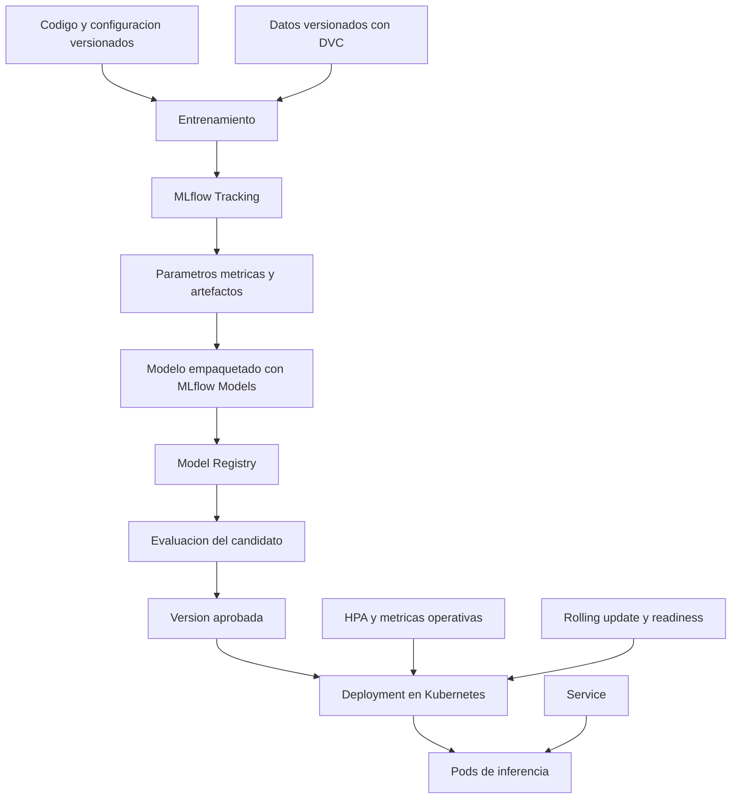

# Clase 6: Actualización y recursos en Kubernetes: trazabilidad y gobernanza de modelos con MLflow

> **Objetivo académico:** Integrar la actualización progresiva y la gestión de recursos en Kubernetes con el seguimiento de experimentos, el empaquetado y la gobernanza de modelos mediante MLflow, distinguiendo disponibilidad operativa, reproducibilidad y calidad predictiva.

## 1. Contexto y marco conceptual

La puesta en producción de un modelo requiere articular decisiones estadísticas y operativas. El contexto del problema determina qué datos son pertinentes, qué métricas representan el valor de negocio y qué restricciones debe satisfacer el servicio. Por ello, la elección de un algoritmo necesita una comparación fundamentada con alternativas y una línea base; seleccionar el primer modelo disponible no ofrece evidencia suficiente de adecuación.

La sesión conecta tres planos del ciclo de vida:

- **Construcción y evaluación:** entrenamiento, selección de hiperparámetros y comparación de resultados.
- **Trazabilidad:** relación entre código, datos, configuración, métricas y artefactos de cada ejecución.
- **Operación:** despliegue, disponibilidad, asignación de recursos, actualización y reversión.

Git permite versionar código; DVC, mencionado fonéticamente de forma variable en la transcripción, se utiliza para el versionamiento de datos y archivos binarios. Docker empaqueta la aplicación y su entorno. Kubernetes administra cargas de trabajo en contenedores. MLflow organiza el seguimiento experimental y los artefactos del modelo. Estas herramientas cumplen funciones complementarias.

**Enriquecimiento conceptual:** La regresión logística es un algoritmo de clasificación, pese a su denominación. Para predecir una variable numérica continua corresponde comparar regresores; para categorías, clasificadores. Random forest y los métodos de boosting pueden ofrecer variantes para ambas tareas. La adecuación depende de la formulación del problema y del estimador concreto, no únicamente de la familia algorítmica.

La degradación de un modelo constituye una motivación central para mantener historial: después de numerosos reentrenamientos, un archivo llamado `modelo_final` no permite identificar de manera confiable qué cambió, con qué datos ni bajo qué condiciones. MLflow aporta una bitácora estructurada para investigar estas relaciones, aunque registrar métricas no equivale por sí mismo a detectar drift ni demostrar sus causas.

## 2. Fundamentos teóricos y arquitectura

### Objetos de Kubernetes y sus responsabilidades

| Objeto | Responsabilidad | Precisión conceptual |
| --- | --- | --- |
| Pod | Unidad desplegable que contiene uno o más contenedores | Un contenedor por Pod es una configuración frecuente, no una equivalencia formal. |
| Deployment | Declara réplicas y administra actualizaciones de la aplicación | Mantiene el estado deseado mediante controladores y ReplicaSets. |
| Service | Proporciona acceso estable a un conjunto de Pods seleccionados por etiquetas | No crea el clúster; ofrece una abstracción de red sobre recursos existentes. |
| Namespace | Agrupa recursos y delimita ámbitos de nombres | No constituye por sí solo un clúster independiente ni aislamiento de seguridad completo. |
| HorizontalPodAutoscaler | Ajusta el número de réplicas según métricas y objetivos | Necesita una fuente de métricas disponible y capacidad para ejecutar las réplicas. |

**Enriquecimiento conceptual:** Las precisiones de la tabla delimitan simplificaciones del discurso. Un Service de tipo `ClusterIP` proporciona acceso interno; la exposición externa necesita una configuración apropiada, como un Service de otro tipo o una capa de entrada. Un namespace propio resulta útil para organizar ambientes, pero Kubernetes ya dispone de namespaces y no obliga a crear uno nuevo para cada aplicación.



El diagrama integra la arquitectura discutida. La promoción del modelo y la actualización del servicio son decisiones conectadas, pero distintas: el registro identifica qué versión se aprueba y el despliegue determina cómo se ejecuta y recibe tráfico.

### Actualización progresiva

Una estrategia `RollingUpdate` reemplaza gradualmente Pods antiguos por nuevos. La demostración utiliza tres réplicas, una réplica adicional permitida durante la transición y ninguna indisponibilidad planificada:

- `replicas: 3`: cantidad deseada de réplicas.
- `maxSurge: 1`: permite incrementar temporalmente la cantidad respecto del objetivo.
- `maxUnavailable: 0`: impide reducir deliberadamente la disponibilidad por debajo del objetivo durante el reemplazo.
- `minReadySeconds: 5`: exige que un Pod permanezca listo durante cinco segundos antes de considerarlo disponible para el progreso de la actualización.
- `readinessProbe`: comprueba si el contenedor está preparado para recibir tráfico.

**Enriquecimiento conceptual:** Estas propiedades controlan el avance de la actualización, pero no garantizan que una solicitud en curso termine antes de eliminar su contenedor. Tampoco garantizan ausencia absoluta de fallos ante pérdida de nodos, errores de aplicación o falta de recursos.

### Componentes de MLflow

| Componente | Función discutida | Resultado |
| --- | --- | --- |
| Tracking | Registrar ejecuciones, parámetros, métricas y artefactos | Historial consultable y comparable. |
| Models | Empaquetar modelos con metadatos y dependencias | Una representación utilizable por herramientas compatibles. |
| Model Registry | Catalogar modelos y sus versiones | Identificación y gobernanza de versiones candidatas y aprobadas. |
| Interfaz de usuario | Explorar ejecuciones y comparar resultados | Consulta visual de la evidencia registrada. |

Un **experimento** agrupa ejecuciones relacionadas. Una **run** representa una ejecución identificable. Los **parámetros** describen elecciones de configuración; las **métricas** cuantifican resultados; los **artefactos** contienen archivos producidos, como modelos o reportes; los **tags** aportan metadatos descriptivos para organización y búsqueda.

La automatización del registro requiere instrumentar el código o configurar mecanismos de registro automático. No toda variable del programa queda documentada por encontrarse dentro de `start_run()`.

## 3. Implementación técnica y lógica de negocio

### Flujo de actualización en Kubernetes

La secuencia demostrada consiste en crear el namespace y el Service, aplicar una primera versión del Deployment, generar solicitudes repetidas y aplicar una segunda versión de la misma carga de trabajo. Durante la transición aparecen respuestas de ambas versiones; al finalizar, las respuestas corresponden a la nueva.

**Enriquecimiento conceptual:** El siguiente fragmento reconstruye los campos centrales de la configuración descrita; no reproduce un manifiesto íntegro visible en la fuente:

```yaml
spec:
  replicas: 3
  minReadySeconds: 5
  strategy:
    type: RollingUpdate
    rollingUpdate:
      maxSurge: 1
      maxUnavailable: 0
```

Estos campos pertenecen al `spec` de un Deployment. El manifiesto completo debe incluir `apiVersion: apps/v1`, `kind: Deployment`, metadatos, selector y plantilla de Pods con etiquetas compatibles. La sonda de disponibilidad se configura dentro del contenedor de esa plantilla y debe apuntar a una ruta y un puerto realmente atendidos por la aplicación.

**Enriquecimiento conceptual:** Una reconstrucción normalizada de los comandos operativos es:

```bash
kubectl apply -f base.yaml
kubectl apply -f app-v1.yaml
kubectl get pods -n lab-rollout
kubectl apply -f app-v2.yaml
kubectl rollout status deployment/web -n lab-rollout
```

`base.yaml` representa los recursos de agrupación y acceso; ambos manifiestos de aplicación deben actualizar el mismo Deployment para producir el reemplazo progresivo. Crear Deployments con nombres distintos no equivale a actualizar uno existente. BusyBox se utiliza como imagen ligera para ejecutar un cliente HTTP repetitivo; no es una herramienta dedicada exclusivamente a consultar servicios.

### Requests y limits

La sesión diferencia la solicitud de recursos usada para planificar y el límite aplicado al consumo:

| Recurso | Request | Limit | Consecuencia relevante |
| --- | --- | --- | --- |
| Memoria | Cantidad que el planificador considera para ubicar el Pod | Umbral de memoria del contenedor | Superarlo puede causar terminación por falta de memoria. |
| CPU | Capacidad solicitada para planificación y reparto bajo contención | Cuota máxima de tiempo de CPU | Alcanzarla suele provocar limitación del procesamiento. |

**Enriquecimiento conceptual:** Un request no significa que la aplicación consuma inmediatamente esa cantidad ni representa un techo. La explicación de «reserva garantizada» debe interpretarse dentro del mecanismo de planificación y de las condiciones del nodo, no como una garantía absoluta frente a cualquier presión de recursos.

Para CPU, la conversión empleada es:

$$
1000\,\mathrm{m}=1\,\text{CPU},\qquad 100\,\mathrm{m}=0.1\,\text{CPU},\qquad 200\,\mathrm{m}=0.2\,\text{CPU}.
$$

Aquí $\mathrm{m}$ significa milicpu y CPU representa una unidad de capacidad de cómputo según la infraestructura del nodo; no mide frecuencia ni memoria. En el ejemplo, `requests.cpu: 100m` y `limits.cpu: 200m` permiten estudiar un proceso que demanda CPU continuamente.

En memoria se plantea un request cercano a 50 MB y un límite cercano a 100 MB, mientras el proceso agrega bloques de aproximadamente 10 MB con pausas de 0.5 segundos. El consumo total incluye además el intérprete y las estructuras del proceso.

**Enriquecimiento conceptual:** Los manifiestos deben distinguir unidades decimales y binarias: `M` y `G` representan potencias de diez; `Mi` y `Gi`, potencias de dos. Las magnitudes narradas no permiten recuperar de forma inequívoca los sufijos utilizados en el código original.

### Seguimiento de regresión logística con MLflow

La demostración usa el conjunto Iris disponible en scikit-learn y divide los datos en 70 % para entrenamiento y 30 % para prueba, con semilla y estratificación. Se realizan tres ejecuciones con `max_iter` de 50, 100 y 200. Cada ejecución registra su configuración, la exactitud y el modelo empaquetado.

**Enriquecimiento conceptual:** Iris es un conjunto de datos de mediciones de flores, no un conjunto sintético generado para esta demostración. La estratificación procura conservar las proporciones de las clases en ambas particiones.

**Enriquecimiento conceptual:** El código siguiente reconstruye la lógica expuesta con nombres normalizados. No se ha ejecutado como parte de estos apuntes. El argumento `artifact_path` corresponde a una interfaz ampliamente utilizada; debe comprobarse su compatibilidad o deprecación en la versión instalada de MLflow.

```python
import mlflow
import mlflow.sklearn
from sklearn.datasets import load_iris
from sklearn.linear_model import LogisticRegression
from sklearn.metrics import accuracy_score
from sklearn.model_selection import train_test_split

X, y = load_iris(return_X_y=True)
X_train, X_test, y_train, y_test = train_test_split(
    X, y, test_size=0.30, random_state=42, stratify=y
)

mlflow.set_experiment("iris-logistic-regression")

for max_iter in (50, 100, 200):
    with mlflow.start_run(run_name=f"logistic-max-iter-{max_iter}"):
        model = LogisticRegression(max_iter=max_iter, random_state=42)
        model.fit(X_train, y_train)
        predictions = model.predict(X_test)
        accuracy = accuracy_score(y_test, predictions)

        mlflow.log_param("max_iter", max_iter)
        mlflow.log_metric("accuracy", accuracy)
        mlflow.sklearn.log_model(model, artifact_path="model")
```

`set_experiment` selecciona el agrupador de las ejecuciones. `start_run` delimita cada registro. `log_param` registra un parámetro individual, `log_metric` una métrica y `mlflow.sklearn.log_model` empaqueta el estimador. El contexto permite distinguir ejecuciones completadas de ejecuciones fallidas cuando una excepción interrumpe el proceso.

**Enriquecimiento conceptual:** MLflow también dispone de `log_params` para recibir un diccionario. El fallo narrado no demuestra que esa función sea inexistente: puede relacionarse con la forma de invocación o con un error de escritura. No se dispone del mensaje completo para establecer la causa.

La exactitud utilizada se expresa como:

$$
\operatorname{accuracy}=\frac{1}{n}\sum_{i=1}^{n}\mathbf{1}(\hat y_i=y_i).
$$

Aquí $n\in\mathbb{N}_{>0}$ es el número de observaciones evaluadas, $y_i$ es la clase observada, $\hat y_i$ la clase predicha y $\mathbf{1}$ vale uno cuando ambas coinciden y cero en caso contrario. La métrica es adimensional y pertenece a $[0,1]$; multiplicarla por 100 permite expresarla como porcentaje. Su interpretación depende de la representatividad de la partición y puede resultar insuficiente con clases desbalanceadas o costes de error diferentes.

### Variación de regularización, firma y tags

La segunda demostración mantiene `max_iter=200` y compara cinco valores del parámetro `C`, cuyos valores concretos no quedan recuperables en la fuente. Además de métricas y parámetros, incorpora firma, ejemplo de entrada y tags de dataset y algoritmo.

**Enriquecimiento conceptual:** En `LogisticRegression` de scikit-learn, $C\in\mathbb{R}_{>0}$ controla inversamente la intensidad de regularización: valores menores implican una regularización más fuerte, manteniendo constantes las demás opciones relevantes. No existe una relación necesariamente monótona entre aumentar `C` y mejorar la métrica de generalización.

La firma se construye con `infer_signature` a partir de entradas y salidas representativas. `signature` documenta la estructura esperada, mientras que `input_example` aporta un ejemplo concreto. Los tags permiten identificar el algoritmo, el dataset o una referencia a su versión en DVC.

**Enriquecimiento conceptual:** Un ejemplo de entrada no almacena necesariamente todo el dataset de entrenamiento y una firma no demuestra su procedencia. Para un linaje verificable se necesita una referencia explícita a los datos y a su versión. Si se registra un hash obtenido de DVC, debe documentarse a qué objeto corresponde y cómo resolverlo; no debe suponerse que cualquier hash es siempre MD5.

## 4. Análisis crítico de casos y auditoría práctica

### Disponibilidad frente a terminación segura

La demostración de rolling update muestra continuidad de respuestas mientras cambia la versión. Una intervención de la sesión introduce un límite importante: un Pod puede estar procesando una solicitud larga cuando comienza su terminación. Que otra réplica esté lista no conserva automáticamente ese trabajo.

**Enriquecimiento conceptual:** `maxSurge`, `maxUnavailable` y readiness resuelven aspectos de disponibilidad y admisión de tráfico. La terminación segura requiere que la aplicación gestione las señales de apagado, deje de aceptar trabajo nuevo y complete o preserve el trabajo en curso dentro de un plazo configurado. Kubernetes ofrece mecanismos como `terminationGracePeriodSeconds` y hooks `preStop`; no espera indefinidamente una confirmación de la aplicación.

En inferencias o procesos de varias horas, puede ser necesario separar la recepción de solicitudes de la ejecución mediante colas y trabajadores, además de persistir estados o puntos de recuperación. Esta arquitectura excede la demostración, pero explica por qué una actualización sin interrupción visible no equivale a integridad transaccional.

La referencia a blue-green aporta otra estrategia de despliegue, aunque no se implementa. Ambas estrategias necesitan considerar solicitudes en curso y compatibilidad de datos; cambiar el tráfico no elimina esas obligaciones técnicas.

### Tres comportamientos de recursos

| Caso | Observación o planteamiento de la sesión | Interpretación rigurosa |
| --- | --- | --- |
| Solicitud de memoria muy superior a la capacidad de los nodos | Pod en `Pending` y evento de planificación fallida | El planificador no encuentra un nodo que satisfaga el request. |
| Proceso que acumula memoria hasta superar el límite | Reinicios y `CrashLoopBackOff` | Debe comprobarse la causa de terminación; el estado de espera no identifica por sí solo un fallo de memoria. |
| Bucle de consumo continuo de CPU | Se plantea observar su limitación con `kubectl top` | Las métricas no estuvieron disponibles y no se obtuvo una medición concluyente. |

**Enriquecimiento conceptual:** Para el segundo caso, `OOMKilled` en el estado anterior del contenedor aporta evidencia más específica que `CrashLoopBackOff`. La terminación por memoria la ejecuta el mecanismo del sistema operativo que aplica el límite; el kubelet gestiona el reinicio según la política configurada. `CrashLoopBackOff` indica espera creciente entre reinicios repetidos, que también pueden tener otras causas.

Los comandos de diagnóstico discutidos pueden normalizarse así:

```bash
kubectl get pods -n lab-recursos
kubectl describe pod come-memoria -n lab-recursos
kubectl logs come-memoria -n lab-recursos --previous
kubectl top pod come-cpu -n lab-recursos
```

`describe` permite revisar eventos y estados; `logs --previous` intenta recuperar la salida de la instancia anterior del contenedor. En la sesión no se recuperaron esos logs, pero el mensaje disponible no permite concluir una causa específica. La ausencia de métricas tampoco demuestra un problema del límite de CPU.

**Enriquecimiento conceptual:** `kubectl top` requiere una API de métricas operativa, habitualmente proporcionada por Metrics Server. Sin esa dependencia, el experimento carece de la observación necesaria para cuantificar consumo o throttling.

### Interpretación de las comparaciones experimentales

Aumentar `max_iter` modifica el máximo de iteraciones del optimizador, no el número de modelos que se entrenan en cada ejecución ni una obligación de completar exactamente ese número de pasos. Si el optimizador ya converge con un límite bajo, aumentar el máximo puede dejar inalteradas las predicciones y la exactitud.

La fuente señala primero métricas iguales y después una posible ventaja de una ejecución. Al no incluir resultados numéricos verificables, no permite establecer un ganador. La segunda demostración muestra la intención de obtener diferencias al variar `C`, pero tampoco ofrece una tabla suficiente para reconstruir los resultados.

**Enriquecimiento conceptual:** Comparar repetidamente configuraciones sobre la misma partición de prueba puede convertirla en un conjunto de selección. Una comparación más sólida reserva validación para elegir hiperparámetros y mantiene una prueba final independiente. MLflow registra la comparación, pero no corrige por sí mismo un diseño estadístico sesgado.

### Búsqueda, interfaz y límites causales

La interfaz permite seleccionar ejecuciones, comparar métricas, revisar duración y consultar artefactos. Los filtros ayudan cuando el historial crece. Aunque el discurso relaciona estas búsquedas con una base de datos SQL, no debe equipararse el lenguaje de filtros de MLflow con SQL arbitrario ni suponerse que toda instalación usa el mismo backend.

La interfaz presentó fallos y posteriormente volvió a funcionar tras modificar su forma de inicio. Se mencionó una posible incompatibilidad de Python, pero no se demostró una causa raíz. La conclusión útil es la necesidad de conservar versiones y mensajes diagnósticos, evitando convertir una sospecha en un resultado técnico.

La alusión a un caso empresarial inmobiliario ilustra el riesgo de promover modelos sin control. La sesión no aporta evidencia para atribuir sus resultados a la ausencia de una arquitectura específica; la lección conceptual se limita a justificar evaluación y monitoreo antes y después de la promoción.

## 5. Principios de diseño, buenas prácticas y anti-patrones

### Reproducibilidad y empaquetado

Las dependencias forman parte del comportamiento del modelo. La sesión recomienda registrar versiones en `requirements.txt` o en una definición de entorno equivalente, en lugar de instalar siempre la versión más reciente sin control. MLflow puede generar archivos de entorno asociados al modelo y conservarlos entre sus artefactos.

**Enriquecimiento conceptual:** Especificar nombres de paquetes sin restricciones de versión no fija el entorno. Asimismo, un paquete de MLflow describe el modelo y sus dependencias, mientras que una imagen Docker incluye una capa de ejecución más amplia. Son mecanismos complementarios y ninguno garantiza por sí solo reproducibilidad total entre sistemas operativos, hardware y dependencias externas.

Los **flavors** de MLflow describen formas de guardar y cargar un modelo mediante integraciones o interfaces compatibles. La analogía con variantes de aplicaciones móviles es limitada: un flavor no crea automáticamente un algoritmo distinto ni transforma un modelo de scikit-learn en otro de TensorFlow o PyTorch.

### Gobernanza mediante champion y challenger

El patrón discutido distingue:

- **Champion:** versión aprobada como referencia operativa.
- **Challenger:** versión candidata que se compara con esa referencia.

Estos nombres se aplican a modelos registrados; no son, por ese hecho, etiquetas de imágenes Docker. El registro permite relacionar un nombre estable con una versión concreta y mantener historial de promociones.

**Enriquecimiento conceptual:** Asignar un alias no implementa automáticamente una política de promoción. La decisión necesita criterios explícitos de calidad, restricciones operativas y evidencia comparable. Una mejor exactitud aislada puede no compensar mayor latencia, consumo excesivo o degradación en grupos relevantes.

Las etapas como staging y producción expresan una política de ciclo de vida. Su representación concreta depende de la versión y configuración de MLflow; no debe asumirse que todos los registros obligan a atravesar etapas predefinidas. Un alias como `champion` tampoco significa necesariamente que la aplicación haya recargado ya el nuevo modelo.

**Enriquecimiento conceptual:** Una URI como `models:/nombre-modelo@champion` permite resolver el alias al cargar el modelo. Si el servicio lo carga solo al arrancar, cambiar el alias no actualiza las réplicas existentes: se requiere una recarga controlada o un nuevo despliegue. Un rollback operativo exige además conservar artefactos compatibles y considerar cambios en datos o esquemas.

### Operación y escalado

Un conjunto compuesto por namespace, Deployment y Service constituye una organización frecuente. El HPA añade ajuste de réplicas según la carga; su utilidad depende de las métricas, de los recursos solicitados y de la capacidad disponible. El objetivo ilustrativo de 50 % no debe interpretarse como una regla universal ni como una creación inmediata de réplicas ante cualquier variación.

**Enriquecimiento conceptual:** Cuando el objetivo se expresa como utilización de CPU, el porcentaje se calcula respecto de los requests pertinentes. Además, agregar réplicas de un modelo puede multiplicar la memoria necesaria para cargar sus pesos; el escalado horizontal no elimina esa restricción.

Los anti-patrones centrales son guardar modelos con nombres ambiguos, omitir la referencia a sus datos, comparar métricas no equivalentes, promover candidatos sin criterios, confundir readiness con terminación segura y permitir consumos sin dimensionamiento. También es riesgoso tratar un namespace como una frontera de seguridad suficiente o eliminarlo sin considerar todos los recursos que contiene.

### Registro compartido y observabilidad

El seguimiento centralizado permite que distintos integrantes consulten experimentos sin intercambiar manualmente archivos. Debe diferenciarse el almacenamiento de metadatos del almacenamiento de artefactos, aunque ambos se presenten desde una misma interfaz. Un servidor compartido puede desplegarse con Docker y Kubernetes, pero la sesión solo demuestra el uso local de MLflow.

Langfuse se presenta como ejemplo de trazabilidad de aplicaciones con grandes modelos de lenguaje: entradas, salidas, configuración, consumo y costes. La conexión relevante es el registro estructurado de ejecuciones. No se desarrolla su implementación ni se demuestra equivalencia funcional con todos los componentes de MLflow.

## 6. Síntesis conceptual y profundización académica

La sesión articula dos responsabilidades que deben mantenerse relacionadas: Kubernetes administra la ejecución del servicio y MLflow conserva evidencia sobre la construcción y selección de sus modelos. Un servicio puede responder correctamente desde el punto de vista de infraestructura y, aun así, utilizar un modelo predictivamente deficiente. De forma inversa, un modelo con buenas métricas puede fracasar por falta de memoria, dependencias incompatibles o una actualización que interrumpa trabajo en curso.

La trazabilidad permite reconstruir qué configuración produjo cada artefacto y con qué evidencia fue promovido. Su alcance depende de lo registrado: métricas sin procedencia de datos limitan la interpretación; firmas sin referencia al dataset no reconstruyen el entrenamiento; alias sin mecanismos de despliegue no actualizan el servicio.

**Enriquecimiento conceptual:** La integración puede analizarse mediante tres preguntas complementarias: qué versión debe operar, cómo se introduce de manera controlada y qué evidencia demuestra que sigue siendo adecuada. El registro y la evaluación responden a la primera; la orquestación y la terminación segura, a la segunda; el monitoreo estadístico y operativo, a la tercera.

La integración continua, el despliegue continuo y el entrenamiento continuo se introducen como marco de automatización. El entrenamiento continuo puede generar candidatos ante cambios de datos, pero no implica su promoción automática. La detección de drift se menciona como motivación y continuidad conceptual; no se presenta en esta clase un procedimiento implementado ni una métrica calculada para medirlo.

Las líneas de profundización derivadas del contenido son la comparabilidad estadística entre versiones, la preservación de trabajo durante actualizaciones, el linaje verificable entre datos y artefactos y la separación entre salud del servicio y calidad del modelo. En conjunto, estas relaciones proporcionan una base para pasar de entrenamientos aislados a sistemas de aprendizaje automático auditables y sostenibles.
