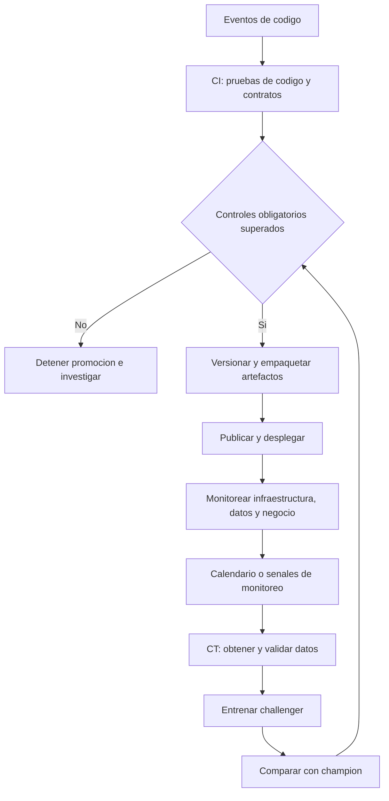

# Clase 7: Automatización CI/CD/CT, monitoreo y gestión del drift en MLOps

> **Objetivo académico:** Integrar validación de código, datos y modelos en un flujo automatizado de producción, y fundamentar las decisiones de monitoreo, reentrenamiento y despliegue mediante evidencia estadística y criterios de negocio.

## 1. Contexto y marco conceptual

### Del desarrollo experimental a la operación continua

El entrenamiento de un modelo constituye una etapa del ciclo de vida de aprendizaje automático. Su utilidad depende también de que pueda reproducirse, desplegarse, consumirse y mantenerse ante cambios del entorno. El despliegue inicia la operación: los datos continúan generándose y la relación entre entradas y resultados puede modificarse aunque el código permanezca intacto.

La sesión presenta MLOps mediante la metáfora de una línea industrial de producción. El trabajo artesanal, basado en notebooks locales, transferencias manuales y artefactos sin trazabilidad, se sustituye progresivamente por procesos repetibles que transforman cambios de código o datos en candidatos verificables para producción. La automatización busca reducir errores, aumentar la consistencia y acelerar la entrega; su alcance debe corresponder a la madurez y las necesidades de la organización.

El sistema requiere gobernar tres componentes interdependientes:

- **Código:** preparación de datos, entrenamiento, inferencia y lógica de aplicación.
- **Datos:** esquemas, valores, procedencia, versiones y distribuciones.
- **Modelo:** artefacto aprendido, configuración, métricas y comportamiento operativo.

**Enriquecimiento conceptual:** La distinción entre DevOps y MLOps no equivale a afirmar que el software convencional carece de validación de datos o que todo modelo produce respuestas aleatorias. Un modelo puede ejecutar inferencias deterministas y, aun así, presentar errores estadísticos y deteriorarse frente a cambios del entorno. MLOps amplía la gestión del software con controles específicos sobre datos, aprendizaje y desempeño predictivo.

### Valor de negocio y continuidad operativa

El conocimiento del negocio orienta la elección del modelo, las métricas y los umbrales de aceptación. Una mejora de accuracy o una reducción del error promedio no bastan si se perjudica un segmento relevante, se altera la definición de la variable objetivo o aumenta el costo de las decisiones.

La conexión con CRISP-DM aparece en la comprensión del negocio y de los datos. Estas actividades también permiten anticipar estacionalidad, cambios demográficos, retrasos de las etiquetas y necesidades de mantenimiento. La responsabilidad técnica incluye comprobar si las predicciones sustentan acciones útiles y si estas generan valor observable.

## 2. Fundamentos teóricos y arquitectura

### Integración, entrenamiento y entrega continuos

La arquitectura articula tres ciclos:

| Componente | Función principal | Evidencia necesaria |
| --- | --- | --- |
| Integración continua, CI | Verificar cambios de código y contratos del sistema | Pruebas, validaciones de datos y controles de compatibilidad |
| Entrenamiento continuo, CT | Generar y evaluar candidatos cuando se activa una política de entrenamiento | Datos identificados, parámetros, métricas y comparación con la referencia |
| Entrega y despliegue, CD | Preparar y promover artefactos aceptados hacia el entorno operativo | Artefactos trazables, controles de publicación y verificación del servicio |

**Enriquecimiento conceptual:** La exposición intercambia en algunos pasajes los términos *continuous delivery* y *continuous deployment*. La entrega continua mantiene una versión validada y preparada para desplegar, con una posible aprobación antes de producción. El despliegue continuo automatiza también esa promoción. Construir una imagen o publicarla en un registro son pasos del proceso y no demuestran por sí solos que el servicio se haya actualizado.

El CT puede funcionar independientemente de los cambios de código. Una nueva ventana de datos o una señal de deterioro puede justificar entrenar otro candidato sin modificar la aplicación.

### Champion, challenger y compuertas de calidad

El **champion** es la versión vigente de referencia; el **challenger** es un candidato que debe demostrar su conveniencia antes de reemplazarla. La comparación debe considerar métricas apropiadas, datos comparables y restricciones operativas.

Las compuertas de calidad detienen la promoción cuando un control obligatorio falla. Su eficacia depende de la calidad de los criterios: automatizar una regla incorrecta reproduce el error con mayor velocidad.

**Enriquecimiento conceptual:** La ausencia de drift no es una condición universal para promover un candidato. Un modelo nuevo puede desarrollarse precisamente para responder a un cambio confirmado. La decisión requiere demostrar que el candidato satisface el objetivo actual sobre evidencia pertinente y que sus riesgos son aceptables.

El diagrama resume dependencias conceptuales. No implica que cada cambio de código deba entrenar un modelo: la estructura concreta depende del tipo de modificación y del costo del proceso.

### Tres pilares de validación

| Pilar | Controles tratados | Riesgo que se busca reducir |
| --- | --- | --- |
| Código | Pruebas unitarias, integración, regresión y smoke; escalamiento, codificación y manejo de nulos | Defectos de implementación o cambios inadvertidos de reglas |
| Datos | Columnas requeridas, tipos, nulos, extremos, cantidad mínima de registros y cambios de distribución | Entrenamiento o inferencia sobre entradas incompatibles o inadecuadas |
| Modelo | Métricas, umbrales, comparación champion–challenger y señales de deterioro | Promoción de un modelo que no satisface los objetivos |

Un contrato de esquema puede detectar que `temperatura` fue sustituida por `temperaturas`. Sin embargo, no identifica necesariamente que una columna denominada `ventas` pasó de representar ventas de productos a representar ventas más servicios. La estabilidad del nombre no garantiza estabilidad semántica.

**Enriquecimiento conceptual:** Los hiperparámetros pertenecen a la configuración del entrenamiento, no a la distribución de los datos. Deben registrarse y validarse, pero su modificación no constituye por sí misma data drift.

## 3. Implementación técnica y lógica de negocio

### Orquestación con GitHub Actions

La demostración organiza la automatización mediante archivos YAML en `.github/workflows/`. Los elementos principales son:

- `on`: eventos que activan el workflow, como `push`, `pull_request`, una programación temporal o ejecución manual.
- `jobs`: unidades de trabajo, como validación, entrenamiento y publicación.
- `runs-on`: entorno del runner que ejecuta un job.
- `steps`: secuencia de acciones y comandos dentro del job.
- `uses`: referencia a una acción reutilizable, como checkout o configuración de Python.
- `run`: ejecución de comandos del proyecto.

La secuencia mostrada comprende obtener el código, preparar Python, instalar dependencias, validar datos y ejecutar pruebas. Posteriormente puede construirse una imagen Docker, comprobar su capacidad de inferencia, autenticarse en el registro y publicar el artefacto.

**Enriquecimiento conceptual:** Un pull request propone integrar cambios y habilita su revisión; abrirlo no equivale a haberlos fusionado. Asimismo, checkout recupera la revisión configurada para esa ejecución, que no tiene por qué coincidir con la última revisión de la rama principal.

Los workflows combinan configuración declarativa con comandos imperativos. No poseen automáticamente las mismas propiedades de reconciliación del estado que un controlador de Kubernetes.

### Dependencias entre trabajos y conservación de artefactos

La publicación depende de la validación previa: si CI falla, el flujo no debe promover la imagen. El CT mostrado se activa por programación o manualmente, genera nuevos datos sintéticos, los valida, revisa señales de cambio y, cuando corresponde, reentrena y guarda el modelo.

La sesión propone DVC para recuperar versiones de datos, aunque la demostración lo sustituye por simulación. MLflow se plantea como soporte para registrar métricas y versiones del modelo. Docker empaqueta la aplicación; un registro conserva las imágenes; Kubernetes o procedimientos remotos permiten actualizar el servicio.

**Enriquecimiento conceptual:** Guardar un archivo en el disco de un runner no lo hace persistente ni accesible automáticamente para otro workflow. El enlace CT → CI/CD debe publicar y recuperar explícitamente el artefacto mediante un almacén persistente, registro de modelos o mecanismo de artefactos. Cada promoción debe identificar qué modelo, datos y código se están utilizando.

**Enriquecimiento conceptual:** Los jobs pueden ejecutarse en entornos separados. Las dependencias de ejecución y la transferencia de archivos requieren configuración explícita. También conviene impedir que una ejecución posterior a CT publique artefactos de una ejecución fallida o de un origen sin permisos de promoción.

### Costos y selección de disparadores

El consumo de runners, almacenamiento y registros influye en la política de automatización. Ejecutar un entrenamiento costoso ante cualquier cambio puede desperdiciar recursos. La sesión propone seleccionar eventos relevantes, como revisiones de integración, y separar CT de CI/CD.

Las cuotas gratuitas y los límites comerciales mencionados no se adoptan como especificaciones permanentes: dependen del plan, la visibilidad del repositorio y la infraestructura utilizada.

### Métricas coherentes con el problema

La sesión destaca que la métrica debe responder al tipo de predicción, a la distribución de los datos y al costo del error.

**Enriquecimiento conceptual:** Para regresión, el error absoluto medio se expresa como:

$$
\operatorname{MAE}=\frac{1}{n}\sum_{i=1}^{n}|y_i-\hat y_i|.
$$

Aquí, $n\in\mathbb{N}_{>0}$ es el número de observaciones etiquetadas; $y_i\in\mathbb{R}$ es el resultado observado y $\hat y_i\in\mathbb{R}$ la predicción para la observación $i$. El MAE conserva la unidad de la variable objetivo. En la heladería representa error medio en helados por día y trata linealmente la magnitud de cada error.

Para penalizar más los errores grandes puede considerarse:

$$
\operatorname{RMSE}=\sqrt{\frac{1}{n}\sum_{i=1}^{n}(y_i-\hat y_i)^2}.
$$

Las variables y unidades son las mismas. Su sensibilidad a errores grandes puede ser conveniente cuando estos son costosos, pero no justifica seleccionar RMSE sin analizar el negocio. Los picos reales de demanda tampoco deben descartarse automáticamente como anomalías.

Las métricas porcentuales requieren precaución cuando existen resultados reales iguales o próximos a cero, porque la división por esos valores puede resultar indefinida o inestable. ROC-AUC corresponde a problemas de clasificación con puntuaciones; no constituye una alternativa intercambiable con MAE para regresión.

### Empaquetado, publicación e inferencia

El empaquetado debe permitir reconstruir el entorno y actualizar componentes con trazabilidad. La sesión recomienda separar cambios de dependencias y aplicación para evitar reconstrucciones innecesarias.

**Enriquecimiento conceptual:** En Docker, esta separación puede implementarse mediante capas: instalar dependencias antes de copiar el código que cambia frecuentemente favorece el uso de caché. La imagen final puede contener ambos componentes y debe conservar un entorno de ejecución coherente. Serializar un modelo con joblib tampoco equivale a compilarlo en todos los casos.

Se presentan dos posibilidades de servicio: una API propia, ilustrada mediante FastAPI, y mecanismos de serving asociados a MLflow. La elección depende de los requisitos de control, integración y operación.

**Enriquecimiento conceptual:** MLflow Tracking Server y un servidor de inferencia cumplen funciones diferentes. Además, una API REST describe una interfaz, mientras que un servidor de modelos describe una implementación de servicio; ambas categorías pueden coexistir. Ninguna herramienta garantiza menor latencia o costo sin considerar hardware, concurrencia, carga del modelo y configuración.

## 4. Análisis crítico de casos y auditoría práctica

### Monitoreo en tres capas

Un servicio puede responder correctamente a nivel HTTP y producir predicciones deterioradas. La observación debe distinguir disponibilidad, adecuación estadística y valor de negocio.

| Capa | Pregunta orientadora | Señales relevantes |
| --- | --- | --- |
| Infraestructura | ¿El servicio está operativo? | CPU, memoria, latencia, errores y comprobaciones de salud |
| Datos y modelo | ¿Las entradas y predicciones siguen siendo adecuadas? | Esquema, distribuciones, errores predictivos, confianza cuando sea pertinente |
| Negocio | ¿Las decisiones generan valor? | Retención, conversión, ahorro y resultados de las acciones |

La sesión también menciona una rúbrica de preparación productiva que considera datos, modelo, infraestructura y monitoreo. Su utilidad conceptual es evitar que un buen resultado experimental oculte carencias operativas. La transcripción no permite reconstruir con precisión su referencia ni sus criterios de puntuación.

### Etiquetas retrasadas

En problemas como abandono de clientes, la etiqueta real puede conocerse después de emitir la predicción. Por ello, las métricas supervisadas no siempre están disponibles en tiempo real. Es necesario distinguir la observación inmediata de las entradas de la evaluación posterior de los resultados.

**Enriquecimiento conceptual:** La evaluación debe vincular cada predicción con su versión de modelo, momento de emisión y resultado observado una vez transcurrido el horizonte pertinente. La ausencia provisional de una etiqueta no equivale a una predicción correcta. Las acciones de retención también pueden modificar el desenlace y complicar la interpretación causal del valor obtenido.

### Data drift y concept drift

**Enriquecimiento conceptual:** Para precisar las definiciones empleadas en la sesión, sean $X\in\mathcal{X}$ las variables de entrada y $Y\in\mathcal{Y}$ la variable objetivo, donde $\mathcal{X}$ y $\mathcal{Y}$ son sus respectivos dominios. Los subíndices $r$ y $a$ indican un período de referencia y un período actual.

El data drift de las entradas corresponde a:

$$
P_r(X)\neq P_a(X).
$$

El concept drift corresponde a una modificación de la relación predictiva:

$$
P_r(Y\mid X)\neq P_a(Y\mid X).
$$

Estas expresiones comparan distribuciones de probabilidad. El concept drift puede existir aunque la distribución de $X$ permanezca estable; no exige que cambien simultáneamente las distribuciones marginales de entradas y resultados. Ambos tipos de cambio pueden coexistir.

Se distinguen cambios súbitos, graduales y estacionales. Esa clasificación temporal ayuda a elegir ventanas de observación y políticas de respuesta, pero no determina por sí sola si se ha deteriorado el modelo.

### Caso de la heladería

El notebook descrito simula ventas diarias en función de la temperatura y ajusta una regresión lineal. En primavera se genera una referencia alrededor de 20 °C. La regla inicial relaciona cada grado adicional con aproximadamente ocho helados más vendidos. Durante la demostración se comenta un error de referencia cercano a ocho helados diarios; es una observación del ejemplo sintético, no un resultado reproducido en estos apuntes.

Se contrastan dos situaciones:

1. **Paso de primavera a verano:** aumenta la temperatura y se desplaza su distribución, mientras se mantiene la relación entre temperatura y ventas. Hay data drift; el modelo puede seguir siendo adecuado.
2. **Cambio asociado a precios altos:** para temperaturas comparables se venden menos helados y se modifica la relación entre temperatura y ventas. El ejemplo altera la sensibilidad aproximada de ocho a cinco helados por grado. Hay cambio de concepto para el modelo que solo observa temperatura.

**Enriquecimiento conceptual:** Una representación pedagógica del ejemplo es:

$$
Y=\beta_0+\beta_1T+\varepsilon.
$$

Aquí, $T\in\mathbb{R}$ representa temperatura en °C, $Y\in\mathbb{R}$ ventas diarias aproximadas, $\beta_0\in\mathbb{R}$ un intercepto en helados por día, $\beta_1\in\mathbb{R}$ la sensibilidad en helados por día y por °C, y $\varepsilon\in\mathbb{R}$ una perturbación en helados por día. Se supone una relación aproximadamente lineal y ruido de media condicional cero. Esta aproximación no garantiza conteos enteros ni predicciones no negativas fuera del rango observado.

Si únicamente cambia la distribución de $T$ y la relación condicional permanece estable, no se deduce que el modelo deba reentrenarse. Si cambia la pendiente, sí existe una razón para revisar la relación aprendida. La omisión del precio muestra además cómo una variable no observada puede modificar la relación aparente entre temperatura y ventas.

### Detección estadística: Kolmogórov–Smirnov y PSI

La sesión menciona dos mecanismos para comparar una ventana actual con una referencia: Kolmogórov–Smirnov y el índice de estabilidad poblacional, PSI.

**Enriquecimiento conceptual:** Para dos muestras de una variable numérica, el estadístico de Kolmogórov–Smirnov es:

$$
D_{n,m}=\sup_{z\in\mathbb{R}}|F_n(z)-G_m(z)|.
$$

$F_n$ y $G_m$ son funciones de distribución empíricas de muestras de tamaños $n,m\in\mathbb{N}_{>0}$; $z$ recorre los valores de la variable. El estadístico $D_{n,m}\in[0,1]$ mide la máxima separación vertical entre ambas distribuciones acumuladas y carece de unidades.

El contraste considera como hipótesis nula que ambas muestras proceden de la misma distribución. Un valor $p$ pequeño respecto de un nivel $\alpha\in(0,1)$ previamente fijado aporta evidencia contra esa hipótesis bajo los supuestos del contraste. No mide directamente gravedad operativa. La dependencia temporal, los tamaños de muestra, los empates y las comparaciones múltiples pueden afectar su interpretación; no rechazar la hipótesis nula tampoco demuestra igualdad.

**Enriquecimiento conceptual:** El PSI compara proporciones sobre los mismos intervalos o categorías:

$$
\operatorname{PSI}=\sum_{j=1}^{k}(q_j-p_j)\ln\left(\frac{q_j}{p_j}\right).
$$

Aquí, $k\in\mathbb{N}_{>0}$ es el número de grupos, $p_j>0$ la proporción de referencia y $q_j>0$ la proporción actual del grupo $j$, con $\sum_jp_j=\sum_jq_j=1$. El índice no tiene unidades; su valor depende de la partición elegida. Las proporciones nulas requieren un tratamiento explícito y documentado. No se establecen umbrales universales de aceptación.

### Alcances de las señales observadas

| Distribución de entradas | Error supervisado | Interpretación prudente |
| --- | --- | --- |
| Estable | Estable | No se observa deterioro en los controles disponibles |
| Cambiante | Estable | Hay señal de cambio; vigilar su relevancia operativa |
| Estable | Creciente | Investigar cambio de concepto u otras causas de error |
| Cambiante | Creciente | Investigar tanto las entradas como la relación predictiva |

**Enriquecimiento conceptual:** El MAE no constituye una prueba específica de concept drift. Un aumento del error también puede proceder de problemas de etiquetas, implementación, mezcla de segmentos o ruido. Asimismo, aplicar Kolmogórov–Smirnov únicamente a temperatura no permite descartar cambios en otras variables o en relaciones multivariantes.

Los relatos sobre una empresa inmobiliaria y Google Flu Trends se utilizan como motivación, pero la transcripción mezcla contextos y no aporta evidencia suficiente para sostener las atribuciones históricas ni sus causas. Conceptualmente, un cambio de precios condicionado a las mismas características puede corresponder a concept drift; un cambio en quién realiza búsquedas puede alterar la distribución de entradas, la relación con el fenómeno objetivo o ambas. La clasificación depende de qué distribución cambió, no del nombre del caso.

## 5. Principios de diseño, buenas prácticas y anti-patrones

### Reentrenamiento condicionado por evidencia

La sesión distingue tres disparadores:

- **Tiempo:** ejecutar el proceso con una periodicidad acorde con la dinámica del entorno.
- **Rendimiento:** responder al deterioro de métricas supervisadas cuando existen etiquetas disponibles.
- **Drift o señales proxy:** investigar cambios que pueden anticipar degradación.

La demostración matiza la idea inicial de reentrenar ante cualquier drift: un desplazamiento de entradas con error estable puede justificar vigilancia, mientras que un deterioro persistente exige una intervención más profunda.

**Enriquecimiento conceptual:** Un disparador activa un proceso de evaluación; no autoriza por sí solo reemplazar el champion. Antes de entrenar conviene descartar errores de captura, cambios de unidades o redefiniciones de la etiqueta. Reentrenar sobre datos defectuosos puede empeorar el sistema. Incluso con concept drift confirmado, la respuesta puede requerir nuevas variables, revisar el objetivo o suspender temporalmente decisiones.

### Estrategias de despliegue y evaluación

| Estrategia | Propósito | Consideraciones |
| --- | --- | --- |
| Blue-green | Mantener dos entornos preparados y cambiar el tráfico hacia la nueva versión | Facilita el retorno al entorno anterior; puede requerir capacidad duplicada |
| Canary | Exponer inicialmente una fracción del tráfico y ampliar según las señales | Limita la exposición al riesgo; necesita criterios claros de avance y reversión |
| A/B testing | Comparar variantes mediante un diseño experimental | Requiere asignación adecuada, métricas de negocio y análisis de incertidumbre |

**Enriquecimiento conceptual:** Blue-green no se define por repartir tráfico progresivamente; esa característica corresponde de forma más directa al canary o a una estrategia híbrida. Un rolling update de Kubernetes tampoco equivale automáticamente a blue-green. Las tres técnicas pueden detectar problemas de infraestructura y comportamiento; la asociación expuesta entre blue-green e infraestructura y entre canary y comportamiento debe entenderse como orientación, no como restricción.

**Enriquecimiento conceptual:** El rollback exige compatibilidad del estado, contratos y datos compartidos. Mantener viva la versión anterior no garantiza una reversión segura si la nueva versión realizó cambios incompatibles.

En A/B testing, la comparación debe centrarse en la pregunta de negocio. La significación estadística y la relevancia práctica son distintas.

**Enriquecimiento conceptual:** En un contraste convencional previamente definido, $p<\alpha$ aporta evidencia contra la hipótesis nula; un valor $p$ superior a 0,05 no demuestra superioridad del candidato. Tampoco basta un resultado significativo si la mejora es irrelevante o se violan restricciones operativas. Revisar continuamente resultados sin un diseño apropiado puede distorsionar las conclusiones.

### Agentes, herramientas y harness

La sesión incorpora una discusión sobre agentes para apoyar codificación, validación y pruebas. El LLM funciona como componente de razonamiento y generación; el sistema incorpora instrucciones, herramientas, memoria o contexto y reglas de ejecución. El **harness** designa el entorno que organiza esos componentes y controla el trabajo.

Las skills se presentan como instrucciones reutilizables, frecuentemente escritas en Markdown. MCP aparece como un protocolo para integrar herramientas. La orquestación coordina responsabilidades, intercambio de contexto y dependencias entre agentes. Esta orquestación es distinta de la ejecución de jobs de CI/CD, aunque ambas ordenan procesos.

**Enriquecimiento conceptual:** Un agente no requiere MCP: puede integrar herramientas mediante otros mecanismos. MCP no fue creado por Google. Asimismo, las skills externas no explican por sí solas las capacidades de programación de un LLM, que también proceden de su entrenamiento. La generación de texto tampoco se reduce a recuperar palabras próximas en un espacio de embeddings; las representaciones contextuales y la atención intervienen en la predicción de tokens.

La documentación compartida —contexto, especificaciones y planes— facilita la coordinación entre herramientas y modelos. La sesión propone distribuir generación y revisión entre modelos diferentes para ampliar perspectivas y seleccionar recursos según la dificultad del trabajo.

**Enriquecimiento conceptual:** Utilizar modelos distintos no garantiza independencia ni corrección; pueden compartir sesgos y errores. Sus observaciones deben contrastarse con pruebas ejecutables, contratos de datos y evidencia del negocio. Tampoco puede afirmarse que todos los LLM respondan siempre de forma positiva.

La propuesta de un segundo modelo que revise y mejore el harness se conserva como una idea de optimización del proceso descrita en la sesión. Su denominación y alcance no se presentan como un estándar establecido.

### Buenas prácticas y anti-patrones

| Buena práctica | Anti-patrón asociado |
| --- | --- |
| Versionar código, datos, configuración y modelos de forma vinculada | Conservar únicamente el archivo final sin procedencia |
| Evaluar champion y challenger sobre evidencia comparable | Comparar métricas de períodos o definiciones incompatibles |
| Monitorear infraestructura, predicción y negocio | Equiparar disponibilidad con calidad predictiva |
| Mantener controles semánticos de los datos | Confiar exclusivamente en nombres y tipos de columnas |
| Ajustar automatización y recursos a la necesidad | Entrenar ante cualquier evento sin criterio de costo |
| Exigir aceptación antes de promover un candidato | Convertir todo reentrenamiento en despliegue automático |
| Validar resultados de agentes con evidencia | Aceptar una revisión generada como garantía de corrección |

## 6. Síntesis conceptual y profundización académica

MLOps transforma el modelo aislado en un servicio mantenible mediante trazabilidad, controles y retroalimentación. CI protege la consistencia de los cambios; CT produce candidatos ante eventos definidos; la entrega y el despliegue convierten candidatos aceptados en versiones operativas. El monitoreo cierra el ciclo al observar infraestructura, datos, desempeño y valor.

La distinción entre data drift y concept drift organiza la interpretación de las señales. Un desplazamiento de entradas puede no afectar a un modelo cuya relación aprendida sigue siendo válida. A la inversa, el deterioro puede aparecer con entradas aparentemente estables si cambia la relación con el objetivo. La heladería ilustra ambos mecanismos y muestra por qué las pruebas sobre entradas deben complementarse con evaluación supervisada cuando las etiquetas están disponibles.

El criterio central es separar **detectar, diagnosticar, entrenar y promover**. Cada acción responde a evidencia distinta. Una alerta estadística no prueba un impacto empresarial; un menor error no garantiza utilidad; un entrenamiento exitoso no acredita aptitud para producción; un despliegue saludable no demuestra vigencia predictiva.

**Enriquecimiento conceptual:** La profundización del tema puede orientarse a la dependencia temporal de los contrastes, el monitoreo por segmentos, la representatividad de las ventanas de evaluación y la relación causal entre predicción y acción. Estas cuestiones conectan la ingeniería de producción con la inferencia estadística y la toma de decisiones: el objetivo es sostener un sistema cuya conducta pueda explicarse, auditarse y corregirse ante un entorno cambiante.
