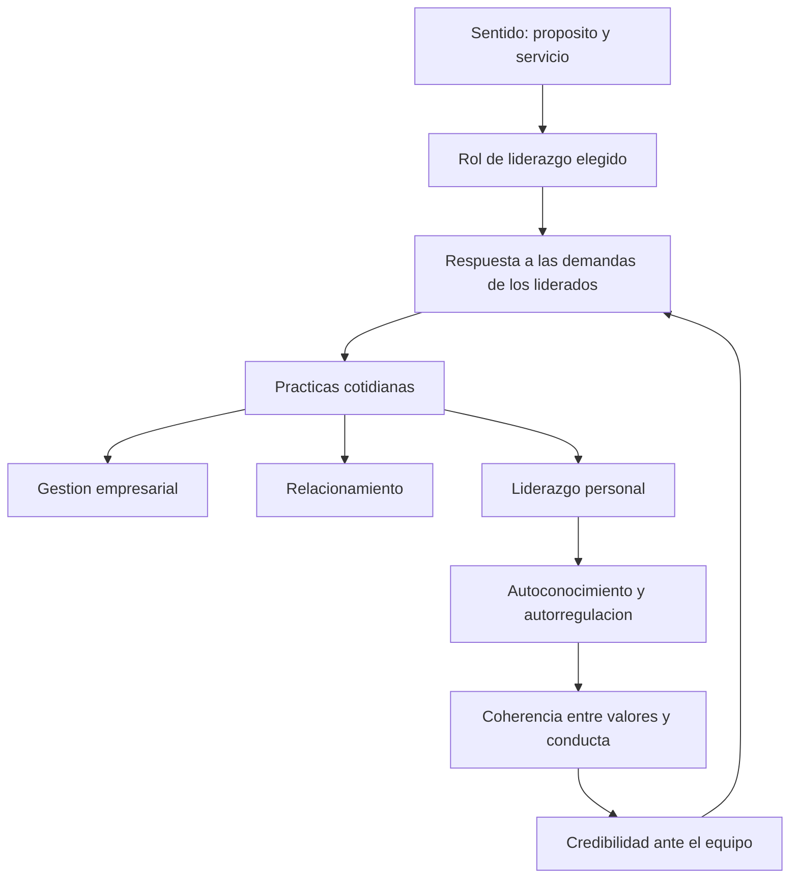

# Clase 1: Autoliderazgo, autoconocimiento y planificación personal con criterio de evidencia

> **Objetivo académico:** Comprender el autoliderazgo como fundamento de la práctica gerencial, analizar sus relaciones con el autoconocimiento y la inteligencia emocional, evaluar críticamente las herramientas de personalidad y articular valores, misión y acciones en una planificación personal coherente.

## 1. Contexto y marco conceptual

### Gestión y liderazgo como funciones complementarias

La distinción entre jefe y líder se utiliza en la sesión como contraste didáctico. No describe dos clases excluyentes de personas: una misma persona puede ejercer funciones de gestión y liderazgo según las necesidades de la situación.

La exposición recupera la distinción atribuida a John Kotter: **gestionar aporta orden y previsibilidad; liderar aporta dirección y capacidad de adaptación al cambio**. La gestión comprende presupuestos, procesos, seguimiento y control. El liderazgo articula visión, alineación y motivación.

| Dimensión | Gestión | Liderazgo |
|---|---|---|
| Problema central | Coordinar recursos y asegurar continuidad | Orientar la acción frente al cambio |
| Mecanismos destacados | Presupuestos, procesos y control | Visión, alineación y motivación |
| Contribución | Orden y previsibilidad | Dirección y adaptación |
| Riesgo de su ausencia | Desorganización operativa | Actividad ordenada sin orientación compartida |

En equipos de ciencia de datos e inteligencia artificial, ambas funciones resultan necesarias. La capacidad técnica no elimina la necesidad de coordinar personas, sostener compromisos ni comunicar el propósito de un proyecto. Asimismo, cumplir procedimientos no garantiza que el trabajo produzca decisiones útiles para la organización.

### Modelo integral de liderazgo

La sesión presenta un modelo integral de liderazgo atribuido a Roberto Rabuin, organizado en cuatro componentes relacionados:

1. **Sentido:** para qué se lidera, cuál es el propósito y a quién se sirve. Sin esta orientación, el ejercicio de autoridad puede reducirse a la búsqueda de poder.
2. **Rol:** qué tipo de líder se elige ser. Supone reconocer que existen distintas formas de ejercer el liderazgo y que la elección tiene consecuencias para las personas y los resultados.
3. **Demandas de los liderados:** qué esperan los demás para reconocer a alguien como líder. El cargo formal no garantiza aceptación ni confianza.
4. **Prácticas:** qué conductas cotidianas sostienen el sentido, el rol y la respuesta a esas demandas.

La afirmación «sin liderados no hay líderes» expresa el carácter relacional del liderazgo: su legitimidad depende también del reconocimiento de quienes participan en la relación.

### Demandas y familias de prácticas

Las diez demandas mencionadas son responsabilidad, convicción, flexibilidad, observación, coherencia, humildad, sensibilidad o empatía, conducta ejemplar, honestidad y voluntad. La transcripción no desarrolla una definición independiente de todas ellas; profundiza especialmente en flexibilidad y convicción.

La **convicción** se presenta como firmeza respecto del propósito, acompañada de capacidad para escuchar y ajustar el recorrido. La analogía del capitán ante una tormenta distingue conservar el destino de aferrarse a una ruta: sostener la dirección requiere evaluar condiciones cambiantes, no ignorarlas.

La **flexibilidad** permite responder a las condiciones de las personas y del trabajo sin abandonar los compromisos esenciales. En el caso de un equipo sometido a exigencias regulatorias, se relaciona con priorizar, revisar cargas y distinguir lo indispensable de lo postergable.

El modelo agrupa las prácticas en tres familias:

- **Gestión empresarial:** visión de futuro, innovación, gestión del cambio, planificación, aprovechamiento tecnológico, asociatividad y delegación.
- **Relacionamiento:** asertividad, escucha activa, comunicación, proximidad, empatía, reciprocidad y afectividad.
- **Liderazgo personal:** reflexión, responsabilidad plena, autoconocimiento, humildad, voluntad, mejoramiento e integridad.

La sesión concentra su desarrollo en la tercera familia. Su dificultad se vincula con que muchas de estas prácticas no reciben una exigencia externa inmediata: una organización puede reclamar resultados sin preguntar cómo reflexiona una persona o cómo sostiene su integridad cuando nadie la observa.

## 2. Fundamentos teóricos y arquitectura

### Autoliderazgo: influencia sobre la propia conducta

El autoliderazgo se define como el **proceso de influir en uno mismo para dirigir la propia conducta y motivación**. La exposición vincula esta formulación con Charles Manz y un trabajo de 1986.

Dos elementos son centrales. Primero, se trata de un proceso sostenido, no de una cualidad que se posee de manera definitiva. Segundo, influir sobre uno mismo implica orientar elecciones: qué hacer, cuándo hacerlo y por qué, incluso sin supervisión directa.

Su relevancia aumenta en actividades con autonomía, trabajo remoto y especialización técnica. En un proyecto de datos, otras personas pueden no comprender cada decisión analítica ni revisar cada línea de código. La responsabilidad profesional requiere entonces criterios internos de organización y conducta.

**Enriquecimiento conceptual:** el autoliderazgo puede contribuir a la autonomía, pero no sustituye la claridad de funciones, los recursos suficientes ni una gestión organizacional adecuada. Una dificultad originada en sobrecarga o prioridades incompatibles no se resuelve únicamente mediante disciplina individual.

### Las siete prácticas de liderazgo personal

| Práctica | Núcleo conceptual | Manifestación relevante |
|---|---|---|
| Reflexión | Interrumpir la acción para comprender qué se quiere y por qué | Reservar espacio para revisar decisiones y patrones |
| Responsabilidad plena | Reconocer la propia participación y capacidad de respuesta | Identificar acciones posibles en lugar de limitarse a atribuir culpas |
| Autoconocimiento | Comprender fortalezas, límites, valores, miedos y reacciones | Contrastar la autoimagen con comportamientos y retroalimentación |
| Humildad | Reconocer límites sin convertirlos en amenaza al propio valor | Admitir que no se sabe y escuchar otras perspectivas |
| Voluntad | Sostener decisiones y hábitos frente a impulsos inmediatos | Mantener una conducta elegida aunque resulte incómoda |
| Mejoramiento | Atender el desarrollo corporal, mental y espiritual | Evitar que el crecimiento profesional absorba todas las áreas de vida |
| Integridad | Mantener coherencia entre pensamiento, comunicación y acción | Expresar límites y cumplir o renegociar compromisos |

La reflexión se contrapone a una ocupación permanente del tiempo. Llenar cada pausa con mensajes, contenidos o actividad puede impedir reconocer errores recurrentes. La ausencia de actividad visible no equivale necesariamente a ausencia de trabajo cognitivo.

La humildad se ilustra mediante la posibilidad de decir «no sé» ante el equipo sin interpretar esa admisión como pérdida automática de autoridad. La voluntad se diferencia del talento: disponer de capacidades no garantiza sostener las conductas necesarias para utilizarlas.

El mejoramiento incorpora una dimensión espiritual que el docente interpreta desde sus convicciones religiosas. En el argumento central, esta dimensión se relaciona con sentido, identidad y orientación vital.

**Enriquecimiento conceptual:** las convicciones espirituales pueden analizarse como parte del marco de valores de una persona. No constituyen por sí mismas evidencia biológica. La afirmación oral sobre una supuesta pérdida de masa corporal al morir, interpretada como salida del alma, carece de documentación en la fuente y no permite establecer esa conclusión. Tampoco la analogía con un personaje de ficción demuestra una teoría científica sobre identidad o conciencia.

### Autoconocimiento interno y externo

La sesión recoge la distinción de Tasha Eurich entre dos dimensiones:

- **Autoconocimiento interno:** claridad sobre valores, aspiraciones, fortalezas, límites y reacciones propias.
- **Autoconocimiento externo:** comprensión de cómo otras personas perciben la propia conducta y sus efectos.

Ambas dimensiones pueden variar de forma relativamente independiente. Una autoimagen elaborada no garantiza comprender el impacto interpersonal.

| Autoconocimiento interno | Autoconocimiento externo | Perfil presentado | Limitación o fortaleza principal |
|---|---|---|---|
| Bajo | Bajo | Buscadores | Falta de claridad sobre sí mismos y sobre su impacto |
| Bajo | Alto | Complacientes | Atención a la mirada ajena con escasa claridad sobre lo propio |
| Alto | Bajo | Introspectivos | Claridad interna acompañada de posibles puntos ciegos interpersonales |
| Alto | Alto | Conscientes | Integración de comprensión propia y percepción externa |

La exposición atribuye a las investigaciones de Eurich una diferencia entre quienes creen conocerse bien, alrededor del 95 %, y quienes cumplirían los criterios utilizados, entre el 10 % y el 15 %. Sin los criterios y las muestras originales, estas cifras deben leerse como resultados reportados, no como una distribución universal ni como diagnóstico de una persona concreta.

Otro planteamiento del modelo integral distingue lo que se cree ser, lo que otros creen que se es y lo que realmente se es.

**Enriquecimiento conceptual:** esta tercera perspectiva no es directamente accesible mediante una única opinión o prueba. Su aproximación exige contrastar conductas, contextos y fuentes de información. La retroalimentación externa también puede contener sesgos.

### Inteligencia emocional y autoconciencia

La sesión presenta cinco componentes asociados al modelo de Daniel Goleman:

1. **Autoconciencia:** reconocer emociones, fortalezas y límites.
2. **Autorregulación:** introducir deliberación antes de actuar.
3. **Motivación:** orientar el esfuerzo por propósitos que exceden la remuneración o el cargo.
4. **Empatía:** comprender lo que sienten otras personas.
5. **Habilidad social:** construir relaciones y redes de cooperación.

La autoconciencia ocupa un lugar de base en la argumentación: reconocer una emoción permite comenzar a regular su expresión y comprender mejor su influencia sobre la interacción.

La propia exposición introduce una cautela mediante Joseph y Newman, cuyo trabajo de 2010 se menciona para discutir el solapamiento de los modelos mixtos de inteligencia emocional con rasgos de personalidad. La utilidad gerencial de un mapa conceptual no demuestra que sus componentes sean capacidades independientes ni que expliquen por sí solos el desempeño.

## 3. Implementación técnica y lógica de negocio

La fuente no contiene código, algoritmos implementados ni resultados computacionales reproducibles. Su aplicación técnica consiste en trasladar los conceptos a decisiones de trabajo, comunicación analítica y planificación de conductas.

### De la introspección abstracta a patrones observables

La sesión propone privilegiar preguntas que permitan identificar situaciones y alternativas de acción. Frente a «¿por qué soy así?», se sugieren formulaciones como «¿qué situaciones desencadenan esta reacción?» o «¿qué puedo hacer distinto la próxima vez?».

El propósito es evitar una introspección que repita explicaciones sin modificar la conducta. Las preguntas sobre situaciones concretas facilitan reconocer antecedentes, respuestas y consecuencias.

**Enriquecimiento conceptual:** esta recomendación no invalida la investigación causal ni vuelve improcedente toda pregunta por el porqué. La diferencia relevante es entre explicaciones contrastables y narraciones que se aceptan sin evidencia. Para el análisis personal pueden combinarse la descripción de patrones y la evaluación de hipótesis causales.

### Integridad en la comunicación de compromisos

La integridad se formula como coherencia entre lo que se piensa, se dice y se hace. Su aplicación no exige perfección: requiere comunicar las discrepancias relevantes y actuar responsablemente cuando un compromiso no puede sostenerse.

En un proyecto, considerar inviable un plazo y afirmar que se llegará puede trasladar el conflicto al trabajo posterior: sobrecarga, deterioro de calidad o incumplimiento. La discrepancia inicial entre juicio y comunicación afecta después a la ejecución.

**Enriquecimiento conceptual:** actuar con integridad no obliga a expresar cualquier pensamiento sin filtros. La confidencialidad, el respeto y la revisión de juicios preliminares también forman parte de la conducta profesional. La exigencia central es no ocultar información material ni prometer algo que se considera inviable sin advertirlo.

### DISC como lenguaje de comunicación

La sesión describe DISC mediante dos ejes interpretativos: ritmo de respuesta, desde más rápido y directo hasta más pausado y reservado; y foco preferente, desde tareas hasta personas. La exposición vincula sus antecedentes con William Marston en 1928 y distingue esos antecedentes de las herramientas comerciales actuales.

| Estilo | Orientación descrita | Tendencia bajo presión según el modelo | Énfasis comunicativo sugerido |
|---|---|---|---|
| D: dominancia | Resultados y decisiones rápidas | Imponer | Impacto, opciones, costos y plazos |
| I: influencia | Entusiasmo y conexión interpersonal | Improvisar | Historia concreta, personas implicadas y beneficios compartidos |
| S: estabilidad | Paciencia, continuidad y armonía | Ceder para evitar conflicto | Secuencia, responsabilidades y acompañamiento |
| C: cumplimiento | Precisión, método y calidad | Concentrarse excesivamente en detalles | Datos, método, incertidumbre y límites |

Estas descripciones son orientaciones del modelo, no predicciones deterministas de la conducta de una persona.

### Un mismo hallazgo, distintas entradas comunicativas

El caso ilustrativo plantea una estimación de posible pérdida del 12 % de los clientes en tres meses. No se proporciona un modelo real ni información para verificar esa estimación.

La adaptación comunicativa conserva el hallazgo, pero modifica el orden y el énfasis:

- Para una orientación a resultados, comenzar por la decisión necesaria, su impacto y las alternativas de intervención.
- Para una orientación relacional, conectar el hallazgo con experiencias reales de clientes y con las personas beneficiadas por una respuesta.
- Para una orientación a la estabilidad, explicar el plan por etapas, responsables y apoyos.
- Para una orientación a la precisión, presentar método, datos, incertidumbres y aspectos pendientes de investigación.

El principio es ajustar la presentación a las necesidades del interlocutor sin alterar la evidencia. La calidad del análisis necesita una comunicación que permita utilizarlo en decisiones.

**Enriquecimiento conceptual:** una predicción de abandono no establece por sí sola por qué se marcharán los clientes ni qué intervención evitará la pérdida. No sería válido añadir una causa económica si el análisis no la ha identificado. La adaptación del mensaje tampoco justifica omitir incertidumbres a quienes prefieren comunicaciones breves.

### De los valores a la misión y las acciones

El plan personal expuesto sigue siete pasos: definir valores, formular la misión, ajustar pensamientos, fijar objetivos, planificar acciones, hablar con pasión y vivir plenamente. El desarrollo se concentra en valores, misión, objetivos y acciones.

Los valores cumplen una función de orientación y priorización. Su relevancia aparece cuando existen tensiones entre alternativas, por ejemplo entre un ascenso y un compromiso personal considerado esencial. La distancia entre valores declarados y conducta cotidiana se interpreta como información para la reflexión.

La misión se estructura mediante tres componentes: qué se hace, a quién se sirve y qué valores orientan la actuación. El ejemplo presentado consiste en convertir datos en decisiones que cuiden la salud de las personas, guiándose por honestidad, servicio y aprendizaje.

Se distingue además entre **propósito de transformación masiva**, entendido como orientación amplia, y **misión personal**, que expresa la forma de contribuir a ese propósito.

La planificación de una página, presentada como adaptación de una propuesta de *Scaling Up*, organiza cuatro columnas —relaciones, logros, costumbres y patrimonio— y tres horizontes:

| Horizonte | Función | Contenido |
|---|---|---|
| De 10 a 25 años | Orientación de largo plazo | Aspiraciones y sentido de vida |
| Un año | Traducción intermedia | Objetivos y actividades verificables |
| 90 días | Ejecución próxima | Acciones que se iniciarán y conductas que se dejarán |

Las áreas espiritual, familiar, de amistades, salud y finanzas sirven como guía transversal. Incluir lo que se dejará de hacer reconoce que el tiempo y la atención son limitados.

## 4. Análisis crítico de casos y auditoría práctica

### Responsabilidad personal y límites del control

La demostración del bolígrafo contrasta «se cayó» con «lo solté» para mostrar cómo el lenguaje puede visibilizar la propia intervención. La utilidad del caso está en identificar la acción de quien sostenía el objeto.

Sin embargo, extender ese razonamiento a cualquier experiencia humana requiere cautela. La sesión propone reformular expresiones sobre despido, comunicación familiar, adopción de modelos y calidad de datos desde la perspectiva de la propia capacidad de actuación.

| Situación | Aporte de la revisión personal | Límite necesario |
|---|---|---|
| Un modelo no se utiliza | Revisar si respondía a la decisión del negocio y cómo se comunicó | También pueden existir barreras organizacionales o falta de recursos |
| Los datos presentan problemas | Identificar validaciones, limpieza y coordinación posibles | La calidad depende de múltiples responsables y sistemas |
| Una relación presenta dificultades | Analizar la propia escucha y comunicación | La otra persona conserva autonomía y responsabilidad |
| Se produce un despido | Revisar aprendizajes y alternativas de respuesta | No demuestra por sí mismo una falla individual |

**Enriquecimiento conceptual:** responsabilidad por la respuesta, causalidad del hecho y culpabilidad son cuestiones diferentes. Decir «me despidieron» puede describir correctamente una decisión ajena. Sustituirlo automáticamente por «no supe hacerme valorar» impone una explicación que podría ser falsa. El enfoque de agencia resulta útil cuando identifica posibilidades reales sin negar injusticias o restricciones externas.

La referencia a Viktor Frankl y *El hombre en busca de sentido* introduce el papel del propósito ante la adversidad. Su valor en la sesión es existencial y reflexivo.

**Enriquecimiento conceptual:** las observaciones narradas sobre supervivencia en condiciones extremas no permiten atribuirla exclusivamente al sentido vital. No corresponde inferir que quienes no sobrevivieron carecieran de propósito ni convertir esa narración en una ley causal.

### Flexibilidad bajo exigencias regulatorias

El caso de un equipo de cumplimiento normativo muestra una tensión entre obligaciones organizacionales y sostenibilidad del trabajo. La flexibilidad se plantea como revisión de cargas, permisos y exigencias secundarias para preservar lo esencial.

**Enriquecimiento conceptual:** conviene separar restricciones externas que el equipo no puede modificar de decisiones internas que sí admite reorganizar. Esa distinción permite ajustar secuencias, distribuir trabajo o escalar necesidades de recursos sin prometer una flexibilidad incompatible con las obligaciones aplicables.

### Valores personales y cultura organizacional

El conflicto entre una persona orientada a la calidad y una organización que exige rapidez a cualquier costo ilustra una posible incompatibilidad de valores. La exposición relaciona la repetición de esa tensión con estrés y desgaste.

**Enriquecimiento conceptual:** el desacuerdo no demuestra por sí solo que una relación laboral deba terminar ni permite estimar una probabilidad individual de agotamiento. Es necesario distinguir estándares mínimos de calidad, perfeccionismo, restricciones reales y prácticas sistemáticamente dañinas. La persistencia del conflicto y la posibilidad de corregirlo son relevantes para evaluar alternativas.

### Personalidad: estimación y evidencia psicométrica

La personalidad se define como un patrón de pensamientos, emociones y conductas relativamente persistente en el tiempo y en distintas situaciones. Un instrumento ofrece una estimación de aspectos de ese patrón, con limitaciones de medición.

La sesión propone tres criterios de lectura:

- **Confiabilidad:** consistencia de las mediciones bajo condiciones comparables.
- **Validez:** evidencia de que la interpretación del resultado resulta adecuada para el uso previsto.
- **Efecto Forer:** aceptación de descripciones generales como si fueran específicamente personales.

Se relata el estudio de Bertram Forer de 1949: 39 estudiantes recibieron una descripción idéntica presentada como individual y la valoraron, en promedio, con 4,26 sobre 5. El caso advierte que reconocerse en una descripción no basta para demostrar su precisión.

**Enriquecimiento conceptual:** un instrumento puede ser consistente y aun así no respaldar el uso que se pretende darle. También es posible que una categoría cambie porque una puntuación se encuentra cerca de un umbral. Por ello, la variación de una etiqueta no prueba por sí sola que toda la medición sea inútil.

| Herramienta | Función descrita en la sesión | Cautela de interpretación |
|---|---|---|
| DISC | Lenguaje de estilos conductuales y comunicación | Respaldo limitado; no convertir estilos en identidades fijas |
| Eneagrama | Exploración de motivaciones mediante nueve tipos | Evidencia mixta sobre confiabilidad y validez |
| HIGH5 | Identificación de cinco fortalezas destacadas | Investigación independiente limitada según la exposición |
| Big Five | Descripción mediante cinco dimensiones de personalidad | Mayor investigación relativa; no determina trayectorias individuales |

La advertencia práctica es no contratar, despedir o evaluar a una persona exclusivamente por una etiqueta de DISC. La utilidad conversacional de una herramienta no acredita su idoneidad para decisiones de alto impacto.

**Enriquecimiento conceptual:** la afirmación general de que ningún instrumento puede utilizarse en selección necesita acotarse. Un uso profesional exige evidencia específica para el propósito, la población y el contexto. Esa evidencia no está disponible para los instrumentos concretos utilizados en la sesión.

### Big Five y desempeño

El modelo se presenta mediante apertura a la experiencia, responsabilidad o escrupulosidad, extraversión, amabilidad y estabilidad emocional. Son dimensiones, no cinco categorías excluyentes. La estabilidad emocional expresa el polo inverso del neuroticismo.

La exposición destaca una asociación aproximada de $r = 0{,}20$ entre responsabilidad y desempeño. Aquí $r$ es un coeficiente de correlación adimensional, situado entre $-1$ y $1$. Una asociación positiva de esa magnitud describe una tendencia modesta; no establece causalidad ni permite asegurar cómo rendirá una persona.

**Enriquecimiento conceptual:** en una regresión lineal simple con intercepto, aplicada a las mismas dos variables y observaciones, el coeficiente de determinación equivale al cuadrado de la correlación de Pearson:

$$
R^2 = r^2 = (0{,}20)^2 = 0{,}04.
$$

$R^2$ es una proporción adimensional entre $0$ y $1$ que expresa la variación de la variable de respuesta recogida por ese ajuste. En este ejemplo hipotético sería un 4 %. La equivalencia ilustra por qué una asociación estadística no determina el desempeño; no reconstruye el análisis del estudio mencionado ni demuestra una contribución causal del rasgo.

### Neuroliderazgo y neuromitos

La sesión cuestiona la clasificación global de personas como predominantemente lógicas por su hemisferio izquierdo o creativas por el derecho. Se menciona un estudio de Nielsen y colaboradores de 2013 con más de mil participantes. La existencia de funciones lateralizadas no autoriza esa tipología general de personalidad.

También se revisa críticamente el cerebro triuno, asociado a Paul MacLean. Puede funcionar como metáfora para distinguir reacción y respuesta, pero no debe presentarse como una descripción literal de tres cerebros independientes apilados evolutivamente. Las preferencias de pensamiento de modelos como el de Herrmann tampoco equivalen a mapas anatómicos individuales.

La exposición refiere un estudio de Dekker y colaboradores de 2012 en el que los docentes encuestados aceptaban, en promedio, el 49 % de los neuromitos presentados. El dato ilustra la difusión de estas creencias en esa investigación, sin justificar generalizaciones a toda población.

Como contraste, se presenta el etiquetado afectivo: nombrar una emoción puede contribuir a regular la respuesta. El trabajo de Lieberman y colaboradores de 2007 se menciona por resultados de neuroimagen relacionados con menor activación de la amígdala.

**Enriquecimiento conceptual:** un resultado de laboratorio no garantiza que nombrar una emoción produzca siempre el mismo efecto en situaciones laborales. Decir «estoy frustrado» puede facilitar una pausa y una respuesta deliberada, pero no resuelve la causa del conflicto ni sustituye otras formas de intervención.

## 5. Principios de diseño, buenas prácticas y anti-patrones

### Coherencia entre propósito, decisiones y condiciones reales

Un liderazgo sostenible conecta propósito, conducta y posibilidades de ejecución. El principio de integridad requiere advertir límites antes de que se conviertan en incumplimientos ocultos. La flexibilidad demanda revisar medios sin perder de vista los compromisos esenciales.

| Buena práctica | Anti-patrón | Consecuencia del anti-patrón |
|---|---|---|
| Contrastar autoimagen con conductas y retroalimentación | Asumir que la introspección elimina los puntos ciegos | Desconocer el impacto sobre otras personas |
| Admitir incertidumbre y límites | Fingir certeza para preservar autoridad | Decisiones apoyadas en información incompleta |
| Usar perfiles como hipótesis de conversación | Etiquetar personas de manera permanente | Estereotipos y expectativas rígidas |
| Adaptar el orden del mensaje conservando la evidencia | Cambiar el contenido para agradar al interlocutor | Pérdida de trazabilidad y confianza |
| Identificar el margen real de actuación | Atribuirse toda causa o trasladar toda culpa | Culpa injustificada o pasividad |
| Priorizar y dejar actividades incompatibles | Añadir objetivos sin liberar capacidad | Planes inviables y sobrecarga |
| Distinguir metáforas y resultados empíricos | Presentar una analogía como prueba científica | Apariencia de rigor sin sustento |

### Intenciones de implementación

La sesión presenta la estructura «si ocurre una situación, entonces realizaré una acción» como mecanismo para vincular una señal reconocible con una respuesta previamente elegida. Se atribuye a Gollwitzer y Sheeran una revisión de 94 estudios y un tamaño del efecto de aproximadamente 0,65 en el logro de metas.

El mecanismo propuesto consiste en reducir la deliberación cuando aparece la situación prevista. Un ejemplo personal conecta un momento semanal con salir a correr antes de revisar mensajes. Un ejemplo laboral conecta la detección de un fallo en producción con comunicar el incidente al responsable del negocio.

**Enriquecimiento conceptual:** el valor 0,65, presentado como tamaño del efecto, no significa un aumento del 65 % en la probabilidad de éxito. Su interpretación precisa depende del estimador, las comparaciones y el diseño de la revisión. En contextos de producción, una regla de respuesta debe ajustarse a la gravedad del incidente y al protocolo vigente; no conviene retrasar una contención urgente por aplicar una secuencia de forma rígida.

### Hábitos: repetición contextual y variabilidad

La exposición cuestiona la regla universal de los 21 días. Refiere un estudio con 96 participantes en el que se reportó una mediana de 66 días y un intervalo de 18 a 254 días para la formación de automaticidad. También destaca que una omisión aislada no necesariamente arruinaba el proceso.

La interpretación práctica es que los hábitos se consolidan mediante repetición en condiciones reconocibles y presentan una variabilidad considerable. La cifra central no constituye un plazo obligatorio para todas las conductas o personas.

El ejemplo de actividad física articula tres niveles: preservar salud y energía a largo plazo, sostener una frecuencia semanal y completar una distancia definida durante el año, y establecer acciones próximas de preparación y organización. Dejar de utilizar dispositivos a altas horas se plantea como una forma de proteger el descanso que hace viable el entrenamiento.

**Enriquecimiento conceptual:** una intención de implementación facilita iniciar una conducta, pero no garantiza su mantenimiento. La carga de trabajo, la salud, el entorno y el acceso a recursos condicionan su viabilidad. El plan necesita revisión cuando esas condiciones cambian.

### Precisión en las atribuciones

La sesión aclara que la formulación «somos lo que hacemos repetidamente», atribuida con frecuencia a Aristóteles, corresponde a una síntesis de Will Durant de 1926. El principio metodológico es distinguir una cita textual de una paráfrasis o reconstrucción posterior.

## 6. Síntesis conceptual y profundización académica

El argumento central de la clase sitúa el autoliderazgo como base de credibilidad para orientar a otras personas. Esa base reúne reflexión, reconocimiento de límites, responsabilidad sobre la propia respuesta y coherencia entre valores, comunicación y acción.

El autoconocimiento adquiere mayor profundidad cuando combina comprensión interna y retroalimentación externa. Los instrumentos de personalidad pueden abrir conversaciones y mostrar tendencias, pero su utilidad depende de la calidad de la medición y del uso previsto. Ningún resultado presentado permite convertir un perfil en identidad definitiva ni en explicación completa del desempeño.

La planificación personal conecta valores y misión con horizontes de acción. Su consistencia exige traducir aspiraciones en conductas observables y reconocer qué actividades deben abandonarse para hacerlas viables. Las intenciones de implementación concretan una señal y una respuesta; la formación de hábitos requiere además repetición y condiciones sostenibles.

La revisión crítica de la sesión deja cuatro distinciones fundamentales:

- **Gestión y liderazgo:** funciones complementarias que aportan coordinación y orientación.
- **Agencia y control total:** capacidad de respuesta que convive con restricciones y responsabilidades ajenas.
- **Metáfora y evidencia:** recursos explicativos que no poseen el mismo valor probatorio.
- **Tendencia y determinación:** asociaciones y perfiles que orientan hipótesis sin fijar destinos personales.

**Enriquecimiento conceptual:** una línea de profundización consiste en estudiar conjuntamente autorregulación individual y diseño organizacional. La conducta profesional emerge de la interacción entre características personales, relaciones, incentivos, recursos y condiciones de trabajo. Esta perspectiva evita reducir los problemas colectivos a falta de voluntad y, al mismo tiempo, permite reconocer el margen de contribución personal.

La prioridad de las personas sobre el modelo resume una orientación gerencial de la sesión: un desarrollo técnico alcanza valor organizacional cuando puede comunicarse, utilizarse y sostenerse mediante relaciones responsables.
