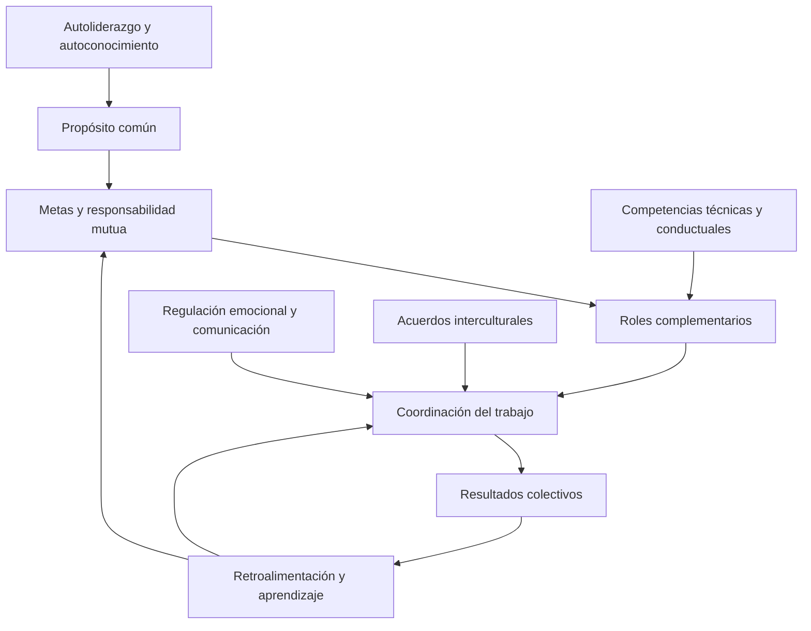

# Clase 2: Gestión de equipos: selección por competencias, inteligencia emocional y comunicación intercultural

> **Objetivo académico:** Distinguir grupos de trabajo y equipos, analizar la complementariedad de sus integrantes y fundamentar decisiones de selección, regulación emocional, comunicación intercultural y productividad mediante conductas observables y una lectura crítica de la evidencia.

## 1. Contexto y marco conceptual

### Del autoliderazgo a la responsabilidad colectiva

La sesión desplaza el foco desde el liderazgo personal hacia la coordinación de personas interdependientes. El autoconocimiento, la regulación de las propias respuestas y la coherencia entre lo que se exige y lo que se practica constituyen la base del liderazgo colectivo. Sin embargo, un equipo necesita además propósito compartido, reglas de colaboración y responsabilidad por resultados comunes.

Como continuidad conceptual, se recuperan tres ideas: liderarse antes de dirigir a otros; interpretar los instrumentos de autodiagnóstico como indicadores de tendencias, no como destinos personales; y vincular una intención con un desencadenante específico mediante la estructura «si ocurre una situación, entonces realizaré una acción». La formación de hábitos se presenta como un proceso gradual y variable entre personas. La sesión menciona un valor de 66 días atribuido al estudio de Lally y colaboradores, junto con la observación de que una omisión aislada no necesariamente interrumpe el proceso. Esta cifra no debe convertirse en un plazo universal de automatización.

### Grupo de trabajo, equipo y trabajo en equipo

La distinción principal, atribuida a Katzenbach y Smith, reside en el compromiso común. Reunir especialistas, compartir una jefatura o utilizar la misma plataforma de comunicación no basta para producir un equipo.

| Dimensión | Grupo de trabajo | Equipo |
| --- | --- | --- |
| Propósito | Predominan objetivos individuales o de cada función | Existe un propósito común asumido por sus integrantes |
| Producto | Agregación de contribuciones individuales | Resultado colectivo que requiere integración |
| Liderazgo | La jefatura concentra asignación y control | Puede distribuirse según el conocimiento pertinente |
| Responsabilidad | Cada integrante responde principalmente por su aporte | Hay responsabilidad individual y mutua |
| Coordinación | Predomina la división de actividades | Se gestionan interdependencias y decisiones compartidas |

Un área de analítica en la que cada profesional atiende reportes independientes puede operar adecuadamente como grupo. En cambio, poner en producción un pronóstico de demanda exige integrar datos, ingeniería, negocio y tecnologías de información: la utilidad final depende de la articulación de esas contribuciones.

La sesión también distingue el equipo de trabajo, entendido como unidad organizada, del trabajo en equipo, entendido como los métodos y procesos de colaboración. Una denominación organizacional no garantiza que esos procesos existan.

No toda actividad necesita convertirse en trabajo de equipo. Cuando las contribuciones son separables y requieren poca integración, un grupo puede ser suficiente y eficiente. El problema aparece cuando se esperan resultados colectivos sin construir propósito, coordinación y responsabilidad compartida.

### El estado emocional como información de gestión

Reconocer cómo llegan las personas a una interacción permite identificar cansancio, incertidumbre, satisfacción o aislamiento que pueden afectar la coordinación. La dinámica inicial utiliza una imagen con personajes para facilitar esa expresión; su valor conceptual consiste en abrir una conversación, no en diagnosticar psicológicamente a las personas.

El debate contrapone una orientación centrada en resultados, con reducción de reuniones y separación entre vida personal y trabajo, con una orientación relacional que considera el estado del equipo para ajustar la coordinación. La posición defendida en la sesión es que los resultados dependen de personas y que las relaciones pueden sostenerlos en el tiempo. No se aportan estimaciones que permitan cuantificar esa ventaja.

**Enriquecimiento conceptual:** escuchar al equipo y proteger su concentración son decisiones compatibles. Una conversación aporta valor cuando revela bloqueos, aclara expectativas o permite ajustar acuerdos; su utilidad debe juzgarse por esa función y por su costo de coordinación. La indagación emocional debe respetar la privacidad y permitir que cada persona decida qué compartir.

## 2. Fundamentos teóricos y arquitectura

### Condiciones del desempeño colectivo

La sesión identifica ocho características de los equipos de alto rendimiento: sentido de propósito, comunicación abierta, confianza y respeto mutuo, liderazgo compartido, procedimientos claros, valoración de las diferencias, flexibilidad y aprendizaje continuo. Estas condiciones se presentan como un marco inicial, sin desarrollar modelos de evolución grupal.

La metáfora de una carreta ilustra un problema de coordinación: algunas personas impulsan, otras permanecen pasivas y otras se oponen. Antes de atribuir una participación insuficiente a falta de voluntad, el liderazgo debe revisar si están claros el propósito, la contribución esperada y las condiciones para actuar.

El esquema integra las relaciones desarrolladas durante la sesión: las capacidades individuales requieren mecanismos de coordinación para convertirse en resultados colectivos, y estos resultados ofrecen información para revisar metas y prácticas.

### Roles de Belbin: complementariedad sin etiquetas

Belbin se introduce como una herramienta para conversar sobre patrones de contribución. La exposición organiza nueve roles en tres familias:

| Familia | Rol | Contribución principal |
| --- | --- | --- |
| Acción | Impulsor | Desafía la inercia y moviliza decisiones |
| Acción | Implementador | Convierte ideas en planes y actividades concretas |
| Acción | Finalizador | Revisa detalles y procura completar el trabajo |
| Personas | Coordinador | Aclara metas y articula aportes según fortalezas |
| Personas | Cohesionador | Escucha, facilita vínculos y reduce fricciones |
| Personas | Investigador de recursos | Conecta al equipo con información, contactos y oportunidades externas |
| Ideas | Cerebro | Propone soluciones originales |
| Ideas | Monitor evaluador | Contrasta alternativas, supuestos y riesgos |
| Ideas | Especialista | Aporta conocimiento profundo en un ámbito específico |

Los roles describen conductas, no identidades fijas. Una persona puede asumir varias contribuciones y un equipo pequeño puede cubrir los nueve roles. La exposición vincula las fortalezas con posibles debilidades asociadas, como la menor atención al detalle del perfil creativo o la aparente frialdad del monitor evaluador.

**Enriquecimiento conceptual:** una debilidad asociada a un rol no justifica maltrato, incumplimiento ni ausencia de responsabilidad. Reconocer una tendencia sirve para compensarla mediante acuerdos y colaboración.

La sesión menciona una revisión de 47 estudios con evidencia mixta sobre la validez del inventario de Belbin. Su utilización se limita, por tanto, a facilitar conversaciones sobre equilibrio y contribuciones; no se recomienda emplearlo para aceptar o descartar candidatos.

### Competencias: del atributo abstracto a la conducta observable

La definición atribuida a Spencer y Spencer relaciona una característica personal con el desempeño superior en un puesto. La relación pertinente es causal, aunque la transcripción registra de forma reiterada «casualmente». Esa formulación teórica no implica que una observación aislada demuestre causalidad.

La implicación práctica es describir las competencias mediante conductas observables. «Ser proactivo» resulta insuficiente; «proponer mejoras al pipeline sin una solicitud previa» permite identificar una manifestación concreta de esa competencia.

| Componente | Contenido | Ejemplo en equipos de datos |
| --- | --- | --- |
| Saber | Conocimientos | Estadística, SQL, Python y comprensión del negocio |
| Saber hacer | Habilidades aplicadas | Construir y validar modelos |
| Poder hacer | Aptitudes y capacidad de aprendizaje | Razonar con abstracciones y aprender nuevas herramientas |
| Querer hacer | Actitudes, motivación y valores | Pedir ayuda oportunamente y cumplir acuerdos |

La metáfora de la bicicleta presenta la capacidad técnica como tracción y la dimensión conductual como dirección. Seleccionar únicamente por dominio técnico deja sin evaluar la colaboración con negocio, la comunicación y la confiabilidad en los compromisos.

### Dos concepciones de inteligencia emocional

La sesión diferencia el enfoque de capacidad de Salovey y Mayer del modelo mixto popularizado por Goleman.

| Enfoque | Núcleo conceptual | Precaución de interpretación |
| --- | --- | --- |
| Capacidad | Percibir, utilizar, comprender y manejar emociones para orientar pensamiento y acción | Es necesario conocer qué prueba de desempeño se utiliza |
| Mixto | Integra capacidades, competencias y rasgos como motivación u optimismo | Puede superponerse con dimensiones de personalidad |

La evidencia citada en la sesión vincula inteligencia emocional y desempeño laboral, incluso al considerar otras variables. Sin embargo, el resultado depende de cómo se defina y mida el constructo. Los autorreportes y las medidas mixtas no deben tratarse como equivalentes a pruebas de capacidad.

El mapa aplicado comprende cuatro dominios: autoconciencia, para reconocer emociones propias y sus efectos; autogestión, para regular respuestas y adaptarse; conciencia social, para comprender a otras personas y el clima colectivo; y gestión de relaciones, para escuchar, abordar conflictos e impulsar el desarrollo de otros.

## 3. Implementación técnica y lógica de negocio

La fuente no desarrolla código ni una implementación informática. Su aplicación técnica consiste en procedimientos de selección, criterios de medición, protocolos de comunicación y sistemas de coordinación para equipos de datos y software.

### Selección estructurada y validez predictiva

La validez predictiva se presenta como la correlación entre la puntuación de un método de selección y el desempeño laboral posterior. La sesión atribuye a Sackett y colaboradores, en 2022, una revisión de estimaciones anteriores que habrían resultado elevadas por correcciones estadísticas excesivas.

| Método | Correlación presentada en la sesión |
| --- | ---: |
| Entrevista estructurada | 0,42 |
| Prueba de conocimiento del puesto | 0,40 |
| Capacidad cognitiva general | 0,31 |
| Entrevista no estructurada | 0,19 |

Estos valores se conservan como cifras expuestas en clase. La transcripción no contiene los detalles metodológicos necesarios para verificarlos ni para establecer su aplicabilidad a una organización específica.

**Enriquecimiento conceptual:** para precisar su interpretación, sean $X$ la puntuación numérica de selección y $Y$ una medida numérica posterior de desempeño, ambas con varianza distinta de cero. La correlación de Pearson es:

$$
r=\frac{\operatorname{Cov}(X,Y)}{\sigma_X\sigma_Y},\qquad -1\leq r\leq 1.
$$

Aquí, $\operatorname{Cov}(X,Y)$ representa la covarianza y $\sigma_X$ y $\sigma_Y$ las desviaciones estándar de las respectivas variables. El coeficiente es adimensional y expresa asociación lineal. Un valor nulo no descarta relaciones no lineales, y una correlación positiva no equivale a una probabilidad de contratación exitosa.

La sesión ilustra el alcance limitado de una correlación de 0,42 mediante su cuadrado:

$$
0{,}42^2=0{,}1764\approx 0{,}18.
$$

**Enriquecimiento conceptual:** en una regresión lineal simple con intercepto, calculada sobre las mismas observaciones, $R^2=r^2$. Bajo esas condiciones, el valor representa aproximadamente el 17,64 % de la variación observada de $Y$ asociada al ajuste lineal con $X$. No significa acertar el 42 % de las contrataciones ni demostrar una contribución causal del método.

La exposición recomienda combinar entrevista estructurada y prueba técnica. **Enriquecimiento conceptual:** esa combinación mejora la predicción cuando añade información pertinente; su ventaja no se deduce automáticamente de las correlaciones individuales, pues también depende del solapamiento entre métodos y del criterio de desempeño utilizado.

### Scorecard: definir el éxito antes de buscar candidatos

El proceso atribuido a Smart y Street comprende cuatro etapas: definir el scorecard, buscar candidatos, seleccionar mediante procedimientos estructurados y presentar una propuesta que permita atraer al candidato adecuado.

El scorecard articula misión del puesto, resultados esperados y competencias. Para una posición sénior de ciencia de datos, la sesión propone como misión apoyar decisiones de inventario con pronósticos confiables; como resultado ilustrativo, reducir un error de pronóstico del 25 % al 15 % en doce meses; y como competencias, dominar series de tiempo, explicar resultados a quienes deciden y pedir ayuda oportunamente.

El ejemplo no especifica la métrica del error de pronóstico. Por ello, no corresponde interpretar esos porcentajes como una medida concreta ni como resultados obtenidos.

Otros casos permiten distinguir una aspiración de un resultado operacionalizado:

| Caso | Línea base y meta ilustrativas | Precisión necesaria |
| --- | --- | --- |
| Adopción de dashboards | Pasar de una a cinco áreas usuarias | Definir qué cuenta como uso efectivo |
| Disponibilidad de software | Pasar del 90 % al 95 % | Establecer ventana y criterio de medición |
| Procesamiento de información bancaria | Reducir de seis a cuatro horas el cierre mensual | Mantener comparables el alcance y las condiciones |
| Calidad de entrega | Medir cumplimiento de criterios acordados | Aclarar qué se verifica y sobre qué conjunto de entregas |

Las precisiones de la última columna son **Enriquecimiento conceptual**. Explican por qué una cifra necesita una definición operativa para convertirse en evidencia útil.

**Enriquecimiento conceptual — ejemplo trabajado:** si el procesamiento mensual pasa de seis a cuatro horas bajo condiciones comparables, el ahorro absoluto es de dos horas y la reducción relativa es:

$$
\frac{6-4}{6}\times100\approx33{,}3\%.
$$

Los valores del numerador y denominador están expresados en horas; su cociente es adimensional. La reducción describe tiempo de procesamiento, no acredita por sí sola una mejora equivalente en calidad, costo total o utilidad del reporte. El ejemplo desarrolla una meta de la sesión, no una ejecución observada.

La definición de una persona «A», presentada como alguien con al menos un 90 % de probabilidad de lograr resultados que solo un 10 % de candidatos alcanzaría, se identifica expresamente como una formulación de los autores, no como una estimación empírica verificable para cada contratación.

### Resultados y valores

La matriz discutida cruza logro de resultados y valores expresados como conducta. Un desempeño numérico elevado no compensa automáticamente comportamientos que deterioran al equipo. Tolerarlos puede enseñar que los valores son prescindibles cuando se cumplen las metas.

La valoración debe apoyarse en hechos observables, no en simpatía. La fuente describe acompañamiento y desarrollo cuando existe una brecha, pero no desarrolla todos los cuadrantes con suficiente detalle para reconstruir una clasificación completa.

### Construcción de entrevistas comparables

La estructuración, vinculada en la sesión con Campion y colaboradores, requiere preguntas derivadas del análisis del puesto, formulación consistente para los candidatos y criterios de puntuación escritos con antelación.

Una pregunta conductual busca una situación concreta, las acciones propias y sus consecuencias. Por ejemplo: «Cuéntame una ocasión en que explicaste un resultado técnico a alguien sin formación técnica. ¿Qué hiciste y qué ocurrió?». Las repreguntas «¿qué hiciste tú?» y «¿qué pasó?» permiten separar el aporte individual del relato colectivo.

La pauta ilustrativa distingue respuestas generales sin caso concreto, casos en los que no se aclaran las acciones o el resultado, y casos específicos con contribución propia y consecuencias identificables. La transcripción presenta ambigüedad en la descripción del nivel superior; aquí se conserva el criterio inequívoco de concreción, acción individual y resultado.

**Enriquecimiento conceptual:** una escala definitiva debe incluir anclajes relacionados con la competencia evaluada y criterios consistentes para los niveles intermedios. Un relato convincente o un resultado favorable no bastan para demostrar competencia sin revisar decisiones, restricciones y evidencia.

### Regulación emocional y comunicación asertiva

Las prácticas expuestas se organizan en cuatro operaciones: nombrar la emoción, reinterpretar la situación, preguntar por la preocupación ajena y solicitar retroalimentación sobre la propia conducta. La referencia al etiquetado emocional y a Lieberman se presenta como evidencia de regulación en un contexto experimental; no demuestra que nombrar cualquier emoción siempre reduzca su intensidad.

El reencuadre modifica la interpretación de una situación. La sesión lo diferencia de inhibir la expresión externa: ocultar el enojo no equivale a regular la experiencia emocional.

| Situación | Respuesta orientada a comprender y coordinar |
| --- | --- |
| Crítica pública a un dashboard | Reconocer el impacto y preguntar qué decisión no permitió tomar |
| Retraso que altera un sprint | Describir el efecto y revisar bloqueos y necesidades |
| Rechazo de un modelo por negocio | Solicitar un caso concreto y analizarlo conjuntamente |

La asertividad permite expresar restricciones y alternativas sin atacar. Frente a una solicitud incompatible con la capacidad disponible, una respuesta útil distingue qué versión puede ofrecerse en un plazo breve, qué limitaciones tendría y qué alcance requeriría más tiempo.

## 4. Análisis crítico de casos y auditoría práctica

### Diagnóstico funcional de equipos de datos

Los casos de Belbin se utilizan para formular hipótesis sobre contribuciones insuficientes:

| Síntoma | Contribuciones que conviene revisar |
| --- | --- |
| Muchas ideas y ningún modelo en producción | Implementación y finalización |
| Análisis permanente sin decisiones | Impulso y coordinación de la decisión |
| Modelo desconocido por las áreas de negocio | Conexión externa e investigación de recursos |
| Acuerdo general sin cuestionamiento de supuestos | Evaluación crítica y contraste de riesgos |

**Enriquecimiento conceptual:** los síntomas no demuestran por sí solos que falte un rol personal. La ausencia de despliegues también puede deberse a infraestructura, restricciones regulatorias o falta de autoridad. La herramienta orienta preguntas; el diagnóstico exige revisar condiciones de trabajo.

### Calidad de las preguntas y comparabilidad

La práctica discutida muestra dos problemas: las preguntas demasiado amplias dispersan la respuesta y las formulaciones ambiguas dificultan aplicar una pauta. También se observa que profesionales de una misma área pueden operar con métricas y restricciones muy diferentes según el negocio.

**Enriquecimiento conceptual:** la comparabilidad requiere evaluar la misma competencia sin suponer que todos los candidatos han tenido idénticas oportunidades. Debe distinguirse el dominio del razonamiento de la familiaridad con una herramienta o sector particular. Asimismo, una pregunta técnica específica puede evaluar conocimiento, mientras que una pregunta conductual busca evidencia sobre cómo se actuó; ambas funciones necesitan criterios propios.

### Continuidad de la comunicación ante una interrupción del servicio

El intercambio inicial sobre una caída del correo aporta un caso de coordinación bajo incertidumbre. Se mencionan la verificación de respaldos independientes y el uso de canales alternativos para mantener las comunicaciones. El episodio muestra cómo una interrupción técnica puede provocar tensión y atribuciones precipitadas de responsabilidad.

**Enriquecimiento conceptual:** un canal alternativo necesita reglas previas de activación, destinatarios y registro de decisiones. Su disponibilidad no garantiza que conserve las mismas condiciones de trazabilidad o resguardo del canal habitual. El caso permite analizar continuidad operativa y regulación emocional sin atribuir una causa técnica no verificada.

### Comunicación intercultural en un proyecto distribuido

La cultura se define como un conjunto de creencias, valores y comportamientos compartidos que orienta la interpretación de otras conductas. El desacuerdo puede surgir porque las personas utilizan criterios distintos para interpretar puntualidad, franqueza, autoridad o compromiso.

Aunque se mencionan nueve escalas de un manual, la transcripción solo desarrolla algunos contrastes: colectivismo e individualismo; honor o vergüenza ante el grupo y culpa vinculada a la conciencia individual; alto y bajo contexto; orientación al logro y al estatus frente a cuidado y calidad de vida; distinta tolerancia a la incertidumbre; y particularismo frente a universalismo. No se reconstruyen las dimensiones ausentes.

La idea atribuida a Erin Meyer es relacional: importa la distancia entre estilos. Una misma forma de comunicación puede parecer directa o indirecta según el interlocutor. Los promedios culturales no determinan el comportamiento individual.

El caso de un equipo en China, Irlanda y Bolivia conduce a los siguientes acuerdos: privilegiar trabajo asíncrono documentado, acordar un idioma común, identificar ventanas de coincidencia y repartir la carga de reuniones fuera del horario habitual. También se proponen herramientas diferenciadas para conversación, videollamada, organización y documentación.

Para los incidentes, se plantea comunicar problemas tempranamente, evitar culpabilización y realizar análisis posteriores con aprendizaje documentado. **Enriquecimiento conceptual:** evitar la culpa no elimina la responsabilidad; permite investigar decisiones y condiciones antes de atribuir negligencia o intención.

### Evidencia y límites de generalización

La sesión cuestiona tres simplificaciones frecuentes:

- La afirmación de que el 93 % de toda comunicación es no verbal extrapola indebidamente los experimentos de Mehrabian sobre expresión de agrado o desagrado en condiciones específicas de incongruencia. No constituye una proporción general aplicable a cualquier mensaje.
- Las etiquetas generacionales no cuentan con respaldo suficiente para decidir sobre personas en el trabajo. Las diferencias observadas pueden relacionarse con edad, etapa profesional y contexto, sin demostrar un efecto generacional independiente.
- El trabajo híbrido debe analizarse con evidencia y condiciones concretas. La sesión describe un experimento aleatorio de Bloom y colaboradores, publicado en 2024, con más de 1600 empleados de Trip.com: dos días semanales desde casa redujeron las renuncias aproximadamente un tercio, sin deterioro detectado en las medidas de desempeño y promoción consideradas.

**Enriquecimiento conceptual:** la asignación aleatoria fortalece la interpretación causal dentro del estudio, pero no garantiza idénticos resultados en cualquier ocupación. Reducir renuncias un tercio expresa una disminución relativa; sin la tasa inicial no puede calcularse la diferencia en puntos porcentuales. La ausencia de deterioro detectado tampoco prueba equivalencia universal entre modalidades.

## 5. Principios de diseño, buenas prácticas y anti-patrones

### Diseñar comunicación según su función

La exposición diferencia estilos pasivo, agresivo, pasivo-agresivo y asertivo. El primero evita expresar desacuerdo; el segundo impone posiciones; el tercero acepta de manera aparente y resiste indirectamente; el cuarto expresa necesidades y límites con claridad y respeto. La asertividad se presenta como una competencia entrenable.

La comunicación incluye palabras, tono y señales no verbales. Las distancias íntima, personal, social y pública, atribuidas a Edward Hall, muestran que la cercanía también depende del contexto cultural. En videoconferencia disminuye parte de la información disponible y conviene confirmar comprensión.

**Enriquecimiento conceptual:** el tono pertenece a la dimensión paraverbal. No existe una distancia interpersonal universal apropiada para todo intercambio, y la cámara encendida no demuestra por sí misma atención o comprensión. La verificación explícita de acuerdos ofrece evidencia más directa.

### Ritmos de reunión y costo de coordinación

El esquema de reuniones atribuido a *Scaling Up* diferencia funciones:

| Frecuencia | Duración expuesta | Función |
| --- | --- | --- |
| Diaria | 15 minutos | Sincronizar avances y bloqueos |
| Semanal | 60 a 90 minutos | Coordinar prioridades y colaboración |
| Mensual | 4 a 8 horas | Aprender y abordar un asunto de fondo |
| Trimestral | Uno o dos días | Definir prioridades del período |
| Anual | Dos días | Revisar estrategia y planificación |

Son referencias prácticas, no duraciones óptimas demostradas para cualquier equipo. Su principio central es evitar que reuniones diferentes repitan información o mezclen decisiones incompatibles.

**Enriquecimiento conceptual:** la analogía de la sesión entre la reunión diaria y Scrum debe limitarse a la sincronización. En Scrum, la Daily Scrum se orienta a inspeccionar el progreso hacia el objetivo del sprint y adaptar el plan; no requiere convertirse en un reporte individual a la jefatura ni seguir siempre tres preguntas fijas.

### Productividad como propiedad del sistema de trabajo

Los principales obstáculos identificados —prioridades cambiantes, reuniones, correo, interrupciones y multitarea— dependen en buena medida de decisiones colectivas. La productividad requiere sistemas que protejan la atención y hagan explícitas las prioridades.

La síntesis práctica se organiza en cuatro verbos: definir una prioridad decisiva, proteger bloques de concentración y una lista confiable de compromisos, actuar mediante hábitos pequeños y medir con un marcador visible y revisión periódica. La sesión presenta estas propuestas como prácticas de divulgación, no como leyes científicas.

El residuo atencional describe la persistencia de atención en una actividad previa al pasar a otra, especialmente cuando queda inconclusa. Por ello, responder un mensaje durante la depuración de un pipeline puede costar más que el tiempo dedicado a leerlo: también dificulta recuperar el contexto del problema.

En el trabajo híbrido, la propuesta integra encuentros presenciales con propósito colaborativo, protocolos claros sobre canales y supervisión basada en resultados.

### IA para organizar información cualitativa

La aplicación discutida consiste en agrupar respuestas de una encuesta de clima por temas, contar su presencia y conservar citas que permitan revisar la interpretación. Los límites son centrales: anonimizar previamente, evitar clasificaciones personales y contrastar la síntesis con el equipo.

**Enriquecimiento conceptual:** deben definirse la unidad de conteo y la posibilidad de asignar una respuesta a varios temas. Si las categorías se superponen, sus frecuencias pueden sumar más que el total de respuestas. También conviene comprobar que las citas existen literalmente y que no contienen detalles que permitan reidentificar a alguien. La IA organiza evidencia; no acredita por sí sola la validez de una interpretación.

### Anti-patrones transversales

| Anti-patrón | Problema | Criterio alternativo |
| --- | --- | --- |
| Llamar equipo a cualquier conjunto de especialistas | Oculta la falta de integración | Revisar propósito e interdependencias |
| Seleccionar por afinidad o conversación improvisada | Reduce comparabilidad | Definir competencias, preguntas y pautas |
| Convertir roles o culturas en identidades fijas | Sustituye evidencia por etiquetas | Observar conductas y contexto |
| Tolerar daño relacional por buenos números | Debilita valores y cooperación | Evaluar resultados y comportamientos |
| Confundir silencio con regulación emocional | Deja problemas sin tratar | Nombrar, reinterpretar y dialogar |
| Medir conexión digital como productividad | Confunde presencia con contribución | Acordar resultados y criterios de calidad |
| Aceptar una síntesis de IA sin contrastarla | Puede consolidar errores de interpretación | Verificar conteos, citas y sentido con las personas |

## 6. Síntesis conceptual y profundización académica

La tesis articuladora es que un equipo se constituye mediante compromiso común y responsabilidad por un resultado integrado. El talento técnico es necesario en muchas funciones, pero no sustituye el propósito, la complementariedad ni la coordinación.

La selección por competencias traduce expectativas en conductas y resultados observables. El scorecard define qué significa tener éxito; la entrevista estructurada organiza evidencia comparable; y la evaluación conjunta de resultados y valores evita reducir el desempeño a cifras aisladas. Las correlaciones predictivas ayudan a valorar métodos, pero no eliminan la incertidumbre de las decisiones individuales.

La inteligencia emocional y la comunicación permiten gestionar esa interdependencia. Reconocer una emoción, comprender una preocupación y expresar límites con respeto pueden convertir una reacción defensiva en información útil. La diversidad cultural exige acuerdos explícitos antes de los incidentes, mientras que la productividad demanda prioridades estables, concentración protegida y reuniones con función definida.

**Enriquecimiento conceptual:** tres relaciones permiten profundizar el marco de la clase. Primero, la complementariedad solo aporta valor cuando existe integración: disponer de capacidades diferentes no garantiza que se combinen. Segundo, una medida útil necesita definición operacional y contexto: error de pronóstico, disponibilidad o adopción no son evidencias interpretables sin criterios de cálculo. Tercero, un resultado promedio de investigación orienta decisiones, pero su aplicación exige considerar población, método y límites de generalización.

La distinción final es entre utilizar modelos para formular mejores preguntas y emplearlos para etiquetar personas. Belbin, los mapas emocionales y las dimensiones culturales resultan pertinentes cuando abren una revisión de conductas, acuerdos y condiciones de trabajo. Pierden rigor cuando reemplazan esa revisión por clasificaciones definitivas.
