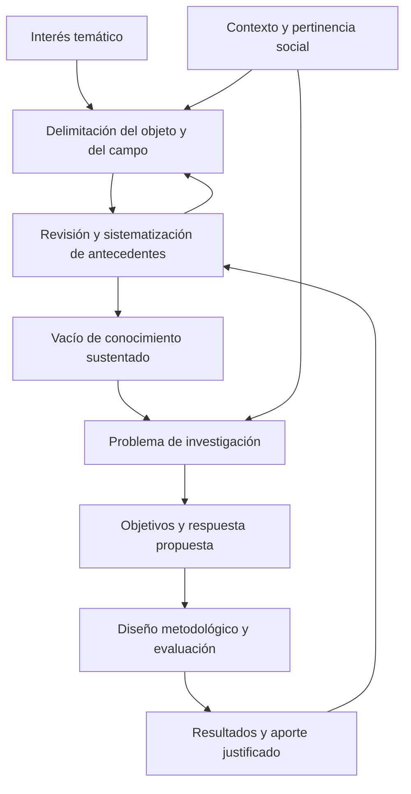

# Clase 1: Delimitación del objeto de investigación y construcción del aporte doctoral en ciencias de la computación

> **Objetivo académico:** Comprender cómo la delimitación del objeto de estudio y del campo de acción, la sistematización de antecedentes y la identificación de un vacío de conocimiento permiten formular un problema científicamente pertinente y justificar un aporte doctoral en ciencias de la computación.

## 1. Contexto y marco conceptual

La sesión aborda la investigación doctoral desde una perspectiva epistemológica: antes de seleccionar una solución tecnológica, es necesario establecer qué se investiga, qué se desconoce y cómo el conocimiento producido se incorpora a la disciplina. Su eje es la relación entre objeto de estudio, campo de acción, problema científico y aporte teórico.

La dificultad recurrente identificada es comenzar por un producto: un algoritmo, una metodología, un modelo o un marco de trabajo. Estos productos pueden constituir resultados pertinentes, pero su sola existencia no demuestra que haya una contribución científica. La pregunta inicial debe dirigirse al conocimiento que falta sobre el fenómeno y a las razones por las que las explicaciones o soluciones existentes resultan insuficientes.

### Tema, objeto, campo y problema

| Categoría | Función en la investigación | Distinción relevante |
| --- | --- | --- |
| Tema | Sitúa un interés dentro de un dominio amplio, como reconocimiento facial, gestión de riesgos o ingeniería de software. | No delimita por sí mismo una pregunta investigable. |
| Objeto de estudio | Identifica el proceso, fenómeno o sistema sobre el que se producirá conocimiento. | Requiere conocer sus características, relaciones y regularidades. |
| Campo de acción | Acota el aspecto del objeto que se pretende explicar o transformar. | Evita abordar indiscriminadamente todas las dimensiones del objeto. |
| Situación problemática | Describe dificultades, tensiones o insuficiencias observadas en la realidad o en el conocimiento disponible. | Debe sustentarse con evidencia y antecedentes. |
| Problema de investigación | Expresa una insuficiencia de conocimiento delimitada y susceptible de investigación. | Su respuesta debe exigir un proceso de indagación justificable. |
| Propuesta de solución | Plantea una posible respuesta al problema. | Debe derivarse del análisis del problema y someterse a evaluación. |

En el vocabulario metodológico de la sesión, el campo de acción es una parte o dimensión del objeto. La delimitación también contempla el contexto y el período de referencia: una pregunta puede cambiar de sentido cuando cambian las condiciones tecnológicas, institucionales o sociales.

**Enriquecimiento conceptual:** Estas categorías pertenecen al enfoque metodológico empleado en la clase; otras tradiciones pueden organizar la delimitación mediante fenómeno, unidad de análisis, población, contexto y pregunta. La exigencia común es mantener un alcance explícito y una relación consistente entre lo que se pregunta y la evidencia que permitiría responder.

### El problema como categoría rectora

La docente presenta el problema como categoría rectora porque orienta las decisiones posteriores: objetivos, hipótesis, métodos, instrumentos y validación. Sin embargo, formularlo requiere una aproximación previa al objeto y sus antecedentes. La investigación combina delimitación y revisión del conocimiento de manera progresiva.

El conocimiento se representa mediante la imagen de una espiral: observación de la realidad, elaboración conceptual, comprensión enriquecida y retorno a la práctica. Cada avance constituye un nuevo punto de partida, no una creación independiente de los antecedentes.

**Enriquecimiento conceptual:** La espiral es una representación heurística del desarrollo del conocimiento. No supone que toda investigación avance linealmente ni que cada resultado confirme lo anterior: también puede revelar errores, límites de validez o contradicciones que obliguen a reformular explicaciones.

## 2. Fundamentos teóricos y arquitectura

### Del antecedente al vacío de conocimiento

La búsqueda bibliográfica cumple una función constitutiva del problema. Permite conocer qué explicaciones, procedimientos y resultados existen, identificar sus supuestos y determinar qué aspectos permanecen abiertos. La sesión insiste en privilegiar artículos científicos por su discusión especializada, actualidad y evaluación por pares.

Sistematizar supera la acumulación de documentos. Supone comparar enfoques, reconocer regularidades, reconstruir relaciones entre conceptos y explicar qué se sabe y qué continúa sin resolverse. Esta síntesis fundamenta el estado del arte y orienta la construcción del marco teórico.

**Enriquecimiento conceptual:** El estado del arte organiza críticamente los avances, controversias y limitaciones de una línea de investigación; el marco teórico establece los conceptos y relaciones que sostienen el estudio. Pueden compartir fuentes, pero cumplen funciones distintas. La actualidad y la revisión por pares son criterios útiles, aunque no garantizan por sí solos la calidad de un resultado ni sustituyen la lectura crítica. Las obras fundacionales pueden seguir siendo necesarias.

En la clase, el vacío se explica como una contradicción entre lo conocido y lo desconocido. Para fundamentarlo, es necesario mostrar qué permiten explicar los antecedentes y qué permanece insuficientemente comprendido dentro del alcance delimitado.

**Enriquecimiento conceptual:** Desconocer personalmente una respuesta no constituye un vacío científico. Tampoco la ausencia de una publicación localizada demuestra que no exista conocimiento pertinente. Una afirmación de novedad debe quedar acotada al alcance y a las limitaciones de la búsqueda realizada.

El diagrama resume relaciones metodológicas discutidas en la sesión. Las flechas de retorno expresan que nuevos antecedentes o resultados pueden modificar la delimitación inicial.

### Aporte práctico y aporte teórico

El aporte práctico puede materializarse en un prototipo, procedimiento, herramienta o intervención. El aporte teórico se refiere al conocimiento que la investigación añade al sistema conceptual de la disciplina: relaciones, explicaciones, regularidades, distinciones o condiciones de aplicación que antes no estaban suficientemente establecidas.

La docente enfatiza que la contribución doctoral debe trascender la presentación de un artefacto útil. No exige necesariamente inventar una categoría ni producir una transformación de gran escala; puede consistir en un avance acotado, siempre que esté sustentado y se explique su relación con el conocimiento previo.

**Enriquecimiento conceptual:** En computación, un algoritmo, un sistema o una evaluación experimental también pueden producir conocimiento teórico o metodológico. La distinción depende de las afirmaciones y evidencias que sostienen la contribución. No conviene establecer una jerarquía en la que conceptualizar excluya programar: la implementación puede ser parte esencial de la demostración o de la evaluación.

### Originalidad y significación

La originalidad se vincula en la sesión con aquello que no está definido, explicado o suficientemente desarrollado en la literatura sobre el objeto. La significación se relaciona con la relevancia del conocimiento para el contexto, la disciplina y la sociedad.

| Dimensión | Pregunta orientadora | Sustento pertinente |
| --- | --- | --- |
| Originalidad | ¿Qué añade o modifica el estudio respecto de los antecedentes? | Comparación explícita con resultados y enfoques previos. |
| Relevancia científica | ¿Qué permite comprender, explicar o investigar mejor? | Identificación de relaciones, límites o consecuencias para la disciplina. |
| Significación social | ¿Por qué resulta relevante el problema para una población o contexto? | Evidencia de necesidades, consecuencias y condiciones de uso. |
| Utilidad práctica | ¿Qué mejora o posibilidad de intervención ofrece? | Evaluación coherente con el uso previsto. |

**Enriquecimiento conceptual:** Significación social y significación estadística son conceptos diferentes. La primera se refiere a relevancia y consecuencias; la segunda pertenece a procedimientos de inferencia estadística. La sesión discute principalmente la primera.

## 3. Implementación técnica y lógica de negocio

La fuente no presenta implementación informática, código, conjuntos de datos ni ejecuciones experimentales. Su contenido operativo consiste en organizar el razonamiento investigativo y mantener la coherencia entre sus componentes.

### Sistematización de la literatura

La sesión propone organizar las fuentes para recuperar antecedentes, identificar regularidades y fundamentar el problema. Se mencionan buscadores académicos, redes de investigación y herramientas de inteligencia artificial como apoyos para localizar y relacionar documentos.

También se describe una herramienta de exploración mediante grafos que conecta artículos. El nombre aparece de manera ambigua en la transcripción, por lo que no se identifica un producto concreto ni se atribuyen funciones verificadas.

**Enriquecimiento conceptual:** Una matriz de lectura puede hacer trazable la sistematización:

| Campo de registro | Propósito analítico |
| --- | --- |
| Referencia y procedencia | Permitir recuperar y comprobar la fuente. |
| Problema y objeto estudiado | Determinar su relación con el estudio propio. |
| Contexto, datos y supuestos | Reconocer las condiciones de validez de los resultados. |
| Enfoque y método | Comparar cómo se obtuvo la evidencia. |
| Resultados y limitaciones | Separar lo establecido de lo pendiente. |
| Relación con el vacío propuesto | Explicar por qué el antecedente apoya, cuestiona o modifica la formulación. |

La inteligencia artificial puede apoyar la localización, organización o síntesis preliminar, pero la sesión preserva la responsabilidad intelectual del investigador: comprender el aporte y explicarlo con argumentos propios.

**Enriquecimiento conceptual:** Las referencias y los resúmenes generados por estas herramientas requieren comprobación en las fuentes originales. Un grafo bibliográfico representa relaciones según criterios de construcción específicos; su posición o conectividad no constituye una medida suficiente de calidad científica.

### Coherencia metodológica

La coherencia metodológica implica que objeto, campo y conceptos centrales conserven su significado a lo largo del estudio. El problema debe corresponder con los objetivos; los métodos deben producir evidencia pertinente; los instrumentos y la evaluación deben referirse a las dimensiones efectivamente investigadas.

| Componente | Relación que debe conservar |
| --- | --- |
| Problema | Expresa qué se desconoce y dentro de qué alcance. |
| Objetivo | Define qué conocimiento o resultado se pretende obtener frente a ese problema. |
| Hipótesis, cuando corresponde | Formula una respuesta o relación susceptible de contraste. |
| Métodos y técnicas | Establecen cómo se obtendrá y analizará la evidencia. |
| Instrumentos | Permiten registrar información pertinente para las dimensiones de interés. |
| Evaluación | Contrasta las afirmaciones de la propuesta con criterios explícitos. |
| Conclusiones | Responden al problema sin exceder el alcance de los resultados. |

La sesión destaca la tríada problema–objetivo–hipótesis. **Enriquecimiento conceptual:** Su pertinencia depende del diseño: no toda investigación necesita una hipótesis predictiva. Una investigación exploratoria, formal o de diseño puede organizarse mediante preguntas, proposiciones o propiedades por demostrar.

### Modelo, metodología y marco de trabajo

La docente distingue estos productos para evitar que sus nombres se utilicen indistintamente. Define el modelo como una abstracción de la realidad que representa componentes y relaciones orientados a un propósito, y señala que una metodología plantea exigencias de evaluación diferentes.

**Enriquecimiento conceptual:** Las siguientes definiciones operativas precisan la comparación sin atribuirlas íntegramente a la sesión:

| Producto | Función principal | Evaluación congruente |
| --- | --- | --- |
| Modelo | Representar componentes, relaciones o mecanismos seleccionados de un fenómeno. | Examinar consistencia, supuestos, adecuación de la representación y utilidad para su propósito. |
| Metodología | Articular principios, métodos y procedimientos para abordar una clase de problemas. | Examinar justificación, aplicabilidad, reproducibilidad y límites en contextos pertinentes. |
| Marco de trabajo | Organizar conceptos, componentes, responsabilidades o prácticas para orientar una actividad. | Examinar coherencia, cobertura, adaptación y utilidad frente al problema definido. |
| Aproximación metodológica | Proponer una articulación de alcance delimitado para abordar un problema. | Ajustar la fuerza de las conclusiones al desarrollo y evidencia disponibles. |

La elección debe derivarse del problema. Cambiar el nombre de un producto no modifica automáticamente la carga de evidencia necesaria para sostener sus afirmaciones.

## 4. Análisis crítico de casos y auditoría práctica

### Reconocimiento facial: solución existente y aporte contextual

El debate parte de una inquietud: si ya existen algoritmos y dispositivos comerciales de reconocimiento facial, ¿qué podría aportar una investigación sobre ese tema? La respuesta metodológica consiste en desplazar la atención desde la existencia del producto hacia las limitaciones del conocimiento disponible.

La sesión reconoce que un contexto local puede presentar características no abordadas por estudios anteriores. Sin embargo, el aporte debe identificarse mediante antecedentes y evidencia; no basta con suponer que una diferencia geográfica garantiza novedad.

**Enriquecimiento conceptual:** Un escenario hipotético ayuda a precisar la diferencia. Aplicar un sistema existente a una población distinta puede ser una intervención útil. La contribución científica aparece si el estudio demuestra una limitación de transferencia, identifica las condiciones que la explican o establece un resultado reproducible sobre el comportamiento del sistema. No se afirma que la sesión haya realizado esa evaluación ni obtenido tales resultados.

### Educación ágil: transferencia interdisciplinaria

Se propone explorar la transferencia de principios de ingeniería de software ágil al ámbito educativo. La conversación reconoce su potencial y advierte que podrían existir desarrollos cercanos bajo otras denominaciones. El caso ilustra la necesidad de revisar antecedentes antes de declarar una nueva categoría.

**Enriquecimiento conceptual:** La transferencia interdisciplinaria requiere explicar qué elementos conservan su significado, cuáles necesitan adaptación y cuáles no son compatibles con el ámbito de destino. Una analogía terminológica puede iniciar una pregunta, pero no valida por sí misma un modelo educativo. La transcripción tampoco permite establecer una genealogía precisa de las metodologías mencionadas.

### Gestión de riesgos: continuidad temática y cambio de contribución

Otro caso plantea continuar una investigación sobre gestión de riesgos mediante un nuevo modelo. La docente acepta la continuidad del tema, pero exige revisar el tipo de aporte: aplicar un procedimiento conocido y explicar una relación nueva sobre el fenómeno son contribuciones distintas.

La conversación menciona MAGERIT y las designaciones ISO 27001 e ISO 31000 dentro de un conjunto de referencias sobre riesgos y seguridad. **Enriquecimiento conceptual:** No deben tratarse automáticamente como categorías equivalentes: normas, metodologías y modelos cumplen funciones diferentes. Es necesario identificar qué papel desempeña cada referente en el diseño investigativo y evitar que la mera adopción de un estándar se presente como novedad científica.

### Validación: alcance de las afirmaciones y evidencia

La sesión sitúa la validación en la propuesta de solución y menciona evaluación técnica, metodológica y estadística, así como instrumentos, constructos y fiabilidad. Estos asuntos se anuncian de manera general; no se desarrolla un procedimiento aplicable ni se presentan resultados de validación.

**Enriquecimiento conceptual:** La evaluación debe cubrir las afirmaciones que sostienen el aporte. Demostrar que una propuesta funciona en una situación no establece automáticamente que su explicación sea correcta o que pueda generalizarse. Tampoco existe un número universal de casos que distinga la validación de un modelo de la de una metodología. La evidencia depende del propósito, la heterogeneidad de contextos y el alcance declarado.

**Enriquecimiento conceptual:** Conviene distinguir:

- **Validez de constructo:** adecuación entre un concepto y la forma en que se representa o mide.
- **Fiabilidad:** consistencia de una medición bajo condiciones definidas.
- **Validez interna:** respaldo de las inferencias dentro del diseño, especialmente frente a explicaciones alternativas cuando se formulan afirmaciones causales.
- **Validez externa:** fundamento para transferir o generalizar resultados a otras condiciones.

Estas nociones no son equivalentes. Un instrumento fiable puede medir de manera consistente algo diferente del constructo de interés.

### Artículos y tesis: funciones relacionadas

La clase diferencia el proceso amplio de investigación de sus productos de comunicación. Una revisión puede apoyar el estado del arte; el análisis de datos y la propuesta pueden originar otras publicaciones. Sin embargo, reunir artículos no produce automáticamente una investigación integrada.

| Tipo tratado en la sesión | Función | Sustento requerido |
| --- | --- | --- |
| Revisión | Organizar y analizar críticamente literatura sobre un problema. | Fuentes pertinentes y un procedimiento de selección y síntesis justificable. |
| Reflexión | Desarrollar una interpretación o argumentación propia. | Coherencia argumentativa, contraste de posiciones y apoyo documental. |
| Investigación original | Comunicar resultados de una indagación. | Correspondencia entre pregunta, método, evidencia y conclusiones. |

**Enriquecimiento conceptual:** La expresión oral «artículo científico» se emplea principalmente para los artículos de resultados originales. Las revisiones y otros géneros también pueden constituir publicaciones científicas rigurosas. Los tres tipos discutidos no forman una clasificación exhaustiva, y una revisión puede generar resultados originales de síntesis.

La sesión describe la evaluación por pares mediante criterios sobre resumen, introducción, métodos, resultados, referencias y presentación. El resumen debe condensar propósito, enfoque, principales resultados y conclusiones, según corresponda al género. También se menciona IMRyD: introducción, métodos, resultados y discusión.

**Enriquecimiento conceptual:** IMRyD es una estructura frecuente para comunicar investigación empírica, pero no es obligatoria para todos los géneros. Los requisitos de extensión, actualidad bibliográfica, idioma y formato dependen de la revista. Las proporciones y los rangos citados durante la conversación son ejemplos particulares, no umbrales universales de calidad. La indexación tampoco sustituye la evaluación de las prácticas editoriales de una revista.

### Integridad de la comunicación científica

La conversación plantea la prohibición de enviar simultáneamente un manuscrito a varias revistas, pero también relata una experiencia de publicaciones con modificaciones de título y redacción tras un período sin respuesta. Ese relato no permite establecer una práctica editorial válida.

**Enriquecimiento conceptual:** El silencio editorial no equivale a rechazo ni confirma la retirada de un manuscrito. Antes de remitirlo a otra revista corresponde aclarar su estado y tramitar la retirada conforme a las políticas pertinentes. Cambiar el título o la redacción no elimina la duplicación sustantiva. La relación con publicaciones previas debe declararse con transparencia; el relato no aporta elementos suficientes para resolver el caso particular.

## 5. Principios de diseño, buenas prácticas y anti-patrones

### Principios de construcción investigativa

1. **Delimitar antes de prescribir.** Precisar objeto, campo y contexto antes de comprometerse con un producto.
2. **Sistematizar para argumentar.** Comparar fuentes y reconstruir relaciones en lugar de acumular citas.
3. **Sustentar la situación problemática.** Separar observaciones documentadas, interpretaciones y suposiciones.
4. **Vincular novedad y antecedentes.** Explicar qué cambia respecto del conocimiento disponible y con qué evidencia.
5. **Ajustar las conclusiones al alcance.** Reconocer los límites de datos, métodos y contextos.
6. **Mantener coherencia conceptual.** Evitar que el objeto o las variables cambien de significado entre secciones.
7. **Integrar perspectivas con justificación.** La interdisciplinariedad requiere relaciones explícitas entre conceptos y métodos.
8. **Preservar la responsabilidad intelectual.** Las herramientas de búsqueda e inteligencia artificial apoyan el proceso, pero no reemplazan la comprensión ni la verificación.

### Líneas de investigación y delimitación disciplinaria

Una línea de investigación organiza un espacio amplio de problemas; no es un catálogo exhaustivo de títulos. La ausencia de una expresión exacta en su descripción no impide la pertinencia de un tema si su relación conceptual puede justificarse. La gestión de riesgos, por ejemplo, puede vincularse con ciberseguridad sin que todas sus variantes estén enumeradas.

La sesión también reconoce que una organización excesivamente detallada puede confundirse con una lista cerrada de temas. **Enriquecimiento conceptual:** Una taxonomía facilita clasificar subáreas, pero no determina por sí sola la originalidad o la calidad de una pregunta. Su función organizativa debe distinguirse de la justificación epistemológica del estudio.

### Redacción como condición de trazabilidad

La docente subraya la unidad de sentido del párrafo, la claridad de los referentes y la necesidad de evitar oraciones extensas que oculten las relaciones entre ideas. Recomienda expresiones directas y conectores que hagan visible el orden del argumento.

**Enriquecimiento conceptual:** La claridad no exige prohibir las oraciones complejas. Exige controlar su estructura y reservarlas para relaciones que realmente lo necesitan. Un párrafo académico puede formular una afirmación, aportar evidencia y explicar su consecuencia para el argumento.

La sesión distingue además contenido, estructura y formato. Las convenciones editoriales y las adaptaciones institucionales deben identificarse por su procedencia; una preferencia local de tipografía, sangría o alineación no debe atribuirse automáticamente a APA. El idioma del artículo depende de la política de la revista, no de una obligación universal de publicar en inglés.

| Anti-patrón | Problema que produce | Criterio de corrección |
| --- | --- | --- |
| Elegir un algoritmo antes de identificar el problema | Confunde un medio con la finalidad científica. | Explicitar qué insuficiencia de conocimiento aborda. |
| Declarar novedad porque no se encontró un antecedente | Convierte una limitación de búsqueda en una conclusión. | Documentar alcance y límites de la revisión. |
| Equiparar aplicación local con aporte teórico | Confunde pertinencia contextual y contribución explicativa. | Mostrar qué conocimiento nuevo se obtiene. |
| Renombrar una propuesta para reducir su evaluación | Modifica la etiqueta sin resolver sus exigencias. | Ajustar evidencia y alcance a las afirmaciones reales. |
| Confundir método, técnica e instrumento | Vuelve ambiguo cómo se produce la evidencia. | Definir la función de cada componente y usarla consistentemente. |
| Usar redacción ornamental o referentes ambiguos | Dificulta evaluar el razonamiento. | Priorizar precisión, evidencia y continuidad argumentativa. |
| Presentar la buena escritura como garantía de validez | Sustituye la calidad científica por persuasión. | Evaluar por separado claridad, sustento y solidez metodológica. |

**Enriquecimiento conceptual:** La insistencia motivacional de la sesión en que todos los temas pueden desarrollarse debe entenderse como estímulo a su reformulación. Una fundamentación clara no vuelve verdadera una afirmación falsa ni corrige un diseño incapaz de responder la pregunta.

## 6. Síntesis conceptual y profundización académica

La contribución doctoral se construye mediante una cadena argumentativa: un objeto delimitado permite organizar antecedentes; su sistematización permite identificar un vacío; el vacío fundamenta un problema; el problema orienta objetivos y diseño; la evaluación permite establecer qué conocimiento se produjo y hasta dónde resulta defendible.

De esta articulación se desprenden cuatro distinciones centrales. El tema sitúa un interés, mientras que el problema precisa la insuficiencia investigable. La utilidad de una solución no basta para demostrar su originalidad. La diferencia contextual debe traducirse en una pregunta y un resultado científicamente justificables. Finalmente, la calidad de la redacción hace examinable la contribución, pero no sustituye la evidencia.

La relación ciencia–tecnología–sociedad proporciona un marco para comprender la pertinencia de la investigación: las necesidades sociales pueden originar preguntas, las tecnologías permiten intervenir y observar, y la investigación produce explicaciones y evalúa límites. La relevancia social y el aporte disciplinario se complementan, aunque requieren argumentos diferenciados.

**Enriquecimiento conceptual:** La profundización de este marco conduce a cuestiones sobre transferencia entre contextos, alcance de las generalizaciones, evidencia necesaria para evaluar artefactos computacionales y función de las revisiones en la producción de conocimiento. También invita a examinar cómo el intercambio entre investigadores permite detectar supuestos, precisar conceptos y cuestionar explicaciones sin desplazar la responsabilidad de quien sostiene cada afirmación.
