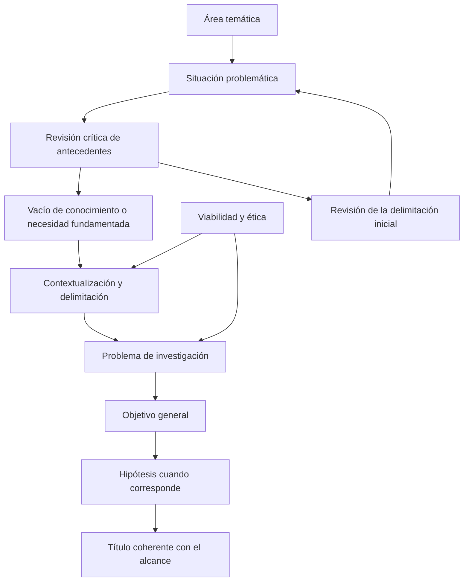

# Clase 2: Antecedentes, vacío de conocimiento y formulación del problema de investigación

> **Objetivo académico:** Fundamentar y delimitar un problema de investigación mediante la revisión crítica de antecedentes, la identificación de un vacío de conocimiento y su articulación con el contexto, el objeto de estudio, el campo de acción y las categorías del diseño científico.

## 1. Contexto y marco conceptual

### Del tema amplio al problema investigable

La sesión sitúa el planteamiento del problema en la etapa exploratoria de la investigación y en la construcción de su diseño teórico. El punto de partida es una situación de la realidad que suscita interrogantes; el resultado esperado es una formulación precisa que permita orientar la producción de conocimiento. La elección de una tecnología o de una solución no sustituye este recorrido: anunciar un algoritmo, un sistema o una intervención antes de fundamentar el problema puede invertir la lógica de la investigación.

Conviene distinguir cuatro niveles:

| Nivel | Función | Ejemplo desarrollado en la sesión |
|---|---|---|
| Tema | Delimita un ámbito general de interés | Educación universitaria |
| Situación problemática | Reconoce una dificultad o tensión situada | Dificultades para desarrollar competencias sociales entre estudiantes de universidades públicas de Bolivia |
| Problema de investigación | Precisa qué relación o aspecto requiere conocimiento adicional | Cómo influyen las estrategias docentes en el desarrollo de esas competencias |
| Objetivo general | Expresa el conocimiento que se pretende producir | Se deriva del problema delimitado; su redacción detallada no se desarrolla en esta sesión |

Una misma situación problemática puede originar varias preguntas legítimas. La selección requiere revisar qué se conoce, qué permanece abierto, qué resulta relevante y qué puede investigarse con los recursos disponibles. La afinidad personal con un área ayuda a sostener el trabajo, pero no basta para demostrar la existencia de un problema científico.

### Contradicción entre lo conocido y lo desconocido

La docente caracteriza el problema como una dificultad o insuficiencia de conocimiento, de carácter teórico, práctico o articulado entre ambos. En el enfoque aplicado presentado, la investigación debe responder a una necesidad de la práctica y, al mismo tiempo, producir una contribución conceptual. Esta orientación corresponde al marco de la sesión y no constituye una definición exhaustiva de toda investigación doctoral.

El vacío de conocimiento expresa una tensión entre explicaciones, resultados o capacidades disponibles y aquello que todavía no se comprende suficientemente. No equivale al desconocimiento personal del investigador. Tampoco se demuestra únicamente porque una organización carezca de un procedimiento, una política o una aplicación.

**Enriquecimiento conceptual:** Es útil diferenciar tres situaciones. Una brecha de formación se resuelve aprendiendo conocimiento disponible; una brecha de implementación puede resolverse aplicando una solución conocida; un vacío científico exige producir o contrastar conocimiento cuya respuesta no está suficientemente establecida. Pueden coexistir: implementar una política de seguridad puede convertirse en investigación si se formula y evalúa una pregunta abierta sobre su efectividad, sus condiciones de funcionamiento o sus límites.

### Planteamiento y formulación

El **planteamiento del problema** es el texto argumentativo que conduce desde la situación problemática hasta la necesidad de investigar. Incluye antecedentes, vacío de conocimiento y contextualización. La **formulación del problema** es su expresión final, concentrada en una pregunta o proposición precisa. Confundir ambos niveles produce preguntas desconectadas de la evidencia o desarrollos extensos que nunca identifican qué se pretende conocer.

La secuencia representa una derivación lógica con retroalimentación. La investigación se perfecciona conforme se profundiza en la literatura; revisar una delimitación inicial no invalida el proceso, sino que puede hacerlo más consistente.

## 2. Fundamentos teóricos y arquitectura

### La revisión bibliográfica como fundamento del problema

La revisión permite identificar investigaciones relacionadas, reconocer sus enfoques metodológicos, contrastar conclusiones y justificar qué conocimiento adicional sería relevante. Su función excede reunir citas: debe sostener una inferencia sobre lo que falta comprender.

La sesión propone priorizar artículos científicos, ensayos científicos, artículos de revisión, ponencias y tesis, atendiendo al rigor de los procesos de revisión. También reconoce recursos web y herramientas de inteligencia artificial como apoyos para localizar o procesar información.

**Enriquecimiento conceptual:** Esta prioridad debe tratarse como una orientación de búsqueda y no como una jerarquía universal de calidad. El tipo documental no garantiza por sí solo revisión por pares ni validez metodológica; tampoco todos los procesos de evaluación son anónimos. En ciencias de la computación, determinadas conferencias constituyen canales centrales de investigación. La calidad debe evaluarse por la pertinencia de la pregunta, el método, la evidencia, la transparencia y los límites del estudio.

La exploración se hace más eficiente al delimitar términos, filtrar por periodo cuando tenga sentido, revisar títulos y leer resúmenes antes de seleccionar documentos para lectura completa. La actualidad es particularmente relevante en ámbitos tecnológicos de cambio rápido, aunque no elimina el valor de contribuciones fundacionales.

### Antecedentes: descripción y síntesis crítica

Un antecedente debe permitir comprender dónde se realizó un estudio, qué investigó, cómo procedió y a qué conclusiones llegó. La selección debe responder a su aportación al problema propio. Los estudios pueden organizarse por ámbito geográfico, metodología o similitud de resultados; la organización más útil es la que permite construir el argumento.

**Enriquecimiento conceptual:** Una matriz de lectura puede estructurarse así:

| Componente | Información que conviene registrar | Función analítica |
|---|---|---|
| Problema y contexto | Fenómeno, población, organización o entorno | Evaluar comparabilidad |
| Método | Diseño, fuentes de datos y procedimiento de análisis | Reconocer qué conclusiones permite obtener |
| Resultados | Hallazgos relevantes para la pregunta propia | Identificar conocimiento disponible |
| Límites | Restricciones declaradas o justificadas mediante análisis crítico | Evitar generalizaciones indebidas |
| Relación con el estudio | Coincidencias, diferencias y aspectos abiertos | Fundamentar el vacío |

La matriz es un instrumento de organización conceptual añadido; no describe una herramienta aplicada durante la clase. Su utilidad consiste en convertir una sucesión de resúmenes en una comparación razonada.

### Arquitectura del argumento

La secuencia de redacción propuesta es:

1. Presentar la situación problemática y su importancia.
2. Describir y relacionar antecedentes relevantes.
3. Explicitar el vacío de conocimiento o la necesidad que origina el estudio.
4. Situar el problema en el contexto de investigación.
5. Formular la pregunta o proposición final.

La docente justifica presentar el vacío antes de la descripción local porque busca que la investigación se apoye en la literatura y después se aterrice en el contexto. Esto impide convertir una preferencia personal en una supuesta necesidad científica.

**Enriquecimiento conceptual:** El orden expositivo puede adaptarse a la disciplina y al género documental. También puede ser válido introducir primero el contexto y después discutir el vacío. Lo indispensable es que el lector pueda reconstruir la relación entre evidencia previa, necesidad de conocimiento y pregunta propuesta. Una necesidad local no demuestra automáticamente una carencia global de investigación.

### Objeto de estudio, campo de acción y contexto

En el vocabulario metodológico de la sesión, el **objeto de estudio** designa una parte de la realidad abstraída como concepto, proceso o sistema sobre el que recae la investigación. Debe nombrarse con precisión, sin confundirse con un párrafo descriptivo. Se mencionan, entre otros ejemplos, gestión de requerimientos, desarrollo de software, sistemas expertos, infraestructura de servicios e ingeniería de tráfico.

El **campo de acción** corresponde al aspecto delimitado sobre el que se busca describir, interpretar, explicar o intervenir. La docente lo presenta como un subsistema del objeto. El **contexto** identifica dónde y bajo qué condiciones se estudia ese aspecto; por ello, el campo no debe confundirse con una empresa, una localidad o un conjunto de hogares.

**Enriquecimiento conceptual:** Esta distinción pertenece a una tradición metodológica específica. En algunos ejemplos de la sesión, el objeto se identifica con una herramienta o enfoque de intervención y el campo con el resultado que se desea modificar; esa relación no siempre es literalmente la de un subsistema dentro de un sistema. Conviene explicitar qué uso se adopta y mantenerlo consistente. Un objeto tampoco se convierte automáticamente en variable independiente ni un campo en variable dependiente: los papeles de las variables dependen de la pregunta y del diseño.

## 3. Implementación técnica y lógica de negocio

La fuente no presenta código, experimentos ejecutados ni resultados empíricos propios. La implementación desarrollada es metodológica: búsqueda y selección de literatura, construcción argumentativa, delimitación de conceptos y formulación de preguntas investigables.

### Procedimiento para construir una pregunta fundamentada

**Primero, identificar una situación observable.** Puede surgir de la experiencia profesional, de una demanda organizacional o de la literatura. El conocimiento del contexto facilita el acceso y la interpretación, pero la experiencia debe respaldarse con evidencia.

**Segundo, revisar investigaciones relacionadas.** La búsqueda debe permitir identificar respuestas disponibles y posibles interrogantes abiertos. La docente insiste en comprobar que la pregunta no tenga ya una respuesta conocida y que no se resuelva mediante un simple relevamiento de información.

**Enriquecimiento conceptual:** La precaución contra el simple relevamiento busca distinguir la investigación de la consulta de datos existentes. Sin embargo, un análisis documental riguroso, una investigación descriptiva o una replicación pueden producir conocimiento científico. El criterio decisivo es la contribución justificada del diseño, no la exclusión de una técnica de recolección.

**Tercero, seleccionar una pregunta central.** Debe ponderarse su relevancia, acceso a información, recursos, conocimiento especializado, alcance y condiciones éticas. Mantener una pregunta rectora ayuda a evitar que el estudio se disperse.

**Cuarto, definir conceptos y unidades de análisis.** La formulación debe aclarar qué se estudia y sobre qué entidades se observará. Las unidades pueden ser personas, organizaciones, proyectos, sistemas o eventos, según el fenómeno.

**Quinto, delimitar el alcance.** La sesión distingue delimitación sustantiva, temporal y geográfica. No todas deben incorporarse literalmente a la pregunta si están explicitadas de manera inequívoca en el diseño.

### Formulación interrogativa y afirmativa

La docente admite ambos formatos y expresa preferencia por el interrogativo porque facilita revisar si el objetivo general responde al problema. La elección gramatical no sustituye las condiciones de precisión, viabilidad y fundamentación.

| Condición | Aplicación metodológica |
|---|---|
| Claridad | Evitar conceptos vagos o relaciones ambiguas |
| Delimitación | Precisar fenómeno, unidades y alcance pertinente |
| Originalidad justificada | Identificar el aporte frente al conocimiento disponible |
| Viabilidad | Asegurar datos, recursos y procedimientos compatibles con la pregunta |
| Neutralidad de la formulación | Evitar calificativos o conclusiones anticipadas |
| Contrastabilidad | Hacer posible una evaluación mediante evidencia apropiada |
| Coherencia | Mantener el significado de los conceptos en problema, objetivo y diseño |

Las preguntas orientadas a respuestas binarias pueden resultar poco informativas cuando no explicitan condiciones o mecanismos. No obstante, la exigencia de evitar un simple «sí» o «no» debe entenderse como una búsqueda de profundidad explicativa.

**Enriquecimiento conceptual:** Una hipótesis susceptible de confirmación o rechazo puede formar parte de un estudio riguroso. El problema aparece cuando la respuesta binaria agota la contribución o sustituye el análisis de magnitud, condiciones, incertidumbre y límites.

### Variables y relaciones: alcance de la analogía funcional

La sesión utiliza la expresión funcional para ilustrar la relación entre una variable de entrada y un resultado:

$$
y=f(x)
$$

En esta analogía, $x$ representa un factor de interés y $y$ un resultado; $f$ expresa la relación propuesta. No se especifican dominios, unidades ni una función concreta porque la exposición no desarrolla un modelo cuantitativo. Esos elementos dependerían de la definición conceptual y operacional de cada estudio.

**Enriquecimiento conceptual:** La notación es ilustrativa y no demuestra causalidad. Un diseño correlacional puede estimar asociaciones sin identificar un efecto causal. Además, una relación empírica suele involucrar variabilidad, factores adicionales y error de medición; no debe asumirse una correspondencia determinista entre dos variables por el solo hecho de escribir una función.

### Gestión bibliográfica y apoyos digitales

Se mencionan Google Académico y herramientas de consulta o resumen de documentos como apoyos para buscar literatura. También se comparan los gestores de referencias de Word y Mendeley. La advertencia técnica central es revisar los metadatos importados: autores, título, fecha y demás datos pertinentes pueden estar incompletos o ser incorrectos.

**Enriquecimiento conceptual:** Un resumen generado por inteligencia artificial debe contrastarse con el documento original. La herramienta puede apoyar la localización y comprensión, pero no acredita la existencia ni la exactitud de una referencia. Asimismo, un gestor automatiza el formato a partir de los datos introducidos; no certifica que esos datos sean correctos.

## 4. Análisis crítico de casos y auditoría práctica

### Caso social: movimientos antivacuna e indecisión vacunal

El caso se utiliza para mostrar que un mismo fenómeno admite distintas preguntas. La discusión distingue entre estudiar comportamientos y argumentos sociales, explorar asociaciones socioeconómicas y evaluar resultados de salud. Estas posibilidades requieren marcos conceptuales y datos diferentes.

| Enfoque discutido | Pregunta o interés | Exigencia metodológica |
|---|---|---|
| Socioeconómico | Relación entre nivel socioeconómico y participación en movimientos antivacuna | Definir ambas dimensiones y distinguir asociación de influencia causal |
| Social y discursivo | Métodos de prevención que proponen sus integrantes | Analizar prácticas y argumentos sin atribuirles eficacia por el hecho de describirlos |
| Sanitario | Protección adquirida e historial de enfermedades | Contar con evidencia clínica pertinente y acceso éticamente autorizado |
| Programas de vacunación | Relación del movimiento con los niveles de vacunación | Precisar alcance, indicadores y explicaciones alternativas |

La docente orienta su lectura del texto hacia el ámbito social, porque el interés principal está en las posiciones y conductas de los colectivos. También se consideran otras lecturas, lo que muestra que mencionar vacunas no determina por sí solo la disciplina del estudio.

**Enriquecimiento conceptual:** El campo disciplinar depende de la pregunta y el método. Un fenómeno relacionado con la salud puede investigarse desde ciencias sociales, salud pública u otros enfoques. Big Data, por su parte, no resulta pertinente únicamente por tratarse de un recurso tecnológico: habría que justificar un problema de datos, escala o procesamiento compatible con la pregunta.

La discusión aporta criterios de selección: acceso a información, especialización, relevancia, disponibilidad de recursos y ética. Los datos clínicos no pueden darse por accesibles; su carácter sensible puede exigir autorizaciones y procedimientos de protección.

La diversidad de perspectivas puede mejorar la formulación, pero el consenso entre participantes no constituye una validación empírica. Tampoco las experiencias personales o las afirmaciones de autoridad compartidas en el debate permiten establecer resultados sobre seguridad o eficacia de vacunas. El valor académico del caso reside en la comparación metodológica de preguntas.

### Sesgos e investigación por encargo

Ante la posibilidad de orientar una investigación para demostrar una posición política, la docente defiende la ausencia de sesgos y la búsqueda de conocimiento contrastado. La advertencia es pertinente: imponer una conclusión desde el inicio compromete la capacidad de evaluar explicaciones alternativas.

**Enriquecimiento conceptual:** La investigación puede estudiar fenómenos políticos, responder a prioridades públicas o recibir financiación por encargo sin perder automáticamente su carácter científico. La exigencia es preservar independencia analítica, transparencia sobre intereses y métodos, y disposición a comunicar resultados contrarios a las expectativas del patrocinador. Seleccionar un tema por interés social es distinto de predeterminar sus conclusiones.

### Casos de ciencias de la computación

Los ejemplos permiten reconocer relaciones entre enfoques técnicos y aspectos que se pretende estudiar o modificar. Son formulaciones discutidas en clase, no intervenciones cuya efectividad haya sido demostrada en la fuente.

| Caso | Objeto identificado en la sesión | Campo o aspecto focalizado | Punto de auditoría |
|---|---|---|---|
| Seguridad de cambios de configuración | Gestión de seguridad de la información | Incidentes asociados con cambios en la configuración de sistemas | Precisar qué incidentes se incluyen y cómo se evaluaría su variación |
| Acceso a información | Gestión de seguridad de la información | Acceso físico y lógico a la información | Justificar si ambas dimensiones integran un constructo o requieren análisis separados |
| Pruebas de software | Herramientas de generación automática de casos de prueba | Tiempo vinculado con detección temprana de errores | Definir qué significa «curva de tiempo» y qué duración se observaría |
| Selección de personal | Sistema experto | Incertidumbre en la selección de personal | Definir operacionalmente la incertidumbre y evitar equipararla sin justificación con calidad de selección |
| Gestión de información | Gestión o eficiencia de la información | Apoyo a la toma de decisiones | Distinguir falta de un sistema de limitaciones de un sistema existente |

También se mencionan tiempos de soporte en un sistema transaccional y calidad de infraestructura de red. Su inclusión ilustra posibles relaciones de estudio; la fuente no proporciona datos suficientes para evaluar el efecto de una auditoría informática ni de una intervención de red.

**Enriquecimiento conceptual:** Una formulación afirmativa como «los incidentes se pueden minimizar aplicando gestión de seguridad» puede funcionar como hipótesis o expectativa de intervención. Si se usa para expresar el problema, debe evitar que la eficacia aparezca ya demostrada. Una alternativa abierta es preguntar bajo qué condiciones y en qué magnitud la intervención se relaciona con cambios observables.

### Caso alimentario: raíz de achicoria

El análisis distingue antecedentes, necesidad del estudio y pregunta sobre los efectos de añadir raíz de achicoria a galletitas. Se identifican dos resultados potencialmente diferentes: valor nutricional y aceptabilidad. Su presencia en una misma pregunta amplía las exigencias del diseño porque no se evalúan necesariamente mediante los mismos procedimientos.

La sesión toma la raíz de achicoria como objeto y el valor nutricional o la aceptabilidad como aspectos de transformación. Los hogares o las fábricas corresponden a contextos o posibles unidades de observación, según el diseño; no sustituyen la definición de esos resultados.

**Enriquecimiento conceptual:** El pasaje alterna «insulina» con una descripción de fibra soluble que parece aludir a «inulina». La transcripción no permite confirmar cada mención y ambos términos no deben equipararse: la insulina es una hormona y la inulina es un carbohidrato asociado con fibra dietética. El caso se conserva por su aportación metodológica, sin establecer composición, pureza o beneficios nutricionales no verificados.

La referencia oral a un posible procedimiento estadístico para la aceptabilidad no permite identificar una prueba concreta. Sin conocer las variables, escalas, muestreo y estructura de los datos, no puede recomendarse un análisis estadístico específico.

## 5. Principios de diseño, buenas prácticas y anti-patrones

### Coherencia metodológica

La clase presenta el problema como categoría rectora: orienta el objetivo, la hipótesis cuando corresponde, el título y posteriormente las decisiones de diseño. La consistencia terminológica permite reconocer qué se estudia sin que los conceptos cambien de significado entre apartados.

**Enriquecimiento conceptual:** La coherencia no exige inmovilidad absoluta. Durante la exploración puede ser necesario revisar nombres, definiciones o alcance; la corrección debe propagarse a todo el diseño. Tampoco toda investigación requiere hipótesis formuladas como relaciones entre variables independientes y dependientes. Los diseños exploratorios, cualitativos o descriptivos pueden organizarse mediante preguntas y categorías de análisis diferentes.

### Buenas prácticas

- Fundamentar la pregunta mediante una síntesis crítica de antecedentes, no mediante una acumulación de referencias.
- Distinguir lo observado, lo que la literatura permite afirmar y lo que todavía requiere contrastación.
- Usar la experiencia profesional para comprender el contexto y verificar sus interpretaciones con evidencia.
- Definir conceptos compuestos, como acceso físico y lógico, antes de tratarlos como una sola variable.
- Precisar unidades de análisis y condiciones de acceso a datos desde la delimitación inicial.
- Elegir un alcance compatible con recursos, tiempo de investigación y obligaciones éticas.
- Revisar metadatos bibliográficos y correspondencia entre citas y referencias.
- Separar el argumento sobre relevancia del estudio de cualquier conclusión anticipada sobre la solución.

### Anti-patrones y correcciones

| Anti-patrón | Riesgo | Corrección |
|---|---|---|
| Elegir una solución antes de fundamentar el problema | Sesgo hacia una tecnología o intervención predeterminada | Revisar primero la necesidad y las alternativas |
| Confundir interés personal con vacío científico | Justificación insuficiente | Contrastar literatura y evidencia del contexto |
| Presentar la falta de un sistema como contribución | Reducir el trabajo a implementación | Identificar qué conocimiento nuevo se produciría |
| Declarar que no existen estudios sin delimitar la búsqueda | Afirmación difícil de sostener | Precisar alcance y límites de la revisión |
| Cambiar términos centrales sin redefinirlos | Ruptura de coherencia | Mantener definiciones estables o actualizar todo el diseño |
| Sumar resultados sin prever su evaluación | Dispersión y complejidad innecesaria | Delimitar dimensiones y métodos compatibles |
| Considerar el consenso una prueba | Confundir acuerdo con evidencia | Contrastar empíricamente las afirmaciones |
| Confiar en referencias automáticas sin verificarlas | Errores de atribución y trazabilidad | Revisar la fuente y sus metadatos |

### Escritura y citación: alcance de las recomendaciones

La docente propone una redacción de lo general a lo particular, párrafos articulados y uso de citas conforme a APA. Las sugerencias sobre extensión de párrafos deben entenderse como orientaciones de legibilidad. La unidad argumentativa y la cohesión son criterios más sólidos que una longitud uniforme o un número fijo de oraciones.

**Enriquecimiento conceptual:** La situación problemática, el contexto y el vacío pueden necesitar citas cuando contienen hechos, cifras o afirmaciones procedentes de otras fuentes. Que un apartado sintetice el razonamiento del investigador no elimina su obligación de trazabilidad. Del mismo modo, una citación correcta no garantiza por sí sola ausencia de plagio, y un índice de similitud no constituye un dictamen definitivo sobre integridad académica.

**Enriquecimiento conceptual:** La indicación «s. f.» informa que no se dispone de fecha de publicación. La fecha de consulta cumple una función distinta y no debe reemplazarla automáticamente; su necesidad depende del tipo de recurso y de las reglas aplicables. Estas precisiones corrigen generalizaciones de la discusión sin atribuir a la sesión una revisión normativa que no se realizó.

## 6. Síntesis conceptual y profundización académica

El planteamiento del problema es una construcción argumentativa que conecta una situación de la realidad con una necesidad de conocimiento. Su calidad depende de la relación entre revisión crítica, delimitación conceptual, relevancia, viabilidad y ética. La formulación final concentra esa construcción y permite evaluar si el objetivo propuesto responde a lo que se necesita conocer.

Los casos muestran tres distinciones decisivas. Primero, una situación problemática admite varias preguntas, pero la selección requiere justificar su aporte y factibilidad. Segundo, el objeto, el aspecto focalizado y el contexto cumplen funciones diferentes. Tercero, proponer una intervención no equivale a demostrar que funciona: esa afirmación requiere un diseño y evidencia adecuados.

**Enriquecimiento conceptual:** La evaluación crítica de una formulación puede organizarse mediante cinco preguntas: ¿qué fenómeno se estudia?, ¿qué conocimiento relevante falta?, ¿qué evidencia permitiría responder?, ¿qué afirmaciones excederían el diseño?, ¿bajo qué condiciones sería válido el resultado? Estas preguntas relacionan la definición del problema con la validez de las conclusiones.

Como líneas de profundización conceptual quedan la diferencia entre asociación y causalidad, la operacionalización de conceptos, la distinción entre contribución científica y desarrollo tecnológico, y la relación entre relevancia social e independencia analítica. Todas amplían el núcleo de la sesión: formular un problema investigable exige justificar qué se pretende conocer antes de comprometerse con una respuesta.
