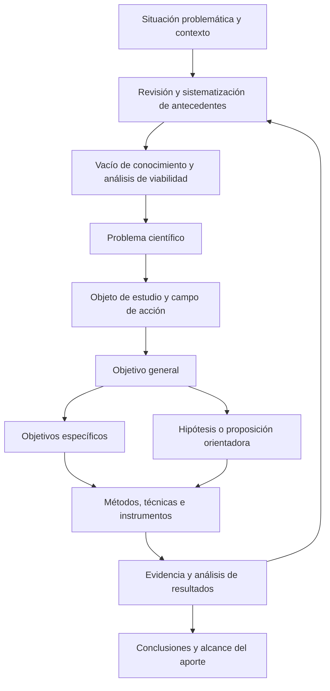

# Clase 3: Objetivos de investigación, coherencia metodológica y delimitación del aporte científico

> **Objetivo académico:** Formular y analizar objetivos generales y específicos coherentes con el problema científico, el objeto de estudio y el campo de acción, articulando los resultados esperados con su fundamentación, diagnóstico, propuesta, validación y delimitación.

## 1. Contexto y marco conceptual

### La investigación como proceso de construcción y revisión

La sesión sitúa los objetivos dentro de la planificación de la investigación y, específicamente, del diseño teórico. Su formulación conecta la identificación del problema con la producción de conocimiento y con las decisiones metodológicas necesarias para obtener evidencia.

El proceso se presenta como un movimiento entre observación, pensamiento abstracto y práctica: se identifica una situación problemática, se estudia el conocimiento existente, se formula un problema y se construye una propuesta cuya aplicación permite revisar la comprensión inicial. Los resultados se convierten en antecedentes de investigaciones posteriores. La imagen de una espiral expresa esta continuidad y la posibilidad de volver sobre decisiones previas desde una comprensión más elaborada.

**Enriquecimiento conceptual:** Esta representación es una orientación epistemológica; no garantiza que toda investigación produzca automáticamente conocimiento superior. El avance depende de la calidad de la evidencia, de la revisión crítica y de la posibilidad de corregir explicaciones previas.

La reformulación inicial del problema, del campo o de las definiciones conceptuales puede indicar maduración intelectual. Sin embargo, la revisión necesita criterios: cambiar una decisión debe responder a nuevos antecedentes, inconsistencias detectadas, restricciones de viabilidad o evidencia relevante. Cuando el diseño alcanza suficiente estabilidad, conviene documentar las propuestas de modificación y valorar sus consecuencias sobre la coherencia del estudio.

### Antecedentes, vacío de conocimiento y viabilidad

La revisión de antecedentes no exige encontrar una investigación idéntica. Si no aparecen trabajos que combinen exactamente el objeto y el campo de interés, pueden estudiarse investigaciones sobre el mismo objeto desde otros aspectos o contextos. Estos antecedentes permiten reconocer tratamientos conceptuales, métodos, técnicas y limitaciones potencialmente útiles.

Sistematizar antecedentes implica comparar sus preguntas, métodos, técnicas, resultados y conclusiones. La revisión vuelve a ser relevante al interpretar los resultados propios: proporciona referencias para identificar coincidencias, diferencias y posibles explicaciones.

La lectura puede revelar múltiples vacíos. Su existencia no basta para elegir uno: también deben considerarse su relevancia, el acceso a información, los recursos y la posibilidad de producir una respuesta defendible. Un vacío poco investigado puede estar asociado con dificultades técnicas o restricciones de acceso, no necesariamente con una oportunidad inmediatamente realizable.

**Enriquecimiento conceptual:** La ausencia de resultados en una búsqueda no demuestra por sí sola la inexistencia de conocimiento. Antes de sostener una afirmación de novedad es necesario revisar términos, fuentes consultadas y criterios de selección.

### Distinciones que organizan el diseño

| Categoría | Función en la investigación | Distinción central |
| --- | --- | --- |
| Tema | Ubica el área amplia de interés | No equivale al título ni al producto propuesto |
| Situación problemática | Describe dificultades, antecedentes y contexto | Es más extensa que la formulación del problema |
| Problema científico | Expresa una pregunta o relación que requiere investigación | Debe derivarse del análisis previo |
| Objeto de estudio | Identifica la parte de la realidad que porta el problema | Responde a qué se estudia |
| Campo de acción | Delimita el aspecto del objeto sobre el que se concentra la investigación | No equivale al lugar geográfico |
| Objetivo general | Expresa el resultado global perseguido | Debe responder al problema |
| Objetivos específicos | Establecen resultados parciales articulados | No son una lista de actividades |
| Hipótesis o proposición orientadora | Anticipa una relación o respuesta susceptible de contrastación | Su tratamiento depende del enfoque y del diseño |

La sesión utiliza objeto y campo como categorías centrales y propone identificarlos mediante dos preguntas: qué se estudiará y qué aspecto se pretende transformar. Esta distinción permite reducir formulaciones extensas a conceptos reconocibles.

**Enriquecimiento conceptual:** La relación entre objeto, campo y variables depende de la tradición metodológica. No debe asumirse que el objeto siempre coincide con la variable independiente ni que el campo siempre coincide con la dependiente. La operacionalización requiere justificar qué conceptos se observarán y cómo se relacionan.

## 2. Fundamentos teóricos y arquitectura

### Coherencia entre problema, objetivo e hipótesis

La tríada problema–objetivo–hipótesis organiza la argumentación metodológica. El problema identifica lo que requiere explicación o transformación; el objetivo establece el resultado que permitirá responderlo; la hipótesis anticipa una relación que será contrastada cuando corresponda al diseño.

La sesión insiste en mantener la misma terminología para el objeto y el campo. Sustituir expresiones sin explicación puede alterar el significado y hacer incierto qué se está investigando. Por ejemplo, alternar entre gestión empresarial y gestión operativa y estratégica exige aclarar si la segunda expresión delimita dimensiones de la primera o introduce otro alcance.

El retorno desde los resultados hacia los antecedentes representa la discusión de hallazgos y la revisión del conocimiento disponible. El diagrama sintetiza relaciones metodológicas; no prescribe una secuencia irreversible.

### Características de los objetivos

Los objetivos orientan la búsqueda de conocimiento y deben expresar logros identificables. La sesión destaca tres cualidades:

- **Claridad:** lenguaje comprensible que permita reconocer qué resultado se busca.
- **Precisión:** alcance definido y compatible con los métodos, recursos y condiciones disponibles.
- **Pertinencia:** relación con el problema y con la lógica de la investigación.

Además, los objetivos deben poder evaluarse, verificarse o comprobarse mediante evidencia. La planificación temporal ayuda a analizar su viabilidad, aunque las fechas de ejecución no necesitan aparecer en cada enunciado.

Se recomienda formularlos con un verbo en infinitivo y evitar expresiones que solo nombren una actividad mental indeterminada. La crítica a verbos como estudiar o comprender apunta a que, utilizados sin mayor especificación, no permiten identificar qué evidencia acreditaría el logro.

**Enriquecimiento conceptual:** Comprender puede ser una finalidad legítima en investigación interpretativa. Su evaluabilidad depende de explicitar el fenómeno, la perspectiva analítica y la evidencia que sustentará la interpretación. Asimismo, evaluable no significa siempre cuantificable: algunos resultados se valoran mediante consistencia argumentativa, categorías analíticas o adecuación interpretativa.

### Alcance, verbos y nivel de contribución

La discusión sobre proponer, diseñar, estructurar y desarrollar muestra que no existe una lista de verbos capaz de resolver por sí sola la calidad del diseño. El verbo debe corresponder al resultado, al alcance y a los procedimientos que permitirán obtenerlo.

La sesión distingue entre la taxonomía de Bloom, orientada a objetivos educativos, y la formulación de objetivos de investigación. También rechaza asignar automáticamente verbos diferentes a maestría y doctorado: la diferencia relevante se encuentra en la profundidad del conocimiento generado.

**Enriquecimiento conceptual:** La contribución doctoral requiere valorar originalidad, profundidad y alcance del aporte. Ningún verbo acredita esas propiedades por sí mismo. Tampoco el carácter exploratorio de una fase impide que forme parte de una investigación doctoral; su pertinencia depende de cómo contribuya al resultado científico global.

La relación que debe revisarse comprende el verbo, el resultado esperado, el alcance, los métodos, los instrumentos y la evidencia. Un objetivo que promete explicar efectos exige un diseño distinto de otro que se limita a describir características o construir un artefacto.

## 3. Implementación técnica y lógica de negocio

La fuente desarrolla procedimientos de formulación metodológica y casos de investigación aplicada. No presenta código, algoritmos implementados ni resultados experimentales reproducibles.

### Construcción del objetivo general

El objetivo general abarca la investigación y expresa su propósito global. La pauta de redacción utilizada en la sesión contiene cuatro componentes principales:

| Componente | Pregunta orientadora | Contenido |
| --- | --- | --- |
| Resultado | ¿Qué se hará? | Modelo, guía, sistema, estrategia u otro resultado definido |
| Fundamento o procedimiento | ¿Cómo se hará? | Técnicas, normas, enfoques o bases metodológicas |
| Finalidad | ¿Para qué se hará? | Aspecto que se busca explicar o transformar |
| Contexto | ¿Dónde se hará? | Organización, población o ámbito de aplicación |

El periodo temporal puede explicitarse en la delimitación para evitar enunciados excesivamente extensos. La finalidad y el procedimiento pueden aparecer en distinto orden si la relación entre ellos permanece clara.

Un caso de la sesión se organiza así: proponer una guía de gestión de seguridad de la información, con base en ISO 27001 e ISO 27002, para mejorar el control de acceso físico y lógico a la información en una empresa. El resultado es la guía; las normas constituyen su fundamento; el control de acceso es el aspecto sobre el que se espera incidir; la empresa delimita el contexto.

La guía debe explicar acciones y formas de ejecución pertinentes para los problemas diagnosticados. Su valor no consiste en reproducir las normas, sino en seleccionar y adaptar sus elementos relevantes al contexto.

**Enriquecimiento conceptual:** Una guía puede incorporar conocimiento aplicado, pero su originalidad científica no queda establecida por su mera existencia. Deben explicarse el vacío que atiende, las decisiones que introduce y la evidencia de su utilidad.

### Cuatro momentos para los objetivos específicos

La sesión articula los objetivos específicos en cuatro momentos: fundamentación teórica, diagnóstico, construcción de la propuesta y validación. Cada uno produce un resultado parcial necesario para el objetivo general.

| Momento | Resultado esperado | Pregunta de control |
| --- | --- | --- |
| Fundamentación teórica | Base conceptual y posición argumentada | ¿Qué conocimiento sustenta las decisiones? |
| Diagnóstico | Caracterización del estado inicial del campo | ¿Qué situación requiere transformación? |
| Propuesta | Artefacto o solución estructurada | ¿Qué se construye y cómo responde al diagnóstico? |
| Validación | Evidencia sobre propiedades, aplicación o efectos | ¿Qué afirmaciones pueden sostenerse? |

La fundamentación debe abordar al menos el objeto, el campo y las bases técnicas indicadas en el objetivo general; también el marco legal cuando resulte pertinente. Un marco teórico sustantivo relaciona perspectivas y justifica decisiones, en lugar de acumular definiciones.

El diagnóstico establece una referencia para valorar cambios. Sin una caracterización inicial, resulta difícil interpretar si la propuesta modifica aquello que afirma transformar.

En la pauta de la sesión, los objetivos específicos explicitan principalmente qué se hará y para qué; incorporan el contexto cuando es necesario. Los procedimientos detallados se desarrollan mediante actividades metodológicas. Esta pauta busca diferenciar el resultado del modo concreto de alcanzarlo.

**Enriquecimiento conceptual:** Los cuatro momentos son una estructura útil para los casos tratados, no una organización universal. Además, recoger datos empíricos para un diagnóstico no convierte automáticamente el estudio en experimental: la experimentación supone intervención o manipulación y condiciones que permitan analizar sus efectos.

### Diferencia entre objetivo y actividad metodológica

El diagnóstico ilustra esta distinción. Un único objetivo diagnóstico puede requerir definir variables, operacionalizarlas, elaborar instrumentos, revisar su validez, realizar un pilotaje cuando corresponda, recoger datos, analizarlos y contrastar fuentes.

Estas operaciones no equivalen cada una a un objetivo específico. Son medios para producir el resultado diagnóstico. Lo mismo sucede con una propuesta: seleccionar componentes, establecer relaciones y definir pasos de aplicación contribuye a construir el artefacto, pero no debe confundirse con su finalidad científica.

La sesión menciona la triangulación metodológica, la matriz de Vester y los árboles de problemas como apoyos para interpretar y organizar problemas detectados. No desarrolla sus procedimientos, por lo que no es posible reconstruir una aplicación concreta.

### Operacionalización y análisis de resultados

El conocimiento conceptual del objeto y del campo es previo a la selección de indicadores. La operacionalización conecta conceptos con dimensiones observables e instrumentos de investigación. Si esta conexión es débil, puede medirse algo distinto de lo que el problema plantea.

La sesión distingue entre transcribir un resultado y analizarlo. Informar un porcentaje no explica qué significa: es necesario relacionarlo con el contexto, las expectativas justificadas, las condiciones de producción de los datos y los antecedentes.

**Enriquecimiento conceptual:** La triangulación permite analizar convergencias, diferencias y complementariedades entre fuentes o métodos. Una discrepancia no debe eliminarse para obtener una conclusión uniforme; puede revelar dimensiones relevantes del fenómeno.

## 4. Análisis crítico de casos y auditoría práctica

### Casos utilizados para vincular resultado, fundamento y finalidad

| Caso | Propuesta o resultado | Fundamento mencionado | Aspecto de transformación |
| --- | --- | --- | --- |
| Seguridad de la información | Guía de gestión de seguridad | ISO 27001 e ISO 27002 | Control de acceso físico y lógico |
| Selección de personal | Modelo de sistema experto | Lógica difusa | Incertidumbre en la selección |
| Redes de datos | Rediseño de una red | Integración de un protocolo y mecanismos de transición | Insuficiencia de direcciones IP |
| Telefonía móvil | Modelo de optimización técnica | Tecnología de cuarta generación LTE Advanced | Red de acceso ante crecimiento de dispositivos |
| Comercio electrónico | Modelo híbrido de recomendaciones | Patrones de compra y aprendizaje automático | Sugerencias de venta |

En el sistema experto, la fundamentación combina selección de personal, competencias pertinentes para empresas de software, sistemas expertos y lógica difusa. El diagnóstico caracteriza la incertidumbre en los mecanismos existentes; la propuesta estructura el modelo; la validación analiza si sus resultados respaldan la reducción esperada. La fuente menciona una simulación, pero no proporciona sus parámetros ni resultados.

En el recomendador, el diagnóstico considera novedad, cobertura y diversidad de las sugerencias. Estas dimensiones concretan qué se observará en lugar de mantener una noción indefinida de mejora. La sesión describe una comparación con el sistema previo y el uso de datos reales, sin aportar valores, conjuntos de datos ni procedimientos suficientes para reproducirla.

En el caso de telefonía móvil, precisar optimización técnica evita confundir el alcance con una optimización económica. El ejemplo muestra que añadir una calificación puede mejorar la precisión conceptual cuando responde al contenido del estudio.

### Problemas frecuentes detectados en las formulaciones

**Juicios de valor sin criterio.** Expresiones como mala realización o implementación más idónea no identifican por sí mismas una propiedad investigable. La dificultad debe describirse mediante características y evidencia, no solo mediante una valoración.

**Confusión entre problema y propuesta.** En varios casos, la formulación anticipaba desarrollar una metodología o integrar tecnologías antes de hacer explícita la dificultad que justificaba esa decisión. La corrección busca recuperar qué se estudia y qué se pretende transformar.

**Enriquecimiento conceptual:** Una pregunta de investigación puede mencionar una intervención candidata o preguntar por sus efectos futuros. La dificultad no radica en nombrar una tecnología, sino en presentar como resuelta su pertinencia o eficacia antes de contrastarlas. Conviene distinguir entre problema, solución candidata y evidencia esperada.

**Exceso de extensión.** El planteamiento puede requerir antecedentes y contextualización amplios; la formulación debe condensar la relación central. Un objeto o campo redactado como una narración dificulta reconocer el foco de investigación.

**Deriva terminológica.** Los casos de gestión de requisitos y de orientación vocacional muestran cambios entre denominaciones que podrían ser equivalentes, pero también designar artefactos distintos. La equivalencia debe definirse y mantenerse de forma consistente.

**Acumulación de finalidades.** En la propuesta sobre hiperautomatización, optimizar la gestión empresarial aparecía junto con aumentar competitividad y eficiencia. La revisión diferencia el resultado central de sus posibles consecuencias. Cada consecuencia añadida amplía el compromiso de evidencia.

**Artefactos sin definición suficiente.** Expresiones como un modelo requieren precisar de qué es el modelo y qué relaciones representa. La denominación debe permitir identificar su función y sus límites.

### Casos de investigación en desarrollo

El caso de inducción de personal vincula herramientas de computación generativa con procesos de incorporación en áreas de soporte y desarrollo. Su punto crítico es especificar qué significa mejorar la inducción y qué indicadores permitirían reconocerlo.

La propuesta de gobierno electrónico muestra la necesidad de acotar una gestión pública demasiado amplia a un nivel institucional y a procesos definidos. Trabajar en una universidad pública delimita el contexto, pero todavía exige precisar el aspecto de gestión estudiado.

En el fenotipado de quinua se distingue entre construir un sistema automatizado y validar uno. Si la investigación incluye la creación del artefacto, un objetivo global centrado solo en validar puede omitir parte sustantiva del trabajo. También se señala la necesidad de mantener la misma denominación de las técnicas y explicitar el contexto de aplicación.

La discusión sobre modelos de lenguaje y aprendizaje por refuerzo plantea una cuestión doctoral central: integrar tecnologías o desarrollar un algoritmo no revela, por sí solo, cuál es el conocimiento original producido.

**Enriquecimiento conceptual:** Un algoritmo puede constituir una contribución doctoral sustantiva. Su relevancia depende del problema resuelto, de la novedad y de sus propiedades teóricas o empíricas, no de sustituir la palabra algoritmo por una denominación más amplia.

### Alcance de modelos y metodologías

En el caso de desarrollo de software asistido por modelos lingüísticos se debate si el resultado debe denominarse metodología o modelo. La preocupación principal es la extensión de las afirmaciones: una propuesta presentada como metodología general exige evidencia sobre su funcionamiento y adaptabilidad en condiciones diversas.

La sesión sugiere considerar un modelo cuando la evidencia disponible corresponde a una representación estructurada y a una aplicación delimitada. También destaca la necesidad de contextualización, dado que las empresas y proyectos no comparten siempre estructuras ni prácticas.

**Enriquecimiento conceptual:** No existe un plazo universal ni una cantidad fija de casos que convierta un modelo en metodología. Cambiar la denominación tampoco reduce automáticamente la evidencia necesaria. Deben definirse el artefacto, sus pretensiones de generalidad y la estrategia que permite sostenerlas.

### Tres planos de validación

La sesión distingue tres planos complementarios:

| Plano | Función | Límite |
| --- | --- | --- |
| Teórico mediante consulta a expertos | Revisar la propuesta con indicadores pertinentes y conocimiento especializado | El juicio experto no demuestra por sí solo eficacia práctica |
| Desde el área de conocimiento | Aplicar la propuesta mediante desarrollo, simulación o estudio de caso | Sus resultados dependen del contexto y de las condiciones de aplicación |
| Metodológico mediante análisis estadístico | Contrastar hipótesis utilizando datos y pruebas apropiadas | La conclusión depende del diseño y de los supuestos de la prueba |

La consulta a expertos requiere justificar la competencia de las personas participantes y adaptar los indicadores al contenido de la propuesta. La experiencia, las publicaciones y la especialización pueden sustentar esa selección. También se plantea la necesidad de evitar que quien acompaña directamente la construcción sea su único evaluador independiente.

**Enriquecimiento conceptual:** El método Delphi es una modalidad de consulta estructurada, habitualmente iterativa, y no equivale a toda consulta a expertos. La confidencialidad o el anonimato tampoco eliminan la necesidad de documentar criterios de selección, conflictos de interés y trazabilidad de las respuestas.

La fuente menciona chi cuadrado, t de Student y t de Welch como pruebas posibles. No desarrolla sus condiciones de aplicación ni ofrece datos para seleccionar una.

**Enriquecimiento conceptual:** La elección depende de la pregunta, el tipo de variable, la independencia o dependencia entre observaciones, la distribución de los datos y los supuestos del diseño. Una prueba de hipótesis no demuestra definitivamente que una propuesta funciona. Deben considerarse también magnitud del efecto, incertidumbre y explicaciones alternativas. La consulta a expertos y la contrastación estadística no son requisitos universales de toda investigación doctoral; su pertinencia depende de las afirmaciones que se busca sostener.

## 5. Principios de diseño, buenas prácticas y anti-patrones

### Introducción, justificación y delimitación

La introducción presenta y sitúa la investigación. La sesión anuncia su importancia, pero no desarrolla una estructura detallada. Su relación con el resto del diseño es contextual: debe permitir comprender qué se investiga y cómo se organiza la argumentación.

**Enriquecimiento conceptual:** Una introducción puede conectar contexto, problema, propósito y organización del documento. Esta pauta se incorpora como orientación general y no como una estructura detallada expuesta en la fuente.

La justificación responde tanto al porqué como al para qué. Debe hacer explícito el valor del conocimiento o del artefacto esperado, su utilidad práctica y su interés metodológico. La metáfora comercial empleada en la sesión subraya la necesidad de comunicar con claridad el valor de la propuesta.

**Enriquecimiento conceptual:** La justificación requiere argumentación proporcionada a la evidencia, sin convertir beneficios esperados en resultados confirmados. Aunque la sesión propone redactarla sin referencias, las afirmaciones empíricas o teóricas que dependan de fuentes externas deben sustentarse y citarse cuando corresponda.

La delimitación establece qué abarca la investigación y permite valorar sus resultados dentro de ese marco:

| Dimensión | Contenido |
| --- | --- |
| Temática o sustantiva | Aspectos del objeto y campo, teorías, tecnologías, normas y fundamentos pertinentes |
| Espacial o geográfica | Organizaciones, lugares y contextos de aplicación; sujetos participantes cuando corresponda |
| Temporal | Periodo de los datos, intervalo del fenómeno estudiado, duración pertinente y condiciones de vigencia |

Identificar autores o instituciones de referencia ayuda a hacer visibles las bases conceptuales, pero su selección debe responder a pertinencia y análisis. La delimitación no sustituye la sistematización del marco teórico.

La dimensión temporal exige distinguir el tiempo de ejecución del estudio del periodo representado por sus datos. El caso de evaluación del impacto del posgrado ilustra que una transformación institucional puede justificar seleccionar un intervalo de análisis más homogéneo. En seguridad, los cambios de amenazas y vulnerabilidades pueden limitar la vigencia de una propuesta y exigir revisiones.

**Enriquecimiento conceptual:** Fijar un periodo de actualización no garantiza vigencia. Deben explicitarse las condiciones que podrían volver insuficiente el resultado, como cambios tecnológicos, normativos, organizacionales o de población.

### Buenas prácticas

- Mantener trazabilidad entre problema, conceptos, objetivos, métodos y conclusiones.
- Definir cada resultado parcial y explicar su contribución al propósito global.
- Construir indicadores desde definiciones conceptuales justificadas.
- Comparar el estado inicial con los resultados de aplicación cuando se afirme transformación.
- Analizar los hallazgos en relación con antecedentes y condiciones del contexto.
- Documentar cambios de alcance y justificar cuáles se incorporan.
- Utilizar herramientas de inteligencia artificial como apoyo sujeto a revisión, evitando trasladar contenido sin análisis.
- Comprender las técnicas estadísticas empleadas, incluso cuando exista asesoría especializada.

### Anti-patrones y límites de las reglas de redacción

La sesión propone un verbo principal por objetivo, finalidades nominalizadas y verbos diferentes entre el objetivo general y los específicos. Estas convenciones buscan evitar objetivos múltiples y hacer visible la jerarquía de resultados.

**Enriquecimiento conceptual:** Son pautas de estilo de la propuesta metodológica presentada. Repetir un verbo o usar un infinitivo en una cláusula de finalidad no invalida por sí mismo un objetivo. Lo decisivo es que el resultado sea inequívoco, evaluable y coherente con su nivel de alcance.

Otros anti-patrones sustantivos son copiar normas en el marco teórico, confundir actividades con objetivos, prometer control total de un fenómeno sin delimitarlo y afirmar mejora sin definir criterios de comparación.

### Integridad de la revisión científica

La discusión sobre revisión de investigaciones destaca la necesidad de una lectura integral. Una objeción debe contrastarse con el problema, los alcances, los procedimientos y los resultados, en lugar de basarse en preferencias aisladas por una palabra.

Las observaciones que enriquecen una propuesta deben distinguirse de las que cambian su objeto o amplían indebidamente sus compromisos. El investigador puede justificar por qué una sugerencia queda fuera del alcance, pero esa respuesta no debe utilizarse para eludir debilidades que afectan las conclusiones centrales.

**Enriquecimiento conceptual:** La integridad combina estabilidad del diseño con disposición a corregir errores. La delimitación permite interpretar el estudio; no protege afirmaciones que exceden la evidencia disponible.

## 6. Síntesis conceptual y profundización académica

Los objetivos articulan una cadena de razonamiento: una situación documentada permite identificar un vacío, el problema expresa la relación que requiere investigación, el objetivo general define el resultado global y los objetivos específicos organizan resultados parciales. Los métodos e instrumentos deben producir evidencia suficiente para valorar esos compromisos.

La estructura de fundamentación, diagnóstico, propuesta y validación conecta conocimiento previo, estado inicial, construcción del artefacto y análisis de sus propiedades o efectos. Su utilidad reside en hacer visible la función de cada etapa, sin convertirla en una receta aplicable a cualquier diseño.

La precisión terminológica evita que cambie inadvertidamente el objeto de la investigación. Sin embargo, la consistencia de palabras debe acompañarse de consistencia conceptual: utilizar siempre el mismo término no garantiza que sus dimensiones e indicadores estén correctamente definidos.

La justificación explica el valor esperado; la delimitación establece hasta dónde llegan las afirmaciones; la validación aporta evidencia sobre aspectos concretos de la propuesta. Ninguna de estas funciones puede sustituirse por una denominación ambiciosa, una lista de verbos o una técnica estadística aislada.

La reflexión final de la sesión introduce una distinción decisiva para ciencias de la computación: una mejora institucional o un sistema útil pueden ser valiosos sin que resulte todavía explícita la contribución disciplinar. Conviene diferenciar el aporte práctico, el aporte teórico y la novedad, y revisar al finalizar qué parte de lo previsto quedó efectivamente sustentada.

**Enriquecimiento conceptual:** La profundización puede concentrarse en las propiedades que hacen transferible el conocimiento más allá del caso: condiciones de funcionamiento, mecanismos explicativos, relaciones entre componentes y límites de generalización. En una contribución computacional, estas propiedades deben distinguirse del beneficio operativo observado en una sola organización.

La calidad del objetivo se aprecia por su correspondencia con el problema, la evidencia que permite valorarlo y el conocimiento que finalmente produce.
