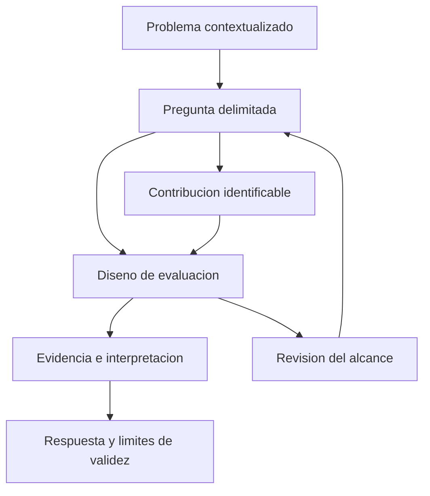

# Clase 3: Diseño y evaluación de investigaciones en ingeniería de software: alcance, contribución y evidencia

> **Objetivo académico:** Analizar la coherencia entre problema, pregunta de investigación, contribución y validación, mediante la revisión crítica de casos de inteligencia artificial, herramientas de desarrollo, auditoría tecnológica y automatización de pruebas.

## 1. Contexto y marco conceptual

La sesión desarrolla una discusión metodológica de propuestas de investigación en informática. Su argumento central es que una idea relevante todavía no constituye una investigación bien delimitada: debe transformarse en una pregunta respondible, un resultado identificable y un diseño de evaluación capaz de producir evidencia pertinente.

La estructura que organiza el razonamiento comprende cuatro componentes:

| Componente | Función | Pregunta de control |
| --- | --- | --- |
| Problema | Identifica una dificultad, necesidad o laguna de conocimiento en un contexto definido. | ¿Qué ocurre, a quién afecta y bajo qué condiciones? |
| Pregunta de investigación | Delimita el conocimiento que se pretende obtener. | ¿Qué relación, propiedad o posibilidad se quiere esclarecer? |
| Resultado o contribución | Especifica el producto intelectual o técnico de la investigación. | ¿Se obtendrá una herramienta, técnica, procedimiento o evidencia empírica? |
| Validación | Determina cómo se sostendrán las afirmaciones sobre la contribución. | ¿Qué observaciones permitirán responder la pregunta? |

La coherencia entre estos componentes es más importante que la sofisticación aparente de la tecnología. Una propuesta puede incluir modelos avanzados y, aun así, carecer de una explicación convincente sobre qué problema resuelve o cómo se reconocerá su éxito.

### Investigación acotada y programa doctoral

Una investigación publicable suele abordar una parte delimitada de un problema mayor. Una tesis puede articular varias contribuciones relacionadas; un artículo necesita una unidad argumental más estrecha. Intentar resolver de una vez el desarrollo, la adaptación, la optimización, la interpretabilidad y la evaluación longitudinal de un sistema puede impedir que cualquiera de esas contribuciones alcance suficiente profundidad.

Delimitar no significa eliminar relevancia. Significa establecer condiciones en las que sea posible producir una respuesta defendible. La generalización puede construirse posteriormente mediante nuevas poblaciones, organizaciones o configuraciones.

### Adecuación al espacio de comunicación científica

Se utiliza la Conferencia Latinoamericana de Informática, CLEI, como ejemplo de encuentro generalista organizado por áreas. Se mencionan sistemas de software, sistemas inteligentes, sistemas en la práctica, tecnología informática y educación en informática. La selección de un área depende de la contribución principal: utilizar inteligencia artificial no convierte automáticamente una investigación en un trabajo sobre modelos de aprendizaje; puede tratarse de ingeniería de software, interacción con usuarios o educación.

La revisión de una convocatoria científica permite reconocer el alcance temático y el grado de madurez esperado. La sesión distingue trabajos completos, trabajos en progreso y presentaciones de artículos previamente publicados en revista. Los primeros requieren una propuesta y una evaluación suficientemente desarrolladas; los segundos pueden comunicar resultados preliminares y limitaciones abiertas, manteniendo exigencias de calidad. Presentar un artículo ya publicado no equivale por sí mismo a producir una nueva publicación.

**Enriquecimiento conceptual:** La aceptación editorial y la calidad metodológica son dimensiones relacionadas, pero diferentes. La adecuación temática favorece una revisión pertinente; la solidez de las conclusiones depende del diseño y de la evidencia, incluso cuando un trabajo haya sido aceptado.

## 2. Fundamentos teóricos y arquitectura

### 2.1. Del concepto abstracto a la propiedad observable

Eficiencia, efectividad, productividad, calidad y experiencia son conceptos demasiado amplios si se utilizan sin definición operacional. La pregunta debe precisar qué dimensión interesa y mediante qué observaciones se estudiará.

En el caso de la inducción de personal, reducir el tiempo de incorporación puede ser un indicador relevante, pero requiere definir qué significa estar incorporado: resolver determinados incidentes, realizar una contribución aceptada o desempeñarse con un grado de autonomía previamente establecido. La mera entrada a un proyecto no demuestra dominio del trabajo.

**Enriquecimiento conceptual:** La eficiencia relaciona resultados con recursos empleados, mientras que la efectividad se refiere al logro de objetivos definidos. Un proceso más rápido puede ser menos efectivo si aumenta los errores. Por ello, una investigación sobre inducción puede necesitar observar simultáneamente tiempo, autonomía y calidad del trabajo.

Un indicador actúa como aproximación a un concepto; no lo representa de manera exhaustiva. En la discusión se consideran tiempo hasta la primera contribución, incidentes introducidos, líneas de código y tickets resueltos. Ninguno debe interpretarse aisladamente como una medida universal de productividad.

### 2.2. Contexto, comparabilidad y variables de confusión

La experiencia previa puede explicar diferencias en el tiempo de adaptación. También importan el rol, la complejidad de los problemas, las tecnologías utilizadas y las prácticas de la organización. Comparar a una persona que desarrolla componentes centrales con otra que trabaja en una interfaz puede mezclar actividades con exigencias distintas.

La contextualización cumple dos funciones. Primero, hace viable la investigación al acotar sus condiciones. Segundo, permite que otros investigadores juzguen si sus propios entornos comparten esas condiciones. Describir una empresa no es un detalle accesorio cuando sus procesos determinan las métricas y el significado de los resultados.

**Enriquecimiento conceptual:** Se distinguen tres preguntas de validez:

- **Validez de constructo:** ¿el indicador representa la propiedad que se quiere estudiar?
- **Validez interna:** ¿la diferencia observada puede atribuirse a la intervención o admite explicaciones alternativas?
- **Validez externa:** ¿a qué otras situaciones podrían transferirse razonablemente los hallazgos?

Un contexto específico puede fortalecer el control del estudio y limitar simultáneamente su generalización. Ambas consecuencias deben explicitarse.

### 2.3. Diseño de artefactos y evaluación empírica

La sesión diferencia dos orientaciones que pueden combinarse, pero no confundirse:

| Orientación | Contribución central | Contenido que exige desarrollar |
| --- | --- | --- |
| Diseño y construcción | Un artefacto, técnica, procedimiento o arquitectura. | Requisitos, decisiones, funcionamiento y evaluación de propiedades relevantes. |
| Investigación empírica | Conocimiento sobre uso, desempeño, efectos o condiciones de adopción. | Diseño del estudio, participantes o casos, instrumentos, datos e interpretación. |

Una herramienta es un resultado tangible; acelerar el desarrollo es un impacto esperado. El impacto necesita demostración y no sustituye la descripción del artefacto. De manera análoga, evaluar un chatbot existente y diseñar uno nuevo generan argumentos científicos diferentes.

### 2.4. Intervención, comparación y atribución

Se discuten diseños antes-después, grupos de comparación, cuestionarios, métricas operativas, estudios de caso y observación de equipos. Estas alternativas deben seleccionarse según la pregunta, el acceso a datos y el grado de control disponible.

**Enriquecimiento conceptual:** Para una duración positiva de referencia, una reducción relativa puede expresarse como:

$$
R_T = \frac{T_0-T_1}{T_0}\times 100\%
$$

Aquí, $T_0>0$ es la duración de referencia y $T_1\geq 0$ la duración observada con la intervención, ambas medidas en la misma unidad y para un criterio de finalización equivalente. $R_T$ es una variación porcentual: un valor positivo representa una reducción; uno negativo, un aumento. La expresión describe una diferencia y no demuestra causalidad. Su interpretación requiere poblaciones y actividades comparables, además de una consideración explícita de cambios simultáneos.

**Enriquecimiento conceptual:** Si la referencia es de 20 días y la intervención registra 15 días bajo un mismo criterio operativo, la reducción descriptiva es $(20-15)/20\times100\%=25\%$. Este ejemplo es ilustrativo y no corresponde a resultados de la sesión. No permite concluir que la herramienta causó la reducción si también cambió la experiencia de las personas o la complejidad del trabajo.

## 3. Implementación técnica y lógica de negocio

La fuente presenta diseños y alternativas de investigación; no contiene código ejecutable, implementaciones demostradas ni resultados experimentales propios verificables. La dimensión técnica consiste en delimitar componentes, entradas, restricciones y criterios de evaluación.

### 3.1. Inteligencia artificial generativa para inducción de personal

El problema planteado es la dificultad de incorporar personal nuevo a empresas tecnológicas cuyos procesos y conocimientos internos deben aprenderse con rapidez. Se propone utilizar un modelo preentrenado para facilitar consultas y adaptar contenidos de inducción.

La lógica del sistema requiere distinguir:

1. El conocimiento de la organización: estándares, procedimientos, guías y prácticas de desarrollo o soporte.
2. El mecanismo de acceso o adaptación de ese conocimiento mediante un modelo de lenguaje.
3. La interacción del trabajador con los contenidos.
4. Los indicadores que permitirían estudiar el aprendizaje y el desempeño posterior.

Durante la discusión se contempla el ajuste fino del modelo con conocimiento de la empresa. Sin embargo, no se especifican datos, procedimiento de entrenamiento ni arquitectura definitiva.

**Enriquecimiento conceptual:** Incorporar conocimiento empresarial no implica necesariamente ajustar los parámetros del modelo. La recuperación de documentos para aportar contexto a las respuestas constituye una alternativa distinta del ajuste fino. La elección depende del propósito, la frecuencia de actualización del conocimiento y los recursos disponibles; ninguna de estas opciones queda implementada en la fuente.

La evaluación exige delimitar primero el rol y las fases de inducción. Las métricas de soporte pueden considerar tickets y su complejidad; las de desarrollo necesitan criterios adecuados a sus actividades. Un cuestionario sobre preparación percibida aporta información subjetiva útil, pero no reemplaza una observación del desempeño.

### 3.2. Configuración de entornos de inteligencia artificial con Docker

Se plantea facilitar la preparación de entornos que integren herramientas como Jupyter, Keras y TensorFlow. La dificultad no se limita a instalar paquetes: incluye compatibilidad, versiones, recursos computacionales y despliegue en infraestructuras heterogéneas.

La discusión distingue dos contribuciones posibles:

| Alternativa | Producto | Consecuencia metodológica |
| --- | --- | --- |
| Generación automatizada del entorno | Una solución que compone y prepara contenedores. | Requiere resolver tanto la recomendación como la automatización robusta del despliegue. |
| Recomendación de configuración | Una lista de componentes y versiones bajo restricciones explícitas. | Permite concentrar la evaluación en la factibilidad de las recomendaciones. |

La segunda alternativa reduce la carga de implementación sin abandonar el problema. Sus entradas podrían incluir hardware disponible, tipo de tarea, conjunto de datos y restricciones sobre el uso de software abierto. La salida sería una configuración candidata que después se construye y comprueba.

Se menciona como antecedente un trabajo sobre recomendación de paquetes para desarrollo mediante un modelo de lenguaje. Su utilidad en la sesión es mostrar un paralelismo metodológico; no se dispone de una referencia bibliográfica completa para documentarlo con precisión.

La actualización mediante versiones de imágenes puede ayudar a distribuir cambios, pero utilizar siempre lo más reciente puede introducir incompatibilidades entre componentes.

**Enriquecimiento conceptual:** La portabilidad de un contenedor depende de condiciones externas, como arquitectura del procesador, controladores y acceso a aceleradores. Tampoco toda actividad de inteligencia artificial exige GPU: su necesidad depende del modelo, la carga de trabajo y el rendimiento requerido. Las condiciones mínimas deben derivarse del caso de uso.

### 3.3. Modelos de lenguaje para retroalimentación de código

El caso propone apoyar la revisión de programas introductorios mediante modelos de lenguaje. Se reconocen varias dimensiones: identificación correcta de errores, calidad de las explicaciones, consistencia entre ejecuciones, diversidad de lenguajes y complejidad de los programas.

La discusión contrasta modificar el modelo con modificar la interacción. El ajuste fino puede requerir datos y recursos relevantes; la ingeniería de instrucciones permite investigar cómo cambia la respuesta al proporcionar criterios, contexto y restricciones. La sesión aconseja buscar una delimitación que produzca conocimiento específico en un área de intensa actividad.

Entre los posibles ejes de delimitación aparecen el pseudocódigo de PSeInt, las instrucciones en español, los modelos ejecutables localmente y las restricciones de privacidad o infraestructura. La ubicación geográfica solo tiene valor explicativo si se traduce en condiciones observables, como idioma, recursos o características del lenguaje utilizado.

**Enriquecimiento conceptual:** Las necesidades de ajuste fino varían según el modelo y el procedimiento; no existe una exigencia universal de entrenar desde cero. Tampoco puede afirmarse de antemano que un modelo de mayor tamaño superará siempre a uno especializado. La comparación debe realizarse sobre la tarea, los datos y las restricciones concretas.

### 3.4. Predicción preventiva de defectos con Transformers

Otra propuesta busca anticipar posibles problemas en software mediante redes de tipo Transformer. La crítica metodológica señala el riesgo de partir de una tecnología elegida y buscar después un problema que justifique su utilización.

La pertinencia del modelo debe sustentarse en las propiedades del problema y en una comparación con alternativas. También importa la unidad de análisis: predecir defectos en un proyecto completo tiene una complejidad distinta de revisar un archivo pequeño. Se considera la posibilidad de utilizar redes feedforward como referencia comparativa, sin establecer una arquitectura final.

**Enriquecimiento conceptual:** Los modelos de lenguaje y los Transformers no constituyen categorías necesariamente separadas. Transformer designa una arquitectura utilizada por numerosos modelos de lenguaje; modelo de lenguaje describe una función de modelado. Una combinación de técnicas debe especificar qué papel cumple cada componente.

### 3.5. Auditoría de controles de tecnología de información en pymes

La propuesta se reformula desde una utilización genérica de inteligencia artificial hacia un ámbito más preciso: apoyar la identificación de riesgos en empresas con infraestructura tecnológica relevante.

Se mencionan planificación, identificación de riesgos y ejecución como partes del proceso de auditoría. También aparecen revisión documental, comprobación de controles, revisión de configuraciones y análisis de accesos. El criterio decisivo es identificar qué actividad concreta mejoraría la herramienta y qué evidencia permitiría comprobarlo.

**Enriquecimiento conceptual:** ISACA es una asociación profesional; COSO remite a marcos de control y gestión; ISO/IEC 27001 es una norma de requisitos para sistemas de gestión de seguridad de la información. Estos referentes no son intercambiables y requieren especificar su función en el diseño de la auditoría.

### 3.6. Chatbots y autorregulación académica

Se analiza un chatbot orientado a estudiantes de trabajo social en línea. La autorregulación se presenta mediante la organización del estudio, la gestión del tiempo y la reducción de la procrastinación. La propuesta incluye múltiples componentes posibles: Transformers, redes recurrentes, aprendizaje por refuerzo, grafos de conocimiento, inferencia causal e interpretabilidad.

La revisión identifica una tensión entre un título centrado en evaluar chatbots y una pregunta que plantea desarrollar un modelo. La implementación de un sistema y la evaluación de sus efectos requieren separar las contribuciones y mantener coherencia entre título, pregunta y evidencia.

El caso se relaciona con una propuesta más amplia sobre experiencia estudiantil mediante asistentes virtuales. La autorregulación constituye una dimensión más específica que la experiencia global y facilita delimitar usuarios, funciones y resultados.

**Enriquecimiento conceptual:** La autorregulación comprende procesos de planificación, seguimiento y ajuste del aprendizaje. Una mejora en la respuesta del chatbot no demuestra por sí misma una mejora en esos procesos. Se necesitan indicadores educativos vinculados al objetivo de la intervención.

## 4. Análisis crítico de casos y auditoría práctica

### 4.1. Inducción: evitar que la métrica sustituya al fenómeno

La disponibilidad de registros empresariales favorece la investigación, pero exige comprobar su significado. Resolver más tickets puede indicar mayor capacidad o una asignación de problemas más sencillos. Escribir más líneas puede reflejar actividad sin mejora de calidad. Llegar antes a producción puede obedecer a presión organizacional.

**Enriquecimiento conceptual:** Una evaluación más sólida combina indicadores de tiempo con calidad y autonomía, documenta la complejidad de las actividades y considera la experiencia inicial. Una métrica compuesta solo es interpretable si se justifican sus componentes, escalas y ponderaciones; agregarlas sin fundamento puede ocultar compensaciones importantes.

### 4.2. Docker: factibilidad y robustez son propiedades diferentes

El arranque de un contenedor aporta evidencia inicial sobre su configuración, pero no garantiza que el entrenamiento funcione, que el acelerador sea accesible o que los resultados sean reproducibles. La pregunta debe precisar si se estudia instalación, ejecución funcional, rendimiento o mantenimiento de compatibilidad.

**Enriquecimiento conceptual:** Una evaluación escalonada podría distinguir construcción de la imagen, ejecución de una actividad representativa y medición de recursos. Esos niveles permiten localizar fallos y evitan tratar una comprobación superficial como validación completa.

### 4.3. Retroalimentación de código: exactitud, estabilidad y utilidad

La propuesta necesita separar la detección de errores de la utilidad de la explicación. Una respuesta puede identificar un defecto y ofrecer una corrección confusa; otra puede ser pedagógicamente clara y técnicamente incorrecta. La variabilidad entre consultas introduce una dimensión adicional de consistencia.

Las cifras de desempeño mencionadas oralmente no incluyen suficiente detalle sobre datos, comparadores y definición de las métricas. Por ello, no se utilizan como resultados establecidos ni como demostración de superioridad de un modelo.

**Enriquecimiento conceptual:** En una evaluación de detección, la precisión y la exhaustividad pueden definirse como:

$$
\mathrm{Precision}=\frac{TP}{TP+FP},\qquad
\mathrm{Recall}=\frac{TP}{TP+FN}
$$

Aquí, $TP$, $FP$ y $FN$ son conteos enteros no negativos de verdaderos positivos, falsos positivos y falsos negativos. Debe definirse la unidad analizada: defecto, línea o programa. Las expresiones requieren denominadores positivos. La precisión indica qué proporción de las detecciones es correcta; la exhaustividad indica qué proporción de los defectos de referencia se detecta. Ambas necesitan una referencia fiable y reglas explícitas para emparejar detecciones con defectos.

Estas medidas no capturan por sí solas claridad, pertinencia pedagógica ni estabilidad. Tampoco deben trasladarse automáticamente al estudio de autorregulación: solo son pertinentes allí si existe una tarea de clasificación definida.

### 4.4. Auditoría de pymes: reconstruir la cadena problema-intervención

La baja utilización de tecnología no justifica automáticamente introducir inteligencia artificial. Primero se requiere distinguir empresas sin infraestructura pertinente de empresas que sí tienen sistemas digitales, pero carecen de herramientas para evaluar sus controles.

La reformulación más coherente define un tipo de empresa, sus sistemas, los riesgos relevantes y la actividad de identificación que se pretende apoyar. Una alerta automática de acceso no demuestra, por sí sola, el empleo de inteligencia artificial.

**Enriquecimiento conceptual:** Una alerta puede proceder de reglas estáticas, umbrales o modelos aprendidos. Identificar el mecanismo evita atribuir capacidades inexistentes. La evaluación también debe distinguir detección de riesgos, funcionamiento de controles y cumplimiento de requisitos: son objetos relacionados, pero diferentes.

Los porcentajes mostrados en este caso carecen de una base de comparación claramente explicada en la fuente; no permiten establecer una magnitud fiable de mejora.

### 4.5. Chatbots: separar desempeño técnico y efecto educativo

El diseño propuesto combina comparación entre grupos, observaciones en distintos momentos, encuestas y seguimiento longitudinal. Esa variedad no garantiza rigor si cada instrumento no responde a una dimensión específica.

**Enriquecimiento conceptual:** La validación cruzada estima desempeño predictivo bajo un esquema de partición de datos; no demuestra un efecto causal sobre el aprendizaje. Si existen varias observaciones por estudiante, distribuirlas indiscriminadamente entre entrenamiento y evaluación puede introducir filtración de información. El seguimiento longitudinal, por su parte, debe considerar cambios de contexto y pérdidas de participantes.

La discusión también identifica un problema de ingeniería de software: probar chatbots cuyas respuestas pueden variar o incluir alucinaciones. La calidad de la interacción, la usabilidad y la fiabilidad requieren criterios explícitos; una conversación fluida no equivale a una respuesta correcta.

### 4.6. Pruebas automatizadas en entornos ágiles

El último caso parte de una tensión industrial: aumentar la velocidad de entrega puede reducir el tiempo dedicado a pruebas. La propuesta inicial busca mejorar la calidad mediante automatización, pero la discusión recomienda distinguir la generación de pruebas de su incorporación al proceso de desarrollo.

Se mencionan EvoSuite y TestSpark como herramientas vinculadas a generación automatizada, junto con el uso de modelos de lenguaje. La sesión identifica problemas abiertos en aserciones y cobertura, sin que las cifras aproximadas expresadas oralmente puedan tratarse como límites universales.

La contribución sugerida consiste en observar cómo equipos reales incorporan herramientas existentes. El acceso a desarrolladores y procesos organizacionales constituye un recurso científico valioso: permite estudiar utilidad, barreras, cambios de práctica y condiciones de adopción.

**Enriquecimiento conceptual:** La cobertura muestra ejecución de elementos del programa según un criterio, pero no garantiza que las aserciones detecten fallos. En equipos distintos, los cambios de calidad también pueden depender de experiencia, proyecto o presión de entrega. Un estudio industrial debe combinar registros del proceso con evidencia sobre el uso efectivo de las pruebas y declarar los límites de atribución.

## 5. Principios de diseño, buenas prácticas y anti-patrones

### Coherencia metodológica

La pregunta, el resultado y la validación deben referirse al mismo objeto. Un título que promete evaluar herramientas existentes no describe adecuadamente una contribución centrada en diseñar una nueva arquitectura. Corregir esa desalineación determina qué evidencia y qué argumentación necesita el trabajo.

### Delimitación progresiva

Conviene comenzar por una población, organización, lenguaje o configuración definidos. Posteriormente puede investigarse la transferencia. El anti-patrón consiste en presentar como objetivo inicial una solución para cualquier empresa, cualquier estudiante o cualquier entorno, sin capacidad de evaluar esa amplitud.

### Selección de tecnología por necesidad

La técnica debe justificarse por las propiedades del problema. Incorporar inteligencia artificial para modernizar el vocabulario de una propuesta no explica su utilidad. Del mismo modo, seleccionar Transformers por familiaridad personal no basta para sostener su pertinencia frente a alternativas.

### Separación de resultado e impacto

Una herramienta, una técnica o un estudio constituyen contribuciones identificables. La rapidez, satisfacción o mejora de calidad son efectos esperados cuya existencia debe evaluarse. Confundir ambas categorías convierte aspiraciones en afirmaciones sin evidencia.

### Evaluación proporcional a las afirmaciones

Un cuestionario puede sostener conclusiones sobre percepción bajo ciertas condiciones; una prueba de arranque, sobre una propiedad técnica limitada. Ninguno autoriza automáticamente afirmaciones sobre productividad, robustez o efecto educativo. La fuerza de la conclusión debe corresponder a la fuerza de la evidencia.

### Colaboración y autoría

La discusión científica permite detectar supuestos, sesgos y problemas de alcance que pueden pasar inadvertidos en el trabajo individual. La autoría debe guardar relación con las contribuciones efectivas y estas deben explicitarse. La colaboración interdisciplinaria aporta valor cuando los papeles técnicos y conceptuales son claros.

### Ética de investigación con personas

La sesión señala la responsabilidad institucional de revisar estudios con participantes humanos. La aprobación pertinente debe gestionarse según las reglas aplicables y describirse de forma verificable.

**Enriquecimiento conceptual:** Las publicaciones también pueden establecer requisitos éticos propios. La responsabilidad institucional no excluye las políticas editoriales. En entornos laborales y educativos resultan especialmente relevantes la voluntariedad, la protección de datos y las relaciones de dependencia entre participantes e investigadores.

### Integridad de la comunicación científica

La discusión desaconseja enviar simultáneamente el mismo manuscrito a espacios que exigen exclusividad. Un programa de investigación puede generar artículos diferentes si sus preguntas y contribuciones son sustantivamente distintas.

**Enriquecimiento conceptual:** Compartir antecedentes no convierte dos trabajos en duplicados, pero reutilizar sustancialmente resultados sin transparencia plantea problemas de publicación redundante. Una versión extendida debe aportar contenido nuevo identificable, reconocer la versión previa y cumplir las políticas del destino editorial.

### Escritura y trazabilidad

Se mencionan LaTeX y Overleaf como recursos de escritura científica. La elección de herramienta debe favorecer consistencia, colaboración y mantenimiento del documento.

**Enriquecimiento conceptual:** La validez científica no depende de utilizar LaTeX o un procesador de texto. La trazabilidad de decisiones, el control de versiones y la correspondencia entre afirmaciones y evidencia son criterios más relevantes que la preferencia por un editor.

## 6. Síntesis conceptual y profundización académica

La sesión muestra que el diseño de investigación consiste en construir una cadena justificativa: un problema situado origina una pregunta; la pregunta determina una contribución y un modo de evaluarla; la evidencia permite responder dentro de límites explícitos. Cuando un eslabón es ambiguo, los demás tienden a volverse imprecisos.

Los casos comparten problemas transversales. La inducción exige operacionalizar aprendizaje y desempeño; Docker obliga a distinguir configuración, compatibilidad y ejecución; la retroalimentación de código demanda separar exactitud y utilidad; la auditoría necesita definir infraestructura y riesgos; los chatbots requieren diferenciar calidad técnica y efectos educativos; las pruebas automatizadas muestran que una tecnología madura todavía puede presentar dificultades de adopción organizacional.

La novedad no depende exclusivamente de inventar un algoritmo. Puede residir en una pregunta poco estudiada, una restricción relevante, una comparación rigurosa o evidencia sobre el uso real de herramientas existentes. El acceso a una organización, a sus procesos y a sus participantes puede permitir contribuciones que no se obtienen mediante experimentos exclusivamente técnicos.

**Enriquecimiento conceptual:** Tres líneas de profundización articulan el conjunto de la clase: la relación entre medición y validez de constructo; la relación entre diseño de comparación y atribución causal; y la relación entre contexto y transferencia de resultados. En sistemas con inteligencia artificial se añade la necesidad de documentar versiones, condiciones de ejecución y variabilidad, para interpretar qué se evaluó realmente y qué podría cambiar al modificar el sistema.

Una investigación defendible delimita lo que afirma, explica cómo lo observa y reconoce qué permanece abierto.
