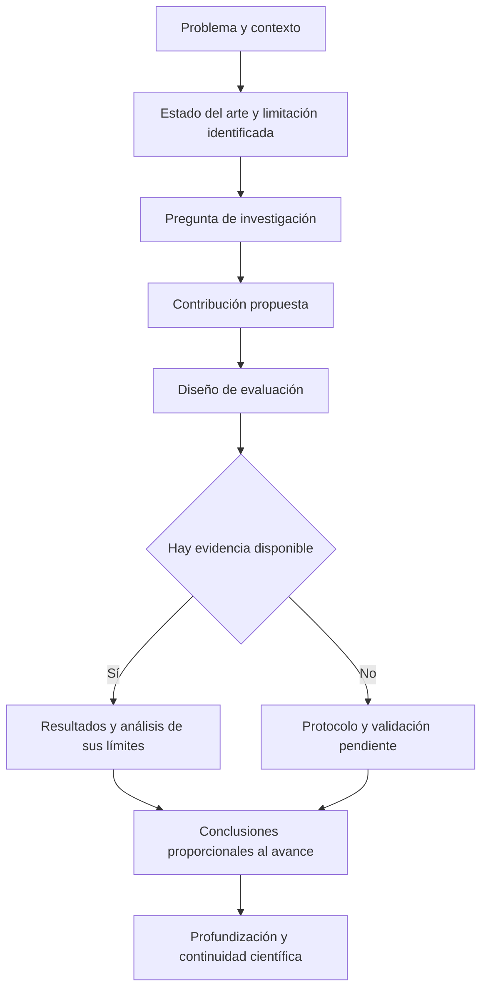
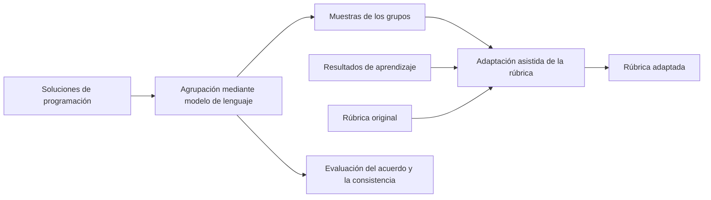

# Clase 4: Diseño y comunicación de investigaciones en progreso en ingeniería de software

> **Objetivo académico:** Comprender cómo transformar una idea de investigación en un artículo científico coherente, distinguir propuestas metodológicas de resultados observados y evaluar críticamente la trazabilidad entre problema, contribución, método y evidencia.

## 1. Contexto y marco conceptual

La sesión aborda la escritura y la revisión de artículos de investigación en ingeniería de software, con énfasis en trabajos en progreso. El problema central consiste en convertir componentes conceptuales de una investigación en un documento que permita comprender qué se propone, por qué resulta pertinente y cómo podría validarse.

### Investigación en progreso y contribución científica

Un trabajo en progreso comunica una investigación cuyo desarrollo todavía no está completo. Puede presentar una metodología, el diseño de un sistema, una implementación parcial o resultados preliminares. Su carácter provisional reduce el alcance de la evidencia disponible, pero mantiene la necesidad de explicar el problema, la contribución y la continuidad de la investigación.

La sesión destaca cuatro componentes que sostienen la calidad conceptual de un trabajo:

- Un problema de investigación claramente delimitado.
- Una pregunta de investigación que concrete qué se desea conocer.
- Una estrategia de evaluación que permita producir evidencia pertinente.
- Un resultado o una contribución cuyo estado de desarrollo se comunique con precisión.

Estos componentes orientan la investigación, pero no tienen que convertirse literalmente en títulos de secciones. La estructura documental debe instanciarlos según la naturaleza del trabajo y proporcionar un flujo argumental comprensible.

La novedad exige explicar qué relación mantiene la propuesta con el estado del arte: qué limitación aborda, qué conocimiento añade o qué solución amplía. Presentar herramientas existentes o describir un problema conocido no basta para identificar una contribución propia.

**Enriquecimiento conceptual:** Una replicación también puede producir conocimiento original si estudia la robustez, la reproducibilidad o los límites de resultados previos en condiciones justificadas. La distinción relevante es entre repetir sin una pregunta nueva y realizar una replicación con valor científico explícito.

### Resultados preliminares y alcance de las conclusiones

Una evaluación inicial puede indicar que una propuesta tiene potencial sin resolver de manera definitiva las preguntas de investigación. La sesión utiliza como ejemplo un método de generación automática de pruebas aplicado a pocos proyectos: esos casos pueden mostrar viabilidad, pero no justifican por sí solos afirmaciones generales.

La escritura debe diferenciar tres estados:

| Estado | Qué puede afirmarse | Límite de la afirmación |
| --- | --- | --- |
| Propuesta metodológica | Se define una estrategia y se explica su fundamento | Su efectividad todavía no está demostrada |
| Implementación o demostración | Existe una realización del enfoque o de alguno de sus componentes | Su funcionamiento no establece superioridad frente a alternativas |
| Evaluación preliminar | Se observan resultados bajo condiciones descritas | La generalización queda limitada por los casos y el diseño utilizados |

El trabajo futuro debe explicar cómo se pasará del estado actual a una investigación más completa: finalizar componentes, ampliar los casos, realizar comparaciones o fortalecer la validación. Su función científica es hacer visible qué evidencia falta y cómo se obtendría.

## 2. Fundamentos teóricos y arquitectura

### Arquitectura argumental del artículo

El artículo debe conectar problema, antecedentes, propuesta, evaluación y conclusiones. La sesión presenta título, autoría, resumen, introducción, conclusiones y referencias como componentes básicos de la estructura discutida. El cuerpo intermedio admite variaciones: materiales y métodos, propuesta, diseño experimental, resultados o subsecciones específicas de cada contribución.

El diagrama sintetiza la relación entre los componentes discutidos; no prescribe que cada nodo deba corresponder a una sección independiente.

### Funciones del resumen y la introducción

El resumen debe presentar de forma concisa el problema, el enfoque y los resultados disponibles. Cuando no existe evaluación, debe indicar el carácter metodológico o propositivo de la contribución. No corresponde completar esa ausencia con resultados esperados redactados como observaciones.

La introducción expande el resumen: desarrolla el contexto, justifica la relevancia del problema, sitúa la contribución e informa qué hace el artículo. Puede cerrar con una descripción de su organización, siempre que esta ayude a orientar al lector.

El resumen y las palabras clave también intervienen en la selección de revisores. Deben caracterizar el contenido real del trabajo: área, problema y enfoque. La sesión sugiere unas pocas palabras clave específicas, evitando listas que diluyan su capacidad de identificación.

### Trabajos relacionados y contribución propia

La revisión de antecedentes demuestra conocimiento del campo y permite justificar la diferencia entre la propuesta y lo existente. En artículos breves debe ser selectiva: una revisión extensa que desplaza la explicación de la contribución debilita el documento.

No se establece una proporción universal de espacio. El criterio es funcional: cada antecedente debe ayudar a comprender el problema, justificar una decisión o establecer una comparación. La extensión de la revisión debe guardar relación con el espacio necesario para explicar el trabajo propio.

**Enriquecimiento conceptual:** Una sección de trabajos relacionados resulta más informativa cuando organiza antecedentes por enfoques, capacidades o limitaciones, en lugar de presentar una sucesión de resúmenes sin conexiones. Esa comparación facilita identificar la brecha que motiva la investigación.

### Propuesta, evaluación y conclusiones

La propuesta debe explicar qué se construye o define y cómo se articulan sus componentes. Cuando existen varias fases, las subsecciones ayudan a distinguir entradas, transformaciones y salidas.

La evaluación describe cómo se contrastará la propuesta: casos, datos, métricas, alternativas de comparación y procedimiento. Los resultados comunican lo observado mediante ese procedimiento. Las conclusiones deben recuperar la contribución efectivamente alcanzada y sus límites, diferenciándola de desarrollos todavía pendientes.

## 3. Implementación técnica y lógica de negocio

La fuente no contiene código, derivaciones matemáticas ni una ejecución reproducible completa. Su contenido técnico se concentra en el diseño de investigaciones, la operacionalización de criterios comparativos y la arquitectura de una propuesta basada en modelos de lenguaje.

### Comparación de herramientas de pruebas automatizadas

Se analiza una comparación entre Ranorex y TestComplete en un contexto de aplicaciones C# con Windows Forms. La delimitación tecnológica importa porque determina qué herramientas son pertinentes y hasta dónde podrían extenderse las conclusiones.

La selección debe justificarse mediante criterios explícitos. La sesión menciona compatibilidad tecnológica y posibles restricciones de acceso o licencia como ejemplos de criterios, sin establecer que las herramientas citadas satisfagan todos ellos.

Un diseño comprensible debe precisar:

1. El contexto de desarrollo y las necesidades que motivan la comparación.
2. Los criterios de inclusión y exclusión de herramientas.
3. Las métricas que se utilizarán y su significado.
4. La organización de los equipos participantes.
5. Las condiciones de trabajo, incluyendo proyecto, soporte y recursos disponibles.
6. El procedimiento de análisis de los datos.

La propuesta discutida contempla dos equipos que trabajan sobre un mismo proyecto con herramientas distintas. Mantener condiciones comparables permite interpretar mejor las diferencias observadas.

**Enriquecimiento conceptual:** Con un equipo por herramienta, la experiencia o composición del equipo puede confundirse con el efecto de la herramienta. La asignación aleatoria, la caracterización de la experiencia previa o un diseño cruzado pueden reducir ese problema, aunque su conveniencia depende de los recursos y de los efectos de aprendizaje.

### Comparación de herramientas de evaluación de riesgos

Otro caso considera técnicas y herramientas de evaluación de riesgos en auditoría de sistemas. Se presenta un proceso que comprende identificar riesgos y necesidades, revisar alternativas, establecer criterios de selección y realizar una prueba piloto.

El punto metodológico central es distinguir los datos de las interpretaciones. Un precio documentado constituye un dato contextualizado; una valoración como «costo regular» es una interpretación que exige una regla de clasificación. Lo mismo ocurre con etiquetas numéricas de efectividad, compatibilidad o usabilidad.

| Criterio | Dificultad identificada | Especificación necesaria |
| --- | --- | --- |
| Costo | Una etiqueta ordinal oculta el importe y las condiciones comerciales | Moneda, modalidad de licencia, alcance y condiciones del precio |
| Efectividad | El término puede significar capacidades o resultados distintos | Definición del atributo y procedimiento para observarlo |
| Compatibilidad | Una valoración global no indica qué integraciones se verificaron | Plataformas, tecnologías o entornos considerados |
| Usabilidad | La percepción del autor puede presentarse como propiedad objetiva | Criterios, usuarios, tareas o procedimiento de valoración |

La sesión propone como ilustración contar funcionalidades o verificar características previamente definidas. La utilidad de este procedimiento reside en hacer visible cómo se asigna cada valor.

**Enriquecimiento conceptual:** Contar características mejora la trazabilidad, pero no garantiza que se mida el constructo declarado. Una herramienta con más funciones no es necesariamente más efectiva, y disponer de interfaz web o soporte no demuestra por sí solo mayor usabilidad. Es necesario justificar la relación entre cada indicador y el atributo que pretende representar.

Si los valores proceden de juicio experto sobre documentación, ese procedimiento puede ser parte legítima del estudio. Debe declararse quién valoró, con qué criterios y qué incertidumbre introduce. La documentación comercial informa sobre lo que afirma un proveedor; no equivale automáticamente a evidencia independiente de desempeño.

El estudio puede restringirse a alternativas accesibles sin costo si esa decisión se justifica. Debe diferenciarse entre licencia abierta, gratuidad y disponibilidad de una versión de prueba, porque describen condiciones distintas.

### Contexto de los resultados de escaneo

El número de vulnerabilidades detectadas, el tiempo de escaneo y los falsos positivos solo son interpretables si se explica qué se hizo. Presentar tiempos aislados no permite comparar herramientas sin conocer el objetivo analizado, el alcance del análisis y el procedimiento.

**Enriquecimiento conceptual:** Para fortalecer la reproducibilidad de esta comparación conviene documentar versiones, configuraciones, recursos computacionales, condiciones de red y repeticiones. La identificación de falsos positivos requiere además un procedimiento de verificación: la coincidencia o discrepancia entre herramientas no establece por sí sola qué hallazgo es verdadero.

### Modelos de lenguaje para agrupar soluciones y adaptar rúbricas

Se discute una propuesta de dos fases en educación de la programación:

1. Un modelo de lenguaje analiza código y agrupa soluciones según criterios de desempeño.
2. Otro procesamiento utiliza muestras de esos grupos para generar descriptores de una rúbrica adaptada.

Los criterios mencionados incluyen corrección, eficiencia y estilo. La evaluación propuesta considera acuerdo con una referencia experta, consistencia entre ejecuciones y diferenciación entre los grupos producidos. Se trata de un diseño presentado para discusión; la sesión no aporta resultados que demuestren su efectividad.

**Enriquecimiento conceptual:** La complejidad ciclomática, mencionada en la propuesta junto con la eficiencia, mide la estructura de caminos de control del programa. No equivale a complejidad temporal ni a consumo de memoria. Conviene separar corrección funcional, eficiencia computacional, complejidad estructural y estilo para evitar indicadores intercambiables sin fundamento.

La revisión identifica un riesgo importante: si la rúbrica se deriva únicamente del desempeño observado, puede reproducir las limitaciones de ese grupo y perder conexión con los aprendizajes esperados. La modificación sugerida incorpora la rúbrica original y los resultados de aprendizaje como referencias para la adaptación.

El esquema representa la modificación conceptual sugerida en la discusión. La ingeniería de instrucciones puede incorporar esas referencias, pero debe acompañarse de una evaluación que compruebe si la adaptación conserva su propósito educativo.

**Enriquecimiento conceptual:** Si se asignan soluciones a niveles definidos de antemano, el procedimiento se aproxima a una clasificación ordinal. Si los grupos emergen sin categorías predefinidas, se trata de agrupamiento. Esta distinción determina qué referencia y qué criterios de validación resultan apropiados. Asimismo, encontrar diferencias entre grupos no demuestra por sí solo que estos representen niveles válidos de competencia.

## 4. Análisis crítico de casos y auditoría práctica

### Caso de clasificación de imágenes mediante Vision Transformers

El primer artículo revisado presenta problema, método y resultados en el resumen. Su cuerpo incluye introducción, trabajos relacionados, materiales y métodos, resultados y conclusiones.

La sesión valora la correspondencia entre la descripción del enfoque y la evaluación, que menciona métricas como exactitud y F1. No se proporcionan detalles suficientes para reconstruir el experimento ni verificar sus cifras.

La crítica principal se refiere al espacio dedicado a antecedentes: una revisión demasiado extensa reduce la explicación de la investigación propia. Como aspecto favorable, las conclusiones identifican continuidad científica mediante ampliación de datos y exploración de otras arquitecturas.

### Caso de detección multimodal de discurso de odio

El segundo artículo organiza la propuesta en fases, entre ellas procesamiento de características, agrupación de imágenes y clasificación. Una figura apoya la relación entre sus componentes.

La evaluación distingue recolección de datos, métricas, alternativas de comparación y detalles de implementación. Los resultados preliminares se presentan de forma breve y se interpretan sin declarar que el problema esté resuelto.

Este caso ilustra que una contribución puede ser compacta y conservar estructura metodológica. Las subsecciones facilitan seguir el razonamiento y relacionar la arquitectura con su evaluación.

### Caso de metodología de innovación tecnológica en pymes

El tercer artículo presenta una propuesta metodológica sin evidencia experimental equivalente a los anteriores. La ausencia de resultados no constituye por sí sola la objeción principal, dado su carácter de trabajo en progreso.

La crítica se concentra en que el contexto y los modelos existentes ocupan gran parte del documento, mientras que la metodología propia aparece tarde y recibe poco desarrollo. La sucesión de secciones al mismo nivel tampoco permite distinguir claramente antecedentes, problema y contribución.

El principio que se deriva es preciso: una investigación organizacional puede requerir tiempos y procedimientos distintos de un prototipo computacional, pero debe explicar qué pretende hacer, en qué contexto y con qué alcance. La complejidad de una validación futura no sustituye la especificación de la propuesta actual.

### Auditoría de resultados supuestos

En el caso de pruebas automatizadas se detecta una redacción que atribuye resultados a una comparación todavía no ejecutada. El problema no se resuelve cambiando el tono de las conclusiones: hay que separar el diseño de investigación de las observaciones inexistentes.

La formulación adecuada comunica que se propone una comparación y se describe cómo se realizará. Una conclusión legítima puede afirmar que se ha definido el protocolo; no puede afirmar que una herramienta superó a otra sin evidencia.

**Enriquecimiento conceptual:** El sesgo del investigador comprende decisiones que favorecen una expectativa, como seleccionar indicadores convenientes o interpretar ambiguamente los datos. Presentar observaciones inventadas es un problema adicional de integridad científica. Una hipótesis explícita puede orientar un estudio; no debe transformarse en un hallazgo antes de contrastarla.

### Revisión por pares y variabilidad de criterio

La sesión distingue experiencia temática y confianza del revisor. Una persona puede conocer el área y, aun así, tener incertidumbre sobre su valoración de un artículo particular.

La participación de varios revisores busca mitigar la dependencia de un único criterio. Sin embargo, comparar artículos aceptados no permite deducir de forma fiable qué área es más sencilla o qué estándar se aplicó, porque pueden intervenir revisores, comunidades y tipos de contribución diferentes.

Las apreciaciones sobre diferencias entre áreas se presentan en la sesión como experiencia y juicio del docente, no como resultados de un estudio sistemático. La aceptación de un artículo tampoco certifica que todas sus decisiones sean ejemplares.

**Enriquecimiento conceptual:** La pluralidad de revisores reduce algunos riesgos, pero sus juicios pueden compartir sesgos o supuestos. El valor de una revisión depende también de la pertinencia de su experiencia y de la calidad de las razones que ofrece. Una revisión cruzada entre colegas resulta útil cuando se concentra en la claridad del problema, la justificación del método y el respaldo de las afirmaciones.

## 5. Principios de diseño, buenas prácticas y anti-patrones

### Escritura concisa y jerarquía de información

La sesión recomienda elaborar primero el contenido necesario y después condensarlo. Esta secuencia permite distinguir lo esencial de lo redundante sin limitar prematuramente la exposición de la contribución.

La reducción debe actuar sobre repeticiones, antecedentes secundarios, tablas sobredimensionadas y explicaciones que pueden integrarse. Alterar márgenes, interlineado o estilos para aparentar cumplimiento de una plantilla es un anti-patrón editorial. La integridad del formato debe preservarse mediante una mejor selección del contenido.

Las figuras deben justificar su presencia por el valor explicativo que aportan. Una representación de arquitectura ayuda cuando aclara relaciones difíciles de seguir en prosa. Si repite información sin añadir comprensión, puede reducirse, integrarse mejor o eliminarse. Adaptar una figura al ancho de una columna puede mejorar el uso del espacio si se conserva su legibilidad.

El material complementario permite ampliar información, pero la sesión advierte que los revisores pueden no consultarlo. El argumento central debe poder comprenderse en el documento principal.

### Herramientas de composición y referencias

LaTeX y Word son alternativas de preparación; el resultado editorial discutido es un PDF que conserva el estilo de la publicación. LaTeX facilita automatizar numeración y referencias, mientras que la edición directa en Word requiere atención para evitar cambios accidentales de estilo. Esta comparación corresponde a la experiencia expuesta, no a una evaluación exhaustiva de las capacidades actuales de ambas herramientas.

En el estilo IEEE tratado en la sesión, las referencias se numeran por su primera aparición y mantienen ese número en menciones posteriores. Puede integrarse el nombre del autor en la oración y conservar el marcador numérico. Los títulos de las fuentes se mantienen en su idioma original.

Las notas al pie pueden alojar aclaraciones o enlaces secundarios sin interrumpir el flujo de lectura. No conviene introducir una nota cuyo único contenido remita innecesariamente a una referencia que podría citarse directamente.

**Enriquecimiento conceptual:** El uso de una nota al pie no debe convertir una fuente decisiva en información secundaria. La importancia de una fuente para el argumento y las normas editoriales deben guiar su tratamiento. Los gestores bibliográficos también permiten automatizar citas y bibliografías en procesadores de texto.

La autoría, las afiliaciones y el financiamiento cumplen funciones diferentes: identifican a quienes contribuyen, su vinculación institucional y los apoyos recibidos. La sesión muestra que agrupar afiliaciones compartidas evita redundancia. Las posibilidades concretas de presentación dependen del formato editorial.

**Enriquecimiento conceptual:** La consistencia del nombre de publicación facilita atribuir correctamente la producción científica. La afiliación debe representar una vinculación pertinente para el trabajo y no se reduce universalmente a quién remunera al autor.

### Integridad y asistencia mediante modelos de lenguaje

El uso legítimo de antecedentes requiere atribución y elaboración propia. Reformular una idea no elimina la obligación de citarla. A su vez, una coincidencia textual detectada automáticamente exige interpretación contextual; el porcentaje de similitud no describe por sí solo la naturaleza de la coincidencia.

La discusión sobre modelos de lenguaje diferencia generar contenido sustantivo y asistir en la corrección de un texto previamente escrito. Se recomienda delimitar la intervención mediante instrucciones específicas, por ejemplo, corregir puntuación o gramática sin añadir información, y revisar cualquier cambio introducido.

La sesión reconoce la falta de fiabilidad suficiente de los detectores automáticos de texto generado. La responsabilidad científica debe centrarse en el origen y la verificación del contenido, la atribución y las políticas aplicables.

**Enriquecimiento conceptual:** La dificultad de detectar una intervención no justifica su uso. Incluso una corrección lingüística puede modificar el alcance de una afirmación o introducir hechos no respaldados. La revisión humana y el cumplimiento de las reglas editoriales siguen siendo necesarios, con independencia del resultado de un detector.

### Anti-patrones recurrentes

| Anti-patrón | Consecuencia | Práctica preferible |
| --- | --- | --- |
| Convertir componentes conceptuales en encabezados rígidos | Flujo artificial y escasa adaptación al problema | Organizar el texto según la contribución |
| Seleccionar herramientas sin justificación | Comparación difícil de interpretar | Explicitar contexto y criterios de selección |
| Presentar preferencias como resultados | Conclusiones sin respaldo | Distinguir hipótesis, diseño y observaciones |
| Asignar puntuaciones sin reglas | Juicios opacos y difícilmente reproducibles | Definir indicadores o declarar el juicio experto |
| Mostrar cifras sin protocolo | Imposibilidad de valorar su significado | Describir condiciones y procedimiento |
| Desarrollar extensamente antecedentes y abreviar la propuesta | Contribución poco visible | Priorizar la explicación del trabajo propio |
| Derivar criterios educativos solo del desempeño observado | Pérdida de alineación con los aprendizajes esperados | Incorporar referencias pedagógicas explícitas |
| Tomar la publicación como garantía de calidad absoluta | Reproducción acrítica de defectos | Analizar la coherencia interna de cada artículo |

## 6. Síntesis conceptual y profundización académica

La calidad de un artículo en progreso depende de que el lector pueda reconstruir su razonamiento: qué problema aborda, qué aporta, cómo pretende obtener evidencia y qué puede concluir en su estado actual. La falta de resultados completos puede ser compatible con una contribución metodológica clara; la falta de especificación del método debilita esa contribución.

Los casos discutidos convergen en tres exigencias. Primero, la selección de herramientas, datos y comparaciones debe tener una justificación visible. Segundo, las métricas deben representar atributos definidos y diferenciar medición de interpretación. Tercero, las conclusiones deben mantenerse dentro del alcance de la evidencia disponible.

La escritura científica también funciona como instrumento de revisión del diseño: cuando no puede explicarse cómo se obtuvo un valor, qué controla una comparación o cómo se valida una agrupación, la dificultad suele señalar una decisión metodológica pendiente.

**Enriquecimiento conceptual:** Las líneas de profundización que articulan estos casos son la validez de constructo, para analizar si los indicadores miden lo que declaran; la validez interna, para distinguir efectos de herramientas y condiciones de trabajo; la validez externa, para delimitar la transferencia a otros contextos; y la reproducibilidad, para permitir reconstruir el procedimiento. Estas dimensiones no requieren añadir formalismo al artículo: requieren hacer explícitas las decisiones y sus límites.

La revisión por pares aporta contraste y retroalimentación, aunque conserva variabilidad. Por ello, la coherencia entre problema, contribución, método y evidencia constituye una base más sólida para valorar un trabajo que su aceptación aislada o la apariencia de completitud de su presentación.
