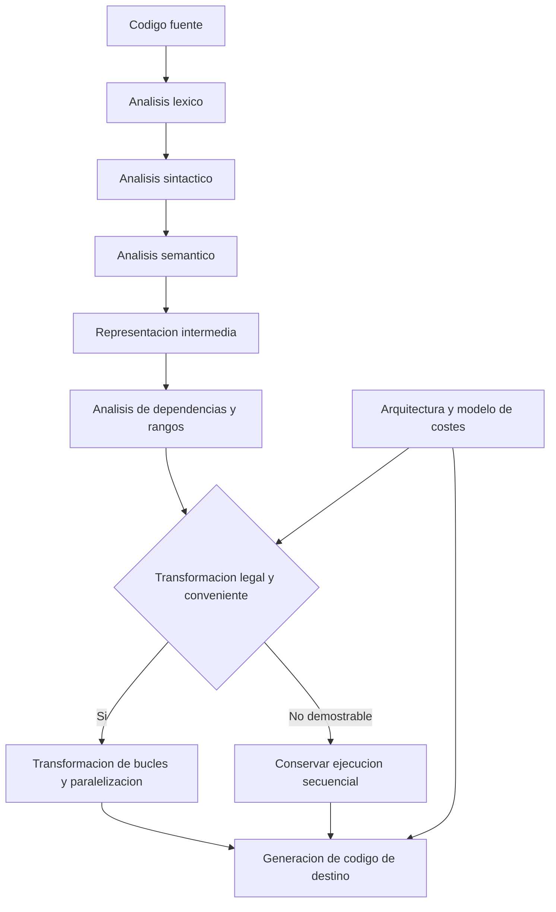

# Clase 3: Diseño de compiladores y paralelización automática: análisis de dependencias y transformaciones con Cetus

> **Objetivo académico:** Comprender las fases de un compilador y analizar cómo las dependencias de datos, las transformaciones de bucles y las características del hardware condicionan la corrección y el rendimiento de la paralelización automática, tomando Cetus como referencia conceptual.

## 1. Contexto y marco conceptual

La sesión relaciona el diseño de compiladores con el aprovechamiento de arquitecturas multinúcleo. El problema central consiste en transformar un programa para ejecutarlo con mayor eficiencia sin alterar su significado observable. La paralelización resulta pertinente en aplicaciones científicas, procesamiento de matrices y sistemas de inteligencia artificial, pero su utilidad depende de la estructura del programa y de los recursos disponibles.

Un **compilador** es un programa que traduce una representación de un programa a otra. La exposición se concentra inicialmente en la traducción desde código fuente hacia código de bajo nivel o código máquina; posteriormente introduce Cetus como herramienta de transformación fuente a fuente orientada al análisis y la paralelización de programas.

**Enriquecimiento conceptual:** La compilación no exige producir directamente instrucciones máquina. También puede generar código fuente, una representación intermedia o instrucciones para una máquina virtual. Conviene clasificar los sistemas por sus etapas de traducción y ejecución, evitando atribuir a cada lenguaje una única modalidad inmutable.

| Modalidad | Relación entre traducción y ejecución | Precisión conceptual |
| --- | --- | --- |
| Compilación anticipada | El código se traduce antes de su ejecución | El resultado puede ser código nativo u otra representación |
| Interpretación | Un motor ejecuta una representación del programa | El motor puede incorporar etapas internas de compilación |
| Compilación intermedia | Se produce una representación que procesa un entorno de ejecución | Java y .NET ilustran esta organización general |
| Transpilación | Se transforma código fuente en otro código fuente | TypeScript a JavaScript es el ejemplo discutido |

**Enriquecimiento conceptual:** Esta tabla sistematiza distinciones planteadas de manera informal en la sesión. JavaScript puede ejecutarse mediante motores que combinan interpretación y compilación dinámica. Node.js es un entorno de ejecución; Angular y Vue son marcos de desarrollo. Instalarlos no determina por sí mismo cómo se ejecutará cada fragmento de código.

También se mencionan lenguajes de propósito específico, como SQL, y herramientas de acceso a datos. **Enriquecimiento conceptual:** LINQ ofrece mecanismos de consulta integrados en lenguajes de .NET; un ORM, como Entity Framework, relaciona estructuras del programa con estructuras de persistencia. Estas abstracciones pueden traducir consultas a SQL, pero su comodidad no garantiza consultas más eficientes ni sustituye la revisión del SQL generado.

La clase presenta Cetus como una plataforma abierta de investigación sobre análisis y transformación de programas, con generación de paralelismo mediante directivas OpenMP. La transcripción no permite verificar todos los atributos y componentes que se le asignan durante la discusión.

## 2. Fundamentos teóricos y arquitectura

### 2.1. Fases de compilación

La exposición identifica una secuencia de análisis y generación:

1. **Análisis léxico:** convierte caracteres del código fuente en tokens, como identificadores, operadores y palabras reservadas.
2. **Análisis sintáctico:** organiza los tokens según la gramática y construye una representación de la estructura del programa.
3. **Análisis semántico:** comprueba restricciones como compatibilidad de tipos y validez de las operaciones.
4. **Generación de representación intermedia:** expresa el programa en una forma adecuada para análisis y transformaciones posteriores.
5. **Optimización:** transforma el programa buscando mejorar alguna propiedad de ejecución.
6. **Generación de código final:** produce la representación de destino.
7. **Adaptación a la arquitectura:** considera instrucciones, registros, memoria y capacidades del procesador.

**Enriquecimiento conceptual:** Esta secuencia es una organización didáctica. Las implementaciones reales pueden intercalar análisis y optimizaciones, usar varias representaciones intermedias y realizar transformaciones tanto antes como después de seleccionar instrucciones.



El diagrama integra las fases expuestas con el problema de decisión discutido: una oportunidad aparente de paralelismo debe ser compatible con la semántica y tener una expectativa razonable de beneficio.

### 2.2. Tres niveles distintos de paralelismo

En el discurso aparecen próximas la reducción del tiempo de compilación, la generación de código paralelo y la programación con hilos.

**Enriquecimiento conceptual:** Es necesario separarlas:

- **Compilación en paralelo:** acelera el proceso de construcción del software ejecutando trabajos de compilación concurrentemente.
- **Paralelización automática:** transforma un programa para que su ejecución pueda aprovechar varios recursos de procesamiento.
- **Programación paralela explícita:** el desarrollador utiliza hilos, bibliotecas o directivas para expresar concurrencia o distribución del trabajo.

Un **hilo** es una unidad de ejecución dentro de un proceso. Puede compartir memoria con otros hilos del mismo proceso. Disponer de varios hilos no implica que todos se ejecuten simultáneamente: el paralelismo efectivo depende de los recursos y de la planificación del sistema.

**Enriquecimiento conceptual:** C# dispone de mecanismos de hilos y de abstracciones de mayor nivel. `BackgroundWorker` es una de esas abstracciones, no la condición que hace posible el uso de hilos. Asimismo, asincronía y paralelismo resuelven problemas relacionados, pero diferentes: una operación asíncrona puede liberar al llamador mientras espera sin ejecutar trabajo de CPU simultáneamente.

### 2.3. Dependencias y legalidad de las transformaciones

La cuestión decisiva es determinar si una iteración necesita valores producidos por otra. Cuando existe esa relación, alterar el orden puede cambiar el resultado.

**Enriquecimiento conceptual:** Para accesos a una misma posición de memoria, las dependencias relevantes incluyen:

| Dependencia | Relación que debe respetarse | Consecuencia |
| --- | --- | --- |
| Verdadera o de flujo | Una operación escribe un valor que otra lee | El consumidor debe observar el valor correcto |
| Antidependencia | Una lectura debe preceder a una escritura posterior | Reordenar puede destruir el valor que debía leerse |
| De salida | Dos operaciones escriben la misma ubicación | El orden puede determinar el valor final |

Estas relaciones pueden existir dentro de una iteración o entre iteraciones. Una transformación legal conserva las relaciones necesarias para mantener el comportamiento del programa.

### 2.4. Alcance y precisión del análisis

El **análisis intraprocedimental** estudia una rutina de forma individual. El **análisis interprocedimental** considera relaciones entre rutinas, llamadas y efectos que atraviesan sus límites. La distinción permite comprender por qué una llamada dentro de un bucle puede dificultar su paralelización.

El **análisis de rangos simbólicos** razona sobre límites o relaciones de valores sin requerir que todos sean constantes conocidas durante la compilación. En la sesión se vincula con la identificación de dependencias, la transformación de bucles y la estimación de costes.

**Enriquecimiento conceptual:** El análisis de rangos no equivale a la ejecución simbólica. El primero puede aproximar conjuntos de valores mediante intervalos o restricciones; la segunda representa estados y condiciones de caminos de ejecución. Ambos pueden utilizar expresiones simbólicas, pero difieren en objetivos y representación.

## 3. Implementación técnica y lógica de negocio

La fuente no contiene una implementación completa ni ejecuciones reproducibles. Presenta técnicas y ejemplos verbales. Los fragmentos siguientes son **Enriquecimiento conceptual:** ilustran las transformaciones discutidas y no representan código ejecutado durante la clase.

### 3.1. Sustitución de variables de inducción

Una variable de inducción cambia de forma regular en cada iteración. Expresar su valor directamente a partir del índice puede eliminar una dependencia artificial.

Supóngase una secuencia entera definida por:

$$
v_{i+1}=v_i+c,\qquad v_0=a.
$$

Aquí $i$ es un índice entero no negativo; $v_i$, $a$ y $c$ son enteros, y $c$ es constante durante el bucle. Por sustitución sucesiva, $v_1=a+c$ y $v_2=a+2c$; por tanto:

$$
v_i=a+ic.
$$

Esta expresión permite calcular cada valor sin esperar a la iteración anterior. Su aplicación exige que no haya otras modificaciones de la variable y que se respeten las reglas aritméticas del lenguaje, incluido el posible desbordamiento.

```c
/* Forma recurrente: n >= 0 y aritmetica sin desbordamiento. */
int v = a;
for (int i = 0; i < n; ++i) {
    out[i] = v;
    v += c;
}

/* Calculo directo de cada elemento. */
for (int i = 0; i < n; ++i) {
    out[i] = a + i * c;
}
```

Se supone que `out` tiene capacidad para `n` enteros. La segunda forma elimina la recurrencia en el cálculo de sus elementos. Si el valor final de `v` es observable después del bucle, también debe conservarse: bajo los supuestos indicados, será `a + n * c`. La equivalencia debe comprobarse para el programa completo y no únicamente para el arreglo producido.

### 3.2. Privatización de datos

La sesión destaca la privatización de escalares y arreglos utilizados en bucles.

**Enriquecimiento conceptual:** En paralelización, privatizar significa proporcionar instancias separadas de ciertos datos a diferentes participantes de la ejecución, según el modelo utilizado. Puede eliminar interferencias si cada instancia contiene únicamente información local y no se pierde un valor que deba compartirse o conservarse.

La privatización no consiste en cambiar un atributo de `public` a `private` en programación orientada a objetos. La visibilidad controla acceso desde el código; la privatización paralela controla qué instancia de almacenamiento utiliza cada participante. Además, replicar arreglos puede aumentar el consumo de memoria.

### 3.3. Reconocimiento de reducciones

Una reducción combina contribuciones mediante una operación acumulativa. El ejemplo típico es la suma:

$$
S=\sum_{i=0}^{n-1}x_i.
$$

**Enriquecimiento conceptual:** Aquí $n$ es un entero no negativo, $i$ identifica un elemento y $x_i$ es un valor numérico. Si los índices se dividen en conjuntos disjuntos $I_1,\ldots,I_p$ cuya unión contiene todos los índices, cada uno de los $p$ trabajadores puede calcular:

$$
S_k=\sum_{i\in I_k}x_i,\qquad S=\sum_{k=1}^{p}S_k.
$$

Cada $S_k$ es una suma parcial y tiene la misma unidad que $x_i$. La organización separa la acumulación local de la combinación final. Para enteros sin desbordamiento, la suma preserva el resultado matemático; con coma flotante, el cambio de asociación puede modificar el redondeo. La reducción requiere comprobar tanto la operación como sus condiciones numéricas.

### 3.4. Transformaciones de bucles y localidad

| Técnica | Propósito | Condición o límite principal |
| --- | --- | --- |
| Intercambio de bucles | Cambiar el orden de recorrido para mejorar accesos a memoria o exponer paralelismo | Debe preservar dependencias |
| Bloqueo o tiling | Recorrer subconjuntos de datos para favorecer su reutilización en caché | El tamaño de bloque depende de los datos y la arquitectura |
| Desenrollado | Replicar el cuerpo para reducir control y exponer operaciones | Puede aumentar tamaño de código y presión sobre registros |
| Vectorización | Aplicar una operación a varios elementos mediante instrucciones vectoriales | Requiere accesos y dependencias compatibles |
| Fusión | Combinar recorridos compatibles | Puede mejorar reutilización, pero también dificultar otras optimizaciones |

**Enriquecimiento conceptual:** La tabla precisa los mecanismos mencionados. El desenrollado no es overclocking: transforma el programa, mientras que el overclocking modifica condiciones de funcionamiento del hardware. Tampoco la vectorización implica necesariamente utilizar varios núcleos.

### 3.5. Subíndices e indirección

El análisis de subíndices estudia qué posiciones de un arreglo acceden las iteraciones. La fuente identifica como obstáculo los índices calculados a partir de otro arreglo.

**Enriquecimiento conceptual:** Considérese:

```c
for (int i = 0; i < n; ++i) {
    A[B[i]] = i;
}
```

Se supone que `B` contiene índices válidos para `A`, que ambos arreglos no se solapan y que `B` permanece estable. Si dos iteraciones tienen el mismo valor de `B[i]`, escribirán sobre la misma posición. Sin conocer propiedades de `B`, el análisis estático puede no demostrar independencia. La ejecución paralela directa podría cambiar el resultado.

Este problema no exige bucles anidados ni recursividad: proviene de la indirección y de la posible coincidencia de accesos. Una llamada a función dentro de un bucle plantea otra dificultad, relacionada con sus efectos sobre memoria; no se resuelve necesariamente agrupando toda la llamada en un hilo.

## 4. Análisis crítico de casos y auditoría práctica

### 4.1. Factorización de Cholesky y evidencia de rendimiento

La discusión de un artículo atribuye mejoras de rendimiento a la paralelización de una factorización de Cholesky. Sin embargo, la transcripción presenta inconsistencias sobre el tipo de matrices y sobre el porcentaje obtenido. No se proporcionan el artículo completo, los tiempos ni la configuración experimental. Por ello, no puede establecerse una mejora cuantitativa verificable.

**Enriquecimiento conceptual:** En su formulación real estándar, Cholesky factoriza una matriz simétrica definida positiva:

$$
A=LL^{\mathsf T}.
$$

Aquí $A\in\mathbb{R}^{n\times n}$, con $n$ entero positivo, y $L$ es una matriz triangular inferior con diagonal positiva. La matriz $A$ satisface $z^{\mathsf T}Az>0$ para todo vector real no nulo $z$. La referencia transcrita a matrices no simétricas no permite identificar qué experimento o variante se discutía.

Procesar varias matrices independientes en paralelo es distinto de paralelizar la factorización de una sola matriz. En este último caso existen dependencias entre operaciones; dividir el trabajo en bloques no elimina automáticamente esas relaciones. El orden puede variar solamente entre operaciones cuya independencia haya sido demostrada o cuya coordinación preserve los datos necesarios.

### 4.2. Costes y rentabilidad del paralelismo

La clase reconoce que una versión paralela puede resultar más lenta por creación de hilos, sincronización y administración del trabajo.

**Enriquecimiento conceptual:** Para comparar una misma carga y un mismo criterio de corrección, se define la aceleración:

$$
S_p=\frac{T_1}{T_p}.
$$

$T_1>0$ es el tiempo de una versión secuencial de referencia y $T_p>0$ el tiempo con $p$ trabajadores, medidos en la misma unidad. $S_p$ es adimensional: un valor mayor que uno indica menor tiempo paralelo. La comparación debe declarar datos, hardware y condiciones de medición.

Un modelo idealizado del límite de aceleración es:

$$
S_p\leq\frac{1}{(1-f)+f/p}.
$$

Aquí $f\in[0,1]$ es la fracción paralelizable del tiempo secuencial y $p$ es un entero positivo. Se supone una carga fija, distribución perfecta del trabajo y ausencia de sobrecostes. Por ejemplo, con $f=0.8$ y $p=4$, el límite ideal es $S_p\leq2.5$. Es un ejemplo ilustrativo, no un resultado de la sesión. Las esperas, la contención y el acceso a memoria pueden reducirlo.

### 4.3. Migración de un sistema de IA a hardware reducido

Se describe un sistema conectado mediante una API a dispositivos de realidad aumentada. El servicio funciona satisfactoriamente en un servidor con mayores recursos, mientras que una computadora más limitada presenta retrasos importantes. El caso ilustra la relación entre capacidad de hardware y latencia, pero no constituye una medición controlada.

**Enriquecimiento conceptual:** Antes de atribuir el retraso a la arquitectura del procesador, conviene distinguir tiempo de comunicación, preprocesamiento, inferencia, transferencias de memoria y posprocesamiento. También importan el tamaño y la precisión del modelo, la memoria disponible y el uso efectivo de aceleradores. La fuente no identifica suficientemente el modelo ni su configuración para establecer cuál de estos factores domina.

La intención de utilizar Cetus para optimizar una parte del sistema es una posibilidad exploratoria. No demuestra que pueda acelerar todo el sistema: primero debe identificarse qué código es transformable y si ese código constituye un cuello de botella relevante.

### 4.4. Portabilidad y compatibilidad de bibliotecas

El caso de migración de una aplicación .NET hacia .NET Core muestra que una dependencia puede impedir o complicar el cambio de plataforma. La solución relatada fue reemplazar funcionalidad de una biblioteca por código propio en JavaScript.

**Enriquecimiento conceptual:** La licencia, la disponibilidad del código y la compatibilidad técnica son dimensiones distintas. Un fallo de migración puede relacionarse con API, plataforma objetivo, componentes no soportados o dependencias. La transcripción no aporta diagnósticos suficientes para atribuirlo a una fase concreta del compilador ni al carácter gratuito o comercial de la tecnología.

### 4.5. Herramientas y atribuciones inciertas

Durante la sesión se mencionan LLVM, GCC, Polly, ROSE, IBM XL y otras herramientas, además de un componente transcrito como «iCetus». También se atribuyen a Cetus aprendizaje automático, ajuste automático y reportes detallados. Estas capacidades no quedan documentadas de forma suficiente en la fuente.

**Enriquecimiento conceptual:** LLVM es una infraestructura de compilación; su denominación histórica no lo convierte en una máquina virtual de ejecución equivalente a un hipervisor. Tampoco debe equipararse directamente con Cetus. Una comparación rigurosa debe distinguir representación de entrada, transformaciones soportadas, arquitectura objetivo y entorno de ejecución requerido.

## 5. Principios de diseño, buenas prácticas y anti-patrones

### 5.1. Corrección antes que aceleración

Una transformación útil debe preservar resultados y efectos observables bajo supuestos explícitos. La independencia de iteraciones, la gestión de datos compartidos y el tratamiento de reducciones son condiciones de diseño, no detalles posteriores.

**Enriquecimiento conceptual:** Cuando un análisis no demuestra seguridad, conservar la ejecución secuencial es una decisión razonable. La imposibilidad de demostrar independencia tampoco prueba que el programa sea intrínsecamente imposible de paralelizar: puede reflejar información insuficiente o límites del análisis.

### 5.2. Adaptación a la arquitectura

El número de núcleos es solo una variable. La sesión también destaca jerarquías de memoria, tipo de procesador y sobrecostes de sincronización. El intercambio y el bloqueo de bucles buscan aprovechar la localidad; el reparto del trabajo debe evitar que la coordinación supere al cálculo útil.

**Enriquecimiento conceptual:** Los procesadores lógicos no equivalen necesariamente a núcleos físicos independientes. La afinidad, la contención por caché y el ancho de banda pueden explicar diferencias entre configuraciones aparentemente similares.

### 5.3. Medición e interpretación prudente

Una mejora observada en un bucle no debe generalizarse a todas las cargas. La discusión sobre bibliotecas de paralelismo en .NET reconoce tanto beneficios como dificultades de coordinación y resultados que llegan en distinto orden.

**Enriquecimiento conceptual:** El orden variable de finalización no implica por sí mismo pérdida de información. Los errores aparecen cuando el programa presupone un orden no garantizado, comparte almacenamiento sin coordinación o utiliza resultados antes de completar el trabajo correspondiente. La evaluación debe separar rendimiento de corrección.

### 5.4. Recursos, alcance y limpieza

La sesión utiliza conexiones a bases de datos para explicar la necesidad de liberar recursos. Un retorno ordinario finaliza la función y deja sin ejecutar las instrucciones posteriores de su trayectoria normal.

**Enriquecimiento conceptual:** La práctica robusta es garantizar la liberación mediante construcciones de gestión de recursos o bloques de limpieza. Según el lenguaje, estas construcciones pueden ejecutarse incluso cuando se produce un retorno o una excepción. Si se devuelven resultados diferidos o un flujo de datos, cerrar la conexión antes de consumirlos puede ser incorrecto; debe explicitarse quién posee el recurso y cuándo termina su uso.

Esta gestión no equivale a privatización paralela ni depende de que una función o variable sea pública o privada.

### 5.5. Anti-patrones identificados

- Crear más hilos suponiendo que aumentará proporcionalmente el rendimiento.
- Paralelizar bucles sin analizar escrituras compartidas y dependencias.
- Confundir visibilidad de objetos con almacenamiento privado por trabajador.
- Atribuir cualquier retraso al procesador sin localizar el cuello de botella.
- Tratar comentarios de código como si fueran directivas de transformación.
- Generalizar porcentajes de mejora sin condiciones experimentales.
- Modificar un compilador antes de revisar compatibilidad y dependencias de la aplicación.

**Enriquecimiento conceptual:** Las directivas tienen una sintaxis y una semántica reconocidas por las herramientas; un comentario descriptivo ordinario no produce el mismo efecto. Además, conviene conservar el código fuente original y distinguirlo del código generado para facilitar mantenimiento y reproducibilidad.

Las anécdotas de daño de equipos no establecen una relación causal general entre paralelismo y fallo físico. **Enriquecimiento conceptual:** La saturación puede elevar consumo y temperatura; la evaluación práctica debe atender refrigeración, límites de recursos y mecanismos de protección. La virtualización proporciona aislamiento de software, pero comparte recursos físicos y no sustituye la gestión térmica.

## 6. Síntesis conceptual y profundización académica

La paralelización automática puede entenderse como una cadena de razonamiento: representar el programa, analizar valores y accesos a memoria, identificar transformaciones legales, valorar su coste y generar una versión adecuada al destino. Las variables de inducción, las reducciones y la privatización muestran que algunas dependencias pueden reformularse; los accesos indirectos y los efectos entre rutinas muestran por qué otras son difíciles de resolver estáticamente.

Cetus funciona en la sesión como referencia para estudiar esa cadena. Su interés conceptual reside en relacionar análisis de programas con transformaciones fuente a fuente. La selección de herramientas exige comprobar capacidades concretas y distinguirlas de expectativas o experiencias anecdóticas.

La exposición también vincula experimentación y escritura científica. El conocimiento experimental requiere separar el trabajo de obtención de datos de la redacción posterior y justificar cómo los resultados sostienen una conclusión. **Enriquecimiento conceptual:** El diseño de la medición, las condiciones de comparación y el criterio de corrección deben establecerse antes de interpretar una mejora. Los resúmenes generados mediante IA pueden apoyar la lectura, pero requieren contraste con la fuente, especialmente cuando se extraen capacidades técnicas o cifras.

Como referencia periférica, aparece una comparación entre evolución del hardware clásico y computación cuántica. **Enriquecimiento conceptual:** La ley de Moore describe una tendencia histórica de integración de transistores; no garantiza que la velocidad se duplique cada año. La computación cuántica utiliza qubits y operaciones propias de ese modelo, por lo que no se explica sustituyendo una cantidad fija de bytes por otra ni invalida por sí misma aquella observación histórica. La sesión no desarrolla algoritmos cuánticos suficientes para profundizar en ellos.

Las líneas de profundización que se desprenden del núcleo de la clase son la precisión del análisis de dependencias, la relación entre localidad y jerarquía de memoria, la estabilidad numérica de las reducciones y la diferencia entre posibilidad de paralelizar y rentabilidad efectiva. En todas ellas, el criterio común es preservar el significado del programa y sostener las afirmaciones de rendimiento con evidencia reproducible.
