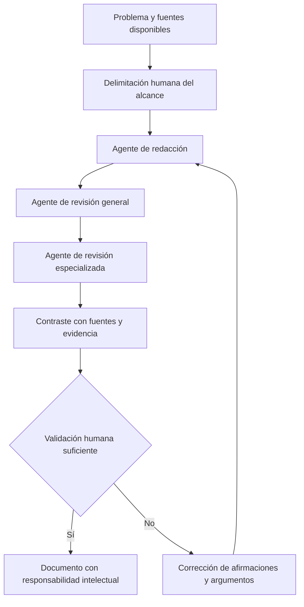

# Clase 5: Inteligencia artificial, autonomía intelectual y validación práctica en computación

> **Objetivo académico:** Analizar el uso de inteligencia artificial en programación y escritura científica, distinguir producción automatizada de comprensión y examinar el papel de la verificación práctica, la revisión crítica y la responsabilidad intelectual.

## 1. Contexto y marco conceptual

La discusión académica se concentra en una tensión transversal: las herramientas de inteligencia artificial pueden producir textos y programas funcionales con rapidez, pero la disponibilidad de un producto no garantiza que quien lo utiliza comprenda su construcción, sus supuestos o sus límites. Esta distinción conecta programación, escritura científica y adquisición de competencias técnicas.

El docente compara la generación de código mediante IA con la reutilización de fragmentos encontrados en internet. En ambos casos, incorporar una solución sin comprenderla puede dificultar su modificación y mantenimiento. El problema central es la pérdida de control intelectual sobre el artefacto: ante un cambio de requisitos o un comportamiento inesperado, su usuario puede carecer de criterios para intervenir.

La sesión también contrapone dos usos de la IA: solicitar una solución completa o utilizarla como apoyo para aprender. La segunda orientación exige una participación activa: formular preguntas, comprender decisiones y revisar resultados. La conveniencia de cada herramienta depende del propósito y de la capacidad de verificar su respuesta.

**Enriquecimiento conceptual:** Conviene distinguir tres dimensiones que pueden evolucionar de manera independiente:

| Dimensión | Qué representa | Evidencia pertinente |
| --- | --- | --- |
| Producción | Capacidad de obtener un texto, programa o configuración | Existencia y funcionamiento del artefacto |
| Comprensión | Capacidad de explicar sus componentes y decisiones | Explicación de supuestos, dependencias y límites |
| Autonomía | Capacidad de adaptar y corregir la solución | Modificaciones justificadas ante condiciones nuevas |

Un resultado terminado acredita producción. La comprensión y la autonomía requieren evidencia adicional.

## 2. Fundamentos teóricos y arquitectura

### 2.1. Generación de texto y límites de la detección

La conversación aborda la dificultad de determinar si un texto fue escrito por una persona o generado por IA. Se mencionan la adaptación del estilo mediante instrucciones y la reformulación sucesiva del contenido como factores que complican esa identificación.

La persona gramatical y la fluidez no constituyen criterios concluyentes de procedencia. Un sistema puede generar textos en primera o tercera persona según la instrucción recibida; un autor humano también puede emplear ambos registros. Por ello, convertir un rasgo estilístico aislado en prueba de autoría conduce a inferencias débiles.

**Enriquecimiento conceptual:** Deben separarse tres problemas:

- **Similitud textual:** coincidencia entre un documento y otros materiales disponibles.
- **Atribución de procedencia:** inferencia sobre las herramientas o agentes que intervinieron en su producción.
- **Integridad intelectual:** correspondencia entre las contribuciones declaradas, las fuentes utilizadas y la responsabilidad por lo afirmado.

Estas dimensiones no son equivalentes. Una coincidencia textual puede corresponder a una cita legítima; un texto reformulado puede conservar una apropiación indebida de ideas; un texto generado puede contener afirmaciones falsas aunque no presente coincidencias reconocibles. La sesión menciona herramientas de similitud y detección, pero no aporta evidencia que permita certificar sus prestaciones ni confirmar cambios en sus servicios.

### 2.2. Sistemas multiagente para escritura científica

Un participante describe un sistema denominado «enjambre» en el que varios agentes reciben funciones diferentes: redactar, revisar y realizar una revisión especializada. La idea arquitectónica recuperable es la descomposición del trabajo en roles con intercambio de resultados.

La transcripción no permite identificar con certeza el proyecto, su publicación ni su configuración. También menciona nombres asociados con modelos y herramientas de ejecución sin distinguir siempre sus funciones.

**Enriquecimiento conceptual:** Un modelo de lenguaje genera respuestas; un entorno de ejecución permite utilizarlo; un orquestador coordina roles, mensajes y etapas. Varios agentes pueden utilizar el mismo modelo, por lo que multiplicar roles no implica disponer de fuentes independientes de conocimiento.

El diagrama explicita una arquitectura conceptual; no representa una implementación demostrada durante la sesión. La verificación contra evidencia es un enriquecimiento necesario para interpretar críticamente la propuesta de escritura automatizada.

## 3. Implementación técnica y lógica de negocio

La fuente no contiene una implementación paso a paso ni código que pueda conservarse. Los elementos técnicos aparecen como casos breves sobre los que es posible precisar funciones y límites.

### 3.1. Programación asistida y mantenimiento

El flujo descrito consiste en proporcionar un problema a una IA e incorporar el código que devuelve. El docente advierte que, si el usuario no comprende la solución, puede encontrar dificultades para mantenerla y ampliarla.

**Enriquecimiento conceptual:** Esta relación requiere una precisión: desconocer el código no demuestra que este sea intrínsecamente poco escalable. La escalabilidad depende de factores como algoritmos, estructuras de datos, concurrencia, persistencia y recursos. Lo que sí disminuye es la capacidad del usuario para analizar esas propiedades y modificar el sistema con seguridad.

Una revisión técnica útil debe relacionar el código con sus entradas, salidas, dependencias y comportamiento ante fallos. Que un programa funcione en una ejecución concreta no basta para justificar su corrección general.

### 3.2. OpenLDAP: organización de identidades y autenticación

Se menciona un caso de OpenLDAP que incluye unidades organizativas, grupos, usuarios, creación de una cuenta y autenticación posterior. También se contraponen la administración por comandos y el uso de una interfaz gráfica.

**Enriquecimiento conceptual:** LDAP permite acceder a un directorio organizado en entradas con atributos y relaciones jerárquicas. OpenLDAP es una implementación de este entorno. Las unidades organizativas sirven para estructurar entradas; los grupos permiten expresar asociaciones de identidades según el esquema utilizado. La estructura concreta depende del diseño del directorio y no debe suponerse idéntica en todas las instalaciones.

Es necesario distinguir autenticación de autorización. La primera verifica una identidad mediante un mecanismo admitido; la segunda determina qué operaciones puede realizar esa identidad. Crear una cuenta y autenticarla muestra una parte del funcionamiento, pero no acredita por sí solo que los permisos estén correctamente configurados.

| Modalidad de administración | Ventaja potencial | Aspecto que requiere revisión |
| --- | --- | --- |
| Comandos | Facilitan automatización y repetición explícita de operaciones | Sintaxis, parámetros y tratamiento de errores |
| Interfaz gráfica | Facilita exploración y edición visual del directorio | Cambios efectivos, valores predeterminados y trazabilidad |

Estas ventajas son enriquecimiento conceptual. La fuente no aporta comandos, archivos de configuración, políticas de acceso ni registros para auditar el caso.

### 3.3. Acceso remoto a recursos de computación cuántica

La sesión menciona el ecosistema de IBM, una referencia oral compatible con Qiskit y el acceso a un simulador o a recursos cuánticos remotos. No presenta circuitos, instrucciones de programación ni resultados de ejecución.

**Enriquecimiento conceptual:** Qiskit es un marco de software para trabajar con computación cuántica. Un simulador reproduce mediante computación clásica determinados comportamientos de un modelo cuántico; un dispositivo cuántico físico ejecuta operaciones sobre hardware sujeto a restricciones y ruido. Utilizar un simulador no equivale a ejecutar sobre un procesador cuántico real.

Las cifras de crédito y duración mencionadas oralmente son ambiguas y dependen de condiciones comerciales no documentadas. No permiten establecer costos, disponibilidad ni tiempo de uso reproducibles.

## 4. Análisis crítico de casos y auditoría práctica

### 4.1. Texto científicamente fluido y validez científica

El sistema multiagente descrito suscita una pregunta central: ¿qué demuestra que un documento tenga apariencia de escritura científica? Demuestra, como máximo, una adecuación formal observable. La validez de sus afirmaciones depende de la evidencia y de la coherencia del razonamiento.

**Enriquecimiento conceptual:** La revisión debe separar calidad expresiva de calidad epistémica. Un texto puede estar bien redactado y contener referencias inexistentes, conclusiones excesivas o interpretaciones incompatibles con sus datos. Del mismo modo, el acuerdo entre varios agentes puede reproducir un error compartido. La revisión automatizada aporta propuestas de corrección, pero su consistencia interna no sustituye el contraste externo.

### 4.2. Código funcional sin dominio de sus decisiones

El caso de copiar código plantea un riesgo de dependencia: se obtiene una respuesta inmediata, pero puede quedar sin desarrollar la capacidad de diagnosticar y modificar su comportamiento.

**Enriquecimiento conceptual:** El criterio de auditoría no debe reducirse al origen del código. Es más informativo comprobar si se pueden explicar sus supuestos, justificar sus dependencias, reconocer límites y anticipar efectos de una modificación. Estas propiedades permiten analizar tanto código propio como reutilizado o generado.

### 4.3. Alcance de una demostración operativa

El caso de OpenLDAP muestra el valor de observar una operación concreta: crear una identidad y utilizarla permite relacionar conceptos del directorio con un comportamiento visible. Sin embargo, una operación satisfactoria constituye evidencia local.

**Enriquecimiento conceptual:** Autenticar una cuenta válida no demuestra que una cuenta inválida sea rechazada, que los privilegios sean mínimos ni que los registros permitan reconstruir accesos. La cobertura de la validación depende de las propiedades que efectivamente se hayan comprobado.

### 4.4. Experiencia práctica y conocimiento declarativo

La conversación distingue experiencia operativa y familiaridad con terminología formal. Una persona puede resolver situaciones recurrentes y, al mismo tiempo, necesitar más tiempo para reconocer sus conceptos en otra disciplina o formulación.

**Enriquecimiento conceptual:** Esta diferencia puede interpretarse como una separación entre conocimiento procedimental —saber cómo actuar— y declarativo —saber explicar qué ocurre y por qué—. Su articulación favorece la transferencia entre telecomunicaciones, programación y administración de sistemas; ninguna de las dos dimensiones sustituye completamente a la otra.

## 5. Principios de diseño, buenas prácticas y anti-patrones

El principio transversal es conservar capacidad de juicio sobre los resultados que se utilizan. En la sesión, esta idea aparece en la recomendación de emplear IA para aprender y en la defensa de la revisión antes de asumir una contribución intelectual.

**Enriquecimiento conceptual:** Las siguientes orientaciones sistematizan ese principio:

| Buena práctica | Justificación | Anti-patrón asociado |
| --- | --- | --- |
| Solicitar explicaciones y contrastarlas | Hace visibles supuestos y decisiones | Aceptar una salida por su fluidez |
| Revisar el comportamiento del código en su contexto | Relaciona la solución con requisitos reales | Considerar suficiente una ejecución satisfactoria |
| Verificar afirmaciones y referencias | Conecta la redacción con evidencia | Confundir tono científico con rigor |
| Separar autenticación y autorización | Evita atribuir al acceso válido garantías sobre permisos | Dar por seguro un directorio porque admite una conexión |
| Identificar el entorno de ejecución cuántica | Permite interpretar correctamente los resultados | Equiparar simulación y hardware físico |
| Revisar antes de asumir autoría | Vincula reconocimiento y responsabilidad | Incorporar nombres sin contribución sustantiva |

La sesión presenta la mejora de la escritura científica como un proceso de lectura, práctica sostenida y revisión. Las experiencias personales relatadas ilustran esa idea, pero sus tiempos y volúmenes no constituyen parámetros generalizables de productividad.

También debe matizarse la afirmación de que la IA no puede intervenir en operaciones prácticas. La fuente no demuestra una imposibilidad técnica general. **Enriquecimiento conceptual:** El alcance de la automatización depende de las herramientas, permisos e interfaces disponibles; la necesidad de validación humana persiste aunque una operación pueda automatizarse.

## 6. Síntesis conceptual y profundización académica

La contribución central de la clase es distinguir capacidad de producir y capacidad de comprender. La IA puede asistir en escritura y programación, pero utilizar sus resultados con criterio exige revisar fundamentos, límites y consecuencias.

Los casos tratados permiten reconocer distintos niveles de evidencia: la fluidez acredita una propiedad del texto; una ejecución satisfactoria acredita un comportamiento situado; una explicación coherente aporta evidencia de comprensión; la adaptación justificada a nuevas condiciones aporta evidencia de autonomía. Ninguno de estos niveles debe confundirse automáticamente con los demás.

La discusión multiagente introduce la distribución de funciones como estrategia de producción y revisión. OpenLDAP permite separar organización de identidades, autenticación y autorización. Las referencias a computación cuántica muestran la importancia de distinguir herramientas de software, simuladores y dispositivos físicos, aunque la fuente no permite desarrollar su programación.

**Enriquecimiento conceptual:** Las líneas de profundización que se desprenden del conjunto son la trazabilidad de las contribuciones asistidas por IA, la independencia de la revisión, la transferencia entre conocimiento procedimental y declarativo y la validación de artefactos mediante evidencia pertinente. El vínculo entre ellas es la responsabilidad por aquello que se afirma, se ejecuta y se incorpora a un sistema.
