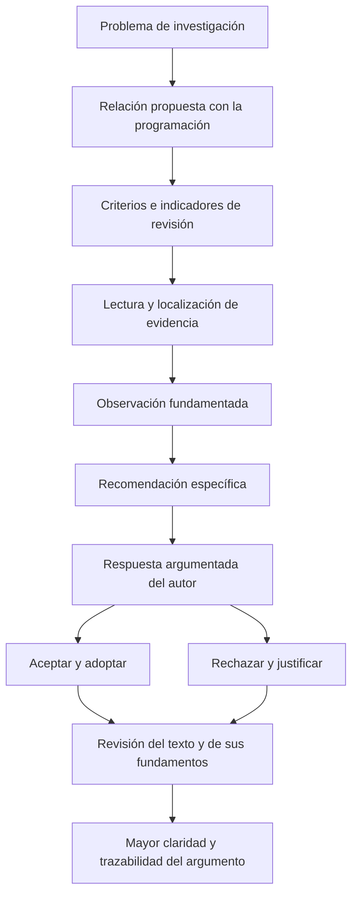

# Clase 6: Revisión crítica de la relación entre programación e investigación doctoral

> **Objetivo académico:** Analizar la pertinencia, la suficiencia argumentativa, la coherencia y la trazabilidad bibliográfica de un artículo que vincula programación con un problema de investigación, mediante observaciones fundamentadas, recomendaciones específicas y respuestas justificadas.

## 1. Contexto y marco conceptual

La sesión aborda la revisión científica de textos sobre la incidencia de la programación en un problema de investigación doctoral. El caso principal es un artículo teórico acerca de la detección de patrones de fraude en compras electrónicas. El interés académico reside en distinguir una relación explícita y fundamentada de una asociación superficial entre un problema y un conjunto de tecnologías.

La programación puede relacionarse con una investigación de varias maneras: como medio de implementación, como soporte de una arquitectura de procesamiento, como expresión de algoritmos o como objeto de análisis teórico. Estas relaciones no son equivalentes. Mencionar un lenguaje, una biblioteca o un paradigma no demuestra por sí mismo su pertinencia para el problema estudiado.

La sesión distingue también entre contribuciones teóricas y desarrollos aplicados. Un análisis conceptual puede sostenerse mediante argumentos, revisión de literatura y discusión de mecanismos, sin incorporar una implementación. Un estudio aplicado puede añadir algoritmos, código y resultados, pero su presencia no elimina la necesidad de explicar qué relación guardan con el problema científico.

**Enriquecimiento conceptual:** La profundidad técnica y la amplitud conceptual son dimensiones complementarias de una investigación doctoral. El dominio de una herramienta permite construir una solución; una contribución científica exige además explicitar qué conocimiento produce, bajo qué supuestos y con qué límites. No existe una oposición general entre especialización técnica e integración teórica.

La revisión se presenta como una actividad interpretativa: cada revisor posee formación, experiencia y supuestos que influyen en su lectura. Reconocer esa perspectiva permite formular críticas discutibles y fundamentadas, en lugar de convertir preferencias personales en reglas universales.

## 2. Fundamentos teóricos y arquitectura

### 2.1. Pertinencia y esencialidad de la programación

La pertinencia responde a la pregunta: **¿cómo incide la programación en el problema de investigación?** La esencialidad exige un argumento adicional: **¿por qué ese papel resulta necesario o decisivo dentro del alcance considerado?**

Una tecnología puede ser pertinente sin ser indispensable. Por ejemplo, una biblioteca puede facilitar la construcción de un clasificador sin ser la única alternativa disponible. Por ello, afirmar que la programación constituye un componente estratégico requiere explicar el mecanismo de esa contribución, no solo emplear calificativos como «fundamental» o «crítico».

**Enriquecimiento conceptual:** Conviene distinguir tres niveles de justificación:

| Nivel | Pregunta central | Evidencia argumentativa esperable |
| --- | --- | --- |
| Relación | ¿Qué conexión existe entre programación y problema? | Descripción del mecanismo que vincula ambos elementos. |
| Utilidad | ¿Qué capacidad aporta la solución computacional? | Explicación de beneficios pertinentes: automatización, procesamiento, representación o análisis. |
| Necesidad condicionada | ¿Qué requisito no podría satisfacerse adecuadamente sin esa capacidad? | Argumento sujeto a restricciones explícitas de volumen, latencia, precisión u operación. |

La necesidad es condicionada porque depende del contexto. No basta con demostrar que una tecnología puede utilizarse para concluir que debe utilizarse.

### 2.2. Criterios de revisión

Los criterios desarrollados en la sesión forman un marco de lectura que integra contenido, estructura y respaldo documental.

| Criterio | Aspectos que se analizan | Insuficiencia característica |
| --- | --- | --- |
| Pertinencia | Incidencia de la programación y justificación de su importancia. | Enumeración de tecnologías sin conexión con el problema. |
| Completitud | Presencia de los componentes necesarios para comprender el argumento. | Ausencia de una discusión o una conclusión que cierre la relación planteada. |
| Suficiencia de ejemplos o argumentos | Razones que sostienen las afirmaciones y cubren el alcance anunciado. | Descripciones genéricas que no explican su función en el caso. |
| Respaldo bibliográfico | Identificación de fuentes y correspondencia con las afirmaciones citadas. | Referencias ambiguas, incompletas o utilizadas sin apoyo verificable. |
| Coherencia | Secuencia lógica, consistencia interna y correspondencia entre objetivos y conclusiones. | Conclusiones que abandonan la relación entre programación y problema. |

La estructura considerada comprende resumen, introducción y contexto, revisión de literatura, desarrollo de la relación conceptual, discusión, implicaciones para la investigación, conclusiones y referencias. Su presencia facilita la lectura, pero no garantiza calidad argumentativa: una sección puede existir y carecer del contenido necesario.

### 2.3. Arquitectura del razonamiento crítico

El diagrama representa un proceso de deliberación. La recomendación no constituye una orden técnica indiscutible: debe poder evaluarse a partir del problema, el alcance del texto y la evidencia disponible.

## 3. Implementación técnica y lógica de negocio

La fuente no presenta código ejecutable, configuraciones completas ni resultados de rendimiento. Su desarrollo técnico consiste en analizar afirmaciones sobre paradigmas, herramientas y arquitecturas dentro de un caso de detección de fraude.

### 3.1. Separación entre plataforma transaccional y detección de fraude

En el artículo analizado se vincula la programación estructurada y orientada a objetos con servicios escalables, encapsulación de lógica y conexiones a bases de datos. La observación central del docente es que estas capacidades pueden explicar la construcción del software sin explicar todavía la detección de fraude.

La distinción es relevante porque una plataforma puede procesar correctamente una compra sin identificar si presenta señales de fraude. A su vez, un componente de detección puede depender de la plataforma para recibir datos y devolver una decisión. La relación entre ambos niveles debe hacerse explícita.

**Enriquecimiento conceptual:** Una descomposición útil distingue:

- **Operación transaccional:** recepción, validación y persistencia de operaciones comerciales.
- **Preparación de datos:** transformación de eventos en información utilizable para el análisis.
- **Lógica de detección:** aplicación de reglas, modelos o procedimientos que producen señales de riesgo.
- **Respuesta del sistema:** utilización de esas señales dentro de una decisión operativa.

Esta separación aclara responsabilidades; no describe una arquitectura implementada durante la sesión.

### 3.2. Paradigmas y herramientas: capacidades frente a mecanismos

La sesión menciona programación orientada a objetos, programación funcional, procesamiento distribuido, bibliotecas de aprendizaje automático, plataformas de eventos y bases de datos. El criterio de revisión consiste en explicar qué aporta cada recurso al problema específico.

| Recurso mencionado | Relación que debe explicitarse | Límite de una afirmación genérica |
| --- | --- | --- |
| Programación orientada a objetos | Organización y encapsulación de componentes de análisis o de gestión de datos. | La modularidad no demuestra capacidad de detección. |
| Programación funcional | Relación de las transformaciones y composición de operaciones con el procesamiento analítico. | Un paradigma no garantiza paralelismo ni rendimiento por sí mismo. |
| Apache Spark | Papel del procesamiento distribuido en el análisis de conjuntos de transacciones. | Su utilización no prueba que se satisfagan restricciones de tiempo real. |
| scikit-learn o PyTorch | Modelos o procedimientos que permiten representar y analizar señales relevantes. | La disponibilidad de una biblioteca no valida un modelo ni sus resultados. |
| Apache Kafka | Función de los flujos de eventos dentro de la arquitectura de análisis. | Transportar eventos no equivale a identificar fraude. |
| Bases de datos y procedimientos SQL o PL/SQL | Persistencia, transformación, registro de eventos o ejecución de lógica explícita. | El almacenamiento flexible no constituye por sí mismo un argumento sobre detección. |

**Enriquecimiento conceptual:** Las precisiones de la tabla delimitan el alcance de los ejemplos tecnológicos. Spark es un motor de procesamiento distribuido que admite distintos estilos de programación; Kafka proporciona infraestructura de eventos. Ninguna de estas herramientas incorpora, por su mera adopción, una solución validada de detección de fraude.

### 3.3. Escalabilidad y requisitos operativos

La escalabilidad aparece como un punto de controversia. El docente cuestiona una formulación centrada en sostener numerosas transacciones cuando el foco anunciado es detectar fraude. La recomendación consiste en relacionar la arquitectura con la carga del análisis y con sus restricciones operativas.

**Enriquecimiento conceptual:** La escalabilidad de la operación comercial y la del análisis antifraude pueden estar estrechamente relacionadas. Para justificar esa conexión conviene identificar qué carga crece, qué componente se satura y qué requisito debe mantenerse: tiempo de respuesta, capacidad de procesamiento, disponibilidad o actualización de señales. Una arquitectura paralela puede contribuir, pero no es una solución necesaria en todos los contextos.

La asincronía y la tolerancia a fallos, también mencionadas en la sesión, son propiedades de diseño. Su pertinencia requiere explicar cómo afectan la continuidad del análisis y la oportunidad de las decisiones. Nombrarlas sin describir esa función deja incompleto el argumento.

## 4. Análisis crítico de casos y auditoría práctica

### 4.1. Caso principal: fraude en compras electrónicas

El resumen del artículo expresa una relación entre programación, clasificación de transacciones y sistemas de análisis. Esto permite reconocer una intención temática pertinente. Sin embargo, la revisión distingue esa intención de su desarrollo efectivo en el cuerpo del texto.

La lectura del apartado sobre orientación a objetos admite dos interpretaciones:

1. La descripción es demasiado general porque se refiere a la construcción de servicios, sin mostrar un mecanismo de detección.
2. La arquitectura del servicio es parte del sistema antifraude y, por tanto, tiene una relación instrumental válida con el problema.

La diferencia no se resuelve afirmando que ambas posiciones tienen el mismo valor en cualquier circunstancia. Se necesita determinar qué sostiene el texto, qué alcance declara y qué evidencia presenta.

**Enriquecimiento conceptual:** El desacuerdo puede revelar una relación insuficientemente explicitada. La revisión mejora cuando distingue entre «la relación no existe» y «la relación no está demostrada con claridad en el manuscrito». La segunda formulación identifica un problema de argumentación sin anticipar una conclusión técnica absoluta.

Una observación fundamentada podría señalar que la encapsulación aparece asociada a la organización del software, pero no se identifica qué componente recibe las transacciones ni cómo participa en la identificación de señales de riesgo. La recomendación correspondiente sería explicar ese componente y su conexión con la lógica de detección, o delimitar el apartado como soporte arquitectónico.

### 4.2. Patrones, anomalías y fraude

Durante la discusión, el docente interpreta la detección de fraude principalmente desde la búsqueda de patrones y comportamientos inusuales. Esta perspectiva orienta sus recomendaciones hacia bibliotecas de clasificación y detección de anomalías.

**Enriquecimiento conceptual:** Una anomalía no equivale necesariamente a fraude: una operación poco frecuente puede ser legítima, mientras que una operación fraudulenta puede parecer habitual. Asimismo, la detección puede combinar reglas, clasificación supervisada y otros enfoques. Por ello, un artículo debe precisar qué entiende por fraude, qué señales utiliza y qué significado atribuye a sus salidas.

La recomendación de utilizar algoritmos genéticos aparece como una posibilidad ilustrativa, no como una selección metodológica demostrada. Su conveniencia no puede deducirse del nombre del problema; necesitaría un objetivo y una justificación específicos.

### 4.3. Auditoría bibliográfica

La sesión distingue dos comprobaciones: localizar la fuente referenciada y verificar que respalda la afirmación para la cual se cita. Encontrar un título no completa la segunda comprobación.

La búsqueda sin resultados tampoco demuestra inexistencia. Puede haber errores en los datos, variantes del título, problemas de indexación o documentos alojados en otros repositorios. La observación académicamente prudente es «referencia no localizada con la información disponible», acompañada de una solicitud de datos completos o de una vía de acceso verificable.

**Enriquecimiento conceptual:** La auditoría bibliográfica comprende tres preguntas diferenciadas:

- **Identidad:** ¿puede identificarse inequívocamente la fuente?
- **Accesibilidad:** ¿puede consultarse su contenido o localizarse una descripción fiable?
- **Correspondencia:** ¿sostiene realmente la proposición que el artículo le atribuye?

La transcripción alude a referencias del artículo de ejemplo, pero no aporta sus datos completos ni permite verificar su contenido. Por ello, no se reproducen como bibliografía validada.

### 4.4. Otros casos y límites de las afirmaciones técnicas

En el caso de auditoría de seguridad se plantea que firmas, criptografía o blockchain pueden relacionar programación y trazabilidad. El punto académico es que una conclusión sobre la importancia general de la auditoría resulta insuficiente cuando el argumento estudiado se centra en mecanismos computacionales.

**Enriquecimiento conceptual:** Cifrado y firma digital cumplen funciones distintas. El cifrado se orienta a la confidencialidad; una firma digital puede contribuir a verificar integridad y autenticidad bajo supuestos sobre claves y algoritmos. Del mismo modo, blockchain no garantiza por sí sola que los datos incorporados sean verdaderos ni que un registro sea absolutamente irrefutable. Estas afirmaciones requieren un modelo de amenazas y supuestos explícitos.

La discusión también utiliza ejemplos sobre lenguajes y capa de transporte para ilustrar pertinencia. Deben interpretarse con cautela: asociar una capa de red obligatoriamente con ensamblador, o descartar JavaScript por su uso frecuente en navegadores, no constituye una justificación técnica suficiente.

**Enriquecimiento conceptual:** La elección de lenguaje depende del componente concreto, del entorno de ejecución, de las interfaces y de las restricciones de rendimiento y seguridad. No puede deducirse exclusivamente de la capa de red mencionada.

Finalmente, se describe un caso aplicado de análisis de hojas de quinua con un conjunto reducido de datos etiquetados y sobreajuste reportado por su autor. No se presentan métricas, particiones ni resultados que permitan auditar ese diagnóstico.

**Enriquecimiento conceptual:** Una cantidad reducida de datos puede aumentar el riesgo de sobreajuste, pero no basta para demostrarlo. La afirmación requiere evidencia sobre generalización y sobre las condiciones de entrenamiento y evaluación. El caso ilustra la importancia de declarar limitaciones empíricas sin convertirlas en conclusiones no verificadas.

## 5. Principios de diseño, buenas prácticas y anti-patrones

### 5.1. Observaciones localizables y recomendaciones justificadas

La sesión propone asociar cada observación con una recomendación. Su valor metodológico reside en transformar una impresión general en una vía de mejora comprensible.

**Enriquecimiento conceptual:** Una observación sólida identifica el pasaje, la afirmación cuestionada, el criterio afectado y la razón de la objeción. La recomendación puede solicitar aclaración, delimitación o evidencia adicional; no necesita imponer una tecnología ni resolver por anticipado el problema de investigación.

| Buena práctica | Anti-patrón correspondiente |
| --- | --- |
| Explicar cómo una tecnología participa en el mecanismo estudiado. | Enumerar nombres de herramientas como sustituto del razonamiento. |
| Distinguir estructura documental y suficiencia del contenido. | Considerar completo el argumento porque existen todos los encabezados. |
| Relacionar escalabilidad con una carga y un requisito identificables. | Afirmar que un paradigma o producto garantiza rendimiento. |
| Formular críticas sobre afirmaciones y evidencia. | Basar la objeción únicamente en preferencias profesionales. |
| Diferenciar falta de claridad y falsedad técnica. | Interpretar toda ambigüedad como prueba de error. |
| Revisar existencia y correspondencia de las referencias. | Dar por válida una cita porque su título parece pertinente. |
| Mantener conclusiones dentro del alcance desarrollado. | Introducir una conclusión general que no responde al argumento central. |

### 5.2. Respuestas del autor y resolución del desacuerdo

La sesión distingue dos respuestas principales: **aceptar y adoptar** una recomendación, o **rechazar y justificar**. En ambos casos, la respuesta debe mostrar una decisión razonada.

Aceptar supone explicar qué cambio mejora el texto. Rechazar supone fundamentar por qué la observación no corresponde al alcance, a los supuestos o a la evidencia. La condición de experto no sustituye esa justificación.

**Enriquecimiento conceptual:** También es posible adoptar parcialmente una recomendación: conservar una decisión técnica y reformular su explicación. Esta posibilidad resulta útil cuando el desacuerdo surge de una ambigüedad y no de una incompatibilidad metodológica.

La mediación de una tercera perspectiva puede ayudar cuando persiste el desacuerdo. Su función es aclarar criterios y fundamentos, no distribuir razón por autoridad. La revisión gana trazabilidad cuando conserva el vínculo entre observación, respuesta y modificación del argumento.

### 5.3. Límites del consenso

La pluralidad de revisores permite detectar omisiones y perspectivas alternativas. Sin embargo, ni el número de lectores ni su acuerdo garantizan por sí solos la validez científica.

**Enriquecimiento conceptual:** La confiabilidad de una revisión depende de la competencia pertinente, la independencia del juicio, la calidad de la evidencia y la transparencia de las razones. La revisión por pares reduce riesgos y favorece la corrección; no certifica infalibilidad ni reemplaza la validación empírica cuando esta resulta necesaria.

## 6. Síntesis conceptual y profundización académica

El eje de la clase es la construcción de una relación argumentada entre un problema de investigación y la programación. Esa relación debe poder seguirse desde el planteamiento inicial hasta las conclusiones, pasando por mecanismos, herramientas, evidencia y límites.

El caso de fraude electrónico muestra una distinción central: construir una plataforma y desarrollar su capacidad de detección son actividades relacionadas, pero requieren explicaciones diferenciadas. La arquitectura puede ser decisiva para que un procedimiento funcione en condiciones reales; esa importancia debe justificarse mediante requisitos y dependencias, no mediante menciones tecnológicas genéricas.

La revisión crítica combina interpretación y control de evidencia. La perspectiva del revisor influye en qué considera relevante, pero no elimina la necesidad de apoyar sus observaciones. La respuesta del autor, a su vez, convierte el desacuerdo en una oportunidad para precisar el alcance y fortalecer la exposición.

Como líneas de profundización conceptual destacan la diferencia entre posibilidad técnica y necesidad condicionada, la relación entre infraestructura y capacidad analítica, la distinción entre anomalía y fraude, y la auditoría de correspondencia entre afirmaciones y fuentes. Todas convergen en un principio: la calidad de un argumento depende de hacer explícitos sus mecanismos y supuestos, y de mantener sus conclusiones dentro de lo que la evidencia permite sostener.
