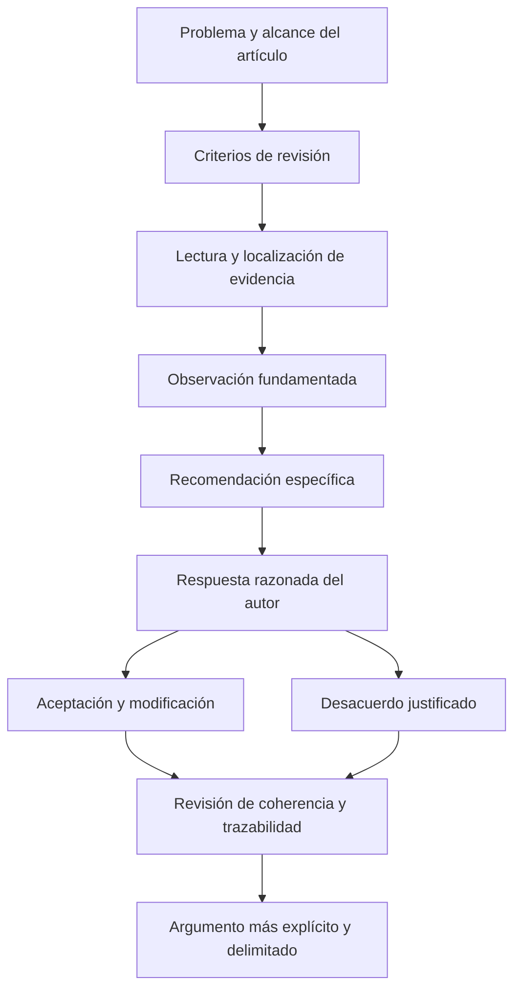

# Clase 7: Revisión científica de la relación entre programación e investigación doctoral

> **Objetivo académico:** Analizar críticamente la pertinencia, suficiencia argumentativa, coherencia y trazabilidad de artículos que vinculan programación e investigación doctoral, mediante observaciones fundamentadas, recomendaciones específicas y respuestas razonadas del autor.

## 1. Contexto y marco conceptual

La sesión aborda la revisión científica de textos sobre la incidencia de la programación en un problema de investigación. Su núcleo es metodológico: cómo identificar una relación relevante, distinguir una afirmación de su justificación y comunicar objeciones que permitan mejorar un argumento.

La relación entre programación e investigación puede ser directa, cuando se desarrollan algoritmos o sistemas, o indirecta, cuando se estudian fundamentos, modelos o condiciones tecnológicas sin realizar una implementación. Un artículo teórico puede sostener una contribución mediante argumentos y literatura; uno aplicado puede incorporar código, procedimientos y resultados. La ausencia de implementación no invalida por sí misma un trabajo teórico, pero tampoco lo exime de justificar sus afirmaciones.

En la discusión se presenta la investigación doctoral como una búsqueda de conexiones científicas que amplía la perspectiva del especialista técnico. El interés no reside únicamente en dominar una herramienta, sino en explicar qué papel desempeña en un problema y qué conocimiento permite producir.

**Enriquecimiento conceptual:** La amplitud temática y la profundidad técnica no distinguen por sí solas los niveles de investigación. Una contribución doctoral necesita un problema delimitado, originalidad y justificación rigurosa; puede combinar especialización profunda con conexiones entre campos.

La revisión se concibe como una interacción entre perspectivas. El revisor interpreta desde su formación y puede identificar vacíos que el autor, por familiaridad con el tema, considera implícitos. Esta diversidad resulta productiva cuando las observaciones se vinculan con pasajes y criterios explícitos.

## 2. Fundamentos teóricos y arquitectura

### 2.1. Pertinencia y necesidad de la programación

La sesión distingue dos preguntas fundamentales:

- **Incidencia o interacción:** ¿cómo participa la programación en el problema investigado?
- **Importancia justificada:** ¿por qué esa participación resulta relevante o esencial para el enfoque propuesto?

Nombrar un paradigma, lenguaje o biblioteca demuestra presencia temática, pero no establece su contribución al problema. La justificación necesita explicar el mecanismo que vincula una capacidad técnica con una necesidad de investigación.

**Enriquecimiento conceptual:** Conviene diferenciar tres niveles de afirmación: una tecnología puede ser útil, necesaria para una arquitectura elegida o indispensable para resolver el problema bajo ciertos supuestos. La última afirmación es más fuerte y requiere considerar alternativas. La expresión «esencial» debe precisar a cuál de estos niveles se refiere.

### 2.2. Criterios de revisión

| Dimensión | Pregunta analítica | Evidencia relevante |
| --- | --- | --- |
| Pertinencia | ¿Se explica la relación entre programación y problema? | Mecanismos, capacidades y restricciones vinculados con el objeto de estudio. |
| Justificación | ¿Se sustenta la importancia de esa relación? | Razones técnicas y científicas, con alcance delimitado. |
| Completitud | ¿El texto desarrolla sus componentes argumentativos? | Contexto, literatura, análisis, discusión, conclusiones y referencias. |
| Ejemplos o argumentos | ¿Las afirmaciones cuentan con respaldo suficiente? | Casos pertinentes, razonamientos o evidencia documentada. |
| Trazabilidad bibliográfica | ¿Las fuentes existen y respaldan lo que se les atribuye? | Correspondencia entre citas, referencias y contenido consultable. |
| Coherencia | ¿Las partes mantienen una secuencia lógica sin contradicciones? | Consistencia entre problema, desarrollo y conclusiones. |

La completitud estructural y la suficiencia científica son distintas. Un texto puede contener todos los apartados y mantener conclusiones débiles o relaciones insuficientemente explicadas.

### 2.3. Ciclo argumentativo de revisión

La unidad básica de la revisión es la relación entre una observación y una recomendación. La observación identifica un problema; la recomendación explica una vía razonable para resolverlo. El autor puede aceptar y adoptar el cambio, o rechazarlo mediante una justificación.

**Enriquecimiento conceptual:** Una recomendación puede solicitar una aclaración, evidencia o delimitación sin imponer una solución técnica única. Así se preserva la autonomía del autor y se evita sustituir su investigación por las preferencias del revisor.

## 3. Implementación técnica y lógica de negocio

La fuente no presenta una implementación ejecutable, código ni mediciones de rendimiento. La aplicación práctica consiste en analizar un artículo ilustrativo sobre detección de fraude en compras electrónicas y documentar razonamientos de revisión.

### 3.1. Procedimiento de análisis

La lectura inicial identifica el problema, el alcance y la estructura argumentativa. El resumen permite formular una primera hipótesis sobre la pertinencia, pero esta debe contrastarse con el cuerpo del artículo. Después se localizan las explicaciones que vinculan paradigmas, herramientas y decisiones de arquitectura con el problema.

El procedimiento desarrollado puede expresarse como una secuencia metodológica:

1. Identificar la afirmación y su ubicación en el texto.
2. Determinar qué criterio permite evaluarla.
3. Localizar el argumento, ejemplo o fuente que la respalda.
4. Distinguir entre ausencia de evidencia, ambigüedad y desacuerdo interpretativo.
5. Formular una observación y una recomendación relacionadas.
6. Contrastar la interpretación con la respuesta del autor.

Una lectura rápida puede pasar por alto una explicación existente. Por ello, «no se encontró» describe el resultado de una búsqueda del revisor y no demuestra automáticamente que el contenido esté ausente.

### 3.2. Capacidades técnicas en el caso de fraude

El ejemplo menciona programación estructurada y orientada a objetos, programación funcional, procesamiento paralelo, bibliotecas de clasificación y detección de anomalías, plataformas de datos y mecanismos de bases de datos.

| Elemento mencionado | Relación discutida en la sesión | Aspecto que necesita justificarse |
| --- | --- | --- |
| Programación orientada a objetos | Encapsulación de lógica y organización de servicios. | Cómo esa organización contribuye al mecanismo de detección. |
| Programación funcional y Spark | Procesamiento paralelo de grandes volúmenes de transacciones. | Qué operaciones se distribuyen y qué restricciones impone el análisis. |
| scikit-learn y PyTorch | Construcción y comparación de modelos. | Qué modelos, datos y señales permiten reconocer patrones relevantes. |
| Kafka | Participación en una arquitectura de procesamiento de eventos. | Su relación con el flujo de datos utilizado por el componente detector. |
| Bases de datos y procedimientos SQL | Registro y automatización asociados a transacciones. | Qué información se conserva y cómo interviene en el análisis del fraude. |

**Enriquecimiento conceptual:** Estas herramientas cumplen funciones distintas. Kafka transporta y organiza flujos de eventos; no es, por sí mismo, un algoritmo detector. PyTorch permite construir modelos y scikit-learn ofrece herramientas de aprendizaje automático, pero su uso no garantiza que el modelo identifique fraude. Spark facilita procesamiento distribuido; sus capacidades no deben atribuirse exclusivamente a un paradigma de programación ni confundirse con una garantía de respuesta en tiempo real.

La sesión también menciona algoritmos genéticos como una posible línea tecnológica. Se trata de una sugerencia ilustrativa: no se desarrolla un algoritmo concreto ni se aporta evidencia que permita considerarlo superior para el caso.

### 3.3. Registro de la revisión

El instrumento analítico utilizado relaciona criterio, observación, recomendación y respuesta. Su valor consiste en hacer rastreable el razonamiento y distinguir la crítica inicial de su resolución.

**Enriquecimiento conceptual:** Un registro útil conserva el pasaje observado, la razón de la objeción, el cambio sugerido y la explicación del autor. La trazabilidad permite comprobar si la modificación resolvió el problema original o si únicamente cambió la redacción.

## 4. Análisis crítico de casos y auditoría práctica

### 4.1. Programación orientada a objetos y detección de fraude

Una afirmación del artículo ilustrativo relaciona clases y objetos con servicios escalables, lógica de detección y conexiones a bases de datos. El revisor plantea que la explicación puede describir la construcción general del software sin demostrar una relación específica con la detección.

La posible respuesta del autor consiste en señalar que el fraude ocurre en sistemas concretos y que sus debilidades o decisiones arquitectónicas forman parte del problema. El desacuerdo revela una ambigüedad de alcance: se está hablando de infraestructura habilitante, de vulnerabilidades o del mecanismo que clasifica transacciones.

La recomendación resultante es explicitar el vínculo entre esos niveles. La discusión no obliga a eliminar la arquitectura del análisis; exige explicar qué aporta al objetivo investigado.

**Enriquecimiento conceptual:** Ambas interpretaciones son discutibles, pero no resultan igualmente válidas por el solo hecho de existir. Su solidez depende del alcance declarado y de la evidencia. Además, un fraude puede derivar de abuso de procesos o de credenciales legítimas, sin requerir un defecto de programación.

### 4.2. Escalabilidad transaccional y escalabilidad analítica

El ejemplo menciona asincronía y tolerancia a fallos para sostener grandes volúmenes de transacciones. La observación cuestiona si esa capacidad se refiere al sistema comercial o al componente detector.

La recomendación consiste en precisar cómo la arquitectura permite analizar patrones fraudulentos bajo los requisitos del caso. Un sistema puede procesar operaciones comerciales de forma eficiente y, aun así, no analizar oportunamente las señales de riesgo.

**Enriquecimiento conceptual:** Deben distinguirse el rendimiento del servicio transaccional y el rendimiento del análisis. Una justificación puede considerar volumen procesado, latencia y recursos disponibles, pero la fuente no aporta valores ni resultados que permitan cuantificarlos. Tampoco debe confundirse rapidez con calidad de detección.

### 4.3. Anomalía, patrón y fraude

Durante la sesión se vincula el fraude con comportamientos inusuales y detección de patrones. Esta relación orienta la lectura de las bibliotecas de aprendizaje automático.

**Enriquecimiento conceptual:** Una anomalía no demuestra fraude, y un comportamiento fraudulento puede parecer habitual. La detección de anomalías produce señales cuya interpretación necesita contexto. El artículo debe precisar si identifica desviaciones, estima riesgo o clasifica casos previamente etiquetados; estas operaciones tienen exigencias de evidencia diferentes.

### 4.4. Argumentación sobre bases de datos

La expresión «manejo flexible» se considera insuficiente para justificar la relación de una base de datos con la detección de fraude. La observación apunta a que una propiedad genérica necesita conectarse con una función concreta.

La sugerencia de incorporar procedimientos SQL ilustra una posible conexión con automatización y registro de eventos transaccionales. No constituye una demostración de que esa sea la arquitectura adecuada.

**Enriquecimiento conceptual:** La selección entre lógica en base de datos y procesamiento externo depende de requisitos como consistencia, mantenibilidad y carga operativa. Agregar procedimientos únicamente para mencionar una tecnología no resuelve un vacío argumentativo.

### 4.5. Auditoría bibliográfica

La sesión diferencia la existencia de una referencia y su correspondencia con la afirmación citada. La auditoría requiere localizar la obra, comprobar sus datos y analizar si respalda el pasaje.

Una búsqueda sin resultados en Google Scholar no basta para declarar inexistente una publicación. Puede haber errores de transcripción, datos incompletos o falta de indexación. La observación prudente comunica que no se logró localizar la fuente y solicita información verificable.

Las referencias del artículo ilustrativo no quedan verificadas de forma concluyente en la transcripción; por ello no se incorporan aquí como bibliografía validada.

### 4.6. Caso de imágenes de hojas de quinua

Se menciona una investigación de cuantificación de severidad en hojas de quinua mediante inteligencia artificial. El testimonio vincula la metaprogramación con una nueva perspectiva del problema, pero no describe su mecanismo ni una arquitectura que permita reconstruir esa relación.

También se informa de pruebas con un subconjunto reducido, condicionado por la disponibilidad de etiquetas, y de sobreajuste observado por el participante. No se proporcionan métricas ni detalles suficientes para verificarlo.

**Enriquecimiento conceptual:** Un conjunto pequeño puede incrementar el riesgo de sobreajuste, pero no lo demuestra por sí solo. La evaluación requiere contrastar el comportamiento con datos de entrenamiento y datos independientes, considerando representatividad, calidad de etiquetas y posibles filtraciones de información. Esta precisión delimita el alcance del testimonio sin inventar resultados.

## 5. Principios de diseño, buenas prácticas y anti-patrones

### 5.1. Crítica fundamentada y conciencia del sesgo

La formación del revisor condiciona qué relaciones considera centrales. Reconocer ese punto de partida ayuda a separar preferencias de objeciones sustentadas. En el ejemplo, la atención reiterada al mecanismo detector responde a una interpretación particular del alcance del artículo.

| Buena práctica | Anti-patrón correspondiente |
| --- | --- |
| Identificar un pasaje y explicar el problema. | Formular juicios generales sin evidencia textual. |
| Relacionar cada observación con una recomendación. | Señalar insuficiencias sin indicar cómo aclararlas. |
| Diferenciar contexto arquitectónico y mecanismo de detección. | Presentar capacidades generales como demostración específica. |
| Explicar el papel de cada herramienta. | Acumular nombres de tecnologías como sustituto del argumento. |
| Contrastar citas con contenido y procedencia. | Suponer validez por la apariencia formal de la referencia. |
| Responder con razones y cambios verificables. | Aceptar por autoridad o rechazar sin fundamentación. |
| Mantener conclusiones proporcionales al análisis. | Afirmar resultados que el desarrollo no establece. |

### 5.2. Precisión en las afirmaciones técnicas

La sesión utiliza como ejemplo la elección de lenguajes en la capa de transporte, contraponiendo ensamblador y JavaScript.

**Enriquecimiento conceptual:** La capa de red no determina por sí sola el lenguaje adecuado. Debe precisarse si se modifica una implementación del protocolo, se programa una aplicación que utiliza sockets o se realiza una simulación. El ensamblador no garantiza optimización automática y JavaScript también puede emplearse en aplicaciones de red fuera del navegador. La elección necesita requisitos y evidencia de rendimiento, no una asociación rígida entre capa y nivel del lenguaje.

En otro ejemplo se relacionan firmas de artefactos, criptografía y blockchain con auditoría e integridad.

**Enriquecimiento conceptual:** Una firma digital permite verificar integridad y autenticidad bajo supuestos sobre algoritmos y claves. Blockchain puede aportar trazabilidad bajo condiciones de consenso y gobernanza, pero no convierte los datos de origen en verdaderos ni vuelve irrefutable cualquier registro. Estas propiedades deben formularse con sus límites.

### 5.3. Alcance de la revisión por pares

La sesión destaca el valor de perspectivas complementarias y de la mediación ante desacuerdos persistentes. Sin embargo, la revisión debe conservar su carácter argumentativo: la intervención de varias personas no sustituye la evidencia.

**Enriquecimiento conceptual:** La pluralidad de revisores aumenta las oportunidades de detectar problemas, pero no garantiza corrección científica. La calidad depende de la competencia pertinente, la independencia del juicio, la profundidad de la lectura y la resolución efectiva de las observaciones.

## 6. Síntesis conceptual y profundización académica

La contribución central de la clase es un método de lectura crítica que conecta problema de investigación, capacidades de programación y evidencia. Su aplicación exige distinguir presencia temática, pertinencia y necesidad justificada. Un texto puede mencionar programación y seguir sin explicar cómo interviene en el problema.

El caso de fraude muestra que infraestructura y mecanismo analítico pueden estar relacionados, pero esa relación necesita hacerse explícita. Lo mismo ocurre con escalabilidad, bibliotecas de aprendizaje automático y bases de datos: sus propiedades generales no bastan para demostrar una contribución específica.

La revisión adquiere valor cuando transforma una interpretación del lector en una observación fundamentada, una recomendación y una respuesta razonada. Aceptar una modificación y sostener un desacuerdo pueden ser decisiones científicamente legítimas cuando se apoyan en argumentos verificables.

**Enriquecimiento conceptual:** Tres líneas de profundización se desprenden del análisis: la relación entre arquitectura de software y validez de las inferencias; la diferencia entre detección técnica y definición del fenómeno estudiado; y la trazabilidad que conecta afirmaciones, fuentes y conclusiones. Estas conexiones permiten evaluar un artículo por la solidez de su razonamiento, además de por su estructura y vocabulario técnico.
