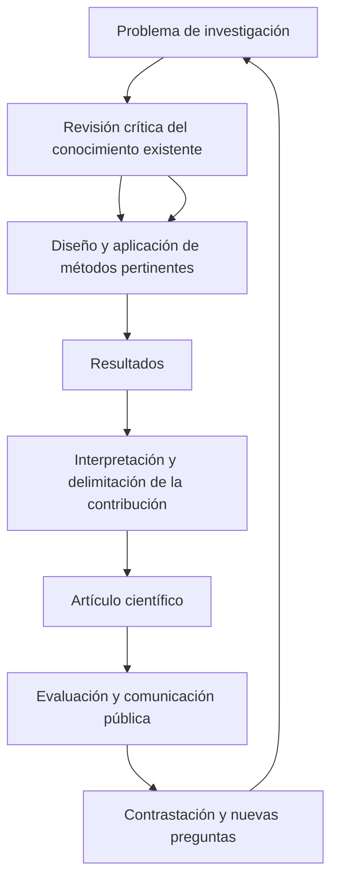

# Clase 1: Producción científica y arquitectura argumentativa del artículo científico

> **Objetivo académico:** Comprender la producción científica como articulación entre investigación, resultados y comunicación; reconocer la estructura funcional del artículo científico y evaluar la coherencia entre problema, métodos, evidencia, interpretación y contribución.

## 1. Contexto y marco conceptual

### Formación doctoral y comunicación del conocimiento

La sesión sitúa la formación doctoral en dos dimensiones complementarias: profundizar en un campo disciplinar y desarrollar capacidad autónoma de investigación. En ciencias de la computación, esta capacidad implica formular problemas relevantes, fundamentar decisiones metodológicas, producir conocimiento y comunicarlo de manera que otros investigadores puedan comprenderlo, discutirlo y contrastarlo.

La escritura científica constituye una competencia intelectual, además de comunicativa. Al redactar, el investigador explicita relaciones que podían permanecer implícitas, identifica vacíos argumentativos y revisa la consistencia de sus afirmaciones. La expresión escrita y la exposición oral requieren habilidades distintas, aunque ambas dependen de comprender y justificar el conocimiento comunicado.

En la sesión se destacan tres capacidades del investigador: pensamiento lógico, creatividad y contrastación de información. La lógica organiza las inferencias; la creatividad permite formular alternativas y nuevas relaciones; la contrastación impide aceptar una afirmación únicamente por la autoridad de quien la expresa. Esto incluye revisar críticamente tanto las fuentes documentales como las explicaciones recibidas.

### Producción científica: proceso, resultado y socialización

La producción científica se presenta como la materialización del conocimiento generado mediante investigación. Su secuencia central comprende investigar, obtener resultados y comunicarlos. El artículo científico es una de sus formas, junto con libros, informes y comunicaciones académicas.

La transcripción recoge dos acepciones del concepto. Una enfatiza los productos publicados y su circulación; otra incluye el proceso investigativo y resultados todavía no publicados. Esta distinción permite separar la existencia de una actividad de investigación de su incorporación efectiva a la discusión pública.

**Enriquecimiento conceptual:** La afirmación de que la ciencia solo existe cuando se publica debe entenderse como énfasis en su dimensión pública y acumulativa. La publicación posibilita crítica, reutilización y reconocimiento, pero no convierte automáticamente una afirmación en conocimiento válido. La calidad de la evidencia y del razonamiento requiere evaluación independiente del hecho de publicar.

El diagrama expresa una relación iterativa: la comunicación abre nuevas posibilidades de contrastación y alimenta investigaciones posteriores. La redacción comunica una investigación, pero no sustituye su diseño ni la obtención de evidencia.

## 2. Fundamentos teóricos y arquitectura

### Investigar y redactar son procesos relacionados, pero diferentes

La distinción metodológica principal de la sesión separa el proceso de investigación de la elaboración del artículo. El primero produce y fundamenta resultados; el segundo organiza su comunicación. Conocer una plantilla editorial no equivale a dominar la investigación que debe sustentarla.

Un artículo puede estar formalmente bien redactado y presentar un diseño insuficiente. También puede existir investigación relevante cuya comunicación sea incompleta o confusa. La calidad exige correspondencia entre ambas dimensiones: lo afirmado en el texto debe poder rastrearse hasta métodos, datos o argumentos adecuados.

### Tipos de artículos y naturaleza de su contribución

| Tipo | Base principal | Contribución esperada | Límite que debe respetarse |
| --- | --- | --- | --- |
| Original o de investigación | Investigación propia | Resultados y argumentos derivados del estudio realizado | No afirmar resultados que el diseño no permite sostener |
| Revisión | Análisis de literatura existente | Organización, comparación y síntesis crítica del conocimiento | Hacer explícito qué literatura sustenta la síntesis y cómo se seleccionó |
| Reflexión | Desarrollo argumentativo sobre un problema | Interpretación o posición fundamentada | Distinguir propuesta conceptual de demostración empírica |

La sesión plantea una duda relevante: si una revisión incorpora una perspectiva propia, ¿se convierte en artículo original? La distinción depende de la naturaleza del trabajo y de la clasificación editorial, además de la presencia de ideas propias.

**Enriquecimiento conceptual:** Una revisión puede generar una contribución original mediante una síntesis, una taxonomía o la identificación de una brecha. Esto no la transforma necesariamente en un artículo de investigación primaria. Asimismo, una propuesta surgida de la literatura debe presentarse como propuesta mientras no exista evidencia suficiente de su efectividad. La investigación documental puede ser exigente; no conviene asumir que toda revisión es metodológicamente sencilla.

### Estructura IMRyD y funciones argumentativas

La arquitectura central abordada es IMRyD: introducción, métodos, resultados y discusión. Las conclusiones pueden aparecer como sección independiente o integrarse en la discusión, según el tipo de artículo y las normas editoriales.

| Componente | Pregunta orientadora | Función |
| --- | --- | --- |
| Introducción | ¿Cuál es el problema y por qué importa? | Contextualizar, revisar antecedentes, delimitar la brecha y formular el propósito |
| Materiales y métodos | ¿Cómo se estudió el problema? | Explicar y justificar el diseño y los procedimientos |
| Resultados | ¿Qué se encontró? | Comunicar los hallazgos pertinentes |
| Discusión | ¿Qué significan los hallazgos? | Interpretar, contrastar y delimitar su alcance |
| Conclusiones | ¿Qué conocimiento puede sostenerse al finalizar? | Sintetizar la contribución y sus límites |
| Referencias | ¿Qué fuentes sustentan el texto? | Permitir atribución y trazabilidad documental |

La utilidad de esta estructura reside en sus funciones epistemológicas, no en reproducir mecánicamente encabezados. La sesión reconoce variaciones entre revistas y disciplinas.

**Enriquecimiento conceptual:** IMRyD es un esquema frecuente para comunicar investigaciones empíricas; los trabajos teóricos, las demostraciones formales y algunas revisiones pueden requerir otras organizaciones. La atribución histórica precisa de su estandarización no puede establecerse a partir de la transcripción disponible.

### Metadatos y orientación de la lectura

El título, el resumen y las palabras clave orientan la identificación y recuperación del artículo. El título ofrece una representación breve del contenido; el resumen permite valorar el propósito, el método y los principales hallazgos; las palabras clave señalan conceptos relevantes para la búsqueda temática.

La sesión recomienda títulos concisos, precisos y libres de redundancias. También reconoce que la longitud permitida depende de la revista. Por ello, las cifras de palabras mencionadas durante la explicación deben tratarse como referencias contextuales, no como límites generales.

## 3. Implementación técnica y lógica de negocio

La sesión no desarrolla código ni ejecuta un procedimiento computacional. Su implementación técnica consiste en traducir una investigación a una arquitectura de comunicación verificable y adecuada al medio editorial.

### Selección de revista y adaptación editorial

Se proponen dos decisiones iniciales: identificar una revista pertinente y consultar sus instrucciones para autores. El ajuste requiere atender al ámbito temático, el público, los tipos de contribución aceptados, la extensión, la estructura y el estilo de referencias.

Las plantillas facilitan el formato, pero no resuelven la lógica científica. Herramientas como LaTeX, procesadores de texto y gestores bibliográficos aparecen como apoyos a la preparación del manuscrito; no se demuestra su configuración ni se comparan sus prestaciones durante la sesión.

El orden de escritura tampoco necesita coincidir con el orden final de lectura. Es posible desarrollar componentes disponibles y luego integrarlos. El título y el resumen deben ajustarse al contenido consolidado, mientras que las conclusiones dependen de resultados efectivamente obtenidos.

### Introducción: del contexto al problema delimitado

La introducción articula relevancia, antecedentes, situación problemática y propósito. En la sesión se recomienda iniciar con una idea pertinente que atraiga al lector y avanzar hacia el problema específico. El movimiento de lo general a lo particular constituye una estrategia posible, no una obligación universal.

La situación problemática se explica como una discrepancia entre un estado observado y un estado esperado. Esa discrepancia necesita documentación: una expectativa deseable, por sí sola, no demuestra la existencia ni la magnitud de un problema.

Los antecedentes permiten conocer qué se ha investigado, con qué resultados y qué permanece abierto. Su selección debe responder a la capacidad explicativa y a la pertinencia de las fuentes. La organización puede seguir la evolución histórica de un concepto, siempre que esa cronología contribuya a comprenderlo.

**Enriquecimiento conceptual:** Ordenar fuentes por año no equivale por sí mismo a aplicar un análisis histórico-lógico. Este requiere explicar transformaciones, continuidades y relaciones. Una organización temática o por controversias también puede ser adecuada. Del mismo modo, una guía de párrafos puede ayudar a planificar; su utilidad termina cuando obliga a simplificar o interrumpir la argumentación.

### Materiales y métodos: hacer explícita la lógica del estudio

La descripción metodológica debe permitir comprender cómo se obtuvieron los resultados y por qué esos procedimientos son adecuados. Según el estudio, puede incluir enfoque, diseño, unidades de análisis, selección de casos o muestras, instrumentos, procedimientos, criterios de medición y estrategia de análisis.

La población de estudio no está restringida a personas. Puede comprender documentos, programas, repositorios u otras unidades que compartan las propiedades investigadas. Esta aclaración resulta central para evitar trasladar automáticamente diseños basados en encuestas a problemas computacionales.

En la sesión se distingue entre enfoques cuantitativos, cualitativos y mixtos, y se recuerda que estas categorías no agotan la clasificación de una investigación. Un estudio también puede clasificarse por su alcance, temporalidad o intervención, porque se trata de criterios diferentes.

**Enriquecimiento conceptual:** Interpretar un dato numérico no basta para declarar un diseño mixto. Este requiere integrar de manera justificada componentes cuantitativos y cualitativos. Asimismo, la coherencia metodológica no exige que toda técnica pertenezca de forma exclusiva a una única familia; exige explicar su función y su relación con las preguntas del estudio.

### Operacionalización, instrumentos y consistencia interna

La operacionalización vincula conceptos con observaciones: una variable compleja puede descomponerse en dimensiones e indicadores, a partir de los cuales se construyen ítems o medidas. El objetivo es justificar qué se observa y cómo esa observación representa el concepto estudiado.

Se menciona el alfa de Cronbach y su disponibilidad en SPSS como recurso para analizar consistencia interna. La explicación requiere distinguir fiabilidad y validez.

**Enriquecimiento conceptual:** Para una escala aditiva de $k$ ítems, el alfa se expresa como:

$$
\alpha = \frac{k}{k-1}\left(1-\frac{\sum_{i=1}^{k}\sigma_i^2}{\sigma_T^2}\right)
$$

Aquí $k$ es un entero mayor que uno; $\sigma_i^2$ es la varianza del ítem $i$; y $\sigma_T^2$ es la varianza de la puntuación total, formada por la suma de los ítems. Se requiere una varianza total positiva y puntuaciones construidas de forma compatible. El coeficiente $\alpha$ es adimensional y resume relaciones entre las variaciones de los ítems y del total.

La expresión procede de la relación entre varianza total, varianzas individuales y covarianzas. Si los ítems comparten variación, la suma de sus varianzas representa una proporción menor de la varianza total y el coeficiente aumenta. Su interpretación como estimador de fiabilidad exige supuestos adicionales, como errores no correlacionados y equivalencia esencial de las contribuciones de los ítems al constructo.

Un alfa alto no demuestra que el instrumento mida el concepto pretendido ni acredita la validez de las conclusiones. Puede aumentar por redundancia entre ítems. Tampoco debe asumirse que siempre pertenece al intervalo de cero a uno: pueden aparecer valores negativos que requieren revisar covarianzas, codificación y estructura del instrumento. Los umbrales de aceptación dependen del propósito de la medición y no deben aplicarse automáticamente.

### Resultados, discusión y conclusiones

Los resultados presentan evidencia pertinente; la discusión interpreta su significado, la contrasta con antecedentes y explicita sus límites. Cuando ambas secciones se integran, debe seguir siendo reconocible qué se observó y qué se infiere.

La sesión utiliza la expresión «ponerle voz al dato» para destacar que una tabla o un porcentaje necesita análisis. Sin embargo, interpretar exige respetar lo que el diseño permite afirmar: la explicación no puede compensar evidencia insuficiente.

Las conclusiones deben comunicar conocimiento derivado del estudio, en lugar de enumerar operaciones realizadas o repetir la organización del documento. Su carácter sintético no autoriza una generalización mayor que la sustentada por los resultados.

## 4. Análisis crítico de casos y auditoría práctica

### Lectura estructural de un artículo sobre competencias digitales

Se analiza un artículo de la revista Atenas como ejemplo de arquitectura científica. La lectura identifica título, resumen, introducción, metodología, resultados y discusión, conclusiones y referencias. El interés principal es reconocer la función de cada componente, no reproducir su diseño.

El resumen permite localizar objetivo, método, resultados y conclusiones. Durante la discusión se aclara que el estudio declara un enfoque cuantitativo. La información disponible no permite reconstruir sus datos, procedimientos completos ni resultados específicos.

También se cuestiona el encabezado «metodologías y métodos» y se propone «materiales y métodos».

**Enriquecimiento conceptual:** El nombre de una sección no basta para determinar un error metodológico. «Metodología», «Métodos» o «Materiales y métodos» pueden ser denominaciones editoriales pertinentes. La auditoría debe revisar el contenido y su coherencia con el diseño, además del título utilizado.

### Caso de la quinua: paráfrasis, interpretación y atribución

Una intervención plantea cómo atribuir afirmaciones sobre el valor nutricional, la adaptación y las enfermedades de la quinua cuando el autor procede de la informática y ha obtenido esa información mediante lectura especializada. El caso permite distinguir entre redactar una frase y producir el conocimiento que la sustenta.

**Enriquecimiento conceptual:** Cambiar las palabras no convierte una idea ajena en una contribución propia. Si una afirmación, dato o interpretación procede de una fuente, debe atribuirse también cuando se parafrasea. Leer un documento y concluir que una institución reconoce determinada situación sigue requiriendo referencia cuando esa conclusión depende del documento.

La paráfrasis conserva la responsabilidad de identificar la fuente. Si el original no se ha consultado, debe transparentarse la dependencia de una fuente secundaria conforme al estilo aplicable. Reformular una idea no resuelve la ausencia de verificación documental.

La distinción entre citas breves y citas en bloque corresponde a la reproducción textual. No se aplica automáticamente a un párrafo largo redactado como paráfrasis. Por ello, contar las palabras del párrafo no permite decidir si existe un error de formato de cita directa.

### Validación en ciencias de la computación

El debate central cuestiona imponer encuestas y validaciones psicométricas a cualquier investigación computacional. Se sostiene que el método debe responder al objeto y a la información necesaria. Evaluar un software no equivale necesariamente a recopilar opiniones sobre él.

**Enriquecimiento conceptual:** Una afirmación sobre rendimiento puede requerir mediciones bajo condiciones controladas; una afirmación sobre corrección puede necesitar pruebas o argumentos formales; una afirmación sobre experiencia de uso puede justificar participación de usuarios. Estas vías ilustran la relación entre afirmación y evidencia, sin constituir procedimientos ejecutados en la sesión.

| Nivel de revisión | Pregunta crítica | Insuficiencia frecuente |
| --- | --- | --- |
| Medición | ¿La medida representa el constructo o propiedad relevante? | Confundir consistencia interna con validez |
| Obtención de datos | ¿El procedimiento produjo registros confiables y trazables? | Suponer que usar una herramienta conocida garantiza los datos |
| Inferencia | ¿Los resultados respaldan la afirmación? | Tomar un porcentaje como demostración suficiente de efectividad |
| Alcance | ¿En qué condiciones se sostiene la conclusión? | Generalizar fuera de las unidades y condiciones estudiadas |

La sesión menciona el método Delphi y la valoración de expertos. Se discute su dependencia de juicios humanos y su posible uso excesivo.

**Enriquecimiento conceptual:** El juicio experto puede aportar evidencia sobre pertinencia, contenido o factibilidad, pero no sustituye automáticamente una evaluación de desempeño. La intervención humana tampoco lo invalida por sí sola: deben analizarse la selección de expertos, el procedimiento, los desacuerdos y el tipo de afirmación que se pretende respaldar. Delphi es un procedimiento estructurado de consulta, no un sinónimo de cualquier opinión experta.

### Indexación, impacto e identificación académica

En el diálogo se usa «alto impacto» como equivalente de «indexada», equivalencia cuestionada por los participantes.

**Enriquecimiento conceptual:** La indexación indica inclusión en una base o sistema documental; el impacto bibliométrico depende de indicadores y contextos concretos. Una revista indexada no pertenece automáticamente a un cuartil alto. La visibilidad, la calidad editorial y la pertinencia temática son dimensiones relacionadas, pero distintas.

También deben distinguirse los identificadores mencionados: ORCID identifica investigadores; DOI identifica de forma persistente objetos digitales; ISSN identifica publicaciones seriadas. Ninguno certifica por sí mismo la calidad científica. Publicar puede documentar precedencia y facilitar atribución, pero no equivale jurídicamente a obtener una patente ni garantiza exclusividad sobre una idea.

## 5. Principios de diseño, buenas prácticas y anti-patrones

### Coherencia y legibilidad

La redacción científica debe ser clara, precisa, concisa y ajustada a la evidencia. Su lector necesita comprender el problema, el procedimiento y la contribución sin reconstruir supuestos esenciales omitidos. La terminología disciplinar reduce ambigüedades cuando se emplea de forma consistente y se define cuando es necesario.

La sesión critica la fragmentación excesiva: encadenar títulos con desarrollos mínimos puede ocultar la falta de conexión argumentativa. Los párrafos de enlace ayudan a explicar relaciones entre ideas.

**Enriquecimiento conceptual:** Un resumen estructurado con etiquetas de objetivo, métodos, resultados y conclusiones puede ser plenamente coherente. La presencia de subtítulos no constituye por sí misma un defecto; su adecuación depende del género y de las normas de la revista. El criterio es que la estructura facilite la comprensión.

### Referencias y construcción teórica

La sesión distingue referencias bibliográficas, correspondientes a fuentes citadas, y bibliografía, que puede incluir obras consultadas sin cita expresa. La denominación final y el alcance de la lista deben seguir el criterio editorial adoptado.

El marco teórico exige seleccionar, comparar y evaluar críticamente las fuentes. No se reduce a acumular citas ni a enumerar conceptos. Debe mostrar qué perspectivas explican el objeto, dónde discrepan y qué posición fundamenta la investigación.

**Enriquecimiento conceptual:** Estado del arte, marco teórico y marco conceptual se relacionan, pero cumplen funciones diferentes. El estado del arte caracteriza la investigación disponible y sus brechas; el marco teórico articula perspectivas explicativas; el marco conceptual delimita los conceptos utilizados. Su integración no elimina estas diferencias.

No existe una cantidad universal de referencias que garantice calidad. Importan su pertinencia, cobertura y uso argumentativo. La actualidad también debe interpretarse: los resultados recientes permiten reconocer avances, mientras que las fuentes clásicas pueden ser indispensables para fundamentar conceptos. Un porcentaje de referencias recientes, aislado de su función, no certifica rigor.

### Evaluación editorial e integridad

Se describe una secuencia general de revisión inicial, evaluación por pares y edición. La sesión menciona modalidades anónimas y abiertas.

**Enriquecimiento conceptual:** El anonimato no garantiza por sí solo objetividad, y la revisión abierta no elimina necesariamente el rigor. La calidad depende también de competencia, transparencia, gestión de conflictos de interés y fundamentación de los dictámenes. La aceptación editorial no exime al lector de realizar su propia evaluación crítica.

Respecto de la inteligencia artificial, la sesión reconoce su potencial como apoyo y la necesidad de contrastar la información producida. También plantea la transparencia sobre sus usos.

**Enriquecimiento conceptual:** La responsabilidad sobre exactitud, fuentes y afirmaciones permanece en los autores. Las políticas de declaración deben consultarse en el medio correspondiente. La fragmentación de párrafos o el resultado de un detector automático no constituye prueba suficiente de autoría mediante IA; puede producir atribuciones erróneas.

| Anti-patrón | Consecuencia | Criterio alternativo |
| --- | --- | --- |
| Copiar un ejemplo como receta universal | Desajuste entre problema y método | Conservar su función y adaptar el procedimiento |
| Imponer encuestas a todo estudio | Evidencia ajena a la afirmación central | Elegir medidas según objeto y propósito |
| Acumular citas sin análisis | Ausencia de posición argumentada | Comparar fuentes y justificar relaciones |
| Presentar una paráfrasis sin atribución | Pérdida de trazabilidad intelectual | Reconocer la procedencia de ideas y datos |
| Concluir mediante un resumen de actividades | Contribución indeterminada | Formular resultados e inferencias con alcance explícito |
| Equiparar identificación, indexación y calidad | Selección editorial insuficientemente fundamentada | Evaluar cada dimensión por separado |

## 6. Síntesis conceptual y profundización académica

La idea articuladora de la clase es la coherencia entre producción de conocimiento y comunicación científica. El artículo organiza una cadena de justificación: un problema relevante conduce a métodos pertinentes; estos producen evidencia; la evidencia sostiene interpretaciones; y las interpretaciones permiten formular una contribución delimitada.

La sesión propone estudiar un mismo objeto desde distintos momentos: diagnóstico empírico, análisis teórico, modelación y propuesta de transformación. Esta secuencia destaca que intervenir requiere conocer previamente la realidad y explicar sus relaciones relevantes.

**Enriquecimiento conceptual:** Esa secuencia constituye una arquitectura posible, no una obligación para toda investigación. Un estudio teórico puede centrarse en una demostración; uno empírico, en una caracterización; y uno aplicado, en evaluar un artefacto. La contribución tampoco exige siempre una teoría completamente nueva o una aplicación inmediata: puede consistir en refinar una explicación, establecer un límite o aportar evidencia que modifique una interpretación previa.

La discusión sobre datos empíricos y comprensión esencial invita a diferenciar observación y explicación. Un modelo teórico representa componentes y relaciones seleccionados para un propósito; su valor depende de su capacidad explicativa y de sus límites, no de incorporar una figura o utilizar la palabra «modelo».

La crítica a la inducción, mencionada en relación con Popper, refuerza la necesidad de prudencia inferencial.

**Enriquecimiento conceptual:** Una regularidad observada en casos particulares no demuestra por sí sola una ley universal. La investigación debe delimitar condiciones, considerar explicaciones alternativas y admitir contrastación. Esta cautela también impide presentar una conclusión como más general de lo que permite el estudio.

Las líneas de profundización que se desprenden de la clase son la relación entre afirmación y evidencia, la distinción entre fiabilidad y validez, la construcción crítica de antecedentes, la clasificación de contribuciones científicas y la evaluación de medios de publicación. En todas ellas opera un mismo criterio: cada decisión metodológica y cada enunciado deben poder justificarse por su función en la investigación.
