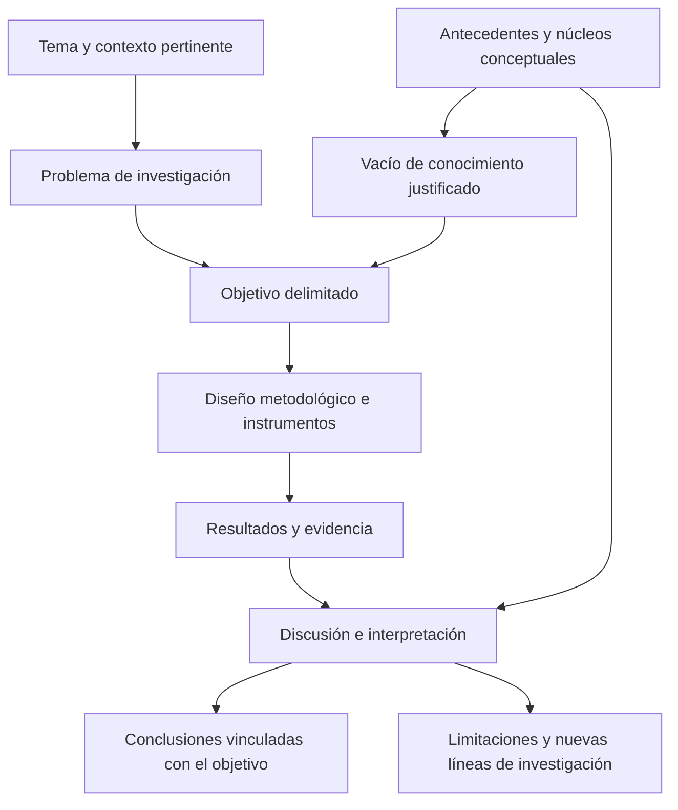

# Clase 2: Arquitectura argumentativa del artículo científico y coherencia metodológica

> **Objetivo académico:** Comprender la función de los apartados de un artículo científico y construir una relación coherente entre problema, antecedentes, objetivos, metodología, resultados, discusión y conclusiones, atendiendo a la trazabilidad de la evidencia y a la ética de la comunicación científica.

## 1. Contexto y marco conceptual

### Investigación, escritura y publicación

La sesión distingue la investigación científica de su comunicación escrita. Investigar supone formular un problema, seleccionar procedimientos y producir o analizar evidencia. Redactar un artículo consiste en organizar ese proceso y sus aportaciones para que una comunidad especializada pueda comprenderlos, evaluarlos y utilizarlos. Publicar incorpora una instancia editorial con requisitos formales y revisión científica.

Estas actividades están relacionadas, pero no son intercambiables: conocer la estructura de un artículo no reemplaza la formación metodológica, y disponer de resultados no garantiza que estén comunicados con claridad. La escritura exige seleccionar información, justificar decisiones y presentar argumentos dentro de una extensión limitada.

El docente propone tres dimensiones transversales para comprender una producción científica: **diseño, fundamentación y resultados**. El diseño delimita qué se estudia y con qué propósito; la fundamentación vincula la investigación con el conocimiento disponible; los resultados expresan lo obtenido mediante el proceso investigativo. Se trata de una organización conceptual presentada por el docente, no de una clasificación universal atribuida a una fuente externa.

### Tipos de artículo y relación con la tesis

| Modalidad | Base del trabajo | Aportación esperada | Relación posible con una tesis |
|---|---|---|---|
| Artículo original | Investigación cuyos resultados se comunican como aportación original | Evidencia, explicaciones, desarrollos o soluciones sustentados por procedimientos explícitos | Comunicar una parte delimitada de la investigación doctoral |
| Artículo de revisión | Literatura publicada sobre una cuestión definida | Síntesis, evaluación crítica, organización conceptual e identificación de vacíos | Fortalecer antecedentes, marco teórico o estado del arte |
| Artículo de reflexión | Desarrollo argumentativo de una posición | Interpretación razonada y discusión conceptual | Profundizar una perspectiva vinculada con el objeto de estudio |
| Estudio de caso | Análisis situado de un caso delimitado | Comprensión contextualizada de un fenómeno | Examinar una manifestación específica del problema |

La explicación se concentra en los artículos originales y de revisión. Una revisión no debería limitarse a reunir resúmenes: su contribución reside en relacionar trabajos, analizar diferencias y construir una comprensión más elaborada del tema.

Un artículo puede preceder a una tesis y contribuir a sus fundamentos, o derivarse de resultados de una tesis en desarrollo. El tema del artículo no necesita abarcar toda la propuesta doctoral: puede concentrarse en un problema parcial susceptible de una comunicación autónoma y coherente.

**Enriquecimiento conceptual:** La originalidad no depende exclusivamente de obtener datos empíricos inéditos. También puede expresarse en desarrollos teóricos, demostraciones, métodos computacionales o síntesis novedosas. Asimismo, una revisión rigurosa puede requerir una carga metodológica considerable; su dificultad y valor científico dependen de la pregunta y del diseño, por lo que no corresponde establecer una superioridad general entre modalidades.

### Estructura y adecuación editorial

La estructura IMRyD —Introducción, Métodos, Resultados y Discusión— funciona como referencia organizativa. Las conclusiones y referencias completan la exposición, aunque su disposición concreta depende de la revista y del tipo de artículo. En computación pueden aparecer apartados específicos sobre modelos, arquitecturas, algoritmos o evaluación.

La estructura facilita localizar la información, pero no garantiza aceptación editorial. La adecuación temática, la calidad de la evidencia y el cumplimiento de las normas para autores siguen siendo condiciones independientes.

## 2. Fundamentos teóricos y arquitectura

### La introducción como construcción del problema

La introducción debe situar al lector y explicar por qué el estudio merece atención. Sus componentes principales son el tema, su relevancia, el contexto pertinente, el problema, los antecedentes y el objetivo. El orden puede variar, pero la relación argumentativa debe ser reconocible.

| Componente | Función académica | Riesgo que debe evitarse |
|---|---|---|
| Tema | Delimitar la realidad o cuestión estudiada | Presentar un campo demasiado amplio |
| Relevancia y pertinencia | Explicar la importancia y utilidad del estudio | Sustituir la justificación por afirmaciones generales |
| Contexto | Identificar condiciones que influyen en el problema | Describir una institución sin relación analítica con la investigación |
| Problema | Precisar la dificultad, contradicción o incertidumbre abordada | Confundir el asunto general con una pregunta investigable |
| Antecedentes | Mostrar qué se conoce y con qué fundamentos | Enumerar autores sin relacionar sus aportaciones |
| Vacío de conocimiento | Justificar qué aspecto permanece insuficientemente explicado | Afirmar ausencia de estudios después de una búsqueda superficial |
| Objetivo | Explicitar qué se pretende alcanzar | Prometer resultados que el diseño no permite producir |

El marco contextual no equivale a una descripción geográfica o institucional. Interesan las condiciones de la realidad que afectan la aparición del problema, su observación o su interpretación. La relevancia puede ser teórica, práctica o social; debe explicarse mediante relaciones concretas con el problema.

El problema puede formularse como pregunta o como enunciado declarativo. La claridad de su delimitación importa más que una fórmula verbal rígida. El docente destaca su papel como punto de partida y propone que el objetivo se comprenda como respuesta a esa necesidad de conocimiento.

**Enriquecimiento conceptual:** Formular un problema investigable no garantiza que exista una solución práctica ni que la investigación produzca una respuesta definitiva. Un estudio también puede establecer límites, descartar explicaciones o mostrar que la evidencia disponible resulta insuficiente.

### Antecedentes, núcleos conceptuales y estado del arte

La fundamentación responde a dos preguntas: ¿en qué teoría se apoya el estudio y cuál explica mejor la realidad investigada? Para organizarla, la sesión propone tres interrogantes: **qué se ha dicho, qué interpretación desarrolla el investigador y qué posición se asume**.

Los núcleos conceptuales son los términos decisivos del tema, del problema y de los objetivos. Deben definirse y relacionarse para evitar que una misma palabra cambie de significado entre apartados. Asumir una posición teórica exige justificar su pertinencia; discrepar de otra requiere argumentos sobre sus supuestos, evidencia o alcance.

El estado del arte representa una reconstrucción crítica del conocimiento disponible sobre un objeto de estudio. No se reduce a la acumulación de referencias: identifica enfoques, resultados, debates, limitaciones y cuestiones abiertas.

**Enriquecimiento conceptual:** Conviene distinguir tres funciones relacionadas. La revisión documental es una actividad de búsqueda y análisis; el marco teórico organiza conceptos y perspectivas que sostienen la investigación; el estado del arte reconstruye críticamente el desarrollo y la situación del conocimiento sobre una cuestión. Sus fronteras pueden variar según la tradición disciplinar.

El vacío de conocimiento debe inferirse del análisis de la literatura. La sesión advierte que una revisión superficial puede llevar a declarar como novedoso algo ya investigado. Conocer trabajos clásicos permite comprender el origen de los conceptos; revisar publicaciones recientes permite evaluar su vigencia y localizar cambios.

**Enriquecimiento conceptual:** Un vacío se justifica mediante una búsqueda y una síntesis transparentes, no únicamente mediante la autoridad o familiaridad del investigador con el tema. Su formulación debe guardar proporción con las fuentes revisadas: resulta más defendible delimitar una carencia dentro del corpus analizado que afirmar una ausencia universal de conocimiento.

### Coherencia global del artículo

El diagrama expresa relaciones de justificación. El problema y los antecedentes sostienen el objetivo; este orienta el método; la evidencia obtenida delimita las interpretaciones y conclusiones admisibles. La escritura puede avanzar de manera iterativa, aunque estas dependencias deben preservarse.

## 3. Implementación técnica y lógica de negocio

La sesión desarrolla procedimientos de lectura, escritura y documentación metodológica. No presenta código, implementaciones ejecutadas ni resultados experimentales verificables. En esta clase, la implementación técnica corresponde a convertir los principios de comunicación científica en decisiones concretas de elaboración del manuscrito.

### Selección, análisis y redacción de la literatura

Se distinguen tres etapas:

1. **Selección de literatura:** localizar fuentes científicas estrechamente relacionadas con el problema y el objeto de estudio.
2. **Revisión analítica:** identificar argumentos, conceptos, métodos, resultados y limitaciones relevantes.
3. **Redacción del texto:** integrar la información mediante una secuencia argumentativa que conduzca al posicionamiento y al objetivo del estudio.

Entre las vías mencionadas aparecen buscadores académicos, bases especializadas, filtros temporales, consulta a investigadores y seguimiento de referencias recurrentes. Revisar qué obras citan varios artículos puede ayudar a localizar contribuciones influyentes. La consulta de investigaciones bolivianas y latinoamericanas permite incorporar antecedentes pertinentes para el contexto.

La organización histórico-lógica propuesta sigue la evolución de los conceptos desde contribuciones clásicas hasta desarrollos contemporáneos. Su utilidad consiste en mostrar continuidades, transformaciones y controversias, no en convertir la introducción en una cronología exhaustiva.

**Enriquecimiento conceptual:** La frecuencia de citación, el prestigio y la actualidad son señales de orientación, no pruebas suficientes de calidad. Una búsqueda apoyada solo en referencias recurrentes puede omitir enfoques recientes o minoritarios. El seguimiento de citas debe complementarse con búsquedas directas y criterios explícitos de pertinencia. PRISMA, mencionado durante el intercambio, es una guía de reporte para revisiones sistemáticas; no sustituye por sí sola el diseño de búsqueda y selección.

Desde la primera lectura conviene registrar autor, año, título, procedencia y localizador de los pasajes utilizados. Las citas textuales y las paráfrasis deben mantenerse diferenciadas de las interpretaciones propias. Esta trazabilidad evita reconstruir al final el origen de cada afirmación.

### Formulación del objetivo

La sesión propone cuatro componentes para redactarlo:

| Componente | Pregunta orientadora | Función |
|---|---|---|
| Verbo | ¿Qué acción cognoscitiva o de desarrollo se realizará? | Expresar el alcance previsto |
| Contenido | ¿Sobre qué objeto o fenómeno? | Delimitar aquello que se estudia |
| Procedimiento, cuando corresponda | ¿Mediante qué aproximación? | Precisar una vía relevante para el propósito |
| Finalidad | ¿Con qué propósito? | Explicitar el sentido de la acción |

Se mencionan verbos como analizar, evaluar, caracterizar, sistematizar, comparar, contrastar, comprender, determinar y proponer. Su elección depende de la intención y de la evidencia que pueda producirse. La sesión relaciona esta selección con taxonomías de aprendizaje y con una revisión de objetivos de publicaciones, sin proporcionar información suficiente para reconstruir la tabla completa mostrada.

Puede plantearse un objetivo único o uno general acompañado de objetivos específicos. Estos últimos deben desarrollar componentes necesarios del propósito general y evitar una colección de acciones inconexas.

**Enriquecimiento conceptual:** La derivación de objetivos requiere revisar su suficiencia conjunta. Cumplir varias acciones parciales no garantiza automáticamente alcanzar un objetivo general si falta una relación lógica entre ellas. Las taxonomías de aprendizaje pueden orientar la selección verbal, pero no reemplazan el análisis metodológico de lo que cada acción exige.

### Materiales y métodos

Este apartado debe permitir comprender cómo se produjo la evidencia y evaluar la adecuación de los procedimientos. La exposición propuesta avanza desde decisiones generales hacia procedimientos particulares: enfoque, diseño, métodos, instrumentos, variables, población, muestra y criterios de selección.

La clase distingue varios ejes de clasificación:

| Criterio | Categorías mencionadas | Aspecto que permite describir |
|---|---|---|
| Orientación de la investigación | Fundamental y aplicada | Relación con la producción de conocimiento y su utilización |
| Naturaleza y tratamiento de los datos | Cuantitativa, cualitativa y mixta | Forma de producir, analizar e integrar información |
| Función o alcance | Descriptiva, explicativa, predictiva y transformadora | Tipo de conocimiento o intervención buscado |
| Lugar de desarrollo | Campo y laboratorio | Entorno de realización |

Estas categorías pertenecen a criterios diferentes. Una investigación puede ser aplicada, cuantitativa y de laboratorio simultáneamente. La tabla recoge la clasificación expuesta en la sesión; las denominaciones no constituyen una taxonomía única para todas las disciplinas.

También se mencionan paradigmas positivistas, interpretativos y críticos, así como perspectivas de complejidad y enfoques holísticos dialécticos. Declarar una postura epistemológica puede ayudar a explicar qué se considera evidencia y cómo se interpreta.

**Enriquecimiento conceptual:** No existe una correspondencia automática entre paradigma y tipo de datos. La coherencia debe justificarse a partir de la pregunta, los supuestos y el diseño. Un enfoque mixto requiere explicar cómo se integran sus componentes, además de indicar que se emplean datos de distinta naturaleza.

En computación se reconocen procedimientos como experimentos controlados, observación, estudios de caso, encuestas y entrevistas. Debe precisarse qué información aporta cada uno y cómo contribuye al objetivo. Para población y muestra interesa describir unidades de análisis, criterios de inclusión y exclusión, procedimiento de selección y alcance de las inferencias. Si se utiliza una fórmula de tamaño muestral, deben declararse su origen, parámetros y supuestos; la transcripción no proporciona una fórmula concreta.

### Validez y confiabilidad

La sesión insiste en que la credibilidad de los resultados depende de la calidad de los procedimientos. La validez se introduce como la adecuación del instrumento para medir aquello que interesa estudiar. Se mencionan revisión por jueces, fundamentación conceptual, pilotaje y procedimientos estadísticos, incluido el alfa de Cronbach.

**Enriquecimiento conceptual:** Es necesario distinguir categorías que aparecen parcialmente superpuestas en la exposición:

- **Evidencia de validez:** sustenta una interpretación y un uso de las mediciones dentro de un contexto definido.
- **Confiabilidad:** se refiere a la consistencia o precisión de las mediciones bajo determinadas condiciones.
- **Validez de contenido:** analiza la relevancia y representatividad de los componentes del instrumento respecto del dominio estudiado; puede apoyarse en juicio experto.
- **Evidencia relacionada con un criterio:** estudia la relación con una referencia externa pertinente; no equivale simplemente a consultar jueces.
- **Pilotaje:** permite detectar problemas de comprensión, aplicación o funcionamiento; no constituye por sí solo una validación completa.

El alfa de Cronbach aporta información sobre consistencia interna bajo determinados supuestos. No demuestra por sí mismo que se mida el constructo pretendido, ni es aplicable a cualquier instrumento. Partir de conceptos publicados ayuda a fundamentar la operacionalización, pero no valida automáticamente un instrumento nuevo. La selección de evidencias cualitativas o cuantitativas debe responder al uso previsto y al tipo de medición.

## 4. Análisis crítico de casos y auditoría práctica

### Caso: objetivo sobre fenotipado de quinua

Durante el intercambio se presenta un objetivo orientado a desarrollar un sistema automatizado de fenotipado de quinua mediante visión por computadora y aprendizaje profundo. El caso permite reconocer el verbo de desarrollo, el objeto técnico, la aproximación metodológica y la finalidad de transformar el proceso.

**Enriquecimiento conceptual:** El verbo «desarrollar» exige que la investigación produzca el sistema o una versión delimitada de este. Si el alcance real fuese revisar tecnologías o comparar métodos existentes, ese verbo podría prometer más de lo realizado. Asimismo, «transformar el proceso» deja abierta la dimensión de mejora: habría que precisar qué propiedad se busca modificar y cómo se observaría, sin atribuir al caso métricas o resultados no expuestos.

### Presentación de resultados

Los resultados muestran lo obtenido mediante los procedimientos declarados. Deben organizarse con una lógica reconocible y vinculada con los objetivos. Cuando existen varios instrumentos, el orden puede responder a su importancia o a las dimensiones analizadas; conviene mantener esa organización en la discusión.

Tablas y figuras deben sintetizar evidencia legible. La selección del recurso depende del mensaje que deba comprender el lector. El texto puede destacar hallazgos relevantes sin reproducir cada dato ya visible.

La sesión recomienda uniformidad visual y evitar presentar la misma información en varios formatos. Las notas de tablas y los elementos explicativos de figuras sirven para aclarar abreviaturas, condiciones, procedencia o aspectos de lectura; no sustituyen la interpretación científica.

**Enriquecimiento conceptual:** La uniformidad no exige utilizar un único tipo de gráfico. Pueden combinarse tablas y figuras cuando responden a necesidades distintas. El criterio es evitar redundancia y conservar convenciones consistentes. Los títulos, notas, leyendas y atribuciones deben ajustarse a la norma editorial aplicable; no se establece aquí una regla universal sobre su denominación o ubicación.

### Discusión: interpretar y contrastar

La discusión explica qué significan los resultados respecto del problema y del objetivo. Interpretar no consiste en verbalizar una tabla: exige identificar implicaciones, relaciones y posibles explicaciones sustentadas en la evidencia.

Sus operaciones centrales son:

- Relacionar hallazgos obtenidos mediante distintos instrumentos, especialmente cuando estudian una misma dimensión.
- Comparar resultados propios con investigaciones anteriores y explicar coincidencias o discrepancias.
- Precisar la contribución del estudio y su posible aplicabilidad.
- Reconocer limitaciones y delimitar nuevas preguntas de investigación.

La sesión denomina validación a ciertas coincidencias con resultados previos. **Enriquecimiento conceptual:** Es más preciso hablar de corroboración o convergencia de evidencia. La coincidencia no prueba automáticamente la validez de ambos estudios: puede depender de condiciones similares, instrumentos compartidos o sesgos comunes. Una discrepancia tampoco refuta por sí sola una teoría; requiere analizar comparabilidad, contexto e incertidumbre.

La crítica debe dirigirse a argumentos y evidencia. El reconocimiento académico de un autor no impide cuestionar sus afirmaciones, aunque toda discrepancia exige fundamentación y una formulación respetuosa.

### Conclusiones y correspondencia argumentativa

Las conclusiones sintetizan las aportaciones sostenidas por la investigación. Su relación con los objetivos es directa: estos expresan lo que se pretendía alcanzar y aquellas delimitan lo que efectivamente se obtuvo. Deben evitar afirmaciones rotundas que excedan el diseño o la evidencia.

| Relación que se revisa | Pregunta de auditoría |
|---|---|
| Problema y objetivo | ¿El propósito responde a la incertidumbre planteada? |
| Objetivo y métodos | ¿Los procedimientos pueden producir la evidencia requerida? |
| Métodos y resultados | ¿Los hallazgos son trazables a los procedimientos descritos? |
| Resultados y discusión | ¿Las interpretaciones están sustentadas y contrastadas? |
| Objetivos y conclusiones | ¿Se explicita qué se logró y dentro de qué límites? |
| Citas y referencias | ¿Cada atribución dispone de información suficiente para localizar su fuente? |

Reconocer limitaciones fortalece la delimitación del aporte. En computación, por ejemplo, un estudio centrado en aspectos técnicos puede dejar abiertas dimensiones sociales; la sesión menciona esta posibilidad sin presentar un caso empírico evaluado.

## 5. Principios de diseño, buenas prácticas y anti-patrones

### Escritura científica y trazabilidad

El lenguaje científico debe favorecer precisión, claridad, concisión y coherencia. La extensión reducida de un artículo obliga a seleccionar evidencia y conectar ideas sin fragmentaciones. Cada párrafo debe cumplir una función dentro del argumento.

| Buena práctica | Justificación | Anti-patrón asociado |
|---|---|---|
| Delimitar problema y objetivo | Orienta decisiones metodológicas y de escritura | Acumular contenidos sin propósito común |
| Integrar críticamente antecedentes | Justifica la posición y el aporte | Encadenar resúmenes independientes |
| Registrar fuentes desde la lectura | Conserva atribución y verificabilidad | Reconstruir al final la procedencia de las citas |
| Describir procedimientos con precisión | Permite evaluar la evidencia | Enumerar instrumentos sin explicar su aplicación |
| Diferenciar resultado e interpretación | Hace visible el razonamiento | Repetir cifras como sustituto de discusión |
| Mantener proporción entre evidencia y afirmación | Delimita el alcance del conocimiento producido | Generalizar más allá de la muestra o del contexto |
| Declarar limitaciones | Hace explícitas las condiciones del aporte | Presentar conclusiones como verdades sin restricciones |

La sesión utiliza informalmente «tautología» para referirse a repeticiones. **Enriquecimiento conceptual:** En este contexto editorial conviene hablar de redundancia. Una conclusión puede recuperar un hallazgo para explicar su alcance sin duplicar toda su presentación; la concisión exige eliminar repeticiones que no aportan una función nueva.

### Referencias y selección editorial

Las referencias deben corresponder con las fuentes citadas y ajustarse a las normas de la revista. La lista de referencias no debe confundirse con el conjunto de materiales consultados. Se recomienda acudir a fuentes primarias cuando sea pertinente y verificar los datos bibliográficos desde el inicio.

Conocer la revista antes de cerrar el manuscrito ayuda a definir estructura, extensión y presentación. Leer artículos publicados en ella permite reconocer convenciones y adecuación temática. La sesión distingue una revisión editorial inicial de aspectos formales y una revisión por pares centrada en el contenido científico.

**Enriquecimiento conceptual:** La elección editorial debe considerar adecuación temática y calidad del proceso de revisión. La indexación y el prestigio son elementos de contexto, pero no sustituyen la evaluación de las políticas y prácticas de una revista. Ninguna estructura formal garantiza aceptación.

### Inteligencia artificial y responsabilidad autoral

El docente presenta un fragmento traducido de recomendaciones atribuidas al ICMJE sobre tecnologías de inteligencia artificial. La idea central expuesta es que su uso debe declararse y que las personas autoras conservan la responsabilidad por el contenido. La IA se plantea como apoyo para explorar información o revisar redacción, con atención a su tendencia a producir lenguaje impreciso o información no sustentada.

**Enriquecimiento conceptual:** La transcripción no reproduce íntegramente el documento ni permite verificar su versión exacta, por lo que no sustenta una autorización editorial universal. La política aplicable depende de cada revista. Las referencias sugeridas por una herramienta deben comprobarse en sus fuentes, y cualquier afirmación generada requiere revisión humana. Tampoco puede inferirse con fiabilidad el uso de IA únicamente a partir del estilo, ni suponerse que una herramienta de pago garantiza exactitud.

## 6. Síntesis conceptual y profundización académica

El artículo científico constituye una cadena de justificación: delimita un problema, explica qué conocimiento lo antecede, formula un objetivo, documenta procedimientos, presenta evidencia y desarrolla conclusiones proporcionadas a ella. Su calidad depende de la coherencia entre esos componentes y de la posibilidad de rastrear cómo se construyó cada afirmación.

La introducción justifica la necesidad y el propósito del estudio; los métodos documentan cómo se obtuvo la evidencia; los resultados muestran los hallazgos; la discusión establece su significado y relación con el conocimiento previo; las conclusiones precisan el aporte alcanzado. Las referencias permiten reconocer y localizar las contribuciones que sostienen el argumento.

La sesión también vincula la producción científica con una concepción dialogada del conocimiento. Al describir su trabajo sobre comunicación pedagógica, el docente destaca la participación, el intercambio de perspectivas y una relación menos unilateral entre quienes enseñan y aprenden. No se presentan datos ni conclusiones específicas de esa investigación.

**Enriquecimiento conceptual:** Esta concepción dialogada permite comprender la discusión científica como un intercambio razonado entre evidencia propia y literatura anterior. La contribución no surge de afirmar superioridad, sino de explicar qué cambia en la comprensión del problema y con qué respaldo.

Las principales líneas de profundización que deja la clase son la justificación transparente de vacíos de conocimiento, la distinción entre validez y confiabilidad, la integración metodológica en estudios mixtos, el diseño de revisiones y la relación entre aportes técnicos y consecuencias sociales. En todos los casos, el criterio rector es conservar correspondencia entre lo que se afirma, lo que se hizo y lo que la evidencia permite sostener.
