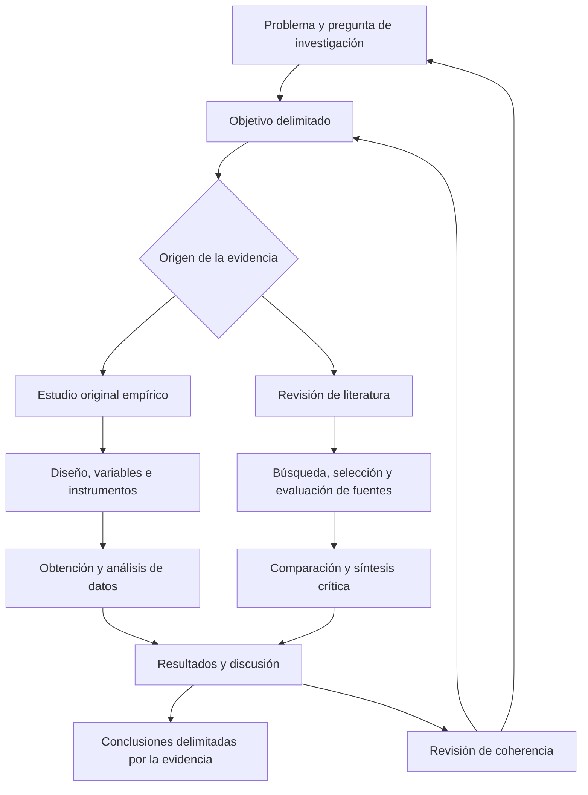

# Clase 3: Argumentación científica, metodología y evaluación crítica de artículos originales y de revisión

> **Objetivo académico:** Comprender cómo se articulan el problema, los objetivos, la fundamentación teórica, los métodos y la discusión en artículos originales y de revisión, y aplicar criterios de trazabilidad argumentativa, reproducibilidad y coherencia para evaluar su calidad científica.

## 1. Contexto y marco conceptual

La sesión aborda la escritura científica mediante la revisión dialogada de manuscritos y problemas metodológicos. Su idea central es que redactar un artículo supone construir una argumentación verificable: el lector debe comprender qué se afirma, de dónde procede su sustento, cómo se obtuvo la evidencia y hasta dónde permite llegar la conclusión.

Se distinguen dos modalidades de producción:

- **Artículo original:** comunica una contribución propia. En los casos tratados, esa contribución procede de un estudio empírico cuyos datos, procedimientos y resultados deben describirse con claridad.
- **Artículo de revisión:** organiza, interpreta y evalúa críticamente conocimiento existente. Su contribución puede consistir en integrar explicaciones, esclarecer controversias, comparar resultados, reconstruir la evolución de un concepto o identificar limitaciones de la literatura.

**Enriquecimiento conceptual:** Ambos son artículos científicos. El término inglés *paper* es genérico y también puede designar una revisión; *review article* especifica esa modalidad, mientras que *journal* designa una revista. Además, un artículo original puede aportar resultados teóricos o metodológicos sin ajustarse necesariamente a un estudio empírico convencional.

La estructura IMRyD —introducción, métodos, resultados y discusión— funciona como referencia organizativa, pero no constituye un formato universal. La sesión reconoce variantes que reúnen resultados y discusión, distribuyen la teoría en subsecciones o utilizan introducción, desarrollo y conclusiones. La elección depende del tipo de contribución, la disciplina y las instrucciones de la revista.

### 1.1. Revista, audiencia e idioma

La revista delimita destinatarios, alcance temático, idioma, extensión, estructura y sistema de referencias. Por ello, la selección editorial permite orientar la escritura desde etapas tempranas. Revisar artículos publicados ayuda a identificar convenciones reales, aunque las instrucciones vigentes para autores tienen prioridad sobre la imitación de ejemplos aislados.

La publicación en inglés puede ampliar la circulación en comunidades donde ese idioma predomina, pero exige precisión terminológica y claridad lingüística. La sesión también menciona resúmenes en varios idiomas como práctica de algunas revistas latinoamericanas.

**Enriquecimiento conceptual:** El idioma no determina por sí solo la calidad, el impacto ni la probabilidad de aceptación. El rechazo puede responder a desajuste temático, exigencias de novedad, problemas metodológicos o prioridades editoriales. Tampoco equivale automáticamente a que el trabajo carezca de valor para otra revista.

## 2. Fundamentos teóricos y arquitectura

### 2.1. La metodología como fundamento de evaluabilidad

La metodología explica cómo se construyó la evidencia que sostiene los resultados. Su exposición debe permitir evaluar la pertinencia de las decisiones, detectar vacíos y comprender las condiciones bajo las cuales sería posible repetir o contrastar el estudio.

La sesión insiste en seleccionar los procedimientos **esenciales**: aquellos cuya omisión impediría entender o reproducir la investigación. Esto exige equilibrio entre brevedad y suficiencia. Una descripción demasiado general oculta decisiones relevantes; una narración indiscriminada de actividades personales dificulta reconocer el procedimiento científico.

**Enriquecimiento conceptual:** Una metodología explícita contribuye a evaluar la validez, pero no la garantiza. Un procedimiento puede estar descrito con precisión y, aun así, utilizar medidas inadecuadas, introducir sesgos o sostener inferencias injustificadas. La calidad de los métodos debe analizarse además de su claridad expositiva.

| Dimensión | Pregunta central | Implicación para el manuscrito |
| --- | --- | --- |
| Validez | ¿La evidencia y el diseño sostienen la interpretación propuesta? | Justificar medidas, decisiones e inferencias. |
| Confiabilidad | ¿La medición mantiene una consistencia adecuada en condiciones pertinentes? | Informar cómo se evaluó esa consistencia cuando corresponda. |
| Reproducibilidad y repetición | ¿Qué información necesita otra persona para repetir el análisis o contrastar el procedimiento? | Especificar datos, instrumentos, pasos y condiciones relevantes. |
| Coherencia interna | ¿Problema, objetivos, variables, métodos y conclusiones se corresponden? | Evitar componentes desconectados y conclusiones que excedan la evidencia. |

**Enriquecimiento conceptual:** La terminología de reproducibilidad y replicación varía entre disciplinas. Conviene declarar el sentido utilizado. Repetir un estudio empírico no obliga a obtener valores idénticos: pueden intervenir variabilidad muestral, incertidumbre de medición y diferencias de contexto.

Se mencionan la revisión por personas expertas y el alfa de Cronbach como posibles recursos para analizar instrumentos, sin desarrollar su aplicación.

**Enriquecimiento conceptual:** La revisión experta puede aportar evidencia sobre la pertinencia del contenido. El alfa de Cronbach se relaciona con la consistencia interna de puntuaciones bajo determinados supuestos; no demuestra por sí solo validez ni estabilidad temporal. No se incorpora una fórmula ni un cálculo porque la sesión no desarrolla esos supuestos ni proporciona datos.

### 2.2. Arquitecturas diferenciadas según el origen de la evidencia

| Componente | Artículo original empírico | Artículo de revisión |
| --- | --- | --- |
| Introducción | Sitúa el problema, presenta antecedentes pertinentes y justifica el objetivo. | Delimita tema, contexto, necesidad de síntesis y objetivo o pregunta. |
| Métodos | Explica diseño, variables, datos, instrumentos, procedimientos y análisis. | Explica localización, selección, evaluación y síntesis de las fuentes. |
| Resultados | Presenta hallazgos obtenidos del estudio. | Presenta patrones, comparaciones, categorías o síntesis de la literatura. |
| Discusión | Interpreta hallazgos y los contrasta con conocimiento previo. | Evalúa convergencias, controversias, límites y alcance de la evidencia reunida. |

La sesión propone una introducción generalmente más breve para las revisiones, porque el tratamiento extenso de los estudios previos constituye su desarrollo principal.

**Enriquecimiento conceptual:** Esta diferencia de énfasis no establece una prohibición de citar antecedentes en la introducción de una revisión. Allí pueden ser necesarios para delimitar el problema y justificar la síntesis. La extensión y la ubicación de ese contenido dependen del tipo de revisión y de la revista; citar una fuente tampoco convierte automáticamente un pasaje en una sección de antecedentes.

### 2.3. Investigación iterativa y coherencia retrospectiva

La investigación se presenta como un proceso de ida y vuelta. La lectura puede precisar el problema, modificar el vocabulario del objetivo o revelar alternativas metodológicas. La introducción puede redactarse inicialmente para orientar el trabajo y revisarse después; no existe un único orden obligatorio de escritura.

La iteración exige propagar los cambios. Si una propuesta incorpora una variable nueva, debe verificarse su fundamento teórico, su relación con el problema, su operacionalización y la evidencia disponible. Añadir componentes porque están en boga, sin reconstruir esas conexiones, produce contradicciones internas.

**Enriquecimiento conceptual:** La actualización tampoco justifica modificar retrospectivamente las preguntas para presentar hallazgos imprevistos como si hubieran sido anticipados. Cuando sea pertinente, deben distinguirse decisiones previstas y análisis surgidos durante el proceso.

## 3. Implementación técnica y lógica de negocio

La fuente no contiene código ejecutable ni un protocolo completo. Su implementación técnica corresponde a la organización de la evidencia y a la explicitación de procedimientos de investigación.

### 3.1. Localización, selección y evaluación de literatura

La metodología de una revisión debe responder cuatro preguntas:

1. **¿Dónde se buscó?** Identificar bases de datos, revistas u otras fuentes utilizadas. En la sesión se menciona Scopus y una plataforma cuyo nombre no se reconoce con certeza.
2. **¿Cómo se buscó?** Explicar descriptores, palabras clave, filtros y decisiones de búsqueda relevantes.
3. **¿Qué se seleccionó y por qué?** Formular criterios de inclusión y exclusión vinculados con el contenido y el objetivo.
4. **¿Cómo se analizó la evidencia?** Describir categorías, comparaciones y criterios de evaluación crítica.

Indicar que se incluyeron publicaciones revisadas por pares es insuficiente para delimitar pertinencia. También debe precisarse qué problemas, características, enfoques o resultados tenían que abordar. La selección debe ser comprensible para alguien que no participó en ella.

**Enriquecimiento conceptual:** En revisiones sistemáticas, las fechas de búsqueda, las estrategias por base, las restricciones y las decisiones de selección son especialmente relevantes. El carácter dinámico de una plataforma refuerza la necesidad de registrar cuándo se consultó. Una secuencia ordenada de búsqueda no basta por sí sola para denominar sistemática a una revisión.

La sesión considera reconocimiento de autores, precisión, coherencia, consistencia y aplicabilidad como posibles criterios de evaluación.

**Enriquecimiento conceptual:** La reputación puede orientar una búsqueda, pero no sustituye el análisis del diseño, los datos y los argumentos. Seleccionar únicamente autores reconocidos puede excluir contribuciones pertinentes. La evaluación debe ajustarse al tipo de evidencia y examinar sus limitaciones.

### 3.2. Mapas conceptuales y matrices de literatura

Se describen dos instrumentos de organización:

- **Mapa conceptual:** representa conceptos, categorías y relaciones para orientar búsquedas y ordenar el campo.
- **Matriz de literatura:** permite comparar autores, ideas, resultados y otros atributos de los documentos.

Estos instrumentos apoyan la identificación de tendencias, discrepancias y posibles dimensiones para operacionalizar variables. No tienen que publicarse íntegramente; su uso metodológico sí debe explicarse cuando sustenta la selección o la síntesis.

**Enriquecimiento conceptual:** Una matriz puede incorporar los siguientes campos, como propuesta organizativa derivada de la sesión y no como registro efectivamente utilizado:

| Campo | Función analítica |
| --- | --- |
| Fuente y contexto | Identificar procedencia y condiciones del estudio. |
| Problema y objetivo | Determinar pertinencia para la revisión. |
| Conceptos y variables | Comparar definiciones y medidas. |
| Diseño y evidencia | Evaluar qué afirmaciones permite sostener. |
| Hallazgos y limitaciones | Evitar separar resultados de sus restricciones. |
| Relación con otras fuentes | Registrar acuerdos, tensiones y complementariedades. |

### 3.3. Fundamentación y trazabilidad de las afirmaciones

Una referencia debe permitir reconocer qué contenido respalda. La discusión distingue entre mencionar autores y mostrar cómo sus planteamientos conducen a una interpretación propia.

**Enriquecimiento conceptual:** Para resolver las ambigüedades del diálogo, conviene diferenciar:

- **Cita textual:** reproduce palabras de una fuente; exige identificación y tratamiento formal de la reproducción.
- **Paráfrasis:** reformula una idea ajena conservando su significado; también requiere atribución.
- **Síntesis de fuentes:** integra aportaciones de varios documentos y debe hacer reconocible qué relación se establece entre ellas.
- **Inferencia propia:** propone una conclusión a partir del análisis; debe explicitar sus premisas y distinguirse de lo afirmado por las fuentes.

Cambiar palabras aisladas no transforma una reproducción cercana en una elaboración independiente. Tampoco basta añadir varias referencias a una afirmación para demostrar que todas la sostienen.

**Enriquecimiento conceptual — ejemplo trabajado:** Ante la afirmación «la integración de inteligencia artificial y metaprogramación asegura escalabilidad», el primer paso es determinar si las fuentes estudian realmente escalabilidad o solo integración. Después se explican sus aportaciones y condiciones. Si ninguna demuestra la garantía propuesta, corresponde formular una posibilidad condicionada o una hipótesis, y señalar que su evaluación requiere evidencia propia. El ejemplo ilustra la lógica argumentativa; no informa un resultado del caso presentado.

### 3.4. Convenciones de redacción y presentación

El resumen se concibe como un texto autónomo que sintetiza el artículo, en lugar de ensamblar fragmentos copiados. La sesión menciona unas 250 palabras como orientación y discute resúmenes estructurados y corridos. Ambos pueden ser válidos según la revista; transformar uno en otro exige reconstruir conexiones sintácticas.

Para el título se favorecen precisión y concisión. La recomendación de alrededor de doce palabras funciona como orientación, no como regla universal. Reducir longitud no debe eliminar información indispensable sobre el objeto o la contribución.

Los epígrafes deben corresponder a cambios temáticos sustantivos. Multiplicar títulos para fragmentos mínimos debilita la continuidad; una breve oración introductoria puede orientar al lector al iniciar una sección.

Se comparan referencias autor-fecha, como APA, con sistemas numéricos. No se establece cuál debe aplicarse a todos los campos: debe respetarse la norma editorial y su edición correspondiente.

**Enriquecimiento conceptual:** En APA, una cita textual de menos de 40 palabras se integra entre comillas; las de 40 palabras o más se presentan en bloque. Debe proporcionarse un localizador adecuado. Las reglas para abreviar autores de una obra son distintas de las que organizan varias obras en una misma cita; no conviene resolver ambas situaciones con una única regla improvisada.

Las siglas y abreviaturas deben utilizarse con moderación y definirse cuando corresponda. La sesión desaconseja su uso en títulos.

**Enriquecimiento conceptual:** Algunas revistas admiten siglas ampliamente reconocidas. El criterio es preservar la comprensión y cumplir las instrucciones editoriales, sin convertir una preferencia general en prohibición absoluta.

## 4. Análisis crítico de casos y auditoría práctica

### 4.1. Inteligencia artificial y metaprogramación aplicadas a hojas de quinua

El caso expuesto combina análisis de imágenes foliares, inteligencia artificial y metaprogramación. Se mencionan obtención de fotografías, introducción de un patógeno en un cultivo, necesidad de etiquetas proporcionadas por una especialista y disponibilidad incompleta de datos. No se presentan métricas ni resultados verificables.

Las preguntas metodológicas pertinentes son: qué se mide, cómo se definen las variables, cómo se generan las imágenes, quién establece las etiquetas y qué procedimiento permite conectar los datos con las conclusiones.

**Enriquecimiento conceptual:** En este contexto conviene documentar condiciones de captura, unidad de análisis, criterio de etiquetado y tratamiento de incertidumbres. Si se construyen modelos predictivos, también debe justificarse cómo se separan los datos utilizados para desarrollar el modelo y evaluar su desempeño. Son precisiones añadidas; la conversación no acredita que esas decisiones se hayan aplicado.

El intercambio sobre figuras muestra una tensión entre economía de espacio y necesidad de explicar procedimientos. Una fotografía puede constituir evidencia metodológica o un dato relevante; una tabla o gráfica también puede ser redundante. El criterio común es su función en la argumentación.

**Enriquecimiento conceptual:** No existe un número universal de repeticiones experimentales ni un límite general de treinta. La cantidad pertinente depende del diseño, la variabilidad y la precisión buscada. Asimismo, no puede fijarse la posición del título de una figura sin conocer el estilo editorial aplicable.

Se recomienda evitar afirmaciones absolutas de prioridad, como declarar que un estudio es el primero sobre un tema, cuando no se puede demostrar una cobertura suficiente de la literatura. Es preferible explicar la novedad concreta y delimitar su alcance.

### 4.2. Revisión de herramientas de escaneo en seguridad de la información

El segundo caso trata herramientas de escaneo vinculadas con auditoría de sistemas y gestión de riesgos. La discusión rescata la delimitación progresiva del tema, los criterios de búsqueda, la selección de documentos y la agrupación por categorías.

El problema analítico consiste en superar el catálogo de herramientas. Una revisión aporta valor cuando compara sus características y resultados con criterios explícitos, explica diferencias y reconoce límites de aplicación.

**Enriquecimiento conceptual:** Una comparación útil podría considerar finalidad, entorno de uso, evidencia de evaluación y restricciones operativas. Esas dimensiones son propuestas de análisis; la fuente no proporciona un conjunto de herramientas ni evidencia suficiente para clasificarlas o recomendar alguna.

### 4.3. Comparación de modelos de lenguaje e integración con una tesis

Se plantea comparar modelos de lenguaje para su aplicación en la fase de implementación del ciclo de desarrollo de software. El caso permite distinguir una comparación de evidencia publicada de una evaluación propia.

**Enriquecimiento conceptual:** Si la contribución consiste en sintetizar estudios existentes, corresponde a una revisión. Si incorpora una evaluación propia con procedimientos y datos nuevos, puede sostener un artículo original. La denominación depende de la contribución efectivamente realizada.

Un artículo puede preceder a una tesis o derivarse de ella. Una revisión puede alimentar su marco teórico; un artículo empírico puede aportar datos, variables, indicadores o procedimientos. Sin embargo, datos obtenidos en otro momento pueden perder pertinencia contextual, aunque parte del método siga siendo útil.

### 4.4. Objetivos, discusión y revisión por pares

Un error señalado consiste en trasladar al artículo el objetivo general de una tesis cuando el manuscrito solo comunica una parte de ella. Si el artículo caracteriza una situación, no debe prometer una propuesta que no presenta ni evalúa.

Otro problema es presentar resultados sin contrastarlos con otras investigaciones. La discusión debe explicar coincidencias, discrepancias y posibles razones, evitando limitarse a repetir hallazgos.

**Enriquecimiento conceptual:** Las diferencias entre estudios pueden depender del diseño, las medidas o el contexto; no toda discrepancia constituye una contradicción teórica. La comparación necesita comprobar que los resultados sean suficientemente comparables.

La publicación y la autocita también se discuten como formas de incorporar trabajos previos propios.

**Enriquecimiento conceptual:** La revisión por pares aporta escrutinio especializado, pero la publicación no certifica la verdad de todas las afirmaciones ni sustituye automáticamente la validación de una tesis. La autocita es pertinente cuando el trabajo previo contribuye al argumento y se identifica con transparencia; no exime de considerar nueva evidencia.

## 5. Principios de diseño, buenas prácticas y anti-patrones

| Principio | Buena práctica | Anti-patrón |
| --- | --- | --- |
| Correspondencia entre objetivo y evidencia | Formular lo que el manuscrito efectivamente permite responder. | Copiar objetivos más amplios que el contenido comunicado. |
| Trazabilidad argumentativa | Mostrar cómo las fuentes y el análisis sostienen cada inferencia relevante. | Añadir referencias sin explicar qué respaldan. |
| Síntesis crítica | Comparar conceptos, diseños, resultados y límites. | Encadenar resúmenes sin integración. |
| Selección pertinente | Definir criterios temáticos y de calidad acordes con la pregunta. | Elegir únicamente por notoriedad del autor. |
| Coherencia iterativa | Revisar los efectos de cada cambio sobre el conjunto del manuscrito. | Incorporar variables nuevas sin fundamento ni medición. |
| Economía expresiva | Conservar información indispensable en texto y figuras. | Usar imágenes decorativas o títulos vacíos. |
| Prudencia epistemológica | Delimitar novedad y conclusiones. | Formular garantías o prioridades universales sin evidencia. |

La actualización bibliográfica debe combinar actualidad y pertinencia. La sesión propone prestar atención a literatura reciente y conservar clásicos cuando sean necesarios. También destaca el análisis histórico-lógico: seguir cómo una idea se formula, se cuestiona y se transforma permite comprender su evolución.

**Enriquecimiento conceptual:** Un intervalo de cinco o seis años no constituye un criterio universal de calidad. La vigencia depende del campo y de la función de la referencia. La selección debe evitar tanto la desactualización como la exclusión mecánica de aportaciones fundacionales.

La fundamentación tampoco se reduce a citar cada oración. Debe distinguirse entre atribuir ideas ajenas, respaldar afirmaciones que requieren evidencia y desarrollar conexiones analíticas propias.

**Enriquecimiento conceptual:** Los porcentajes de similitud textual no miden directamente plagio ni originalidad. Una paráfrasis correctamente atribuida puede tener escasa coincidencia textual; una coincidencia puede corresponder a una cita identificada. La evaluación exige revisar los pasajes y su atribución, sin imponer porcentajes ideales de texto citado.

### 5.1. Herramientas de escritura y automatización

LaTeX se presenta como una herramienta útil para composición científica, especialmente en documentos con fórmulas y estructuras formales. Se asocia la automatización con precisión operativa y ahorro de tiempo, sin desarrollar una demostración técnica.

**Enriquecimiento conceptual:** LaTeX no es obligatorio ni garantiza calidad científica. La elección frente a un procesador de texto depende de plantillas editoriales, colaboración, complejidad del documento y experiencia del equipo. Si una herramienta de inteligencia artificial transcribe una fórmula desde una imagen, deben verificarse símbolos, índices, relaciones y significado antes de incorporarla. Automatizar la composición no sustituye la revisión del contenido.

## 6. Síntesis conceptual y profundización académica

La calidad científica del manuscrito depende de una cadena coherente: problema delimitado, objetivo pertinente, fundamento suficiente, método justificable, resultados trazables y conclusiones proporcionadas a la evidencia. La estructura editorial ayuda a exponer esa cadena, pero no puede suplirla.

En un artículo original empírico, la transparencia se concentra en cómo se producen y analizan los datos. En una revisión, se concentra en cómo se localiza, selecciona, evalúa y sintetiza la literatura. Ambas modalidades requieren argumentación y contraste crítico.

El marco teórico constituye una construcción analítica del autor sustentada en conocimiento previo. Su aporte puede estar en esclarecer relaciones, identificar supuestos incompatibles, explicar desacuerdos o proponer categorías justificadas. La crítica comprende reconocer fortalezas, vigencia y límites; no se restringe a señalar defectos.

La sesión también muestra que la escritura funciona como instrumento de pensamiento: un borrador hace visibles ambigüedades que pueden corregirse mediante lectura y discusión. La introducción orienta provisionalmente y se ajusta conforme madura la investigación, manteniendo la correspondencia entre lo prometido y lo efectivamente realizado.

**Enriquecimiento conceptual:** Las revisiones y los estudios originales cumplen funciones complementarias; su rigor e impacto no se ordenan automáticamente por modalidad. Una síntesis rigurosa puede modificar la comprensión de un campo, mientras que un estudio original requiere evidencia sólida para sostener su aporte. La profundización pertinente comprende la evaluación de calidad de las fuentes, los criterios de comparabilidad, la validez de instrumentos y la distinción entre contribución conceptual, metodológica y empírica.
