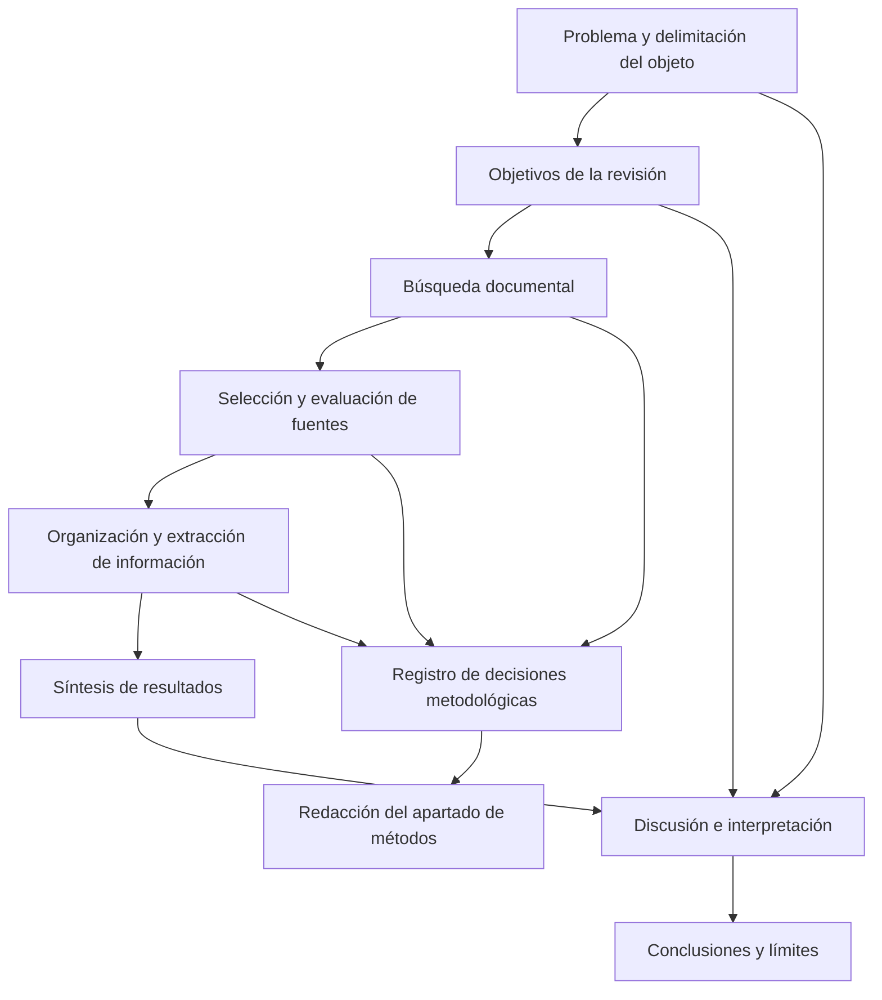

# Clase 4: Artículo de revisión: diseño metodológico, síntesis crítica y redacción científica

> **Objetivo académico:** Comprender la lógica de producción de un artículo de revisión, articular sus componentes metodológicos y argumentativos, y evaluar la coherencia entre problema, búsqueda documental, síntesis, discusión y conclusiones.

## 1. Contexto y marco conceptual

### La revisión como investigación y como comunicación científica

La sesión desarrolla el artículo de revisión como una investigación documental que localiza, selecciona, organiza y analiza conocimiento previamente publicado. Su valor no reside en acumular referencias, sino en convertir información dispersa en una síntesis inteligible, argumentada y pertinente para un problema delimitado.

El artículo científico comunica una investigación; por ello, su calidad depende de dos competencias relacionadas: investigar y redactar. Una investigación débil no se corrige únicamente mediante una escritura elegante, y una investigación sólida puede perder claridad si sus resultados se comunican sin organización ni precisión.

La clase propone comprender cualquier producción científica desde sus componentes esenciales y las relaciones que los articulan. Aplicado a un artículo, esto exige reconocer qué función desempeña cada sección y cómo contribuye al propósito general. La lectura analítica identifica esas funciones, las transiciones argumentativas y las decisiones de presentación, además del contenido temático.

### Artículo original y artículo de revisión

| Dimensión | Artículo original | Artículo de revisión |
| --- | --- | --- |
| Base del trabajo | Produce o analiza evidencia para responder una pregunta de investigación | Examina un corpus de publicaciones u otros documentos pertinentes |
| Operaciones destacadas | Obtención y análisis de datos, contrastación de hipótesis o caracterización de fenómenos | Localización, selección, comparación, integración y evaluación crítica de conocimiento |
| Contribución | Hallazgos derivados del estudio realizado | Síntesis, clarificación conceptual, identificación de tendencias, contradicciones y vacíos |
| Métodos que deben explicarse | Procedimientos efectivamente empleados para generar y analizar evidencia | Procedimientos de búsqueda, selección, evaluación y síntesis documental |
| Resultados y discusión | Pueden presentarse separados o integrados | Su integración es frecuente en revisiones teóricas, pero depende del diseño y de la revista |

El docente destaca que una revisión también debe aportar conocimiento: una definición mejor delimitada, una comparación entre teorías, una clasificación, una toma de posición argumentada o una explicación que facilite comprender un campo. Repetir sucesivamente lo dicho por otros autores no constituye por sí solo una contribución suficiente.

**Enriquecimiento conceptual:** La diferencia entre ambos tipos de artículo no equivale a una oposición entre originalidad y ausencia de originalidad. Una revisión puede producir interpretaciones y resultados de síntesis nuevos. Tampoco todo artículo original obtiene datos directamente mediante observación o experimentación: puede trabajar con datos existentes, desarrollos teóricos o métodos computacionales. La distinción debe atender al diseño y a la pregunta del estudio.

### Autonomía, pensamiento crítico y contrastación

La conversación inicial conecta la formación investigadora con el aprendizaje autónomo, la creatividad y la capacidad de contrastar información. Frente a la abundancia de contenidos y herramientas de inteligencia artificial, se subraya la necesidad de verificar afirmaciones mediante fuentes científicas y conocimiento disciplinar.

En el aula invertida, la preparación autónoma no elimina la función docente. La desplaza hacia la selección de materiales, la organización del debate, la retroalimentación y la gestión de la participación. Este papel requiere dominio del contenido y habilidades didácticas y comunicativas. El uso de aplicaciones, por sí mismo, no garantiza un uso pedagógico de la tecnología.

La relación con la escritura científica es directa: comprender un texto exige intervenir intelectualmente sobre él, identificar sus argumentos y reconocer sus límites, en lugar de recibirlo como una autoridad incuestionable.

## 2. Fundamentos teóricos y arquitectura

### Secuencia general de producción

La sesión organiza la elaboración de una revisión en cuatro momentos: definición del objetivo, búsqueda bibliográfica, organización de la información y redacción. Estos momentos se relacionan con el diseño de la investigación, su fundamentación, los métodos y los resultados.

El diagrama representa una dependencia argumentativa: las conclusiones deben poder rastrearse hasta los resultados y estos hasta un corpus seleccionado mediante procedimientos explícitos. Los objetivos orientan tanto la búsqueda como la interpretación.

### Problema, objeto, contexto y objetivo

El **tema** expresa el ámbito general de la investigación. El **objeto de estudio** delimita la realidad, proceso o conjunto de relaciones sobre el que se concentra el análisis. El **problema** expresa aquello que requiere explicación o resolución, y el **objetivo** precisa el conocimiento o resultado que se pretende alcanzar.

El docente caracteriza el problema como una manifestación del comportamiento del objeto que no coincide con un estado considerado deseable. Esta formulación vincula estrechamente problema, objeto y transformación propuesta.

**Enriquecimiento conceptual:** Esa caracterización resulta pertinente para investigaciones orientadas a intervenir sobre una situación, pero no agota los problemas científicos. Una contradicción entre explicaciones, una incertidumbre conceptual o una regularidad todavía no comprendida también pueden constituir problemas, aunque no describan un funcionamiento negativo. El problema pertenece al análisis del objeto, pero no se identifica sin más con la totalidad de este.

El **contexto** comprende condiciones que rodean al objeto e influyen en la aparición del problema o en su interpretación. Puede incluir dimensiones institucionales, culturales, tecnológicas y materiales; no equivale únicamente a una ubicación geográfica.

### Campo de acción y pluralidad metodológica

La sesión distingue dos maneras de utilizar el término **campo de acción**: como una delimitación del contenido del objeto y como la parte del objeto que se pretende transformar mediante una propuesta. El docente presenta esta distinción desde su interpretación metodológica y advierte que las tradiciones de investigación no siempre emplean las categorías de igual manera.

El punto operativo consiste en precisar qué se estudia y qué alcance tiene la intervención, sin confundir campo de acción con contexto o lugar de aplicación. En un artículo, esas delimitaciones pueden quedar expresadas mediante el tema, la pregunta y los objetivos, sin necesidad de incorporar todos los rótulos propios de una tesis.

**Enriquecimiento conceptual:** La exposición de las dos acepciones presenta solapamientos. Conviene conservar la advertencia sobre la diversidad terminológica sin convertirla en una clasificación universal de metodologías. Lo decisivo es definir cada categoría y mantener su significado a lo largo del trabajo.

### Arquitectura argumentativa del artículo

La estructura desarrollada comprende introducción, métodos, resultados, discusión, conclusiones y referencias. La revista puede agrupar o denominar esas funciones de otra manera, pero el manuscrito debe permitir reconocerlas.

| Componente | Pregunta que responde | Relación central |
| --- | --- | --- |
| Introducción | ¿Qué se estudia, por qué importa y qué se busca conocer? | Problema, contexto, justificación y objetivo |
| Métodos | ¿Cómo se construyó y analizó el corpus? | Objetivo y decisiones documentales |
| Resultados | ¿Qué mostró el análisis? | Evidencia extraída y síntesis |
| Discusión | ¿Qué significan los hallazgos? | Resultados, problema, contexto y otras explicaciones |
| Conclusiones | ¿Qué conocimiento principal queda establecido? | Objetivos, hallazgos y alcance |
| Referencias | ¿Qué obras sustentan las afirmaciones? | Citas y trazabilidad documental |

**Enriquecimiento conceptual:** La presencia o ausencia de encabezados específicos no determina por sí sola el rigor. Del mismo modo, cumplir una estructura convencional facilita la evaluación editorial, pero no garantiza la aceptación de un artículo.

## 3. Implementación técnica y lógica de negocio

La fuente no presenta código ni una ejecución experimental. La implementación corresponde a un procedimiento de investigación documental y de construcción del manuscrito.

### Introducción: delimitar y justificar

La secuencia sugerida es presentar el tema y su contexto, formular el problema, explicar su relevancia y cerrar con el objetivo. El docente la propone por su lógica comunicativa, sin considerarla una secuencia obligatoria para cualquier artículo.

El tema puede introducirse de manera fluida y vincularse con condiciones internacionales, regionales o locales cuando esas escalas ayuden a comprender el problema. La justificación debe mostrar la importancia teórica o práctica de la investigación. Puede integrarse en la argumentación, sin un subtítulo independiente.

El problema admite una formulación interrogativa o declarativa. El objetivo debe corresponder a esa pregunta y expresar el logro pretendido. En el ejemplo de pedagogía digital, la pregunta sobre qué se entiende por ese concepto conduce a un propósito de comprensión y caracterización de su tratamiento en la literatura.

La clase recomienda evitar una sucesión mecánica de etiquetas y cuidar las transiciones. También cuestiona la acumulación de citas que desplace la voz del autor.

**Enriquecimiento conceptual:** La introducción necesita las referencias suficientes para sostener el estado del conocimiento, el vacío y la relevancia de la pregunta. No existe una cantidad universal adecuada de citas. Su pertinencia se evalúa por la función que cumplen, no por una preferencia general por pocas referencias. Una contextualización breve de antecedentes puede ser necesaria en una revisión; debe evitarse duplicar la síntesis extensa que corresponde a sus resultados.

### Métodos: localización, estrategia y selección

La sesión establece tres componentes principales del apartado metodológico:

1. **Localización de documentos:** fuentes consultadas, bases de datos o colecciones, momento de la búsqueda y cantidad de registros recuperados.
2. **Estrategia de búsqueda:** descriptores, palabras clave, combinaciones, frases, familias de términos y filtros aplicados.
3. **Criterios de selección y calidad:** condiciones que debe cumplir un documento para integrar el corpus y aspectos considerados al evaluar su contenido.

Las palabras clave y los filtros deben guardar relación con el problema y los objetivos. Los criterios pueden atender al tema, periodo, idioma, tipo documental y pertinencia del contenido. La evaluación de las fuentes considera, entre otros aspectos discutidos, claridad de resultados, adecuación metodológica, actualidad y posibles sesgos.

Una estrategia es un sistema organizado de acciones dirigido a un objetivo. Su carácter estratégico incluye revisar términos cuando las búsquedas recuperan documentos que no corresponden al interés del estudio.

**Enriquecimiento conceptual:** Conviene distinguir los criterios de elegibilidad de la evaluación de calidad. Un estudio puede cumplir las condiciones temáticas y temporales de inclusión y, aun así, presentar limitaciones metodológicas. Tampoco la aplicabilidad inmediata de sus resultados debe exigirse a toda investigación, pues podría excluir injustificadamente estudios teóricos relevantes.

### Concisión y reproducibilidad

Un debate central contrapone la necesidad de resumir el procedimiento y la exigencia de explicar cómo se pasa de numerosos registros iniciales a un corpus reducido. En la discusión se menciona PRISMA como referencia para documentar el proceso de selección.

El docente propone identificar los pasos esenciales y evitar narrar cada intento accesorio de búsqueda. La preocupación planteada por los participantes es conservar suficiente detalle para que otra persona comprenda y pueda repetir el procedimiento.

**Enriquecimiento conceptual:** La concisión debe lograrse mediante una organización eficiente, no suprimiendo decisiones que cambian el corpus. En una revisión sistemática conviene conservar las consultas reproducibles, fuentes y fechas de búsqueda, restricciones, eliminación de duplicados, criterios de cribado y motivos de exclusión relevantes. Si el espacio editorial es limitado, los detalles pueden organizarse en tablas o materiales complementarios cuando la revista lo permita. PRISMA es una guía de reporte; su utilización no garantiza por sí sola la validez del diseño.

### Organizar antes de redactar

| Recurso | Función | Precaución |
| --- | --- | --- |
| Índice o guion | Anticipar apartados y secuencia argumentativa | Evitar categorías desconectadas del objetivo |
| Mapa conceptual o mental | Descomponer el objeto en dimensiones y relaciones | Revisar que la clasificación sea disciplinariamente correcta |
| Percha de análisis | Asociar obras concretas con cada dimensión temática | Registrar autor y obra, no solo nombres |
| Tabla de síntesis | Comparar documentos con campos comunes | Mantener criterios de extracción consistentes |
| Gestor bibliográfico | Organizar colecciones y administrar citas | Verificar metadatos y correspondencia con los textos |

La **percha de análisis**, según su uso en la clase, añade referencias a las ramas de una organización temática. Es una herramienta de trabajo que no necesariamente se incorpora como figura al artículo.

La tabla de síntesis propuesta incluye autor, objetivo de la obra, métodos, aporte y año de publicación. Su valor reside en permitir comparar contribuciones y examinar la correspondencia entre lo que cada estudio pretendía y lo que efectivamente sostiene.

También se presenta una técnica denominada **deslizar**, atribuida en la exposición a Maeda, con cuatro operaciones: ordenar documentos por características comunes, asignar nombres a los grupos, integrarlos según relaciones pertinentes y priorizar los contenidos. La fuente no ofrece una referencia bibliográfica completa de esta atribución.

Los criterios de organización incluyen avanzar de lo general a lo particular, contrastar escalas geográficas pertinentes, reconstruir la evolución histórica de los conceptos y derivar gradualmente dimensiones del objeto. Ningún criterio debe aplicarse si no ayuda a responder la pregunta.

Se mencionan Mendeley y Zotero como herramientas de apoyo. Las observaciones sobre límites de categorías corresponden a la experiencia relatada por un participante y no permiten afirmar restricciones vigentes de todas sus versiones.

### Redacción y tiempos verbales

La sesión destaca claridad, brevedad, precisión y tendencia a la exactitud. Redactar implica seleccionar ideas, organizarlas, entrelazarlas y convertirlas en un mensaje comprensible.

Como orientación general, los procedimientos realizados y los resultados obtenidos se narran en pasado; la discusión de conocimiento vigente y las conclusiones pueden formularse en presente. Un proyecto todavía no ejecutado puede describir acciones futuras.

**Enriquecimiento conceptual:** El tiempo verbal depende de la función de cada enunciado. Una misma sección puede combinar tiempos: describir en pasado lo observado y expresar en presente su interpretación actual. La uniformidad mecánica de toda una sección puede reducir la precisión.

## 4. Análisis crítico de casos y auditoría práctica

### Distinguir presentación e interpretación

La diferencia sintetizada en la clase es: los resultados **presentan** y la discusión **interpreta**. Los primeros exponen hallazgos de manera organizada; la segunda explica su significado respecto del problema y los objetivos, los compara con otras contribuciones y considera el contexto.

En una revisión, ambas funciones pueden aparecer integradas. Es posible presentar conceptos, definiciones y posiciones autorales y, a continuación, analizar sus coincidencias o contradicciones. También pueden utilizarse tablas comparativas, mapas y figuras para sintetizar relaciones. El uso de documentos como evidencia no excluye recursos gráficos ni análisis de datos extraídos.

La discusión debe hacer visible la posición argumentada del autor, señalar tendencias y reconocer limitaciones. Enumerar autores sin contrastar sus contribuciones mantiene el texto en un nivel descriptivo.

### Caso de medición manual e inteligencia artificial

Un participante describe una comparación entre apreciaciones manuales de una característica fitopatológica y una estimación mediante inteligencia artificial. El caso plantea cómo interpretar resultados que coincidan o discrepen con una investigación previa.

La sesión utiliza la coincidencia como evidencia de corroboración y subraya la importancia de explicar la metodología antes de comparar resultados.

**Enriquecimiento conceptual:** Un procedimiento automatizado no es necesariamente más objetivo por utilizar inteligencia artificial. Su desempeño depende de los datos, las etiquetas de referencia, el diseño de evaluación y los errores del modelo. La coincidencia entre estudios puede fortalecer la confianza, pero no demuestra automáticamente validez: ambos podrían compartir sesgos. Una discrepancia tampoco constituye una falta ética; requiere analizar diferencias de medición, muestra y contexto, y comunicarlas con transparencia. La concordancia no permite validar de manera general todo un método epistemológico.

### Búsquedas sin evidencia local

La ausencia de resultados sobre Bolivia o una localidad específica puede ser relevante para delimitar el alcance de una revisión y explicar la necesidad de investigación contextualizada. Sin embargo, la clase advierte que una afirmación de inexistencia exige especial cuidado.

**Enriquecimiento conceptual:** Es más preciso declarar que no se identificaron estudios locales en las fuentes, consultas y periodo examinados que afirmar que tales estudios no existen. La transferencia de resultados internacionales debe considerar las condiciones institucionales, tecnológicas o sociales que podrían modificar su pertinencia.

### Vacíos teóricos y límites temporales

Un vacío se establece mediante una búsqueda suficientemente informada y una comparación del conocimiento disponible. No debe confundirse la falta de conocimiento del investigador con una ausencia en la literatura.

La discusión señala que una contribución reciente podría modificar la afirmación de novedad. Por ello, conviene delimitar el periodo cubierto y expresar que el vacío se refiere al corpus revisado hasta una fecha determinada.

El problema científico se presenta como un límite del conocimiento: una cuestión todavía no explicada que motiva una contribución. La revisión puede ayudar a identificarla y a fundamentar una investigación posterior.

**Enriquecimiento conceptual:** Un vacío tampoco garantiza por sí mismo relevancia ni factibilidad. Debe analizarse si resolverlo produce conocimiento significativo y si existe un procedimiento viable para abordarlo. Del mismo modo, no toda contribución consiste en explicar una causa; también puede describir, comparar, predecir o clarificar conceptos.

### Auditoría del artículo sobre inteligencia artificial y gestión comercial

La sesión analiza una revisión sobre tendencias de inteligencia artificial en la gestión comercial. Se comentan criterios de selección vinculados con antigüedad, idioma, pertinencia, acceso y formato, así como una selección final de 44 documentos.

El intercambio permite identificar tres problemas de auditoría:

- **Correspondencia entre criterio y corpus:** si se declara una antigüedad máxima, la presencia de documentos anteriores requiere explicar si pertenecen al corpus o si cumplen otra función, como fundamentación conceptual.
- **Consistencia de los recuentos:** durante el diálogo aparecen estimaciones diferentes de actualidad bibliográfica. No se dispone aquí de la lista completa ni de la tabla proyectada para resolverlas.
- **Trazabilidad de las referencias:** se plantea que algunas obras listadas podrían no estar citadas. La observación requiere cotejar el texto completo y su lista de referencias; no basta con una impresión de lectura.

**Enriquecimiento conceptual:** El porcentaje de actualidad puede utilizarse como indicador descriptivo si se define su denominador:

$$
A = \frac{n_r}{N}\times 100
$$

Aquí $N$ es el número entero positivo de documentos del conjunto auditado, $n_r$ es el número de esos documentos publicados dentro de un intervalo temporal previamente definido, con $0\leq n_r\leq N$, y $A$ es el porcentaje de actualidad, entre $0$ y $100$. Debe indicarse si se evalúa el corpus incluido o la lista total de referencias, porque pueden ser conjuntos distintos.

Como ejemplo trabajado con las cifras discutidas, si un conjunto de 44 documentos tuviera exactamente cinco fuera del intervalo, quedarían 39 dentro de él:

$$
A = \frac{44-5}{44}\times 100 \approx 88.6\%
$$

Este cálculo es condicional y no certifica la composición del artículo. Muestra por qué una estimación próxima al 42 % y otra basada en cinco documentos antiguos no pueden tratarse como equivalentes sin revisar sus intervalos y denominadores. Ningún porcentaje universal determina por sí solo la calidad bibliográfica.

### Conclusiones, inferencias y recomendaciones

La clase distingue una conclusión de una descripción del procedimiento y de una sugerencia. La conclusión expresa un resultado sustantivo; la recomendación propone una acción o una línea de desarrollo apoyada en los resultados.

Se utiliza un caso hipotético de desempeño educativo para mostrar el paso desde varios indicios hacia una caracterización general. El punto metodológico es la inferencia: producir una afirmación sintética sin limitarse a repetir los datos.

**Enriquecimiento conceptual:** Una inferencia inductiva amplía el alcance de lo observado y conserva incertidumbre. Una deducción obtiene una consecuencia necesaria si las premisas son verdaderas y el razonamiento es válido. Por ejemplo: si todos los documentos incluidos deben satisfacer un criterio de idioma y un documento no lo satisface, ese documento no cumple la elegibilidad declarada. En cambio, observar una tendencia en el corpus y extenderla al campo completo requiere justificar su representatividad. Tampoco es válido atribuir una causa específica a varios indicios si el diseño no permite identificarla.

Las recomendaciones pueden señalar dimensiones no abordadas, enfoques complementarios o necesidades de profundización. Deben distinguirse del conocimiento que la investigación efectivamente estableció.

## 5. Principios de diseño, buenas prácticas y anti-patrones

### Coherencia y trazabilidad

El principio central es conservar una cadena reconocible entre problema, objetivo, procedimiento, resultados y conclusión. Cada afirmación importante debe tener un fundamento identificable.

La sesión extiende esta lógica a la tesis: los momentos de estudio teórico, diagnóstico, construcción de un modelo o elaboración de una propuesta deben relacionarse con objetivos y conclusiones. La propuesta se presenta como una concreción práctica del conocimiento desarrollado.

**Enriquecimiento conceptual:** Esta arquitectura corresponde a un tipo de investigación con propuesta y no a toda tesis doctoral. Tampoco existe necesariamente una correspondencia numérica fija entre capítulos, objetivos y conclusiones. La exigencia generalizable es que cada objetivo tenga una respuesta sustentada y que las conclusiones no excedan la evidencia. Un producto tecnológico puede materializar conocimiento científico, pero su desarrollo también puede incluir validación empírica y decisiones de diseño que no derivan de una única teoría.

### Calidad de fuentes y evaluación editorial

La clase recomienda priorizar fuentes científicas, actuales, confiables y pertinentes, y prestar atención a la indexación y al proceso de revisión. Al mismo tiempo, reconoce que existen artículos publicados con errores y que los incentivos económicos pueden afectar prácticas editoriales.

**Enriquecimiento conceptual:** Publicación, indexación, reputación del autor o cuartil de una revista son señales contextuales, pero no pruebas suficientes de la calidad de un estudio particular. El país de publicación y el cobro de una tarifa tampoco determinan por sí mismos su rigor. Deben analizarse los métodos, la evidencia, la transparencia y la adecuación de las conclusiones. Según el diseño de la revisión, libros, documentos técnicos o literatura no indexada pueden ser pertinentes si su inclusión está justificada y su calidad se evalúa explícitamente.

### Referencias y bibliografía

La sesión diferencia las referencias de las fuentes consultadas que no fueron citadas. Toda cita debe permitir identificar su obra correspondiente. El registro bibliográfico debe seguir de forma consistente la norma editorial aplicable.

**Enriquecimiento conceptual:** En una lista de referencias bajo APA, las entradas deben corresponder a obras citadas en el texto, considerando las excepciones previstas por la propia norma. Una bibliografía adicional de consulta solo procede si el tipo de documento o las instrucciones editoriales la admiten. Los gestores bibliográficos reducen trabajo mecánico, pero no sustituyen la revisión de autoría, títulos, fechas y demás metadatos.

### Anti-patrones y alternativas

| Anti-patrón | Consecuencia | Alternativa |
| --- | --- | --- |
| Encadenar resúmenes sin compararlos | Falta de síntesis y de contribución propia | Organizar convergencias, diferencias y relaciones |
| Declarar solo que se usaron palabras clave | Búsqueda insuficientemente documentada | Registrar consultas y decisiones relevantes |
| Confundir indexación con validez | Aceptación acrítica de resultados | Evaluar el estudio individual |
| Afirmar que no existe investigación | Generalización mayor que la búsqueda realizada | Delimitar fuentes, periodo y alcance de la ausencia |
| Presentar actividades como conclusiones | Se informa lo realizado, pero no lo aprendido | Expresar hallazgos y su significado |
| Omitir limitaciones | Sobreestimación del alcance | Explicar restricciones y posibles sesgos |
| Citar autores sin identificar sus obras | Pérdida de trazabilidad | Vincular cada atribución con una referencia |
| Copiar fórmulas expresivas sin comprenderlas | Texto rígido o desconectado | Adoptar la función argumentativa y redactar una formulación propia |

La lectura de buenos artículos contribuye a construir criterios de calidad, pero debe acompañarse de evaluación crítica. Aprender una estructura argumentativa no equivale a copiar su expresión literal.

## 6. Síntesis conceptual y profundización académica

Un artículo de revisión transforma un corpus documental en conocimiento organizado. Su contribución aparece cuando permite comprender mejor un problema, relacionar resultados dispersos, clarificar conceptos o establecer límites de lo que puede sostenerse con la evidencia disponible.

La distinción entre resultados, discusión y conclusiones es funcional: los resultados muestran lo identificado; la discusión interpreta su significado; las conclusiones condensan la respuesta principal a los objetivos. Pueden compartir espacio textual, pero no deben perder su identidad argumentativa.

El rigor metodológico y la calidad de la escritura son complementarios. La metodología hace auditable la construcción de la evidencia; la redacción permite comprenderla sin ambigüedades innecesarias. La brevedad debe preservar la información que permite evaluar las decisiones del estudio.

**Enriquecimiento conceptual:** La profundización puede orientarse hacia las diferencias entre revisiones narrativas y sistemáticas, la evaluación del riesgo de sesgo, la transferencia contextual de hallazgos y la distinción entre ausencia de evidencia y evidencia de ausencia. Estas líneas amplían los problemas planteados en la sesión sin suponer que se desarrollaron protocolos completos ni análisis ejecutados.

La aportación transversal de la clase es relacional: comprender la investigación supone explicar de dónde procede cada componente, qué función cumple y con qué otros componentes debe ser coherente.
