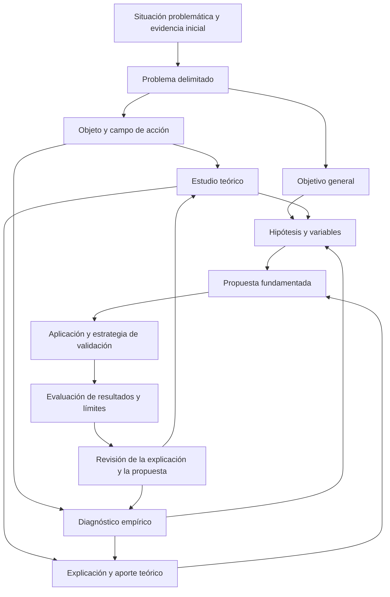

# Clase 7: Coherencia del diseño investigativo: problema, objeto, hipótesis, aportes y validación

> **Objetivo académico:** Comprender y evaluar la coherencia entre problema, objeto, campo de acción, objetivos, hipótesis y variables, y relacionar el aporte teórico con la significación práctica y las estrategias de validación de una investigación aplicada.

## 1. Contexto y marco conceptual

### La investigación como sistema de relaciones

La sesión desarrolla una idea central: los componentes de una investigación deben formar una estructura argumentativa coherente. El problema delimita aquello que se necesita comprender o transformar; el objeto identifica el proceso o realidad que debe investigarse; el campo precisa el foco de análisis; los objetivos expresan los resultados buscados; y la hipótesis anticipa una respuesta fundamentada que requiere contrastación.

La elección de métodos, técnicas, instrumentos, población y muestra depende de esas decisiones. Seleccionar una encuesta, una simulación o un procedimiento estadístico antes de precisar qué se busca conocer puede producir información abundante, pero poco pertinente.

El docente utiliza la expresión diseño teórico-metodológico para referirse al conjunto articulado de estos componentes. Durante el diálogo también aparece un uso más restringido de diseño metodológico, centrado en procedimientos de obtención y análisis de evidencia. Conviene explicitar ambas acepciones para evitar confundir diferencias terminológicas con desacuerdos sustantivos.

### Situación problemática, problema y propuesta

La **situación problemática** describe una condición de la realidad que motiva la investigación: dificultades observadas, resultados insuficientes, contradicciones o necesidades. El **problema de investigación** precisa la pregunta que orienta la producción de conocimiento. La **propuesta** es la respuesta o intervención que se construye y fundamenta durante el proceso.

En el enfoque aplicado discutido, el problema se formula en función de aquello que se pretende transformar, evitando incorporar anticipadamente la solución. Por ejemplo, preguntar cómo desarrollar determinadas competencias permite investigar las dificultades de su formación; incluir desde el inicio un modelo específico puede reducir prematuramente el espacio de soluciones.

**Enriquecimiento conceptual:** Una necesidad práctica y un vacío de conocimiento deben distinguirse. Que una institución presente dificultades no demuestra por sí mismo que la ciencia carezca de respuestas. La investigación debe establecer qué conocimiento falta: mecanismos insuficientemente comprendidos, límites de soluciones existentes, condiciones de transferencia o evidencia sobre una intervención en un contexto determinado.

### Función formativa de la investigación doctoral

La sesión destaca el desarrollo de la lógica investigativa: reconocer problemas reales, revisar antecedentes, construir explicaciones, obtener evidencia y justificar conclusiones. El valor científico depende de la autenticidad del problema y de los datos, además de la organización formal del documento.

Se defiende una formación plural, apoyada en varios autores y perspectivas. Comparar enfoques permite reconocer sus supuestos y elegir una posición con argumentos. La autoridad de un autor o la familiaridad con una estructura no sustituyen esa justificación.

## 2. Fundamentos teóricos y arquitectura

### Problema y delimitaciones

El problema se presenta como una discrepancia entre un estado observado y una condición esperada. Esa diferencia permite reconocer una dificultad, pero requiere evidencia para convertirse en un planteamiento investigativo sólido.

En el caso educativo analizado, se considera adecuada la pregunta: «¿Cómo desarrollar competencias en ingeniería de software en los estudiantes de la carrera de Sistemas de la Universidad Privada Domingo Sabio?» Su estructura identifica la transformación buscada, la población y la institución.

| Delimitación | Función | Aplicación al caso |
| --- | --- | --- |
| Temática | Precisa el fenómeno o proceso | Desarrollo de competencias en ingeniería de software |
| Poblacional | Identifica a quiénes se estudia | Estudiantes de la carrera de Sistemas |
| Espacial | Sitúa el contexto institucional o territorial | Universidad mencionada en el caso |
| Temporal | Establece el período pertinente | Se incorpora cuando el diseño lo requiere; no se especificó uno para este caso |

Las delimitaciones orientan el alcance de la evidencia y de las conclusiones. No es necesario concentrar todos los componentes del diseño en una sola pregunta: objeto, campo y objetivos tienen funciones propias.

**Enriquecimiento conceptual:** La delimitación temporal también puede ser necesaria en estudios prospectivos y transversales. Asimismo, la ausencia de una solución en la formulación del problema corresponde al enfoque discutido; existen preguntas evaluativas legítimas que nombran una intervención para estudiar sus efectos.

### Objeto de estudio: la realidad que requiere comprensión

El objeto es el proceso o realidad cuyo conocimiento resulta necesario para comprender el problema. En el caso educativo, el docente propone concentrarse en el proceso de desarrollo de competencias, o en el proceso de enseñanza y aprendizaje vinculado con su formación.

La distinción decisiva es entre **realidad por transformar** y **medio transformador**. Si el problema consiste en competencias insuficientemente desarrolladas, investigar únicamente prácticas ágiles omite preguntas sobre cómo se forman esas competencias, qué dificultades existen y bajo qué condiciones puede modificarse el proceso.

El objeto se aborda desde dos planos complementarios:

- **Estudio teórico:** conceptos, antecedentes, explicaciones, resultados y límites del conocimiento disponible.
- **Estudio empírico:** características del contexto, prácticas existentes, estado actual y evidencia de las dificultades.

El diagnóstico permite caracterizar la situación y explorar posibles factores relacionados con el problema. En la terminología utilizada en clase, ofrece un conocimiento fenoménico que necesita elaboración teórica para avanzar hacia una explicación.

**Enriquecimiento conceptual:** Describir regularidades o recoger percepciones sobre posibles causas no establece causalidad. La fuerza de una explicación causal depende del diseño, de las alternativas consideradas y de la evidencia disponible. Además, un artefacto, un algoritmo o una metodología también pueden constituir objetos legítimos de investigación cuando la pregunta se refiere a sus propiedades o comportamiento.

### Campo de acción: dos enfoques discutidos

La sesión presenta dos vías para delimitar el campo de acción. Ambas buscan precisar el objeto, aunque emplean criterios diferentes.

| Enfoque | Criterio de delimitación | Ejemplo educativo |
| --- | --- | --- |
| Precisión del objeto | Acotar un proceso general a un dominio particular | Objeto: desarrollo de competencias. Campo: desarrollo de competencias en ingeniería de software |
| Contenido por transformar | Identificar el aspecto del objeto vinculado con el objetivo y la propuesta | Objeto: enseñanza y aprendizaje. Campo: educación interdisciplinaria para la formación de competencias |

El segundo enfoque se vincula en la exposición con la metodología de Carlos Álvarez. El docente también cuestiona que el objeto de una investigación deba coincidir con el objeto amplio de toda una ciencia, porque podría resultar excesivo para una investigación concreta.

La discusión contiene formulaciones distintas: el campo aparece como parte o precisión del objeto y también como sus relaciones esenciales. La idea operativa común es que debe establecer un foco más preciso, manteniendo la relación con el problema. No corresponde pasar de un objeto acotado a un campo más amplio que lo desborde.

### Arquitectura del proceso

El diagrama expresa dependencias conceptuales y retroalimentación. La hipótesis puede formularse inicialmente y refinarse a medida que avanza el conocimiento del objeto.

## 3. Implementación técnica y lógica de negocio

### Objetivo general y alcance de la afirmación

En la investigación aplicada discutida, el objetivo general combina una acción principal, una propuesta con características pertinentes y la finalidad de transformación. Los verbos proponer, diseñar y elaborar expresan alcances que deben corresponderse con los resultados obtenidos.

El ejemplo educativo consiste en proponer un modelo interdisciplinario basado en prácticas de conocimiento ágil y proyectos socioformativos para favorecer competencias de desarrollo de software en una población delimitada.

La consistencia terminológica es esencial: incidir, desarrollar, mejorar y lograr no expresan exactamente lo mismo. Si el objetivo utiliza una noción y la hipótesis otra, debe aclararse su relación para evitar cambios inadvertidos de alcance.

**Enriquecimiento conceptual:** Un objetivo es una intención de investigación; una hipótesis es una proposición susceptible de contrastación. Aunque el logro de un objetivo sea incierto, ambas categorías cumplen funciones distintas. Diseñar una propuesta tampoco demuestra automáticamente su eficacia.

### Objetivos específicos y momentos investigativos

El docente propone organizar los objetivos específicos según los principales momentos del proceso:

1. Sistematizar los fundamentos teóricos del objeto.
2. Establecer los procedimientos metodológicos, cuando su desarrollo constituya un resultado diferenciado en la estructura adoptada.
3. Diagnosticar el estado actual de la realidad estudiada.
4. Precisar los componentes y relaciones de la propuesta.
5. Evaluar o validar la propuesta mediante una estrategia explícita.

Esta organización permite identificar qué conocimiento o resultado debe producirse en cada momento. Se recomienda separar la construcción de la propuesta de su validación, porque requieren evidencias y procedimientos diferentes.

**Enriquecimiento conceptual:** La correspondencia entre objetivos y capítulos puede orientar la escritura, pero no es una regla universal. Los objetivos deben expresar resultados sustantivos; la organización documental debe servir a esos resultados.

### Modelo como componentes y relaciones

La sesión define un modelo como una representación de una realidad que identifica componentes esenciales y relaciones entre ellos. Por ello, «precisar los componentes y relaciones estructurantes» ofrece mayor orientación que una formulación genérica sobre elaborar un modelo.

Toda propuesta debe incluir dos elementos operativos:

- **Metodología de aplicación:** condiciones, procedimientos y formas de utilización.
- **Proceso de evaluación:** indicadores que permitan analizar funcionamiento, resultados y necesidades de mejora.

La propuesta adquiere sentido cuando puede explicarse cómo utilizarla y cómo reconocer sus resultados. En software, la actualización continua se utiliza como ejemplo de revisión frente a problemas detectados y cambios del contexto.

### Hipótesis: propuesta, características y resultado esperado

La hipótesis se presenta como una conjetura científicamente fundamentada. Debe apoyarse en teoría y razonamiento, evitando relaciones triviales, arbitrarias o meramente declarativas.

Para el tipo de investigación trabajado, el docente recomienda incluir tres elementos:

| Elemento | Pregunta que responde |
| --- | --- |
| Propuesta | ¿Qué se plantea como posible solución? |
| Características esenciales | ¿Qué componentes o relaciones justifican su capacidad de contribuir? |
| Resultado esperado | ¿Qué transformación se espera observar? |

En el caso educativo, declarar únicamente que un modelo interdisciplinario incide en las competencias resulta demasiado general. La hipótesis debe explicar qué rasgos del modelo sostienen esa expectativa, como la articulación de prácticas ágiles y proyectos socioformativos. La fuente no proporciona una versión final validada de dicha hipótesis.

Otro ejemplo relaciona un modelo de inferencia de estilos de aprendizaje con preferencias explícitas, comportamiento en una plataforma e información contextual. Su función es ilustrar la estructura argumentativa de una hipótesis; no se presentan resultados que demuestren la eficacia de esa propuesta.

Se propone una redacción menos determinista, con expresiones como «puede contribuir», y se discute la idea a defender como una formulación más flexible dentro de ciertas tradiciones metodológicas.

**Enriquecimiento conceptual:** El lenguaje prudente necesita condiciones de contrastación. Debe aclararse qué resultado, en qué contexto y con qué evidencia respaldaría o debilitaría la proposición. Añadir características no elimina por sí mismo el determinismo. Tampoco toda hipótesis científica necesita relacionar dos variables: esa estructura corresponde a las hipótesis relacionales o causales aquí trabajadas. Si se emplea «significativamente», debe precisarse si se alude a relevancia práctica o a significación estadística.

### Variables y operacionalización

En el esquema de intervención discutido, la variable independiente corresponde a la propuesta o condición de intervención; la dependiente representa el resultado que se espera modificar. Para el caso educativo, el modelo constituye la intervención y el desarrollo de competencias el resultado de interés.

La operacionalización descompone un concepto complejo en aspectos observables. La secuencia expuesta puede organizarse así: variable, dimensiones, indicadores e ítems o registros del instrumento. Los indicadores orientan qué información recoger y evitan preguntas desvinculadas del objeto.

**Enriquecimiento conceptual:** La siguiente tabla ilustra una operacionalización posible del caso educativo; sus dimensiones e indicadores no fueron desarrollados como instrumento en la sesión.

| Nivel | Ejemplo ilustrativo |
| --- | --- |
| Variable | Competencia en desarrollo de software |
| Dimensión | Análisis de requisitos |
| Indicador | Capacidad de identificar requisitos verificables en un caso |
| Registro | Valoración de una especificación mediante criterios explícitos |

La selección depende de la definición de competencia y del propósito del estudio. Distintas operacionalizaciones pueden ser defendibles, siempre que se justifiquen.

El docente sostiene que una buena operacionalización contribuye a la validez del instrumento porque vincula sus preguntas con aquello que se necesita medir. Distingue esta contribución de una certificación automática de validez.

**Enriquecimiento conceptual:** La validez se refiere al respaldo de las interpretaciones y usos de los datos; la confiabilidad se relaciona con la consistencia de la medición. Una matriz coherente aporta evidencia inicial, pero no garantiza comprensión de los ítems, cobertura del constructo ni ausencia de sesgos. En estudios observacionales, una variable denominada independiente puede ser un predictor medido sin manipulación experimental.

### Apoyo de inteligencia artificial

La sesión admite el uso de IA para revisar ortografía, mejorar redacción y generar propuestas iniciales de operacionalización. La responsabilidad permanece en el investigador: contrastar las sugerencias con sus objetivos y conocimientos, corregir generalidades y preservar la terminología específica.

Un texto fluido puede contener categorías imprecisas o frases de relleno. La revisión científica exige comprobar qué aporta cada afirmación y si sus términos tienen un significado definido.

**Enriquecimiento conceptual:** Los rasgos de estilo no permiten establecer de manera fiable la autoría mediante IA. La evaluación debe centrarse en precisión, trazabilidad y sustento. Asimismo, un indicador fácilmente observable puede representar de forma insuficiente un constructo complejo; operacionalizar implica justificar esa relación, además de producir una tabla.

La fuente no desarrolla código, algoritmos ejecutables ni un procedimiento computacional reproducido. La implementación abordada es metodológica e instrumental.

## 4. Análisis crítico de casos y auditoría práctica

### Caso educativo: competencias y prácticas ágiles

La propuesta combina ingeniería de software y educación. El debate surge porque inicialmente se presenta como objeto aquello que se desea utilizar para transformar la realidad: conocimiento ágil y proyectos socioformativos. El docente desplaza la atención hacia el proceso de formación de competencias.

La lógica es que una propuesta educativa requiere comprender el proceso que pretende modificar: qué se entiende por competencia, cómo se desarrolla, qué prácticas existen y qué dificultades presenta el contexto. También debe estudiar las metodologías que utilizará, pero ese estudio no sustituye el conocimiento del problema.

La sesión admite distintas formas de organizar la fundamentación de la propuesta. El docente prefiere reservarla para su apartado específico, porque el diagnóstico podría modificar el tipo de solución inicialmente imaginado. Reconoce que otras estructuras incorporan esos fundamentos en el marco teórico.

**Enriquecimiento conceptual:** La organización puede variar mientras sea trazable la relación entre fundamentos, decisiones y evidencia. Además, demostrar que una práctica ágil funciona en desarrollo profesional de software no demuestra que mejore el aprendizaje. Esa transferencia necesita una explicación y una evaluación propias. La pertinencia disciplinar de una investigación interdisciplinaria depende del contenido efectivo de su contribución.

### Caso de auditoría: controles de tecnología de información

El diálogo final analiza una propuesta de modelo de auditoría de sistemas para evaluar controles de TI en pymes. Su aporte conceptual consiste en diferenciar el modelo propuesto de la realidad que se desea evaluar.

Se considera que el núcleo del objeto debe situarse en los controles de TI o en su proceso de control. Para el campo se discuten dos alternativas: delimitar el proceso en un contexto empresarial específico, o enfocar el proceso de auditoría desde el criterio vinculado con el objetivo. Las formulaciones son provisionales y requieren precisión disciplinar.

En la pregunta sobre cómo evaluar los controles se revisa el adjetivo «efectiva»: sin criterios explícitos, añade poca precisión. También se advierte que sustituir evaluar por mejorar puede ampliar el alcance del problema.

La evidencia preliminar cumple una función importante: pasar de una impresión sobre dificultades empresariales a datos que permitan sostener su existencia. Ese reconocimiento inicial no sustituye el diagnóstico completo.

Se cuestiona, además, una hipótesis de correlación entre el modelo propuesto y la mejora de la evaluación cuando todavía no existe una operacionalización del modelo ni observaciones que permitan analizar esa relación.

**Enriquecimiento conceptual:** Un modelo inicialmente inexistente puede construirse y después someterse a evaluación. Lo necesario es que exista una implementación o condición observable al recoger los datos. La correlación exige variación y medidas definidas; formularla verbalmente no demuestra un efecto causal.

### Selección de estrategias de validación

La discusión contrapone la revisión por expertos con pruebas empíricas y tecnológicas. El desacuerdo permite distinguir qué clase de afirmación respalda cada procedimiento.

| Estrategia | Evidencia que puede aportar | Límite principal |
| --- | --- | --- |
| Juicio de expertos | Coherencia, pertinencia, claridad y plausibilidad | No demuestra por sí solo eficacia en uso |
| Evaluación por usuarios | Comprensión, aceptación y experiencia de utilización | Las valoraciones no equivalen necesariamente a resultados objetivos |
| Prototipo o banco de pruebas | Comportamiento técnico bajo condiciones controladas | Su alcance depende del entorno y los escenarios |
| Simulación | Comportamiento bajo supuestos representados | Sus conclusiones dependen de la adecuación del modelo simulado |
| Aplicación práctica | Resultados en el contexto de uso | Requiere controlar explicaciones alternativas y condiciones de aplicación |

La revisión por expertos se describe mediante selección de participantes, preparación de una síntesis suficientemente detallada y construcción de un instrumento con criterios de valoración. La cantidad de expertos mencionada procede de la experiencia del docente; no se establece una regla general.

**Enriquecimiento conceptual:** El método Delphi no equivale a cualquier consulta a expertos: normalmente implica rondas sucesivas y retroalimentación controlada. El consenso informa sobre convergencia de juicio y no constituye una prueba automática de verdad. La selección debe justificar experiencia pertinente, independencia y posibles sesgos.

En el área tecnológica se mencionan pruebas de caja blanca, caja negra, integración, prototipos y simulaciones. La secuencia ilustrada va desde componentes aislados hacia sistemas integrados y condiciones de utilización, con retroalimentación para corregir problemas.

**Enriquecimiento conceptual:** Las pruebas de software pueden demostrar que una implementación satisface requisitos sin demostrar toda la contribución científica. La simulación permite estudiar escenarios, mientras que un prototipo y un banco de pruebas pueden ejecutar componentes reales. La estrategia debe corresponder a la afirmación: corrección, rendimiento, robustez, utilidad o efecto sobre un proceso.

La afirmación de que un modelo no puede simularse resulta demasiado amplia. Un modelo conceptual puede necesitar formalización para ser simulado; un modelo computacional sí puede ejecutarse. En educación, una simulación puede explorar mecanismos supuestos, pero no reemplaza la evidencia directa sobre aprendizaje real.

### Diagnóstico, comparación y resultados adversos

La sesión relaciona la evaluación posterior con el diagnóstico inicial: utilizar medidas comparables permite analizar cambios tras aplicar una propuesta.

**Enriquecimiento conceptual:** Si se utiliza una escala comparable, un cambio descriptivo puede expresarse como:

$$
\Delta Y = Y_{\mathrm{posterior}} - Y_{\mathrm{inicial}}
$$

Aquí, $Y_{\mathrm{inicial}}$ y $Y_{\mathrm{posterior}}$ son valores del mismo indicador antes y después de la intervención; $\Delta Y$ conserva su unidad. Su interpretación exige que la escala y el procedimiento de medición sean comparables. Si un valor mayor indica mejor desempeño, una diferencia positiva describe una mejora; si el indicador mide errores, la dirección favorable se invierte. La diferencia por sí sola no establece causalidad y no requiere que los resultados sean favorables.

El diagnóstico debe permitir confirmar, matizar o cuestionar la situación inicialmente supuesta. Buscar únicamente datos que demuestren que todo está mal introduce sesgo de confirmación.

Se menciona chi cuadrado como recurso estadístico, sin desarrollar su aplicación. Su pertinencia depende de las variables, los datos y la pregunta; no constituye un método universal para validar propuestas.

Finalmente, un resultado adverso requiere revisar la explicación, la implementación, la medición y las condiciones de aplicación. No demuestra automáticamente que toda la teoría sea falsa. Tampoco una simulación exitosa demuestra por sí sola eficacia en todos los contextos.

## 5. Principios de diseño, buenas prácticas y anti-patrones

### Coherencia y trazabilidad

Cada decisión debe poder vincularse con el problema: qué se estudia, por qué se recoge una información, qué resultado se espera y qué evidencia lo respalda.

| Buena práctica | Anti-patrón asociado |
| --- | --- |
| Mantener estable el significado del objetivo | Reformularlo con alcances distintos entre apartados |
| Comprender el proceso que se desea transformar | Justificar solamente la herramienta preferida |
| Delimitar objeto y campo con un criterio explícito | Mezclar enfoques o ampliar el campo respecto del objeto |
| Derivar indicadores de definiciones justificadas | Elaborar preguntas por intuición y vincularlas después |
| Separar diseño y evaluación de la propuesta | Considerar su construcción como demostración de eficacia |
| Elegir validación según la afirmación | Usar el mismo procedimiento para cualquier resultado |
| Conservar versiones del diseño | Eliminar formulaciones sin registrar su evolución |

### Antecedentes y originalidad

La revisión debe analizar qué resuelven los trabajos previos y qué límites mantienen respecto del problema. El vacío no se demuestra mediante un número fijo de antecedentes ni por la ausencia de coincidencia literal con un título.

La propuesta debe tener una fundamentación propia. La crítica al eclecticismo se dirige a reunir componentes de distintas fuentes sin explicar su compatibilidad o función.

**Enriquecimiento conceptual:** Combinar enfoques existentes puede producir una contribución original si la articulación está justificada y evaluada. La diferencia contextual tampoco basta por sí sola para demostrar novedad teórica. Es necesario precisar qué conocimiento nuevo surge y con qué alcance.

### Escritura científica y revisión

La introducción debe establecer situación problemática, problema, pertinencia y objetivo, en lugar de convertirse únicamente en una explicación extensa de la tecnología utilizada. La discusión debe relacionar resultados y antecedentes para hacer visible la contribución.

En una revisión de literatura, la metodología debe permitir comprender cómo se obtuvo el corpus analizado. La sesión menciona estrategias booleanas, filtros y el flujograma PRISMA, pero no desarrolla un protocolo completo.

**Enriquecimiento conceptual:** PRISMA orienta la transparencia del reporte de revisiones; su uso no garantiza automáticamente calidad metodológica ni reproducibilidad. Un flujograma debe acompañarse de decisiones de búsqueda y selección suficientemente explícitas.

La extensión del artículo debe ajustarse al medio de publicación sin omitir información necesaria para evaluar el estudio. La revisión metodológica y la revisión de especialistas del área son complementarias. Las observaciones deben valorarse mediante argumentos, porque los revisores pueden discrepar y tener competencias diferentes.

**Enriquecimiento conceptual:** La publicación y la revisión por pares aportan escrutinio externo, pero no sustituyen la evidencia ni garantizan la verdad de una conclusión.

### Adaptación disciplinar

La sesión propone adaptar los principios generales de investigación a las ciencias de la computación. Esa adaptación debe partir del conocimiento disponible y de las propiedades del objeto, evitando trasladar mecánicamente una estructura de otra disciplina.

**Enriquecimiento conceptual:** Las ciencias de la computación admiten demostraciones formales, análisis de complejidad, experimentación, simulación y estudios empíricos de sistemas o usuarios. La simulación es una opción relevante, no la única vía legítima. Del mismo modo, el carácter aplicado de un estudio no establece una superioridad científica automática sobre investigaciones descriptivas, exploratorias o teóricas.

## 6. Síntesis conceptual y profundización académica

### Aporte teórico, novedad y significación práctica

El aporte teórico se define en la sesión como conocimiento nuevo sobre el objeto: conceptos, categorías, relaciones, principios, componentes o explicaciones que no estaban formulados en los antecedentes revisados. Su contribución consiste en ampliar o precisar la comprensión de la realidad estudiada.

La significación práctica expresa la utilidad de ese conocimiento y de la propuesta: qué permite hacer, qué necesidad atiende y qué resultados puede generar. En el enfoque desarrollado, la propuesta concreta el aporte teórico en una forma utilizable.

| Categoría | Pregunta orientadora | Evidencia pertinente |
| --- | --- | --- |
| Novedad | ¿Qué diferencia introduce respecto de lo conocido? | Comparación argumentada con antecedentes |
| Aporte teórico | ¿Qué comprensión o explicación nueva se obtiene? | Desarrollo conceptual y respaldo adecuado a sus afirmaciones |
| Propuesta | ¿Cómo se organiza una posible respuesta al problema? | Componentes, relaciones y metodología de aplicación |
| Significación práctica | ¿Qué utilidad tiene y bajo qué condiciones? | Argumentación de uso y evidencia de resultados cuando exista |

La sesión ilustra estas relaciones mediante ejemplos sobre visión y lentes, teoría del sonido y micrófonos, y teoría cuántica y dispositivos tecnológicos. Su función es mostrar el vínculo entre explicación y aplicación; no se desarrollan demostraciones físicas ni reconstrucciones históricas verificadas.

**Enriquecimiento conceptual:** No todo aporte teórico necesita convertirse inmediatamente en tecnología ni toda innovación técnica constituye una teoría nueva. Una extensión o refinamiento también puede ser un aporte teórico si modifica de manera sustantiva la explicación disponible. La novedad es una característica que debe demostrarse; no garantiza validez o utilidad.

### Alcance de la validación

La evaluación de una propuesta puede aportar evidencia sobre algunas consecuencias de la explicación que la sostiene. Para interpretar esa evidencia es necesario distinguir coherencia conceptual, funcionamiento de una implementación y efecto sobre la realidad.

Las conclusiones deben respetar esa diferencia: una valoración favorable de expertos respalda plausibilidad; una prueba controlada informa sobre condiciones específicas; una aplicación contextual permite estudiar resultados reales. Ninguna de estas evidencias autoriza por sí sola una generalización ilimitada.

### Profundización conceptual

La articulación de la clase permite formular tres líneas de análisis: cómo transferir una solución entre contextos, qué relación existe entre calidad de la medición y fuerza de las conclusiones, y qué combinación de evidencia respalda una contribución interdisciplinaria.

El criterio integrador es la correspondencia entre lo que se pregunta, lo que se hace y lo que se afirma haber aprendido. La investigación gana solidez cuando explicita sus supuestos, admite resultados contrarios a sus expectativas y mantiene abierta la revisión tanto de la propuesta como de su explicación.
