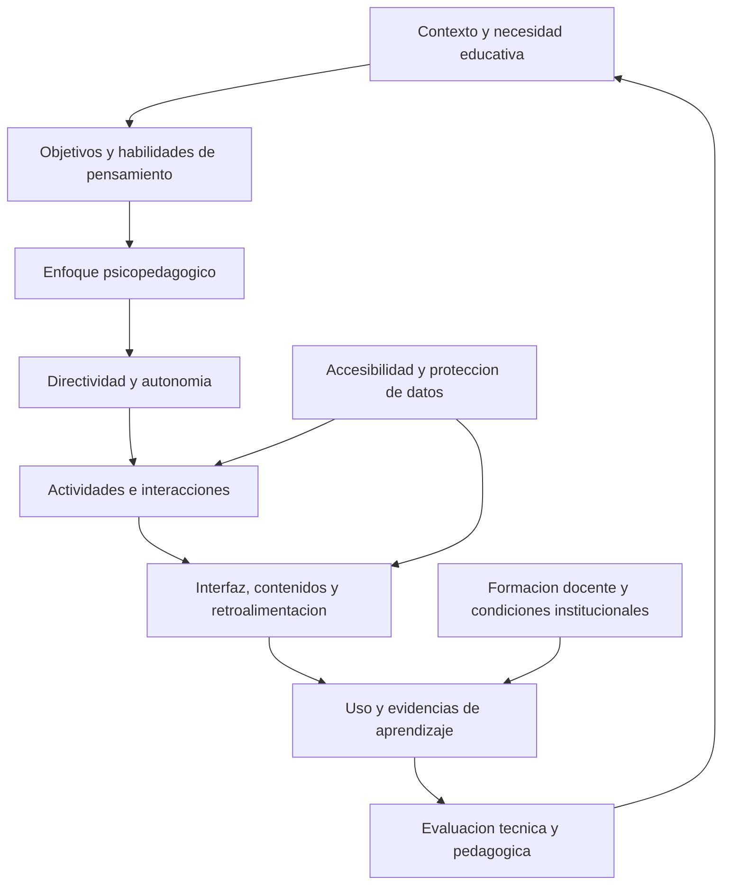

# Clase 2: Software educativo: directividad, diseño tecnopedagógico y evaluación de calidad

> **Objetivo académico:** Analizar cómo las necesidades educativas, las habilidades de pensamiento y las condiciones del contexto orientan la selección, el diseño y la evaluación del software educativo, distinguiendo su funcionamiento técnico de su contribución al aprendizaje.

## 1. Contexto y marco conceptual

El software educativo comprende programas y herramientas digitales diseñados para apoyar la enseñanza y el aprendizaje. Su valor educativo depende de la relación entre sus funcionalidades, los objetivos de formación, las características de los usuarios y las condiciones de uso. La disponibilidad de una tecnología novedosa no demuestra por sí misma su pertinencia pedagógica.

La sesión sitúa este problema en un entorno de rápida expansión de herramientas digitales, inteligencia artificial generativa y recursos inmersivos. Esta expansión amplía las posibilidades de intervención, pero también incrementa la incertidumbre institucional: adoptar una herramienta exige decisiones pedagógicas, técnicas, curriculares y organizacionales cuyo impacto no siempre está suficientemente documentado.

Una distinción central es la que existe entre **captar la atención**, **motivar la participación** y **producir aprendizaje**. Una aplicación puede resultar atractiva sin favorecer la comprensión, la transferencia o el desarrollo de habilidades. La sesión advierte que las observaciones locales y las experiencias breves requieren una interpretación prudente antes de convertirse en afirmaciones generales sobre eficacia educativa.

El contexto relevante incluye:

- Infraestructura: dispositivos disponibles, conectividad y condiciones de acceso.
- Perfil de los usuarios: edad, conocimientos previos, diversidad cultural, idioma y necesidades de accesibilidad.
- Currículo: contenidos, objetivos y competencias que se pretende desarrollar.
- Enfoque psicopedagógico: concepción del aprendizaje que orienta las actividades y la retroalimentación.
- Organización: formación docente, integración en la práctica y posibilidades de continuidad o ampliación.

La formación docente constituye una condición de apropiación: una propuesta técnicamente disponible puede tener escaso alcance si quienes deben utilizarla no comprenden su propósito o no pueden incorporarla a sus prácticas.

**Enriquecimiento conceptual:** Conviene distinguir entre software creado con una finalidad educativa y herramientas de propósito general utilizadas pedagógicamente. En el segundo caso, el valor educativo surge de la configuración de actividades, contenidos e interacciones. Esta distinción permite analizar recursos como tableros colaborativos o herramientas de autor sin atribuirles automáticamente una arquitectura pedagógica propia.

## 2. Fundamentos teóricos y arquitectura

### Directividad y autonomía

La directividad expresa cuánto determina el sistema las acciones, la secuencia y las posibilidades de decisión del usuario. Una aplicación muy directiva prescribe recorridos y respuestas; una aplicación más abierta permite explorar, elegir estrategias o modificar variables.

La sesión presenta un continuo orientativo entre práctica estructurada, evaluación, lecciones, contenidos, recomendación, simulación y juegos. El criterio de selección es la correspondencia entre el objetivo educativo, el perfil del usuario y la autonomía que resulta conveniente ofrecer.

| Tipo de software | Función educativa destacada | Decisiones de diseño y límites |
|---|---|---|
| Ejercicio y práctica | Reforzar habilidades específicas mediante repetición y respuesta inmediata | Evitar que la resolución automática sustituya la comprensión; considerar el tedio de la repetición |
| Evaluación y retroalimentación | Reconocer errores y orientar mejoras | Relacionar los patrones de respuesta con dificultades reales; evitar mensajes genéricos |
| Lecciones y tutorías | Organizar explicaciones, pasos e interacción guiada | Ajustar el ritmo y los apoyos sin reducir todo el aprendizaje a una secuencia rígida |
| Contenidos multimedia | Integrar textos, imágenes, videos y recursos didácticos | La variedad de formatos requiere coherencia pedagógica y navegación comprensible |
| Recomendación | Seleccionar recursos o problemas según información del usuario | La calidad de las recomendaciones depende de los datos y de los criterios de selección |
| Simulación | Explorar fenómenos mediante un modelo manipulable | La utilidad depende de la validez del modelo y de que se comprendan sus supuestos |
| Juegos y gamificación | Favorecer participación mediante desafíos y mecánicas lúdicas | Mantener la relación entre la actividad y el aprendizaje buscado |

Los objetivos delimitados pueden beneficiarse de recorridos estructurados. Los objetivos que involucran exploración, razonamiento o solución de problemas pueden requerir mayor libertad. Sin embargo, ofrecer autonomía también exige evitar que el usuario pierda de vista el propósito del aprendizaje.

**Enriquecimiento conceptual:** Este continuo es una heurística de diseño, no una clasificación universal. Un juego puede imponer una secuencia estricta; una simulación puede incluir instrucciones muy detalladas; un recomendador puede restringir considerablemente las alternativas. La directividad debe analizarse en las interacciones concretas. Tampoco puede inferirse una relación universal entre mayor directividad y mayor eficacia: esta depende del objetivo, los conocimientos previos y los apoyos disponibles.

### Congruencia psicopedagógica

La sesión contrasta mecanismos asociados al conductismo y al constructivismo. Los puntos, niveles y recompensas pueden reforzar conductas; las situaciones de exploración, descubrimiento y construcción de explicaciones pueden apoyar procesos constructivos. El nombre de la herramienta no determina su orientación: importan las acciones que propone y los procesos que hace posibles.

**Enriquecimiento conceptual:** Gamificación y aprendizaje basado en juegos son conceptos relacionados, pero diferentes. La gamificación incorpora elementos de juego a una actividad; el aprendizaje basado en juegos utiliza un juego como entorno de aprendizaje. Ambos pueden combinar mecanismos de refuerzo con exploración y razonamiento.

### Arquitectura de alineación

El diagrama sintetiza las relaciones discutidas: la funcionalidad debe derivarse de una necesidad, y la evaluación debe retroalimentar el diseño. La accesibilidad y la protección de datos atraviesan las decisiones de interacción e interfaz.

## 3. Implementación técnica y lógica de negocio

### De la necesidad educativa a la funcionalidad

El reto principal no consiste únicamente en programar una operación, sino en crear condiciones para que el usuario comprenda y utilice el conocimiento. Una rutina que suma matrices puede ser breve; una experiencia que ayude a comprender la operación requiere representaciones, decisiones del usuario y retroalimentación pertinentes.

La traducción tecnopedagógica puede observarse en los siguientes ejemplos discutidos:

| Necesidad o proceso | Funcionalidad posible | Propósito pedagógico |
|---|---|---|
| Comprender fracciones | Representaciones visuales interactivas | Vincular expresiones simbólicas con relaciones parte-todo |
| Favorecer la lectura | Textos graduados y retroalimentación inmediata | Ajustar la dificultad y orientar la comprensión |
| Expresar ideas en otro idioma | Espacios de producción escrita u oral | Hacer observable la formulación del pensamiento |
| Comprender un procedimiento | Lecciones interactivas organizadas por pasos | Relacionar decisiones y resultados intermedios |
| Explorar un fenómeno | Manipulación de variables en una simulación | Contrastar anticipaciones con el comportamiento del modelo |

La interfaz organiza lo visible y lo navegable; la interacción determina qué puede hacer el usuario; la retroalimentación comunica correcciones, explicaciones o sugerencias. La motivación, los contenidos y la evaluación del aprendizaje deben integrarse en esa misma lógica.

La sesión no presenta código ejecutable ni resultados de una implementación. Menciona alternativas como Python, HTML, Scratch, App Inventor y herramientas de autor, sin establecer un lenguaje obligatorio. La selección tecnológica queda subordinada a la funcionalidad, la comprensión del recorrido y las condiciones de uso.

### Habilidades de pensamiento como requisitos funcionales

La sesión distingue habilidades básicas y procesos de mayor complejidad. Su incorporación exige diseñar acciones observables, no limitarse a declararlas en los objetivos.

| Proceso | Significado en la sesión | Traducción funcional orientativa |
|---|---|---|
| Observación | Dirigir intencionalmente la atención hacia información relevante | Señalar elementos y permitir su exploración |
| Descripción | Expresar con precisión características o ideas | Registrar explicaciones escritas u orales |
| Conceptualización | Integrar conocimientos previos y nuevos en una unidad de significado | Relacionar representaciones y contextos |
| Comparación | Establecer semejanzas y diferencias mediante criterios | Contrastar objetos según variables explícitas |
| Clasificación | Agrupar según características compartidas o diferenciadoras | Organizar elementos y justificar agrupaciones |
| Formulación de hipótesis | Proponer afirmaciones susceptibles de contrastación | Registrar anticipaciones antes de observar resultados |
| Solución de problemas | Movilizar capacidades para producir una respuesta | Permitir estrategias y mostrar resultados intermedios |
| Evaluación | Juzgar respuestas o procedimientos | Proporcionar criterios y retroalimentación |
| Metacognición | Reflexionar sobre los propios procesos de pensamiento | Explicitar estrategias, dificultades y cambios de comprensión |

También se destacan creatividad, planificación y organización. Estas capacidades no aparecen automáticamente por utilizar una aplicación compleja: deben tener oportunidades de manifestarse en las actividades.

### Ejemplo conceptual: matrices e imágenes

La sesión utiliza la suma de matrices para mostrar la diferencia entre ejecutar una regla y comprenderla en otro contexto. Dos matrices pueden sumarse elemento a elemento si tienen el mismo orden.

**Enriquecimiento conceptual:** Una formulación precisa es:

$$
A,B\in\mathbb{R}^{m\times n},\qquad C=A+B,\qquad c_{ij}=a_{ij}+b_{ij}.
$$

Aquí $m$ y $n$ son enteros positivos que representan filas y columnas; $i\in\{1,\ldots,m\}$ y $j\in\{1,\ldots,n\}$ identifican cada posición. Los elementos son números reales y $C$ conserva las dimensiones de $A$ y $B$. Por ejemplo:

$$
\begin{pmatrix}1&2\\3&4\end{pmatrix}
+
\begin{pmatrix}4&3\\2&1\end{pmatrix}
=
\begin{pmatrix}5&5\\5&5\end{pmatrix}.
$$

Al trasladar esta operación a imágenes RGB, cada píxel contiene tres componentes de color. Para una suma directa deben coincidir las dimensiones espaciales y los canales; tener solamente igual cantidad total de píxeles no garantiza correspondencia entre posiciones.

**Enriquecimiento conceptual:** Si $I,J\in\{0,\ldots,255\}^{h\times w\times3}$ son imágenes RGB de ocho bits por canal, $h$ y $w$ representan altura y anchura en píxeles. La suma se realiza sobre valores de canal sin unidad física. Para visualizarla en el mismo rango puede aplicarse saturación:

$$
K_{ijc}=\min\left(255,I_{ijc}+J_{ijc}\right).
$$

El índice $c\in\{1,2,3\}$ identifica el canal. Esta expresión supone una operación directa sobre los valores almacenados; no equivale por sí sola a una mezcla físicamente precisa de luz. Si dos valores de canal son $180$ y $100$, su suma aritmética es $280$, mientras que la salida saturada es $255$.

La pregunta sobre multiplicar una fotografía por cinco permite distinguir intensidad y geometría. **Enriquecimiento conceptual:** Multiplicar los valores de sus canales por un escalar $5$, adimensional, conserva la resolución y puede saturar colores; ampliar sus dimensiones exige otra operación. Esta diferencia aporta comprensión cuando el usuario anticipa el resultado y explica qué cambió en su razonamiento. La transferencia entre contextos favorece la comprensión conceptual; se vuelve metacognitiva cuando incluye reflexión explícita sobre cómo se comprendió o corrigió la idea.

### Recomendación y adaptación

El ejemplo de recomendación utiliza una colección previa de problemas matemáticos disponible en Kaggle. La lógica descrita comprende recopilación, conversión y procesamiento de datos para seleccionar recursos asociados a las habilidades que se pretende desarrollar. No se especifican el conjunto de datos, el algoritmo ni resultados de validación.

La sesión también plantea reconocer patrones de dificultades y ofrecer retroalimentaciones diferenciadas. Esto muestra que una aplicación puede mantener alta directividad y, simultáneamente, personalizar sus respuestas.

**Enriquecimiento conceptual:** Personalización y autonomía son dimensiones distintas. El sistema puede elegir contenidos para cada usuario sin concederle capacidad de decisión. Asimismo, un recomendador puede construirse mediante reglas explícitas; no necesita necesariamente aprendizaje automático.

## 4. Análisis crítico de casos y auditoría práctica

### Análisis estratégico de tendencias

El análisis de tendencias busca fundamentar decisiones sobre qué adoptar, cómo implementarlo y qué objetivos conviene ajustar. La sesión amplía la perspectiva más allá de la revisión bibliométrica mediante herramientas de análisis estratégico y comparación contextual.

| Herramienta | Aporte | Precaución interpretativa |
|---|---|---|
| FODA | Examinar fortalezas, oportunidades, debilidades y amenazas | Definir si el objeto es una institución, una solución o una propuesta |
| PESTEL | Revisar factores políticos, económicos, sociales, tecnológicos, ecológicos y legales | Relacionar los factores con el contexto y la decisión concreta |
| Analítica web | Obtener indicadores de uso y comportamiento en un entorno digital | La actividad registrada no demuestra aprendizaje |
| Tableros de indicadores | Organizar métricas para observar y comparar | Mantener definiciones y procedimientos consistentes |
| Pedagogía comparada | Analizar semejanzas y diferencias entre sistemas o contextos educativos | Considerar sus condiciones normativas, culturales e institucionales |
| Bibliometría | Reconocer patrones de producción científica y áreas menos investigadas | La presencia en publicaciones no equivale a adopción o eficacia |

La diferencia entre diagnóstico y prospectiva es relevante. Un FODA diagnóstico caracteriza una situación presente; un uso prospectivo explora condiciones y posibilidades de una decisión futura. Comparar soluciones existentes permite identificar funciones compartidas, limitaciones y espacios de diferenciación.

**Enriquecimiento conceptual:** Google Analytics produce información sobre entornos instrumentados a los que se tiene acceso autorizado; no proporciona automáticamente datos internos de uso de plataformas ajenas ni una medida completa de la demanda del mercado. La comparación de herramientas debe declarar qué evidencia está disponible y qué inferencias permite.

La sesión insiste en la consistencia de los datos: conservar criterios de recolección, definiciones y procedimientos de reporte. Los indicadores apoyan la interpretación; no sustituyen el razonamiento contextual ni garantizan conclusiones exactas.

### Configuración de un LMS

Moodle y Google Classroom se abordan como sistemas de gestión del aprendizaje. Su análisis debe diferenciar la administración de contenidos de las actividades que efectivamente promueven aprendizaje. Configurar una plataforma puede constituir una intervención tecnopedagógica cuando la selección y organización de herramientas responde al enfoque adoptado.

La sesión destaca Moodle por sus posibilidades de configuración y analítica. También plantea inquietudes sobre cuentas de acceso, seguimiento y datos personales en servicios alojados.

**Enriquecimiento conceptual:** El carácter libre de un software no garantiza privacidad por sí mismo. La protección depende también del alojamiento, la configuración, los permisos, las integraciones y las prácticas institucionales. Del mismo modo, disponer de analíticas no asegura una interpretación pedagógica válida.

### Auditoría de calidad

La calidad requiere revisar simultáneamente el funcionamiento y la experiencia educativa.

| Dimensión | Pregunta de auditoría | Evidencia pertinente |
|---|---|---|
| Funcionalidad | ¿Las funciones responden a la necesidad declarada? | Correspondencia entre objetivos, recorridos y resultados |
| Usabilidad | ¿El usuario comprende cómo operar y navegar? | Dificultades de interacción, errores y claridad de las acciones |
| Accesibilidad | ¿Qué barreras afectan a usuarios con distintas capacidades? | Compatibilidad con modos alternativos de percepción e interacción |
| Pertinencia pedagógica | ¿Las actividades favorecen el aprendizaje buscado? | Coherencia entre contenidos, acciones y retroalimentación |
| Adaptación a dispositivos | ¿La información sigue siendo legible y operable? | Visualización y funcionamiento en pantallas diferentes |
| Rendimiento | ¿Los tiempos de respuesta permiten completar la actividad? | Comportamiento bajo condiciones de uso declaradas |
| Mantenibilidad | ¿Puede comprenderse y corregirse la solución? | Organización y documentación de sus componentes |
| Portabilidad | ¿Puede utilizarse en otros entornos tecnológicos? | Dependencias y condiciones de ejecución |
| Seguridad y privacidad | ¿Se protegen los datos y se justifican sus usos? | Accesos, información solicitada y tratamiento de datos |

El caso de gráficas poco legibles en un teléfono muestra que una función disponible en escritorio puede perder utilidad en una pantalla pequeña. La compatibilidad técnica debe acompañarse de legibilidad y posibilidad real de interacción.

Las normas se presentan como marcos para ordenar criterios y realizar una evaluación contextualizada. La fuente no identifica sus denominaciones ni versiones, por lo que no permite afirmar cumplimiento de un estándar específico. La interoperabilidad se menciona como cuestión relacionada, sin desarrollo técnico.

## 5. Principios de diseño, buenas prácticas y anti-patrones

1. **Partir de la necesidad y del usuario.** La tecnología se selecciona después de precisar el problema, los objetivos y las condiciones de uso.
2. **Hacer observable la congruencia pedagógica.** Un enfoque se expresa en las acciones y apoyos disponibles, además de su declaración conceptual.
3. **Ajustar la directividad.** La estructura debe apoyar a quien la necesita y permitir exploración cuando el objetivo la requiere.
4. **Priorizar funcionalidad y comprensión.** Una solución sencilla y contextualizada puede aportar más que una aplicación compleja con recorridos confusos.
5. **Diseñar retroalimentación útil.** Identificar dificultades y orientar mejoras aporta más información que comunicar únicamente acierto o error.
6. **Integrar accesibilidad desde el diseño.** Reconocer limitaciones de alcance evita expectativas falsas y permite identificar barreras que deben corregirse.
7. **Revisar datos y privacidad.** La integración de recursos externos exige conocer qué información solicitan y cómo la utilizan.
8. **Mantener coherencia en las evidencias.** Las comparaciones requieren datos obtenidos y reportados mediante criterios explícitos.
9. **Considerar continuidad institucional.** Formación docente, mantenimiento y posibilidades de ampliación condicionan la sostenibilidad.

Entre los anti-patrones discutidos o derivados de los casos están acumular botones y efectos visuales sin propósito, confundir repetición con comprensión, asumir que las recompensas hacen constructivista una actividad, adoptar herramientas por novedad y considerar suficiente que el programa ejecute correctamente.

La sesión menciona el cuestionario Honey-Alonso como recurso de caracterización de preferencias de aprendizaje. **Enriquecimiento conceptual:** Sus categorías no deben tratarse como diagnósticos inmutables ni como prueba suficiente para asignar a cada persona una modalidad exclusiva de enseñanza. Para adaptar una experiencia conviene considerar también conocimientos previos, desempeño observado, necesidades de accesibilidad y características del contenido.

**Enriquecimiento conceptual:** La calidad institucional de la presentación y la pertinencia pedagógica deben revisarse por separado. El uso coherente de identidad visual puede facilitar reconocimiento y orientación, pero no demuestra que una actividad favorezca aprendizaje.

## 6. Síntesis conceptual y profundización académica

El argumento central de la sesión es que el software educativo debe evaluarse como parte de un sistema tecnopedagógico. Su contribución depende de la articulación entre necesidad, objetivos, enfoque, actividades, interfaz, retroalimentación y condiciones institucionales.

La directividad ayuda a analizar la distribución de decisiones, pero no funciona como indicador aislado de calidad. La personalización puede coexistir con una secuencia rígida; un juego puede combinar recompensas y exploración; una plataforma de gestión puede alojar actividades pedagógicamente diferentes. Por ello, la unidad de análisis más informativa es la experiencia concreta de aprendizaje.

El análisis de tendencias ofrece información para decidir, mientras que la auditoría revisa la adecuación de una solución. Ambos requieren distinguir datos, interpretación y supuestos. La funcionalidad técnica, la satisfacción del usuario y la evidencia de aprendizaje aportan información complementaria.

**Enriquecimiento conceptual:** Una profundización metodológica consiste en mantener trazabilidad entre cuatro elementos: necesidad detectada, decisión de diseño, proceso cognitivo esperado y evidencia observable. Esta relación permite justificar por qué se incluye una función y reconocer cuándo su uso no produce el efecto previsto. También permite distinguir ejecución correcta, comprensión conceptual, transferencia y reflexión metacognitiva, sin atribuir a una sola métrica más alcance del que tiene.

La perspectiva sistémica integra así rigor técnico, coherencia pedagógica, inclusión y responsabilidad sobre los datos. La innovación adquiere sentido cuando mejora una experiencia educativa situada y cuando sus límites pueden describirse y evaluarse con claridad.
