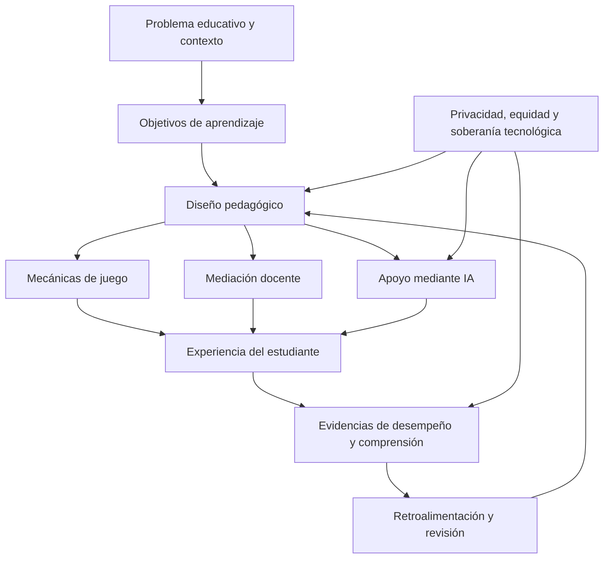

# Clase 4: Gamificación, inteligencia artificial educativa y soberanía tecnológica

> **Objetivo académico:** Analizar las relaciones entre juego, motivación, aprendizaje e inteligencia artificial, y evaluar sus implicaciones pedagógicas, metodológicas y políticas para diseñar experiencias educativas sostenibles, éticas y contextualizadas.

## 1. Contexto y marco conceptual

La sesión articula tres planos de la tecnología educativa: el diseño de experiencias lúdicas, la incorporación de inteligencia artificial y la distribución del poder sobre infraestructuras, datos y decisiones educativas. La pregunta transversal es cómo transformar posibilidades técnicas en aprendizaje con sentido, sin confundir atractivo visual, automatización o participación con comprensión.

Como punto de partida se utiliza un anuncio de un videojuego espacial de mundo abierto. Sus participantes describen libertad de exploración, progresión, adquisición de recursos, desafíos y aspiraciones personales. El material no fue presentado como recurso educativo: permite identificar condiciones de involucramiento y discutir qué mediaciones serían necesarias para convertir esa experiencia en una propuesta pedagógica.

El debate reconoce capacidades potencialmente movilizadas por los juegos: planificación, reconocimiento de patrones, toma de decisiones, resolución de problemas, coordinación social y pensamiento estratégico. Sin embargo, la ejecución competente dentro de un juego no demuestra por sí misma comprensión de sus fundamentos ni transferencia hacia otros contextos.

**Enriquecimiento conceptual:** Conviene diferenciar tres resultados: desempeño situado, comprensión conceptual y transferencia. El primero consiste en actuar eficazmente dentro de un entorno; la segunda permite explicar relaciones y justificar decisiones; la tercera supone utilizar lo aprendido ante situaciones diferentes. Una mejora en el primero no garantiza automáticamente los otros dos.

La noción de aprendizaje significativo aparece como problema central: lo personalmente atractivo para un participante puede diferir de los objetivos científicos de una institución. Las experiencias relatadas sobre jóvenes y videojuegos ilustran esa tensión, pero no permiten establecer diferencias universales entre generaciones.

**Enriquecimiento conceptual:** El interés personal puede facilitar el aprendizaje, pero no equivale a aprendizaje significativo. Este requiere integrar conocimientos nuevos con estructuras previas de comprensión. Una propuesta lúdica necesita explicitar qué relaciones conceptuales favorece y cómo se reconocerá su apropiación.

La posición de la sesión evita una causalidad unilateral: ni la tecnología determina por sí sola la educación ni la pedagogía controla completamente el desarrollo tecnológico. Ambas se configuran mutuamente bajo restricciones institucionales, económicas y culturales. Por ello, una experiencia puede combinar recompensas, exploración, colaboración y resolución de problemas, siempre que la combinación tenga una justificación pedagógica.

## 2. Fundamentos teóricos y arquitectura

### Gamificación, aprendizaje basado en juegos y juegos serios

La sesión distingue tres enfoques que suelen utilizarse de manera intercambiable, aunque designan decisiones diferentes de diseño.

| Enfoque | Unidad principal de diseño | Finalidad y ejemplo discutido | Condición pedagógica |
| --- | --- | --- | --- |
| Gamificación | Elementos de juego incorporados a una actividad que no es un juego completo | Insignias, puntos, niveles o reconocimiento para favorecer el involucramiento | Vincular la progresión con objetivos de aprendizaje, no solo con acumulación de recompensas |
| Aprendizaje basado en juegos | Uso de un juego como medio de aprendizaje | Juego de mesa o digital que exige aplicar propiedades de matrices para avanzar | Integrar el juego en una secuencia con orientación, retroalimentación y reflexión |
| Juegos serios | Juego completo diseñado con una finalidad que trasciende el entretenimiento | Simulación orientada al aprendizaje de pilotaje | Articular fidelidad del entorno, decisiones relevantes y análisis del desempeño |

**Enriquecimiento conceptual:** Estas categorías pueden superponerse. Un juego serio puede utilizarse dentro de una estrategia de aprendizaje basado en juegos. Además, una simulación no constituye necesariamente un juego: debe distinguirse la representación de un sistema de la presencia de reglas, objetivos y desafíos lúdicos.

En la exposición se relaciona la introducción del término gamificación con Nick Pelling y su difusión posterior con Jane McGonigal. Estas menciones cumplen una función contextual; la transcripción no proporciona referencias bibliográficas completas para reconstruir una historia exhaustiva del concepto.

### Motivación y mecanismos de participación

Los componentes identificados incluyen avatares, retos, puntos, insignias, niveles, estadísticas, clasificaciones y objetivos compartidos. El avatar favorece identificación; los niveles estructuran progresión; los puntos hacen visible una medida del avance; los equipos pueden combinar colaboración interna con competencia entre grupos.

La docente interpreta parte de estos mecanismos desde una lógica conductista: determinadas acciones reciben consecuencias que favorecen su repetición. También plantea una expectativa de tránsito desde la motivación extrínseca, apoyada en recompensas externas, hacia una motivación intrínseca vinculada al interés por comprender y explorar.

**Enriquecimiento conceptual:** Ese tránsito no es automático. Una recompensa puede orientar la atención hacia el contenido o desplazarla hacia la obtención del premio. Su efecto depende del significado que adquiere, de la autonomía disponible y de su relación con la experiencia de competencia.

La sesión presenta tres marcos de apoyo al diseño motivacional:

| Marco | Elementos explicitados en la fuente | Uso conceptual |
| --- | --- | --- |
| ARCS | Atención, relevancia, confianza y satisfacción | Revisar si la experiencia atrae, tiene sentido para el participante, permite anticipar progreso y produce satisfacción |
| Teoría de la autodeterminación | Se menciona como fundamento de la motivación | Analizar la calidad de la participación, además de su intensidad |
| Octalysis | Se menciona como marco de gamificación | Organizar una revisión de los factores motivacionales del diseño |

**Enriquecimiento conceptual:** La teoría de la autodeterminación distingue necesidades de autonomía, competencia y relación. Estas permiten evaluar si una experiencia ofrece decisiones significativas, desafíos alcanzables y vínculos sociales. La sesión no desarrolla las dimensiones particulares de Octalysis, por lo que no se reconstruyen como contenido expuesto.

### Arquitectura sociotécnica del aprendizaje

El diagrama expresa la relación central de la clase: las mecánicas y la IA adquieren valor educativo dentro de un diseño que conecta objetivos, mediación y evidencias. La privacidad, la equidad y el control institucional atraviesan toda la arquitectura.

## 3. Implementación técnica y lógica de negocio

### Ciclo de desarrollo de un juego educativo

La fuente describe tres fases generales, sin presentar código ni una implementación reproducible:

1. **Preproducción:** conceptualización, definición del público, mecánicas y reglas, dirección artística y análisis de viabilidad. Se plantea la colaboración entre especialistas del contenido, desarrollo, psicología, motivación y conocimiento del mercado.
2. **Producción:** programación, construcción de niveles y elaboración de componentes visuales e interactivos. Su propósito es materializar la conceptualización, no sustituirla por una suma de efectos gráficos.
3. **Postproducción:** revisión de calidad, normas y respuesta del entorno a las necesidades del público. Incluye valorar personajes, texturas, animaciones y funcionamiento general.

El costo no se reduce a programar: comprende conocimiento disciplinar, diseño pedagógico, arte, validación y mantenimiento. La obsolescencia introduce una tensión adicional: un contenido relativamente estable puede depender de una interfaz o plataforma que pierde vigencia rápidamente.

**Enriquecimiento conceptual:** Separar contenido, reglas pedagógicas y presentación facilita actualizar componentes sin reconstruir todo el sistema. Esta separación debe justificarse por necesidades de mantenimiento; no demuestra por sí misma eficacia educativa.

### Progresión, dificultad y retroalimentación

La lógica de niveles admite dos operaciones diferentes: desbloquear contenidos a medida que se avanza y retirar apoyos o introducir restricciones para aumentar la dificultad. La sesión menciona ambas posibilidades. Su coherencia depende de que el incremento del desafío corresponda a capacidades desarrolladas y no solo a mayor velocidad o complejidad de los controles.

La retroalimentación constituye una distinción decisiva. Un mensaje de éxito o un bono informa un resultado del juego; una explicación sobre la elección realizada puede apoyar la comprensión disciplinar. La fuente propone mediación docente o apoyo de IA para producir devoluciones inmediatas sobre decisiones correctas e incorrectas.

**Enriquecimiento conceptual:** La inmediatez es útil cuando permite corregir una interpretación antes de consolidarla, pero no sustituye la calidad explicativa. Una devolución pertinente identifica la decisión, relaciona su consecuencia con un principio y orienta una revisión. Tampoco toda reflexión debe ocurrir durante la acción: una pausa posterior puede favorecer explicaciones más elaboradas.

### Matemática de los juegos discutidos

Los participantes describen juegos sobre coordenadas cartesianas, pendientes, parábolas, números primos y rotaciones mediante matrices. La transcripción no contiene las interfaces completas ni reglas suficientes para reproducirlos.

**Enriquecimiento conceptual:** Para precisar la relación entre una acción de juego y una rotación plana, puede utilizarse la matriz

$$
R(\theta)=\begin{pmatrix}\cos\theta & -\sin\theta\\ \sin\theta & \cos\theta\end{pmatrix},\qquad \mathbf{p}'=R(\theta)\mathbf{p}.
$$

Aquí $\mathbf{p}=(x,y)^T\in\mathbb{R}^2$ representa una posición respecto del origen, $\mathbf{p}'$ su posición rotada y $\theta\in\mathbb{R}$ un ángulo expresado en radianes. Se supone un sistema cartesiano con orientación positiva antihoraria, vectores columna y rotación alrededor del origen. Las coordenadas conservan su unidad de longitud y la matriz es adimensional. La expresión no representa por sí sola una traslación ni un giro alrededor de otro centro.

Para $\theta=\pi/2$ y $\mathbf{p}=(1,0)^T$, se obtiene

$$
\mathbf{p}'=\begin{pmatrix}0 & -1\\1 & 0\end{pmatrix}\begin{pmatrix}1\\0\end{pmatrix}=\begin{pmatrix}0\\1\end{pmatrix}.
$$

Este paso permite conectar el giro observado con una transformación matemática. Acertar una orientación bajo presión no basta para saber si el participante comprende esa relación.

**Enriquecimiento conceptual:** La descripción oral de desplazamientos de parábolas es ambigua porque no distingue con claridad cambios dentro y fuera del argumento. Para $f:\mathbb{R}\to\mathbb{R}$, la expresión $g(x)=f(x-h)+k$, con $h,k\in\mathbb{R}$, traslada la gráfica $h$ unidades horizontalmente y $k$ verticalmente: valores positivos desplazan hacia la derecha y hacia arriba, respectivamente. Cada desplazamiento debe expresarse en la unidad de su eje. Para la parábola básica, $g(x)=(x-h)^2+k$ tiene vértice en $(h,k)$. Esta precisión aclara la notación sin atribuir al juego una implementación no observada.

### IA educativa: funciones y apoyos

La sesión identifica tutores virtuales, evaluación automática, retroalimentación personalizada, sistemas adaptativos, chatbots, análisis de emociones y análisis de trayectorias. Estas funciones responden a necesidades diferentes:

| Función | Necesidad educativa | Límite que debe considerarse |
| --- | --- | --- |
| Tutor conversacional | Orientación y explicación durante el aprendizaje | La respuesta debe ser revisable y pertinente al contenido |
| Retroalimentación automática | Atender oportunamente a grupos numerosos | Automatizar una devolución no garantiza exactitud ni utilidad |
| Adaptación | Ajustar apoyos o contenidos según evidencias disponibles | La adaptación depende de la calidad de esas evidencias |
| Análisis multimodal de emociones | Explorar señales de dificultad en entornos virtuales | Una señal observable no determina un estado psicológico |
| Análisis de trayectorias | Identificar rezago y posibles necesidades de apoyo | Una predicción no debe convertirse en una etiqueta definitiva |

La docente describe trabajo con redes neuronales profundas multimodales para estudiar dificultades en matemáticas mediante señales como expresión facial, postura o pulsos. No se presentan arquitectura, datos, métricas ni resultados, por lo que se conserva como descripción de una línea de investigación.

La formación docente aparece como otra necesidad: guías metodológicas para elegir herramientas, formular instrucciones y ubicar las intervenciones de IA dentro de una secuencia didáctica. La competencia técnica aislada resulta insuficiente para decidir cuándo una respuesta automatizada debe orientar, ser contrastada o derivarse a una persona.

## 4. Análisis crítico de casos y auditoría práctica

### Videojuego comercial: involucramiento y transferencia

El entorno espacial permite observar exploración, objetivos de largo alcance y progresión sostenida. Su potencial educativo depende de qué decisiones se analicen y de cómo se vinculen con conocimientos. Convertirlo en recurso pedagógico requiere más que añadir preguntas al final: debe existir una relación defendible entre sus acciones y los objetivos formativos.

El contraste con problemas numéricos de apariencia austera muestra que la presentación influye en la disposición inicial. Sin embargo, una interfaz atractiva puede ocultar comprensión superficial, mientras que una representación sencilla puede sostener razonamiento profundo si dispone de mediación adecuada.

### Juegos matemáticos: evidencia observada y dificultades

| Observación relatada | Lectura crítica | Implicación de diseño |
| --- | --- | --- |
| Instrucciones poco claras obligan a cambiar de juego | La barrera puede ser de comprensión de la interfaz | Revisar lenguaje, ejemplos iniciales y orientación |
| Un juego de rotaciones entrega puntos sin explicación matemática | El refuerzo informa éxito, pero no hace visible el razonamiento | Conectar la acción con la transformación aplicada |
| El juego de números primos exige saltos precisos | Un error motor puede confundirse con un error conceptual | Distinguir dominio del contenido y manejo del control |
| La dificultad aumenta por niveles | La progresión puede sostener el interés | Comprobar si aumenta la exigencia conceptual o solo la velocidad |

**Enriquecimiento conceptual:** Confundir destreza motriz con conocimiento introduce una amenaza a la validez de la interpretación. Para inferir comprensión conviene disponer de evidencias complementarias, como explicar una decisión o resolver una situación equivalente con otra interfaz. Una puntuación del juego tampoco constituye una medida válida de inteligencia sin un instrumento y una validación específicos.

### Aprender construyendo juegos

Se discute una alternativa a consumir juegos terminados: que los estudiantes los construyan. En programación, diseñar reglas y comportamientos puede movilizar lógica, resolución de problemas e integración de componentes. También se menciona un artículo de 2025 que relacionaría esta orientación con pensamiento de sistemas y diagramas causales; sus datos bibliográficos y su esquema completo no aparecen en el texto disponible.

La referencia a signos positivos y negativos pertenece a la dinámica de sistemas.

**Enriquecimiento conceptual:** En un diagrama causal, el signo positivo indica variación en el mismo sentido y el negativo variación en sentido contrario, manteniendo constantes otras condiciones relevantes. No significan que una relación sea beneficiosa o perjudicial. Sin el diagrama original no puede reconstruirse su estructura ni inferirse la existencia de ciclos concretos.

El relato de un prototipo biomédico construido con componentes y procedimientos prefabricados ilustra creatividad e integración técnica. No permite confirmar sus afirmaciones sobre detección de estados mentales.

**Enriquecimiento conceptual:** La conducción ósea describe transmisión mecánica de vibraciones hacia el sistema auditivo; no equivale a lectura de actividad cerebral. Para atribuir a un prototipo reconocimiento de cansancio o estrés sería necesario especificar sensores, señales, procesamiento y validación. Tampoco corresponde denominar telepatía a una inferencia automatizada sobre señales fisiológicas.

### Calidad de la evidencia sobre gamificación

La docente cuestiona que los beneficios descritos se concentren en motivación y satisfacción inmediatas, y propone comparar intervenciones con grupos de control y medidas comunes. Esa observación identifica una preocupación metodológica; no constituye una revisión sistemática que demuestre ausencia general de estudios longitudinales.

**Enriquecimiento conceptual:** Una comparación necesita considerar conocimientos iniciales, tiempo de interacción, apoyos docentes y dificultad del contenido. Además de resultados inmediatos, la retención diferida y la transferencia permiten analizar si la mejora persiste. Utilizar la misma medida facilita comparar, pero no elimina diferencias previas ni demuestra causalidad por sí solo.

El caso oral denominado de forma aproximada «Foldit» vincula resolución lúdica de problemas de proteínas con contribución colectiva. La narración no permite confirmar su secuencia técnica de entrenamiento de IA. Debe distinguirse entre resolver estructuras, generar datos y entrenar modelos, sin adoptar la expresión «ADN de proteína» como descripción molecular precisa.

### Caso técnico complementario: IA y metaprogramación en agricultura

La conversación final analiza una propuesta para cuantificar severidad y esporulación en hojas de quinua. Su aportación declarada no consiste necesariamente en superar la exactitud predictiva de métodos previos, sino en facilitar la adaptación de un pipeline mediante configuración y mecanismos descritos como metaprogramación.

La discusión contrapone dos criterios de contribución: efectividad predictiva y flexibilidad de la arquitectura. Se mencionan cambios de iluminación, dimensiones de la hoja y parámetros de procesamiento como posibles condiciones de adaptación. La recomendación técnica central es mostrar cómo opera el mecanismo y qué modifica en el procesamiento o la clasificación, más allá de una definición general o un esquema.

**Enriquecimiento conceptual:** Un archivo de configuración no demuestra por sí mismo metaprogramación. La configuración selecciona valores u opciones; la metaprogramación implica mecanismos que manipulan, generan o transforman estructuras de programa. La evidencia disponible no permite determinar qué caso corresponde a la propuesta. Tampoco un pipeline configurable garantiza robustez frente a cambios de iluminación o distribución de datos: eso requiere evaluación empírica.

No se presentan resultados verificables ni una comparación reproducible. Las cifras predictivas mencionadas durante la conversación son hipotéticas y no se consideran hallazgos.

## 5. Principios de diseño, buenas prácticas y anti-patrones

### Coherencia pedagógica y sostenibilidad

- **Partir del problema educativo:** elegir mecánicas y tecnologías por su función en el aprendizaje.
- **Relacionar avance con comprensión:** hacer visible qué conocimiento sostiene una decisión exitosa.
- **Diseñar retroalimentación explicativa:** complementar puntos y mensajes con razones y posibilidades de revisión.
- **Considerar diversidad de usuarios:** evitar que velocidad, habilidad motriz o familiaridad con videojuegos monopolicen las oportunidades de participación.
- **Justificar las combinaciones pedagógicas:** la presencia simultánea de recompensas y colaboración no demuestra una integración coherente de teorías.
- **Planificar mantenimiento:** considerar recursos humanos, infraestructura, actualización y dependencia de plataformas durante todo el ciclo de vida.

Son anti-patrones reducir gamificación a puntos e insignias, equiparar tiempo de uso con aprendizaje, asumir que una apariencia moderna vuelve obsoleta cualquier herramienta anterior y atribuir eficacia a una combinación tecnológica sin evidencias. Las menciones a GeoGebra, MATLAB, Maple, R y Python expresan un debate sobre elección de herramientas; la sesión no demuestra la sustitución general de unas por otras.

### Transformación del papel docente

El debate sobre sustitución docente contrapone dos posiciones. Una anticipa mayor automatización de explicación, práctica y valoración del desempeño, con intervención humana especializada. Otra destaca que la docencia comprende reconocimiento de circunstancias personales, cuidado, confianza y transmisión de experiencia, además de tratamiento de contenidos.

Las simulaciones de pilotaje sirven para pensar una distribución de funciones: el sistema registra acciones y consecuencias; una persona puede ayudar a interpretar el error y reconstruir decisiones. La existencia de automatización parcial no prueba la desaparición de una profesión. Las predicciones temporales mencionadas en la sesión se consideran escenarios debatidos, no hechos establecidos.

**Enriquecimiento conceptual:** Resulta más preciso analizar funciones que oponer un docente humano completo a una máquina completa. Pueden distinguirse explicación, orientación, seguimiento, interpretación contextual y responsabilidad institucional. La viabilidad técnica de automatizar una función tampoco determina que su delegación sea pedagógica o socialmente deseable.

### Privacidad, poder y soberanía tecnológica

La discusión se desplaza desde qué puede hacer una herramienta hacia quién decide su funcionamiento, qué datos recoge y bajo qué condiciones se utiliza. La soberanía tecnológica aparece asociada al control de infraestructuras y datos, a la capacidad de decisión de instituciones y países y a la reducción de dependencias que condicionan la educación digital.

La desigualdad de conectividad limita el acceso incluso antes de discutir sofisticación algorítmica. A su vez, la personalización y la selección de contenidos pueden restringir la diversidad de información recibida. Estas tensiones vinculan diseño educativo con equidad, autonomía y gobernanza.

**Enriquecimiento conceptual:** La soberanía no exige necesariamente producir localmente toda la tecnología. Puede analizarse mediante la capacidad de elegir, auditar, sustituir y mantener sistemas. La educación abierta puede contribuir mediante acceso y posibilidad de reutilización de recursos, pero no elimina por sí sola las dependencias de infraestructura. Este vínculo amplía un tema anunciado en la sesión cuyo desarrollo específico fue limitado.

En sistemas de análisis emocional, recopilar más señales no equivale automáticamente a comprender mejor al estudiante. Deben justificarse la necesidad de los datos, su uso, su conservación y las consecuencias de una inferencia equivocada.

**Enriquecimiento conceptual:** Una predicción de dificultad debería activar apoyo revisable, no una clasificación irreversible. La supervisión humana necesita capacidad efectiva para cuestionar resultados y corregir decisiones. Las afirmaciones generales sobre escucha permanente o acceso total de plataformas a comunicaciones personales no quedan demostradas por la transcripción y requieren análisis de cada servicio y configuración.

## 6. Síntesis conceptual y profundización académica

La sesión sostiene una tesis de integración: la tecnología no resuelve por sí sola problemas pedagógicos, mientras que una pedagogía ajena al entorno tecnológico pierde capacidad de respuesta. La formulación expresada al cierre carece de atribución verificable en la fuente y se conserva aquí como síntesis conceptual, no como cita de autoridad.

La gamificación aporta recursos para estructurar participación, pero su calidad educativa depende de la relación entre acción y conocimiento. El aprendizaje basado en juegos exige integrar el recurso en una secuencia, y los juegos serios requieren justificar la finalidad y la fidelidad de sus experiencias. En todos los casos, motivación, comprensión y transferencia deben distinguirse analíticamente.

La IA amplía las posibilidades de orientación, seguimiento y personalización. Su valor depende de la pertinencia de las inferencias y de las decisiones que habilitan. Reconocer patrones, generar respuestas y comprender circunstancias humanas son capacidades que no deben equipararse sin evidencia.

La consulta técnica sobre agricultura refuerza una lección transversal: una innovación puede contribuir por adaptabilidad o mantenibilidad, además de rendimiento predictivo, pero debe demostrar específicamente aquello que afirma mejorar. La novedad de una combinación no basta para establecer su utilidad.

Como líneas de profundización conceptual destacan la persistencia de la motivación sin recompensas, la transferencia desde entornos lúdicos, la validez de inferencias emocionales, la distribución de funciones entre docentes y sistemas y la capacidad institucional de controlar sus dependencias tecnológicas. El criterio común es evaluar qué se aprende, bajo qué condiciones, con qué evidencia y con qué consecuencias para la autonomía de las personas.
