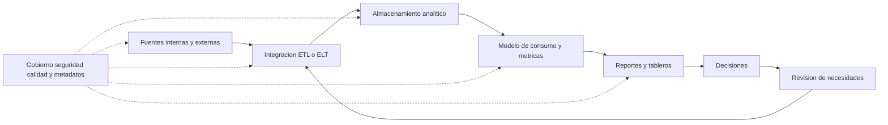
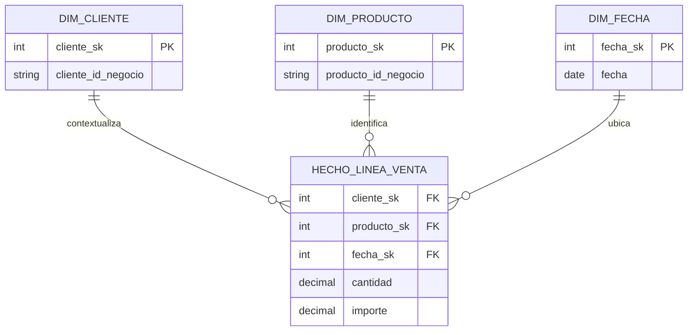
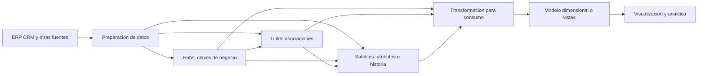
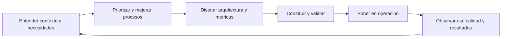

# Clase 2: Arquitectura de inteligencia de negocios: madurez organizacional, integración e historia de datos

> **Objetivo académico:** Fundamentar el diseño de una arquitectura de inteligencia de negocios coherente con la estrategia, la madurez y las necesidades de decisión de una organización, distinguiendo enfoques de integración, modelos de almacenamiento, mecanismos de calidad y alternativas de conservación histórica.

## 1. Contexto y marco conceptual

### La arquitectura comienza en la organización

La inteligencia de negocios, o Business Intelligence (BI), integra procesos, tecnologías, personas y prácticas de gestión para transformar datos en información útil para decidir. Su diseño exige comprender previamente la organización: objetivos estratégicos, procesos, capacidades de TI, presupuesto, cultura, regulación y condiciones competitivas. La disponibilidad de una tecnología avanzada no demuestra su pertinencia.

La tesis central de la sesión es la **coherencia entre necesidad y capacidad organizacional**. Una solución puede ser técnicamente sofisticada y resultar inviable si las fuentes contienen errores, los procesos carecen de controles o los usuarios no incorporan la información a sus decisiones. Una solución sencilla puede aportar valor si resuelve una necesidad concreta, cuenta con datos confiables y puede mantenerse.

El análisis del contexto interno y externo se vincula con los marcos VUCA y PESTEL mencionados durante la recapitulación. El primero permite considerar volatilidad, incertidumbre, complejidad y ambigüedad; el segundo organiza factores políticos, económicos, sociales, tecnológicos, ambientales y legales. Ambos ayudan a justificar prioridades de información, riesgos y capacidad de adaptación.

### Vigilancia tecnológica e inteligencia competitiva

La vigilancia tecnológica observa cambios y oportunidades en tecnologías relevantes; la inteligencia competitiva analiza información del entorno para orientar decisiones estratégicas. La sesión presenta un proceso que comprende identificar necesidades, obtener información, procesarla, producir resultados, utilizarlos y protegerlos.

Estas prácticas pueden combinar datos internos y externos. Por ejemplo, los costos internos de abastecimiento adquieren otro significado cuando se relacionan con cambios en precios de mercado o condiciones de proveedores. El BI ofrece infraestructura para sistematizar esa integración y reducir la dependencia de recopilaciones manuales.

**Enriquecimiento conceptual:** La capacidad de aplicar vigilancia e inteligencia competitiva no depende exclusivamente del tamaño empresarial. Una organización pequeña puede realizar versiones acotadas de estas prácticas. La diferencia relevante reside en su alcance, continuidad, formalización y recursos, evitando equipararlas automáticamente con cualquier estudio de mercado.

### BI como soporte de la estrategia

La analogía del BI como un GPS expresa que una organización necesita conocer su destino estratégico y observar su avance. Los indicadores permiten contrastar resultados con objetivos y orientar ajustes. Un reporte que presenta valores sin metas, referencias ni contexto puede describir una situación sin permitir evaluar su desempeño.

El BI puede contribuir a eficiencia operativa, automatización de reportes, visibilidad, reducción de costos y detección de oportunidades. Estos beneficios no autorizan a atribuirle directamente cualquier aumento de ingresos. La sesión destaca el valor de la oportunidad: disponer de información antes puede permitir una compra favorable o una respuesta más rápida, aunque cuantificar el beneficio requiera analizar qué habría ocurrido sin esa decisión.

**Enriquecimiento conceptual:** La secuencia datos–información–conocimiento–sabiduría es una orientación conceptual, no una transformación automática. Un dato adquiere significado al contextualizarse; su interpretación y uso requieren conocimiento del negocio, criterios de decisión y responsabilidad humana.

## 2. Fundamentos teóricos y arquitectura

### Evolución y delimitación de conceptos

La exposición describe una evolución desde informes y sistemas de soporte a decisiones hacia almacenes analíticos, integración de datos, big data, servicios en la nube y analítica predictiva. Estas aproximaciones coexisten: la aparición de una tecnología no elimina la utilidad de modelos anteriores.

**Enriquecimiento conceptual:** La cronología de la sesión debe entenderse como una panorámica de adopción, no como una datación precisa del origen de cada tecnología. Del mismo modo, migrar a la nube modifica opciones de operación y procesamiento, pero no determina por sí solo el modelo de datos ni la calidad analítica.

| Concepto | Función principal | Distinción relevante |
| --- | --- | --- |
| BI | Integrar y presentar información para apoyar decisiones | Comprende arquitectura, procesos y gobierno, además de visualización |
| Big data | Abordar datos cuyas características exigen capacidades específicas de almacenamiento y procesamiento | No se define únicamente por incluir datos no estructurados ni exige necesariamente nube |
| Analítica | Aplicar métodos para describir, explicar, predecir o apoyar decisiones | Puede operar sobre volúmenes pequeños o grandes y sobre distintas arquitecturas |
| ERP y CRM | Registrar y gestionar operaciones empresariales y relaciones con clientes | Constituyen posibles fuentes del sistema analítico |
| DSS | Apoyar decisiones mediante datos, modelos y procedimientos | Su función se solapa con soluciones contemporáneas de BI |
| Sistemas de información ejecutiva | Proporcionar información sintética a niveles directivos | Priorizan claridad y relevancia estratégica |

**Enriquecimiento conceptual:** Las categorías anteriores no forman una secuencia de sustitución estricta. En particular, la analítica no se limita a predicción y un DSS puede incluir capacidades que exceden un tablero. Una predicción estima resultados bajo supuestos e incertidumbre; no equivale a conocer con certeza el futuro.

### OLTP y OLAP

OLTP se orienta al registro y actualización de transacciones operativas. OLAP se orienta al análisis de información mediante agregaciones y perspectivas de consulta. La distinción principal reside en la carga de trabajo y el propósito, no en una marca de software.

| Aspecto | OLTP | OLAP |
| --- | --- | --- |
| Finalidad | Ejecutar operaciones del negocio | Analizar resultados y patrones |
| Operaciones habituales | Inserciones, modificaciones y consultas puntuales | Lecturas amplias, agregaciones y comparaciones |
| Perspectiva temporal | Estado operativo y transacciones | Historia y evolución, según el diseño |
| Organización de datos | Frecuentemente normalizada | Frecuentemente dimensional o preparada para análisis |
| Usuarios | Aplicaciones y personal operativo | Analistas, responsables de áreas y dirección |

**Enriquecimiento conceptual:** SQL Server o MySQL pueden soportar diferentes cargas; no son sinónimos de OLTP. Power BI es una plataforma analítica y de visualización, no la definición de OLAP. Asimismo, la periodicidad de actualización es una decisión arquitectónica: un sistema OLAP puede actualizarse por lotes o con baja latencia.

### Top-down, bottom-up e integración híbrida

La sesión diferencia dos orientaciones de construcción:

- **Top-down:** parte de una visión corporativa y deriva estructuras o soluciones para ámbitos particulares. Se relaciona con el enfoque de Inmon y un almacén empresarial integrado.
- **Bottom-up:** comienza por procesos o áreas específicos y amplía progresivamente su alcance. Se relaciona con el enfoque dimensional de Kimball.
- **Híbrido:** combina entregas incrementales con definiciones y mecanismos de integración corporativa.

La analogía con deducción e inducción ayuda a distinguir direcciones de construcción, pero no convierte estas estrategias arquitectónicas en métodos de inferencia científica.

**Enriquecimiento conceptual:** Kimball no equivale a acumular datamarts independientes. Su integración requiere dimensiones conformadas y criterios comunes entre procesos. Inmon propone un núcleo empresarial integrado, habitualmente normalizado, desde el cual pueden derivarse estructuras dimensionales de consumo. Ambos enfoques admiten implementaciones incrementales y combinaciones justificadas.

### Capas y responsabilidades

Una arquitectura general comprende fuentes, integración, almacenamiento y consumo. Calidad, seguridad, gobierno y metadatos atraviesan todas las capas.

El diagrama es una síntesis conceptual de las responsabilidades expuestas; no prescribe una tecnología ni obliga a materializar cada capa en una plataforma diferente.

## 3. Implementación técnica y lógica de negocio

La fuente desarrolla criterios de diseño y ejemplos conceptuales. No contiene una implementación ejecutada, código SQL verificable ni mediciones de rendimiento. Las tecnologías mencionadas se presentan como alternativas, no como resultados de una comparación experimental.

### ETL, ELT y zonas de preparación

En **ETL**, los datos se extraen, se transforman y se cargan en el destino definido. En **ELT**, se extraen y cargan antes de realizar transformaciones dentro del entorno de destino. La elección depende de capacidades de procesamiento, restricciones de seguridad, volumen, costos y organización de las capas.

Una zona de *staging* permite recibir información y preparar procesos posteriores. Puede haber varios almacenamientos intermedios, pero cada uno debe tener una finalidad: conservar una entrada, validar, reconciliar o producir una representación apta para consumo. Agregar etapas sin propósito aumenta operación y mantenimiento.

**Enriquecimiento conceptual:** ETL y ELT pueden coexistir en una misma arquitectura y ninguno exige exclusivamente instalaciones locales o nube. La clasificación depende del destino considerado y del orden de las transformaciones; una carga inicial en una zona temporal no basta para caracterizar todo el sistema.

Se mencionan SQL Server Integration Services, Talend y Pentaho como herramientas de integración; SQL Server Analysis Services para modelos analíticos; Power BI, Tableau y Qlik para consumo y visualización; y SAP BW/4HANA como una plataforma integrada de almacenamiento analítico. La selección debe considerar compatibilidad, capacidades del equipo, licencias y mantenimiento.

### Calidad de datos y controles de origen

La calidad no se obtiene solamente al final del flujo. Los controles de captura, el modelado del sistema operativo y las reglas de negocio condicionan el trabajo posterior de integración.

| Problema discutido | Riesgo analítico | Tratamiento pertinente |
| --- | --- | --- |
| Registros duplicados | Doble conteo de operaciones | Definir identidad del registro y reglas de deduplicación |
| Fechas con formatos heterogéneos | Ordenamiento o interpretación temporal incorrectos | Usar tipos adecuados y reglas explícitas de conversión |
| Correos incompletos | Datos de contacto inválidos | Validar sintaxis y distinguirla de existencia real |
| Ciudad y código postal incompatibles | Inconsistencia entre atributos | Contrastar con catálogos confiables |
| Campos ausentes | Agrupaciones incompletas y sesgo | Determinar causa y reglas de recuperación con el área responsable |
| Importes fuera de límites | Valores contrarios a reglas del negocio | Validar dominio y gestionar excepciones |
| Claves foráneas inexistentes | Operaciones sin entidad asociada | Aplicar integridad referencial y reconciliar registros |
| Decimales mal definidos | Diferencias acumuladas en cálculos | Establecer precisión, escala y política de redondeo |
| Categorías equivalentes con distintas etiquetas | Fragmentación de grupos | Homologar mediante catálogos y reglas documentadas |

No corresponde completar datos faltantes por intuición ni eliminar diferencias sin conocer su significado. Las áreas responsables deben aportar criterios de negocio. Corregir un formulario o una relación defectuosa en el origen puede evitar limpiezas repetidas.

**Enriquecimiento conceptual:** Estandarizar etiquetas no es lo mismo que normalizar relaciones de una base de datos. Además, un valor extremo no demuestra un error: puede ser válido. El tratamiento exige distinguir anomalías de captura, excepciones legítimas y observaciones relevantes.

El análisis exploratorio de datos, mencionado en la discusión, contribuye a comprender distribuciones, tipos, ausencias, valores atípicos y relaciones entre variables. Se complementa con ETL: sus hallazgos pueden convertirse en reglas de preparación, mientras que ETL operacionaliza movimientos y transformaciones. Las técnicas de auditoría asistidas por computadora permiten detectar incoherencias y orientar mejoras de control.

### Modelos dimensionales: estrella, copo de nieve y constelación

El **esquema en estrella** organiza una tabla de hechos alrededor de dimensiones. Los hechos representan eventos o mediciones; las dimensiones proporcionan contexto, por ejemplo cliente, producto y fecha.

El **copo de nieve** normaliza parte de la estructura de dimensiones en tablas relacionadas. La **constelación** comprende varias tablas de hechos que pueden compartir dimensiones conformadas, por ejemplo ventas y producción conectadas mediante producto y fecha.

**Enriquecimiento conceptual:** La decisión inicial es el **grano**, es decir, qué representa una fila de hechos. Para ventas podría ser una línea de producto de un documento. Si ese es el grano, el detalle de venta puede constituir directamente la tabla de hechos. No es obligatorio crear otra tabla de hechos por la sola existencia de una relación entre cabecera y productos. Mezclar importes de cabecera con líneas de detalle puede multiplicar totales al realizar uniones.

**Enriquecimiento conceptual:** El siguiente esquema ilustra ese grano sin reproducir una estructura ejecutada en la sesión:

Las claves con sufijo `sk` representan identificadores sustitutos del almacén; los identificadores de negocio mantienen la referencia con las fuentes. Cada fila de hechos corresponde a una línea de venta, bajo el supuesto explícito de que ese nivel de detalle está disponible.

**Enriquecimiento conceptual:** La tabla de hechos no se define exclusivamente por contener montos: existen hechos sin medidas numéricas, utilizados para registrar ocurrencias. Tampoco el copo de nieve constituye una evolución necesariamente superior a la estrella; normalizar dimensiones introduce compromisos entre redundancia, claridad y costo de las uniones.

### Data Vault: identidad, relaciones e historia

La clase introduce **Data Vault** como una alternativa de integración histórica para entornos con múltiples fuentes y necesidades de trazabilidad. Su organización distingue:

- **Hubs:** identifican conceptos de negocio, como empleado, departamento o proyecto, mediante claves de negocio estables.
- **Links:** registran asociaciones entre esos conceptos, como la participación de un empleado en un proyecto.
- **Satélites:** conservan atributos descriptivos y sus cambios, vinculados a hubs o links.

La exposición destaca claves técnicas, fecha de carga y sistema de procedencia. Estos metadatos permiten investigar cuándo se incorporó información y desde qué fuente. Los satélites pueden contener tanto atributos descriptivos como valores cuantitativos que posteriormente alimenten dimensiones o hechos.

El valor del paso intermedio consiste en conservar una representación histórica e integrada que puede reutilizarse para distintos consumos. Su costo es una mayor cantidad de tablas, cargas, controles y reglas temporales.

**Enriquecimiento conceptual:** Una clave hash es una alternativa técnica frecuente, pero no sustituye la definición correcta de la clave de negocio. Su uso requiere reglas consistentes de representación de entradas y gestión de posibles colisiones. La fecha de carga tampoco demuestra cuándo ocurrió el cambio en el mundo real; cuando esa diferencia importa, debe modelarse además el tiempo de vigencia del negocio.

**Enriquecimiento conceptual:** Data Vault no impide técnicamente que una herramienta consulte sus tablas. La dificultad radica en que su estructura se orienta a integración e historia, por lo que suele convenir una capa de consumo. Tampoco garantiza por sí solo auditoría completa o ausencia de cambios futuros: requiere controles, procedimientos y gestión de versiones.

### Almacenes, lagos y modelos de consumo

El data warehouse organiza información integrada para análisis; un datamart atiende un dominio o proceso particular. La sesión también menciona data lake para almacenar datos de diversa estructura y lakehouse como aproximación que combina capacidades asociadas a lagos y almacenes.

**Enriquecimiento conceptual:** Estas categorías describen responsabilidades y capacidades; no equivalen a una ubicación obligatoria. Un data lake puede existir fuera de la nube. Un lakehouse requiere mecanismos de gestión y consulta, y no se obtiene únicamente reuniendo dos repositorios. La arquitectura medallón aparece mencionada, pero no se desarrolla suficientemente en la fuente para reconstruir sus capas.

## 4. Análisis crítico de casos y auditoría práctica

### Crecimiento local y armonización corporativa

El docente describe una multinacional donde distintas sedes desarrollaron soluciones de BI con tecnologías diferentes. Las iniciativas resolvieron necesidades locales, pero posteriormente dificultaron la consolidación y exigieron reglas corporativas.

La lección es que una estrategia bottom-up puede producir valor temprano y, a la vez, acumular incompatibilidades. La integración posterior requiere armonizar definiciones, identificadores, estructuras y responsabilidades. En otro caso, una iniciativa conjunta entre finanzas y sistemas se extendió a otras áreas tras demostrar utilidad. Ambos relatos ilustran trayectorias posibles, no una comparación controlada entre métodos.

**Enriquecimiento conceptual:** Una auditoría de integración debe comprobar si el mismo indicador conserva definición, período, unidad y criterio de reconocimiento entre sedes. Compartir una herramienta de visualización no garantiza compartir significado.

### Tiempo real: pertinencia y costo

Un participante relata una implementación que buscó actualizar toda la información en tiempo real, con tecnologías como Kafka, y encontró costos y complejidad operativa que no respondían a todas las necesidades. La discusión distingue entre indicadores periódicos de rentabilidad y casos como detección de fraude o intrusiones, donde la demora puede reducir la utilidad de la respuesta.

La frecuencia debe asociarse al proceso de decisión. Una organización puede disponer de una arquitectura analítica avanzada y actualizar determinados indicadores solo algunas veces al día. La baja latencia es una propiedad específica, no una medida universal de madurez.

**Enriquecimiento conceptual:** También debe distinguirse actualidad del registro de validez de la medición. Mostrar ventas recientes no convierte automáticamente una rentabilidad provisional en una cifra contablemente consolidada. Los ejemplos de salud, meteorología y mercados financieros de la discusión ilustran necesidades distintas; no demuestran por sí solos efectos causales ni obligaciones universales de actualización.

### Cuadro de mando integral y automatización

El cuadro de mando integral articula cuatro perspectivas: financiera, clientes, procesos internos y aprendizaje y crecimiento. La sesión destaca que concentrarse únicamente en finanzas y clientes puede ocultar debilidades operativas o de capacidades internas.

Una implementación manual puede resultar útil para iniciar la definición de indicadores. Su límite aparece cuando recopilar y reconciliar información consume gran parte del trabajo y cada área utiliza fuentes o criterios distintos. El BI puede automatizar alimentación y cálculo, pero necesita definiciones integradas.

**Enriquecimiento conceptual:** Un cuadro de mando integral no es solo una colección de indicadores: debe vincular objetivos, medidas, metas e hipótesis sobre sus relaciones. Aprendizaje y crecimiento comprende capacidades organizacionales, información y cultura, además de recursos humanos. La prioridad de la perspectiva financiera también depende de la misión institucional.

La presentación ejecutiva requiere síntesis. La dirección suele necesitar pocas métricas críticas con metas y contexto; los niveles operativos requieren desagregación por sucursal, producto o cliente. Esto exige diseñar distintos niveles de detalle sin alterar las definiciones compartidas.

**Enriquecimiento conceptual:** Para formalizar la comparación entre resultado y meta puede definirse:

$$
\Delta = A - T
$$

Aquí $A$ es el valor observado y $T$ la meta, ambos medidos en la misma unidad, período y ámbito; $\Delta$ es la desviación en esa unidad. Si $T>0$, puede expresarse una desviación relativa:

$$
\delta = \frac{A-T}{T}\times 100\%
$$

$\delta$ representa el porcentaje de diferencia respecto a la meta. Un valor positivo no es siempre favorable: puede ser deseable en ventas y desfavorable en costos. La expresión no debe utilizarse con meta cero y requiere interpretación específica para indicadores negativos.

**Enriquecimiento conceptual:** Como ejemplo ilustrativo, si la meta de ventas es 100 unidades monetarias y el resultado es 90 en el mismo período, entonces $\Delta=90-100=-10$ unidades monetarias y $\delta=-10\%$. Si el indicador fuese costo, una desviación negativa podría ser favorable, siempre que no refleje una reducción indeseada de actividad o calidad.

### Integridad deficiente en producción y construcción

En un caso industrial, el identificador de una orden se ingresaba manualmente como texto y sin controles suficientes. Las omisiones e inconsistencias deterioraban las uniones utilizadas por los reportes. El problema no se resolvía por disponer de un ERP sofisticado: la configuración y el proceso de captura eran deficientes.

En otro relato, la falta de correspondencia entre materiales enviados y materiales declarados como utilizados en obras dificultaba la conciliación y se asociaba con pérdidas y fraude. La respuesta propuesta fue revisar el proceso y sus controles, en lugar de limitarse a limpiar registros posteriores.

**Enriquecimiento conceptual:** Una clave textual no es defectuosa por su tipo. El riesgo está en carecer de unicidad, obligatoriedad, validación o correspondencia referencial. Asimismo, las discrepancias justifican investigación y controles, pero no prueban fraude por sí solas. La corrección del origen debe acompañarse de reconciliación y tratamiento documentado de la historia afectada.

### Historia de datos y límites de la comparación Kimball–Data Vault

La discusión final resalta que copiar el estado actual de una base transaccional no permite reconstruir necesariamente el estado anterior de un cliente. Esto afecta tanto comparaciones históricas como modelos de abandono de clientes, o *churn*.

Un participante introduce claves sustitutas y dimensiones lentamente cambiantes como mecanismos de conservación histórica en modelos dimensionales. Este aporte matiza las afirmaciones previas que atribuían la trazabilidad exclusivamente a Data Vault.

**Enriquecimiento conceptual:** Los mecanismos mencionados se distinguen así:

| Tratamiento dimensional | Comportamiento | Capacidad histórica |
| --- | --- | --- |
| Tipo 1 | Sobrescribe atributos | No conserva por sí mismo el valor anterior |
| Tipo 2 | Añade una versión con clave sustituta y vigencia | Conserva versiones si la carga y los intervalos están bien gestionados |
| Tipo 3 | Mantiene valores anteriores en atributos específicos | Conserva una historia limitada por el diseño |

**Enriquecimiento conceptual:** En tipo 2, un hecho debe relacionarse con la versión dimensional válida para el momento relevante del evento. La clave sustituta permite distinguir versiones, pero no genera historia automáticamente. Kimball admite historificación, metadatos y auditoría de cargas; Data Vault hace de la integración histórica una responsabilidad estructural explícita. La comparación rigurosa debe evaluar cobertura temporal, linaje, evolución y costo, evitando afirmar que un modelo dimensional carece necesariamente de trazabilidad.

**Enriquecimiento conceptual:** Para analítica predictiva, conservar historia también ayuda a evitar fuga de información: las variables utilizadas para predecir deben corresponder a información disponible en el momento de la predicción, sin incorporar estados conocidos después del resultado.

## 5. Principios de diseño, buenas prácticas y anti-patrones

### Selección proporcional y madurez multidimensional

La sesión propone niveles inicial, intermedio, avanzado y predictivo como orientación. Estos niveles no constituyen una escala formal validada. Integración, gobierno, calidad, automatización, profundidad analítica y actualización pueden evolucionar a ritmos diferentes.

Una institución mediana puede justificar un modelo predictivo acotado sobre una arquitectura sencilla. Una empresa grande puede resolver adecuadamente un dominio mediante un esquema en estrella. Por tanto, ni la nube, ni el tiempo real, ni Data Vault constituyen requisitos universales de madurez.

| Buena práctica | Anti-patrón asociado |
| --- | --- |
| Seleccionar tecnología desde objetivos y restricciones | Comprar por moda, preferencia personal o presión comercial |
| Ordenar procesos y mantener controles de integración | Compensar indefinidamente fallas del origen con reparaciones manuales |
| Definir grano, dimensiones y métricas compartidas | Acumular reportes con significados incompatibles |
| Justificar latencia por decisiones concretas | Exigir tiempo real para todos los indicadores |
| Diseñar conservación histórica y linaje | Copiar estados actuales y asumir que representan el pasado |
| Asignar responsables y documentar transformaciones | Construir sin catálogo ni conocimiento de dependencias |
| Gestionar acceso según funciones y sensibilidad | Habilitar información indiscriminadamente |
| Diseñar capas de consumo comprensibles | Exponer estructuras complejas sin semántica de negocio |
| Planificar adopción y mantenimiento | Considerar terminado el proyecto al publicar un tablero |

### Gobierno, seguridad y metadatos

El autoservicio busca reducir dependencias innecesarias del área de TI y permitir que usuarios autorizados exploren información pertinente. La democratización requiere políticas de acceso y responsabilidades; no significa acceso irrestricto.

El ejemplo de exposición de salarios evidencia que un tablero funcional puede generar incidentes si no restringe información sensible. Deben definirse propietarios de datos, destinatarios, permisos y controles coherentes con la finalidad del uso.

La gestión de metadatos debe registrar fuentes, tablas, campos, transformaciones, responsables, periodicidad y dependencias. Sin esta información, un cambio en el origen puede romper cargas o alterar indicadores sin que sus consumidores comprendan la causa.

**Enriquecimiento conceptual:** Conviene distinguir linaje técnico —qué transformaciones y fuentes produjeron un dato— de significado de negocio —qué mide y bajo qué reglas—. Ambos son necesarios para explicar un indicador y evaluar el impacto de cambios.

### Herramientas y evidencia de selección

No es necesario dominar todas las plataformas para elegir responsablemente. La experiencia del equipo es un criterio legítimo, junto con integración, costo, seguridad, escalabilidad y soporte. El apego a una herramienta se vuelve problemático cuando sustituye la evaluación de necesidades.

El cuadrante de Gartner mencionado en la sesión sirve como referencia del mercado. **Enriquecimiento conceptual:** La ubicación en un cuadrante no demuestra que una plataforma sea la mejor para toda organización ni representa por sí sola una cuota de adopción. La evaluación local debe comprobar requisitos y condiciones de licenciamiento; una edición gratuita no implica distribución empresarial sin costos o restricciones.

### Método de proyecto y arquitectura son decisiones diferentes

La sesión propone un ciclo que comienza por comprender la situación, realizar mejoras previas y continuar con diseño, construcción, puesta en marcha, seguimiento y mejora continua. También distingue esta conducción del proyecto de la elección de un modelo de almacenamiento.

**Enriquecimiento conceptual:** Kimball incluye prácticas de ciclo de vida además del modelado dimensional; Inmon y Data Vault tampoco se reducen a una forma de dibujar tablas. Por su parte, el Manifiesto Ágil expresa valores y principios, Scrum es un marco de trabajo y Kanban ofrece prácticas de gestión del flujo. Una combinación requiere aclarar responsabilidades y mecanismos de coordinación, en lugar de reunir nombres de metodologías sin integración.

La arquitectura debe poder evolucionar con las necesidades. Una solución incremental requiere patrocinio, responsables y estándares mínimos, incluso cuando comienza en una sola área. El BI aporta evidencia para coordinar, pero no resuelve por sí mismo conflictos entre ventas y producción ni reemplaza políticas organizacionales.

## 6. Síntesis conceptual y profundización académica

La arquitectura de BI es una decisión sociotécnica: articula necesidades de información, semántica de negocio, procesos, controles y capacidades tecnológicas. La herramienta de visualización constituye una parte del sistema; su eficacia depende de lo que ocurre antes y de cómo se utilizan sus resultados.

La sesión conecta cuatro planos que deben mantenerse consistentes:

1. **Estrategia:** qué decisiones y objetivos requieren soporte.
2. **Información:** qué indicadores, referencias, granularidad e historia permiten responder.
3. **Arquitectura:** cómo integrar, conservar, transformar y servir datos confiables.
4. **Operación y gobierno:** quién mantiene, interpreta, utiliza y protege el sistema.

Los enfoques top-down, bottom-up e híbrido ofrecen rutas de construcción. Estrella, copo de nieve, constelación y Data Vault responden a responsabilidades de modelado diferentes y pueden coexistir. ETL y ELT organizan transformaciones; el análisis exploratorio ayuda a comprender datos; el gobierno define responsabilidades y condiciones de uso.

La conservación de historia merece especial atención. Deben distinguirse estado actual, versión histórica, momento de carga y vigencia del negocio. Esta distinción sostiene comparaciones válidas, auditoría y uso predictivo. Ninguna arquitectura garantiza estas propiedades sin reglas de carga, controles y documentación.

**Enriquecimiento conceptual:** Las líneas de profundización que se desprenden del contenido son la gestión temporal de dimensiones, la comparación de costos entre integración histórica y consumo dimensional, la evaluación del valor de reducir latencia y el diseño de métricas conformadas. Su relación central es la trazabilidad de la decisión: poder explicar de dónde procede un resultado, qué representa, qué límites tiene y por qué justifica una acción.
