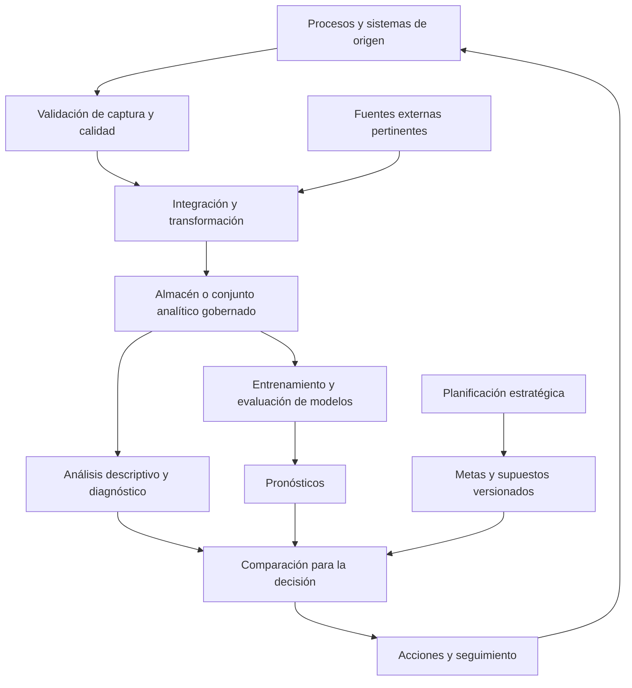

# Clase 4: Analítica predictiva e integración estratégica de resultados, metas y pronósticos

> **Objetivo académico:** Comprender las condiciones organizacionales y técnicas de la analítica predictiva, distinguir las principales familias de modelos y sus criterios de evaluación, e integrar resultados observados, metas estratégicas y pronósticos en sistemas de inteligencia de negocios orientados a decisiones.

## 1. Contexto y marco conceptual

### De la visualización a la confiabilidad de la decisión

La sesión sitúa la inteligencia de negocios, o BI, dentro de una transformación organizacional que involucra procesos, personas, cultura, arquitectura de datos y conocimiento del negocio. El tablero constituye una capa de consumo de información; su calidad visual no demuestra que los datos ni las conclusiones sean correctos.

El caso introductorio describe una implementación cuyo componente descriptivo representaba incorrectamente la operación y cuyo componente predictivo recomendaba adquisiciones de materia prima incompatibles con las necesidades y disponibilidades financieras de la organización. El fracaso se relacionó con un diagnóstico inicial insuficiente, la falta de participación de responsables del negocio y problemas en los sistemas de origen.

Entre estos problemas aparecen campos de clasificación capturados como texto libre, registros incompletos y operaciones relevantes que el sistema no obligaba a documentar. Estas condiciones generan heterogeneidad y ausencia de información antes de cualquier transformación analítica. Corregirlas exclusivamente mediante ETL puede producir soluciones frágiles que encubren defectos persistentes.

La secuencia conceptual es: comprender y mejorar los procesos, asegurar registros adecuados, integrar y transformar la información, modelarla y validar sus resultados antes de utilizarla para decidir. La retroalimentación desde el tablero hacia los orígenes resulta indispensable cuando se detectan inconsistencias.

### Cuatro propósitos analíticos

| Propósito | Pregunta principal | Ejemplo de la sesión | Alcance |
| --- | --- | --- | --- |
| Descriptivo | ¿Qué ocurrió? | Ventas, utilidad o rentabilidad registradas | Resume hechos observados |
| Diagnóstico | ¿Por qué ocurrió? | Menor utilidad pese a mayores ventas por incremento de costos o gastos | Investiga factores asociados y mecanismos del negocio |
| Predictivo | ¿Qué podría ocurrir? | Estimar un importe o una probabilidad a partir de datos disponibles | Produce estimaciones sujetas a incertidumbre |
| Prescriptivo | ¿Qué conviene hacer? | Evaluar una política de descuentos o revisar una meta | Relaciona alternativas con objetivos y restricciones |

**Enriquecimiento conceptual:** Un filtro de tablero puede localizar dónde se concentra una variación, pero no demuestra por sí mismo su causa. Del mismo modo, una predicción no constituye automáticamente una recomendación: decidir exige considerar costos, riesgos, recursos y consecuencias.

### Madurez organizacional y pertinencia del pronóstico

La necesidad de un modelo predictivo depende del problema y de la capacidad de convertir su salida en una acción útil. Se mencionan aplicaciones como abandono de clientes, mora y segmentación comercial; esta última puede corresponder a agrupamiento no supervisado, por lo que no debe confundirse con una predicción de una etiqueta conocida.

Disponer de un almacén de datos facilita el acceso a información histórica y coherente, pero no constituye una condición universal para desarrollar modelos. La condición fundamental es contar con datos pertinentes, comprensibles y suficientemente confiables. Cuando estos no están preparados, el esfuerzo incluye ingeniería de datos antes del modelado.

En organizaciones con recursos limitados puede resultar razonable comenzar con un alcance acotado y evolucionar progresivamente. En organizaciones de mayor tamaño o sometidas a regulación, aumentan las exigencias de trazabilidad, seguridad y gobierno. La elección debe considerar madurez, volumen, concurrencia, recursos y criticidad de las decisiones.

**Enriquecimiento conceptual:** El tamaño empresarial no determina por sí solo la utilidad del aprendizaje automático. Una organización pequeña puede beneficiarse de una aplicación sencilla si existe una decisión concreta, datos adecuados y una relación favorable entre beneficio y costo.

## 2. Fundamentos teóricos y arquitectura

### Arquitectura analítica y acceso a los datos

La sesión contrasta el consumo directo de tablas operacionales con el uso de estructuras analíticas, como almacenes de datos, datamarts y esquemas en estrella o copo de nieve. El propósito de estas estructuras es organizar medidas y dimensiones con significado estable, facilitar consultas y reducir la dependencia de interpretar repetidamente las tablas de origen.

Una tabla con cantidades monetarias o numéricas no se convierte automáticamente en una tabla de hechos. Para su uso analítico es necesario conocer qué representa cada fila, qué medidas contiene y cómo se relaciona con las dimensiones del negocio.

**Enriquecimiento conceptual:** El grano define el hecho representado por cada registro, por ejemplo, una línea de venta de un producto en una transacción. Sin un grano explícito pueden combinarse niveles incompatibles y duplicarse importes. Además, el modelado dimensional puede implementarse sobre un gestor relacional: no existe una oposición necesaria entre base relacional y esquema en estrella.

El acceso directo puede permitir un inicio rápido, pero también generar acoplamiento con la estructura operacional, carga sobre los sistemas de producción, dispersión de definiciones y exposición de información mediante archivos exportados. Una conexión ODBC no implica por sí misma capacidad de modificación: esa posibilidad depende de los permisos y la configuración.

**Enriquecimiento conceptual:** Tampoco es universal que consultar tablas operacionales produzca un mal rendimiento. Este depende del diseño físico, los índices, el motor, el volumen y la concurrencia. Separar cargas y establecer una capa semántica son decisiones que deben justificarse con esas condiciones.

El diagrama distingue dos procesos que convergen en la decisión: producir evidencia analítica y establecer objetivos organizacionales. Las metas se definen mediante planificación; el BI permite incorporarlas, compararlas y seguir su cumplimiento.

### Probabilidad, distribuciones e inferencia

La estadística se presenta como un medio para decidir bajo incertidumbre. El ejemplo del dado ilustra una probabilidad basada en casos equiprobables.

**Enriquecimiento conceptual:** Para un dado justo de seis caras, el espacio muestral es $\Omega=\{1,2,3,4,5,6\}$ y el evento de obtener un número par es $A=\{2,4,6\}$. Entonces:

$$
P(A)=\frac{|A|}{|\Omega|}=\frac{3}{6}=0.5.
$$

Aquí $P(A)$ es una probabilidad sin unidad y $|\cdot|$ indica el número de elementos de un conjunto finito. La razón entre casos favorables y posibles requiere equiprobabilidad; no se traslada directamente a clientes con comportamientos heterogéneos.

La sesión vincula la probabilidad con la estimación de compra a partir de apertura de correos y visitas web. Los porcentajes mencionados son ejemplos ilustrativos, no resultados de un modelo documentado.

Las distribuciones permiten caracterizar la variación de los datos. Se menciona la distribución normal junto con histogramas y análisis de frecuencias, pero su uso debe responder al comportamiento observado.

**Enriquecimiento conceptual:** No todos los datos siguen una distribución normal ni todos los modelos la requieren. Las variables pueden ser continuas, discretas, categóricas o mezclas de estas. La inferencia de una muestra a una población depende, además, del mecanismo de muestreo y de los supuestos del procedimiento; una muestra sesgada no se vuelve representativa por aplicar una prueba estadística.

### Regresión, clasificación y agrupamiento

| Familia | Salida principal | Ejemplo | Distinción esencial |
| --- | --- | --- | --- |
| Regresión | Valor numérico | Importe neto estimado | Busca aproximar una magnitud |
| Clasificación | Clase o probabilidad de clase | Venta alta o baja; control efectivo o inefectivo | Requiere una variable objetivo categórica |
| Agrupamiento | Asignación a grupos por similitud | Segmentos de clientes | No necesita etiquetas objetivo previas |

**Enriquecimiento conceptual:** Un umbral no define por sí solo toda clasificación. Puede emplearse para convertir probabilidades en decisiones binarias o para construir una etiqueta de negocio; también aparece en particiones de árboles de regresión. Conviene distinguir el umbral que define una clase, el que divide un nodo y el que transforma una probabilidad en una acción.

## 3. Implementación técnica y lógica de negocio

### Modelos revisados

#### Regresión lineal

La regresión lineal se presenta mediante cantidad e importe de venta, y se relaciona con otros ámbitos: capacitación y productividad, seguridad y telecomunicaciones. Su utilidad consiste en estimar una magnitud a partir de una relación ajustada sobre observaciones.

**Enriquecimiento conceptual:** En una regresión lineal simple:

$$
\widehat{y}=\widehat{\beta}_0+\widehat{\beta}_1x.
$$

Si $x$ es cantidad en unidades de producto y $\widehat{y}$ es el importe estimado en unidades monetarias, el intercepto $\widehat{\beta}_0$ tiene unidad monetaria y la pendiente $\widehat{\beta}_1$ tiene unidad monetaria por unidad de producto. Los parámetros se estiman con datos; la expresión supone que una aproximación lineal resulta adecuada en el dominio analizado. No demuestra causalidad ni garantiza validez fuera del rango observado.

La sesión conecta este modelo con investigaciones de alcance correlacional y distingue, según la terminología metodológica utilizada, alcances exploratorio, descriptivo, correlacional y explicativo. La correlación estudia asociación y la regresión modela una respuesta condicional; ninguna basta por sí sola para afirmar un mecanismo causal.

#### Árboles de decisión y CART

Los árboles dividen el espacio de variables mediante reglas sucesivas. En el ejemplo de cantidad e importe, una representación escalonada corresponde a un árbol de regresión: diferentes intervalos reciben predicciones numéricas. En una clasificación, las hojas representan clases o distribuciones de clases.

La transcripción alterna inicialmente ambas interpretaciones y posteriormente identifica el ejemplo de CART como regresión. La representación gráfica en escalones no lo convierte en clasificador; la distinción depende de la salida que se aprende.

#### Random Forest

Random Forest combina múltiples árboles. En clasificación agrega sus decisiones y en regresión combina sus estimaciones numéricas. La sesión destaca su carácter de ensamble y la dificultad de representar simultáneamente todos los árboles.

**Enriquecimiento conceptual:** La combinación de árboles construidos con aleatoriedad busca reducir la variabilidad respecto de un árbol individual. Aumentar su número puede estabilizar la predicción, pero no garantiza mejoras indefinidas ni resuelve datos sesgados o variables inadecuadas. La profundidad y otras restricciones de los árboles también afectan la generalización.

#### Regresión logística

La regresión logística se utiliza para estimar probabilidades de una clase. Debe precisarse el evento modelado: por ejemplo, compra frente a no compra, o venta alta frente a baja.

**Enriquecimiento conceptual:** Para clasificación binaria:

$$
P(Y=1\mid\mathbf{x})=\frac{1}{1+e^{-z}},\qquad z=\beta_0+\sum_{j=1}^{p}\beta_jx_j.
$$

La variable objetivo $Y\in\{0,1\}$ identifica las dos clases; $\mathbf{x}=(x_1,\ldots,x_p)$ contiene $p$ características disponibles al predecir, y $\beta_0,\ldots,\beta_p$ son parámetros estimados. El predictor $z$ es adimensional; cada coeficiente debe compensar la unidad de su característica. La salida es una probabilidad entre cero y uno, no un importe ni una cantidad.

Si la etiqueta es venta alta, la salida estima $P(\text{venta alta}\mid\mathbf{x})$. No puede interpretarse sin más como probabilidad de vender exactamente una cantidad introducida. Un valor cercano a uno tampoco constituye certeza sobre el futuro.

#### Redes neuronales

El ejemplo expuesto utiliza una red para clasificación y representa una probabilidad asociada a la venta. Se destaca que su uso requiere definir el objetivo y los criterios de decisión.

**Enriquecimiento conceptual:** Las redes neuronales también pueden utilizarse para regresión. El tipo de salida y la función de entrenamiento deben corresponder al problema. Una mayor complejidad no asegura superioridad frente a modelos sencillos y puede aumentar las necesidades de datos y evaluación.

#### K-means

K-means agrupa observaciones alrededor de centroides. En la sesión se ilustra mediante segmentos de compradores pequeños, medianos y grandes.

**Enriquecimiento conceptual:** Esas denominaciones son interpretaciones posteriores de los grupos. K-means no recibe necesariamente límites comerciales predefinidos: ajusta centroides para reducir distancias dentro de los grupos. El número de grupos, la escala de las variables, la inicialización y la geometría de los datos afectan el resultado. Sus agrupaciones no prueban que existan categorías naturales del mercado.

#### KNN

KNN se aborda como un método que puede emplearse en clasificación o regresión.

**Enriquecimiento conceptual:** Su nombre es *k-nearest neighbors*, o $k$ vecinos más cercanos. El entero positivo $k$ indica cuántas observaciones vecinas se consideran. Para clasificar se agregan sus etiquetas; para regresión se agregan sus valores numéricos, por ejemplo mediante un promedio. La distancia y el escalado de características son decisiones centrales. Su mecanismo no requiere siempre un umbral binario explícito.

### Integración de Python en Power BI

La demostración emplea un objeto visual de Python para obtener datos del modelo de Power BI, ajustar un algoritmo y representar sus resultados. Se utilizan cantidad e importe neto de una tabla de hechos de ventas. También se menciona la posibilidad de calcular otras medidas, como margen y rentabilidad.

El flujo descrito comprende configurar el entorno de Python, importar bibliotecas, seleccionar variables, crear o entrenar el modelo, producir estimaciones y dibujarlas. No se proporcionan fragmentos de código completos y verificables; por ello no se reconstruyen importaciones, parámetros ni implementaciones exactas.

Una segunda visualización incorpora un segmentador o *slicer* para variar la cantidad y observar el importe estimado. Esta interacción permite explorar escenarios, siempre que el significado del parámetro y sus límites sean conocidos.

**Enriquecimiento conceptual:** Mover un control no equivale a probar una intervención causal. El modelo puede estimar asociaciones históricas que no se mantengan si cambian precios, demanda o capacidad. Además, si cantidad e importe pertenecen a la misma transacción ya realizada, debe comprobarse que la cantidad estará disponible en el momento de la predicción. Sin esa definición temporal, el resultado puede ser una estimación condicional y no un pronóstico futuro.

La demostración presentó demoras de actualización y problemas visuales. El traslado a un servidor puede mejorar recursos, pero no garantiza por sí mismo baja latencia.

**Enriquecimiento conceptual:** En un despliegue operativo conviene separar entrenamiento e inferencia cuando corresponda, controlar versiones del modelo y verificar las condiciones del entorno de publicación. Rendimiento, permisos y disponibilidad deben evaluarse sobre la arquitectura efectiva.

### Simulación Monte Carlo

Se introduce Monte Carlo como herramienta para analizar incertidumbre en modelos financieros y de riesgo. Se mencionan Crystal Ball, su integración con Excel y posibles implementaciones mediante Python. El procedimiento consiste en variar entradas según distribuciones especificadas y observar sus efectos sobre una salida, repitiendo el cálculo numerosas veces.

**Enriquecimiento conceptual:** Si $Y=f(\mathbf{X})$, donde $Y$ es una salida como utilidad monetaria y $\mathbf{X}$ reúne entradas inciertas, la probabilidad de alcanzar un objetivo $a$ puede aproximarse por:

$$
\widehat{P}(Y\geq a)=\frac{1}{N}\sum_{i=1}^{N}\mathbf{1}\{f(\mathbf{X}^{(i)})\geq a\}.
$$

Aquí $N$ es un entero positivo que representa el número de simulaciones; $\mathbf{X}^{(i)}$ es la entrada simulada en la repetición $i$; $a$ tiene la misma unidad que $Y$, y el indicador vale uno cuando se alcanza el objetivo y cero en caso contrario. La estimación depende de las distribuciones y relaciones entre entradas. Aumentar $N$ reduce variación numérica, pero no corrige supuestos equivocados. Las entradas no tienen que ser estadísticamente independientes y la probabilidad obtenida es condicional al modelo utilizado.

## 4. Análisis crítico de casos y auditoría práctica

### Evaluación y generalización

La sesión enfatiza que entrenar un algoritmo no basta: debe evaluarse su comportamiento sobre datos que no haya utilizado para ajustarse. Se discuten una separación 80/20 y otra de 60 % / 20 % / 20 %. Son ejemplos de reparto, no reglas universales.

| Conjunto | Función |
| --- | --- |
| Entrenamiento | Ajustar los parámetros del modelo |
| Validación | Comparar alternativas y seleccionar configuraciones |
| Prueba | Estimar el desempeño final con datos reservados |

**Enriquecimiento conceptual:** Una partición fija, o *holdout*, no equivale a validación cruzada. Esta última repite ajustes y evaluaciones sobre distintas particiones del conjunto de desarrollo. En problemas temporales debe respetarse el orden de disponibilidad de la información; cuando existen múltiples registros de una misma entidad, también debe analizarse si separarlos entre conjuntos introduce dependencia o fuga de información.

El sobreajuste ocurre cuando un modelo captura particularidades del entrenamiento que no se sostienen fuera de él. Los árboles muy profundos pueden ser sensibles a este problema. Un ensamble puede reducir parte de esa variabilidad, pero su ventaja debe comprobarse mediante comparación bajo condiciones equivalentes.

### Métricas según el objetivo

Se mencionan precisión, recall, F1, AUC de la curva ROC y error cuadrático. Deben asociarse al tipo de problema.

**Enriquecimiento conceptual:** En clasificación binaria, una vez definida la clase positiva, $TP$, $FP$, $FN$ y $TN$ son los conteos de verdaderos positivos, falsos positivos, falsos negativos y verdaderos negativos. Entonces:

$$
\mathrm{Precisión}=\frac{TP}{TP+FP},\qquad
\mathrm{Recall}=\frac{TP}{TP+FN},\qquad
F_1=\frac{2TP}{2TP+FP+FN}.
$$

Estas métricas son adimensionales y requieren denominadores no nulos o una convención explícita para casos degenerados. La precisión indica qué proporción de positivos predichos es correcta; recall indica qué proporción de positivos reales se recupera; F1 combina ambas dimensiones. La exactitud global, que incluye positivos y negativos correctos, es una medida diferente. ROC-AUC evalúa discriminación al variar el umbral y no demuestra calibración de probabilidades.

Para regresión, el error cuadrático medio es:

$$
\mathrm{MSE}=\frac{1}{n}\sum_{i=1}^{n}(y_i-\widehat{y}_i)^2.
$$

Aquí $n$ es el número positivo de observaciones evaluadas, $y_i$ el valor observado y $\widehat{y}_i$ su predicción. Si la respuesta se mide en moneda, MSE se expresa en moneda al cuadrado. Su raíz devuelve la unidad original. Esta métrica penaliza fuertemente errores grandes; no sustituye la evaluación del costo económico de esos errores.

### Caso de controles de seguridad en Weka

La demostración de Weka utiliza un archivo ARFF con 28 registros y atributos relacionados con implementación, cumplimiento, madurez, riesgo y efectividad del control. La información se presenta como ilustrativa y con posibles incoherencias semánticas; no constituye evidencia de una auditoría real.

La variable objetivo seleccionada inicialmente es la efectividad del control. Con J48 se obtiene un árbol sencillo que asocia riesgo alto o medio con control inefectivo y riesgo bajo con control efectivo. Después se cambia la variable objetivo a madurez, produciendo reglas que combinan cumplimiento, implementación y riesgo.

**Enriquecimiento conceptual:** J48 es la implementación de C4.5 disponible en Weka; no debe confundirse con CART. Elegir el atributo de clase determina qué variable se predice. Los atributos restantes actúan como posibles predictores, siempre que estén disponibles en el momento adecuado.

El cambio de objetivo demuestra que un mismo conjunto permite formular problemas diferentes, pero obliga a revisar el significado y la disponibilidad de cada variable. Si madurez está codificada mediante categorías nominales, predecirla con un clasificador no equivale necesariamente a modelar una escala ordinal.

La sesión describe una matriz sin falsos positivos ni falsos negativos en el ejemplo. No queda documentado con suficiente precisión el protocolo que produjo ese resultado.

**Enriquecimiento conceptual:** Un desempeño aparentemente perfecto sobre 28 registros no acredita generalización. Puede reflejar evaluación sobre entrenamiento, reglas artificiales, redundancia entre atributos o fuga de información. Si el nivel de riesgo se calculó utilizando la misma evaluación que determina la efectividad, predecir esta última desde el riesgo puede limitarse a reproducir una regla ya incorporada en las etiquetas.

También debe distinguirse entre riesgo inherente y residual. Un control efectivo puede coexistir con riesgo residual alto si el riesgo inicial era muy elevado. Por tanto, riesgo alto no demuestra automáticamente inefectividad. Asimismo, el número admisible de intentos fallidos de acceso depende de la política y del contexto; el valor mencionado en el ejemplo no debe convertirse en regla universal.

### Alcance del prototipo y de los datos sintéticos

Weka permite ilustrar carga de datos, preprocesamiento, selección del objetivo, entrenamiento y lectura de resultados. La sesión reconoce su utilidad como entorno de prototipado y menciona el acceso a algoritmos mediante Java.

**Enriquecimiento conceptual:** Las afirmaciones absolutas sobre su imposibilidad de uso empresarial exceden la evidencia presentada. La elección entre Weka, Python u otras herramientas requiere evaluar volumen, integración, mantenimiento, despliegue y capacidades del equipo. Del mismo modo, los datos sintéticos pueden comprobar estructura y funcionamiento de un prototipo, pero no demostrar desempeño sobre una población real.

## 5. Principios de diseño, buenas prácticas y anti-patrones

### Principios transversales

- **Calidad desde el origen:** establecer validaciones de captura y reglas de negocio antes de depender de correcciones posteriores.
- **Participación del dominio:** involucrar a responsables de operaciones, finanzas y otras áreas para validar significados y resultados.
- **Definición temporal del problema:** precisar qué se conoce al predecir y qué horizonte se pretende anticipar.
- **Evaluación adecuada:** seleccionar métricas y particiones según la decisión, la estructura de los datos y el costo del error.
- **Seguridad integral:** aplicar permisos, controles de exportación y trazabilidad. Una herramienta de visualización no garantiza seguridad por su sola presencia.
- **Parámetros gobernados:** documentar umbrales, supuestos y responsables de cambios; evitar valores incrustados sin contexto.

Los principales anti-patrones son presentar estética como evidencia de calidad, usar ETL para ocultar fallas sistemáticas, entrenar sin evaluación independiente, atribuir certeza a probabilidades elevadas y mover parámetros sin una pregunta de negocio.

### La meta como producto de la planificación

El núcleo estratégico de la sesión distingue resultado observado, meta y pronóstico. Una rentabilidad observada de 10%, una meta de 15% y una predicción de 18% representan objetos diferentes, aunque compartan la misma unidad.

| Elemento | Origen | Función |
| --- | --- | --- |
| Resultado observado | Registros y reglas de cálculo | Establecer la situación efectiva |
| Meta | Planificación y acuerdos organizacionales | Expresar un objetivo deseado |
| Pronóstico | Modelo, datos y supuestos | Estimar un resultado posible |

La planificación combina historia interna, presupuestos financieros, comerciales y operativos, inteligencia competitiva, vigilancia tecnológica e investigación de mercado. Se mencionan las cinco fuerzas de Porter, PESTEL y VUCA como referencias para comprender competencia y entorno. El BI no sustituye ese proceso: puede almacenar sus resultados y compararlos con la operación.

**Enriquecimiento conceptual:** PESTEL organiza factores políticos, económicos, sociales, tecnológicos, ambientales y legales; VUCA describe volatilidad, incertidumbre, complejidad y ambigüedad. Estas perspectivas ayudan a seleccionar supuestos y escenarios, pero no producen automáticamente una meta numérica ni una predicción.

La estrategia puede revisarse ante cambios externos, como variaciones cambiarias. Para que la revisión sea interpretable, conviene preservar qué meta estaba vigente, bajo qué supuestos y para qué periodo.

### Incorporación de metas y maestro de precios y costos

La sesión presenta tres niveles de incorporación al BI: un parámetro puntual, una tabla maestra de metas y una estructura más desagregada denominada **MPC, maestro de precios y costos**. Este último se plantea como una propuesta para reunir precios, costos y cantidades de referencia y permitir comparaciones más detalladas.

El MPC debe entenderse en el sentido específico expuesto, sin asumir que constituye un estándar universal. Su finalidad es apoyar análisis por producto, cliente, marca o agregado, e incluso valorar una operación antes de ejecutarla.

**Enriquecimiento conceptual:** Una tabla de metas requiere un grano compatible con la comparación. No corresponde contrastar directamente una meta anual global con una venta individual sin una regla de distribución. Además, las rentabilidades agregadas deben calcularse a partir de sus componentes monetarios; promediar porcentajes sin ponderación puede distorsionar el resultado.

La sesión advierte sobre costos unitarios poco confiables y dificultades en su mantenimiento. El promedio ponderado no es por sí mismo un defecto: su confiabilidad depende de registros correctos, valorización y políticas consistentes. Las estimaciones en línea deben distinguir costos conocidos, provisionales y posteriormente ajustables.

## 6. Síntesis conceptual y profundización académica

### Lectura integrada de rentabilidad y brechas

La rentabilidad positiva no basta para concluir que una organización tiene un desempeño satisfactorio. Debe compararse con sus objetivos y con una definición precisa del indicador. Rentabilidad sobre ventas, activos y patrimonio utilizan bases distintas y no son intercambiables.

**Enriquecimiento conceptual:** Una definición simplificada del margen neto sobre ventas es:

$$
r=\frac{U}{V},\qquad U=V-C-G.
$$

Aquí $V>0$ son ingresos por ventas, $C$ costos y $G$ gastos del mismo periodo y perímetro, todos en una moneda común; $U$ es la utilidad bajo esa simplificación y $r$ es una razón adimensional. Su expresión porcentual es $100r\%$. El modelo requiere explicitar el tratamiento de impuestos, resultados financieros y otros componentes, que no se detallan en la sesión.

Con los valores ilustrativos de la clase, si $r_{obs}=0.10$, $r_{meta}=0.15$ y $r_{pred}=0.18$, las brechas orientadas como valor menos meta son:

$$
r_{obs}-r_{meta}=-0.05,\qquad r_{pred}-r_{meta}=0.03.
$$

Los subíndices identifican resultado observado, meta y pronóstico. La primera diferencia equivale a menos cinco puntos porcentuales y la segunda a más tres puntos porcentuales. No son variaciones relativas de 5% y 3%. Estas comparaciones solo resultan válidas si coinciden definición, ámbito y periodo; si el observado corresponde a un periodo parcial y la meta al cierre, deben presentarse explícitamente como magnitudes de horizontes diferentes.

### Ejemplo de apoyo a una política de descuentos

La propuesta del MPC busca reconocer cuándo una operación conserva rentabilidad y hasta dónde puede modificarse su precio.

**Enriquecimiento conceptual:** Bajo un modelo unitario simplificado, con precio neto $p>0$ y costo total unitario asignado $c\geq0$, ambos en moneda por unidad, el margen sobre venta es:

$$
m=\frac{p-c}{p}=1-\frac{c}{p}.
$$

Para una meta de margen $m^*\in[0,1)$, la condición $m\geq m^*$ implica:

$$
1-\frac{c}{p}\geq m^*
\quad\Longrightarrow\quad
p\geq\frac{c}{1-m^*}.
$$

Si $c=80$ unidades monetarias por producto y $m^*=0.20$, el precio mínimo bajo esos supuestos es $100$ unidades monetarias por producto. Es un ejemplo añadido, no un resultado de la demostración. La expresión supone costos estables y una asignación aceptada; no incorpora cambios de demanda, capacidad, financiación o riesgo. Además, margen sobre venta y recargo sobre costo utilizan denominadores diferentes.

### Decidir cuando el pronóstico supera la meta

Si la meta es 15% y el modelo estima 18%, la decisión no consiste en adoptar automáticamente el valor mayor. La sesión plantea revisar consistencia, posibilidad de logro y acuerdo entre responsables gerenciales y directorio.

**Enriquecimiento conceptual:** Debe analizarse si el pronóstico y la meta suponen las mismas acciones. Un escenario condicionado a aumentar precios o capacidad no demuestra que esa rentabilidad aparecerá sin intervenir. También conviene considerar incertidumbre y riesgo: una estimación puntual favorable puede ocultar escenarios de pérdidas o restricciones operativas.

La integración madura conserva tres perspectivas: los hechos muestran la situación, la planificación establece la dirección y los modelos estiman posibles evoluciones. Su articulación permite evaluar brechas y alternativas, siempre que las definiciones sean compatibles y la evidencia sea confiable. Las líneas de profundización que se desprenden de la sesión son la calibración de probabilidades, la evaluación temporal, la trazabilidad de metas y la articulación entre costos unitarios, escenarios y decisiones.
